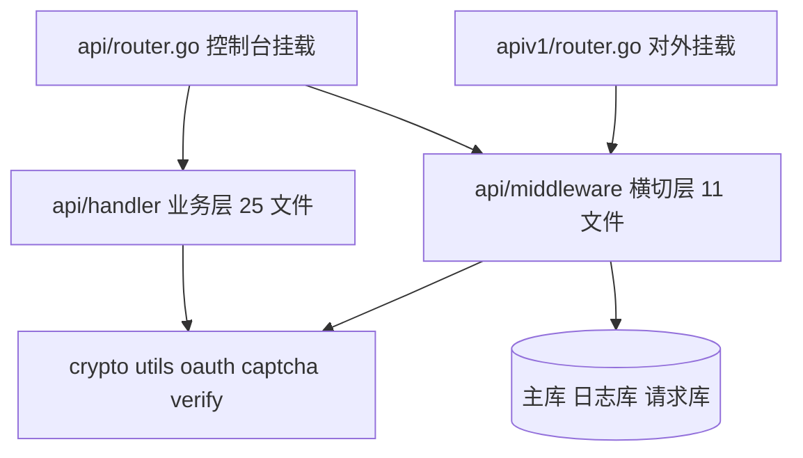
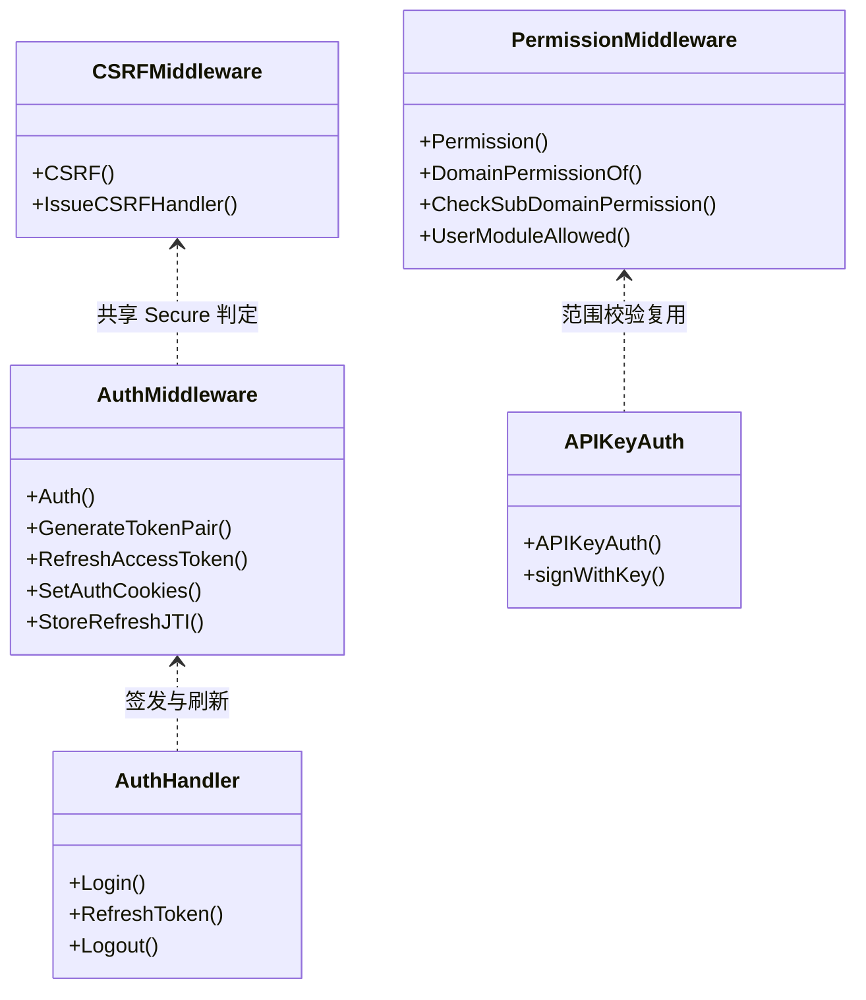
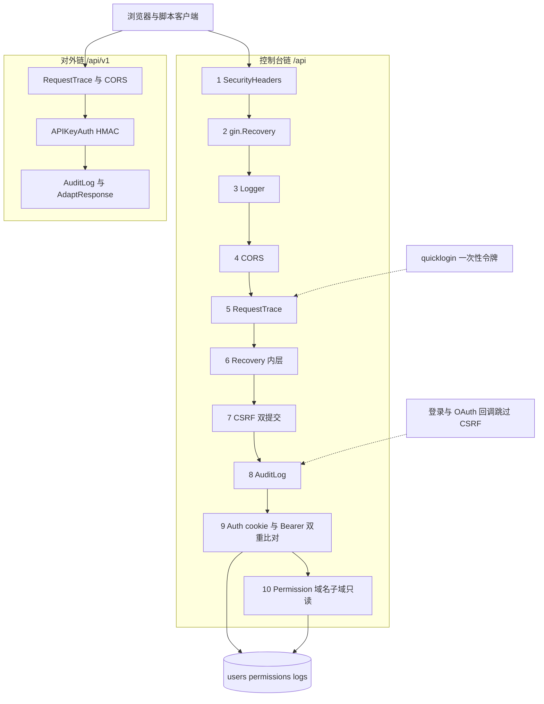
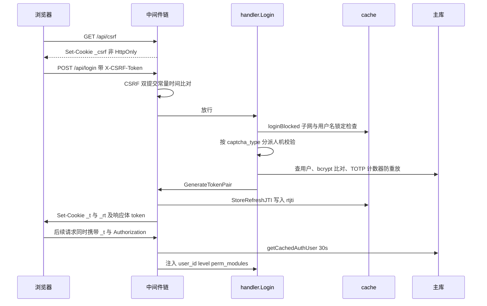
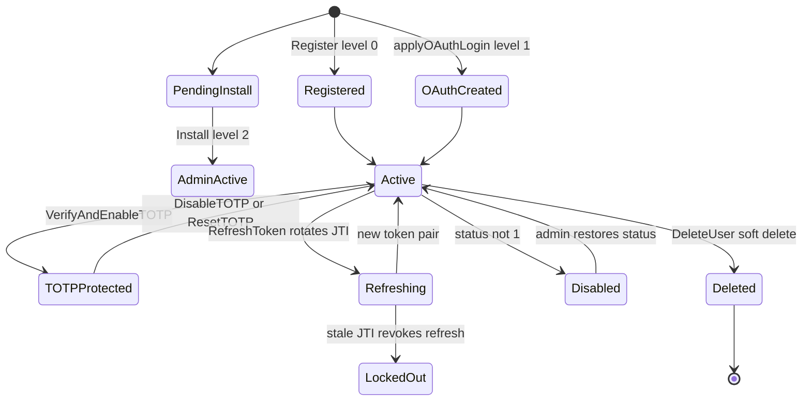
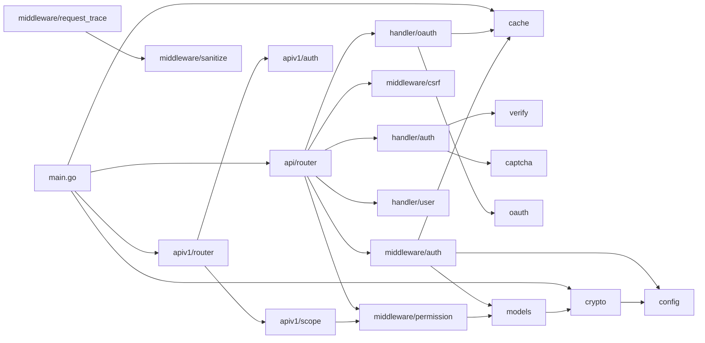
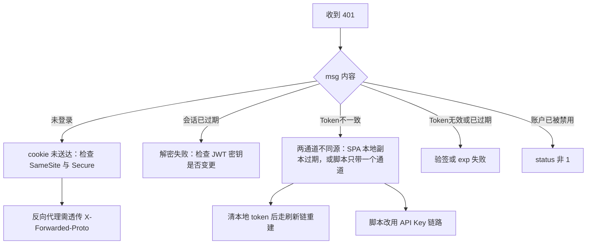

# 用户权限系统

<cite>
**本文档引用的文件**
- [router.go](file://main/internal/api/router.go)
- [middleware/auth.go](file://main/internal/api/middleware/auth.go)
- [middleware/permission.go](file://main/internal/api/middleware/permission.go)
- [middleware/csrf.go](file://main/internal/api/middleware/csrf.go)
- [middleware/audit.go](file://main/internal/api/middleware/audit.go)
- [middleware/logger.go](file://main/internal/api/middleware/logger.go)
- [middleware/recovery.go](file://main/internal/api/middleware/recovery.go)
- [middleware/request_trace.go](file://main/internal/api/middleware/request_trace.go)
- [middleware/sanitize.go](file://main/internal/api/middleware/sanitize.go)
- [middleware/sign.go](file://main/internal/api/middleware/sign.go)
- [middleware/apikey.go](file://main/internal/api/middleware/apikey.go)
- [handler/auth.go](file://main/internal/api/handler/auth.go)
- [handler/user.go](file://main/internal/api/handler/user.go)
- [handler/oauth.go](file://main/internal/api/handler/oauth.go)
- [handler/captcha.go](file://main/internal/api/handler/captcha.go)
- [handler/behavioral_captcha.go](file://main/internal/api/handler/behavioral_captcha.go)
- [handler/quicklogin.go](file://main/internal/api/handler/quicklogin.go)
- [handler/account.go](file://main/internal/api/handler/account.go)
- [handler/quota.go](file://main/internal/api/handler/quota.go)
- [handler/auth_control.go](file://main/internal/api/handler/auth_control.go)
- [apiv1/auth.go](file://main/internal/apiv1/auth.go)
- [apiv1/scope.go](file://main/internal/apiv1/scope.go)
- [apiv1/errors.go](file://main/internal/apiv1/errors.go)
- [apiv1/router.go](file://main/internal/apiv1/router.go)
- [captcha/captcha.go](file://main/internal/captcha/captcha.go)
- [verify/code.go](file://main/internal/verify/code.go)
- [crypto/crypto.go](file://main/internal/crypto/crypto.go)
- [crypto/migrate.go](file://main/internal/crypto/migrate.go)
- [models/models.go](file://main/internal/models/models.go)
- [models/hooks.go](file://main/internal/models/hooks.go)
- [oauth/oauth.go](file://main/internal/oauth/oauth.go)
- [utils/totp.go](file://main/internal/utils/totp.go)
- [config/config.go](file://main/internal/config/config.go)
- [sysconfig/sysconfig.go](file://main/internal/sysconfig/sysconfig.go)
- [web/lib/api.ts](file://web/lib/api.ts)
- [web/app/(dashboard)/layout.tsx](file://web/app/(dashboard)/layout.tsx)
</cite>

## 目录

1. [简介](#简介)
2. [项目结构](#项目结构)
3. [核心组件](#核心组件)
4. [架构总览](#架构总览)
5. [详细组件分析](#详细组件分析)
6. [依赖关系分析](#依赖关系分析)
7. [性能考虑](#性能考虑)
8. [故障排查指南](#故障排查指南)
9. [结论](#结论)
10. [附录](#附录)

## 简介

用户权限系统是 dnsplane 的控制面准入层，把「谁、用什么凭据、能操作哪些资源、能做哪些动作」收口在同一套链路上。控制台是长驻浏览器会话的 Web 应用，对外 API 是无浏览器上下文的机器对机器通道，两者的凭据形态、重放风险与吊销语义完全不同，因此系统在同一条链上承载两条互不相交的鉴权通路。

### 目标与落地手段

| 目标 | 落地手段 | 证据位置 |
| --- | --- | --- |
| 多认证方式并存 | 口令 / TOTP / 魔法链接 / OAuth / API Key 五条入口共用会话层 | `handler/auth.go:239`、`quicklogin.go:124`、`oauth.go:71`、`apiv1/auth.go:44` |
| 角色与功能权限分离 | `level` 决定管理员直通，`permissions` JSON 决定模块可见性 | `models/models.go:17`、`:19`、`permission.go:383` |
| 资源所有者隔离 | 域名归属 + 委派授权 + 子域覆盖 + 只读位四维判定 | `permission.go:132`、`:304` |
| 凭据不落地明文 | 会话 Cookie AES-GCM 封装、字段级 `enc:v1:` 加密 | `middleware/auth.go:45`、`crypto/crypto.go:17` |
| 全链路可追溯 | 请求追踪 + 审计日志 + 分级文件日志 | `request_trace.go:135`、`audit.go:21`、`logger.go:170` |

**章节来源**
- [handler/auth.go:239-406](file://main/internal/api/handler/auth.go#L239-L406)
- [middleware/permission.go:132-207](file://main/internal/api/middleware/permission.go#L132-L207)

### 核心价值与阅读路径

权限判定收敛在「一个中间件 + 三个可复用函数」的极小面积上：`Permission()` 处理绝大多数请求，`DomainPermissionOf`、`CheckDomainPermission`、`CheckSubDomainPermission` 供 handler 与对外 API 直调（`permission.go:330`、`:335`、`:344`）。对外 V1 另建一层可枚举的范围声明，把控制台散落在 handler 内部的三类校验整理为「模块 / 域名 / 子域 / 只读」四个正交维度，动机是避免新增接口漏掉某一维度（`apiv1/scope.go:11-26`）。接入方式看核心组件与依赖关系分析，实现细节看详细组件分析，线上误拒看故障排查指南；同域《安全防护》一文聚焦攻击面，本文聚焦机制本身。

**章节来源**
- [middleware/permission.go:304-383](file://main/internal/api/middleware/permission.go#L304-L383)
- [apiv1/scope.go:11-60](file://main/internal/apiv1/scope.go#L11-L60)

## 项目结构

权限域代码集中在后端 `internal/api/middleware`（横切能力）与 `internal/api/handler`（业务入口），对外 API 独立在 `internal/apiv1`，凭据与算法下沉到 `internal/crypto`、`internal/utils`、`internal/oauth`、`internal/captcha`、`internal/verify`。

**图表来源**
- [router.go:24-104](file://main/internal/api/router.go#L24-L104)
- [apiv1/router.go:24-40](file://main/internal/apiv1/router.go#L24-L40)

### 结构表

| 目录 | 文件数 | 代表文件与行数 | 职责 |
| --- | ---: | --- | --- |
| `internal/api/middleware` | 11（10 非测试 + 1 bench） | `auth.go`:572 / `permission.go`:400 / `request_trace.go`:372 | 认证、授权、CSRF、审计、追踪、恢复、日志、签名 |
| `internal/api/handler` | 25 | `auth.go`:1573 / `user.go`:743 / `oauth.go`:565 | 登录注册、用户管理、OAuth、验证码、配额 |
| `internal/apiv1` | 若干 | `auth.go`:165 / `scope.go`:132 / `errors.go`:136 | API Key 签名、范围声明、错误码 |
| `internal/captcha`、`internal/verify` | 各 1 | `captcha.go`:391 / `code.go`:130 | go-captcha 三型生成校验；邮箱验证码与双维限流 |
| `internal/crypto` | 2 | `crypto.go`:101 / `migrate.go`:72 | 字段级 AES-GCM 与存量明文迁移 |
| `internal/oauth` | 6 | `oauth.go`:201 + 5 家 Provider | 授权码换令牌与用户信息拉取 |
| `internal/utils` | 若干 | `totp.go`:157 | TOTP 生成校验、恢复码工具 |
| `web` 前端 | 若干 | `lib/api.ts`:1743 / `app/(auth)` 9 页 | 凭据存取、CSRF 引导、导航级模块隐藏 |

**章节来源**
- [middleware/auth.go:1-572](file://main/internal/api/middleware/auth.go#L1-L572)
- [handler/auth.go:1-1573](file://main/internal/api/handler/auth.go#L1-L1573)

### 技术栈矩阵

| 层次 | 选型 | 版本口径 | 权限域用途 |
| --- | --- | --- | --- |
| HTTP 框架 | Gin | v1.12.0 | 中间件链与路由分组继承 |
| ORM | GORM | v1.31.2 | `BeforeSave` / `AfterFind` 加密钩子 |
| 令牌与口令哈希 | golang-jwt HS256 + bcrypt | cost 12（`handler/auth.go:36`） | 双令牌签发解析；注册、改密、重置、管理员建号 |
| 对称加密与消息认证 | AES-256-GCM、HMAC-SHA256 | 标准库 | 会话 Cookie 封装、字段级加密、V1 请求签名 |
| 缓存 | Redis 或进程内 | `cache.C` 抽象 | 频控、JTI、验证码、state、用户缓存 |
| 前端 | Next.js / React | 16.2.4 / 19.2.4 | 认证页面与请求客户端 |

**章节来源**
- [config/config.go:14-132](file://main/internal/config/config.go#L14-L132)
- [models/hooks.go:9-70](file://main/internal/models/hooks.go#L9-L70)

## 核心组件

### 中间件链与组件清单

控制台链的实际 `.Use` 顺序如下，顺序本身是安全设计的一部分。

| # | 中间件 | 挂载点 | 成功输出 | 失败响应 |
| --- | --- | --- | --- | --- |
| 1 | `SecurityHeaders`（`middleware/auth.go:483`） | `router.go:28` | 六项安全头 + HTTPS 时 HSTS | 不会失败 |
| 2、3 | `gin.Recovery`、`Logger`（`logger.go:170`） | `router.go:29`、`:30` | 控制台彩色行；5xx→`FileError`（`:231`）、≥3s→`SLOW`（`:240`） | panic → 500；不拦 |
| 4 | `CORS`（`middleware/auth.go:516`） | `router.go:45` | 命中白名单才回显 Origin + `ACAC: true` | 不回显 Origin |
| 5 | `RequestTrace`（`request_trace.go:135`） | `router.go:47` | `X-Request-ID`；`c.Next()` 后异步落库 | 不拦；非 `/api` 直通（`:138`） |
| 6 | `Recovery` 内层（`recovery.go:21`） | `router.go:48` | `X-Error-ID` | 未写出时 `500 {code:-1}` |
| 7 | `CSRF`（`csrf.go:70`） | `router.go:50` | 安全方法补发 cookie | `403 {code:403}`（`:106`、`:110`） |
| 8 | `AuditLog`（`audit.go:21`） | `router.go:52` | `SafeGo` 异步写 `logs`（`:74`） | 不拦；`user_id` 空则不记（`:45`） |
| 9 | `Auth`（`middleware/auth.go:125`） | `router.go:96` | 注入 `user_id`/`level`/`perm_modules*` | `401`，7 种原因 |
| 10 | `Permission`（`permission.go:132`） | `router.go:104` | 注入 `perm_read_only` 等三键 | `200 {code:-1}`，4 种原因 |

内层 `Recovery` 必须紧跟 `RequestTrace`，否则 panic 穿透会让 `c.Next()` 之后的落库代码不执行，请求日志完全丢失（`router.go:34-43` 注释）。对外 V1 组挂在引擎根，仅复用追踪、恢复、CORS、审计四层，认证改为 `apiv1.APIKeyAuth`（`apiv1/auth.go:44`），并显式不挂 CSRF（`apiv1/router.go:11-15` 注释）。

**章节来源**
- [router.go:28-104](file://main/internal/api/router.go#L28-L104)
- [middleware/csrf.go:70-120](file://main/internal/api/middleware/csrf.go#L70-L120)
- [apiv1/auth.go:44-141](file://main/internal/apiv1/auth.go#L44-L141)
- [middleware/apikey.go:22-50](file://main/internal/api/middleware/apikey.go#L22-L50)

### 组件关系

**图表来源**
- [middleware/auth.go:125-473](file://main/internal/api/middleware/auth.go#L125-L473)
- [middleware/permission.go:132-383](file://main/internal/api/middleware/permission.go#L132-L383)
- [apiv1/auth.go:44-118](file://main/internal/apiv1/auth.go#L44-L118)

**章节来源**
- [middleware/auth.go:125-473](file://main/internal/api/middleware/auth.go#L125-L473)
- [handler/oauth.go:396-420](file://main/internal/api/handler/oauth.go#L396-L420)

### 凭据形态

| 认证方式 | 入口 | 令牌载体 | 生命周期 | 吊销手段 |
| --- | --- | --- | --- | --- |
| 用户名 + 口令 | `handler/auth.go:239` | `_t`（HttpOnly，path `/`）+ `_rt`（path `/api/auth/refresh`）+ 响应体明文 | access 15m、refresh 7d（`middleware/auth.go:91`、`:92`） | `ClearAuthCookies:314`；JTI 一次性（`:353`） |
| TOTP | `handler/auth.go:342-364` | 不签发，仅作第二因子 | 30s 窗口 ±1 格（`utils/totp.go:70`） | 关闭时清空 `totp_secret`（`DisableTOTP:688`） |
| 邮箱魔法链接 | `RequestMagicLink:1216` → `QuickLogin:124` | 一次性 token 存 `ql:` 前缀 | magic 15m、quicklogin 5m，命中即删（`quicklogin.go:144`） | 单次消费 + TTL |
| OAuth | `OAuthLogin:71` → `OAuthExchange:216` | state 存 `oauth_state:`；响应体不含令牌（`oauth.go:209-215` 注释） | state 5m 一次性 | `consumeOAuthState:52` 读取即删 |
| API Key | `apiv1.APIKeyAuth:44` | 无 JWT，注入 `user_id`/`level`/`auth_type` | 无过期，轮转为止（`ResetAPIKey:369`） | 关闭 `is_api` 即清空 key（`user.go:215-217`） |

**章节来源**
- [middleware/auth.go:229-320](file://main/internal/api/middleware/auth.go#L229-L320)
- [handler/quicklogin.go:22-175](file://main/internal/api/handler/quicklogin.go#L22-L175)
- [handler/oauth.go:28-215](file://main/internal/api/handler/oauth.go#L28-L215)

## 架构总览

### 认证全景

**图表来源**
- [router.go:28-104](file://main/internal/api/router.go#L28-L104)
- [apiv1/router.go:24-40](file://main/internal/apiv1/router.go#L24-L40)
- [middleware/csrf.go:30-53](file://main/internal/api/middleware/csrf.go#L30-L53)
- [handler/quicklogin.go:124-204](file://main/internal/api/handler/quicklogin.go#L124-L204)

**章节来源**
- [router.go:28-104](file://main/internal/api/router.go#L28-L104)
- [apiv1/router.go:11-46](file://main/internal/apiv1/router.go#L11-L46)

### 一次登录

**图表来源**
- [handler/auth.go:239-406](file://main/internal/api/handler/auth.go#L239-L406)
- [middleware/csrf.go:70-120](file://main/internal/api/middleware/csrf.go#L70-L120)
- [middleware/auth.go:125-335](file://main/internal/api/middleware/auth.go#L125-L335)

**章节来源**
- [handler/auth.go:262-364](file://main/internal/api/handler/auth.go#L262-L364)
- [middleware/auth.go:125-200](file://main/internal/api/middleware/auth.go#L125-L200)

### 分层职责

| 层 | 职责边界 | 不做的事 |
| --- | --- | --- |
| 横切层 | 身份确认、资源范围裁剪、请求可追溯 | 不含业务语义判断 |
| 认证 handler | 凭据兑换为会话、账号生命周期写入 | 不把 `level` 当作资源权限替代品 |
| 业务 handler | 配额、字段校验、上游调用 | 不重复实现域名归属判定 |
| 基础设施 | 加解密、验证码、限流、Provider 适配 | 不感知 HTTP 上下文 |

链外路由只经过前三层（`SecurityHeaders`、`gin.Recovery`、`Logger`）：`GET /optimizeip/status`（`router.go:341`）与 `POST /qqbot/webhook`（`:342`）各自在 handler 内部完成校验；`GET /`（`:407`）与 `NoRoute`（`:411`）为静态与回落。

**章节来源**
- [router.go:28-63](file://main/internal/api/router.go#L28-L63)
- [router.go:337-411](file://main/internal/api/router.go#L337-L411)
- [handler/account.go:24-67](file://main/internal/api/handler/account.go#L24-L67)

## 详细组件分析

### 用户生命周期

用户从安装、注册、登录到注销、找回、删除共十余类动作，全部由 `router.go` 显式注册，无隐式路由。

**图表来源**
- [handler/auth.go:526-575](file://main/internal/api/handler/auth.go#L526-L575)
- [handler/oauth.go:279-346](file://main/internal/api/handler/oauth.go#L279-L346)
- [handler/user.go:228-267](file://main/internal/api/handler/user.go#L228-L267)

| 动作 | 路由与行号 | handler | 关键写入与副作用 |
| --- | --- | --- | --- |
| 安装 | `POST /api/install`（`router.go:75`） | `Install:526` | level=2、status=1；已有用户即拒绝（`:527-533`） |
| 自助注册 | `POST /api/auth/register`（`:91`） | `Register:1420` | level=0；用户名 2-64（`:1445`）、邮箱白名单、双查重、默认套餐 |
| 登录 | `POST /api/login`（`:70`） | `Login:239` | 写 `last_time`；锁定 → 验证码 → bcrypt → TOTP → 签发 |
| 刷新 | `POST /api/auth/refresh`（`:89`） | `RefreshToken:417` | 新 JTI 覆盖旧值；body 优先，回落 `_rt` |
| 注销 | `POST /api/logout`（`:111`） | `Logout:406` | 仅 `ClearAuthCookies`，无库写入 |
| 改密 | `POST /api/user/password`（`:108`） | `ChangePassword:487` | 需原密码与强度校验 |
| 找回口令与 TOTP | `forgot-*` 与 `reset-*` 四条路由（`:79-82`） | `ForgotPassword:840`、`ResetPassword:893`、`ForgotTOTP:942`、`ResetTOTP:997` | `reset_token` 落 SHA-256 指纹（`hashResetToken:745`），30m 有效；重置 TOTP 清空密钥 |
| 管理员建号 | `POST /api/users`（`:206`） | `CreateUser:96` | `is_api` 为真时生成 key（`:138`） |
| 管理员改号 | `POST /api/users/:id`（`:208`） | `UpdateUser:157` | 目标或请求 level ≥ 自己即拒；关闭 API 清空 key（`:215-217`） |
| 管理员删号 | `POST /api/users/:id/delete`（`:207`） | `DeleteUser:228` | 软删 `users`，硬删 OAuth 绑定与委派权限；不能自删 |
| 委派权限 CRUD | `/api/users/:id/permissions*`（`:209-212`） | `AddUserPermission:281` 等 | 每步带 `uid` 复合条件，防跨用户改行 |

**章节来源**
- [handler/auth.go:406-575](file://main/internal/api/handler/auth.go#L406-L575)
- [handler/auth.go:745-1103](file://main/internal/api/handler/auth.go#L745-L1103)
- [handler/user.go:96-267](file://main/internal/api/handler/user.go#L96-L267)
- [router.go:70-212](file://main/internal/api/router.go#L70-L212)

### 认证方式与准入开关

五条入口各绑定一个 `sys_configs` 开关，读写统一走认证控制页，白名单由固定键集合与 OAuth 动态前缀锁定（`auth_control.go:37-52`、`:62-75`）；开关读取经 `syscfg:<key>` 60 秒缓存（`sysconfig/sysconfig.go:13-14`），`UpdateAuthControl` 写入后立即失效。魔法链接的补验分支值得注意：已开 TOTP 的用户点击邮件链接后不直接签发会话，而是写 `mtp:` 中间态（10m），由 `MagicLinkVerifyTotp:1271` 再过一次动态码（`quicklogin.go:160-163`）。

| 开关键 | 判定函数 | 缺省语义 | 调用点 |
| --- | --- | --- | --- |
| `auth_password_login` | `handlerSwitchOn:1142` | 未配置即开 | `Login:251` |
| `captcha_enabled`（回落 `login_captcha`、`captcha_type`） | `Login` 内联查询 | 未配置即需要验证码 | `handler/auth.go:266-276`，分派 `:278-312` |
| `register_enabled` + `auth_password_register` | `authRegisterPolicy:1133` | 未配置即关，须显式 true | `Register:1420` |
| `auth_email_verify` + 邮箱白名单 | `authEmailVerifyRequired:1153`、`registerEmailPassesWhitelist:1160` | 验证未配置即开；白名单未配置即不限制 | `Register` |
| `auth_magic_link_login` | 显式 true 或 1 | 未配置即关 | `RequestMagicLink:1227` |
| `auth_oauth_<provider>_login` / `_register` | `handlerSwitchOn` | 未配置即开 | `oauth.go:83`、`:310` |
| `turnstile_secret_key` / `captcha_secret_key` | `requireTurnstile:111`、`requireCaptcha:83` | 私钥为空即放行 | `handler/captcha.go` |

**章节来源**
- [handler/auth.go:1133-1271](file://main/internal/api/handler/auth.go#L1133-L1271)
- [handler/auth_control.go:37-160](file://main/internal/api/handler/auth_control.go#L37-L160)
- [handler/quicklogin.go:124-204](file://main/internal/api/handler/quicklogin.go#L124-L204)
- [sysconfig/sysconfig.go:13-40](file://main/internal/sysconfig/sysconfig.go#L13-L40)

### 权限模型与资源隔离

角色（`level`）、功能模块（`permissions` JSON）、资源归属是三个正交维度。判定链顺序为：管理员直通 → 无 `domain_id` 交 handler → 域名不存在拒绝 → 自有账户完全开放 → 委派权限缺失拒绝 → 只读写请求拒绝 → 子域不覆盖拒绝 → 注入三键放行（`permission.go:132-207`）。

| 维度 | 数据源 | 判定函数 | 语义 |
| --- | --- | --- | --- |
| 角色 | `users.level` | `checkAdmin:24`、`requireAdmin:43`、`isAdmin:52` | 0 自助注册、1 第三方建号、≥2 管理员 |
| 模块 | `users.permissions` | `ApplyUserPermissionModules:367`、`UserModuleAllowed:383` | 未配置直通（兼容旧库），已配置仅允许列表内 key |
| 域名归属 | `accounts.uid` + `domains.aid` | `Permission:162`、`getDomainPermission:304` | 自有账户域名完全开放，子域为星号 |
| 委派授权 | `permissions` 表（`models.go:105-114`） | `activeDelegatedPermissionsByUID:19`、`pickDelegatedPermission:93` | 剔除过期行，无匹配即拒 |
| 子域覆盖与只读 | `permissions.sub`、`permissions.read_only` | `subGrantCoversRR:34`、`isDomainScopedWriteRequest:265` | 空或星号全覆盖，否则逗号列表精确匹配 rr；POST 视为写，`/whois` 后缀例外（`:272`） |
| 证书资产 | `cert_accounts.uid` 等 | `cert_authz.go:32`、`:46`、`:96` | 独立的 owner 判定族 |
| 操作日志与配额 | `logs.uid`；`user_quotas` / 套餐 / 系统默认 | `operationLogScope:547`；`quotaForUser:84`、`CheckQuota:120` | 非管理员日志收窄到自身；配额 -1 不限、0 禁止、正数为上限，管理员无限 |

模块 key 全集由前端导航声明：`domain`、`monitor`、`cert`、`deploy`（`layout.tsx:57-92`），前端仅据此隐藏导航项（`:234-242`），不构成安全边界。`domain_id` 提取采用三级回落：`decrypted_data` → 查询串 → `c.Param("id")`（`permission.go:210-231`），该回落在故障排查小节有副作用说明。

**章节来源**
- [middleware/permission.go:19-383](file://main/internal/api/middleware/permission.go#L19-L383)
- [models/models.go:100-115](file://main/internal/models/models.go#L100-L115)
- [handler/quota.go:84-264](file://main/internal/api/handler/quota.go#L84-L264)
- [web/app/(dashboard)/layout.tsx:49-92](file://web/app/(dashboard)/layout.tsx#L49-L92)

### API Key 与对外 V1 签名

对外接口不复用 JWT，改用 UID、时间戳、HMAC 签名三头方案，签名密钥即 `users.api_key`。校验顺序为：三头非空 → 时间戳偏差 ≤5 分钟 → 取用户 → `is_api` → `status` → 重算签名并常量时间比对（`apiv1/auth.go:44-116`）。

| 项 | 值 | 位置 |
| --- | --- | --- |
| 请求头 | `X-API-UID`、`X-API-Timestamp`、`X-API-Sign` | `apiv1/auth.go:39` 附近常量 |
| 待签串与算法 | `uid`、`timestamp`、`METHOD`、`PATH` 换行拼接；HMAC-SHA256 hex，`hmac.Equal` 比较 | `apiv1/auth.go:93`、`:96`、`:118` |
| 时间容差 | ±5 分钟 | `apiv1/auth.go:37` |
| 密钥来源 | 32 字节随机 → 64 hex | `handler/user.go:49` |
| 请求体解析 | `JSONBodyToDecryptedData` 写 `decrypted_data` | `apiv1/auth.go:143` |
| 响应契约 | `AdaptResponse` 置于链末包裹所有写出 | `apiv1/router.go:34` |
| CSRF | 显式不挂载：客户端无 cookie，继承会让所有写请求被拒 | `apiv1/router.go:11-15` 注释 |

已知边界：签名不覆盖请求体与查询串，且无 nonce，5 分钟窗口内可原样重放或在保持签名有效的前提下替换请求体（属代码路径结论，未在运行期复现）。

**章节来源**
- [apiv1/auth.go:28-165](file://main/internal/apiv1/auth.go#L28-L165)
- [apiv1/router.go:9-46](file://main/internal/apiv1/router.go#L9-L46)
- [apiv1/scope.go:28-132](file://main/internal/apiv1/scope.go#L28-L132)
- [handler/user.go:43-54](file://main/internal/api/handler/user.go#L43-L54)
- [handler/user.go:369-392](file://main/internal/api/handler/user.go#L369-L392)

### OAuth 第三方登录

服务商以工厂表注册，内置五家：`github`、`google`、`wechat`、`dingtalk`、`custom`（`oauth/oauth.go:70-75`）。是否「已启用」取决于凭据是否配置完整，由 `GetProvider` 校验把关（`:129-152`）。流程分两跳：回调一跳只建立会话并 302 到前端页面，响应体不含任何令牌；前端再调 `exchange` 取回 access（`oauth.go:209-215` 注释）。

| 环节 | 位置 | 关键点 |
| --- | --- | --- |
| state 生成与存取 | `generateState:37`、`saveOAuthState:44`、`consumeOAuthState:52` | `crypto/rand` 16 字节 → 32 hex；前缀与 TTL 见 `:28-29`；一次性 |
| 绑定模式 | `oauthStateEntry:31` | bind 模式携带 `BindUID` |
| 开关门禁 | `oauth.go:83`、`:310` | 登录与注册分别可控，关闭即失败重定向 |
| 自动建号 | `applyOAuthLogin:279` 分支 | 用户名由 `generateUniqueUsername:537` 生成，`Password` 留空，`level=1` |
| 令牌落库 | `createOAuthBinding:370` 走 `Create` 钩子会加密 | `Updates(map)` 分支（`:293-299`、`:354-360`）不触发钩子 |
| 会话建立 | `establishSession:396` | `GenerateTokenPair` + `SetAuthCookies` |
| 前端不落本地 | `web/lib/api.ts:99-103` | `setSessionToken` 显式清 `localStorage`，首个 401 后的刷新链会重新写入（`:127`） |

**章节来源**
- [handler/oauth.go:28-537](file://main/internal/api/handler/oauth.go#L28-L537)
- [oauth/oauth.go:51-152](file://main/internal/oauth/oauth.go#L51-L152)
- [web/lib/api.ts:93-171](file://web/lib/api.ts#L93-L171)

### 验证码与频控

三类人机验证与一组速率限制，全部以 `cache.C` 为后端。

| 类型 | 生成与校验 | 键与 TTL | 容差与失败语义 |
| --- | --- | --- | --- |
| 图形验证码 | `GetCaptcha:156`，进程内 `DefaultMemStore`（`handler/auth.go:32`） | 无共享后端 | 校验即销毁；多实例下必然失败 |
| 行为验证码 | `captcha/captcha.go:134` 生成、`:265` 校验 | `captcha:<uuid>` 5m（`:29-32`） | click 15px（`:309`）、slide ±5px（`:333`）、rotate ±5°（`:360`）；校验前先删键，答错必须重取 |
| 通过凭证 | `ConsumeCaptchaVerifyToken:88` | `captcha_verify:<uuid>` 10m | 读取即删；仅 `Login` 的 behavioral 分支消费 |
| Turnstile / reCAPTCHA / hCaptcha | `requireTurnstile:111`、`requireCaptcha:83` | 无状态 | 私钥为空即放行；第三方需类型与私钥同时匹配，配错刻意放行（`:74-78` 注释） |
| 敏感流程合流 | `requireSensitiveCaptcha:130` | 无状态 | 两者都配置时要求都通过，接入点均置于限流之前 |
| 邮箱验证码 | `verify/code.go:33` 生成、`:62` 校验 | `vcode:<scene>:<email>` 5m | 8 位码、重发间隔 60s、错 5 次作废（`:11-15`） |

速率限制集中在登录爆破锁定与公开发信两类：`login_fail:<子网>:<用户名>` 按 15 分钟窗口 5 次触发（`handler/auth.go:76-77`），IP 先归一到 IPv4 /24 或 IPv6 /64 分桶（`bucketLoginFailIP:87`），计数走 `cache.Incr` 原子自增（`noteLoginFailure:128`）；公开发信按 IP 与邮箱双维限流（`AllowPublicEmailRequest:120`）。`Incr` 出错时一律放行，属可用性优先的既定取舍（`verify/code.go:126-128`、`quicklogin.go:113`）。CSRF 的跳过集合为 16 项精确匹配加两个前缀（`csrf.go:30-53`），token 强度 32 字节随机 → 64 hex，比较用 `subtle.ConstantTimeCompare`（`:109`）。

**章节来源**
- [captcha/captcha.go:29-360](file://main/internal/captcha/captcha.go#L29-L360)
- [handler/behavioral_captcha.go:18-99](file://main/internal/api/handler/behavioral_captcha.go#L18-L99)
- [verify/code.go:11-130](file://main/internal/verify/code.go#L11-L130)
- [handler/auth.go:75-160](file://main/internal/api/handler/auth.go#L75-L160)
- [middleware/csrf.go:30-120](file://main/internal/api/middleware/csrf.go#L30-L120)

### 密码学与凭据存储

| 用途 | 算法 | 密钥来源 | 备注 |
| --- | --- | --- | --- |
| JWT 签名 | HMAC-SHA256 | `config.jwt.secret`，可被 `DNSPLANE_JWT_SECRET` 覆盖 | 首启生成 32 字节；检测历史默认值自动替换（`config/config.go:14`、`:132`）；解析强制 HMAC 算法族（`middleware/auth.go:429`） |
| 会话 Cookie | AES-256-GCM | `sha256(JWT.Secret)`（`middleware/auth.go:35`） | 输出 `hex(nonce ‖ ciphertext ‖ tag)`，无 JWT 特征 |
| 字段级加密 | AES-256-GCM，前缀 `enc:v1:` | `sha256(security.master_key)`，可被 `DNSPLANE_MASTER_KEY` 覆盖 | `sync.Once` 缓存（`crypto/crypto.go:22`）；主密钥为空即 panic（`:30`）；`MustDecrypt` 失败原样返回（`:95`）；加密列为 `models/hooks.go:32-70` 的 7 模型 9 列 |
| 存量迁移 | — | — | `crypto/migrate.go:14-22` 逐列把非 `enc:v1:` 值改写为密文 |
| 口令哈希 | bcrypt cost 12 | — | 注册、改密、重置、管理员建号统一走 `bcryptCost`（`handler/auth.go:36`）；登录成功后不做 cost 透明升级 |
| TOTP | HMAC-SHA1，30s，6 位，窗口 ±1 | `GenerateTOTPSecret:26` 生成 20 字节 Base32 | 登录侧加计数器防重放（`VerifyTOTPCodeWithCounter:70`） |
| 一次性令牌与 API Key | 32 字节随机 → 64 hex | `crypto/rand` | 重置令牌落库为 SHA-256 指纹（`hashResetToken:745`），明文仅在邮件正文；`users.api_key` 未纳入加密钩子，同时充当 V1 HMAC 密钥 |

审计与追踪分工：`AuditLog` 在 `c.Next()` 之后异步写 `LogDB.logs`（`audit.go:74-89`），跳过前缀含 `/api/login`、`/api/auth/`、`/api/install`（`:98`），因此口令登录不进操作日志；`RequestTrace` 独立落 `RequestDB` 或 Redis（`request_trace.go:296-302`），body 与 header 由 `sanitize.go:17-57` 的敏感键清单掩码（`:101`、`:155`），但 `Query` 字段直存原始查询串（`:278`）。

**章节来源**
- [crypto/crypto.go:17-101](file://main/internal/crypto/crypto.go#L17-L101)
- [crypto/migrate.go:14-35](file://main/internal/crypto/migrate.go#L14-L35)
- [models/hooks.go:9-70](file://main/internal/models/hooks.go#L9-L70)
- [config/config.go:14-132](file://main/internal/config/config.go#L14-L132)
- [middleware/audit.go:21-140](file://main/internal/api/middleware/audit.go#L21-L140)
- [middleware/request_trace.go:135-302](file://main/internal/api/middleware/request_trace.go#L135-L302)
- [middleware/sanitize.go:17-155](file://main/internal/api/middleware/sanitize.go#L17-L155)

## 依赖关系分析

### 内部依赖图

**图表来源**
- [router.go:24-104](file://main/internal/api/router.go#L24-L104)
- [apiv1/router.go:24-46](file://main/internal/apiv1/router.go#L24-L46)
- [middleware/auth.go:1-40](file://main/internal/api/middleware/auth.go#L1-L40)
- [apiv1/auth.go:1-40](file://main/internal/apiv1/auth.go#L1-L40)

**章节来源**
- [middleware/permission.go:1-40](file://main/internal/api/middleware/permission.go#L1-L40)
- [apiv1/scope.go:1-30](file://main/internal/apiv1/scope.go#L1-L30)

### 权限矩阵与依赖性质

| 角色 | 用户与委派管理 | 域名与记录 | 证书与部署 | 监控任务 | 系统配置 |
| --- | --- | --- | --- | --- | --- |
| 0 自助注册 | 仅自身信息与密码 | 自有账户读写；委派域名按授权范围 | 仅自有资产 | 仅自有任务 | 受限只读 |
| 1 第三方建号 | 仅自身；无密码不能口令登录 | 同 level 0 | 同 level 0 | 同 level 0 | 同上 |
| ≥2 管理员 | 全站增删改与委派 | `Permission` 直通全站读写 | 全站读写 | 全站读写 | 可读写认证开关与配额默认值 |
| 被禁用（status 非 1） | 全部拒绝 | `Auth` 返回「账户已被禁用」 | 同左 | 同左 | 同左 |
| API Key 客户端 | 不暴露 | 受模块、域名、子域、只读四重校验 | 受模块位约束 | 受模块位约束 | 不开放 |
| 只读委派 | — | 写请求拦截，`/whois` 例外 | — | — | — |

| 依赖边 | 性质 | 断开后的行为 |
| --- | --- | --- |
| `Auth` → `cache.C` 与主库；`Permission` → `domains`/`accounts`/`permissions` | 强 | 前者缓存不可用降级直查库；后者不可断开 |
| 字段加密 → `security.master_key` | 强 | 为空即 panic，启动期硬失败 |
| 频控 → `cache.Incr`；审计 → `LogDB` | 弱 | 限流出错放行保可用；审计异步写失败不影响主请求 |
| 人机验证 → 外部校验服务 | 可选 | 私钥为空放行 |

| 外部实体 | 用途 | 失败表现 | 位置 |
| --- | --- | --- | --- |
| GitHub / Google / 微信 / 钉钉 / 自定义 | 授权码换令牌 | 回调重定向为失败态，不建会话 | `oauth.go:70-75` |
| Turnstile / reCAPTCHA / hCaptcha | 敏感流程人机验证 | 私钥为空放行；第三方需类型与私钥同时匹配 | `handler/captcha.go:111`、`:83` |
| SMTP 邮件服务 | 找回密码、绑定邮箱、魔法链接 | 异步发送，信号量 32（`mailSendSem:824`） | `handler/auth.go:751-840` |
| Redis、SQLite 三库 | 频控与令牌后端；主库、日志库、请求库 | Redis Ping 失败回退进程内缓存；审计与追踪写失败不阻断请求 | `internal/cache`、`internal/database` |

**章节来源**
- [middleware/permission.go:132-207](file://main/internal/api/middleware/permission.go#L132-L207)
- [apiv1/scope.go:28-132](file://main/internal/apiv1/scope.go#L28-L132)
- [handler/quota.go:84-120](file://main/internal/api/handler/quota.go#L84-L120)
- [crypto/crypto.go:26-36](file://main/internal/crypto/crypto.go#L26-L36)
- [oauth/oauth.go:70-152](file://main/internal/oauth/oauth.go#L70-L152)
- [handler/captcha.go:83-135](file://main/internal/api/handler/captcha.go#L83-L135)
- [handler/auth.go:751-840](file://main/internal/api/handler/auth.go#L751-L840)

## 性能考虑

### authUserCacheTTL 的权衡与 JWT 开销

`Auth` 每次请求都要确认用户存在且 `status=1`。为削减 SQLite 往返，`getCachedAuthUser` 以 `auth_user:<uid>` 缓存整份用户模型，TTL 30 秒（`middleware/auth.go:99`、`:456`）；审计与追踪均在 `c.Next()` 之后异步落库（`audit.go:74`、`request_trace.go:296-302`），主请求线程不等待，读动作由后缀白名单跳过（`audit.go:103`）以避免写满日志库。

| 问题 | 现状 | 效果与代价 |
| --- | --- | --- |
| 每请求一次 `users` 查询 | 30 秒读穿缓存 | 高频接口下 DB 查询量与 QPS 解耦；禁用、降级、改权限最多延迟 30 秒生效 |
| 缓存失效函数未被调用 | `InvalidateAuthUserCache:473` 定义后零调用点 | 管理员改权限无法即时生效，只能等 TTL |
| 缓存就绪但条目缺失 | `middleware/auth.go:359-363` 对 refresh JTI 直接拒绝 | 收紧重放窗口；`cache.C` 未初始化时降级放行（`:355`） |
| 注释与常量不一致 | `middleware/auth.go:166-169` 写「10 秒」，实际 30 秒 | 影响排障判断，以代码为准 |
| `DecryptCookie` + `ParseToken` + 逐字比对 | 每认证请求各 1 次（`:136`、`:146`、`:152`） | 均为 CPU 成本，相对数据库查询可忽略；密钥经 `deriveKey` 复用无派生开销 |
| 静态与页面路由 | `Auth` 与 `Permission` 只在 `auth` 子组挂载 | 不付认证开销；`RequestTrace` 对非 `/api` 直通 |

**章节来源**
- [middleware/auth.go:98-200](file://main/internal/api/middleware/auth.go#L98-L200)
- [middleware/auth.go:353-465](file://main/internal/api/middleware/auth.go#L353-L465)
- [middleware/audit.go:45-140](file://main/internal/api/middleware/audit.go#L45-L140)
- [middleware/logger.go:170-240](file://main/internal/api/middleware/logger.go#L170-L240)

## 故障排查指南

### 症状矩阵

| 症状 | 直接原因 | 排查动作 | 处理方案 |
| --- | --- | --- | --- |
| `401 未登录` / `会话已过期` | `_t` 缺失、过期，或 cookie 解密失败（JWT 密钥变更） | 检查 cookie 是否存在、path 是否为 `/`；比对 `config.json` 的 `jwt.secret` 与环境变量 | 重新登录；统一密钥来源后重启；确认代理未剥 `Set-Cookie` |
| `401 Token不一致` | `Authorization` 与 `_t` 明文不同 | 前端本地副本可能与 cookie 脱节 | 走刷新链对齐（`api.ts:112`）；清本地 token |
| `401 无效的Token类型` | 用 refresh 令牌访问 API | 检查 `token_type` 声明 | 仅用 access 令牌调用业务接口 |
| `401 账户已被禁用` | `users.status` 非 1 | 查库确认 | 管理员恢复；30 秒缓存窗口内仍可能拒绝 |
| `403 CSRF token 缺失或不匹配` | `_csrf` 与 `X-CSRF-Token` 不一致 | 确认前端是否 bootstrap 成功 | 先 `GET /api/csrf` 再带头发写请求 |
| `200 且 code -1 域名不存在` | `domain_id` 提取错误 | 核对携带的是域名 ID 还是其他实体 ID | 见权限误拒小节 |
| `200 且 code -1 无权限操作该域名` | 无未过期委派授权 | 查 `permissions.expire_time` | 管理员新增或续期授权 |
| `V1 1002` / `V1 1003` | 时钟偏差超 5 分钟 / 待签串构造不一致 | 校时；核对 METHOD 与 PATH 取值 | 同步 NTP；按 uid、timestamp、METHOD、PATH 换行拼接 |
| 登录后 15 分钟即掉线 | 前端未消费 `X-Token-Expiring` | 检查是否仅在 401 后才刷新 | 主动在信号出现时刷新 |

**章节来源**
- [middleware/auth.go:125-200](file://main/internal/api/middleware/auth.go#L125-L200)
- [middleware/csrf.go:70-120](file://main/internal/api/middleware/csrf.go#L70-L120)
- [apiv1/errors.go:20-105](file://main/internal/apiv1/errors.go#L20-L105)

### cookie 与 Bearer 不一致的定位

`Auth` 采用「密文 cookie + 明文 Bearer 逐字比对」的双重校验（`middleware/auth.go:143-150`），任一通道单独失效都表现为 401。

**图表来源**
- [middleware/auth.go:125-200](file://main/internal/api/middleware/auth.go#L125-L200)
- [middleware/auth.go:324-330](file://main/internal/api/middleware/auth.go#L324-L330)
- [web/lib/api.ts:107-171](file://web/lib/api.ts#L107-L171)

`isSecureRequest`（`middleware/auth.go:324`）依赖 `X-Forwarded-Proto` 决定是否给 cookie 打 `Secure`。代理未透传时，HTTPS 站点可能拿到不带 `Secure` 的 cookie，HTTP 站点会拿到被浏览器丢弃的 `Secure` cookie——这是「本地正常、上线即 401」的典型根因。

**章节来源**
- [middleware/auth.go:296-330](file://main/internal/api/middleware/auth.go#L296-L330)

### refresh JTI 轮转与吊销缺口

刷新链判定为「缓存中的 jti 是否等于提交的 jti」（`middleware/auth.go:353`），每用户同一时刻仅一个有效 refresh（`:335`）。命中即轮转（`:370-372`），不匹配即删除该用户记录并拒绝（`:364-369`），构成重用检测。

| 场景 | 预期 | 实际行为 | 影响 |
| --- | --- | --- | --- |
| 正常刷新 | 旧 refresh 作废，新对下发 | 一致 | 无 |
| 旧 refresh 被重放 | 判定失败 | 该用户 refresh 记录被清除 | 强制重新登录，属预期收紧 |
| 用户注销 | 所有会话失效 | `Logout:406` 仅清 cookie，不删 `rtjti` | 持旧令牌者在 7 天内仍可换新会话 |
| 改密或重置 | 既有会话失效 | 只 `Updates(map)`，不吊销 JTI 也不失效用户缓存 | 被盗会话不因改密被踢除 |
| 多标签页并发刷新 | 都成功 | 后刷新者胜出，另一页触发重用检测 | 表现为随机登出 |

**章节来源**
- [middleware/auth.go:335-420](file://main/internal/api/middleware/auth.go#L335-L420)
- [handler/auth.go:406-457](file://main/internal/api/handler/auth.go#L406-L457)
- [handler/auth.go:487-526](file://main/internal/api/handler/auth.go#L487-L526)

### 权限误拒、验证码与死链路

`getDomainIDFromRequest` 的第三级回落是 `c.Param("id")`（`permission.go:229`）。对 `:id` 并非域名 ID 的路由（如 `/users/:id/permissions`、`/accounts/:id/*`，见 `router.go:115-212`），`level` 小于 2 的用户可能因该数字未命中 `domains` 表而被误报「域名不存在」。代码路径已验证，运行期复现未知（本次未获得覆盖该场景的夹具）。

| 症状 | 根因 | 处理 |
| --- | --- | --- |
| 行为验证码答错后必须重取 | `Verify` 在校验前即删缓存键（`captcha.go:272`） | 一次性设计，前端重新 GET |
| 多实例部署验证码永远失败 | 图形验证码用进程内 `DefaultMemStore`（`handler/auth.go:32`） | 单实例部署，或迁至共享缓存 |
| 换 IP 后仍被锁定 / 限流完全不生效 | 按 /24 或 /64 子网分桶（`handler/auth.go:87`）；`cache.Incr` 出错时一律放行 | 同子网共享计数，等 15 分钟窗口；检查 Redis 连接与降级状态 |
| 关闭邮箱验证后注册无频控 | `Register:1420` 未挂限流与人机验证 | 保持 `auth_email_verify` 开启 |
| 前端把未注册路径当鉴权失败 | `NoRoute` 返回 200 的 HTML（`router.go:411`） | 核对后端路由是否存在 |

`ParseToken` 强制签名方法为 HMAC 系（`middleware/auth.go:429`），`alg=none` 或 RS256 混淆都会在验签前失败，属预期行为，排障时不要放宽该判断。另有两处死代码容易误导：`DecryptAndVerify`（`sign.go:17`）、`GetAESKey`（`:94`）、`EncryptedResponse`（`:142`）组成的 RSA 混合加密链路全仓无生产调用点，`EncryptedResponse` 恒走明文分支；`middleware/apikey.go`（112 行）与 `apiv1/auth.go` 是同功能重复实现，前者零调用点且未写 `auth_type`。

**章节来源**
- [middleware/permission.go:143-231](file://main/internal/api/middleware/permission.go#L143-L231)
- [router.go:115-212](file://main/internal/api/router.go#L115-L212)
- [captcha/captcha.go:265-283](file://main/internal/captcha/captcha.go#L265-L283)
- [handler/auth.go:32-136](file://main/internal/api/handler/auth.go#L32-L136)
- [middleware/sign.go:17-206](file://main/internal/api/middleware/sign.go#L17-L206)
- [middleware/apikey.go:22-50](file://main/internal/api/middleware/apikey.go#L22-L50)

## 结论

系统形成三层结构：横切层用十个中间件收口身份、范围与可追溯性；业务层用五个认证入口覆盖人与机器两类客户端；基础设施层把算法与凭据形态隔离在五个包内。角色、模块、资源三维彼此正交，新增接口只需声明组合。

| 优势 | 具体表现 | 待改进 |
| --- | --- | --- |
| 凭据不可混淆 | cookie 密文与 Bearer 明文逐字比对，强制 HMAC 算法族 | — |
| 令牌不留痕 | 会话 cookie 无 JWT 特征；OAuth 回调响应体不含令牌 | access token 仍落 `localStorage`（`api.ts:70`） |
| 吊销语义明确 | refresh JTI 一次性且用户维度唯一，重用即清 | 注销与改密不吊销 JTI |
| 判定面积小 | 资源隔离集中在 `Permission` 与三个导出函数 | `c.Param("id")` 回落污染非域名路由 |
| 开关可控 | 五种方式各有 `sys_configs` 开关并即时失效缓存 | 注册在关闭邮箱验证后无频控 |
| 观测完整 | 追踪、审计、分级日志、慢请求标记四路并存 | 口令登录不进操作日志 |

### 改进优先级

1. 会话吊销统一：`Logout`、改密、重置口令与重置 TOTP 均删除 `rtjti:<uid>` 并调用 `InvalidateAuthUserCache`，同时消除 30 秒权限窗口。
2. `domain_id` 去掉 `c.Param("id")` 无条件回落，改为路由级显式声明域名参数；行为验证码类型以缓存值为准，请求侧类型仅作一致性校验。
3. V1 待签串纳入请求体摘要与 nonce；追踪日志的 `Query` 字段接入敏感键脱敏。
4. 存量口令在登录成功后检测 bcrypt cost 并透明重哈希；清理死链路与重复实现（`middleware/apikey.go`、签名链、前端未引用的加密模块）。

**章节来源**
- [router.go:24-104](file://main/internal/api/router.go#L24-L104)
- [handler/auth_control.go:97-160](file://main/internal/api/handler/auth_control.go#L97-L160)

## 附录

### JWT 声明表

| 声明 | 类型 | 位置 | 说明 |
| --- | --- | --- | --- |
| `user_id` | string | `Claims:102` | 用户 ID，字符串存储以匹配 SQL 占位符 |
| `username` | string | `Claims:103` | 便于日志与调试直接读出 |
| `level` | int | `Claims:104` | 签发时角色值，不作为实时权限来源 |
| `token_type` | string | `Claims:105` | `access` 或 `refresh`；非 access 拒绝访问 API |
| `jti` | string | `generateJTI:446` | 16 字节随机 hex，refresh 轮转凭据 |
| `exp` / `iat` | numeric date | `:256`、`:275`、`RegisteredClaims` | access 15m、refresh 7d；`iat` 为签发时间 |
| `expires_in` | int64 | `TokenPair:113` | 响应字段，取自 `AccessTokenExpire`（`:243`） |

密钥值一律脱敏为 `{占位}`；配置文件 `config.json` 权限 0600。

**章节来源**
- [middleware/auth.go:101-114](file://main/internal/api/middleware/auth.go#L101-L114)
- [middleware/auth.go:229-290](file://main/internal/api/middleware/auth.go#L229-L290)
- [middleware/auth.go:423-451](file://main/internal/api/middleware/auth.go#L423-L451)

### 错误码速查

| 通道 | code | 含义 | 位置 |
| --- | --- | --- | --- |
| 控制台 | 401 `未登录` / `会话已过期` | `_t` 缺失 / cookie 解密失败 | `middleware/auth.go:130`、`:138` |
| 控制台 | 401 `Token不一致` / `Token无效或已过期` | 两通道不等 / 验签或 exp 失败 | `:147`、`:154` |
| 控制台 | 401 `无效的Token类型` / `用户不存在` / `账户已被禁用` | refresh 访问 API / 查库失败 / status 非 1 | `:161`、`:172`、`:178` |
| 控制台 | 403 | CSRF 缺失或不匹配 | `middleware/csrf.go:106`、`:110` |
| 控制台 | 200 且 `code:-1` | 权限与参数类业务错误 | `permission.go:153`、`:177`、`:184`、`:194` |
| V1 | 1001 / 1002 / 1003 | 缺凭据 / 时间戳非法 / 签名不匹配 | `apiv1/errors.go:20-22` |
| V1 | 1004 / 1005 / 1006 | 未启用 API / 账户禁用 / 用户不存在 | `:23-25` |
| V1 | 3001–3006 | 模块、域名、子域、只读、管理员、所有者 | `:35-40` |
| V1 | 4001–4008 | 资源类未找到与冲突 | `:43-50` |
| V1 | 5001–5006 / 9001 / 9002 | 上游与内部依赖失败 / 内部错误 / 能力未提供 | `:53-62` |

**章节来源**
- [apiv1/errors.go:20-105](file://main/internal/apiv1/errors.go#L20-L105)
- [middleware/auth.go:125-200](file://main/internal/api/middleware/auth.go#L125-L200)

### 缓存键速查

| 键 | TTL | 用途 | 位置 |
| --- | --- | --- | --- |
| `rtjti:<uid>` | 7d | refresh 轮转与重用检测 | `middleware/auth.go:335` |
| `auth_user:<uid>` | 30s | 认证用户模型读穿缓存 | `:99`、`:456` |
| `login_fail:<子网>:<用户名>` | 15m | 登录爆破锁定 | `handler/auth.go:76-77` |
| `oauth_state:<32hex>` | 5m | OAuth state 一次性 | `handler/oauth.go:28-29` || `captcha:<uuid>` / `captcha_verify:<uuid>` | 5m / 10m | 行为验证码答案与通过凭证 | `captcha/captcha.go:29-32`、`behavioral_captcha.go:18-19` |
| `vcode:<scene>:<email>` | 5m | 邮箱验证码与错次计数 | `verify/code.go:11-15` |
| `rl:pubmail:<kind>:ip\|em:<值>` | 1h | 公开发信双维限流 | `verify/code.go:120` |
| `ql:<64hex>` / `mtp:<64hex>` | 5m 或 15m / 10m | 一次性登录令牌与待补 TOTP 中间态 | `handler/quicklogin.go:23`、`:26`、`:160` |
| `syscfg:<key>` | 60s | 认证开关读取缓存 | `sysconfig/sysconfig.go:13-14` |

术语对照：双提交 cookie 指 `_csrf` cookie 与 `X-CSRF-Token` 的一致性校验（`csrf.go:16` 注释）；JTI 轮转指每次刷新作废旧 refresh 唯一 ID（`middleware/auth.go:335`）；委派权限指 `permissions` 表中把某域名授予他人的行（`models/models.go:105`）；模块位指 `users.permissions` JSON 中的功能 key（`permission.go:367`）。

**章节来源**
- [middleware/auth.go:335-465](file://main/internal/api/middleware/auth.go#L335-L465)
- [handler/auth.go:75-136](file://main/internal/api/handler/auth.go#L75-L136)
- [handler/quicklogin.go:22-26](file://main/internal/api/handler/quicklogin.go#L22-L26)
- [verify/code.go:11-130](file://main/internal/verify/code.go#L11-L130)
- [middleware/csrf.go:16-53](file://main/internal/api/middleware/csrf.go#L16-L53)
