# 认证机制

<cite>
**本文档引用的文件**
- [main/internal/api/handler/auth.go](file://main/internal/api/handler/auth.go)
- [main/internal/api/handler/auth_control.go](file://main/internal/api/handler/auth_control.go)
- [main/internal/api/handler/quicklogin.go](file://main/internal/api/handler/quicklogin.go)
- [main/internal/api/handler/behavioral_captcha.go](file://main/internal/api/handler/behavioral_captcha.go)
- [main/internal/api/handler/captcha.go](file://main/internal/api/handler/captcha.go)
- [main/internal/api/handler/oauth.go](file://main/internal/api/handler/oauth.go)
- [main/internal/api/handler/user.go](file://main/internal/api/handler/user.go)
- [main/internal/api/middleware/auth.go](file://main/internal/api/middleware/auth.go)
- [main/internal/api/middleware/csrf.go](file://main/internal/api/middleware/csrf.go)
- [main/internal/api/router.go](file://main/internal/api/router.go)
- [main/internal/apiv1/auth.go](file://main/internal/apiv1/auth.go)
- [main/internal/apiv1/router.go](file://main/internal/apiv1/router.go)
- [main/internal/captcha/captcha.go](file://main/internal/captcha/captcha.go)
- [main/internal/oauth/oauth.go](file://main/internal/oauth/oauth.go)
- [main/internal/oauth/github.go](file://main/internal/oauth/github.go)
- [main/internal/verify/code.go](file://main/internal/verify/code.go)
- [main/internal/utils/totp.go](file://main/internal/utils/totp.go)
- [main/internal/crypto/crypto.go](file://main/internal/crypto/crypto.go)
- [main/internal/models/hooks.go](file://main/internal/models/hooks.go)
- [main/internal/models/models.go](file://main/internal/models/models.go)
- [main/internal/config/config.go](file://main/internal/config/config.go)
- [main/internal/notify/templates.go](file://main/internal/notify/templates.go)
- [web/lib/api.ts](file://web/lib/api.ts)
- [web/app/(auth)/login/page.tsx](file://web/app/(auth)/login/page.tsx)
</cite>

## 目录

1. [简介](#简介)
2. [项目结构](#项目结构)
3. [核心组件](#核心组件)
4. [架构总览](#架构总览)
5. [详细组件分析](#详细组件分析)
6. [依赖关系分析](#依赖关系分析)
7. [性能考虑](#性能考虑)
8. [故障排查指南](#故障排查指南)
9. [结论](#结论)
10. [附录](#附录)

## 简介

dnsplane 提供五种互不替换的认证方式，分别服务「人」「人 + 设备」与「程序」三类调用方：

| 方式 | 定位 | 后端入口 | 凭据落地形态 |
| --- | --- | --- | --- |
| 口令登录 | 控制台主路径 | `handler.Login` | `_t` / `_rt` 双 HttpOnly Cookie + 响应体令牌 |
| TOTP | 口令之上的第二因子，非独立入口 | `Login` 内联分支、`MagicLinkVerifyTotp` | `users.totp_secret` 密文列 |
| Magic Link | 无密码登录，邮件一次性链接 | `RequestMagicLink` → `QuickLogin` | 缓存一次性令牌 + 兑换后的完整会话 |
| OAuth | 第三方身份委托 | `OAuthLogin` → `OAuthExchange` | 仅 HttpOnly Cookie，响应体不含令牌 |
| API Key | 对外 V1 的程序身份 | `apiv1.APIKeyAuth` | `users.api_key`，兼作 HMAC 密钥 |

三条设计事实定义了整套体系的取向：

- **会话凭据无明文特征。** cookie 值是 AES-256-GCM 密文的 hex 表示，看不到 JWT 三段式结构（`middleware/auth.go:41-60`）。
- **双通道一致性。** `Auth` 要求 cookie 解密出的 access token 与 `Authorization: Bearer` 逐字相等（`middleware/auth.go:143-150`），单凭一方无法构造合法请求。
- **刷新令牌一次性轮转。** 每次刷新删旧 JTI 登记新 JTI，不匹配即吊销该用户全部 refresh 记录（`middleware/auth.go:343-373`）。

权限模型（角色、模块权限、域名委派）与频控全貌分别见《权限模型》与《安全防护》。

**章节来源**
- [main/internal/api/middleware/auth.go](file://main/internal/api/middleware/auth.go)
- [main/internal/api/handler/auth.go](file://main/internal/api/handler/auth.go)

## 项目结构

认证代码按「入口 handler / 会话中间件 / 能力包」三层分布，协议细节不落入 handler：

```text
main/internal/api/handler/     auth.go（口令、刷新、注销、改密、找回、注册、TOTP 生命周期）
                               auth_control.go（开关读写） quicklogin.go（一次性令牌）
                               behavioral_captcha.go captcha.go（人机验证准入） oauth.go
main/internal/api/middleware/  auth.go（JWT + Cookie 加密 + Auth 链 + 安全头 + CORS） csrf.go
main/internal/                 oauth/（Provider 接口与五种实现） captcha/（三型行为码）
                               verify/（邮箱码与频次） utils/totp.go crypto/（字段级 AES-GCM）
web/app/(auth)/  11 个页面：登录、注册、找回密码、找回 TOTP、两个 reset 落地页、
                 magic-link 申请、magic-login 中转、magic-login/totp 补验、
                 oauth-callback、github-callback（旧书签兼容）
```

| 模块 | 职责 | 关键导出 | 依赖方向 |
| --- | --- | --- | --- |
| `handler` | 入参绑定、业务分支、响应码 | `Login`、`RefreshToken`、`RequestMagicLink`、`OAuthExchange` | → `middleware`、`oauth`、`captcha`、`verify`、`utils` |
| `middleware` | 会话建立、校验、吊销、安全头 | `GenerateTokenPair`、`SetAuthCookies`、`DecryptCookie`、`Auth` | → `config`、`cache`、`database` |
| `internal/oauth` | OAuth2 协议差异封装 | `Provider`、`GetProvider`、`GetEnabledProviders` | → `database`、`models` |
| `internal/captcha` | 行为码答案存储与比对 | `Generate`、`Verify` | → `cache` |
| `internal/verify` | 邮箱码与发信频次 | `Generate`、`Verify`、`AllowPublicEmailRequest` | → `cache` |
| `internal/apiv1` | 对外接口签名认证 | `APIKeyAuth`、`JSONBodyToDecryptedData` | → `middleware`、`database` |

挂载位置是结构上的关键事实：公开认证路由直挂 `/api` 组（经 CSRF 与审计层、不经 `Auth`），受保护路由挂 `auth` 子组；`GET /api/quicklogin` 刻意留在 `auth` 组之外（`main/internal/api/router.go:69-92`、`:337`），靠一次性令牌自身鉴权。V1 链挂引擎根节点，不继承 `/api` 组的 CSRF（`main/internal/apiv1/router.go:24-34`）。

**章节来源**
- [main/internal/api/router.go](file://main/internal/api/router.go)
- [main/internal/apiv1/router.go](file://main/internal/apiv1/router.go)

## 核心组件

### 会话凭据与 Cookie 加密层

`middleware` 同时签发 JWT 与把 JWT 再加密成 cookie 值，两者密钥同源：cookie 的 AES-256 密钥就是 JWT secret 的 SHA-256 摘要（`middleware/auth.go:34-39`）。

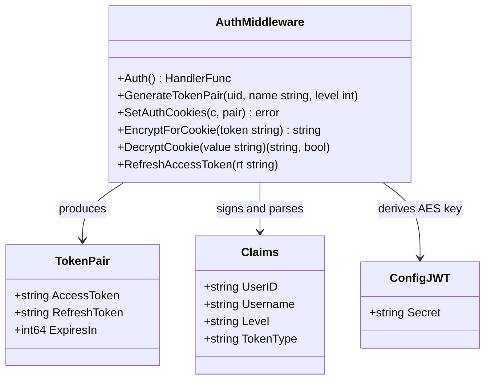

**图表来源**

- [main/internal/api/middleware/auth.go](file://main/internal/api/middleware/auth.go)
- [main/internal/config/config.go](file://main/internal/config/config.go)

**章节来源**
- [main/internal/api/middleware/auth.go](file://main/internal/api/middleware/auth.go)
- [main/internal/config/config.go](file://main/internal/config/config.go)

### 令牌参数与 Cookie 属性

生命周期参数全是代码常量而非配置项：`AccessTokenExpire = 15m`、`RefreshTokenExpire = 7d`、`authUserCacheTTL = 30s`（`middleware/auth.go:90-99`）。`config/config.go:69-72` 定义了 `jwt.expire_hour`，但本次未见读取点，令牌有效期不受配置文件影响（推断：基于定义位置与消费缺口，未做全仓复核）。

`GenerateTokenPair` 一次产出两个 HS256 令牌，仅靠 `token_type` 区分用途（`middleware/auth.go:228-283`），每个都带 16 字节随机 hex 的 `jti`（`:446-450`）。

| Cookie | 内容 | Path | Max-Age | HttpOnly | SameSite |
| --- | --- | --- | --- | --- | --- |
| `_t` | AES-GCM(access) 的 hex | `/` | 900 | 是 | Strict |
| `_rt` | AES-GCM(refresh) 的 hex | `/api/auth/refresh` | 604800 | 是 | Strict |
| `_csrf` | 32 字节随机 hex | `/` | 7 天 | 否 | Strict |

`Secure` 由 `isSecureRequest` 决定：`c.Request.TLS != nil` 或 `X-Forwarded-Proto: https`（`middleware/auth.go:320-329`）。`_csrf` 不能是 HttpOnly，因为 double-submit 要求前端把 cookie 值回填到请求头（`middleware/csrf.go:22-24`）。secret 可被环境变量 `DNSPLANE_JWT_SECRET` 覆盖，空值或历史默认值会在首启被 32 字节随机数替换并以 0600 回写（`config/config.go:122-143`、`:156-170`）；本文一律以 `{JWT_SECRET}` 占位。

**章节来源**
- [main/internal/api/middleware/auth.go](file://main/internal/api/middleware/auth.go)
- [main/internal/api/middleware/csrf.go](file://main/internal/api/middleware/csrf.go)
- [main/internal/config/config.go](file://main/internal/config/config.go)

### TOTP 组件

`utils/totp.go` 是纯函数集合，不依赖数据库与缓存：密钥为 20 字节随机 Base32 无填充（`:25-33`），URI 为 `otpauth://totp/{Issuer}:{Account}?secret=...&period=30&digits=6&algorithm=SHA1`（`:35-62`），校验遍历 `[-30, 0, +30]` 三个偏移（`:70-82`）。落库侧 `users.totp_secret` 经 GORM `BeforeSave` 做字段级 AES-GCM（`models/hooks.go:56-62`），前缀 `enc:v1:`，主密钥为 `sha256(security.master_key)`（`crypto/crypto.go:16-36`），环境变量 `DNSPLANE_MASTER_KEY` 可覆盖。

登录分支额外做计数器防重放：键 `totp_used:<sha256(secret) 前 8 字节 hex>:<counter>`，TTL 90 秒（`handler/auth.go:49-70`）。

**章节来源**
- [main/internal/utils/totp.go](file://main/internal/utils/totp.go)
- [main/internal/models/hooks.go](file://main/internal/models/hooks.go)
- [main/internal/api/handler/auth.go](file://main/internal/api/handler/auth.go)

### Magic Link 一次性令牌

令牌与控制台会话解耦：`generateResetToken` 产出 32 字节随机 hex（`handler/auth.go:730-735`），以 `ql:<token>` 写缓存、TTL 15 分钟（`:1251-1256`），兑换即删（`handler/quicklogin.go:143-144`）。链接指向 `/magic-login`，由该页跳转 `GET /api/quicklogin?token=`（`handler/quicklogin.go:124-204`）。

**章节来源**
- [main/internal/api/handler/auth.go](file://main/internal/api/handler/auth.go)
- [main/internal/api/handler/quicklogin.go](file://main/internal/api/handler/quicklogin.go)

### OAuth Provider 抽象

`internal/oauth` 用 `Provider` 接口屏蔽五家差异（`oauth/oauth.go:51-59`），`providerFactories` 注册 github / google / wechat / dingtalk / custom（`:69-76`）。`GetProvider` 以「凭据至少配齐一组」为启用判据：`ClientID`、`AppID`、`AppKey` 全空即报错（`:93-95`），`GetEnabledProviders` 据此过滤前端按钮（`:137-152`），其 `Enabled` 字段恒为 true，不能当管理员开关使用（同文件注释 `:133-135`）。

**章节来源**
- [main/internal/oauth/oauth.go](file://main/internal/oauth/oauth.go)

## 架构总览

### 口令登录（含 TOTP 二段）

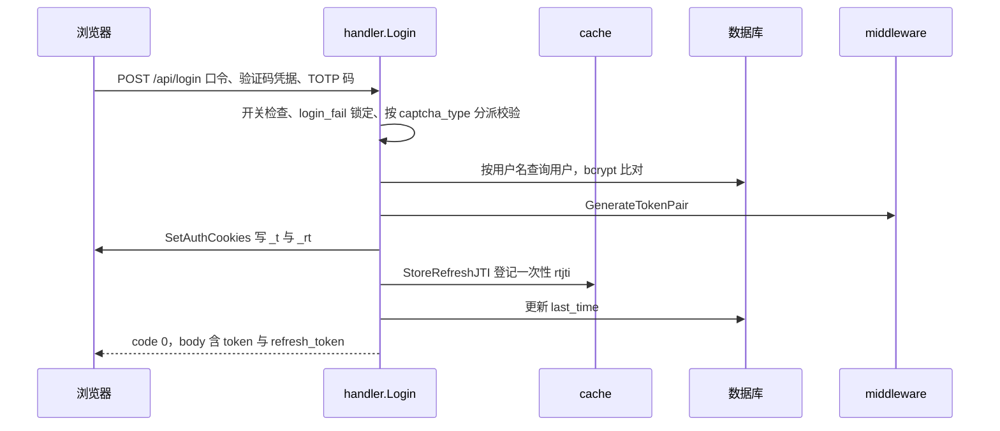

**图表来源**

- [main/internal/api/handler/auth.go](file://main/internal/api/handler/auth.go)
- [main/internal/api/middleware/auth.go](file://main/internal/api/middleware/auth.go)

启用 TOTP 的账号首次不带动态码时返回 `code: 2`（`handler/auth.go:341-345`），前端据此展开第二步输入框（`web/app/(auth)/login/page.tsx:64`、`:308`）。该步不签发令牌，语义是「要求补充因子」。

**章节来源**
- [main/internal/api/handler/auth.go](file://main/internal/api/handler/auth.go)
- [web/app/(auth)/login/page.tsx](file://web/app/(auth)/login/page.tsx)

### TOTP 绑定与验证

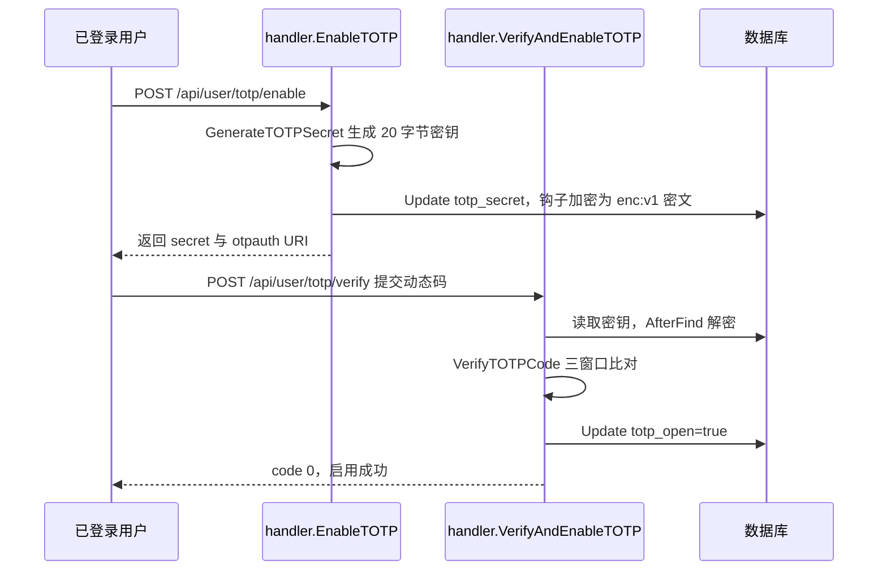

**图表来源**

- [main/internal/api/handler/auth.go](file://main/internal/api/handler/auth.go)
- [main/internal/utils/totp.go](file://main/internal/utils/totp.go)

两段式把「生成密钥」与「启用开关」分离：用户扫码后未验证即退出时 `totp_open` 仍为 false，不会把自己锁在门外（`handler/auth.go:639-648`、`:680-684`）。

**章节来源**
- [main/internal/api/handler/auth.go](file://main/internal/api/handler/auth.go)

### Magic Link 兑换

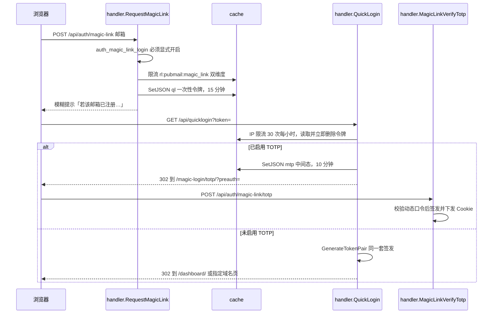

**图表来源**

- [main/internal/api/handler/auth.go](file://main/internal/api/handler/auth.go)
- [main/internal/api/handler/quicklogin.go](file://main/internal/api/handler/quicklogin.go)
- [main/internal/notify/templates.go](file://main/internal/notify/templates.go)

**章节来源**
- [main/internal/api/handler/quicklogin.go](file://main/internal/api/handler/quicklogin.go)

### OAuth 换 token

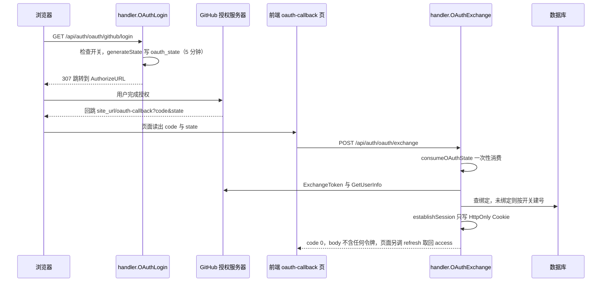

**图表来源**

- [main/internal/api/handler/oauth.go](file://main/internal/api/handler/oauth.go)
- [main/internal/oauth/github.go](file://main/internal/oauth/github.go)
- [web/lib/api.ts](file://web/lib/api.ts)

**章节来源**
- [main/internal/api/handler/oauth.go](file://main/internal/api/handler/oauth.go)

### API Key 签名认证

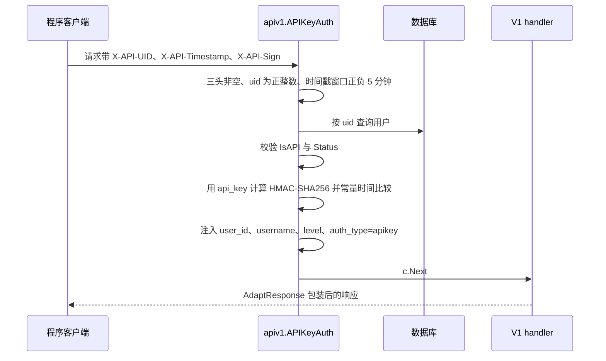

**图表来源**

- [main/internal/apiv1/auth.go](file://main/internal/apiv1/auth.go)
- [main/internal/apiv1/router.go](file://main/internal/apiv1/router.go)

V1 链刻意不挂 CSRF：`apiv1/router.go:11-15` 与 `api/router.go:57-62` 两处注释一致说明「API Key 客户端没有 `_csrf` cookie，继承该链会让所有写请求被拒，签名本身即身份与完整性凭据」。

**章节来源**
- [main/internal/apiv1/auth.go](file://main/internal/apiv1/auth.go)
- [main/internal/apiv1/router.go](file://main/internal/apiv1/router.go)

## 详细组件分析

### 口令登录的准入顺序

登录的判定顺序不是随意的，代码注释锁定了三条理由：开关检查置于锁定计数之前（关闭时不存在凭据校验，不应累加失败次数）、人机验证置于口令比对之前、禁用账户分支也计入失败计数（避免用计数差异探测账户状态）。

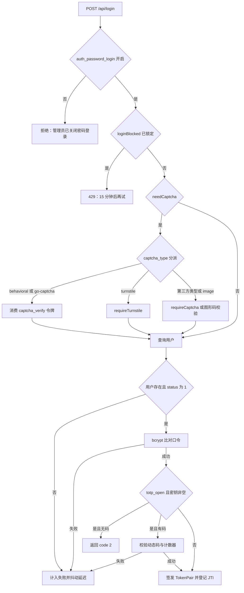

**图表来源**

- [main/internal/api/handler/auth.go](file://main/internal/api/handler/auth.go)
- [main/internal/api/handler/captcha.go](file://main/internal/api/handler/captcha.go)

失败计数以（子网前缀, 用户名小写）为键：IPv4 归一到 `/24`、IPv6 归一到 `/64`（`handler/auth.go:80-101`）。动机写在注释里——按原始 IP 计数会让海量随机 IP 撑爆内存缓存（`:82-86`）。代价是同一 /24 内不同用户互相触发锁定，跨网段的用户名喷洒各自独立计数（`:103-120`）。所有失败路径统一加 50–150 ms 抖动（`:38-47`）。

**章节来源**
- [main/internal/api/handler/auth.go](file://main/internal/api/handler/auth.go)

### 行为验证码的签发与消费

| 环节 | 入口 | 存储 | TTL | 一次性 |
| --- | --- | --- | --- | --- |
| 生成 | `GetBehavioralCaptcha`（`handler/behavioral_captcha.go:32-43`） | `captcha:<uuid>` | 5 分钟 | 否 |
| 校验 | `VerifyBehavioralCaptcha`（`:51-85`） | 由 `captcha.Verify` 读取后删除 | — | 是 |
| 通过凭证 | `captcha_verify:<uuid>`（`:18-19`） | 缓存 | 10 分钟 | 是，`ConsumeCaptchaVerifyToken` |
| 图形验证码 | `GetCaptcha`（`handler/auth.go:156-171`） | 进程内 `base64Captcha.DefaultMemStore` | 由 store 决定 | 是 |

类型由查询参数决定，未指定时随机三型之一（`handler/behavioral_captcha.go:21-30`）。`captcha.Verify` 在比对之前就先删缓存（入口 `internal/captcha/captcha.go:265`，`storeCache` 在 `:368`），答错一次即作废整张图，前端必须重新 GET。

需明确标注一个缺陷：`Verify` 用请求体的 `captcha_type` 决定比对分支，而不使用缓存中记录的 `type`，跨类型提交会命中零值答案并通过容差判断。该结论来自 `internal/captcha/captcha.go` 的分支结构与分析素材《analysis-auth.md》问题 1；本文未构造运行期复现，属「代码路径已验证、行为为推断」。

**章节来源**
- [main/internal/api/handler/behavioral_captcha.go](file://main/internal/api/handler/behavioral_captcha.go)
- [main/internal/captcha/captcha.go](file://main/internal/captcha/captcha.go)

### TOTP 生命周期与失效路径

| 动作 | 路由 | handler | 写入 | 前置凭据 |
| --- | --- | --- | --- | --- |
| 状态查询与密钥生成 | `GET /api/user/totp/status`、`POST /api/user/totp/enable` | `GetTOTPStatus`（`auth.go:586-602`）、`EnableTOTP`（`:604-649`） | `totp_secret` | 已登录且未启用 |
| 验证启用 | `POST /api/user/totp/verify` | `VerifyAndEnableTOTP`（`:651-685`） | `totp_open=true` | 动态码 |
| 自助关闭 | `POST /api/user/totp/disable` | `DisableTOTP`（`:687-728`） | 清空 `totp_secret` | 口令 + 动态码 |
| 邮件重置 | `POST /api/auth/forgot-totp`、`/reset-totp` | `ForgotTOTP`、`ResetTOTP`（`:941-1036`） | 同上 | 邮箱令牌 + 人机验证 |
| 管理员重置 | 用户管理路由 | `AdminSendResetEmail`、`AdminResetTOTP`（`:1038-1130`） | 同上 | 管理员身份 |

失效语义只有一种：`totp_secret=""`。三条关闭路径都写空串而非删行，`Encrypt` 对空串直接返回空串（`crypto/crypto.go:42-45`），因此 `AfterFind` 解密对空值恒等，不会因缺前缀报错（`models/hooks.go:56-62`）。

`utils.GenerateRecoveryCodes` 与 `VerifyRecoveryCode`（`utils/totp.go:136-157`）在当前工作区无调用点，`models.User` 也没有恢复码字段（字段清单 `models/models.go:14-30`）。「恢复码应急登录」目前不可用，丢设备只能走邮件重置。此结论为源码检索结果，非运行期验证。

**章节来源**
- [main/internal/api/handler/auth.go](file://main/internal/api/handler/auth.go)
- [main/internal/utils/totp.go](file://main/internal/utils/totp.go)
- [main/internal/models/models.go](file://main/internal/models/models.go)
- [main/internal/crypto/crypto.go](file://main/internal/crypto/crypto.go)

### 忘记密码与重置令牌存储

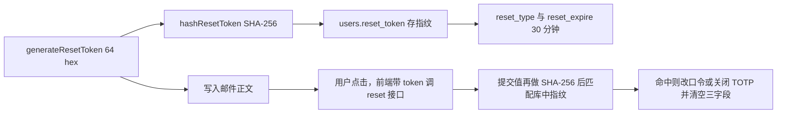

**图表来源**

- [main/internal/api/handler/auth.go](file://main/internal/api/handler/auth.go)

设计动机写在 `hashResetToken` 注释里（`handler/auth.go:737-748`）：`Updates(map)` 不触发字段加密钩子，直接存令牌会明文落库；改用不可逆摘要后，读库也无法反推可用凭据。管理员侧有效期放宽到 60 分钟（`:1073-1082`）。找回密码与找回 TOTP 同构，仅 `reset_type` 取值不同（`password` 对 `totp`）。

限流阈值写在调用点字面量里：`forgot_pw` 12/5、`forgot_totp` 12/5、`magic_link` 15/5、`reg_code` 24/8、`bind_mail` 30/12（`handler/auth.go:857`、`:957`、`:1233`、`:1392`、`:1522`；双维度实现 `verify/code.go:120-130`）。邮箱验证码本身是 8 位、TTL 5 分钟、重发间隔 60 秒、错 5 次作废（`verify/code.go:11-15`、`:33-59`、`:61-92`）。所有公开接口成功口径恒定，不区分用户不存在、未绑邮箱、邮件未配置（`handler/auth.go:858-872`）。

**章节来源**
- [main/internal/api/handler/auth.go](file://main/internal/api/handler/auth.go)
- [main/internal/verify/code.go](file://main/internal/verify/code.go)

### OAuth 的三条入口与差异

| 入口 | 路由 | 会话建立 | 响应体含令牌 | 场景 |
| --- | --- | --- | --- | --- |
| `OAuthLogin` | `GET /api/auth/oauth/:provider/login` | 307 跳第三方，不建会话 | 否 | 登录按钮 |
| `OAuthExchange` | `POST /api/auth/oauth/exchange` | `establishSession` 写 Cookie | 否（注释 `handler/oauth.go:209-215`） | 当前主路径 |
| `OAuthCallback` | `GET /api/auth/oauth/:provider/callback` | 建会话后 302 | 否 | 旧回调地址兼容 |

绑定与登录共用 `handleOAuthCallback`，差异全在 state 条目 `oauthStateEntry{Provider, BindUID, Mode}`（`handler/oauth.go:31-35`）：`BindUID > 0` 走 `applyOAuthBind`，否则 `applyOAuthLogin` + `establishSession`（`:145-156`）。旧回调入口会用路径上的 provider 与 state 记录比对，不符即 `invalid_state`（`:123-125`）。`oauthCallbackPageURL` 同时用于授权请求与令牌交换，两处必须逐字一致（`:159-168`），而 `github.go` 的交换请求只提交 `client_id` / `client_secret` / `code`（`oauth/github.go:25-36`），redirect_uri 未随交换发送——若上游收紧校验会直接导致 `token_failed`，属需关注的一致性缺口。

自动建号需两个开关同时放开：全局 `register_enabled` 显式为 `true`，且 `auth_oauth_<provider>_register` 未显式关闭（`handler/oauth.go:304-312`）。新建用户 `level=1`、`Password=""`（`:322-329`），空哈希使 bcrypt 比对必然失败，该账号因此无法走口令登录。用户名由 `generateUniqueUsername` 逐级尝试（`:536-565`）。

更新既有绑定时用 `Updates(map)`（`:293-299`、`:354-360`），新建绑定用 `Create`（`:370-387`）。GORM 的 map 分支不会把 `BeforeSave` 的加密结果带回 SQL，而 `models/hooks.go` 声明 `UserOAuth.{AccessToken, RefreshToken}` 为加密列，同一列因此可能明文密文混杂（标注：源码路径已验证，落库实况未知）。

**章节来源**
- [main/internal/api/handler/oauth.go](file://main/internal/api/handler/oauth.go)
- [main/internal/oauth/github.go](file://main/internal/oauth/github.go)
- [main/internal/models/hooks.go](file://main/internal/models/hooks.go)

### API Key 的校验分支与轮转

签名串四段拼接 `uid + "\n" + timestamp + "\n" + METHOD + "\n" + PATH`，密钥为 `users.api_key`，输出 hex（`apiv1/auth.go:93-94`、`signWithKey` 在 `:117-122`），比较用 `hmac.Equal` 常量时间（`:96`）。

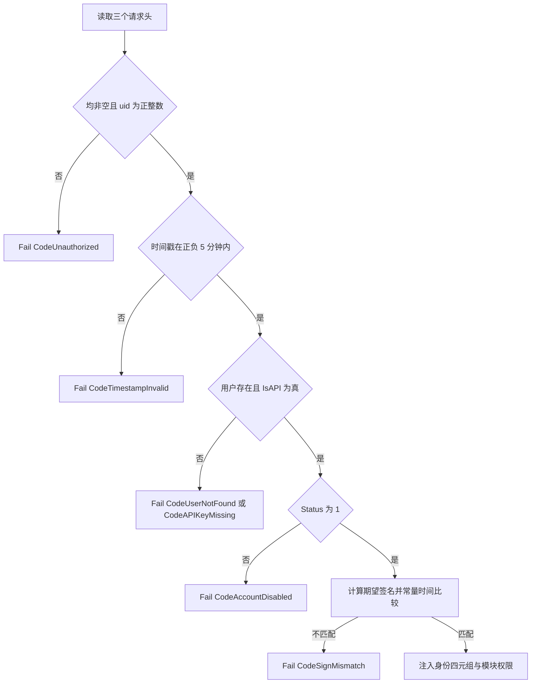

**图表来源**

- [main/internal/apiv1/auth.go](file://main/internal/apiv1/auth.go)

待签串不含请求体与查询串，因此 ±5 分钟窗口内的抓包可原样重放，也可在签名有效前提下替换参数（分析素材问题 25，依据 `apiv1/auth.go:93` 的代码事实）。密钥生成 32 字节随机 hex（`handler/user.go:49-53`），轮转入口 `ResetAPIKey`（`:368-391`）。

**章节来源**
- [main/internal/apiv1/auth.go](file://main/internal/apiv1/auth.go)
- [main/internal/api/handler/user.go](file://main/internal/api/handler/user.go)

### 会话校验、刷新与吊销

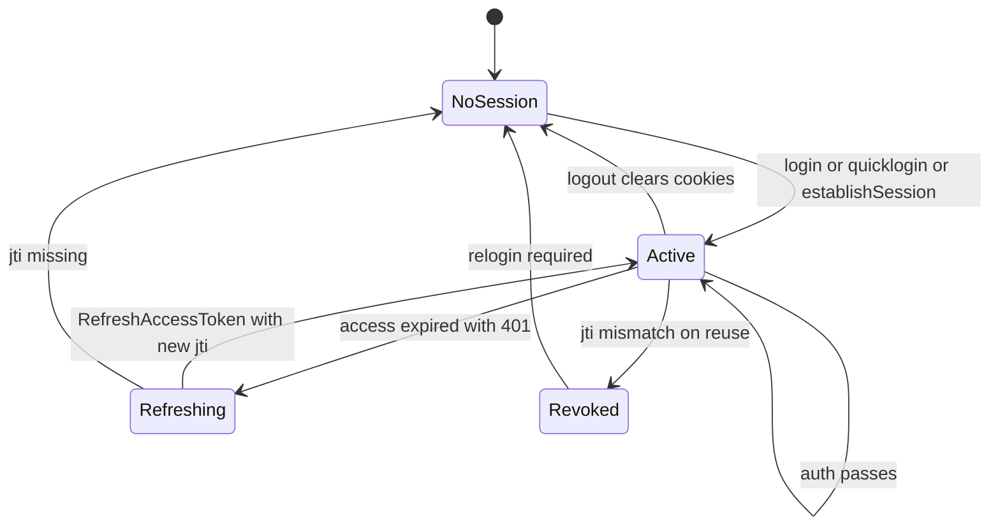

**图表来源**

- [main/internal/api/middleware/auth.go](file://main/internal/api/middleware/auth.go)

两个可观察行为由刷新链决定：每用户同一时刻只有一个有效 refresh（`StoreRefreshJTI` 用 `rtjti:<uid>` 单键覆盖，TTL 7 天，`middleware/auth.go:331-341`）；缓存就绪但条目缺失一律拒绝，仅整体未初始化才降级放行（`:343-373`）。前端在首个 401 后自动刷新，并用 `refreshInFlight` 合并并发（`web/lib/api.ts:127-168`、`:216-237`）。

`X-Token-Expiring` 在剩余不足 5 分钟时写出并在 CORS 放行（`middleware/auth.go:190-196`、`:525`），但 `web/lib/api.ts` 全文无读取点，实际仍是到期后被动刷新，access 过期瞬间会有一次可感知往返。

`Logout` 只清 Cookie，不删 `rtjti:<uid>`（`handler/auth.go:406-411`、`middleware/auth.go:313-318`），因此 7 天内先前泄露的 refresh 凭据在用户「已退出」后仍能换取新会话。`ChangePassword`、`ResetPassword`、`AdminResetTOTP` 同样只更新用户行（`:520`、`:930-935`、`:1122-1125`），既不吊销 JTI 也不清认证缓存。

**章节来源**
- [main/internal/api/middleware/auth.go](file://main/internal/api/middleware/auth.go)
- [main/internal/api/handler/auth.go](file://main/internal/api/handler/auth.go)
- [web/lib/api.ts](file://web/lib/api.ts)

### 认证开关的读写契约

`auth_control.go` 是这批开关唯一的写入口，可写集合由固定清单加动态前缀白名单构成：

| 键 | 默认语义 | 消费点 |
| --- | --- | --- |
| `auth_password_login` | 未配置视为开启 | `handler/auth.go:251` |
| `auth_password_register` 与 `register_enabled` | 均需显式 true 才开放自助注册 | `handler/auth.go:1133-1137` |
| `auth_magic_link_login` | 未配置视为关闭 | `:1227` |
| `auth_email_verify` | 未配置视为开启 | `:1150-1155` |
| `auth_email_whitelist_enabled` 与 `auth_email_whitelist` | 未启用即不限制 | `:1159-1200` |
| `auth_oauth_<provider>_login` 与 `_register` | 未配置视为开启 | `handler/oauth.go:83`、`:310` |

「未配置=开」与「未配置=关」并存，规则直接：影响既有登录能力的开关取前者以免升级即失效，扩大暴露面的开关取后者。`handlerSwitchOn` 与显式 `== "true"` 两条判据因此分别存在（`handler/auth.go:1139-1148` 对 `:1187-1188`）。

写入后逐键失效缓存，否则开关最长 60 秒不生效（`handler/auth_control.go:115-156`）。拒绝是整批的：任一不可写键都会让本次保存失败，避免「一半写入一半报错」的中间状态（`:141-148`）。可写键前缀 `auth_oauth_` 的动态部分取自 `oauth.GetEnabledProviders()`，与前端列表同源（`:62-86`、`oauth/oauth.go:137-152`）。

**章节来源**
- [main/internal/api/handler/auth_control.go](file://main/internal/api/handler/auth_control.go)
- [main/internal/api/handler/auth.go](file://main/internal/api/handler/auth.go)
- [main/internal/api/handler/oauth.go](file://main/internal/api/handler/oauth.go)

## 依赖关系分析

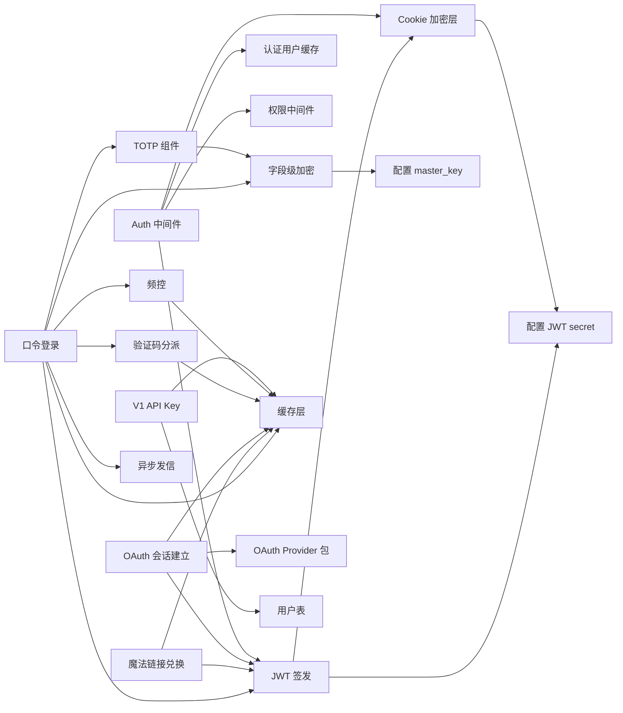

**图表来源**

- [main/internal/api/middleware/auth.go](file://main/internal/api/middleware/auth.go)
- [main/internal/api/handler/auth.go](file://main/internal/api/handler/auth.go)
- [main/internal/api/handler/oauth.go](file://main/internal/api/handler/oauth.go)
- [main/internal/apiv1/auth.go](file://main/internal/apiv1/auth.go)

三组值得注意的依赖特征：

- **缓存是硬依赖而非优化项。** 一次性令牌（`ql:`、`mtp:`）、OAuth state、验证码答案、JTI 轮转、失败计数全部只存在于缓存。`cache.C` 为内存实现时重启即让所有未完成流程失效；多实例部署必须共享后端。`handler/auth.go:1252` 直接对 `cache.C` 调 `SetJSON` 而未判空，与 `handler/behavioral_captcha.go:71-75` 的判空风格不一致。
- **两套密钥派生并存。** Cookie 层每次调用重算 `sha256(JWT.Secret)`（`middleware/auth.go:34-39`），字段加密层用 `sync.Once` 缓存（`crypto/crypto.go:21-36`）。属可统一的重复模式。
- **认证与权限只有一个耦合点。** `Auth` 注入 `user_id` / `username` / `level` / `auth_user_model` / `perm_modules*`，下游全读这些键（`middleware/auth.go:183-196`、`apiv1/auth.go:102-111`）。V1 走 `APIKeyAuth` 不写 `auth_user_model`，两侧 handler 都必须容忍该键缺失。

**章节来源**
- [main/internal/api/middleware/auth.go](file://main/internal/api/middleware/auth.go)
- [main/internal/apiv1/auth.go](file://main/internal/apiv1/auth.go)
- [main/internal/api/handler/behavioral_captcha.go](file://main/internal/api/handler/behavioral_captcha.go)

## 性能考虑

每个经过 `Auth` 的请求都执行一次完整 AES-GCM 解密路径：`hex.DecodeString` → `sha256(Secret)` → `aes.NewCipher` → `cipher.NewGCM` → `gcm.Open`（`middleware/auth.go:66-88`），其中密钥派生与两个构造函数都没有缓存，而 `crypto` 包对同样操作做了 `sync.Once` 复用（`crypto/crypto.go:21-36`）。

| 环节 | 频次 | 可否复用 | 口径 |
| --- | --- | --- | --- |
| `deriveKey` 的 SHA-256 | 每次解密 1 次 | 可，密钥在配置加载后固定 | 结构性观察，未压测 |
| `aes.NewCipher` 与 `NewGCM` | 每次解密各 1 次 | 可，与明文无关 | 结构性观察，未压测 |
| `gcm.Open` 与 `hex.DecodeString` | 各 1 次 | 不可 | 输入约为令牌长度的 2 倍 |
| 用户查询 | 命中缓存则跳过 | 已由 30 秒缓存覆盖 | `middleware/auth.go:452-467` |

绝对耗时都不大，真实成本在于每请求固定分配的 `cipher.Block` 与 `cipher.AEAD` 对象带来的 GC 压力。请求量上升时最划算的改动是把派生密钥与构造函数一并收进 `sync.Once`，与 `crypto` 包既有做法同构，属去重而非新增抽象。本文未做基准测试，不给出百分比。

另两处取舍与性能直接相关：所有登录失败固定 sleep 50–150 ms（`handler/auth.go:38-47`），暴力破解场景会放大协程占用，换取账号存在性不可观测；四组公开邮件接口共用容量 32 的 `mailSendSem`，超额在 goroutine 内阻塞排队（`:818-837`），SMTP 抖动不会耗尽 FD，但队列堆积对用户不可见。

**章节来源**
- [main/internal/api/middleware/auth.go](file://main/internal/api/middleware/auth.go)
- [main/internal/crypto/crypto.go](file://main/internal/crypto/crypto.go)
- [main/internal/api/handler/auth.go](file://main/internal/api/handler/auth.go)

## 故障排查指南

| 症状 | 首要怀疑点 | 证据位置 | 处置 |
| --- | --- | --- | --- |
| 登录后立即 401「未登录」 | `_t` 未回传，或 Cookie 域与请求域不同 | `middleware/auth.go:308`（domain 传空串即 host-only） | 确认前后端同源；跨子域需改造 Cookie 作用域 |
| 401「Token不一致」 | 未带 `Authorization` 头，或本地令牌与 cookie 内令牌不同源 | `middleware/auth.go:143-150` | 让前端走一次 `POST /api/auth/refresh` 重新对齐 |
| 401「会话已过期」 | cookie 解密失败，通常是 secret 变更后旧 cookie 全失效 | `middleware/auth.go:66-88`、`config/config.go:122-143` | 清 cookie 重登；容器重建时固定 `DNSPLANE_JWT_SECRET` |
| 刷新总失败 | `rtjti:<uid>` 条目缺失（TTL 到期或 Redis 丢数据），用 refresh 令牌访问业务接口也归此类 | `middleware/auth.go:159-164`、`:353-373` | 属预期收紧策略，需重新登录 |
| TOTP 恒判错误 | 服务器与手机时钟偏差超过 30 秒；同一码二次提交属防重放命中 | `utils/totp.go:70-82`、`handler/auth.go:49-70` | 校准服务器 NTP，等下一个 30 秒窗口，勿改终端时间 |
| 多实例验证码必失败 | 图形码用进程内 `DefaultMemStore` | `handler/auth.go:32` | 收敛单实例或改用行为码链路 |
| OAuth 报 `invalid_state` | state 超 5 分钟或被二次消费 | `handler/oauth.go:28-29`、`:51-62` | 重新点登录，勿刷新回调页 |
| OAuth 报 `token_failed` | redirect_uri 与第三方配置不一致 | `handler/oauth.go:159-168`、`oauth/github.go:20-36` | 核对 `site_url` 与 OAuth App 回调地址 |
| 登录 429 | `login_fail:<子网>:<用户名>` 达 5 次 | `handler/auth.go:75-120` | 等 15 分钟或清该键 |
| 改了开关不生效 | 配置缓存 60 秒未过期，或写入了非白名单键 | `handler/auth_control.go:115-156` | 走 `/system/auth-control` 保存并确认「更新成功」 |
| 找回密码邮件收不到 | 提示恒定模糊，无法从响应区分原因 | `handler/auth.go:862-889` | 查文件日志中 `mail_forgot_password` 错误行 |
| V1 报时间戳错误 | 客户端与服务器时差超 5 分钟 | `apiv1/auth.go:36-73` | 校准客户端时钟，勿放宽窗口 |

**章节来源**
- [main/internal/api/middleware/auth.go](file://main/internal/api/middleware/auth.go)
- [main/internal/api/handler/auth.go](file://main/internal/api/handler/auth.go)
- [main/internal/api/handler/oauth.go](file://main/internal/api/handler/oauth.go)
- [main/internal/api/handler/auth_control.go](file://main/internal/api/handler/auth_control.go)

### 时区与时间

TOTP 与 JWT 都用 Unix 秒，与时区无关，故障只有「时钟偏移」一种原因；偏移表在 `utils/totp.go:75` 写死为 `[-30, 0, 30]`，不可配置放宽。重置链接有效期由服务器写入时刻计算（`handler/auth.go:875`、`:980`、`:1075`），比对用 `user.ResetExpire.Before(time.Now())`（`:911`、`:1020`）：时区设置错但 UTC 时刻正确时不影响判定，UTC 时刻本身偏移则用户立刻看到「已过期」。认证用户缓存 30 秒（`middleware/auth.go:98-99`）意味着禁用、降级、改权限最长 30 秒后才生效；`InvalidateAuthUserCache` 已定义（`:469-477`）但本次未见调用点，目前只能等 TTL。同函数上方注释写「10 秒 TTL」与实际常量不一致（`:166-169`），排障以常量为准。

**章节来源**
- [main/internal/utils/totp.go](file://main/internal/utils/totp.go)
- [main/internal/api/handler/auth.go](file://main/internal/api/handler/auth.go)
- [main/internal/api/middleware/auth.go](file://main/internal/api/middleware/auth.go)

### 反向代理下的 Cookie

`Secure` 取决于 `isSecureRequest`（`middleware/auth.go:320-329`）。代理未透传 `X-Forwarded-Proto` 时，HTTPS 站点会拿到 `Secure=false` 的 cookie；反之该头可被伪造时，会写出 `Secure=true` 却实际明文传输。同一判定决定 HSTS 是否写出（`:502-505`）。排查顺序建议固定：先看响应 `Set-Cookie` 是否含 `Secure`，再确认 `Path=/api/auth/refresh` 是否让 `_rt` 只在刷新端点出现（`handler/auth.go:423-430` 的回落读取正依赖这一点），最后才怀疑 secret。

**章节来源**
- [main/internal/api/middleware/auth.go](file://main/internal/api/middleware/auth.go)
- [main/internal/api/handler/auth.go](file://main/internal/api/handler/auth.go)

## 结论

五种方式在实现上收敛到同一条签发链：无论入口是 `Login`、`QuickLogin`、`MagicLinkVerifyTotp` 还是 `establishSession`，最终都调 `GenerateTokenPair` + `SetAuthCookies` + `StoreRefreshJTI`（分别见 `handler/auth.go:369-384`、`:1313-1326`、`handler/quicklogin.go:175-191`、`handler/oauth.go:396-420`）。这是当前体系最可取的一点——令牌语义、Cookie 形态与 JTI 登记规则只有一份定义，新增登录方式只需接上这三个函数。

差异被有意留在**准入层**而非会话层：各方式自行决定开关、人机验证、频控与第二因子，`Auth` 对来源无感（V1 的 API Key 是唯一例外，它写 `auth_type` 但不参与 cookie 校验）。

明确记录的不足有三类：吊销链不完整（注销与改密均不吊销 refresh、不清认证缓存）；行为验证码存在类型混淆（`internal/captcha/captcha.go:265` 起）；`Updates(map)` 与字段加密钩子组合导致同列明文密文混杂。三者都是实现缺陷而非架构选择，修法收敛在少数调用点，优先级表见《安全防护》。

**章节来源**
- [main/internal/api/handler/auth.go](file://main/internal/api/handler/auth.go)
- [main/internal/api/handler/quicklogin.go](file://main/internal/api/handler/quicklogin.go)
- [main/internal/api/handler/oauth.go](file://main/internal/api/handler/oauth.go)

## 附录

### 凭据结构

```text
_t  = hex( nonce || ciphertext || tag )
      nonce 长度由 gcm.NonceSize() 决定；gcm.Seal(nonce, nonce, ...) 使 nonce 前置于密文
      ciphertext = AES-256-GCM( key = sha256(JWT_SECRET), plaintext = access JWT )
      Max-Age 900，Path /，HttpOnly，SameSite=Strict        （middleware/auth.go:45-60、:296-311）
_rt = 同结构，明文为 refresh JWT；Max-Age 604800，Path /api/auth/refresh
```

JWT 的 `Claims` 由 `user_id`、`username`、`level`、`token_type` 加注册声明组成（`middleware/auth.go:101-107`），access 与 refresh 除 `token_type` 与 `exp` 外无差别：

```json
{
  "user_id": "1",
  "username": "{username}",
  "level": 2,
  "token_type": "access",
  "exp": 1700000900,
  "iat": 1700000000,
  "jti": "32 位 hex（16 字节随机）"
}
```

算法固定 HS256，`ParseToken` 显式要求 `*jwt.SigningMethodHMAC`，其它 alg 一律拒绝（`:423-444`）。cookie 解密失败两种原因（hex 非法与认证标签不匹配）都折叠成同一个 false，`Auth` 因此无法区分管线被篡改与 secret 已轮换（`:66-88`）。

**章节来源**
- [main/internal/api/middleware/auth.go](file://main/internal/api/middleware/auth.go)

### 凭据归属关系

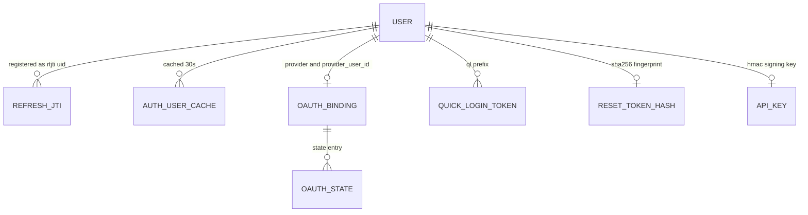

**图表来源**

- [main/internal/api/handler/quicklogin.go](file://main/internal/api/handler/quicklogin.go)
- [main/internal/api/handler/oauth.go](file://main/internal/api/handler/oauth.go)
- [main/internal/api/middleware/auth.go](file://main/internal/api/middleware/auth.go)

本图是凭据归属的概念关系，不是数据库外键：带前缀的条目均为缓存项而非表。

**章节来源**
- [main/internal/api/handler/quicklogin.go](file://main/internal/api/handler/quicklogin.go)
- [main/internal/api/handler/oauth.go](file://main/internal/api/handler/oauth.go)

### 常量与路由清单

| 常量 | 取值 | 定义位置 |
| --- | --- | --- |
| `AccessTokenExpire` / `RefreshTokenExpire` | 15 分钟 / 7 天 | `middleware/auth.go:91-92` |
| `authUserCacheTTL` | 30 秒 | `middleware/auth.go:99` |
| `bcryptCost` | 12 | `handler/auth.go:36` |
| `loginFailWindow` / `loginFailThreshold` | 15 分钟 / 5 次 | `handler/auth.go:76-77` |
| `captchaVerifyTTL` / `oauthStateTTL` | 10 分钟 / 5 分钟 | `handler/behavioral_captcha.go:19`、`handler/oauth.go:29` |
| magic link / `mtp:` / 域名快捷登录 TTL | 15 / 10 / 5 分钟 | `handler/auth.go:1256`、`handler/quicklogin.go:96`、`:163` |
| `codeTTL` / `sendInterval` / `maxAttempts` | 5 分钟 / 60 秒 / 5 次 | `verify/code.go:13-15` |
| 重置链接有效期 | 30 分钟（用户）/ 60 分钟（管理员） | `handler/auth.go:875`、`:1075` |
| `apiKeyTimestampTolerance` / `mailSendSem` | 5 分钟 / 32 | `apiv1/auth.go:37`、`handler/auth.go:824` |
| TOTP 偏移表 | `-30, 0, 30` 秒 | `utils/totp.go:75` |

| 方法 | 路径 | 需认证 | CSRF |
| --- | --- | --- | --- |
| POST | `/api/login`、`/auth/refresh`、`/auth/magic-link`、`/auth/magic-link/totp` | 否 | 免（`csrf.go:36-53`） |
| GET / POST | `/api/auth/captcha`、`/captcha/behavioral`、`/captcha/behavioral/verify` | 否 | 生成免，verify 需 |
| GET | `/api/auth/config`、`/auth/oauth/providers` | 否 | 免 |
| POST | `/api/auth/forgot-password`、`/reset-password`、`/forgot-totp`、`/reset-totp` | 否 | 免 |
| GET / POST | `/api/auth/oauth/:provider/login`、`/oauth/exchange`、`/oauth/:provider/callback` | 否 | 前缀放行 |
| GET | `/api/quicklogin` | 否 | 前缀放行 |
| POST | `/api/logout`、`/api/user/password` | 是 | 需 |
| GET | `/api/user/totp/status`、`/api/user/info`、`/api/user/oauth/bindings` | 是 | GET 免校验 |

**章节来源**
- [main/internal/api/middleware/auth.go](file://main/internal/api/middleware/auth.go)
- [main/internal/api/middleware/csrf.go](file://main/internal/api/middleware/csrf.go)
- [main/internal/api/router.go](file://main/internal/api/router.go)
- [main/internal/api/handler/auth.go](file://main/internal/api/handler/auth.go)
