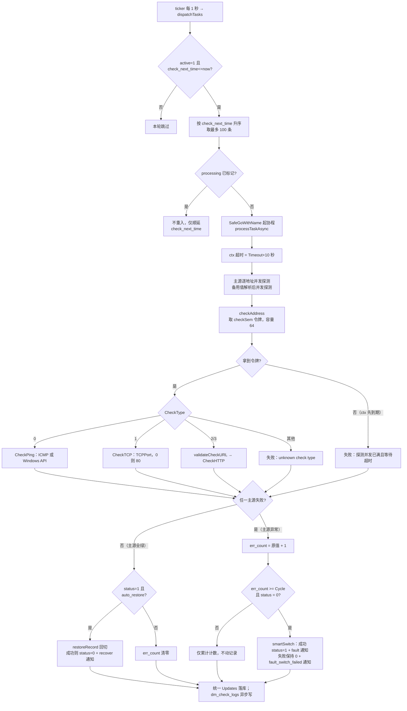
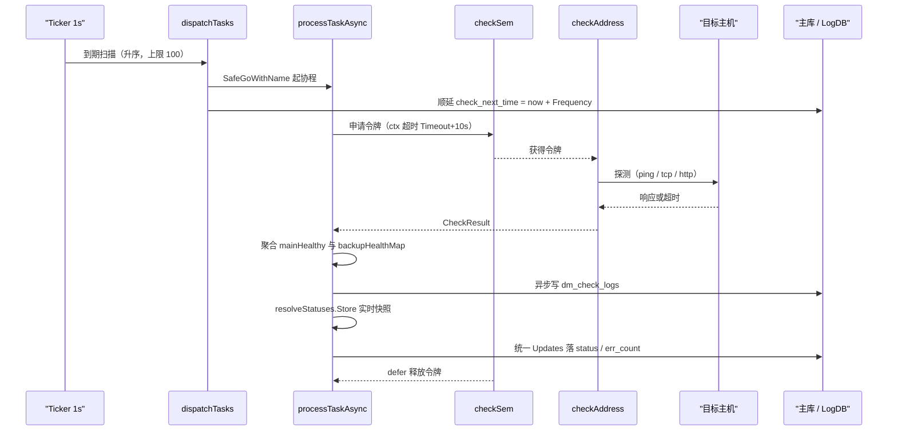
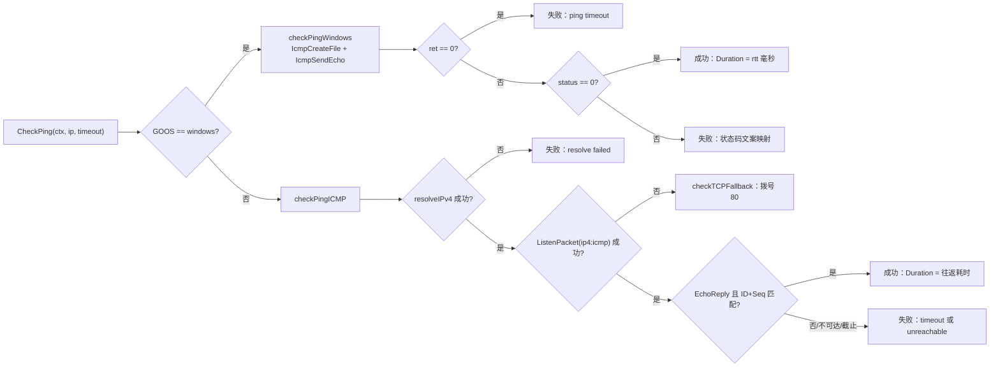
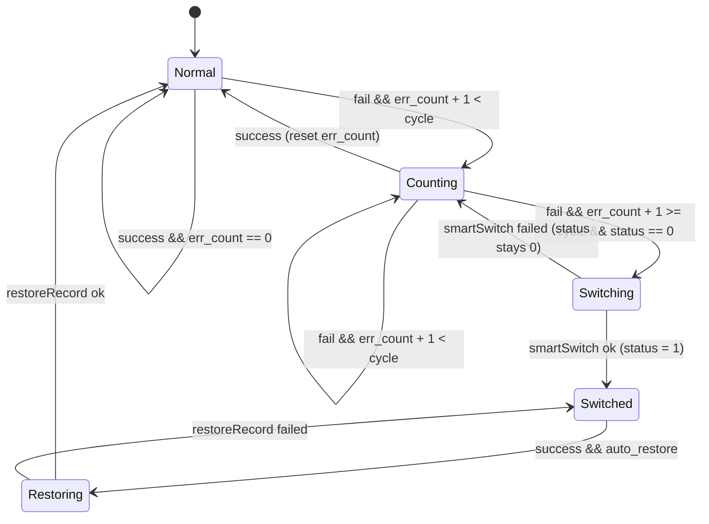

# 健康检查机制

<cite>
**本文档引用的文件**
- [check.go](file://main/internal/monitor/check.go)
- [ssrf.go](file://main/internal/monitor/ssrf.go)
- [capabilities.go](file://main/internal/monitor/capabilities.go)
- [monitor.go](file://main/internal/monitor/monitor.go)
- [check_ping_windows.go](file://main/internal/monitor/check_ping_windows.go)
- [check_ping_stub.go](file://main/internal/monitor/check_ping_stub.go)
- [check_tcp_test.go](file://main/internal/monitor/check_tcp_test.go)
- [models.go](file://main/internal/models/models.go)
- [monitor.go](file://main/internal/api/handler/monitor.go)
- [safe_go.go](file://main/internal/utils/safe_go.go)
- [safe_url.go](file://main/internal/notify/safe_url.go)
- [page.tsx](file://web/app/(dashboard)/dashboard/monitor/page.tsx)
- [utils.ts](file://web/lib/utils.ts)
- [go.mod](file://main/go.mod)
- [Dockerfile](file://Dockerfile)
</cite>

## 目录

1. [简介](#简介)
2. [项目结构](#项目结构)
3. [核心组件](#核心组件)
4. [架构总览](#架构总览)
5. [详细组件分析](#详细组件分析)
6. [依赖关系分析](#依赖关系分析)
7. [性能考虑](#性能考虑)
8. [故障排查指南](#故障排查指南)
9. [结论](#结论)
10. [附录](#附录)

## 简介

健康检查是容灾监控的数据入口：引擎按任务配置对主源与备用源发起探测，把「可达 / 不可达」压缩为布尔量，再喂给连续失败阈值判定与 DNS 记录改写。探测实现集中在 `main/internal/monitor` 包的三个文件——`check.go` 承载探针本体，`ssrf.go` 承载出站目标拦截，`capabilities.go` 承载平台能力查询（决定探测结论如何转化为记录操作）。

任务用 `CheckType` 选探针，取值 0/1/2/3（`models.go:146`），对外表现为 `Ping` / `TCP` / `HTTP` / `HTTPS` 四种类型名（`utils.ts:80-85`）。HTTPS 不是独立探针，而是 HTTP 探针的 TLS 变体：两者共用 `CheckHTTP`（`check.go:206`），仅在 URL 缺省时拼接的协议头不同（`monitor.go:361`、`monitor.go:375`）。

| CheckType | 探针名 | 入口函数 | 判定成功 | 判定失败 | 定义位置 |
|:---:|---|---|---|---|---|
| 0 | Ping（ICMP） | `CheckPing` → `checkPingICMP` / `checkPingWindows` | 收到 ID 与 Seq 均匹配的 EchoReply | 超时、`destination unreachable`、发包失败、解析失败 | `check.go:55-130` |
| 0（降级） | TCP:80 | `checkTCPFallback` | 到目标 80 端口的 TCP 握手成功 | 握手失败，错误前缀 `icmp unavailable, tcp80 failed` | `check.go:151-161` |
| 1 | TCP | `CheckTCP` | 到 `TCPPort`（0 时回退 80）的握手成功 | 连接失败 `tcp connect failed` | `check.go:163-174` |
| 2 | HTTP | `CheckHTTP` | 状态码落在 `[200,400)`，或命中 `ExpectStatus` 白名单，且正文含 `ExpectKeyword` | 状态码不符、关键词缺失、请求异常、重定向超限 | `check.go:206-343` |
| 3 | HTTPS | `CheckHTTP` | 同上，另受证书校验约束（`AllowInsecureTLS` 可关闭） | 同上，另有 TLS 握手失败 | `check.go:206-343`、`monitor.go:372-385` |
| 其他 | 未知 | — | 不可能成功 | 恒定返回 `unknown check type` | `monitor.go:386-388` |

三条需预先建立的边界认知：**探测层没有重试语义**，单次失败即返回，「重试」由调度器下一轮重新派发实现（`monitor.go:150-153`），间隔等于 `Frequency`；**SSRF 拦截只覆盖类型 2/3**，`validateCheckURL` 仅在 case 2/3 调用（`monitor.go:363`、`monitor.go:378`），类型 0/1 走裸 `net.Dialer`（`check.go:153`、`check.go:166`）无私网判定，这是已验证的能力缺口而非设计意图；**不调用系统 `ping` 命令**，Linux 走 `x/net/icmp` 原始套接字（`check.go:68`），Windows 走 `iphlpapi.dll` 的 `IcmpSendEcho`（`check_ping_windows.go:20-23`），`internal/monitor` 全量检索无 `os/exec` 或 `exec.Command` 命中。

**章节来源**
- [check.go:55-161](file://main/internal/monitor/check.go#L55-L161)
- [check.go:206-343](file://main/internal/monitor/check.go#L206-L343)
- [monitor.go:349-388](file://main/internal/monitor/monitor.go#L349-L388)
- [models.go:146-148](file://main/internal/models/models.go#L146-L148)

## 项目结构

监控域按「探针本体 / 探针分派 / 出站校验 / 能力查询 / 平台特化」切分文件，全部落在同一 Go 包 `package monitor` 内，包内符号直接可见，无接口注入。

| 文件 | 行数 | 结构角色 | 关键符号 |
|---|:---:|---|---|
| `check.go` | 372 | 探针本体 | `CheckPing`（`:55`）、`CheckTCP`（`:163`）、`CheckHTTP`（`:206`）、`checkTCPFallback`（`:151`）、`resolveIPv4`（`:133`）、`rewriteAddrHostIP`（`:176`）、`matchExpectHTTPStatus`（`:192`）、`CheckResult`（`:44`）、`maxHTTPBodyPreview`（`:22`） |
| `ssrf.go` | 127 | 出站目标校验 | `validateCheckURL`（`:31`）、`isPrivateOrReservedIP`（`:62`）、`ssrfDialControl`（`:99`）、`validateHostIP`（`:115`） |
| `capabilities.go` | 33 | 静态能力表 | `PlatformCaps`（`:4`）、`platformCapabilities`（`:10`）、`GetPlatformCaps`（`:28`） |
| `monitor.go` | 1049 | 分派与结论消费 | `checkAddress`（`:338`）、`processTaskAsync`（`:183`）、`dispatchTasks`（`:144`）、`maxConcurrentChecks`（`:29`）、`maxDispatchPerTick`（`:24`） |
| `check_ping_windows.go` | 94 | Windows 特化 | `checkPingWindows`（`:14`）、`windowsICMPStatusText`（`:79`），标签 `//go:build windows`（`:1`） |
| `check_ping_stub.go` | 10 | 非 Windows 占位 | `checkPingWindows` 转调 `checkPingICMP`（`:8-10`），标签 `//go:build !windows`（`:1`） |
| `check_tcp_test.go` | 78 | 探针测试（仅 TCP） | `TestCheckTCPAcceptsIPv6Literal`（`:18`）、`TestCheckTCPRejectsUnreachablePort`（`:61`） |

```mermaid
graph TB
    subgraph SCHED["调度与判定层"]
        MO["monitor.go<br/>checkAddress / processTaskAsync"]
    end
    subgraph PROBE["探针实现层"]
        CK["check.go<br/>CheckPing / CheckTCP / CheckHTTP"]
        PW["check_ping_windows.go<br/>IcmpSendEcho"]
        PS["check_ping_stub.go<br/>非 Windows 占位"]
    end
    subgraph GUARD["出站安全层"]
        SF["ssrf.go<br/>validateCheckURL / ssrfDialControl"]
    end
    subgraph CAP["能力层"]
        CA["capabilities.go<br/>GetPlatformCaps"]
    end
    MO --> CK
    MO --> SF
    MO --> CA
    CK --> PW
    CK --> PS
    CK --> SF
    PW -. "构建期互斥" .- PS
```



**图表来源**
- [check.go:55-60](file://main/internal/monitor/check.go#L55-L60)
- [monitor.go:338-389](file://main/internal/monitor/monitor.go#L338-L389)
- [check_ping_windows.go:1-14](file://main/internal/monitor/check_ping_windows.go#L1-L14)
- [check_ping_stub.go:1-10](file://main/internal/monitor/check_ping_stub.go#L1-L10)

两处结构性事实：`check_ping_windows.go` 与 `check_ping_stub.go` 是同名函数的构建期二选一，由于 `CheckPing` 已用 `runtime.GOOS` 做运行期分支（`check.go:56-59`），非 Windows 上占位实现实际不可达，其存在意义是保证符号通过编译（`check_ping_stub.go:7` 注释明确了这一点）；探针层与判定层之间只传 `*CheckResult`（`check.go:44-50`），探针不感知任务、平台与记录，新增探针类型只需在 `checkAddress` 的 switch 增分支。

**章节来源**
- [check.go:1-50](file://main/internal/monitor/check.go#L1-L50)
- [monitor.go:338-389](file://main/internal/monitor/monitor.go#L338-L389)
- [check_ping_stub.go:1-10](file://main/internal/monitor/check_ping_stub.go#L1-L10)

## 核心组件

健康检查由四个组件协作：Probe（探测单元与结果契约）、Timeout（超时层级）、Retry（重入语义）、SSRF Guard（出站目标阻断）。

```mermaid
classDiagram
    class CheckResult {
        +bool Success
        +Duration Duration
        +string Error
        +int StatusCode
        +string BodyPreview
    }
    class HTTPCheckOptions {
        +string HostIP
        +int MaxRedirects
        +string ExpectStatus
        +string ExpectKeyword
        +string ProxyType
        +bool UseEnvProxy
        +bool InsecureSkipTLS
    }
    class Monitor {
        +chan struct{} checkSem
        +sync.Map resolveStatuses
        +sync.Map processing
        +checkAddress(task, addr) CheckResult
        +processTaskAsync(task) void
    }
    class PlatformCaps {
        +bool Pause
        +bool Delete
        +bool Mixed
    }
    class SSRFGuard {
        +validateCheckURL(rawURL) error
        +validateHostIP(hostIP) error
        +ssrfDialControl(network, address, c) error
        +isPrivateOrReservedIP(ip) bool
    }
    Monitor --> CheckResult : 消费
    Monitor --> HTTPCheckOptions : 构造
    Monitor --> SSRFGuard : 调用
    Monitor --> PlatformCaps : 查询
```

**图表来源**
- [check.go:25-50](file://main/internal/monitor/check.go#L25-L50)
- [monitor.go:56-65](file://main/internal/monitor/monitor.go#L56-L65)
- [ssrf.go:31-115](file://main/internal/monitor/ssrf.go#L31-L115)
- [capabilities.go:4-8](file://main/internal/monitor/capabilities.go#L4-L8)

### Probe：探测单元与结果契约

`CheckResult` 是探针唯一输出契约（`check.go:44-50`），五个字段各有明确消费方：

| 字段 | 填充方 | 消费方 | 说明 |
|---|---|---|---|
| `Success` | 三类探针 | 主源健康位聚合（`monitor.go:210-212`）、备用健康图（`monitor.go:232`） | 唯一影响切换判定的字段 |
| `Duration` | 三类探针 | `DMCheckLog.Duration`（`monitor.go:257`） | 探针起点到结果生成 |
| `Error` | 失败路径 | 首个失败主源拼为 `errMsg`（`monitor.go:245-250`），截断 500 字节（`monitor.go:258`） | 成功时为空 |
| `StatusCode` | 仅 `CheckHTTP`（`check.go:321`） | 当前无消费方，`ResolveStatus` 与 `DMCheckLog` 均无对应字段 | 推断为可观测性缺口 |
| `BodyPreview` | 仅 `CheckHTTP`，前 8192 字节（`check.go:22`、`:313-317`） | 关键词匹配在探针内完成后不外传 | 局部使用 |

探测粒度是**地址**而非任务：`checkAddress(ctx, task, addr)`（`monitor.go:338`）对单地址探测一次。主源可为逗号分隔多值，`parseValues` 拆分后逐值探测（`monitor.go:197`、`monitor.go:952-965`）；备用值是域名时先经 `resolveToAddrs` → `resolveCNAME` 递归解析为 IPv4 再逐地址探测（`monitor.go:979-1017`）。聚合规则只有一条：**任一主源地址失败即整体不健康**（`monitor.go:210-212`），无比例阈值、无多数仲裁。

**章节来源**
- [check.go:44-50](file://main/internal/monitor/check.go#L44-L50)
- [monitor.go:197-250](file://main/internal/monitor/monitor.go#L197-L250)
- [monitor.go:338-347](file://main/internal/monitor/monitor.go#L338-L347)
- [monitor.go:952-1017](file://main/internal/monitor/monitor.go#L952-L1017)

### Timeout：三层超时与一处退化

| 层级 | 定义位置 | 取值 | 覆盖范围 |
|---|---|---|---|
| 任务级上下文 | `monitor.go:192` | `Timeout + 10` 秒 | 整个 `processTaskAsync`，含排队、全部探测与落库前 |
| 排队等待 | `monitor.go:342-347` | 复用任务级 ctx | 取 `checkSem` 令牌期间，超时判失败 |
| 探针级 | `check.go:74-75`、`:153`、`:166`、`:221`、`:288` | `Timeout` 秒 | ICMP 读截止、TCP 拨号、HTTP 拨号与整请求 |

`Timeout` 默认 2 秒（`models.go:151`），创建接口零值兜底 2（`handler/monitor.go:241-243`），表单下限 1 秒（`page.tsx:1581-1582`）。Windows ICMP 分支有额外退化保护：`timeout * 1000` 为 0 时强制 5000 毫秒（`check_ping_windows.go:36-39`）。

退化点在 `Timeout = 0` 未被兜底到底：`net.Dialer{Timeout: 0}` 与 `http.Client{Timeout: 0}` 在 Go 语义中均为「不超时」（`check.go:166`、`check.go:288`），而更新接口对 `timeout` 是无条件覆盖写入（`handler/monitor.go:370-391`），因此经对外 API 传入 `timeout=0` 时只剩任务级 `0 + 10 = 10` 秒兜底。这是已验证代码路径，实际影响取决于调用方是否绕过控制台。

**章节来源**
- [check.go:151-174](file://main/internal/monitor/check.go#L151-L174)
- [check.go:286-298](file://main/internal/monitor/check.go#L286-L298)
- [monitor.go:183-192](file://main/internal/monitor/monitor.go#L183-L192)
- [monitor.go:338-347](file://main/internal/monitor/monitor.go#L338-L347)
- [check_ping_windows.go:36-39](file://main/internal/monitor/check_ping_windows.go#L36-L39)
- [handler/monitor.go:238-243](file://main/internal/api/handler/monitor.go#L238-L243)

### Retry：无探针内重试，靠调度重入

实现中没有重试环：探针一次成败即定论（`check.go:89-91` 发包失败立刻返回；`check.go:306-310` 请求失败立刻返回）。所谓「重试」由三处协作等价实现：`dispatchTasks` 每 1 秒 tick 扫描 `active = 1 AND check_next_time <= now`（`monitor.go:110`、`monitor.go:150`），派发后把 `check_next_time` 顺延 `now + Frequency`（`monitor.go:174-178`）；`processing` 这张 `sync.Map` 提供任务级不重入锁（`monitor.go:165`、`monitor.go:185`）；阈值 `Cycle` 区分偶发失败与持续故障，仅 `errCount >= task.Cycle && task.Status == 0` 才切换（`monitor.go:311`）。

抖动容忍度等价于 `Frequency × Cycle` 秒。默认 `Frequency` 由表单给 60、`Cycle` 给 3（`page.tsx:1574-1578`、`handler/monitor.go:238-243`），最坏 180 秒判定故障。

必须记入的放大效应：**切换失败后 `status` 仍为 0**（`monitor.go:325-330`），下一轮条件继续成立，于是每个 `Frequency` 周期重复调用 DNS 写接口并重复推送告警。代码中不存在退避、最大重试次数或告警冷却——`sendNotification` 调用点仅 `monitor.go:301`、`monitor.go:324`、`monitor.go:329` 三处。

**章节来源**
- [monitor.go:144-185](file://main/internal/monitor/monitor.go#L144-L185)
- [monitor.go:306-334](file://main/internal/monitor/monitor.go#L306-L334)
- [check.go:89-91](file://main/internal/monitor/check.go#L89-L91)
- [page.tsx:1574-1578](file://web/app/(dashboard)/dashboard/monitor/page.tsx#L1574-L1578)

### SSRF Guard：三段拦截

`ssrf.go` 头部注释标注设计动因（`ssrf.go:11-13`）：`CheckURL` 由可添加域名的普通用户提供，未过滤即发起出站请求，可被用作访问云厂商 IMDS、内网服务、Kubernetes API 的跳板。防护由三段组成：

| 拦截段 | 函数 | 触发点 | 拒绝条件 | 可绕局面 |
|---|---|---|---|---|
| URL 字面校验 | `validateCheckURL`（`ssrf.go:31-59`） | `monitor.go:363`、`monitor.go:378` | 协议非 http/https（`:40-43`）、主机为空（`:44-47`）、`localhost`/`.localhost`/`.internal`/`.local`（`:48-52`）、IP 字面量属私网或保留段（`:53-57`） | 域名形式不解析，可指向 `127.0.0.1` |
| 连接期校验 | `ssrfDialControl`（`ssrf.go:99-112`），注入 `Dialer.Control`（`check.go:222`） | 每次 `connect(2)` 之前 | 解析后的实际目标 IP 落入 `isPrivateOrReservedIP`（`:108-110`） | 覆盖 DNS rebinding；代理场景只校验到代理的连接 |
| HostIP 校验 | `validateHostIP`（`ssrf.go:115-127`） | `check.go:216-218` | 非合法 IP（`:119-122`）或私网/保留地址（`:123-125`） | 空值直接放行（`:116-118`） |

`ssrf.go:29-30` 的注释解释了 URL 校验阶段刻意不做 DNS 解析的理由：避免慢解析与 TOCTOU 漂移，把解析后地址判定交给连接期回调。同仓通知侧 `ValidateOutboundURL`（`safe_url.go:15-43`）只有第一段的字面校验、无连接期回调，两条出站链路强度不同。

**章节来源**
- [ssrf.go:11-59](file://main/internal/monitor/ssrf.go#L11-L59)
- [ssrf.go:99-127](file://main/internal/monitor/ssrf.go#L99-L127)
- [check.go:216-223](file://main/internal/monitor/check.go#L216-L223)
- [monitor.go:358-385](file://main/internal/monitor/monitor.go#L358-L385)
- [safe_url.go:15-43](file://main/internal/notify/safe_url.go#L15-L43)

## 架构总览

从 tick 到探测结论的完整决策路径如下，「主源全绿？」是唯一分岔条件，阈值判定与切换执行都在异常分支内。



**图表来源**
- [monitor.go:107-127](file://main/internal/monitor/monitor.go#L107-L127)
- [monitor.go:144-236](file://main/internal/monitor/monitor.go#L144-L236)
- [monitor.go:245-389](file://main/internal/monitor/monitor.go#L245-L389)



**图表来源**
- [monitor.go:144-274](file://main/internal/monitor/monitor.go#L144-L274)
- [monitor.go:338-389](file://main/internal/monitor/monitor.go#L338-L389)
- [safe_go.go:21-31](file://main/internal/utils/safe_go.go#L21-L31)

最值得强调的性质：探测层与判定层之间只有一条数据通道 `CheckResult.Success`，因此任何探测口径偏差（ICMP 降级、状态码范围、关键词大小写）都会 1:1 转成切换决策偏差，中间没有二次确认。回切同样没有冷却，条件只有 `task.Status == 1 && task.AutoRestore` 且本轮主源全绿（`monitor.go:292`）。

**章节来源**
- [monitor.go:107-334](file://main/internal/monitor/monitor.go#L107-L334)
- [monitor.go:338-389](file://main/internal/monitor/monitor.go#L338-L389)

## 详细组件分析

### Ping 探测：ICMP 原始套接字与平台分支

`CheckPing` 只按 `runtime.GOOS` 分流（`check.go:55-60`），两条实现路径的判定语义并不等价。



**图表来源**
- [check.go:55-130](file://main/internal/monitor/check.go#L55-L130)
- [check.go:151-161](file://main/internal/monitor/check.go#L151-L161)
- [check_ping_windows.go:14-94](file://main/internal/monitor/check_ping_windows.go#L14-L94)

Linux 路径要点（`check.go:62-130`）：地址归一化由 `resolveIPv4` 完成，先 `net.ParseIP`、失败则 `net.LookupIP` 取第一个 IPv4（`check.go:133-148`），域名主源因此只会被探测一个地址；套接字是 `icmp.ListenPacket("ip4:icmp", "0.0.0.0")`（`check.go:68`），属**特权原始套接字**，需 `CAP_NET_RAW` 或 root，绑定 `0.0.0.0` 意味着会收到本机所有 ICMP 流量并靠 ID/Seq 过滤；报文 `icmp.Message` 类型为 `ICMPTypeEcho`、载荷固定 `"DNSPlane"`、ID 与 Seq 各取 `rand.Intn(0xFFFF)`（`check.go:77-83`），二者为 16 位随机值，多任务并发时理论上存在碰撞误匹配概率（推断，未见唯一性保障代码）；截止由 `conn.SetDeadline`（`check.go:74-75`）、循环内 `select ctx.Done()`（`check.go:95-99`）与兜底 `time.Now().After(deadline)`（`check.go:126-128`）三重保证；判定只认 `ICMPTypeEchoReply` 且 `echo.ID == id && echo.Seq == seq`（`check.go:114-120`），`ICMPTypeDestinationUnreachable` 直接失败（`check.go:122-124`），`ParseMessage` 失败或其他类型 `continue`（`check.go:109-112`），即噪声包被动丢弃而非报错。

Windows 路径要点（`check_ping_windows.go:14-77`）：`syscall.NewLazyDLL("iphlpapi.dll")` 取 `IcmpCreateFile` / `IcmpSendEcho` / `IcmpCloseHandle`（`:20-23`），句柄用 `defer procClose.Call` 释放（`:30`）；`IcmpSendEcho` 是阻塞调用，被放进 goroutine 与 `ctx.Done()` 竞争以保证取消语义（`:46-60`）；结果从 256 字节回复缓冲区按固定偏移读取，status 在 `replyBuf[4]`、RTT 在 `replyBuf[8]`（`:70-71`），依赖 `ICMP_ECHO_REPLY` 结构布局；状态码文案映射覆盖 11002 / 11003 / 11010 / 11013（`:79-94`）。

**降级是 Ping 最大的隐性口径变更**：`icmp.ListenPacket` 一旦失败即 `return checkTCPFallback(...)`（`check.go:70`），错误串前缀变为 `icmp unavailable, tcp80 failed`（`check.go:157`），端口硬编码 80（`check.go:154`）。后果见[故障排查指南](#故障排查指南)。

**章节来源**
- [check.go:55-161](file://main/internal/monitor/check.go#L55-L161)
- [check_ping_windows.go:14-94](file://main/internal/monitor/check_ping_windows.go#L14-L94)
- [check_ping_stub.go:7-10](file://main/internal/monitor/check_ping_stub.go#L7-L10)

### TCP 探测：地址拼装与握手判定

`CheckTCP` 是最薄的一类探针（`check.go:163-174`），四行核心逻辑：`net.JoinHostPort(host, strconv.Itoa(port))` → `net.Dialer{Timeout: ...}` → `DialContext` → 出错即返回 `tcp connect failed`。

端口来自 `task.TCPPort`，为 0 时由**分派层**回退 80（`monitor.go:353-356`）；`models.go:148` 本身没有默认值标签，因此「0 视为 80」这一约定只存在于代码而非模型。成功判定为握手完成即成功，随即 `conn.Close()`（`check.go:172`）——不发送任何应用层数据，因此无法证明服务真正可用，只证明端口可达。

`JoinHostPort` 是刻意选择：IPv6 字面量必须带方括号，裸拼会产出 `::1:80` 这类多冒号地址，`net.Dial` 以 `too many colons in address` 拒绝，任务将永久判失败。回归用例 `TestCheckTCPAcceptsIPv6Literal` 起真实 IPv6 回环监听并断言对端确实收到连接，而非只比对地址字符串（`check_tcp_test.go:18-53`）；`TestCheckTCPRejectsUnreachablePort` 断言失败路径给出的是拨号错误而非格式错误（`check_tcp_test.go:61-78`）。

TCP 探针与 Ping 的降级路径共用风格但不共用实现：`checkTCPFallback`（`check.go:151-161`）是 Ping 专用的固定 80 端口版本，`CheckTCP` 接受端口参数。两者都不经过 SSRF 回调——两个 `net.Dialer` 构造都没设置 `Control`（`check.go:153`、`check.go:166`），这是「类型 0/1 可探测内网」结论的直接来源。

**章节来源**
- [check.go:151-174](file://main/internal/monitor/check.go#L151-L174)
- [monitor.go:352-357](file://main/internal/monitor/monitor.go#L352-L357)
- [models.go:148](file://main/internal/models/models.go#L148)
- [check_tcp_test.go:18-78](file://main/internal/monitor/check_tcp_test.go#L18-L78)

### HTTP(S) 探测：状态码、关键词、重定向与代理

`CheckHTTP`（`check.go:206-343`）是唯一带业务判定语义的探针，`HTTPCheckOptions` 由分派层从任务字段装配（`httpCheckOptionsFromTask`，`monitor.go:391-408`）。判定链条按序为：`validateHostIP`（`check.go:216-218`）→ 构造带 `Control` 的 `baseDialer`（`check.go:220-223`）→ TLS 配置 `InsecureSkipVerify: opts.InsecureSkipTLS`（`check.go:225`，`check.go:38-40` 注释把默认校验与安全审计项 H-3 绑定，字段来自 `models.go:175`）→ 代理三选一（`check.go:232-284`）→ `GET` 请求带 `User-Agent: DNSPlane-Monitor/1.0`（`check.go:300-306`）→ 正文只取前 8192 字节（`check.go:313-315`）→ 状态码判定（`check.go:325-332`）→ 关键词判定（`check.go:334-339`）。

代理分支细节：字段级 HTTP 代理用 `http.ProxyURL`，凭据以 `url.UserPassword(user, pass)` 注入代理 URL（`check.go:237-247`）；字段级 SOCKS5 用 `proxy.SOCKS5` 并把阻塞拨号放进 goroutine 以支持 ctx 取消（`check.go:248-275`）；两者条件都不满足时，`UseEnvProxy` 为真则 `http.ProxyFromEnvironment`（`check.go:276-279`）。`UseEnvProxy` 的启用条件是 `task.UseProxy` 为真且未填字段级代理（`monitor.go:405`）。

重定向语义集中在 `client.CheckRedirect`（`check.go:289-297`）：

| `MaxRedirects` | `maxFollow` | 行为 | 定义 |
|:---:|:---:|---|---|
| `0` | 3 | 最多跟随 3 次，超出返回 `重定向过多(最多 3 次)` | `check.go:211-214`、`:293-295` |
| `>0` | 同值 | 自定义上限 | `check.go:211` |
| `-1` | — | `http.ErrUseLastResponse`，只看首包 | `check.go:290-292` |

状态码基线是 `code >= 200 && code < 400`（`check.go:325`），但 **`ExpectStatus` 非空时基线被完全替换**（`check.go:326-328`），改由 `matchExpectHTTPStatus` 按逗号分隔精确匹配（`check.go:192-203`），即写 `200` 时 302 判失败。关键词是双方 `ToLower` 后的 `Contains`（`check.go:334-339`），大小写不敏感的子串匹配，非正则。

CDN 回源模式（`task.CDN`）在分派层把被探测地址转成 `HostIP`（`monitor.go:366-369`、`monitor.go:380-383`），实际替换发生在 `rewriteAddrHostIP`（`check.go:176-190`）：地址不含端口时按 URL 协议头补 443 或 80，再把主机部分换成 `HostIP`，`Host` 头保持原 URL 域名。三个代理分支都调用该改写（`check.go:245`、`check.go:259`、`check.go:281`），因此 CDN 模式在代理链路下仍生效。

**章节来源**
- [check.go:176-203](file://main/internal/monitor/check.go#L176-L203)
- [check.go:206-343](file://main/internal/monitor/check.go#L206-L343)
- [monitor.go:358-385](file://main/internal/monitor/monitor.go#L358-L385)
- [monitor.go:391-408](file://main/internal/monitor/monitor.go#L391-L408)
- [models.go:164-175](file://main/internal/models/models.go#L164-L175)

### SSRF 私网阻断：判定集合与执行位置

`isPrivateOrReservedIP`（`ssrf.go:62-95`）先取标准库谓词，再补 IPv4 手工段：

| 类别 | 判定来源 | 覆盖 |
|---|---|---|
| 标准库谓词 | `ssrf.go:66-72` | 环回、未指定、链路本地单播/组播、组播、接口本地组播、`IsPrivate()`（一次覆盖 RFC1918） |
| `0.0.0.0/8`、`127.0.0.0/8` | `ssrf.go:75-77`、`:82-83` | 本网络与环回，后者与标准库重叠 |
| `100.64.0.0/10` | `ssrf.go:78-81` | CGNAT，标准库 `IsPrivate` 不覆盖，属手工补齐 |
| `169.254.0.0/16` | `ssrf.go:84-87` | 链路本地，含云厂商 IMDS `169.254.169.254`（注释点名） |
| `224.0.0.0/4`、`240.0.0.0/4` | `ssrf.go:88-91` | 组播与保留/广播，逐字节枚举 224–239、240–255 |

执行位置决定防护强度：`ssrfDialControl` 注册为 `net.Dialer.Control`（`check.go:222`），Go 在地址解析完成、`connect(2)` 之前回调，参数 `address` 已是 `IP:port`，因此回调内 `SplitHostPort` + `ParseIP` 拿到的必然是数字地址（`ssrf.go:100-107`），域名指向内网无法绕过。

三个当前实现留下的边界，均属事实而非推测：覆盖范围仅类型 2/3，类型 0/1 的拨号器无 `Control`（`check.go:153`、`check.go:166`），`resolveToAddrs` / `resolveCNAME` 的 DNS 解析也不做私网判定（`monitor.go:979-1017`）；字段级 HTTP 代理下 `DialContext` 仍走 `baseDialer`，校验对象是到代理的连接，代理再转发内网不被本包拦截（`check.go:244-247`）；`nil` IP 返回 `false`（`ssrf.go:63-65`），即「不是合法 IP 就默认放行」，现有三处调用都在 `net.ParseIP` 成功后才调用（`ssrf.go:53-57`、`:104-108`、`:119-125`），当前不构成缺陷但复用时需注意语义方向。

**章节来源**
- [ssrf.go:31-127](file://main/internal/monitor/ssrf.go#L31-L127)
- [check.go:151-174](file://main/internal/monitor/check.go#L151-L174)
- [check.go:216-247](file://main/internal/monitor/check.go#L216-L247)
- [monitor.go:979-1017](file://main/internal/monitor/monitor.go#L979-L1017)

### capabilities 探测：静态表与真实支持面

`capabilities.go` 不是运行时探测，而是**编译期静态能力表**——全文 33 行（`capabilities.go:1-33`），包内没有任何针对平台能力的网络探测或版本协商代码。结构体三字段：`Pause`（支持暂停记录）、`Delete`（支持删除记录）、`Mixed`（支持 A+CNAME 混合）（`capabilities.go:4-8`）。

表内登记 15 家（`capabilities.go:10-26`），未登记时 `GetPlatformCaps` 返回默认 `{Pause: false, Delete: true, Mixed: false}`（`capabilities.go:28-33`）。

| 能力组合 | 平台（`account.Type` 取值） | 行号 |
|---|---|---|
| Pause ✓ / Delete ✓ / Mixed ✓ | `dnspod` | `:11` |
| Pause ✓ / Delete ✓ / Mixed ✓ | `huawei` | `:14` |
| Pause ✓ / Delete ✓ / Mixed ✗ | `aliyun`、`huoshan`、`dnsla`、`west`、`jdcloud`、`baidu`、`bt` | `:12`、`:15-19`、`:23` |
| Pause ✗ / Delete ✓ / Mixed ✗ | `cloudflare`、`namesilo`、`powerdns`、`tencenteo`、`aliyunesa` | `:13`、`:20-21`、`:24-25` |
| Pause ✗ / Delete ✗ / Mixed ✗ | `spaceship` | `:22` |
| 默认值（未登记） | 其余平台 | `:32` |

唯一被消费的字段是 `Pause`：`monitor.go:437` 取值，`monitor.go:481` 在 `disableRecord` 中判断。`Delete` 与 `Mixed` 在本包内没有读取点（`capabilities.go` 之外仅 `monitor.go:437` 一处构造 `caps`，检索 `caps.Delete` / `caps.Mixed` 无命中，据此判定为未被消费）。

偏差是运维需知重点：本包只登记 15 家，而 `main/internal/dns/providers` 目录实有 22 家实现，未登记平台一律吃默认 `Pause:false`，「暂停/恢复」型任务因此在这些平台退化为删除 + 重建路径（由 `disableRecord` 回退分支决定）。哪些 provider 实际支持状态切换、是否与表内标注冲突，属 DNS 抽象层文档范围，本文标注为**未知**（本次未逐一核对各 provider 的 `SetDomainRecordStatus`）。

`disableRecord` 的回退链（`monitor.go:479-510`）：`caps.Pause` 为真先试 `SetDomainRecordStatus(ctx, recordID, false)`，成功即返回（`:481-487`）；失败或未登记时读取原记录存入 `TaskState`（`:490-501`），再 `DeleteDomainRecord`（`:503-505`），最后 `saveTaskState` 落库（`:507`）。回切时 `enableRecord` 依 `state.WasDeleted` 决定重新启用还是重建（`monitor.go:513-518`）。

**章节来源**
- [capabilities.go:1-33](file://main/internal/monitor/capabilities.go#L1-L33)
- [monitor.go:437-437](file://main/internal/monitor/monitor.go#L437-L437)
- [monitor.go:479-518](file://main/internal/monitor/monitor.go#L479-L518)

### 探测相关参数与默认值速查

| 字段 | 列名 | 声明 | 默认/兜底 | 生效点 |
|---|---|---|---|---|
| `CheckType` | `check_type` | `models.go:146` | `default:0`（ping） | `monitor.go:349` switch |
| `MainValue` | `main_value` | `models.go:142` | 无 | `parseValues` 拆分（`monitor.go:197`） |
| `BackupValues`/`BackupValue` | `backup_values`/`backup_value` | `models.go:143-144` | 前者非空时优先（`monitor.go:968-976`） | 备用探测与 `isBackupHealthy` |
| `CheckURL` | `check_url` | `models.go:147` | 空时拼 `http(s)://`+addr | `monitor.go:359-361`、`:373-375` |
| `TCPPort` | `tcp_port` | `models.go:148` | 0 → 80（仅分派层） | `monitor.go:353-356` |
| `Frequency` | `frequency` | `models.go:149` | `not null`，表单 60 | `monitor.go:177` 顺延量 |
| `Cycle` | `cycle` | `models.go:150` | `default:3`，创建兜底 3 | `monitor.go:311` 阈值 |
| `Timeout` | `timeout` | `models.go:151` | `default:2`，创建兜底 2 | `monitor.go:192` 与探针 |
| `CDN` | `cdn` | `models.go:154` | `default:false` | `monitor.go:366-369` 置 `HostIP` |
| `ExpectStatus` | `expect_status` | `models.go:164` | 空=用基线 | `check.go:326-328` |
| `ExpectKeyword` | `expect_keyword` | `models.go:165` | 空=不校验 | `check.go:334-339` |
| `MaxRedirects` | `max_redirects` | `models.go:166` | 0=默认 3；-1=不跟随 | `check.go:211-214`、`:290-292` |
| `UseProxy` | `use_proxy` | `models.go:153` | `default:false` | `monitor.go:405` → `check.go:277-279` |
| `ProxyType`/`Host`/`Port`/`Username` | `proxy_*` | `models.go:167-170` | 无 | `check.go:232-235` |
| `ProxyPassword` | `proxy_password` | `models.go:171`（`json:"-"`） | `{占位}` | `check.go:241`、`check.go:252` |
| `AllowInsecureTLS` | `allow_insecure_tls` | `models.go:175` | `default:false` | `check.go:225` |
| `ErrCount`/`Status` | `err_count`/`status` | `models.go:159-160` | 0 / 0 | `monitor.go:308-320` |

**章节来源**
- [models.go:134-176](file://main/internal/models/models.go#L134-L176)
- [handler/monitor.go:238-243](file://main/internal/api/handler/monitor.go#L238-L243)
- [monitor.go:349-408](file://main/internal/monitor/monitor.go#L349-L408)

## 依赖关系分析

```mermaid
graph LR
    HD["handler/monitor.go<br/>任务 CRUD"] -->|写 dm_tasks| DB[("dm_tasks")]
    DB -->|到期扫描| DISP["dispatchTasks"]
    DISP --> PA["processTaskAsync"]
    PA --> CA["checkAddress"]
    CA --> CK["check.go 探针"]
    CA --> SG["ssrf.go"]
    PA --> CAP["capabilities.go"]
    CK -->|ip4:icmp 原始套接字| HOST["主源 / 备用源主机"]
    CK -->|HTTP(S) GET| WEB["HTTP 服务端"]
    CK -->|iphlpapi.dll| WINAPI["Windows ICMP API"]
    PA -->|DMCheckLog| LOGDB[("dm_check_logs")]
    PA -->|Updates| DB
    PA -->|sendNotification| NOTIFY["notify 渠道"]
    CAP -->|PlatformCaps| SW["smartSwitch → DNS provider"]
    SW --> CLOUD["云端 DNS API"]
```

**图表来源**
- [monitor.go:144-334](file://main/internal/monitor/monitor.go#L144-L334)
- [monitor.go:338-408](file://main/internal/monitor/monitor.go#L338-L408)
- [check.go:55-343](file://main/internal/monitor/check.go#L55-L343)
- [capabilities.go:28-33](file://main/internal/monitor/capabilities.go#L28-L33)

外部依赖清单：

| 依赖 | 引入位置 | 用途 | 约束 |
|---|---|---|---|
| `x/net/icmp`、`x/net/ipv4` | `check.go:17-18` | Linux ICMP 收发与报文解析 | 版本 `v0.59.0`（`go.mod:23`），需 `CAP_NET_RAW` |
| `x/net/proxy` | `check.go:19` | SOCKS5 拨号器 | `check.go:254` 构造、`:266` 使用 |
| `net`/`net/http`/`net/url`/`crypto/tls` | `check.go:4-15` | TCP 拨号、HTTP 客户端、TLS | 标准库 |
| `syscall` | `ssrf.go:8`、`check_ping_windows.go:8` | `RawConn` 回调、`NewLazyDLL` | 后者平台专属 |
| `runtime` | `check.go:12` | `GOOS` 分支（`check.go:56`） | 运行期判定 |
| `unsafe` | `check_ping_windows.go:10` | 回复缓冲区偏移取 status/RTT | 依赖结构体布局 |
| `database`/`models`/`dns`/`notify`/`utils`/`logger` | `monitor.go:7-12` | 读写、provider 调用、通知、panic 兜底 | 探针层不依赖，方向单向 |

包内耦合的关键性质是**探针层零业务依赖**：`check.go` 只额外依赖 `ssrf.go`（`check.go:216`、`check.go:222`），`ssrf.go` 只依赖标准库，因此 `CheckTCP` / `CheckHTTP` 可被单测直接调用而不必构造任务与数据库（`check_tcp_test.go:43`、`check_tcp_test.go:74` 为实证）。

上游调用面：探测字段的写入入口是 `handler/monitor.go` 的创建与更新（`handler/monitor.go:222-282`）；批量与智能创建路径各自给 `Cycle`/`Timeout` 兜底，其中智能创建给 `Cycle=3`、`Timeout=5`（`handler/monitor.go:1093-1096`），与单条创建的 `Timeout=2`（`handler/monitor.go:241-243`）不一致。前端仅 `page.tsx` 消费探针类型（`page.tsx:715-717` 名称映射、`page.tsx:1557-1567` 按类型显示端口/URL 输入、`page.tsx:1586-1600` HTTP 高级项）。

**章节来源**
- [check.go:1-20](file://main/internal/monitor/check.go#L1-L20)
- [check_ping_windows.go:5-11](file://main/internal/monitor/check_ping_windows.go#L5-L11)
- [monitor.go:3-17](file://main/internal/monitor/monitor.go#L3-L17)
- [handler/monitor.go:171-282](file://main/internal/api/handler/monitor.go#L171-L282)
- [handler/monitor.go:1093-1096](file://main/internal/api/handler/monitor.go#L1093-L1096)
- [page.tsx:715-717](file://web/app/(dashboard)/dashboard/monitor/page.tsx#L715-L717)
- [go.mod:23](file://main/go.mod#L23)

## 性能考虑

**并发控制分两级。** 任务级：每 tick 最多派发 `maxDispatchPerTick = 100`（`monitor.go:24`、`monitor.go:152`），按 `check_next_time` 升序取，未进入本轮的任务保留原时间戳等下一 tick（`monitor.go:147-149` 注释），超量时形成排队而非丢弃。地址级：全局信号量 `checkSem` 容量 64、所有任务共享（`monitor.go:29`、`monitor.go:70`），取令牌期间 `ctx.Done()` 命中即返回失败（`monitor.go:342-347`）。`monitor.go:26-28` 注释给出容量存在的原因：每个探测持有 socket 或特权 ICMP 句柄，无上限会在任务密集时耗尽文件描述符。

需正视的副作用是**排队超时会被计入主源失败**。任务数与备用值数量共同放大探测次数（主源多值 + 每个备用值解析出的多个地址，`monitor.go:203-236`），64 令牌打满后排队失败会推进与目标主机无关的 `err_count`，批量任务下可能出现同步误切换。

**超时层级按最紧者评估：**

| 场景 | 单任务最坏耗时 | 构成 |
|---|---|---|
| 主源 1 值、目标无响应 | 约 `Timeout` 秒 | 探针超时（`check.go:166`、`:221`、`:288`） |
| 主源 N 值 | 与单值同级 | 并发发起，`mainWg`（`monitor.go:203-215`、`:238`） |
| 主源 + 备用 M 值 | 两组各自 `Wait`，可并行 | `backupWg`（`monitor.go:223-241`） |
| 令牌排队 | 最长 `Timeout + 10` 秒 | 任务 ctx（`monitor.go:192`、`:342-347`） |
| API 传入 `Timeout=0` | 最长约 10 秒 | 只剩任务 ctx 兜底 |

`Timeout + 10` 的余量（`monitor.go:192`）同时容纳排队与探针，使单任务总时长被硬约束在十几秒级，不因慢目标拖垮整轮。

**数据库侧压力。** 每条到期任务在派发阶段参与批量 `UPDATE check_next_time`，按 `Frequency` 分组合并为一条语句（`monitor.go:159-178`），这是对高频 tick 的显式优化；调度查询 `active = ? AND check_next_time <= ?`（`monitor.go:150`）命中 `models.go:162`/`models.go:157` 声明的复合索引 `idx_dm_tasks_active_next`（`active` 前缀列 + `check_next_time`），tick 扫描不退化为全表扫。每轮探测写一条 `dm_check_logs` 到 `LogDB`，且放在未受控的裸 goroutine 中（`monitor.go:253-265`），既不占 `checkSem` 也不进 `wg`：好处是不阻塞探测主路径，代价是停机可能丢写入、高频任务把写压力转给 SQLite（字段清单 `models.go:179-190`，保留期由 `database/maintenance.go` 配置项控制，具体默认值本次未实读，标注未知）。

**HTTP 正文与连接复用。** 关键词匹配只读前 8192 字节（`check.go:22`、`check.go:313`），其余 `io.Copy(io.Discard, ...)` 排空（`check.go:315`），超大响应不会造成内存膨胀；排空而非直接 `Close` 是为了让 `Transport` 的 10 个空闲连接与 30 秒空闲超时能复用（`check.go:226-230`）。

**DNS 解析是隐性成本。** `resolveIPv4`（`check.go:133-148`）与 `resolveToAddrs` → `resolveCNAME`（`monitor.go:979-1017`）都会触发解析，递归深度上限 3（`monitor.go:984`、`:992-995`）。备用值的 `resolveToAddrs` 在主 goroutine 内联执行（`monitor.go:224`），不受 `checkSem` 约束，慢解析会直接推迟该任务整轮结论；`CheckPing` 内的 `resolveIPv4` 在探针函数内，受任务 ctx 约束。

**章节来源**
- [monitor.go:21-29](file://main/internal/monitor/monitor.go#L21-L29)
- [monitor.go:144-265](file://main/internal/monitor/monitor.go#L144-L265)
- [monitor.go:338-347](file://main/internal/monitor/monitor.go#L338-L347)
- [monitor.go:979-1017](file://main/internal/monitor/monitor.go#L979-L1017)
- [check.go:226-230](file://main/internal/monitor/check.go#L226-L230)
- [check.go:313-315](file://main/internal/monitor/check.go#L313-L315)
- [models.go:157-162](file://main/internal/models/models.go#L157-L162)
- [models.go:179-190](file://main/internal/models/models.go#L179-L190)

## 故障排查指南

### 现象—根因对照表

| 现象 | 根因 | 证据位置 | 处置方向 |
|---|---|---|---|
| 新库 `err_count` 恒 0，永不切换、永不告警 | `DMTask` 未声明 `last_error`/`backup_health`/`fault_time`/`recover_time`，但代码按列名写入，新库无该列 → 整条 `Updates` 失败且返回值未检查 | `models.go:134-176`、`monitor.go:275-283`、`:316`、`:334` | 补齐模型字段并检查 `Updates` 错误 |
| 详情面板看不到最近错误与故障时间 | 同一缺列问题使 JSON 响应不含这些键 | `models.go:134-176`、`page.tsx:1007-1012` | 同上 |
| Ping 任务恒失败，错误含 `icmp unavailable, tcp80 failed` | 原始套接字创建失败（缺 `CAP_NET_RAW`），静默降级 TCP:80，目标仅监听 443 | `check.go:68-71`、`:151-161`、`Dockerfile:32-35` | 改用 TCP/HTTPS 类型或授予 `CAP_NET_RAW` |
| 302 目标时而成功时而失败 | `ExpectStatus` 为空时基线接受 3xx；填写即完全替换基线；`MaxRedirects=-1` 只看首包 | `check.go:290-292`、`:325-328` | 明确白名单或显式设定重定向次数 |
| 关键词明明存在却判失败 | 只在正文前 8192 字节内查找；匹配为子串包含而非正则 | `check.go:22`、`:313`、`:334-339` | 把关键词置于头部或缩短正文 |
| 报 `拒绝指向私网/保留地址` / `host_ip ...` | SSRF 三段拦截命中，含 CGNAT 与 IMDS 段 | `ssrf.go:53-57`、`:78-92`、`:108-110`、`:119-125` | 见「SSRF 误杀专项」 |
| 大量无关任务同时报 `探测并发已满且等待超时` | 全局 64 令牌打满，排队超时计入主源失败 | `monitor.go:29`、`:342-347` | 降低任务数/地址数或调大上限并同步评估 FD 上限 |
| 代理探测每次编辑任务后失败 | `ProxyPassword` 为 `json:"-"`，列表不回传，前端回填空串后被无条件覆盖提交 | `models.go:171`、`handler/monitor.go:370-391` | 编辑时重填；长期需服务端保留原值 |
| `unknown check type` | `CheckType` 落在 0-3 之外 | `monitor.go:386-388` | 修正任务字段 |
| 中文错误串出现半字符乱码 | `truncate` 按字节切片，可能截成非法 UTF-8 | `monitor.go:1044-1049`、用于 `:258`、`:322` | 改为按 rune 截断 |

**章节来源**
- [models.go:134-176](file://main/internal/models/models.go#L134-L176)
- [monitor.go:275-347](file://main/internal/monitor/monitor.go#L275-L347)
- [monitor.go:1044-1049](file://main/internal/monitor/monitor.go#L1044-L1049)
- [check.go:68-161](file://main/internal/monitor/check.go#L68-L161)
- [ssrf.go:53-125](file://main/internal/monitor/ssrf.go#L53-L125)
- [handler/monitor.go:370-391](file://main/internal/api/handler/monitor.go#L370-L391)
- [Dockerfile:32-35](file://Dockerfile#L32-L35)

### ICMP 权限专项

排查顺序按证据强度排列：

1. **确认探针实际走了哪条路**——错误串是决定性线索：含 `icmp unavailable, tcp80 failed` 即降级 TCP:80（`check.go:157`）；含 `ping timeout` 说明套接字创建成功但无回包（`check.go:104`、`check.go:127`）；含 `send:` 前缀说明发包失败（`check.go:90`）。
2. **确认部署形态**——`Dockerfile:32` 用 `gcr.io/distroless/static-debian12:nonroot`，`Dockerfile:35` 显式 `USER nonroot:nonroot`，容器内无 `CAP_NET_RAW`，`ip4:icmp` 必然创建失败，因此容器化生产环境下 Ping 类型实际等同 TCP:80 探测。
3. **Linux 宿主机直跑**——内核 `net.ipv4.ping_group_range` 决定 UDP 探测套接字的可用组，但本实现用 `ip4:icmp` 原始套接字而非 `udp4`（`check.go:68`），调整该参数对此路径无效，必须 root 或 `CAP_NET_RAW`（推断依据为套接字类型，未在本仓库实测内核行为）。
4. **Windows 部署**——`IcmpCreateFile` 无需管理员权限，但句柄获取失败返回 `IcmpCreateFile: ...`（`check_ping_windows.go:27-29`）。

推荐处置：把健康检查目标改为显式 TCP 端口探测或 HTTPS 探测，将 Ping 类型限定在裸机部署；不要依赖降级路径判断站点存活，因为 80 端口开放与业务可用之间没有因果关系。

**章节来源**
- [check.go:68-71](file://main/internal/monitor/check.go#L68-L71)
- [check.go:90-127](file://main/internal/monitor/check.go#L90-L127)
- [check.go:151-161](file://main/internal/monitor/check.go#L151-L161)
- [check_ping_windows.go:25-29](file://main/internal/monitor/check_ping_windows.go#L25-L29)
- [Dockerfile:32-35](file://Dockerfile#L32-L35)

### HTTP 302 判定专项

3xx 结论完全取决于三个开关的组合，排查时逐一走查：

| 配置组合 | 首包 302 的结论 | 依据 |
|---|---|---|
| `ExpectStatus` 空 + `MaxRedirects=0` | 跟随至第 3 次，最终 2xx 成功；超限报 `重定向过多(最多 3 次)` | `check.go:211-214`、`:293-295`、`:325` |
| `ExpectStatus` 空 + `MaxRedirects=-1` | 不跟随，302 落在 `[200,400)` → 成功 | `check.go:290-292`、`:325` |
| `ExpectStatus="200"` + 任意 | 302 判失败，错误 `HTTP 状态 302` | `check.go:326-331`、`:192-203` |
| 任一 + `ExpectKeyword` 非空 | 最终正文须含关键词，否则报未包含 | `check.go:334-339` |
| 重定向目标解析到私网 | 连接期拦截，错误前缀 `ssrf guard:` | `ssrf.go:99-112` |

需特别注意 `ExpectStatus` 的「替换」语义（`check.go:326-328`）：它不是在基线上追加，而是接管整个判定。若目标会从 200 偶发变 302，正确写法是把两者都列入白名单（如 `200,302`）而非留空。

**章节来源**
- [check.go:192-214](file://main/internal/monitor/check.go#L192-L214)
- [check.go:289-297](file://main/internal/monitor/check.go#L289-L297)
- [check.go:325-339](file://main/internal/monitor/check.go#L325-L339)
- [ssrf.go:99-112](file://main/internal/monitor/ssrf.go#L99-L112)

### SSRF 误杀专项

误杀的实质通常是「合法目标落在保留段判定内」，逐项核对：

1. **CGNAT 段 `100.64.0.0/10`**（`ssrf.go:78-81`）——自建 VPN / 内网穿透常用此段，标准库 `IsPrivate()` 不覆盖而本实现显式补齐，因此该段 IP 字面量会被拒；改用域名形式可过字面校验（`ssrf.go:29-30`），但连接期回调仍会拦截（`ssrf.go:108-110`），最终仍需公网地址。
2. **`0.0.0.0/8` 与 `240.0.0.0/4`**（`ssrf.go:75-77`、`:90-91`）判定偏保守，内部测试环境使用非常规段会被拒。
3. **CDN 回源的 `HostIP`**（`ssrf.go:115-127`）只接受公网 IP 字面量（空值除外），填内网 CDN 节点 IP 直接失败，错误为 `拒绝 host_ip 指向私网/保留地址`。
4. **保留 TLD**：`.internal` / `.local` / `.localhost` 后缀无条件拒绝（`ssrf.go:48-52`），公司内网常用 `.internal`，此类域名只能换公网等价入口或改检测类型。
5. **代理转发不被监控**：字段级 HTTP 代理下拦截只作用于到代理的连接（`check.go:244-247`），因此不会出现「代理可达但目标被误杀」；若报 `ssrf guard:` 且代理本身是内网地址，失败原因其实是代理地址。

反向缺口同样需记录（属风险而非误杀）：CheckType 0/1 完全不受 SSRF 约束（`check.go:153`、`check.go:166` 的拨号器无 `Control`），任何可创建监控任务的账号都能对任意地址发起 TCP 端口探测；备用值 DNS 解析同样不做私网判定（`monitor.go:979-989`）。缓解优先级应是把带 `Control` 的拨号器复用到 `checkTCPFallback` 与 `CheckTCP`，此项未实现，记为待办。

**章节来源**
- [ssrf.go:44-127](file://main/internal/monitor/ssrf.go#L44-L127)
- [check.go:151-174](file://main/internal/monitor/check.go#L151-L174)
- [check.go:244-247](file://main/internal/monitor/check.go#L244-L247)
- [monitor.go:979-989](file://main/internal/monitor/monitor.go#L979-L989)

### 快速自检清单

- 探测结论异常：先看 `dm_check_logs` 的 `error` 文本（写入点 `monitor.go:253-265`，字段 `models.go:179-190`），再对照现象—根因表。
- 确认实时判定快照：读 `resolveStatuses`（写入 `monitor.go:266-274`，读取 `monitor.go:743-764`），但快照在进程重启后为空，且任务删除与开关切换都不清理（`monitor.go:185` 只删 `processing` 键）。
- 备用值健康位缺失时的行为：`isBackupHealthy` 在快照查不到时**默认返回 true**（`monitor.go:940-949`），未探测过的备用值会被当作可用备用直接切换。
- 测试覆盖现状：探针层仅 TCP 有两个用例（`check_tcp_test.go:18-78`），Ping、HTTP 判定、SSRF 拦截与 `capabilities` 均无测试覆盖（`internal/monitor` 其余测试文件集中在通知渠道装载，与探测无关）。

**章节来源**
- [monitor.go:183-185](file://main/internal/monitor/monitor.go#L183-L185)
- [monitor.go:253-274](file://main/internal/monitor/monitor.go#L253-L274)
- [monitor.go:743-764](file://main/internal/monitor/monitor.go#L743-L764)
- [monitor.go:940-949](file://main/internal/monitor/monitor.go#L940-L949)
- [check_tcp_test.go:18-78](file://main/internal/monitor/check_tcp_test.go#L18-L78)
- [models.go:179-190](file://main/internal/models/models.go#L179-L190)

## 结论

健康检查机制的分派与判定部分清晰自洽：`checkAddress` 把四种类型收敛到三个探针函数（`monitor.go:338-389`、`check.go:55-343`），探针只输出 `CheckResult`（`check.go:44-50`），判定层只看 `Success` 一位（`monitor.go:210-212`），超时按「任务 ctx → 排队等待 → 探针」三层收敛（`monitor.go:192`、`monitor.go:342-347`、`check.go:166`）。SSRF 防护采用「字面校验 + 连接期回调」双层结构，后者覆盖 DNS rebinding（`ssrf.go:29-30`、`ssrf.go:99-112`），是同仓两条出站链路中更严格的一条（对照 `safe_url.go:15-43`）。

按设计原则评估：**KISS** 体现在探针契约极简，新增类型只需加一个 switch 分支；**SRP** 体现在 `check.go` / `ssrf.go` / `capabilities.go` / `monitor.go` 四分且探针层零业务依赖、可单测；**OCP** 基本成立，`HTTPCheckOptions` 以选项结构承载扩展位（`check.go:25-42`）。违反点集中在**契约脱钩**与**静默退化**：前者是探测结论写入的列不在模型中（`models.go:134-176` 对 `monitor.go:275-283`、`monitor.go:316`）且 `Updates` 返回值未检查（`monitor.go:334`），后果是新库上整套判定链路静默失效；后者包括 ICMP 静默降级 TCP:80（`check.go:70`）、未探测备用值默认健康（`monitor.go:948`）、排队超时计入主源失败（`monitor.go:346`）。三者共同特征是「不报错但结论错」，对容灾系统而言风险高于显式失败。

改进优先级（建议，未实施）：补齐 `DMTask` 缺失字段并检查 `Updates` / `Create` 返回值以恢复状态持久化契约；把「ICMP 不可用」显式化为可查询状态而非只藏在错误串里；将 SSRF 连接期回调扩展到类型 0/1；为切换失败加退避与告警冷却；补 Ping / HTTP 判定 / SSRF 三段的单元测试。

**章节来源**
- [check.go:44-50](file://main/internal/monitor/check.go#L44-L50)
- [check.go:68-71](file://main/internal/monitor/check.go#L68-L71)
- [monitor.go:210-212](file://main/internal/monitor/monitor.go#L210-L212)
- [monitor.go:275-347](file://main/internal/monitor/monitor.go#L275-L347)
- [monitor.go:940-949](file://main/internal/monitor/monitor.go#L940-L949)
- [models.go:134-176](file://main/internal/models/models.go#L134-L176)

## 附录

### 探测链路状态视角

主源健康结论对任务状态的推动可用状态机表达（标识符为字段名与取值）：



**图表来源**
- [monitor.go:285-334](file://main/internal/monitor/monitor.go#L285-L334)
- [monitor.go:706-708](file://main/internal/monitor/monitor.go#L706-L708)

关键性质：`Switching → Counting` 的失败回环无退避（`monitor.go:325-330`），`Switched → Normal` 的回切无冷却与二次确认（`monitor.go:292`）。

**章节来源**
- [monitor.go:285-334](file://main/internal/monitor/monitor.go#L285-L334)
- [monitor.go:706-708](file://main/internal/monitor/monitor.go#L706-L708)

### 函数索引

| 符号 | 位置 | 调用方 |
|---|---|---|
| `CheckPing(ctx, ip, timeout)` | `check.go:55` | `monitor.go:351` |
| `checkPingICMP` | `check.go:62` | `check.go:59`、`check_ping_stub.go:9` |
| `checkPingWindows` | `check_ping_windows.go:14` | `check.go:57` |
| `checkTCPFallback` | `check.go:151` | `check.go:70` |
| `resolveIPv4` | `check.go:133` | `check.go:63`、`check_ping_windows.go:15` |
| `CheckTCP(ctx, host, port, timeout)` | `check.go:163` | `monitor.go:357`、`check_tcp_test.go:43` |
| `CheckHTTP(ctx, rawURL, timeout, opts)` | `check.go:206` | `monitor.go:371`、`monitor.go:385` |
| `rewriteAddrHostIP` / `matchExpectHTTPStatus` | `check.go:176` / `check.go:192` | `check.go:245`、`:259`、`:281` / `check.go:327` |
| `IsIPAddress` / `GetRecordType` / `ResolveDomain` | `check.go:359` / `:363` / `:345` | 包内工具，探测链路未使用 |
| `checkAddress` | `monitor.go:338` | `monitor.go:207`、`:229` |
| `httpCheckOptionsFromTask` | `monitor.go:391` | `monitor.go:370`、`:384` |
| `validateCheckURL` | `ssrf.go:31` | `monitor.go:363`、`:378` |
| `ssrfDialControl` | `ssrf.go:99` | `check.go:222` |
| `validateHostIP` / `isPrivateOrReservedIP` | `ssrf.go:115` / `ssrf.go:62` | `check.go:216` / `ssrf.go:54`、`:108`、`:123` |
| `GetPlatformCaps` | `capabilities.go:28` | `monitor.go:437` |
| `parseValues` / `getBackupValues` / `resolveToAddrs` | `monitor.go:952` / `:968` / `:979` | `monitor.go:197` / `:217` / `:224` |
| `isBackupHealthy` | `monitor.go:940` | 切换选值路径 |
| `truncate` | `monitor.go:1044` | `monitor.go:258`、`:322`、`:934` |

**章节来源**
- [check.go:55-363](file://main/internal/monitor/check.go#L55-L363)
- [monitor.go:338-408](file://main/internal/monitor/monitor.go#L338-L408)
- [monitor.go:940-1049](file://main/internal/monitor/monitor.go#L940-L1049)
- [ssrf.go:31-127](file://main/internal/monitor/ssrf.go#L31-L127)
- [capabilities.go:28-33](file://main/internal/monitor/capabilities.go#L28-L33)

### 配置样例（脱敏）

HTTP(S) 探测任务的典型字段组合，凭据一律以 `{占位}` 表示：

```json
{
  "domain_id": 12, "rr": "www", "record_id": "910000000001", "type": 2,
  "main_value": "203.0.113.10,203.0.113.11", "backup_values": "203.0.113.20",
  "check_type": 3, "check_url": "https://www.example.com/healthz",
  "frequency": 60, "cycle": 3, "timeout": 5,
  "expect_status": "200,302", "expect_keyword": "ok", "max_redirects": 3,
  "cdn": false, "proxy_type": "socks5", "proxy_host": "{占位}",
  "proxy_port": 1080, "proxy_username": "{占位}", "proxy_password": "{占位}"
}
```

字段约束：`domain_id` / `rr` / `record_id` / `main_value` / `frequency` 为创建请求必填（`handler/monitor.go:172-191`）；`cycle` / `timeout` 传 0 时服务端兜底为 3 / 2（`handler/monitor.go:238-243`）；`proxy_password` 不出现在任何响应中（`models.go:171` 的 `json:"-"`）；`check_type=3` 且 `check_url` 留空时自动拼成 `https://` + 被探测地址（`monitor.go:373-375`）。

本文未覆盖的范围：探测结论之后的记录改写细节（`smartSwitch` 各分支与 provider 调用）属「故障切换流程」；告警文案与渠道装载属「通知渠道与告警」；`dm_check_logs` 保留期具体数值、以及各 provider 对 `SetDomainRecordStatus` 的真实支持面，本次未实读，均标注为未知。

**章节来源**
- [handler/monitor.go:171-243](file://main/internal/api/handler/monitor.go#L171-L243)
- [models.go:171-171](file://main/internal/models/models.go#L171-L171)
- [monitor.go:373-375](file://main/internal/monitor/monitor.go#L373-L375)
