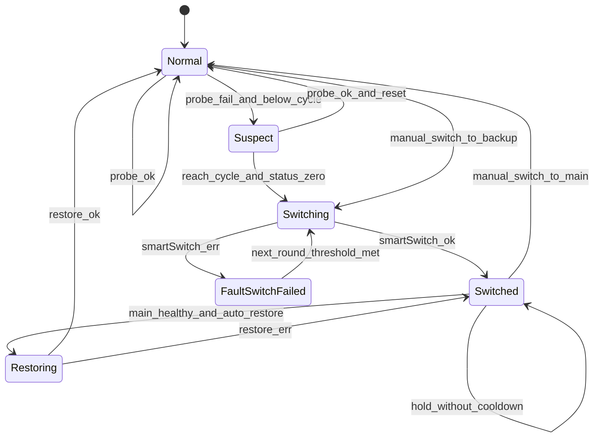
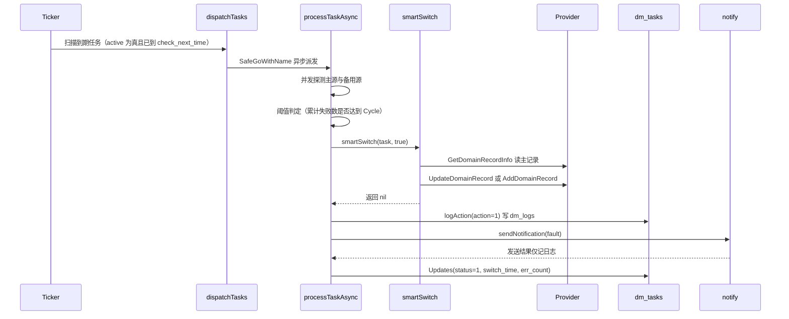
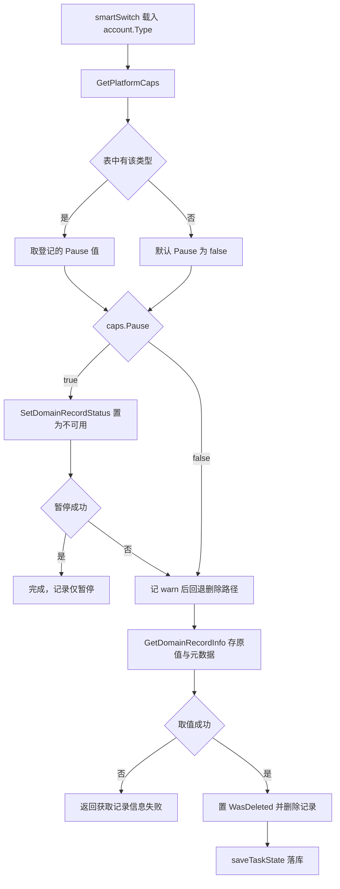
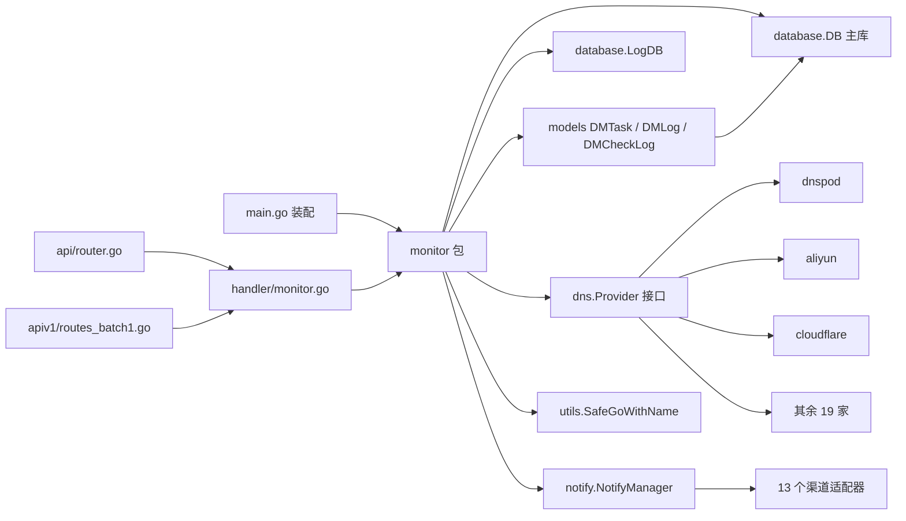
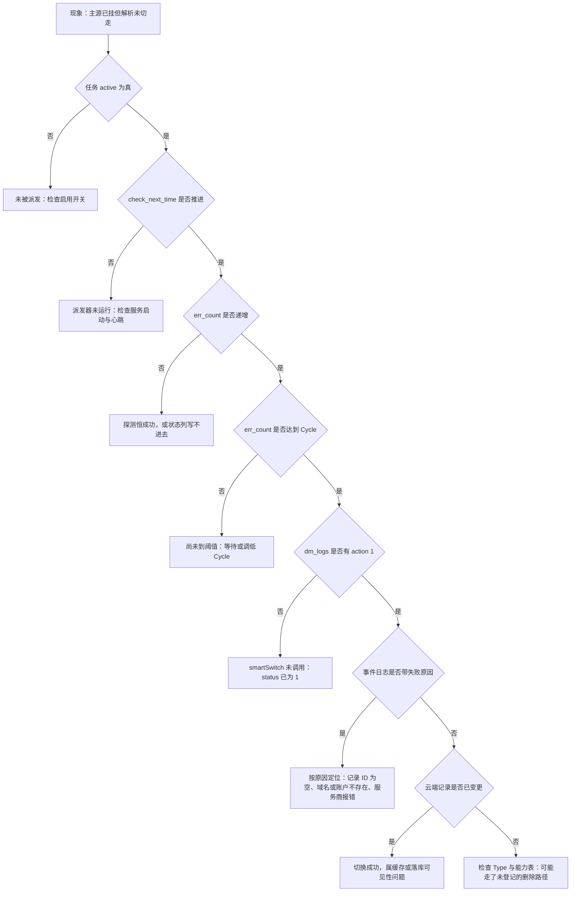

# 故障切换逻辑

<cite>
**本文档引用的文件**
- [monitor.go](file://main/internal/monitor/monitor.go)
- [check.go](file://main/internal/monitor/check.go)
- [ssrf.go](file://main/internal/monitor/ssrf.go)
- [capabilities.go](file://main/internal/monitor/capabilities.go)
- [handler/monitor.go](file://main/internal/api/handler/monitor.go)
- [schedule.go](file://main/internal/service/schedule.go)
- [models.go](file://main/internal/models/models.go)
- [interface.go](file://main/internal/dns/interface.go)
- [router.go](file://main/internal/api/router.go)
- [routes_batch1.go](file://main/internal/apiv1/routes_batch1.go)
- [main.go](file://main/main.go)
- [notify.go](file://main/internal/notify/notify.go)
- [channel_registry.go](file://main/internal/notify/channel_registry.go)
- [maintenance.go](file://main/internal/database/maintenance.go)
- [page.tsx](file://web/app/(dashboard)/dashboard/monitor/page.tsx)
</cite>

## 目录

1. [简介](#简介)
2. [项目结构](#项目结构)
3. [核心组件](#核心组件)
4. [架构总览](#架构总览)
5. [详细组件分析](#详细组件分析)
6. [依赖关系分析](#依赖关系分析)
7. [性能考虑](#性能考虑)
8. [故障排查指南](#故障排查指南)
9. [结论](#结论)
10. [附录](#附录)

## 简介

故障切换是容灾监控的写入侧：探测发现主源连续失败达到阈值后改写云端 DNS 记录，把解析指向备用源；主源恢复且任务开启自动回切时再还原。整条链路由常驻协程驱动，无需人工介入即可闭环。

本文只讲**切换与回切的决策与执行**，即 `main/internal/monitor/monitor.go` 中从阈值判定到记录落地的代码路径。探测手段本身属于监控探测文档，本文仅在影响切换结论时引用其判定口径。

### 范围界定

| 维度 | 覆盖 | 不覆盖 |
| --- | --- | --- |
| 触发 | `err_count` 累计与 `Cycle` 比较（`monitor.go:308-311`） | ICMP/TCP/HTTP 参数细节 |
| 执行 | 三种策略在 22 家服务商上的记录改写（`:445-661`） | 记录增删改的通用控制台操作 |
| 回切 | `status == 1 && AutoRestore` 单轮全绿即回切（`:292`） | 定时切换的日历式到点动作 |
| 旁路 | 三类事件通知与两层渠道筛选（`:766-899`） | 证书、域名到期告警链路 |
| 保护 | 任务重入锁与全局探测信号量（`:165`、`:342`） | 多副本部署的分布式锁 |

**章节来源**
- [monitor.go:285-334](file://main/internal/monitor/monitor.go#L285-L334)
- [monitor.go:445-661](file://main/internal/monitor/monitor.go#L445-L661)

### 阅读前置

| 概念 | 代码对应 | 定义位置 |
| --- | --- | --- |
| 一个被监控的记录 | `dm_tasks` 一行，含探测配置与切换配置 | `models.go:133-176` |
| 是否已切换 | `status`，0 正常 / 1 已切换 | `models.go:160` |
| 连续失败数 | `err_count`，主源健康即清零 | `models.go:159` |
| 切换阈值 | `cycle`，默认 3 | `models.go:150` |
| 可逆性凭据 | `record_info` 列承载的 `TaskState` JSON | `models.go:163`、`monitor.go:42-53` |
| 能否暂停记录 | 平台能力 `caps.Pause` | `capabilities.go:4-33` |

**章节来源**
- [models.go:133-176](file://main/internal/models/models.go#L133-L176)
- [monitor.go:41-53](file://main/internal/monitor/monitor.go#L41-L53)
- [capabilities.go:1-33](file://main/internal/monitor/capabilities.go#L1-L33)

## 项目结构

切换逻辑集中在 `monitor` 包，写入入口在 `api/handler`，记录改写通过 `dns.Provider` 抽象落到 22 家服务商。`main/main.go:105-107` 把监控服务作为进程装配第 10 步启动。

### 文件与职责

| 文件 | 行数 | 在切换链路中的职责 | 关键位置 |
| --- | --- | --- | --- |
| `main/internal/monitor/monitor.go` | 1049 | 主循环、派发、阈值判定、切换与回切执行、通知装载、状态存储 | `:107-127`、`:285-334`、`:411-740` |
| `main/internal/monitor/check.go` | 372 | 探测实现与成功/失败判定，产出 `mainHealthy`；`GetRecordType` | `:52-60`、`:163-174`、`:363-372` |
| `main/internal/monitor/capabilities.go` | 33 | 平台能力表，决定暂停还是删除 | `:10-26`、`:28-33` |
| `main/internal/monitor/ssrf.go` | 127 | HTTP(S) 探测地址的协议与私网拦截 | `:15-18`、`:31` |
| `main/internal/api/handler/monitor.go` | 1270 | 手动切换入口与运行状态查询 | `:472-528`、`:791-809` |
| `main/internal/dns/interface.go` | 167 | 被切换侧调用的写方法契约 | `:41`、`:58-73` |
| `main/internal/models/models.go` | 370 | `DMTask` / `DMCheckLog` / `DMLog` 结构 | `:133-199` |
| `main/internal/notify/notify.go` | 914 | `NotifyManager` 串行外发 | `:688-704` |
| `main/internal/database/maintenance.go` | 444 | 切换日志与探测历史保留期清理 | `:19-20`、`:218-232` |

`monitor.go` 单文件承担 5 个职责：生命周期（`:68-141`）、调度派发（`:144-179`）、决策（`:183-335`）、执行（`:411-708`）、旁路副作用（`:766-937`）。前四层是严格串行依赖，第五层失败不回滚主流程——这个不对称是"云端已变更但库里看不到"类问题的结构根源。

**章节来源**
- [monitor.go:1-1049](file://main/internal/monitor/monitor.go#L1-L1049)
- [check.go:1-372](file://main/internal/monitor/check.go#L1-L372)
- [main.go:105-107](file://main/main.go#L105-L107)

### handler 侧入口

切换只有一个写入端点，控制台与对外 API 共用同一个 handler：

| 方法 | 路径 | handler | 路由位置 |
| --- | --- | --- | --- |
| POST | `/api/monitor/tasks/:id/switch` | `SwitchMonitorTask` | `router.go:174` |
| POST | `/api/v1/monitor/tasks/switch` | `SwitchMonitorTask` | `routes_batch1.go:78` |
| GET | `/api/monitor/tasks/:id/resolve-status` | `GetResolveStatus` | `router.go:178` |
| GET | `/api/monitor/status` | `GetMonitorStatus` | `router.go:183` |

入参 `to_backup` 是指针类型（`handler/monitor.go:474`），用于区分"未传"与"传了 false"：未传时按当前 `status` 取反（`:510-515`），即正常态点击切到备用、已切换态点击回切。前端手动切换按钮走的就是这个默认方向（`page.tsx:513`）。

**章节来源**
- [handler/monitor.go:472-528](file://main/internal/api/handler/monitor.go#L472-L528)
- [router.go:169-183](file://main/internal/api/router.go#L169-L183)
- [routes_batch1.go:69-88](file://main/internal/apiv1/routes_batch1.go#L69-L88)

## 核心组件

### 状态机：status 与 err_count 的二元组

切换状态没有独立状态列，而是由 `dm_tasks.status` 与 `dm_tasks.err_count` 拼出的隐式状态机：

| 逻辑态 | status | err_count | 进入条件 | 退出条件 |
| --- | --- | --- | --- | --- |
| 正常 | 0 | 0 | 初始或回切成功 | 探测失败累计 |
| 疑似故障 | 0 | 1..Cycle-1 | 有失败但未达阈值 | 主源恢复清零；达阈值切换 |
| 切换中 | 0 | ≥ Cycle | `smartSwitch(task, true)` 期间 | 成功置 1，失败保持 0 |
| 已切换 | 1 | 0 | 切换成功 | 主源恢复且开启回切 |
| 回切中 | 1 | 0 | `restoreRecord` 期间 | 成功置 0，失败保持 1 |
| 故障且切换失败 | 0 | ≥ Cycle | `switchErr != nil` | 下一轮阈值条件重新成立 |

最后一行是全局行为的关键：**切换失败不推进状态**（`monitor.go:319-330`），下一轮 `errCount >= Cycle && Status == 0`（`:311`）再次成立。这既是"最终会切过去"的自愈保证，也是重复写接口与重复告警的风暴来源。

**章节来源**
- [monitor.go:285-334](file://main/internal/monitor/monitor.go#L285-L334)
- [models.go:159-160](file://main/internal/models/models.go#L159-L160)

### 阈值与冷却

判定式一行：`errCount >= task.Cycle && task.Status == 0`（`monitor.go:311`），其中 `errCount = task.ErrCount + 1`（`:308`）。默认 `Cycle=3`、`Frequency=60` 时，从首次真实故障到切换落地约需 3 个周期。

两处边界无守卫：`Cycle` 为 0 时首次失败即切换；`Frequency` 为 0 时派发器把下次检查时间算成 `now + 0`（`:177`），下一秒立即重跑。创建路径有零值兜底、更新路径没有，差异见故障排查。

冷却方面，`monitor.go` 全文通读可确认不存在任何冷却、退避、静默期或告警合并判定。与"距离上次切换多久"相关的只有 `switch_time`（`models.go:158`），它在切换成功（`:321`）与回切成功（`:297`）时被写入，但**没有任何一处读取它做时间窗比较**。因此主源在阈值上下抖动时，切换与回切可在相邻两周期内来回发生。`TaskState` 与 `DMTask` 都未预留冷却字段，加冷却需同时改表结构与判定式，属契约变更。

**章节来源**
- [monitor.go:174-178](file://main/internal/monitor/monitor.go#L174-L178)
- [monitor.go:292-334](file://main/internal/monitor/monitor.go#L292-L334)
- [models.go:150-158](file://main/internal/models/models.go#L150-L158)

### DNS 记录替换的可逆性凭据

切换能否还原，不依赖服务商而依赖 `record_info` 里那份 JSON：

| 字段 | 作用 | 写入点 | 读取点 |
| --- | --- | --- | --- |
| `OriginalValue` | 切换前主源值，回切时还原 | `:557`、`:495`、`:456` | `:538-541`、`:691-694` |
| `DeletedRecord` | 被删记录的 type/line/ttl/mx/remark，重建时逐字段复用 | `:496-500`、`:608-612`、`:635-639` | `:526-543` |
| `WasDeleted` | 主记录是被删除还是仅暂停，决定回切走重建还是启用 | `:501`、`:603`、`:613`、`:640` | `:514`、`:522`、`:674` |
| `BackupRecordIDs` | 切换期间新增的备用记录 ID，回切时逐条删除 | `:589`、`:656` | `:666-671` |

`record_info` 声明 `size:200`（`models.go:163`），上述字段序列化后很容易超限。`saveTaskState` 用 `Update` 写入且不检查错误（`monitor.go:924-927`），MySQL 严格模式下截断报错会被静默吞掉；后果是回切读不到完整 `DeletedRecord`，落到 `recreateRecord` 的默认值分支（`line=default`、`ttl=600`、`type=A`，`:526-541`）。

**章节来源**
- [monitor.go:42-53](file://main/internal/monitor/monitor.go#L42-L53)
- [monitor.go:479-553](file://main/internal/monitor/monitor.go#L479-L553)
- [monitor.go:923-927](file://main/internal/monitor/monitor.go#L923-L927)
- [models.go:163](file://main/internal/models/models.go#L163)

### 组件职责矩阵

| 组件 | 输入 | 输出 | 失败时的行为 |
| --- | --- | --- | --- |
| `dispatchTasks` | `dm_tasks` 到期行 | goroutine + `check_next_time` 顺延 | 顺延与派发解耦，派发跳过仍会顺延 |
| `processTaskAsync` | 单个 `DMTask` 快照 | `dm_check_logs` + `dm_tasks` 状态列 | `:334` 的 `Updates` 错误被丢弃 |
| `smartSwitch` | `DMTask` + 方向 | error | 返回错误，调用方记日志并告警 |
| `switchToBackup` | provider + `TaskState` | 云端记录变更 + `record_info` | 部分删除错误被忽略（`:604`、`:614`、`:645`、`:648`） |
| `restoreRecord` | `DMTask` | error | 只记日志，状态保持已切换 |
| `sendNotification` | 事件类型 | 外发结果 | 无渠道时打一条 warn 后返回 |

**章节来源**
- [monitor.go:144-179](file://main/internal/monitor/monitor.go#L144-L179)
- [monitor.go:411-477](file://main/internal/monitor/monitor.go#L411-L477)
- [monitor.go:705-708](file://main/internal/monitor/monitor.go#L705-L708)

## 架构总览

### 状态迁移全景

下图把代码里的隐式状态机显式化。状态名是本文的分析标签，落库仍是 `status` 与 `err_count` 两列。

**图表来源**
- [monitor.go:285-334](file://main/internal/monitor/monitor.go#L285-L334)
- [monitor.go:705-740](file://main/internal/monitor/monitor.go#L705-L740)

迁移与落库字段的对应关系：

| 迁移 | 判定条件 | 落库字段 |
| --- | --- | --- |
| Suspect 内自环 | `errCount = ErrCount + 1` 且未达阈值 | `err_count`、`check_time`、`last_error`、`main_health` |
| Suspect → Switching | `errCount >= Cycle && Status == 0` | `fault_time` |
| Switching → Switched | `smartSwitch` 返回 nil | `status=1`、`switch_time`、`record_info` |
| Switching → FaultSwitchFailed | `smartSwitch` 返回错误 | `dm_logs.action=1`，无 `status` 变更 |
| Switched → Normal | `AutoRestore` 且 `restoreRecord` 返回 nil | `status=0`、`recover_time`、`err_count=0` |

三条结构性观察：`FaultSwitchFailed → Switching` 无边数上限或退避守卫；`Switched → Restoring` 只要求本轮主源全绿，没有连续轮次确认，也没有最小驻留时间；手动路径与自动路径共用 `smartSwitch`，但各自维护一份字段清单（`:723-738` 与 `:275-283`）。

**章节来源**
- [monitor.go:275-334](file://main/internal/monitor/monitor.go#L275-L334)
- [monitor.go:710-740](file://main/internal/monitor/monitor.go#L710-L740)

### 一次完整故障周期的时序

**图表来源**
- [monitor.go:107-179](file://main/internal/monitor/monitor.go#L107-L179)
- [monitor.go:306-334](file://main/internal/monitor/monitor.go#L306-L334)
- [monitor.go:555-661](file://main/internal/monitor/monitor.go#L555-L661)

倒数两步的顺序很关键：通知发送在状态落库**之前**（`:324` 早于 `:334`），且 `sendNotification` 同步执行，内部逐渠道串行发送并受 10 秒 ctx 约束（`:814-821`、`notify.go:688-697`）。也就是说 `status=1` 要等所有渠道尝试完才写进库——渠道慢会拖后状态可见时间，这段窗口内进程被杀，则云端已切换而库里仍是正常态。

**章节来源**
- [monitor.go:181-190](file://main/internal/monitor/monitor.go#L181-L190)
- [monitor.go:300-334](file://main/internal/monitor/monitor.go#L300-L334)
- [notify.go:688-704](file://main/internal/notify/notify.go#L688-L704)

## 详细组件分析

### 主源判定：任一失败即故障

主源值按逗号拆成列表（`parseValues`，`monitor.go:952-965`），每个地址起一个 goroutine 并行探测，任一地址失败就把 `mainHealthy` 置 false（`:210-212`）。没有比例阈值也没有仲裁：3 个主源挂 1 个与挂 3 个，在切换决策上完全等价。多 IP 轮询场景下，单点抖动即可触发整条记录切到备用值。

`errMsg` 只取 map 中第一个失败项（`:244-250`）。Go 的 map 遍历顺序随机，因此同一批故障在不同轮次可能给出不同错误文本，告警内容不稳定。所有主源探测共用一个 `WaitGroup`，任务级 ctx 超时为 `Timeout + 10` 秒（`:192`）。

**章节来源**
- [monitor.go:192-215](file://main/internal/monitor/monitor.go#L192-L215)
- [monitor.go:244-250](file://main/internal/monitor/monitor.go#L244-L250)
- [monitor.go:951-965](file://main/internal/monitor/monitor.go#L951-L965)

### 备用值选取与健康位默认值

备用值优先取 `BackupValues`（逗号分隔），回退 `BackupValue`（`getBackupValues`，`:967-976`）。每个备用值先经 `resolveToAddrs` 解析成可探测地址（`:978-989`）：已是 IP 直接用，否则 `resolveCNAME` 取 IPv4，解析失败则回退用原值探测。

健康位写 `backupHealthMap[val] = result.Success`（`:232`）。同一备用值解析出多个地址时后写覆盖前写，因此一个备用域名多 IP 场景下健康位取决于 goroutine 完成顺序。切换时选第一个健康备用值（`:569-576`），而 `isBackupHealthy` 在内存快照缺失时返回 `true`（`:939-949`）。

快照 `resolveStatuses` 只在 `processTaskAsync` 写入（`:274`），进程重启即为空。因此**重启后第一轮故障切换会在没有任何备用探测数据的情况下，直接选用列表第一个备用值**，即使它已不可用。备用列表为空时 `switchToBackup` 返回 `无备用值`（`:564-567`），进入切换失败分支。

**章节来源**
- [monitor.go:216-236](file://main/internal/monitor/monitor.go#L216-L236)
- [monitor.go:555-576](file://main/internal/monitor/monitor.go#L555-L576)
- [monitor.go:939-989](file://main/internal/monitor/monitor.go#L939-L989)

### 切换策略分派与记录改写矩阵

`smartSwitch` 按 `task.Type` 分派（`:445-476`，值域注释见 `models.go:141`），三条路径的可逆性代价完全不同：

| Type | 名称 | 切到备用时 | 回切时 | `record_id` 是否变更 | 破坏性 |
| --- | --- | --- | --- | --- | --- |
| 0 | 暂停/恢复 | `disableRecord`：优先暂停，不支持或失败则删除并存原值 | `enableRecord`：`WasDeleted` 为真转重建，否则启用 | 删除路径会变 | 中 |
| 1 | 删除/重建 | 先存原值与元数据，再删除记录 | `recreateRecord` | 一定会变（新 ID） | 高 |
| 2 | 切换备用值 | `switchToBackup` | `switchToMain` | 视类型是否一致 | 低到高 |

分派前有两道空值守卫：`DomainID == 0` 与 `RecordID == ""` 直接返回错误（`:412-417`），这是唯一一处对任务配置完整性的显式校验；`Type` 之外的值返回 `unknown task type`（`:476`）不做任何写操作。

Type 2 的改写动作由"备用值类型"与"主记录类型"是否一致决定（`:622-657`），类型判定用 `GetRecordType`（`check.go:363-372`：IP 得 A/AAAA，其余得 CNAME）：

| 主记录 | 备用值 | 判定 | 改写动作 |
| --- | --- | --- | --- |
| A | IPv4 | 一致 | `UpdateDomainRecord` 原地改值 |
| AAAA | IPv6 | 一致 | `UpdateDomainRecord` 原地改值 |
| A | IPv6 或域名 | 不一致 | 暂停或删除主记录 + 新增对应类型记录 |
| CNAME | IPv4/IPv6 | 不一致 | 暂停或删除主记录 + 新增 A 记录 |
| CNAME | 域名 | 走 CNAME 备用分支 | 解析为 IPv4 后逐条加 A 记录 + 禁用主记录 |

最后一行（`:578-619`）的设计意图是避开"CNAME 与 A 不能共存"，代价是把弹性域名固化成若干静态 IP——备用方换 IP 后已切换的记录不会自动跟进，只能靠回切再重切刷新。新增 A 记录时错误被忽略（`:587-590` 仅在 `addErr == nil` 时追加 ID），部分 IP 添加失败既无告警，回切时也不会去删。

**章节来源**
- [monitor.go:411-477](file://main/internal/monitor/monitor.go#L411-L477)
- [monitor.go:555-661](file://main/internal/monitor/monitor.go#L555-L661)
- [check.go:363-372](file://main/internal/monitor/check.go#L363-L372)
- [models.go:141](file://main/internal/models/models.go#L141)

### 平台能力驱动的暂停/删除回退

`capabilities.go` 只登记 15 家服务商（`:10-26`），而 `main/internal/dns/providers/` 实际有 22 个子目录。未登记类型取 `GetPlatformCaps` 默认值 `{Pause: false, Delete: true, Mixed: false}`（`:28-33`），即默认认为不支持暂停。

**图表来源**
- [capabilities.go:10-33](file://main/internal/monitor/capabilities.go#L10-L33)
- [monitor.go:437-437](file://main/internal/monitor/monitor.go#L437-L437)
- [monitor.go:479-510](file://main/internal/monitor/monitor.go#L479-L510)

三点由上述文件通读可直接确认：`PlatformCaps` 三个字段中只有 `Pause` 被消费（`:481`、`:594`、`:643`），`Delete` 与 `Mixed` 在整个包内没有任何读取点；未登记的 7 家即便实际支持状态切换也会走删除重建这条破坏性路径，回切必然生成新 `record_id`；`disableRecord` 在删除失败时返回错误且不落 `WasDeleted`（`:503-507`），这一条路径是安全的——不安全的顺序问题在 `switchToBackup`，详见故障排查。

**章节来源**
- [capabilities.go:1-33](file://main/internal/monitor/capabilities.go#L1-L33)
- [monitor.go:479-510](file://main/internal/monitor/monitor.go#L479-L510)
- [monitor.go:594-649](file://main/internal/monitor/monitor.go#L594-L649)

### 回切条件与四级回退

回切唯一入口在健康分支的 `if task.Status == 1 && task.AutoRestore`（`monitor.go:292`）。成功后一次性写 `status=0`、`switch_time`、`recover_time`、`err_count=0`，记一条 `action=2` 事件日志并发 `recover` 通知（`:296-301`）；失败只打一条 error 日志，状态保持已切换（`:302-304`），下一轮主源仍健康时再次尝试——这是回切方向唯一的隐式重试。

`restoreRecord` 即 `smartSwitch(task, false)`（`:705-708`），三分支各自的回退顺序：

| 分支 | 第一选择 | 失败后回退 | 最终回退 |
| --- | --- | --- | --- |
| Type 0 | 启用记录；若 `WasDeleted` 直接转重建 | 无 | 无 |
| Type 1 | `recreateRecord`，元数据缺省补 `default`/600/`A`/`MainValue` | 无 | 无 |
| Type 2 | 删全部备用记录 → 曾删除则重建 → 否则启用主记录 | 启用失败转读记录再改值回 `OriginalValue` | 读记录失败即返回错误 |

`switchToMain` 清理备用记录时逐条删除并把失败降级为 warn（`:666-670`），不中断回切，随后 `BackupRecordIDs` 置 nil（`:671`）——删除失败的备用记录会成为云端孤儿，且此后没有任何结构记得它存在。`recreateRecord` 在 `!state.WasDeleted` 时直接返回 nil（`:522-524`），若暂停实际成功但 `record_info` 写入失败，回切会误判为无需处理，主记录停留在暂停态。

**章节来源**
- [monitor.go:285-305](file://main/internal/monitor/monitor.go#L285-L305)
- [monitor.go:512-553](file://main/internal/monitor/monitor.go#L512-L553)
- [monitor.go:663-708](file://main/internal/monitor/monitor.go#L663-L708)

### 通知发送：三类事件与两层筛选

`sendNotification` 只认三种事件，其余直接返回（`:788-805`）：

| 事件 | 触发点 | 标题前缀 | 正文要点 |
| --- | --- | --- | --- |
| `fault` | `:324` 切换成功 | 【容灾告警】 | 域名、主源、错误、已切到备用 |
| `fault_switch_failed` | `:329` 切换失败 | 【紧急告警】 | 额外附失败原因，提示人工介入 |
| `recover` | `:301` 回切成功 | 【容灾恢复】 | 域名、主源、已恢复 |

域名展示值按 `RR + "." + domain.Name` 拼接，`RR` 为 `@` 时只用域名（`:782-785`）。正文里"连续失败: %d 次"取的是阈值 `task.Cycle`（`:793`、`:798`）而非实际累计值 `errCount`，因此实际失败 7 次时告警仍显示 3 次。

渠道装载 `buildNotifyManager`（`:824-873`）在 `notify` 注册表之上叠加两层筛选：先按 `NoticeKey()` 非空的渠道查 `notice_*` 开关（`:857`），再按任务白名单 `channelInTaskWhitelist` 过滤（`:860`），两者都通过才 `ch.Build` 并 `AddNotifier`（`:863-866`）。`noticeEnabled` 的语义是未配置视为开启、仅显式 `0`/`false`/`no`/`off` 关闭（`:918-921`），管辖的开关键共 6 个（`channel_registry.go:47-49`），其余渠道 `NoticeKey()` 为空即不受容灾开关管辖。任务白名单为空时 `useAll` 为 true，全部已配置渠道都会发送（`:849`）；白名单有 `mail`/`email` 与 `wxwork`/`wxwork_app` 两处别名兼容（`:905-908`）。

装载成功数为 0 时返回 nil，调用方仅打一条 warn（`:808-812`）。发送串行且 `Send` 只返回第一个错误（`notify.go:688-704`），因此 `monitor.go:818` 的失败日志无法反映哪些渠道真的没发出去。整条链路无重试、无补发、无节流。

**章节来源**
- [monitor.go:766-899](file://main/internal/monitor/monitor.go#L766-L899)
- [monitor.go:918-921](file://main/internal/monitor/monitor.go#L918-L921)
- [channel_registry.go:42-49](file://main/internal/notify/channel_registry.go#L42-L49)
- [notify.go:688-704](file://main/internal/notify/notify.go#L688-L704)

### 并发切换保护与手动路径

保护分两个层级，粒度与失败后果不同：

| 机制 | 载体 | 容量 | 目的 | 生命周期 |
| --- | --- | --- | --- | --- |
| 任务重入锁 | `processing sync.Map` | 无上限 | 同一任务不被两个 goroutine 并发处理 | `LoadOrStore` 于 `:165`，`Delete` 于 `:185` |
| 探测信号量 | `checkSem chan struct{}` | 64（`:29`） | 限制同时持有的 socket 数 | 获取与释放都在 `checkAddress` 内（`:342-344`） |

任务锁是切换幂等的关键：派发器每 tick 都会命中同一到期任务，靠 `processing.LoadOrStore` 拦重入；`processTaskAsync` 用 defer 释放（`:185`）并在同一函数 `recover` panic（`:186-190`），因此协程崩溃不会导致锁永久泄漏。但即便任务因重入被跳过，派发器仍会顺延它的下次检查时间（`:164-167` 的 `continue` 在 ID 收集之后），实际探测间隔被拉长而非并发执行。

信号量层面的误判风险更严重：等待槽位期间 ctx 到期就返回失败结果 `"探测并发已满且等待超时"`（`:342-347`），这条结果与真实探测失败在 `:210-212` 处完全等价，会把主源判为不健康并累计 `err_count`。任务数一多就会出现与目标健康度无关的批量误切换。跨进程维度没有任何保护——`processing` 是实例字段（`:63`），多副本部署时两个副本可同时对同一条记录发起切换。

`ManualSwitch`（`:710-740`）是唯一绕开阈值直接执行切换的路径，它自己重查任务（`:713`）、不复用内存快照，与自动路径的差异：

| 维度 | 自动路径 | 手动路径 |
| --- | --- | --- |
| 触发 | 阈值判定（`:311`） | 端点调用（`handler/monitor.go:517`） |
| 备用健康位 | 读 `resolveStatuses`，缺失即视为健康 | 同样读快照，重启后为空 |
| 是否发通知 | 是 | 否 |
| 是否记 `dm_logs` | 是 | 是（`:730`、`:736`） |
| 权限校验 | 无（协程内部） | 模块 + 域名 + 只读位 + 子域（`handler/monitor.go:505`） |

手动切换不发通知但写审计日志（`handler/monitor.go:526`），这解释了"运维手动切过去之后告警渠道里没有记录"的常见疑问。

**章节来源**
- [monitor.go:56-65](file://main/internal/monitor/monitor.go#L56-L65)
- [monitor.go:144-190](file://main/internal/monitor/monitor.go#L144-L190)
- [monitor.go:338-347](file://main/internal/monitor/monitor.go#L338-L347)
- [monitor.go:710-740](file://main/internal/monitor/monitor.go#L710-L740)
- [handler/monitor.go:477-528](file://main/internal/api/handler/monitor.go#L477-L528)

## 依赖关系分析

### 依赖扇出

切换是 `monitor` 包唯一会写云端权威数据的路径，其依赖扇出直接决定故障半径。

**图表来源**
- [monitor.go:3-17](file://main/internal/monitor/monitor.go#L3-L17)
- [main.go:105-107](file://main/main.go#L105-L107)
- [router.go:169-183](file://main/internal/api/router.go#L169-L183)

切换只用到 Provider 接口的 1 读 + 5 写方法（`interface.go:41-73`）：

| 方法 | 接口定义行 | 调用点 | 用途 |
| --- | --- | --- | --- |
| `GetDomainRecordInfo` | `:58` | `:454`、`:490`、`:559`、`:686` | 取原值与 type/line/ttl/mx/remark |
| `UpdateDomainRecord` | `:64` | `:626`、`:696` | 类型一致时原地改值 |
| `AddDomainRecord` | `:61` | `:543`、`:587`、`:652` | 重建主记录或新增备用记录 |
| `DeleteDomainRecord` | `:70` | `:465`、`:503`、`:604`、`:614`、`:645`、`:648`、`:667` | 删除主记录或清理备用记录 |
| `SetDomainRecordStatus` | `:73` | `:482`、`:517`、`:595`、`:644`、`:679` | 暂停与启用 |

provider 实例由 `dns.GetProvider(account.Type, config, domain.Name, domain.ThirdID)` 现取（`monitor.go:432`），账户配置 JSON 在此反序列化（`:430`）。关键缺陷：`smartSwitch` 用 `context.Background()`（`:438`），**不继承任务 ctx 的超时**，服务商 API 挂住时任务级 `Timeout + 10` 秒约束对它无效，`processTaskAsync` 可长时间不返回，期间任务锁一直被持有。

**章节来源**
- [interface.go:41-73](file://main/internal/dns/interface.go#L41-L73)
- [monitor.go:411-477](file://main/internal/monitor/monitor.go#L411-L477)

### 数据写点与保留期

| 目标 | 写入点 | 检查错误 | 影响 |
| --- | --- | --- | --- |
| `dm_check_logs`（LogDB） | `monitor.go:253-265` | 否 | 裸 goroutine，停机可丢 |
| `dm_tasks` 状态列 | `monitor.go:334` | 否 | 整轮判定结果落地与否全靠这一条 |
| `dm_tasks.record_id` | `monitor.go:548` | 否 | 重建后新 ID 不回写则下次切换失败 |
| `dm_tasks.record_info` | `monitor.go:926` | 否 | 回切可逆性凭据 |
| `dm_tasks`（手动） | `monitor.go:738` | 否 | 手动切换状态 |
| `dm_logs` | `monitor.go:931` | 否 | 事件日志 |
| `sys_configs.run_time` | `monitor.go:132` | 否 | 心跳 |

七处状态写入全部不检查返回值，这是本文所有"云端已变更但库里看不到"问题的共同根因。两类日志由维护协程按保留期回收：`dm_check_logs` 走 `maint_check_log_hours` 默认 72 小时（`maintenance.go:20`、`:52`、`:218-224`），`dm_logs` 走 `maint_monitor_log_days` 默认 60 天（`:19`、`:51`、`:226-232`）；`dm_tasks` 不参与清理，因此删除任务后其探测历史会成为孤儿行。

**章节来源**
- [monitor.go:253-265](file://main/internal/monitor/monitor.go#L253-L265)
- [monitor.go:923-937](file://main/internal/monitor/monitor.go#L923-L937)
- [maintenance.go:16-52](file://main/internal/database/maintenance.go#L16-L52)
- [maintenance.go:218-232](file://main/internal/database/maintenance.go#L218-L232)

## 性能考虑

### 派发与并发预算

| 常量 | 值 | 定义位置 | 超限时行为 |
| --- | --- | --- | --- |
| `maxDispatchPerTick` | 100 | `monitor.go:24` | 未派发任务保持原 `check_next_time`，下轮按升序优先 |
| `maxConcurrentChecks` | 64 | `monitor.go:29` | 排队等待，等待期间 ctx 超时即判探测失败 |
| 任务 ctx 超时 | `Timeout + 10` 秒 | `monitor.go:192` | `WaitGroup` 内探测被 ctx 取消 |

按 `check_next_time` 升序取前 N 个（`:150-153`）让积压任务优先，配合 100 的上限形成公平调度。但 64 个探测槽被所有任务共享，单任务占用的槽位数等于主源地址数加上备用值解析出的地址数之和：一个配 5 主源 + 5 备用域名的任务可占 10 个以上槽位并持续数十秒，10 个这样的任务就打满信号量。

结论：容量估算应按"并发地址总数 / 64"而不是"任务数"，这是配置监控规模时最容易忽略的一点。

**章节来源**
- [monitor.go:21-29](file://main/internal/monitor/monitor.go#L21-L29)
- [monitor.go:144-179](file://main/internal/monitor/monitor.go#L144-L179)
- [monitor.go:338-347](file://main/internal/monitor/monitor.go#L338-L347)

### 同步通知与查询放大

`sendNotification` 在判定分支内同步调用（`:301`、`:324`、`:329`），内部串行走完所有渠道，10 秒 ctx 约束的是整体（`:814-821`）。最坏情况下状态落库（`:334`）推迟到通知全部尝试完毕，带来两个次生效应：任务锁未释放导致同任务不再派发、实际检测间隔被放大；进程此间退出时 `defer wg.Wait()`（`:102`）只等主循环不等这些协程，云端已改而库里状态未更新。

`buildNotifyManager` 每次告警都执行一次 `WHERE key IN (71 个键)` 直查主库（`:832`），键集合来自 `notify.NotifyConfigKeys()`。批量域名同时抖动时每次切换或恢复都新增这条查询，而主库同时是 `dm_tasks` 写入目标。前端侧另有读取放大：监控台每 15 秒轮询列表并对每个任务并发请求 1 小时探测历史，单页最多 200 个任务即一轮最多 200 次 LogDB 扫描，而 `dm_check_logs` 只有单列索引、缺少 `task_id + created_at` 复合索引；72 小时保留期在 60 秒间隔下每任务约 4320 行，200 任务约 86 万行，前端轮询与切换写入会争抢同一个 SQLite。

**章节来源**
- [monitor.go:181-190](file://main/internal/monitor/monitor.go#L181-L190)
- [monitor.go:300-334](file://main/internal/monitor/monitor.go#L300-L334)
- [monitor.go:824-873](file://main/internal/monitor/monitor.go#L824-L873)
- [maintenance.go:19-20](file://main/internal/database/maintenance.go#L19-L20)

## 故障排查指南

### 切换未生效的分层定位

切换"没生效"有 6 个可能断点，必须按序排除，跳层易误判：

**图表来源**
- [monitor.go:144-179](file://main/internal/monitor/monitor.go#L144-L179)
- [monitor.go:306-334](file://main/internal/monitor/monitor.go#L306-L334)
- [monitor.go:929-937](file://main/internal/monitor/monitor.go#L929-L937)

**章节来源**
- [monitor.go:144-179](file://main/internal/monitor/monitor.go#L144-L179)
- [monitor.go:306-334](file://main/internal/monitor/monitor.go#L306-L334)

### 状态列写不进去

这是最需要优先排除的一条。`processTaskAsync` 的 `updates` map 含 4 个列名：`last_error`（`monitor.go:278`）、`backup_health`（`:282`）、`recover_time`（`:298`）、`fault_time`（`:316`），而 `DMTask` 结构体（`models.go:133-176`）经通读确认没有对应字段声明。

| 库状态 | `updates` 执行结果 | 表现 |
| --- | --- | --- |
| 旧库（历史版本遗留了这些列） | 成功 | 一切正常 |
| 新库（按当前结构体建表） | 整条 UPDATE 失败，错误被 `:334` 丢弃 | `err_count` 恒为 0 |

`err_count` 恒为 0 时 `errCount = 0 + 1 = 1`，默认 `Cycle=3` 下 `1 >= 3` 恒假，于是永不切换、永不告警、永不回切；`status` 同样写不进去，回切条件恒不成立。判定方法：主源持续故障时直接读 `err_count`，始终为 0 基本可锁定本条；若按 1、2、3 递增则跳过本条。

上游分析素材记录了对旧库 DDL 的实测（这些列存在于 `main/data/data.db` 而不在当前结构体）以及在按当前结构体新建的库上复现 UPDATE 失败、影响 0 行。本次未重跑该验证，引用时以此为准。

**章节来源**
- [monitor.go:275-283](file://main/internal/monitor/monitor.go#L275-L283)
- [monitor.go:296-334](file://main/internal/monitor/monitor.go#L296-L334)
- [models.go:133-176](file://main/internal/models/models.go#L133-L176)

### 探测恒成功与假健康

主源被判健康、`err_count` 不涨，用户以为"该切没切"。三个可由代码直接验证的成因：

| 成因 | 机制 | 证据 |
| --- | --- | --- |
| ICMP 不可用降级 TCP:80 | `icmp.ListenPacket` 需特权，失败即回退探测固定 80 端口 | `check.go:68-71`、`:149-161` |
| 80 通而业务端口挂 | 上一行的直接后果，降级探测成功即判主源健康 | `check.go:151-161` |
| HTTP 判定过宽 | 正文仅取前 8192 字节匹配关键词，状态码白名单可放过异常 | `check.go:21`、`:24-42` |

同类问题还有 SSRF 守卫的类型不对称：`validateCheckURL` 只对 `CheckType` 2/3 生效（`monitor.go:363`、`:377`），协议白名单仅 `http`/`https`（`ssrf.go:15-18`），并在 dial 阶段由 `ssrfDialControl` 二次拦截解析后指向私网的地址以对抗 DNS rebinding（`ssrf.go:29-30` 注释）；`CheckType` 0/1 与 `resolveToAddrs` 的解析（`monitor.go:979-989`）都不做私网判定。结果是同一私网目标用 HTTP 监控会被判失败并切换，改用 ping 或 tcp 则不会——配置时必须统一探测类型口径。

建议：把 `CheckType` 显式设为与业务真实端口一致的 TCP（`monitor.go:352-357`），不要依赖 ping 的降级路径；`TCPPort` 为 0 时代码回退 80（`:354-356`）。

**章节来源**
- [check.go:62-71](file://main/internal/monitor/check.go#L62-L71)
- [check.go:149-174](file://main/internal/monitor/check.go#L149-L174)
- [ssrf.go:15-31](file://main/internal/monitor/ssrf.go#L15-L31)
- [monitor.go:352-385](file://main/internal/monitor/monitor.go#L352-L385)
- [monitor.go:978-989](file://main/internal/monitor/monitor.go#L978-L989)

### 回切抖动与告警风暴

抖动表现为解析在主备之间来回切换，告警渠道短时间收到多条【容灾告警】与【容灾恢复】交替。成因组合均可由代码验证：回切无二次确认（`monitor.go:292`）、回切无驻留时间（`switch_time` 写了但无消费方）、主源判定过严（`:210-212`，反之任一时刻成功即算健康，无去抖）、切换失败反复重试（`:311` 与 `:325-330`）、告警无节流（`:767-822`）。

临时缓解首选**拉长 `Frequency`**，它同时降低切换与回切的频率上限；调大 `Cycle` 可延长判定窗口；关闭 `AutoRestore`（`models.go:174`）可彻底消除来回，代价是故障恢复后需人工回切。根治需要新增冷却字段与冷却判定，属表结构、决策式、API 三处联动改动。

**章节来源**
- [monitor.go:210-212](file://main/internal/monitor/monitor.go#L210-L212)
- [monitor.go:292-330](file://main/internal/monitor/monitor.go#L292-L330)
- [monitor.go:767-822](file://main/internal/monitor/monitor.go#L767-L822)
- [models.go:174](file://main/internal/models/models.go#L174)

### 记录残留、状态显示与前端缺口

三类记录残留：

| 现象 | 触发条件 | 代码依据 |
| --- | --- | --- |
| 备用记录成孤儿 | 回切时删除备用记录失败，仅记 warn 后继续 | `monitor.go:666-671` |
| 主/备重复解析 | `switchToBackup` 中 `WasDeleted` 已置真，紧随的删除不检查错误 | `:603-604`、`:613-614`、`:640-648` 配 `:617`、`:659` |
| CNAME 备用切换后不再跟进 | 切换时把备用域名固化为若干 A 记录 | `:586-591` |

第二行是顺序问题的核心：`state.WasDeleted = true` 之后紧跟的 `DeleteDomainRecord` 一律不检查返回值，而 `saveTaskState` 无条件执行，因此删除失败也会落库为"已删除"，回切据此走 `recreateRecord` 新增一条，与云端仍在的原记录构成同名重复解析。

运行状态显示类：`updateRunStatus` 由 60 秒 statusTicker 驱动（`:114`、`:130-141`），而 `/api/monitor/status` 只在 10 秒内视为运行（`handler/monitor.go:803`），两者相差 6 倍，绝大多数时刻前端都显示未启动——这不是切换故障，但会误导排查，排查前先确认 `run_time` 是否按 60 秒推进。另有一处 MySQL 专属问题：`handler/monitor.go:798` 写作 `Where("key = ?", "run_time")`，未加反引号，而 `key` 是 MySQL 保留字；同文件其他位置（`:132`、`:641`）与 `monitor.go:132` 一律带反引号。

前端可见性类：监控台的故障时间线依赖 `task.backup_health`、`last_error`、`fault_time`、`recover_time` 四个键（`page.tsx:992`、`:1000-1001`、`:1237-1256`），列表接口以 `dm_tasks.*` 扫描进 `models.DMTask` 再序列化，结构体没有这 4 个字段，因此这些键不会出现在 JSON 中，对应分支恒不渲染。渠道白名单同样有缺口：创建向导有通知渠道多选（`page.tsx:2001-2006`），编辑表单没有该字段，任务创建后无法通过界面调整白名单。

**章节来源**
- [monitor.go:586-619](file://main/internal/monitor/monitor.go#L586-L619)
- [monitor.go:630-671](file://main/internal/monitor/monitor.go#L630-L671)
- [monitor.go:113-141](file://main/internal/monitor/monitor.go#L113-L141)
- [handler/monitor.go:791-809](file://main/internal/api/handler/monitor.go#L791-L809)
- [page.tsx:992-1256](file://web/app/(dashboard)/dashboard/monitor/page.tsx#L992-L1256)

### 排查动作清单

| 目标 | 检查方式 | 判据 |
| --- | --- | --- |
| 服务是否在跑 | 查 `sys_configs.run_time` | 是否在 60 秒内推进 |
| 任务是否被派发 | 查 `dm_tasks.check_next_time` | 是否按 `frequency` 递增 |
| 阈值是否成立 | 查 `err_count` 与 `cycle` | 是否递增并触达 `cycle` |
| 探测是否真失败 | 查 `dm_check_logs` 的 `success` 与 `error` | 72 小时窗口内失败分布 |
| 切换是否执行 | 查 `dm_logs` 的 `action` | 1 切换、2 恢复（`models.go:196`） |
| 切换是否可逆 | 查 `record_info` JSON | `was_deleted` 与 `backup_record_ids` 是否与实际云端一致 |
| 通知是否装载 | 看进程日志 | 是否出现"无可用通知渠道"（`monitor.go:810`） |
| 云端是否真有记录 | 服务商控制台 | 与 `record_id` 是否一致（重建后 ID 会变） |

**章节来源**
- [monitor.go:808-812](file://main/internal/monitor/monitor.go#L808-L812)
- [models.go:178-199](file://main/internal/models/models.go#L178-L199)
- [maintenance.go:218-232](file://main/internal/database/maintenance.go#L218-L232)

## 结论

### 决策逻辑完整，风险集中在契约与旁路

从阈值判定到记录改写再到回切，`monitor.go` 的决策路径清晰且自洽：`Cycle` 与 `err_count` 构成触发条件（`:308-311`），`smartSwitch` 按 `Type` 三分派（`:445-476`），能力表决定暂停还是删除（`:481`），`TaskState` 承载可逆性（`:42-53`），回切条件明确（`:292`）。按证据强度把问题分三档：

| 档位 | 问题 | 证据强度 |
| --- | --- | --- |
| 代码即证据 | 7 处写库不检查错误；`switch_time` 无消费方导致零冷却；`smartSwitch` 不继承任务超时；能力表仅 15 家且 `Delete`/`Mixed` 无消费方；`isBackupHealthy` 缺快照时默认真；信号量等待超时计入主源失败；删除备用记录失败仍继续；告警文案用阈值而非实际次数；重启后时间线四个键不渲染 | 高（均为本文实读行号） |
| 上游素材实测、本次未重跑 | 新库缺列导致 UPDATE 失败、`err_count` 恒 0 从而永不切换；旧库因残留列表现正常 | 中 |
| 依赖部署形态 | 容器内 ICMP 是否可用；MySQL 下 `/monitor/status` 是否报错 | 中 |

主备切换语义在"单副本、旧库、服务商登记齐全"三个前提下可用；三条前提任一不成立，都会退化为静默失效或破坏性路径。

**章节来源**
- [monitor.go:285-334](file://main/internal/monitor/monitor.go#L285-L334)
- [monitor.go:438-481](file://main/internal/monitor/monitor.go#L438-L481)
- [check.go:68-71](file://main/internal/monitor/check.go#L68-L71)
- [handler/monitor.go:798-803](file://main/internal/api/handler/monitor.go#L798-L803)

### 改进顺序建议

1. 补齐 `DMTask` 缺失的 4 个字段、或把这 4 个键从 `updates` map 移除（二选一），并给 `:334`、`:548`、`:926`、`:931` 加错误检查——这是让其余修复可验证的前提
2. 给 `smartSwitch` 传入任务 ctx，使服务商调用受超时约束
3. 加最小切换驻留时间与回切连续轮次确认，冷却判定接在 `:311` 与 `:292`
4. 通知改为落库后异步发送，并为 `fault_switch_failed` 加节流
5. 能力表与 provider 实现做一致性校验，或让 `Pause` 由 provider 自报，消除两份清单的分叉

前三项不涉及功能扩展，属补齐已有契约；第 4、5 项才是行为新增。按 KISS/YAGNI 口径，第 1 项未完成前不应推进后续各项。

**章节来源**
- [monitor.go:292-334](file://main/internal/monitor/monitor.go#L292-L334)
- [monitor.go:767-822](file://main/internal/monitor/monitor.go#L767-L822)
- [capabilities.go:10-33](file://main/internal/monitor/capabilities.go#L10-L33)

## 附录

### 常量与默认值

| 名称 | 值 | 定义位置 | 影响 |
| --- | --- | --- | --- |
| `maxDispatchPerTick` | 100 | `monitor.go:24` | 单秒最多派发任务数 |
| `maxConcurrentChecks` | 64 | `monitor.go:29` | 全局并发探测地址数 |
| 任务 ctx 超时 | `Timeout + 10` 秒 | `monitor.go:192` | 单轮最长执行时间 |
| `Timeout` 默认 | 2 秒 | `models.go:151` | 单次探测超时 |
| `Cycle` 默认 | 3 | `models.go:150` | 触发切换的连续失败数 |
| `Frequency` | 无默认（`not null`） | `models.go:149` | 为 0 时每秒重跑 |
| `record_info` 上限 | 200 字节 | `models.go:163` | 状态 JSON 容量 |
| `recreateRecord` 兜底 | line `default`、ttl 600、type A | `monitor.go:526-541` | 元数据缺失时的重建值 |
| `resolveCNAME` 深度 | 备用解析 5 层、探测解析 3 层 | `monitor.go:580`、`:984` | 域名转 IP 的递归上限 |
| 通知 ctx 超时 | 10 秒 | `monitor.go:814` | 全渠道串行发送总时限 |
| 探测历史保留 | 72 小时 | `maintenance.go:20`、`:52` | 历史查询窗口 |
| 切换事件保留 | 60 天 | `maintenance.go:19`、`:51` | 事件日志窗口 |

**章节来源**
- [monitor.go:192-192](file://main/internal/monitor/monitor.go#L192-L192)
- [monitor.go:520-541](file://main/internal/monitor/monitor.go#L520-L541)
- [models.go:149-163](file://main/internal/models/models.go#L149-L163)
- [maintenance.go:16-52](file://main/internal/database/maintenance.go#L16-L52)

### 告警文案与开关语义

三类事件的正文模板见 `monitor.go:788-805`，字段为：域名 `{fullDomain}`、主源 `{task.MainValue}`、错误 `{truncate(errMsg, 200 或 300)}`、连续失败 `{task.Cycle}次`、时间 `{2006-01-02 15:04:05}`，`fault_switch_failed` 额外附切换失败原因。`truncate` 按字节切片（`:1043-1049`），中文错误串被截半会产生非法 UTF-8。邮件正文经内容适配器把纯文本转 HTML（`notify.go:680-687` 的契约注释），这三段模板正是邮件换行依赖的纯文本场景。

受容灾开关键管辖的渠道共 6 个键：`notice_mail`、`notice_wxtpl`、`notice_tgbot`、`notice_qqbot`、`notice_webhook`、`notice_custom_webhook`（`channel_registry.go:47-49`）。开关语义为"未配置视为开启，仅显式 `0`/`false`/`no`/`off` 关闭"（`monitor.go:918-921`）。

**章节来源**
- [monitor.go:788-805](file://main/internal/monitor/monitor.go#L788-L805)
- [monitor.go:1043-1049](file://main/internal/monitor/monitor.go#L1043-L1049)
- [channel_registry.go:42-49](file://main/internal/notify/channel_registry.go#L42-L49)
- [notify.go:680-687](file://main/internal/notify/notify.go#L680-L687)

### 定时切换与故障切换对照

两者都改 DNS 记录，但不共用任何决策代码：

| 维度 | 故障切换 | 定时切换 |
| --- | --- | --- |
| 触发依据 | 探测失败累计达阈值 | `next_time` 到点 |
| 执行周期 | 1 秒 tick 加 `Frequency` 顺延 | 启动延迟 20 秒后 60 秒轮询 |
| 决策位置 | `monitor.go:311` | `schedule.go:88-96` |
| 可逆方式 | `AutoRestore` 加主源恢复 | 任务本身配置的下一条动作 |
| 是否发通知 | 是（三类事件） | 否，仅写 `models.Log` 到 LogDB |
| 读取的任务表 | `dm_tasks` | `schedule_tasks` |

因此"记录被定时切换改走"与"被故障切换改走"在日志上来自两个不同源头，排查记录值异常时两条链路都要查。

**章节来源**
- [monitor.go:144-179](file://main/internal/monitor/monitor.go#L144-L179)
- [monitor.go:292-311](file://main/internal/monitor/monitor.go#L292-L311)
- [schedule.go:65-96](file://main/internal/service/schedule.go#L65-L96)
- [schedule.go:254-259](file://main/internal/service/schedule.go#L254-L259)
