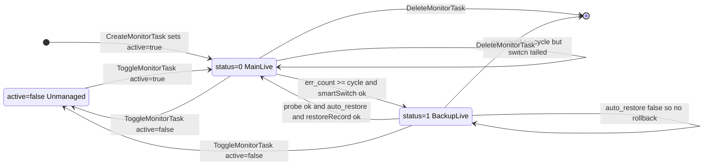
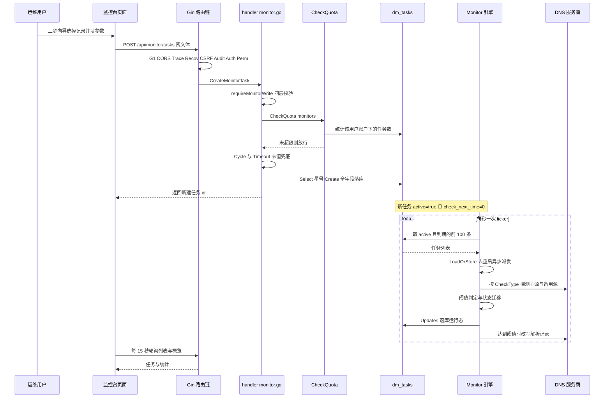
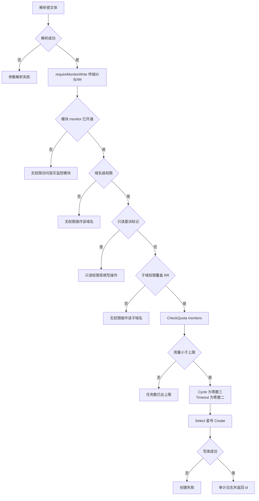
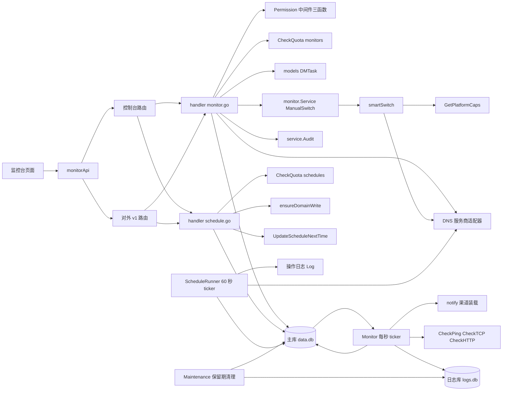
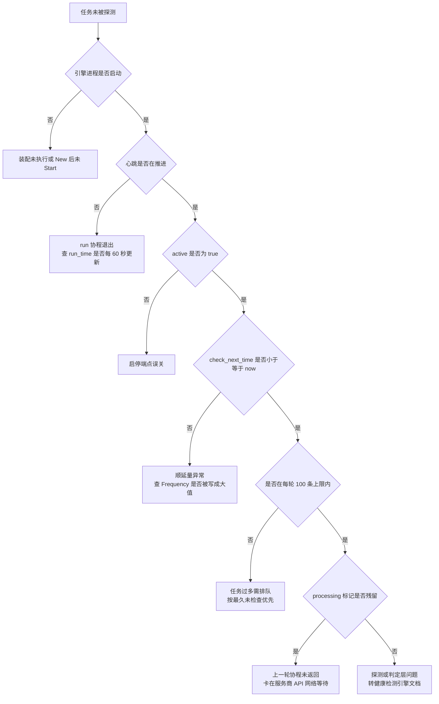

# 监控任务管理

<cite>
**本文档引用的文件**
- [models.go](file://main/internal/models/models.go)
- [monitor.go](file://main/internal/api/handler/monitor.go)
- [schedule.go](file://main/internal/api/handler/schedule.go)
- [quota.go](file://main/internal/api/handler/quota.go)
- [domain_ext.go](file://main/internal/api/handler/domain_ext.go)
- [account.go](file://main/internal/api/handler/account.go)
- [permission.go](file://main/internal/api/middleware/permission.go)
- [router.go](file://main/internal/api/router.go)
- [routes_batch1.go](file://main/internal/apiv1/routes_batch1.go)
- [quota_gate.go](file://main/internal/apiv1/quota_gate.go)
- [monitor.go (引擎)](file://main/internal/monitor/monitor.go)
- [check.go](file://main/internal/monitor/check.go)
- [capabilities.go](file://main/internal/monitor/capabilities.go)
- [schedule.go (执行器)](file://main/internal/service/schedule.go)
- [maintenance.go](file://main/internal/database/maintenance.go)
- [main.go](file://main/main.go)
- [page.tsx (监控台)](file://web/app/(dashboard)/dashboard/monitor/page.tsx)
- [api.ts](file://web/lib/api.ts)
</cite>

## 目录

1. [简介](#简介)
2. [项目结构](#项目结构)
3. [核心组件](#核心组件)
4. [架构总览](#架构总览)
5. [详细组件分析](#详细组件分析)
6. [依赖关系分析](#依赖关系分析)
7. [性能考虑](#性能考虑)
8. [故障排查指南](#故障排查指南)
9. [结论](#结论)
10. [附录](#附录)

## 简介

监控任务是 dnsplane 容灾监控域里唯一面向用户的**持久化控制对象**。它把「一条云端解析记录 + 一组探测参数 + 一套切换策略 + 一组告警开关」压进单行 `dm_tasks` 记录，由常驻引擎按秒轮询、按阈值决策、按策略改写 DNS。

任务管理层只负责四件事，职责边界清晰：**生命周期**（创建、更新、删除、启停）、**批量入口**（按子域名批量建档与智能创建）、**可见性与权限**（模块 + 域名 + 只读 + 子域四层收敛）、**观测出口**（列表、切换事件、探测历史、可用率、实时解析状态）。

与本文强相关但**不在范围内**的内容交由同目录其他文档：探测类型与判定阈值见《健康检测引擎》，切换决策树与记录改写细节见《容灾切换引擎》，通知渠道装载见《告警通知链路》。

必须前置说明：`dm_tasks` 所在的域里还有一个姊妹对象——**定时切换策略**（`schedule_tasks` 表）。两者共用同一套域名级写权限入口（`ensureDomainWrite`，`domain_ext.go:59-75`）与同一套配额机制（`max_monitors` / `max_schedules`），但执行器完全不同：容灾任务由 `monitor.Monitor` 以 1 秒 ticker 派发（`monitor.go:107-127`），定时策略由 `service.ScheduleRunner` 以 60 秒 ticker 轮询（`service/schedule.go:66-88`）。本文以容灾任务为主线，同时覆盖定时策略的 CRUD。

**章节来源**
- [main.go:105-120](file://main/main.go#L105-L120)
- [monitor.go:107-127](file://main/internal/monitor/monitor.go#L107-L127)
- [schedule.go:66-88](file://main/internal/service/schedule.go#L66-L88)

## 项目结构

监控任务管理横跨「模型 → 处理 → 引擎 → 执行器 → 前端」五段：

| 层次 | 文件 | 行数 | 在本域中的职责 |
| --- | --- | --- | --- |
| 模型 | `main/internal/models/models.go` | 370 | `DMTask`/`DMCheckLog`/`DMLog`/`ScheduleTask` 四表（`:134-176`、`:179-190`、`:193-199`、`:292-311`） |
| 处理 | `main/internal/api/handler/monitor.go` | 1270 | 15 个控制台端点与 15 个对外端点共用同一批 handler |
| 处理 | `main/internal/api/handler/schedule.go` | 258 | 定时切换策略 6 端点 CRUD |
| 处理 | `main/internal/api/handler/quota.go` | 351 | `monitors` / `schedules` 维度的上限与用量 |
| 鉴权 | `main/internal/api/middleware/permission.go` | 400 | 模块、域名、子域三类判定函数 |
| 引擎 | `main/internal/monitor/monitor.go` | 1049 | 派发、状态落库、手动切换、心跳 |
| 引擎 | `main/internal/monitor/check.go` | 372 | ping/tcp/http(s) 探测实现 |
| 引擎 | `main/internal/monitor/capabilities.go` | 33 | 平台能力表（决定暂停还是删除重建） |
| 执行器 | `main/internal/service/schedule.go` | 289 | 定时切换轮询 + 下次执行时间计算 |
| 装配 | `main/main.go` | 156 | `:105-107` 启动监控，`:112-120` 启动定时执行器 |
| 路由 | `main/internal/api/router.go` | — | 控制台 15 条监控路由（`:169-183`）、6 条定时切换路由（`:266-271`） |
| 路由 | `main/internal/apiv1/routes_batch1.go` | — | 对外 15 条监控路由（`:70-88`）、6 条定时切换路由（`:91-103`） |
| 前端 | `web/app/(dashboard)/dashboard/monitor/page.tsx` | 2100 | 列表、概览、编辑、三步智能添加、切换确认 |

结构上两点值得注意：

1. **没有独立的 `service/monitor.go`**。监控任务的全部 CRUD 落在 `handler/monitor.go` 单文件 1270 行内，混装权限构造器、7 个写端点、6 个读端点、批量创建、记录查询、字段兼容层与工具函数。这与项目「单文件一个职责」的原则存在张力，是可拆分点。
2. **定时切换执行器在 `service/`，不在 `monitor/`**。`monitor` 包不依赖 `service`，而 `service/schedule.go` 反向引用 `monitor.GetRecordType`（`:172`），因此「监控引擎」与「定时执行器」是两个互不嵌套的平行 goroutine 家族。

**章节来源**
- [models.go:134-311](file://main/internal/models/models.go#L134-L311)
- [router.go:169-183](file://main/internal/api/router.go#L169-L183)
- [routes_batch1.go:70-103](file://main/internal/apiv1/routes_batch1.go#L70-L103)

## 核心组件

### MonitorTask（`models.DMTask`）

容灾任务的唯一载体，表名 `dm_tasks`，定义在 `models.go:134-176`，共 42 个字段，按语义分六组：

| 分组 | 字段（列名） | 作用 | 行号 |
| --- | --- | --- | --- |
| 定位 | `DomainID`(did)、`RR`、`RecordID`、`RecordType`、`RecordLine` | 锁定云端某条记录；`RecordID` 在记录被删除重建后会变更 | `:136-140` |
| 策略 | `Type`、`MainValue`、`BackupValue`、`BackupValues`、`BackupType` | 0 暂停/恢复、1 删除/重建、2 切备用值；多备用逗号分隔且 `BackupValues` 优先 | `:141-145` |
| 探测 | `CheckType`、`CheckURL`、`TCPPort`、`Frequency`、`Cycle`、`Timeout`、`ExpectStatus`、`ExpectKeyword`、`MaxRedirects` | 0 ping / 1 tcp / 2 http / 3 https；`Frequency` 单位为秒且 `not null` | `:146-151`、`:164-166` |
| 代理传输 | `UseProxy`、`CDN`、`ProxyType`/`Host`/`Port`/`Username`/`Password`、`AllowInsecureTLS` | `ProxyPassword` 标注 `json:"-"`（`:171`），序列化不外泄 | `:153-154`、`:167-171` |
| 运行态 | `AddTime`、`CheckTime`、`CheckNextTime`、`SwitchTime`、`ErrCount`、`Status`、`MainHealth`、`Active`、`RecordInfo` | `CheckNextTime` 是调度唯一依据；`RecordInfo` 存 `TaskState` JSON | `:155-163` |
| 告警 | `NotifyEnabled`、`NotifyChannels`、`AutoRestore` | `NotifyChannels` 为 JSON 数组字符串形式的渠道白名单 | `:172-174` |

两处设计直接影响正确性：

- **复合索引 `idx_dm_tasks_active_next`**：`Active` 为前缀列（`:162`），`CheckNextTime` 为第二列（`:157`）。派发查询 `active = ? AND check_next_time <= ? ORDER BY check_next_time ASC`（`monitor.go:150-153`）与索引列序完全对齐，不是随意声明。
- **`Status` 与 `Active` 是两个正交维度**：`Status` 表示解析当前指向主源还是备用源（`:160`），`Active` 表示引擎是否纳管（`:162`）。**停用一个已切换的任务不会把 DNS 记录切回来**——这是运维最容易误解的一点。

关联模型：`DMCheckLog`（`dm_check_logs`，写在独立 `LogDB`，`models.go:179-190`）存每次探测结果；`DMLog`（`dm_logs`，主库，`:193-199`）存切换与恢复事件，`action` 取 1 切换、2 恢复。

**章节来源**
- [models.go:134-199](file://main/internal/models/models.go#L134-L199)
- [monitor.go:150-153](file://main/internal/monitor/monitor.go#L150-L153)

### Schedule（`models.ScheduleTask`）

定时切换策略，表名 `schedule_tasks`，定义在 `models.go:292-311`。与容灾任务不同，它是**日历驱动**而非健康驱动：

| 字段 | 列名 | 语义 | 实测消费方 |
| --- | --- | --- | --- |
| `DomainID`/`RR`/`RecordID` | did/rr/record_id | 定位记录 | `service/schedule.go:113-127` |
| `Type` | type | 执行器按 `task.Type == 1` 判定是否为周期任务 | `service/schedule.go:195` |
| `Cycle` | cycle | 周期粒度：1 每周、2 每月、其他每天 | `service/schedule.go:196-214` |
| `SwitchType` | switch_type | 动作：1 启用、2 暂停、3 删除、默认分支修改值 | `service/schedule.go:139-179` |
| `SwitchDate`/`SwitchTime` | switch_date/switch_time | 月内日或周几、`HH:mm`；单次任务按 `2006-01-02 15:04:05` 解析并补 `:00` | `service/schedule.go:198-219` |
| `Value`/`Line`/`RecordInfo` | value/line/record_info | 新值、线路覆盖、原记录快照（TTL/类型/MX/备注） | `service/schedule.go:129-178` |
| `NextTime`/`Active` | next_time/active | 复合索引 `idx_schedule_tasks_active_next` 两列（`models.go:307-308`） | `service/schedule.go:98` |

需如实指出口径冲突：`Type` 与 `Cycle` 的结构体注释（`models.go:298-299` 写作「0 modify/1 enable/2 pause/3 delete」「0 once/1 daily/2 weekly/3 monthly」）与执行器实际判定**不一致**。当前以代码为准，注释是陈旧信息；前端标签映射与执行器一致、与注释相反。

**章节来源**
- [models.go:292-311](file://main/internal/models/models.go#L292-L311)
- [schedule.go:113-223](file://main/internal/service/schedule.go#L113-L223)

### TaskStatus

「任务状态」在本域不是枚举类型，而是**三个列 + 一个内存快照**的组合视图。数据库侧：`Status`（0 正常 / 1 已切换，`models.go:160`）、`MainHealth`（最近一次主源是否健康，默认 true，`:161`）、`Active`（是否纳管，`:162`）。引擎侧：`monitor.ResolveStatus`（`monitor.go:32-39`）携带 `TaskID`/`MainValue`/`MainHealth`/`BackupValues map[string]bool`/`LastCheck`/`LastError`，存在 `sync.Map` 里（`:62`）。

四者更新时机互不相同：`Status` 只在切换成功或回切成功时写（`monitor.go:296`、`:320`、`:728`、`:733`）；`MainHealth` 每轮探测都写（`:277`）；`Active` 只由启停端点写；`ResolveStatus` **进程重启即清空**，且删除任务时不清理残留条目。

`TaskState`（`monitor.go:42-53`）是 `RecordInfo` 列的 JSON 结构，承载 `backup_record_ids[]`、`original_value`、`deleted_record{type,line,mx,remark}`、`was_deleted` 四类回切所需信息——它不是数据库列，而是把「原始记录长什么样」这份知识塞进单列文本里，使引擎重启后仍能重建记录。

状态迁移如下（标识符为列名与端点动作）：

**图表来源**
- [monitor.go:275-334](file://main/internal/monitor/monitor.go#L275-L334)
- [monitor.go:711-740](file://main/internal/monitor/monitor.go#L711-L740)
- [models.go:160-162](file://main/internal/models/models.go#L160-L162)

注意 `MAIN --> MAIN: switch failed` 这条自环：切换失败时 `Status` 保持 0（`monitor.go:325-330`），下一轮 `errCount >= Cycle && Status == 0` 仍成立，于是每个 `Frequency` 周期重复调用 DNS 写接口并重复推送紧急告警。

**章节来源**
- [models.go:160-162](file://main/internal/models/models.go#L160-L162)
- [monitor.go:32-53](file://main/internal/monitor/monitor.go#L32-L53)
- [monitor.go:275-334](file://main/internal/monitor/monitor.go#L275-L334)

## 架构总览

从「用户在监控台点保存」到「引擎第一次探测这条任务」的链路，跨越 handler、主库、引擎、DNS 服务商四个边界：

**图表来源**
- [monitor.go:222-282](file://main/internal/api/handler/monitor.go#L222-L282)
- [monitor.go:144-179](file://main/internal/monitor/monitor.go#L144-L179)
- [router.go:169-183](file://main/internal/api/router.go#L169-L183)

关键点：**创建端点不直接与引擎通信**。handler 只写库，引擎靠 `check_next_time <= now` 这一条件在下一个 tick 自行发现新任务。两个后果——新任务首次探测延迟上界为 1 秒，无需通知机制；启停、批量、删除都不需要重启服务，因为派发条件是纯数据驱动的。

装配点在 `main.go:105-107`：`monitor.New()` 会把实例赋给包级单例 `Service`（`monitor.go:68-74`），`SwitchMonitorTask` 靠 `monitor.Service == nil` 判断「服务未启动」（`handler/monitor.go:495-498`）。定时执行器在 `main.go:113-115` 独立起协程，与 `TaskRunner` 共享同一个 `taskCtx`，取消时经 `service/schedule.go:44-47` 触发 `Stop`。

**章节来源**
- [main.go:105-120](file://main/main.go#L105-L120)
- [monitor.go:68-74](file://main/internal/monitor/monitor.go#L68-L74)
- [monitor.go:144-179](file://main/internal/monitor/monitor.go#L144-L179)

## 详细组件分析

### 创建：`CreateMonitorTask`

入口 `handler/monitor.go:222-282`，请求体 `CreateMonitorTaskRequest`（`:171-196`）。顺序是「先权限、再配额、后兜底、最后落库」：

**图表来源**
- [monitor.go:222-282](file://main/internal/api/handler/monitor.go#L222-L282)
- [monitor.go:60-80](file://main/internal/api/handler/monitor.go#L60-L80)
- [quota.go:120-139](file://main/internal/api/handler/quota.go#L120-L139)

四处细节决定行为：

- `binding:"required"` 只标了 `domain_id`、`rr`、`record_id`、`main_value`、`frequency`（`:172-176`、`:189`）。`backup_value` 不必填——`Type=0/1`（暂停/删除）策略本就不需要备用值。
- **零值兜底只覆盖 `Cycle` 与 `Timeout`**（`:238-243`），不覆盖 `Frequency`。但 `Frequency` 带 `required`，Gin 会把 `0` 视为未提供并拒绝，所以创建路径不会写进 `frequency=0`；真正的风险在更新路径。
- **`Select("*")` 而非默认 `Create`**（`:275`，源码带注释）。GORM 默认跳过零值列，会让 `check_type=0`（ping）、`type=0`（暂停策略）被数据库默认值覆盖。这是必要补丁。
- **请求体不含 `auto_restore`/`notify_enabled`/`notify_channels`**（对照 `:171-196` 与模型 `:172-174`）。经该端点建的任务这两个布尔位恒为 `false`——**永不告警、永不自动回切**。要带告警与回切必须走 `AutoCreateMonitorTask` 或后续调用更新接口。

**章节来源**
- [monitor.go:171-196](file://main/internal/api/handler/monitor.go#L171-L196)
- [monitor.go:222-282](file://main/internal/api/handler/monitor.go#L222-L282)
- [models.go:172-175](file://main/internal/models/models.go#L172-L175)

### 更新：`UpdateMonitorTask`

入口 `handler/monitor.go:313-396`，采用**「关键字段条件更新 + 其余字段无条件覆盖」**的混合策略。

任务定位：`req.ID` 为 0 时回退路径参数 `:id`（`:320-325`），仍为 0 则早退（`:326-329`）。该守卫同时兼容控制台（带路径参数）与对外 v1（无路径参数、body 带 `id`）两个入口。

权限判定做**两次**：先用原记录的 `DomainID`+`RR` 校验（`:337-339`），再在 `req.DomainID`/`req.RR` 变化时用新值二次校验（`:340-351`）。缺第二次会造成「把任务迁到自己无权的域名下」的越权。

| 类别 | 字段 | 写入条件 | 行号 |
| --- | --- | --- | --- |
| 关键字段 | `did`、`rr`、`record_id`、`main_value` | 仅当请求值非零或非空才写入 | `:356-367` |
| 普通字段 | `type`、`backup_value`、`backup_values`、`check_type`、`check_url`、`tcp_port`、`expect_status`、`expect_keyword`、`max_redirects`、`proxy_*`（6 个）、`frequency`、`cycle`、`timeout`、`use_proxy`、`cdn`、`auto_restore`、`notify_enabled`、`remark` | 一律写入，零值也写 | `:370-391` |

由此产生三个必须在集成侧防范的后果：`Frequency=0` 使引擎算出 `check_next_time = now + 0`（`monitor.go:174-178`），任务退化为**每秒重复探测**；`Cycle=0` 使阈值判定 `errCount >= 0` 恒真，**首次失败即切换**；`Timeout=0` 使探测层失去自身超时，只剩任务级 `Timeout+10` 的 ctx 兜底（`monitor.go:192`）。

另两处偏差：`updates["backup_values"] = req.BackupValue`（`:372`）把单备用值同时写进多备用列，与创建路径不写 `BackupValues` 的行为不同；`updates["proxy_password"]`（`:383`）走 `Updates(map)`，绕过 `BeforeSave` 加密钩子，落库为明文。控制台表单恰好提交全部字段（含空串口令），因此后者更容易被对外 API 触发。

**章节来源**
- [monitor.go:284-396](file://main/internal/api/handler/monitor.go#L284-L396)
- [monitor.go:174-178](file://main/internal/monitor/monitor.go#L174-L178)
- [monitor.go:192](file://main/internal/monitor/monitor.go#L192)

### 删除：`DeleteMonitorTask`

入口 `handler/monitor.go:402-433`。流程：解析 ID（body 优先、路径回退）→ 取任务 → `requireMonitorWrite` → 删任务（`:429`）→ 按 `task_id` 删 `DMLog`（`:430`）→ 审计。

三个缺口值得记录：

- **不级联删除 `dm_check_logs`**。探测历史在独立 `LogDB`，此处未清理，长期会留下孤儿 `task_id`，目前只能靠保留期（默认 72 小时，`maintenance.go:20`、`:220-223`）自然淘汰。
- **不检查错误**。两次 `Delete` 都未读 `.Error`，删除失败仍返回「删除成功」。
- **不清理引擎内存快照**。`resolveStatuses` 与 `processing` 两个 `sync.Map` 没有对应删除动作（对照 `monitor.go:274` 的写入点），已删任务在内存残留到进程重启。

删除是**纯控制面动作**：不会把已切到备用的 DNS 记录改回主源。若需要「先回切再删除」，当前只能先调 `POST /monitor/tasks/:id/switch` 传 `to_backup=false`，确认 `status` 回到 0 之后再删。

**章节来源**
- [monitor.go:402-433](file://main/internal/api/handler/monitor.go#L402-L433)
- [monitor.go:274](file://main/internal/monitor/monitor.go#L274)
- [maintenance.go:218-232](file://main/internal/database/maintenance.go#L218-L232)

### 启停：`ToggleMonitorTask` 与手动切换

启停是整个域里最小的写端点（`handler/monitor.go:440-470`），单列更新无副作用（`:467` 对 `active` 做 `Update`）。其真实语义是「**是否参与调度**」——派发条件第一条就是 `active = true`（`monitor.go:150`）。停用后：

- 探测停止，`main_health`/`err_count`/`check_time` 停留在停用前的值
- 已切换到备用的记录**保持备用状态不回切**（回切发生在 `processTaskAsync` 内，任务不被派发就永不触发）
- 概览口径变化：`active_count` 与 `healthy_count` 带 `active = true`，但 `faulty_count` 只按 `status = 1` 统计（`handler/monitor.go:615-621`），因此「停用的已切换任务」仍被计入故障数

手动切换入口 `handler/monitor.go:477-528`，动作委托 `monitor.Service.ManualSwitch(taskID, toBackup)`（`monitor.go:711-740`）。两处细节：`ToBackup *bool` 用指针区分「未传」与「传了 false」（`:474` 带注释），未传时按当前状态取反（`:510-515`），前端 `monitorApi.switch(id)` 不发 body（`api.ts:589`）走的正是取反分支；`ManualSwitch` 会重新 `First(&task)` 从库读取（`monitor.go:713`）而非复用 handler 已加载对象，并发下用的是最新值，代价是多一次查询。

定时切换的启停同构但独立：`ToggleScheduleTask`（`handler/schedule.go:197-221`）默认取反 `task.Active`，query 带 `active` 时用参数覆盖（`:215-218`）。它额外做了监控端没做的**空 `:id` 早退守卫**，源码注释明确解释 `First(&task, "")` 会退化成不带主键条件的查询、静默命中全表第一条（`handler/schedule.go:126-138`）。

**章节来源**
- [monitor.go:435-470](file://main/internal/api/handler/monitor.go#L435-L470)
- [monitor.go:472-528](file://main/internal/api/handler/monitor.go#L472-L528)
- [monitor.go:711-740](file://main/internal/monitor/monitor.go#L711-L740)
- [schedule.go:197-221](file://main/internal/api/handler/schedule.go#L197-L221)
- [api.ts:582-606](file://web/lib/api.ts#L582-L606)

### 批量：`BatchCreateMonitorTasks` 与 `AutoCreateMonitorTask`

两个批量入口解决不同问题，命名易混淆：

| 维度 | `BatchCreateMonitorTasks`（`:687-789`） | `AutoCreateMonitorTask`（`:1043-1215`） |
| --- | --- | --- |
| 输入 | 单个 `domain_id` + `rr` + 一套探测参数 | `domain_id` + `sub_domain` + `records[]` + 参数（含单记录兼容字段） |
| 记录来源 | 现场调用 `provider.GetSubDomainRecords(rr,1,100,...)`（`:718`） | 前端先经 `LookupRecord` 拉取再回传（`:923-980`） |
| 记录类型过滤 | 只保留 `A`/`AAAA`（`:734-736`） | 不过滤，任何类型都建 |
| 去重键 | 仅 `record_id`（`:739`） | `record_id + did`（`:1161`） |
| 参数兜底 | `Cycle=3`、`Timeout=2`（`:698-703`），`Frequency` 必填 | `Frequency=60`、`Cycle=3`、`Timeout=5`（`:1089-1097`） |
| 告警与回切 | 不写 `notify_*`/`auto_restore` | 显式写 `AutoRestore`/`NotifyEnabled`/`NotifyChannels`（`:1197-1199`） |
| 初始运行态 | 不设 `CheckNextTime`（隐式 0，立即到期） | 显式 `CheckNextTime=now`、`MainHealth=true`（`:1202-1204`） |
| 配额校验 | 无 | 无 |
| 备用类型判定 | 不做 | `IsIPValue` 判 `backup_type` 为 ip 或 cname（`:1166-1169`、`:1218`） |
| 返回 | `created` + `existed` 计数 | `ids[]` + `created` 计数 |

`AutoCreateMonitorTask` 含一个**字段命名兼容层**：`AutoCreateRecord`（`:987-1002`）同时声明 `id`/`RecordId`/`record_id` 三套键，由五个 getter（`:1004-1040`）按优先级取值。原因是不同 DNS 服务商适配器返回的记录字段大小写风格不同。

三个共同缺口：

1. **`Create` 错误被吞**。两端点都写成 `if err := ...Create(&task).Error; err == nil { 计数++ }`（`:782-784`、`:1208-1210`），失败既不返回也不记日志，用户只能从 `created` 数量间接察觉。
2. **无配额校验**。单条创建走 `CheckQuota(c, "monitors")`（`:234`），两个批量入口都不走，等于绕过配额门。`quota_gate.go:12-25` 解释了 v1 为何不在路由层重复挂门（判据是「handler 内部有没有 `CheckQuota`」），但这两个 handler 内部也没有，因此两个入口都未被覆盖。
3. **`record_info` 可能溢出**。批量路径把 `type`/`line`/`ttl`/`mx`/`remark` 组成的 JSON 写进 `RecordInfo`（`:744-777`），而该列声明 `size:200`（`models.go:163`）；线路名与备注偏长时在 MySQL 严格模式下写入失败，失败又被上一条的静默分支吞掉。

前端契约另有偏差：`monitorApi.batchCreate` 发送 `{ tasks: [...] }`（`api.ts:603`），而后端 `BatchMonitorRequest`（`handler/monitor.go:198-220`）要求 `domain_id` + `rr` 的单任务结构。监控台实际只调 `autoCreate`（智能添加流程），因此不影响主界面，但直接调 `/monitor/tasks/batch` 的集成方需注意请求形状。

**章节来源**
- [monitor.go:198-220](file://main/internal/api/handler/monitor.go#L198-L220)
- [monitor.go:687-789](file://main/internal/api/handler/monitor.go#L687-L789)
- [monitor.go:923-1040](file://main/internal/api/handler/monitor.go#L923-L1040)
- [monitor.go:1043-1215](file://main/internal/api/handler/monitor.go#L1043-L1215)
- [quota.go:226-230](file://main/internal/api/handler/quota.go#L226-L230)
- [api.ts:603](file://web/lib/api.ts#L603)

### 分组与检索视图

先给明确结论：**`DMTask` 没有独立的分组字段**。已验证 `models.go:134-176` 的 42 个字段不含 `cid`/`category`/`group`；分类模型 `DomainCategory`（`models.go:63-69`）的外键挂在 `Domain.CategoryID`（`:75`）上，只作用于域名列表，不参与监控任务查询。

实际存在的「分组」是四个层次的隐式分组：

| 层次 | 分组维度 | 实现位置 | 说明 |
| --- | --- | --- | --- |
| SQL 查询 | 按域名归组 + 关键字模糊 | `handler/monitor.go:107-122` | `LEFT JOIN domains` 后按 `domains.name`/`rr`/`main_value` 三列 LIKE |
| 可见性 | 按账户归属归组 | `handler/monitor.go:30-42`、`:98-105` | 子查询「自有账户域名 ∪ 未过期委派域名」；uid 解析失败时退化为 `SELECT 0 WHERE 0` |
| 调度 | 按 `Frequency` 分组合并 UPDATE | `monitor.go:159-178` | 同频任务顺延量相同，一次 `WHERE id IN (...)` 完成 |
| 前端视图 | 按 `statusFilter` 四类过滤 | `page.tsx:757-771` | `all`/`0` 正常/`1` 已切换/`active`/`inactive` |
| 概览统计 | 按状态与启用位聚合六个计数 | `handler/monitor.go:600-643` | 9 个 goroutine 并发统计，前端卡片直接取（`page.tsx:267-269`） |

调度层的 Frequency 分组是唯一带实现巧思的一处：分组累积与去重判断在同一次循环里完成，但**语义刻意分离**——即使任务因重入被 `continue` 跳过派发，它的 ID 也已进入 `idsByFrequency`，`check_next_time` 仍会顺延（`monitor.go:164-167` 的注释正是解释这件事）。若不顺延，一个长时间卡住的任务每个 tick 都会被命中，把每轮 100 条的派发预算占满。

前端列表的归组只在渲染层：表格第一列是「域名」（`page.tsx:978`），任务按 `dm_tasks.id DESC` 排序（`handler/monitor.go:161`），**不按域名聚类**。需要按域名聚合视图时，当前只能靠关键字搜索或前端本地过滤。

定时切换侧倒有一个真正的显式分组过滤：`GetScheduleTasks` 支持 `type` 参数直接落到 `WHERE a.type = ?`（`handler/schedule.go:67-69`）。监控列表不支持类似的状态参数——`monitorApi.list` 签名里虽写了 `status?: number`（`api.ts:583`），但后端 `GetMonitorTasks` 的请求结构体只解析 `page`/`page_size`/`keyword`（`handler/monitor.go:129-133`），该参数会被静默忽略。

**章节来源**
- [models.go:63-75](file://main/internal/models/models.go#L63-L75)
- [models.go:134-176](file://main/internal/models/models.go#L134-L176)
- [monitor.go:30-122](file://main/internal/api/handler/monitor.go#L30-L122)
- [monitor.go:600-643](file://main/internal/api/handler/monitor.go#L600-L643)
- [monitor.go:159-178](file://main/internal/monitor/monitor.go#L159-L178)
- [schedule.go:67-69](file://main/internal/api/handler/schedule.go#L67-L69)
- [page.tsx:757-771](file://web/app/(dashboard)/dashboard/monitor/page.tsx#L757-L771)

### 权限：四层收敛

监控任务的权限判定是**四层串行短路**，任一层不过立即返回对应文案：

| 层 | 判定函数 | 依据 | 失败文案 | 行号 |
| --- | --- | --- | --- | --- |
| 模块 | `UserModuleAllowed(c, "monitor")` | 用户功能权限 JSON 是否含 `monitor` | 无权限访问容灾监控模块 | `permission.go:383-399` |
| 域名 | `CheckDomainPermission(uid, level, didStr)` | 自有账户或 `permissions` 表未过期委派 | 无权限操作该域名 | `permission.go:335-341` |
| 只读 | `c.Get("perm_read_only")` | 委派记录声明只读 | 该域名为只读权限，无法执行写操作 | `handler/monitor.go:69-74` |
| 子域 | `CheckSubDomainPermission(uid, level, didStr, rr)` | `perm.SubDomain` 是否覆盖该 RR | 无权限操作该子域名 | `permission.go:344-360` |

读写分工由两个入口函数承担：`requireMonitorWrite(c, domainID, rr)`（`:60-80`）被 `CreateMonitorTask`、`UpdateMonitorTask`、`DeleteMonitorTask`、`ToggleMonitorTask`、`SwitchMonitorTask`、`BatchCreateMonitorTasks`、`AutoCreateMonitorTask` 使用；`requireMonitorTaskByID(c, taskID)`（`:82-96`）被观测端点使用——先按 ID 取任务、再判模块、最后经 `monitorTaskAccessible`（`:52-57`）做**只读级**域名校验。

四处需要留意的口径差异：

1. **管理员短路点分散**。`isAdmin`（`account.go:52`）在 `monitorTaskAccessible`（`:53-54`）、`dmTasksScoped`（`:100`）、`buildMonitorTasksListQuery`（`:112`）各判一次；模块与域名、子域三层则在 `permission.go:336-338`、`:345-347`、`:384-386` 以 `level >= 2` 各自返回 true。
2. **模块未配置时对普通用户一律放行**。`UserModuleAllowed` 在 `perm_modules_configured` 为 false 时返回 true（`:387-391`），注释写明为兼容旧库。即「未显式配置功能权限」等同于「全模块可用」，与直觉相反。
3. **`overview` 的权限口径由路由层与 handler 分别决定**。路由表把 `/api/monitor/overview` 标为 admin 权限点，handler 内部只做模块校验（`handler/monitor.go:577-580`）；同一 handler 复用到对外 v1 时（`routes_batch1.go:85`）只带 `monitor` 模块中间件。同一函数经两个入口暴露出不同强度，集成方需注意。
4. **定时切换走 `domain` 模块而非 `monitor`**（`handler/schedule.go:45`、`:86`、`:123`、`:176`、`:198`、`:224`），写操作统一走 `ensureDomainWrite`（`domain_ext.go:59-75`）。因此「开通 monitor 但未开通 domain」的账号能建监控任务却建不了定时策略，反之亦然。

配额是与权限独立的第二道门。`CheckQuota`（`quota.go:120-139`）的上限来自三层优先级：个体覆盖 > 套餐 > 系统默认（`:20-27`），取值约定 `-1` 不限、`0` 禁止、正数为上限；未显式配置的维度铺满 `-1`（`unlimitedQuota`，`:47-52`）。用量统计沿 `dm_tasks.did → domains.aid → accounts.uid` 归到用户（`:226-230`），**只计自有账户下域名上的任务**，被委派域名上的任务不计入该用户用量；`schedules` 同构（`:235-239`）。`level >= 2` 直接返回全不限（`:84-88`）。

**章节来源**
- [monitor.go:30-105](file://main/internal/api/handler/monitor.go#L30-L105)
- [permission.go:335-399](file://main/internal/api/middleware/permission.go#L335-L399)
- [domain_ext.go:59-75](file://main/internal/api/handler/domain_ext.go#L59-L75)
- [account.go:52-67](file://main/internal/api/handler/account.go#L52-L67)
- [quota.go:20-139](file://main/internal/api/handler/quota.go#L20-L139)
- [quota.go:200-249](file://main/internal/api/handler/quota.go#L200-L249)

## 依赖关系分析

**图表来源**
- [router.go:169-183](file://main/internal/api/router.go#L169-L183)
- [routes_batch1.go:70-103](file://main/internal/apiv1/routes_batch1.go#L70-L103)
- [monitor.go:3-27](file://main/internal/api/handler/monitor.go#L3-L27)
- [schedule.go:3-14](file://main/internal/api/handler/schedule.go#L3-L14)

依赖方向上的三条硬约束：

1. **`handler` 依赖 `monitor` 包级单例而非注入**。`SwitchMonitorTask` 直接读 `monitor.Service`（`handler/monitor.go:495`），使「服务未启动」能被优雅拒绝，但也让 handler 层无法在测试里替换引擎实现——依赖倒置原则的一处已知妥协。
2. **`monitor` 包不依赖 `service` 包**。引擎自带的 `logAction` 直写 `DMLog`（`monitor.go:930`），而定时执行器在 `service` 侧并反向引用 `monitor.GetRecordType`（`service/schedule.go:172`），不存在双向包依赖。
3. **`apiv1` 只是转发层**。15 条监控路由与 6 条定时路由复用同一批 handler（`routes_batch1.go:73-87`、`:97-102`），差异仅在中间件链：控制台是 G1、CORS、Trace、Recovery、CSRF、Audit、Auth、Permission 八层，对外是 `requireModuleMW` 加入口适配。定时切换的 v1 路由额外挂了 `paramAlias(map{"id":"id"})`（`:95`），把 body 里的 `id` 映射到路径参数位，以匹配 handler 的 `c.Param("id")` 取法。

**章节来源**
- [monitor.go:1-24](file://main/internal/api/handler/monitor.go#L1-L24)
- [monitor.go:495-498](file://main/internal/api/handler/monitor.go#L495-L498)
- [schedule.go:1-18](file://main/internal/api/handler/schedule.go#L1-L18)
- [routes_batch1.go:70-103](file://main/internal/apiv1/routes_batch1.go#L70-L103)

## 性能考虑

### 任务数量上限

「上限」在本域是**多个性质不同的阈值叠加**，不是一个数字：

| 阈值 | 数值 | 来源 | 超限后果 |
| --- | --- | --- | --- |
| 用户配额 `max_monitors` | 默认 `-1` 不限 | `quota.go:34`、`:47-52`、`:71` | 单条创建被拒并返回上限提示 |
| 批量创建配额 | 无校验 | `handler/monitor.go:687`、`:1043` | 可无限建，配额形同虚设 |
| 列表分页 | 默认 200，硬上限 500 | `handler/monitor.go:136-144` | 超出部分截断，不报错 |
| 前端单次拉取 | 固定 `page_size=200` | `page.tsx:327` | 任务多于 200 时界面只见前 200 条 |
| 每轮派发 | 100 条 | `monitor.go:24` 常量 `maxDispatchPerTick`、`:152` | 其余保持原 `check_next_time`，下一 tick 再派 |
| 全局探测并发 | 64 | `monitor.go:29` 常量 `maxConcurrentChecks`、`:70` | 排队等待，等待期 ctx 超时即判失败 |
| 单次批量记录数 | 100 条 | `handler/monitor.go:718` | 子域下超 100 条记录时只建前 100 条 |
| 记录查询条数 | 100 条 | `handler/monitor.go:969` | 向导第二步看不到第 101 条之后的记录 |
| 历史点数 | 4000 点 | `handler/monitor.go:27`、`:852` | 见「观测精度」 |

真正制约「能管多少任务」的是引擎侧两个阈值。派发上限 100 与 1 秒 ticker 组合，意味着稳态下每秒最多派发 100 个任务。5000 条 `Frequency=60` 的任务每分钟需派发 5000 次，而 60 × 100 = 6000，接近饱和。一旦超限，`ORDER BY check_next_time ASC`（`monitor.go:151`）保证**最久未检查的优先**，表现为「检测间隔被动拉长」而非「部分任务饿死」——这是刻意保留的公平性设计。

并发上限 64 则引入**与目标无关的误判**：信号量满时新探测在 `select` 上等待，`ctx.Done()` 触发即返回「探测并发已满且等待超时」（`monitor.go:342-347`）。该失败与主源健康无关，却计入 `err_count`（`:308-309`）并在达阈值时触发切换。任务规模上去后可能出现「一批目标都正常但被批量切换」。缓解手段只有提高 `Frequency` 降低派发密度，代码层没有独立熔断。

**章节来源**
- [monitor.go:24-29](file://main/internal/monitor/monitor.go#L24-L29)
- [monitor.go:144-153](file://main/internal/monitor/monitor.go#L144-L153)
- [monitor.go:338-347](file://main/internal/monitor/monitor.go#L338-L347)
- [monitor.go:136-144](file://main/internal/api/handler/monitor.go#L136-L144)
- [quota.go:34-52](file://main/internal/api/handler/quota.go#L34-L52)

### 调度精度

容灾任务的调度基准是这一行：`Update("check_next_time", now+int64(freq))`（`monitor.go:177`）。`now` 是**本轮派发时刻**，不是上一次的理论到期时刻。因此任何一次派发延迟（DB 慢、上一轮超出 100 条上限、GC）都会**永久顺移到后续所有周期**，不回补。实际间隔恒 ≥ 配置间隔，抖动只朝一个方向累积。

任务级超时为 `Timeout + 10` 秒（`monitor.go:192`），处理完成前 `processing` 标记不释放（`:185`）。当 `Frequency` 小于「探测耗时 + 10」时，同一任务会被重入保护跳过，表现为实际间隔大于配置值。`Frequency` 的下界只在**前端表单**存在（`min={10}`，`page.tsx:1574`），后端 handler **无下限校验**，对外 API 可传 1 秒。

定时切换的量级完全不同：

| 环节 | 量级 | 位置 |
| --- | --- | --- |
| 首次启动延迟 | 20 秒 | `service/schedule.go:73` |
| 轮询周期 | 60 秒 | `:76` |
| 时间解析精度 | 分钟（`HH:mm` 补 `:00`） | `:216`、`parseHH`/`parseMM`（`:236-252`） |
| 触发延迟上界 | 约 60 秒 | 由轮询周期决定 |

真正的精度风险不在延迟而在**失败后的重复执行**：`updateNextTime` 只在 `executeOne` 成功返回后被调用（`service/schedule.go:180`）。若某次执行失败，`next_time` 不变，下一个 60 秒轮询以同一条件再次命中——无退避、无失败计数、无最大重试。单次任务（`Type != 1`）过期后解析值不满足 `After(now)`，`nextTime` 被置 0（`:215-220`），从此永不命中；此时经 `BatchScheduleTaskAction` 的 `open` 重新启用只改 `active`、不重算 `next_time`（`handler/schedule.go:249-251`），任务将永久静默。批级 `recover` 位于 `executeDueTasks` 的 defer（`service/schedule.go:91-95`），单任务 panic 会终止**整批**循环，同批剩余任务要等下一分钟。

**章节来源**
- [monitor.go:174-192](file://main/internal/monitor/monitor.go#L174-L192)
- [schedule.go:66-95](file://main/internal/service/schedule.go#L66-L95)
- [schedule.go:180-252](file://main/internal/service/schedule.go#L180-L252)
- [schedule.go:223-258](file://main/internal/api/handler/schedule.go#L223-L258)
- [page.tsx:1571-1583](file://web/app/(dashboard)/dashboard/monitor/page.tsx#L1571-L1583)

### 观测精度

`GetMonitorHistory` 以 `ORDER BY created_at DESC LIMIT 4000` 取窗口内最近的点，再 `slices.Reverse` 还原时序（`handler/monitor.go:851-853`）。对 60 秒间隔任务，30 天窗口本应约 43200 点，接口只返回最近 4000 点（约 1.7 天）——**前端 30 天曲线实际画的是 1.7 天的数据**。period 白名单为 `1h`/`7d`/`30d`，其余值（含默认）落到 24 小时（`:838-848`）。

`dm_check_logs` 上的索引是 `task_id`、`created_at`、`success` 三个单列索引，而历史与可用率查询都按 `task_id + created_at` 过滤，缺少对应复合索引，规模上去后只能靠保留期控制。前端放大效应更直接：每次 15 秒轮询在拉完列表后对**每个任务**并发发起一次 `history?period=1h`（`page.tsx:292-309`、`:360-369`），任务数按 200 计即每 15 秒 200 个请求，每请求再触发一次 LogDB 扫描。

**章节来源**
- [monitor.go:27](file://main/internal/api/handler/monitor.go#L27)
- [monitor.go:838-853](file://main/internal/api/handler/monitor.go#L838-L853)
- [maintenance.go:218-224](file://main/internal/database/maintenance.go#L218-L224)
- [page.tsx:292-309](file://web/app/(dashboard)/dashboard/monitor/page.tsx#L292-L309)
- [page.tsx:360-369](file://web/app/(dashboard)/dashboard/monitor/page.tsx#L360-L369)

## 故障排查指南

### 调度未触发

这是本域最高频的现象类问题：任务建好、`active` 开着、页面在刷新，但 `check_time` 一直是 0 或停在很久以前。按下面顺序逐层排除，每步都对应可验证证据。

**图表来源**
- [monitor.go:107-141](file://main/internal/monitor/monitor.go#L107-L141)
- [monitor.go:144-179](file://main/internal/monitor/monitor.go#L144-L179)

逐层验证要点：

1. **进程侧**。引擎在 `main.go:105-107` 装配，`monitor.New()` 设置包级单例 `Service`（`monitor.go:68-74`）。若 `SwitchMonitorTask` 返回「监控服务未启动」（`handler/monitor.go:496`），说明 `Service == nil`，进程内引擎根本没起来。
2. **心跳侧**。`updateRunStatus` 由 60 秒 ticker 驱动（`monitor.go:114`、`:130-141`），每 60 秒把 `run_time` 写成当前时间。**两个消费端阈值与心跳周期矛盾**：`GetMonitorStatus` 只在 10 秒内视为运行（`:803`），`GetMonitorOverview` 用 15 秒（`:667`）。因此即使引擎完全健康，前端大部分时间也会显示「未运行」。判断引擎真实存活应看 `sys_configs.run_time` 是否每 60 秒推进，而不是看前端指示灯。
3. **数据库侧**。派发条件只有两个：`active = true` 与 `check_next_time <= now`（`monitor.go:150`）。新任务在 `CreateMonitorTask` 里不写 `CheckNextTime`（`handler/monitor.go:245-272` 的结构体字面量无该字段），落库为 0，下一个 tick 即到期。
4. **MySQL 特有**。`GetMonitorStatus` 写成 `Where("key = ?", "run_time")`（`handler/monitor.go:798`），未加反引号，而 `key` 是 MySQL 保留字；同文件其他位置一律写成带反引号的形式（`:132`、`:641`）。MySQL 部署下该端点直接报错，易被误读为「调度停了」。
5. **重入标记侧**。`processing` 靠 `processTaskAsync` 的 defer 释放（`monitor.go:185`）。若协程被 ctx 取消但仍卡在服务商 API 的网络等待里，标记会残留到协程真正返回，期间该任务被 `LoadOrStore` 跳过（`:165`）。

定时切换「未触发」是另一条线，重点三项：`active`（`service/schedule.go:98` 第三个条件）、`next_time > 0`（单次任务过期置 0 即永久失效）、执行器协程是否存活（`main.go:115`；`taskCtx` 取消会经 `service/schedule.go:44-47` 触发 `Stop`）。

**章节来源**
- [main.go:105-120](file://main/main.go#L105-L120)
- [monitor.go:68-185](file://main/internal/monitor/monitor.go#L68-L185)
- [monitor.go:477-528](file://main/internal/api/handler/monitor.go#L477-L528)
- [monitor.go:791-809](file://main/internal/api/handler/monitor.go#L791-L809)
- [schedule.go:90-111](file://main/internal/service/schedule.go#L90-L111)

### 状态与统计读不出来

| 症状 | 直接原因 | 证据位置 | 判定方法 |
| --- | --- | --- | --- |
| `err_count` 恒 0、`check_time` 不更新且**永不切换** | 新库缺 `last_error`/`backup_health`/`fault_time`/`recover_time` 四列，整条 `Updates` 报错且返回值被丢弃 | `monitor.go:275-283`、`:296-322` 写这些列；`models.go:134-176` 无对应字段；`monitor.go:334` 未检错误 | 对 `dm_tasks` 手工执行同型 UPDATE，看是否报 `no such column` |
| 故障时间线与备用健康标记空白 | 列表把 `dm_tasks.*` 扫进 `models.DMTask`，未声明列被丢弃，JSON 里不出现该键 | `handler/monitor.go:108-110`、`:146-149` | 抓一次列表响应，确认有无 `last_error` 键 |
| 概览卡片与表格数字不符 | `healthy_count` 带 `active=1`、`faulty_count` 不带；前端另有本地过滤兜底 | `handler/monitor.go:615-621`；`page.tsx:267-269` | 停用一条已切换任务，观察 `faulty_count` 是否仍计入 |
| 「解析状态」页签空白 | 数据源是进程内 `sync.Map`，重启后需等下一轮探测；服务未启动返回空数组 | `monitor.go:274`、`:743-764`；`handler/monitor.go:1242` | 看该任务 `check_time` 是否刚更新过 |
| 编辑后代理口令消失 | 模型 `json:"-"` 使列表不返回该字段，前端回填得 undefined，提交空串被无条件覆盖 | `models.go:171`；`handler/monitor.go:383` | 编辑带代理认证的任务且不重填，观察探测是否随即失败 |
| 编辑后探测频率异常升高 | 更新接口无条件覆盖 `frequency`/`cycle`/`timeout`，请求缺字段即写 0 | `handler/monitor.go:370-391` | 用不带这些字段的 body 调 v1 update，前后比对列值 |

最严重的是第一行，表现为「旧库正常、新装静默失效」：存量库早年留了这些列，`AutoMigrate` 只加列不减列，升级环境能用；全新库按当前结构体建表，列不存在，`Updates` 整条失败，`check_time` 与 `err_count` 一并回滚，`errCount = 0 + 1` 永远小于默认 `Cycle = 3`，于是**不切换、不告警、不回切，日志里也没有任何错误**。

**章节来源**
- [models.go:134-176](file://main/internal/models/models.go#L134-L176)
- [monitor.go:275-334](file://main/internal/monitor/monitor.go#L275-L334)
- [monitor.go:108-110](file://main/internal/api/handler/monitor.go#L108-L110)
- [monitor.go:615-621](file://main/internal/api/handler/monitor.go#L615-L621)
- [monitor.go:370-391](file://main/internal/api/handler/monitor.go#L370-L391)

### 切换后无法回切

回切只有两条路径：自动（`monitor.go:292-301`）与手动（`handler/monitor.go:477-528` → `monitor.go:711-740`）。自动回切要求三条件同时成立：

1. `task.Status == 1`（`monitor.go:292`）
2. `task.AutoRestore == true`（同左）
3. **本轮所有主源地址全部探测成功**（`mainHealthy`，`:210-212`、`:285`）

第 2 条最易被忽略：`CreateMonitorTaskRequest` 不含 `auto_restore`（`handler/monitor.go:171-196`），所以**经单条创建端点建的任务永远不满足自动回切**，只能靠更新接口显式写入或走智能创建。第 3 条要求多主源「全绿」，任一地址失败即 `mainHealthy = false`，无比例阈值。回切失败时行为是「只记日志、状态不变」（`:302-304`），下一轮再试——既是自动重试，也意味着持续失败会每轮刷日志并发一次服务商写请求。

**章节来源**
- [monitor.go:285-305](file://main/internal/monitor/monitor.go#L285-L305)
- [monitor.go:210-212](file://main/internal/monitor/monitor.go#L210-L212)
- [monitor.go:706-740](file://main/internal/monitor/monitor.go#L706-L740)
- [monitor.go:171-196](file://main/internal/api/handler/monitor.go#L171-L196)

### 告警重复与告警缺失

两个方向都可能出现，定位方法不同。

**重复告警**：切换失败走 `monitor.go:325-330`，`status` 保持 0，下一轮阈值判定再次成立，于是每个 `Frequency` 周期推一次紧急告警。代码中不存在 dedup / cooldown / silence 逻辑，`sendNotification` 也无节流。排查时先看 `dm_logs` 中同一 `task_id` 的 `action=1` 记录是否按 `Frequency` 节奏密集出现。

**告警缺失**：依次核对四个开关——`NotifyEnabled` 是否为真（`monitor.go:768-771` 直接跳过）、`notify_channels` 白名单是否含目标渠道（`channelInTaskWhitelist`，`:885-899`）、对应 `notice_*` 容灾开关是否被关闭（`noticeEnabled`，`:918-921`，仅显式 `0`/`false`/`no`/`off` 视为关闭）、事件类型是否受支持（只有 `fault`/`fault_switch_failed`/`recover` 三种，其余直接 return，`:788-804`）。此外编辑表单字段集不含 `notify_channels`，任务创建后无法从界面修改渠道白名单。

**章节来源**
- [monitor.go:318-331](file://main/internal/monitor/monitor.go#L318-L331)
- [monitor.go:767-805](file://main/internal/monitor/monitor.go#L767-L805)
- [monitor.go:885-921](file://main/internal/monitor/monitor.go#L885-L921)
- [capabilities.go:4-33](file://main/internal/monitor/capabilities.go#L4-L33)

## 结论

监控任务管理层实现的是**一个数据驱动的极简控制面**：handler 只做校验与写库，引擎靠 `active + check_next_time` 两个条件自行发现任务，两者之间没有任何通知、注册或重启动作。收益很明确——启停是单列 SQL、批量是一条 INSERT、新任务 1 秒内自然进入调度、并发安全靠 `sync.Map` 的 `LoadOrStore` 解决。

从原则角度评估：

- **KISS 做得好**：启停（`handler/monitor.go:467`）、删除（两条 DELETE）、派发（一条与复合索引列序对齐的等值加范围查询）。派发里 `Frequency` 分组顺手合并 UPDATE（`monitor.go:159-178`），是简洁与效率同时命中的例子。
- **SOLID 有违背**：`handler` 依赖 `monitor.Service` 具体单例而非抽象（D 缺口）；`handler/monitor.go` 1270 行混装权限、CRUD、批量、兼容层与工具（S 缺口）。
- **契约漂移是最大风险**：模型字段与引擎写入列不一致导致新库静默失效；结构体注释与执行器语义相反；前端 API 声明与后端实际字段不一致（`status` 参数被忽略、`batchCreate` 请求形状不符、`getStatus` 期望 `last_run` 而后端返回 `run_time`）。这些都不是逻辑错误，而是「三方各自演进、缺一份共享契约」的结果。
- **YAGNI 视角下的冗余**：`capabilities.go` 的 `Delete`/`Mixed` 两字段声明后从未被读取（`monitor.go` 只用 `caps.Pause`，见 `capabilities.go:4-8`）。

优先级建议：先补齐 `DMTask` 缺失列并检查 `Updates` 返回值（这是唯一会让整个域失效的缺陷），再收敛更新接口的字段覆盖范围（改为指针或显式 patch 语义），最后给告警加冷却去重、给批量入口补配额校验。

**章节来源**
- [monitor.go:159-178](file://main/internal/monitor/monitor.go#L159-L178)
- [monitor.go:467](file://main/internal/api/handler/monitor.go#L467)
- [monitor.go:495-498](file://main/internal/api/handler/monitor.go#L495-L498)
- [capabilities.go:4-33](file://main/internal/monitor/capabilities.go#L4-L33)
- [api.ts:582-606](file://web/lib/api.ts#L582-L606)

## 附录

### 控制台端点速查

挂载于 `router.go:169-183`，全部走 Auth+Perm 组（G1、CORS、Trace、Recovery、CSRF、Audit、Auth、Permission 八层中间件）。

| 方法 | 路径 | handler | 起始行 | 权限入口 | 读写 |
| --- | --- | --- | --- | --- | --- |
| GET | `/api/monitor/tasks` | `GetMonitorTasks` | `:124` | `requireMonitorModule` + 域名子查询 | 读 |
| POST | `/api/monitor/tasks` | `CreateMonitorTask` | `:222` | `requireMonitorWrite` + `CheckQuota monitors` | 写 |
| POST | `/api/monitor/tasks/:id` | `UpdateMonitorTask` | `:313` | `requireMonitorWrite`（新旧两次） | 写 |
| POST | `/api/monitor/tasks/:id/delete` | `DeleteMonitorTask` | `:402` | `requireMonitorWrite` | 写 |
| POST | `/api/monitor/tasks/:id/toggle` | `ToggleMonitorTask` | `:440` | `requireMonitorWrite` | 写 |
| POST | `/api/monitor/tasks/:id/switch` | `SwitchMonitorTask` | `:477` | `requireMonitorWrite` + `Service` 非空 | 写 |
| GET | `/api/monitor/tasks/:id/logs` | `GetMonitorLogs` | `:536` | `requireMonitorTaskByID` | 读 |
| GET | `/api/monitor/tasks/:id/history` | `GetMonitorHistory` | `:811` | `requireMonitorTaskByID` | 读 |
| GET | `/api/monitor/tasks/:id/uptime` | `GetMonitorUptime` | `:858` | `requireMonitorTaskByID` | 读 |
| GET | `/api/monitor/tasks/:id/resolve-status` | `GetResolveStatus` | `:1242` | `requireMonitorTaskByID` | 读 |
| GET | `/api/monitor/overview` | `GetMonitorOverview` | `:577` | `requireMonitorModule`（路由标 admin） | 读 |
| POST | `/api/monitor/tasks/batch` | `BatchCreateMonitorTasks` | `:687` | `requireMonitorWrite`，无配额 | 写 |
| POST | `/api/monitor/tasks/auto-create` | `AutoCreateMonitorTask` | `:1043` | `requireMonitorWrite`，无配额 | 写 |
| POST | `/api/monitor/lookup` | `LookupRecord` | `:923` | 模块 + 域名 + 子域 | 读 |
| GET | `/api/monitor/status` | `GetMonitorStatus` | `:791` | `requireMonitorModule` | 读 |

**章节来源**
- [router.go:169-183](file://main/internal/api/router.go#L169-L183)
- [monitor.go:124-1242](file://main/internal/api/handler/monitor.go#L124-L1242)

### v1 与定时切换端点速查

对外 v1 由 `registerMonitorRoutes`（`routes_batch1.go:70-88`）注册 **15 条**，全部为 POST，路径规则是控制台路径去掉 `/api` 前缀后把动作追加为 `/list`、`/create`、`/update`、`/delete`、`/toggle`、`/switch`、`/logs`、`/history`、`/uptime`、`/resolve-status`、`/batch`、`/auto-create` 等后缀，中间件为 `requireModuleMW("monitor")`；`overview`、`status`、`lookup` 三条路径无 `/tasks` 段（分别见 `:85`、`:86`、`:87`）。由于 v1 路由不带 `:id` 路径参数，`c.Param("id")` 恒为空串，任务定位完全依赖 body 里的 `id`——这正是各 handler 统一采用「body 优先、路径回退、仍为 0 则早退」三段式取 ID 的原因（`handler/monitor.go:320-329`、`:409-418`、`:447-456`、`:484-493`）。

定时切换：控制台 `router.go:266-271` 与对外 `routes_batch1.go:97-102` 各 6 条，权限模块为 `domain`。

| handler | 起始行 | 关键校验 |
| --- | --- | --- |
| `GetScheduleTasks` | `:44` | 模块 `domain` + 域名子查询 + `type` 过滤 |
| `CreateScheduleTask` | `:81` | `CheckQuota schedules` + 必填三项 + 重复策略判定 + `UpdateScheduleNextTime` |
| `UpdateScheduleTask` | `:122` | 空 `:id` 早退守卫 + `ensureDomainWrite` + 重复策略判定（排除自身） |
| `DeleteScheduleTask` | `:175` | 空 `:id` 早退守卫 + `ensureDomainWrite` |
| `ToggleScheduleTask` | `:197` | 空 `:id` 早退守卫 + query `active` 覆盖取反 |
| `BatchScheduleTaskAction` | `:223` | 逐条校验权限后 delete/open/close，不重算 `next_time` |

**章节来源**
- [routes_batch1.go:70-103](file://main/internal/apiv1/routes_batch1.go#L70-L103)
- [quota_gate.go:12-45](file://main/internal/apiv1/quota_gate.go#L12-L45)
- [router.go:169-183](file://main/internal/api/router.go#L169-L183)
- [schedule.go:44-258](file://main/internal/api/handler/schedule.go#L44-L258)

### 参数默认值与保留期

| 参数 | 后端兜底 | 前端默认 | 前端下限 | 建议区间 | 证据 |
| --- | --- | --- | --- | --- | --- |
| `Frequency` | 单条创建不兜底（`required` 拒绝 0）；智能创建兜底 60 | 60 | 10 | ≥ 60 且不小于「探测超时 + 10」 | `handler/monitor.go:189`、`:1089-1091`；`page.tsx:1574` |
| `Cycle` | 3 | 3 | 1 | 2 至 5 | `handler/monitor.go:238-240`、`:698-700`、`:1092-1094`；`page.tsx:1578` |
| `Timeout` | 单条与批量为 2，智能创建为 5 | 5 | 1 | 3 至 10 | `handler/monitor.go:241-243`、`:701-703`、`:1095-1097`；`page.tsx:1582` |
| `PageSize` | 默认 200，上限 500 | 200 | 无 | ≤ 200（前端硬编码） | `handler/monitor.go:136-144`；`page.tsx:327` |

`Timeout` 的两个不同兜底值（2 与 5）会让同一参数经不同入口建出行为不同的任务，排障时值得注意。

| 数据 | 库 | 配置键 | 默认 | 清理点 |
| --- | --- | --- | --- | --- |
| 探测历史 `dm_check_logs` | LogDB | `maint_check_log_hours` | 72 小时 | `maintenance.go:218-224` |
| 切换事件 `dm_logs` | 主库 | `maint_monitor_log_days` | 60 天 | `maintenance.go:226-232` |
| 任务行 `dm_tasks` | 主库 | 无 | 不清理 | 仅由删除端点移除 |
| 内存快照 `resolveStatuses` | 进程内存 | 无 | 进程生命周期 | 无清理逻辑，重启即空 |

探测实现细节（`check.go`）：`maxHTTPBodyPreview = 8192` 限制关键词匹配的正文长度（`:22`）；`CheckPing` 在非 Windows 走原始 ICMP 套接字，`icmp.ListenPacket("ip4:icmp", "0.0.0.0")` 失败时**静默降级为 TCP:80 探测**（`:68-71`），需要 `CAP_NET_RAW` 或 root 权限，容器内以 nonroot 运行时该降级路径是常态。

**章节来源**
- [monitor.go:238-243](file://main/internal/api/handler/monitor.go#L238-L243)
- [monitor.go:1089-1097](file://main/internal/api/handler/monitor.go#L1089-L1097)
- [maintenance.go:19-52](file://main/internal/database/maintenance.go#L19-L52)
- [maintenance.go:218-232](file://main/internal/database/maintenance.go#L218-L232)
- [check.go:22-71](file://main/internal/monitor/check.go#L22-L71)
- [page.tsx:1571-1583](file://web/app/(dashboard)/dashboard/monitor/page.tsx#L1571-L1583)
