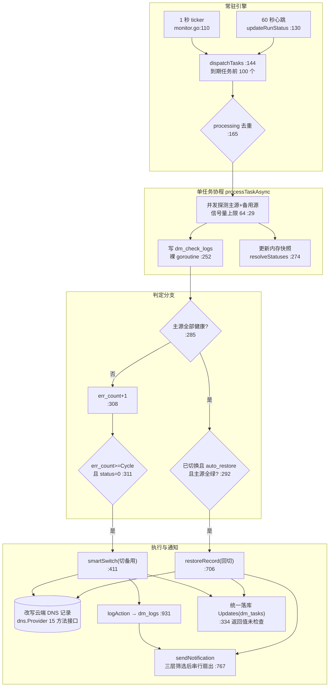
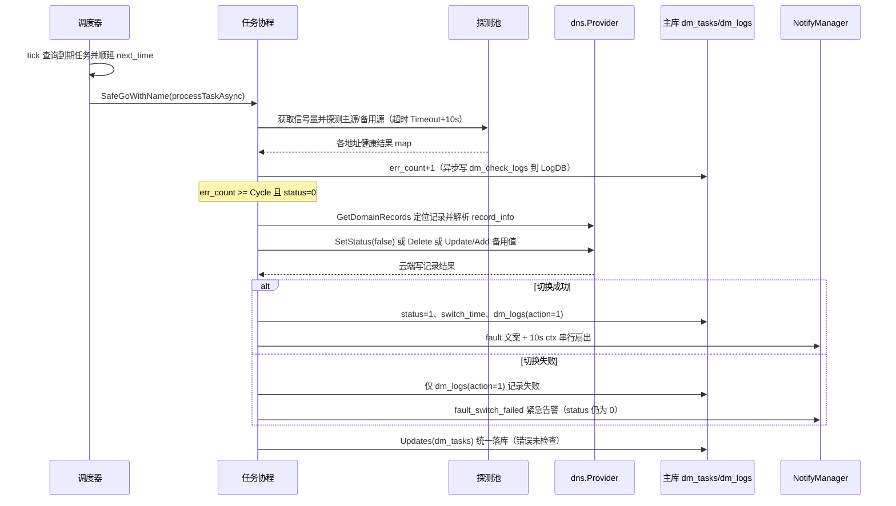
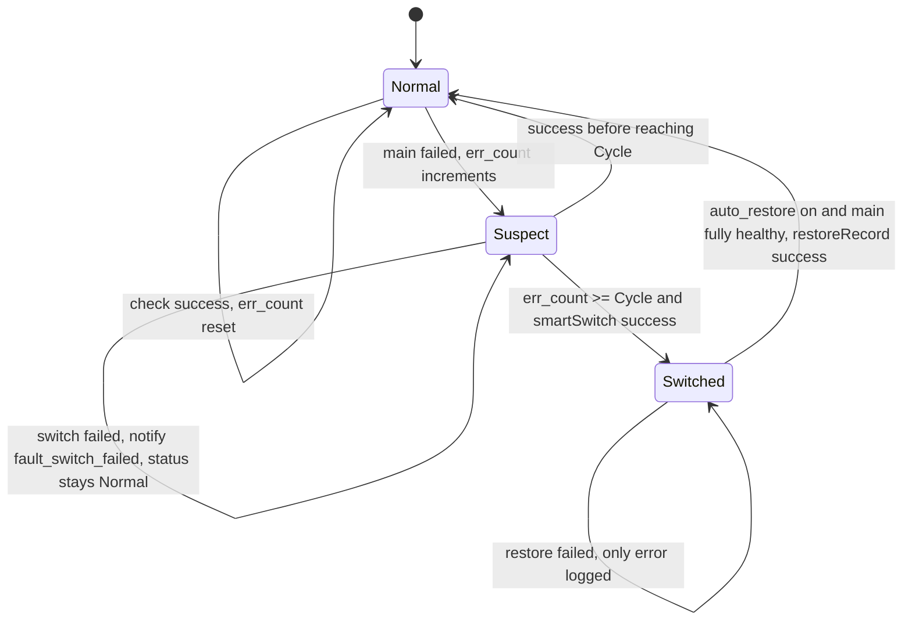
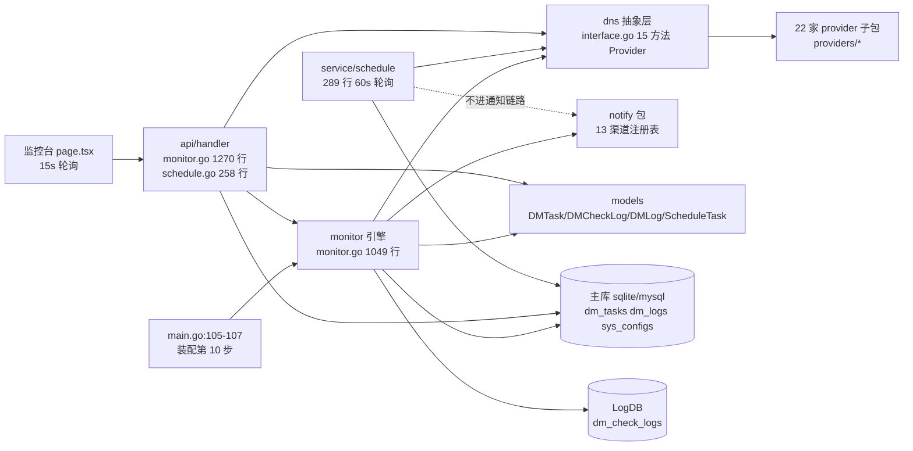

# 监控告警系统

**本文档引用的文件**
- [monitor.go](file://main/internal/monitor/monitor.go)
- [check.go](file://main/internal/monitor/check.go)
- [ssrf.go](file://main/internal/monitor/ssrf.go)
- [capabilities.go](file://main/internal/monitor/capabilities.go)
- [handler/monitor.go](file://main/internal/api/handler/monitor.go)
- [handler/schedule.go](file://main/internal/api/handler/schedule.go)
- [service/schedule.go](file://main/internal/service/schedule.go)
- [models.go](file://main/internal/models/models.go)
- [maintenance.go](file://main/internal/database/maintenance.go)
- [notify.go](file://main/internal/notify/notify.go)
- [channel_registry.go](file://main/internal/notify/channel_registry.go)
- [channel_adapters.go](file://main/internal/notify/channel_adapters.go)
- [router.go](file://main/internal/api/router.go)
- [routes_batch1.go](file://main/internal/apiv1/routes_batch1.go)
- [main.go](file://main/main.go)

## 目录
1. [简介](#简介)
2. [项目结构](#项目结构)
3. [核心组件](#核心组件)
4. [架构总览](#架构总览)
5. [详细组件分析](#详细组件分析)
6. [依赖关系分析](#依赖关系分析)
7. [性能考虑](#性能考虑)
8. [故障排查指南](#故障排查指南)
9. [结论](#结论)
10. [附录](#附录)

## 简介

监控告警系统是 dnsplane 的容灾核心域，由三个能力闭环构成：

- **多协议健康检查**：对监控任务的主源地址执行 Ping（ICMP）、TCP、HTTP、HTTPS 四类探测，
  探测参数（间隔、连续失败阈值、超时、期望状态码/关键词、代理）逐任务可配
  （`main/internal/monitor/check.go`，`main/internal/monitor/monitor.go:338-389`）。
- **自动容灾切换**：主源连续失败达到阈值后，按任务策略改写云端 DNS 记录——暂停/恢复、
  删除/重建、或切换到备用值；主源恢复且开启自动回切时自动还原
  （`main/internal/monitor/monitor.go:411-477`）。
- **多渠道通知**：切换、切换失败、恢复三类事件经任务级开关、渠道开关与任务白名单三层筛选后，
  由 13 个已注册通知渠道（邮件/Telegram/Webhook/Discord/钉钉/飞书/QQ 机器人等）串行扇出
  （`main/internal/monitor/monitor.go:767-873`，`main/internal/notify/channel_adapters.go:330-344`）。

与之相邻的**定时切换**子域（`main/internal/api/handler/schedule.go` +
`main/internal/service/schedule.go`）复用同一套 DNS 写记录链路，按日期时间或周期到点执行
启用/暂停/删除/修改，但不进通知渠道，仅写操作日志。

本文所有行号均以当前工作区文件实测为准（版本 1.0.11，工作区存在未提交修改）。
涉及机密值（代理口令、渠道密钥）一律以 `{占位}` 表述。

## 项目结构

监控域后端代码分布与实测行数（`wc -l` 复核）：

```text
main/
├── main.go                          # 第 10 步装配 monitor.New() → Start()（main.go:105-107）
└── internal/
    ├── monitor/                     # 监控引擎（非测试 1685 行 / 含测试 2857 行）
    │   ├── monitor.go               # 1049 行：主循环、派发、判定、切换、通知、状态存储
    │   ├── check.go                 # 372 行：ping/tcp/http(s) 探测实现与判定阈值
    │   ├── ssrf.go                  # 127 行：探测 URL/HostIP 私网拦截
    │   ├── capabilities.go          # 33 行：DNS 平台能力表（暂停/删除/混合）
    │   ├── check_ping_windows.go    # 94 行：Windows IcmpSendEcho 实现
    │   ├── check_ping_stub.go       # 10 行：非 Windows 占位实现
    │   └── *_test.go                # 4 个文件 1947 行：通知渠道装载/开关/白名单 + TCP 探测
    ├── api/handler/
    │   ├── monitor.go               # 1270 行：控制台 15 端点 + 对外端点共用
    │   └── schedule.go              # 258 行：定时切换策略 CRUD
    ├── service/schedule.go          # 289 行：定时切换执行器（60s 轮询）
    ├── models/models.go             # DMTask:134-176 / DMCheckLog:179-190 / DMLog:193-199 / ScheduleTask:293-311
    └── database/maintenance.go      # 444 行：保留期与清理策略（监控两类日志见 :218-232）
```

| 文件 | 行数 | 职责 | 关键入口 |
| --- | --- | --- | --- |
| `main/internal/monitor/monitor.go` | 1049 | 主循环/派发/判定/切换/通知/存储 | `run` :107、`dispatchTasks` :144、`processTaskAsync` :183、`smartSwitch` :411、`ManualSwitch` :711 |
| `main/internal/monitor/check.go` | 372 | 四类协议探测 | `CheckPing` :55、`CheckTCP` :163、`CheckHTTP` :206 |
| `main/internal/monitor/ssrf.go` | 127 | 私网拦截 | `validateCheckURL` :31、`isPrivateOrReservedIP` :62、`ssrfDialControl` :99 |
| `main/internal/monitor/capabilities.go` | 33 | 平台能力表 | `GetPlatformCaps` :28 |
| `main/internal/api/handler/monitor.go` | 1270 | HTTP 端点与查询构造 | 权限 :27-122、CRUD :171-470、观测 :530-920 |
| `main/internal/api/handler/schedule.go` | 258 | 定时切换 CRUD | :44-258 |
| `main/internal/service/schedule.go` | 289 | 定时切换执行器 | `Start` :66-88、`executeDueTasks` :91 |
| `main/internal/database/maintenance.go` | 444 | 数据清理 | 监控日志清理 :218-232 |

注意：`main/internal/monitor/logs/*.log`（3 个文件）不是运行时存储，而是 `go test`
在该包目录内以相对路径 `logs` 初始化 logger 的产物（`main/internal/logger/logger.go:54`），
`.gitignore` 仅忽略 `main/logs/` 与 `*.log`，目录本身仍在源码树内。
前端监控台为 `web/app/(dashboard)/dashboard/monitor/page.tsx`（2100 行单文件页面）与
`web/app/(dashboard)/dashboard/schedule/page.tsx`（421 行）。

## 核心组件

### 调度器

调度器是常驻协程：`run()` 以 1 秒 ticker 驱动派发、以 60 秒 statusTicker 刷新心跳
（`monitor.go:107-127`）。`dispatchTasks()` 每轮查询 `active=1 AND check_next_time<=now`
的任务，按 `check_next_time` 升序最多取 `maxDispatchPerTick = 100` 个（`monitor.go:24`），
用 `processing.LoadOrStore` 防止同一任务并发处理，派发后立即顺延
`check_next_time = now + Frequency`（`monitor.go:144-179`）。任务体经
`utils.SafeGoWithName` 起裸 goroutine 执行 `processTaskAsync`，不受 `Stop()` 的
`wg.Wait()` 覆盖（`monitor.go:171`，`monitor.go:93-104`）。

**章节来源**
- `main/internal/monitor/monitor.go:19,24,93-104,107-127,144-179`

### 检测器

`check.go` 提供三类平台无关探测与一个 Windows 原生 ICMP 分支：Ping 收到 ID+Seq 匹配的
EchoReply 判成功，非 Windows 或权限不足时静默降级为 TCP:80（`check.go:55-130,151-161`）；
TCP 探测握手成功即健康，`TCPPort=0` 回退 80（`check.go:148,163-174`）；HTTP(S) 探测
`2xx/3xx` 或命中 `ExpectStatus` 白名单、且正文（前 8192 字节）含关键词才成功
（`check.go:22,206-343`）。每次探测受任务级 ctx 超时 `Timeout + 10` 秒约束（`monitor.go:192`）。

**章节来源**
- `main/internal/monitor/check.go:22,55-130,148-174,206-343`
- `main/internal/monitor/monitor.go:192,338-389`

### 决策器

`processTaskAsync` 的判定分支（`monitor.go:285-331`）：主源全健康则清零 `err_count`，
若任务处于已切换态且 `auto_restore` 开启则触发回切；主源异常则 `err_count + 1`，
达到 `Cycle` 阈值且尚未切换时触发 `smartSwitch(task, true)`。多主源语义为
**任一地址失败即判主源故障**，无比例仲裁（`monitor.go:210-212,952-965`）。

**章节来源**
- `main/internal/monitor/monitor.go:210-212,285-331,952-965`

### 执行器

`smartSwitch`（`monitor.go:411-477`）按 `task.Type` 分派三种策略：暂停/恢复
（`disableRecord` :479-510，能力不支持暂停时回退删除+存原值）、删除/重建
（`DeleteDomainRecord` :452-466，先存 `OriginalValue`/`DeletedRecord`）、
切换备用值（`switchToBackup` :555-661，选首个健康备用值，CNAME 备用先解析 IPv4 再加 A，
记录类型不一致时删/停主记录再建新记录）。回切经 `restoreRecord`/`recreateRecord`
（:521-553,706-708）。手动路径为 `ManualSwitch(taskID, toBackup)`（:711-740）。

**章节来源**
- `main/internal/monitor/monitor.go:411-510,521-553,555-661,706-740`

### 存储

运行期数据分五处落点（详见[历史数据](#历史数据)与[清理策略](#清理策略)）：任务状态列写主库
`dm_tasks`（`monitor.go:334`），逐次探测结果异步写 LogDB `dm_check_logs`
（`monitor.go:252-265`），切换事件写主库 `dm_logs`（`monitor.go:931`），实时解析快照存进程内存
`sync.Map`（`monitor.go:274`），运行心跳 `run_time`/`run_count` 写 `sys_configs`
（`monitor.go:130-141`）。

**章节来源**
- `main/internal/monitor/monitor.go:130-141,252-274,334,931`
- `main/internal/models/models.go:134-199`

### 通知装配

`sendNotification(task, eventType, errMsg)` 依次执行：`NotifyEnabled` 门禁 → 反查域名拼
完整域名 → 生成 `fault`/`fault_switch_failed`/`recover` 三种纯文本文案 → `buildNotifyManager`
按 `notify.NotifyConfigKeys()` 一次 `IN` 查询直读 `sys_configs`，遍历 13 个注册渠道，
套 `notice_*` 开关与任务白名单两层筛选 → 10 秒 ctx 内 `manager.Send` 串行扇出，
失败仅记日志（`monitor.go:767-873`，`notify.go:688-704`）。

**章节来源**
- `main/internal/monitor/monitor.go:767-873`
- `main/internal/notify/notify.go:688-704`
- `main/internal/notify/channel_adapters.go:330-344`

### SSRF 防护

`ssrf.go` 提供两道拦截：建探测任务/执行探测时校验 URL scheme 与 IP 字面量私网段
（`validateCheckURL` :31，`isPrivateOrReservedIP` :62），并在 Dialer 的 `Control` 钩子里对
**解析后的实际连接地址**二次拦截，防 DNS rebinding（`ssrfDialControl` :99，`check.go:220-223`）。
覆盖范围仅限 CheckType 2/3 与 CDN 回源 HostIP（`monitor.go:363,378`，`check.go:216-218`）；
CheckType 0/1 与备用值解析 `resolveToAddrs` 不做私网判定（详见故障排查）。

**章节来源**
- `main/internal/monitor/ssrf.go:31,62,99`
- `main/internal/monitor/check.go:216-223`
- `main/internal/monitor/monitor.go:363,378`

### capabilities 平台能力表

`capabilities.go` 以静态表登记各 DNS 平台是否支持暂停/删除/混合记录（:10-26），
未登记平台回退默认值 `{Pause:false, Delete:true, Mixed:false}`（:28-32）。当前表只登记
15 家，而 `providers` 目录实有 22 家；且仅 `Pause` 字段被 `monitor.go:481,594,643` 消费，
`Delete`/`Mixed` 无读取方。

**章节来源**
- `main/internal/monitor/capabilities.go:10-32`
- `main/internal/monitor/monitor.go:481,594,643`

## 架构总览

### 检测循环与切换链路



**图表来源**
- `main/internal/monitor/monitor.go:29,107-141,144-179,252-274,285-334,411,706,767,931`

**章节来源**
- `main/internal/monitor/monitor.go:29,107-141,144-179,252-274,285-334,411-477,706,767-822,931`

### 切换触发时序



**图表来源**
- `main/internal/monitor/monitor.go:107-179,192,252-265,285-334,411-477,555-661,767-822,931`

**章节来源**
- `main/internal/monitor/monitor.go:107-179,192,252-265,285-334,411-477,555-661,767-822,931`

## 详细组件分析

### 任务模型

监控任务对应 `models.DMTask`（表 `dm_tasks`，主库，`models.go:134-176`）。字段按职责分组：

| 分组 | 字段（列名） | 语义与默认值 |
| --- | --- | --- |
| 定位 | `DomainID`(did) / `RR`(rr) / `RecordID`(record_id) / `RecordType` / `RecordLine` | 域名与云端记录锚点；RecordID 在删除重建后会变更（:136-140） |
| 切换策略 | `Type`(type) | 0 暂停/恢复、1 删除/重建、2 切换备用值，默认 0（:141） |
| 源值 | `MainValue` / `BackupValue` / `BackupValues` / `BackupType` | 主源逗号分隔多值；`BackupValues` 非空时优先于单备用值；BackupType 为 ip 或 cname（:142-145） |
| 探测参数 | `CheckType` / `CheckURL` / `TCPPort` / `Frequency` / `Cycle` / `Timeout` | 0 ping/1 tcp/2 http/3 https；间隔默认 3 秒阈值连续失败 3 次超时 2 秒（:146-151） |
| HTTP 判定 | `ExpectStatus` / `ExpectKeyword` / `MaxRedirects` | 状态码白名单、正文关键词；0=默认跟随 3 次重定向，-1=不跟随（:164-166） |
| 代理/CDN | `UseProxy` / `CDN` / `ProxyType`/`ProxyHost`/`ProxyPort`/`ProxyUsername`/`ProxyPassword` | 代理口令 `json:"-"` 且落库加密（:153-154,167-171） |
| 运行状态 | `CheckTime` / `CheckNextTime` / `SwitchTime` / `ErrCount` / `Status` / `MainHealth` / `Active` / `RecordInfo` | Status 0 正常/1 已切换；CheckNextTime 是调度唯一依据；RecordInfo 存 TaskState JSON（:155-163） |
| 通知/回切 | `NotifyEnabled` / `NotifyChannels` / `AutoRestore` / `AllowInsecureTLS` | 告警总开关、渠道白名单 JSON 数组、主源恢复自动回切、探测跳过证书校验（:172-175） |
| 备注 | `Remark` / `AddTime` | 备注 100 字符、创建时间戳（:152,155） |

`RecordInfo` 的 JSON 载体是 `TaskState`（`monitor.go:42-53`）：`backup_record_ids[]`、
`original_value`、`deleted_record{type,line,ttl,mx,remark}`、`was_deleted`，声明容量
`size:200`（`models.go:163`），批量创建时可能溢出（详见故障排查）。

辅助模型：`DMCheckLog`（表 `dm_check_logs`，LogDB，`models.go:179-190`）、
`DMLog`（表 `dm_logs`，主库，action 1 切换/2 恢复，`models.go:193-199`）、
`ScheduleTask`（表 `schedule_tasks`，`models.go:293-311`）。

已知缺口：实测 `main/data/data.db` DDL 存在 `last_error`/`backup_health`/`fault_time`/
`recover_time`/`uid` 列，但 Go 结构体无对应字段；新库 AutoMigrate 后执行引擎同型
`Updates(map)` 会报 `no such column: backup_health` 且 `rows=0`（详见[故障排查指南](#故障排查指南)）。

**章节来源**
- `main/internal/models/models.go:134-199,293-311`
- `main/internal/monitor/monitor.go:42-53,277-279`

### 检测类型

检测类型在 `processTaskAsync` 内按 `CheckType` 分派（`monitor.go:338-389`）：

| CheckType | 名称 | 入口函数 | 关键参数 | 成功判据 | 失败判据 |
| --- | --- | --- | --- | --- | --- |
| 0 | Ping(ICMP) | `CheckPing` → `checkPingICMP`/`checkPingWindows` | MainValue、Timeout | 收到 ID+Seq 匹配的 EchoReply | 超时、`destination unreachable`、发送失败 |
| 0(降级) | TCP:80 | `checkTCPFallback` | 固定端口 80 | TCP 握手成功 | 握手失败 |
| 1 | TCP | `CheckTCP` | TCPPort（0 回退 80）、Timeout | 连接建立 | 连接失败 |
| 2 | HTTP | `CheckHTTP` | CheckURL（空则 `http://`+addr）、ExpectStatus、ExpectKeyword、MaxRedirects、代理、CDN→HostIP | 2xx/3xx 或命中状态码白名单，且正文含关键词 | 状态码不符、关键词缺失、请求错误 |
| 3 | HTTPS | `CheckHTTP` | 同上，空 URL 回退 `https://`+addr | 同上，另受 TLS 校验约束 | 同上 |
| 其他 | 未知类型 | — | — | — | 恒定返回 `unknown check type` |

支撑函数：`ResolveDomain`（`check.go:345`）、`IsIPAddress`（`:359`）、`GetRecordType`（`:363`）。
Windows 走 `IcmpSendEcho`（`check_ping_windows.go`），其余平台的 ping 需要先取得
`ip4:icmp` 监听权限，失败即静默降级 TCP:80（`check.go:68-71,151-161`）。

**章节来源**
- `main/internal/monitor/monitor.go:338-389`
- `main/internal/monitor/check.go:55-71,151-174,206-343,345-363`

### 判定阈值

- **主源聚合**：`parseValues` 按逗号拆分多主源（`monitor.go:952-965`），逐地址并发探测，
  任一失败即 `mainHealthy=false`，无比例或仲裁阈值（`monitor.go:210-212`）。
- **备用源聚合**：`getBackupValues` 优先 `BackupValues`、回退 `BackupValue`（:968-976）；
  非 IP 值经 `resolveToAddrs` 解析（:979-989）；同一值解析出多地址时结果 map 被后写覆盖
  （:227-234）。
- **切换阈值**：`errCount = task.ErrCount + 1`，`errCount >= Cycle` 且 `status == 0` 才触发
  切换（`monitor.go:308-318`）。`Cycle=0`（经对外 API 零值覆盖可达）时首次失败即切换。
- **回切阈值**：仅 `status==1 && auto_restore` 且本轮主源全绿即回切（`monitor.go:292`），
  无“备用源保持 N 轮再回切”的二次确认，也无回切冷却。
- **兜底超时**：任务级 ctx = `Timeout + 10` 秒（:192）；全局并发信号量 64（:29），
  等待信号量期间 ctx 超时直接判该次探测失败（:342-347）。

**章节来源**
- `main/internal/monitor/monitor.go:29,192,210-212,227-234,292,308-318,342-347,952-989`

### 切换策略

`smartSwitch` 先做空值守卫与 `Domain → Account → Provider` 载入，再读平台能力
`GetPlatformCaps(account.Type)`，解析 `record_info` 为 `TaskState` 后按 `task.Type` 分派
（`monitor.go:411-477`）。三种策略的状态迁移如下：



**图表来源**
- `main/internal/monitor/monitor.go:285-331,411-477,706-708`

策略要点：

- **Type 0 暂停/恢复**：平台 `caps.Pause` 为真时走 `SetStatus(false)`；不支持暂停的平台
  回退为删除+把原值存入 `TaskState.DeletedRecord`（`monitor.go:479-510`）。
- **Type 1 删除/重建**：直接 `DeleteDomainRecord`，回切时由 `recreateRecord` 用存的
  type/line/ttl/mx/remark 重建（`monitor.go:452-466,521-553`）。
- **Type 2 切换备用值**：`switchToBackup` 选取首个 `isBackupHealthy` 的备用值
  （:555-661）；注意 `isBackupHealthy` 在内存快照缺失时默认返回 `true`（:940-949），
  即“未探测过的备用值”会被当作健康备用直接切换；备用值为 CNAME 时先解析 IPv4 再追加 A
  记录（:578-591）；主备记录类型不一致时删/停主记录再建新类型记录（:630-656）。
- **失败语义**：切换失败不置 `status=1`，下一轮继续命中阈值重复切换并重复推送紧急告警，
  代码中不存在退避、最大重试或告警合并逻辑（`monitor.go:311-330`）。

**章节来源**
- `main/internal/monitor/monitor.go:311-330,411-510,521-553,555-661,706-708,940-949`

### 通知链路

发送前的三层门禁与文案生成（`monitor.go:767-873`）：

| 层级 | 条件 | 行为与位置 |
| --- | --- | --- |
| 任务总开关 | `task.NotifyEnabled` 为 false | 直接跳过并记 Info 日志（:768-771） |
| 事件类型 | eventType 限定 fault / fault_switch_failed / recover | 生成【容灾告警】/【紧急告警】/【容灾恢复】标题与纯文本正文，其余类型直接 return（:788-805） |
| 渠道开关 | `NoticeKey()` 非空的渠道受 `notice_mail`/`notice_tgbot`/`notice_qqbot`/`notice_webhook`/`notice_custom_webhook` 约束，未配置视为开启，仅 0/false/no/off 关闭 | `channel_registry.go:47-49`、`monitor.go:857,918-921`；其余 8 个渠道 `NoticeKey()` 返回空串，只要已配置就会发送 |
| 任务白名单 | `task.NotifyChannels` JSON 数组精确匹配渠道标识，别名仅 `mail|email`、`wxwork|wxwork_app` 两组 | `monitor.go:860,885-908`；白名单留空则 `useAll`（:849） |

渠道注册表共 13 个渠道（`channel_adapters.go:330-344`）。发送模型为
`NotifyManager.SendAll` 串行遍历、共享单个 10 秒 ctx、返回首个错误（`notify.go:688-704`）；
monitor 与 notify 两条链路均无节流、无冷却、无告警合并、无投递记录表
（实测代码无 dedup/cooldown/silence 关键词命中，`models.go` 全文无通知配置或发送记录模型）。
邮件正文经 `mailContentAdapter` 将纯文本转 HTML（`notify.go:78-111`），容灾告警正文即纯文本。
出站地址受 `ValidateOutboundURL` 字面校验（`safe_url.go:15-43`，不做 DNS 解析）。

`UpdateMonitorTask` 的关键字段选择性更新与无条件覆盖并存（`handler/monitor.go:356-391`）：
`notify_channels` 在前端编辑表单字段集中不存在（`monitor/page.tsx:200-226,415-444`），
任务创建后无法在界面修改渠道白名单。

**章节来源**
- `main/internal/monitor/monitor.go:767-873,885-921`
- `main/internal/notify/notify.go:78-111,688-704`
- `main/internal/notify/channel_registry.go:47-49`
- `main/internal/notify/channel_adapters.go:330-344`
- `main/internal/api/handler/monitor.go:356-391`

### 历史数据

| 数据 | 库 | 写入点 | 读取点 | 保留策略 |
| --- | --- | --- | --- | --- |
| 逐次探测结果 `dm_check_logs` | LogDB(SQLite) | `monitor.go:254`（裸 goroutine） | `handler/monitor.go:851,899-909` | `maint_check_log_hours` 默认 72h，每小时清理（`maintenance.go:218-224,178`） |
| 切换事件 `dm_logs` | 主库 | `monitor.go:931` | `handler/monitor.go:570-572,584-589` | `maint_monitor_log_days` 默认 60d（`maintenance.go:226-232`） |
| 任务状态列 `dm_tasks` | 主库 | `monitor.go:334/548/738/926` | 列表/详情/概览端点 | 不清理 |
| 实时解析快照 `resolveStatuses` | 进程内存 sync.Map | `monitor.go:274` | `monitor.go:743-764` → `GetResolveStatus` 端点 | 进程生命周期，重启即空，任务删除不清理 |
| 运行心跳 `run_time`/`run_count` | `sys_configs` | `monitor.go:130-141`（60s） | `handler/monitor.go:641,798` | 覆盖写 |

查询侧行为：`GetMonitorHistory` period 白名单 1h/7d/30d、默认 24h，取回后 `slices.Reverse`，
单任务上限 `maxMonitorHistoryPoints = 4000` 点（`handler/monitor.go:27,811-856`）——60 秒
间隔任务 30 天应有约 43200 点，实际只返回最近约 1.7 天数据。`GetMonitorUptime` 为
3 窗口 × 3 查询串行，`AVG(duration)` 用 `.Row().Scan` 忽略错误（:858-920）。实测
`logs.db` 的 `dm_check_logs` 仅有 `task_id`/`created_at`/`success` 三个单列索引，
历史与在线率查询按 `task_id + created_at` 过滤时缺少复合索引。

**章节来源**
- `main/internal/monitor/monitor.go:254,274,334,743-764,931`
- `main/internal/api/handler/monitor.go:27,570-572,584-589,641,798,811-920`
- `main/internal/database/maintenance.go:178,218-232`

### 清理策略

清理由后台维护协程统一驱动（`maintenance.go`）：监控检查日志按小时粒度、以
`created_at < now - CheckLogHours` 删除 LogDB 记录（:218-224）；容灾切换日志按天粒度、以
`created_at < now - MonitorLogDays` 删除主库记录（:226-232）。保留期来自
`MaintenanceConfig`（:16 起）经 `LoadMaintenanceConfig`（:62）从 `sys_configs` 读取，
`StartMaintenance`（:111）注册每小时任务。

缺口：`DeleteMonitorTask` 删除任务时级联删除 `dm_logs` 但**不删** `dm_check_logs`
（`handler/monitor.go:402-433`），旧库会残留孤儿探测史；`dm_tasks` 本身无清理逻辑，
停用的历史任务长期占表。

**章节来源**
- `main/internal/database/maintenance.go:16,62,111,178,218-232`
- `main/internal/api/handler/monitor.go:402-433`

## 依赖关系分析



**图表来源**
- `main/main.go:105-107`
- `main/internal/monitor/monitor.go:419-435,767-873`
- `main/internal/api/handler/monitor.go:27-122`
- `main/internal/service/schedule.go:91-179`
- `main/internal/dns/interface.go:41-86`
- `main/internal/notify/channel_registry.go:20-33`

依赖关系要点：

| 方向 | 关系 | 证据 |
| --- | --- | --- |
| 上游装配 | `main.go` 第 10 步 `monitor.New()` → `mon.Start()`，全局 `monitor.Service` 供 handler 判空 | `main.go:105-107`、`monitor.go:19`、`handler/monitor.go:495` |
| monitor → dns | 切换/回切经 `dns.GetProvider` 取实例，调用 `SetDomainRecordStatus`、`DeleteDomainRecord`、`Add/UpdateDomainRecord` 等接口方法 | `monitor.go:419-435,479-661` |
| monitor → notify | `buildNotifyManager` 直查 `sys_configs`（71 个键的 `IN` 查询），不经 `sysconfig` 60s 缓存也不经 `dbcache` | `monitor.go:825-873`、`analysis: notify 侧 P16` |
| monitor → 存储 | 任务状态与事件写主库，探测日志写 LogDB，心跳写 `sys_configs` | `monitor.go:130-141,254,334,931` |
| handler 双链共用 | 控制台 15 条路由与对外 16 条 `/api/v1/monitor/*` 复用同一批 handler 函数 | `router.go:169-183`、`apiv1/routes_batch1.go:69-88` |
| 定时切换旁路 | `service/schedule.go` 独立 60s 轮询执行器，动作分派复用 dns Provider，但通知只写 `models.Log` | `service/schedule.go:139-179,254-259` |

## 性能考虑

- **派发吞吐**：1 秒 tick × 每轮 100 任务上限（`monitor.go:24,144-153`），理论上支撑
  每秒新起约 100 个任务协程；实际瓶颈在探测信号量 `maxConcurrentChecks = 64`（:29），
  满员排队期间 ctx 超时即误判失败（:342-347），任务规模大时形成与目标无关的批量误切换风险。
- **SSRF 检查开销**：`validateCheckURL` 为纯字符串/字面 IP 解析（`ssrf.go:31-77`），成本可忽略；
  Dialer `Control` 钩子（`ssrf.go:99`）在每次连接建立时执行一次私网判定，属常数级开销。
  设计上刻意不做前置 DNS 解析以避免慢解析与 TOCTOU 漂移（`ssrf.go:28-30` 注释）。
- **通知链放大**：每次告警新增一次 `WHERE key IN (71 键)` 主库直查（`monitor.go:832`），
  且 `sendNotification` 同步执行——邮件 SMTP 分支拨号 12s+阶段 15s 不受 10s ctx 约束
  （`notify.go:173-174`），最坏情况拖延 `Updates` 落库、放大重复切换窗口（`monitor.go:324-334`）。
- **观测查询**：`GetMonitorOverview` 以 9 个 goroutine 并发统计（`handler/monitor.go:606-643`），
  但 `GetMonitorUptime` 9 次查询串行（:890-917）；前端每 15 秒轮询后对每个任务并发拉
  `history?period=1h`，最多 200 任务即 200 次 LogDB 扫描（`monitor/page.tsx:292-309,360-369`），
  仅靠三个单列索引支撑，缺 `task_id+created_at` 复合索引。
- **内存增长**：`resolveStatuses`/`processing` 两个 sync.Map 只增不减，删除任务与停启用
  均不清理（`handler/monitor.go:402-470`），长期运行残留失效条目。

## 故障排查指南

### 误切（主源正常却触发切换）

- 全新安装库上 `err_count` 可能永远写不进去也永远读不出来：`DMTask` 缺
  `last_error`/`backup_health`/`fault_time`/`recover_time` 字段，`Updates(map)` 报
  `no such column` 且返回值被丢弃（`monitor.go:334`），表现为“永不切换”的反向症状亦由
  同根因引发——先核对表结构再下结论。
- ICMP 权限缺失时静默降级 TCP:80（`check.go:68-71`），只监听 443 的源会被判故障；
  容器 distroless nonroot 环境基本必触发该降级。
- 探测并发满 64 时排队超时直接计入主源失败（`monitor.go:342-347`）。
- 编辑任务会把 `proxy_password` 清空：模型 `json:"-"` 使列表不回显
  （`models.go:171`），前端回填 undefined 后提交空串被无条件覆盖
  （`handler/monitor.go:383`），认证代理探测随即失败并误判主源。
- 对外 API 更新未传字段时写零值：`Frequency=0` 导致每秒重复探测、`Cycle=0` 导致首次
  失败即切换、`Timeout=0` 使探测只剩 10 秒 ctx 兜底（`handler/monitor.go:370-391`，
  `monitor.go:177,311`，`check.go:220-221,288`）。
- CheckType 0/1 与备用值解析无 SSRF 私网拦截，`tcp` 类型可探测内网端口
  （`monitor.go:363,378` 仅覆盖 2/3），排查异常目标时注意该边界。

**章节来源**
- `main/internal/monitor/monitor.go:68-71,177,311,334,342-347,363,378`
- `main/internal/monitor/check.go:68-71,220-221,288`
- `main/internal/api/handler/monitor.go:370-391`
- `main/internal/models/models.go:171`

### 回切失败

- 回切条件极窄：仅 `status==1 && auto_restore` 且本轮主源全绿（`monitor.go:292`），
  无二次确认；任一主源地址残留失败即保持已切换态。
- 备用记录删除错误被丢弃：`monitor.go:604,614,645,648` 调用 `DeleteDomainRecord` 后不
  检查错误仍把 `WasDeleted=true` 落库；在暂停与删除均失败的平台（能力表
  `spaceship` 标 `Delete:false`，`capabilities.go:22`）回切时 `recreateRecord` 会再加一条
  同名记录，形成主/备重复解析（`monitor.go:521-553`）。
- 平台能力表分叉：`aws`/`dnsmgr`/`goedge`/`technitium`/`qingcloud` 实际支持状态切换，
  但未登记能力表而回退 `Pause:false` 默认值（`capabilities.go:28-32`），走破坏性的
  删除+重建路径，回切依赖 `record_info` 完整性。
- 停机竞态：探测协程与日志写入均为裸 goroutine，`Stop()` 只等主循环
  （`monitor.go:93-104,171,253-265`），可能已删除主记录但 `record_info` 未落库，
  记录无法自动重建——需手动经 `SwitchMonitorTask`（`handler/monitor.go:477-528`）或
  云端控制台修复。

**章节来源**
- `main/internal/monitor/monitor.go:93-104,253-265,292,521-553,604-648`
- `main/internal/monitor/capabilities.go:22,28-32`
- `main/internal/api/handler/monitor.go:477-528`

### 通知未达

排查按三层门禁自内向外：任务 `notify_enabled`（`monitor.go:768`）→ `notice_*` 开关
（值域：未配置视为开启，仅 `0/false/no/off` 关闭，`monitor.go:918-921`）→ 任务渠道
白名单（`monitor.go:885-908`）。常见根因：

- 白名单缺渠道：前端可勾选项仅 9 个渠道标识（`monitor/page.tsx:1998-2018`），
  `dingtalk`/`feishu`/`wxwork_app`/`wxtpl` 不在其中，任务一旦显式填写白名单这 4 个渠道
  永不命中，只有留空（useAll）才发出。
- 渠道缺配置入口：`wxpusher`/`qqbot` 在白名单可勾选，但设置页无对应配置键输入框，
  三键/两键必为空导致渠道必然不装载（`channel_adapters.go:298,320`）。
- 串行扇出饿死：单 10s ctx 下首个渠道慢（SMTP 拨号+阶段最坏 27s）即吃满预算，后续渠道
  在超时 ctx 下必然失败，且 `Send` 只返回首个错误、其余 12 渠道失败原因被丢弃
  （`notify.go:688-704`、`monitor.go:814-818`）。
- 无投递记录：通知无配置表/发送记录表，无法回答“这条告警发到哪些渠道、哪个在何时失败”，
  只能检索 `[Monitor] Task %d: 发送通知失败` 日志行。
- 告警风暴反向干扰：切换失败每周期重复推送（`monitor.go:311-330`），文案中“连续失败次数”
  打印的是阈值 `task.Cycle` 而非实际计数（`monitor.go:791-798`）。

**章节来源**
- `main/internal/monitor/monitor.go:768,791-798,814-818,885-921,311-330`
- `main/internal/notify/notify.go:173-174,688-704`
- `main/internal/notify/channel_adapters.go:298,320`

### 运行状态与数据展示异常

| 症状 | 根因 | 位置 |
| --- | --- | --- |
| 前端频繁显示“监控未运行” | 心跳 60s 刷新 vs 状态判定 10s/15s 窗口矛盾，约 75-83% 时间在阈值外 | `monitor.go:114,130-141` vs `handler/monitor.go:664-671,803` |
| MySQL 下 /monitor/status 报错 | `Where("key = ?")` 未反引号，`key` 为 MySQL 保留字（同文件其他处均加反引号） | `handler/monitor.go:798` 对比 :132,641 |
| 故障时间线永久空白 | 列表接口以 `dm_tasks.*` 扫描进无对应字段的结构体，未声明列被丢弃，JSON 不含这些键 | `handler/monitor.go:108-110,146-149` |
| 30 天曲线只有约 1.7 天数据 | 单任务历史上限 4000 点截断 | `handler/monitor.go:27,851-853` |
| 概览四卡片数字互不对账 | `healthy_count` 要求 active=1，`faulty_count` 只看 status=1，口径不同源 | `handler/monitor.go:615-622` |
| 代理口令编辑后失效 | 见[误切](#误切主源正常却触发切换)第 4 条；另 `Updates(map)` 路径绕过 `BeforeSave` 加密钩子，库中出现明文（`enc:v1:` 前缀边界被击穿，口令值一律视为 `{占位}` 脱敏） | `models/hooks.go:54`、`handler/monitor.go:383` |

**章节来源**
- `main/internal/api/handler/monitor.go:27,108-110,132,146-149,383,615-622,641,664-671,798,803,851-853`
- `main/internal/monitor/monitor.go:114,130-141`

## 结论

监控引擎的**决策逻辑本身完整且可读**：阈值判定 → 三策略切换 → 云端记录改写 → 恢复回切 →
事件通知，主干全部收敛在 `monitor.go` 一个 1049 行文件内，符合 KISS；通知侧通过渠道注册表
实现“新增渠道只需注册”，对 monitor 满足开闭原则（`channel_registry.go:20-33`）。

但**状态持久化契约已与模型脱钩**：新库上探测结果与切换状态写不进 4 个未声明列
（`no such column`，返回值被丢弃），形成“旧库看似正常、新库静默失效”的分叉。叠加更新接口
零值覆盖、告警无节流、运行状态判定自相矛盾，该域当前处于高危状态。建议优先级：

1. 补齐 `DMTask` 缺失字段并检查 `Updates` 返回值（P-1 根因，牵动 P-2/P-7 排障可信度）。
2. 收敛 `UpdateMonitorTask` 字段覆盖范围，非零/显式传入才写（P-5/P-4）。
3. 为告警增加冷却与并发扇出（P-7/P4：串行饿死 + 只回传首个错误）。
4. 补能力表缺口（15 家 vs 22 家）并删除 `Delete`/`Mixed` 死字段（P-12）。
5. 补 `dm_check_logs` 复合索引、任务删除级联、监控切换/回切路径测试
   （现 27 个测试全部集中在通知装载与 TCP，判定/切换/派发零覆盖）。

## 附录

### 控制台监控端点（15 条，`main/internal/api/router.go:169-183`）

| 方法 | 路径 | handler |
| --- | --- | --- |
| GET | `/api/monitor/tasks` | `GetMonitorTasks` |
| POST | `/api/monitor/tasks` | `CreateMonitorTask` |
| POST | `/api/monitor/tasks/:id` | `UpdateMonitorTask` |
| POST | `/api/monitor/tasks/:id/delete` | `DeleteMonitorTask` |
| POST | `/api/monitor/tasks/:id/toggle` | `ToggleMonitorTask` |
| POST | `/api/monitor/tasks/:id/switch` | `SwitchMonitorTask` |
| GET | `/api/monitor/tasks/:id/logs` | `GetMonitorLogs` |
| GET | `/api/monitor/tasks/:id/history` | `GetMonitorHistory` |
| GET | `/api/monitor/tasks/:id/uptime` | `GetMonitorUptime` |
| GET | `/api/monitor/tasks/:id/resolve-status` | `GetResolveStatus` |
| GET | `/api/monitor/overview` | `GetMonitorOverview` |
| POST | `/api/monitor/tasks/batch` | `BatchCreateMonitorTasks` |
| POST | `/api/monitor/tasks/auto-create` | `AutoCreateMonitorTask` |
| POST | `/api/monitor/lookup` | `LookupRecord` |
| GET | `/api/monitor/status` | `GetMonitorStatus` |

中间件链统一为 G1+CORS+Trace+Recov+CSRF+Audit+Auth+Perm；权限标注上 `overview` 为
admin、`lookup` 为 domain+subdomain、`tasks`(POST) 挂 quota，其余以 handler 内
模块/域名级校验为准（`scan-backend` 路由清单实测）。

**章节来源**
- `main/internal/api/router.go:169-183`
- `main/internal/api/handler/monitor.go:124-920`

### 对外 API 监控端点（`main/internal/apiv1/routes_batch1.go:69-88`，`registerMonitorRoutes`）

全部为 POST、仅挂 `monitor` 模块中间件、无入口限流（逐条实测 15 条 :73-87；素材口径
记为 16 条，差异条目未知）：

| 路径 | 复用 handler |
| --- | --- |
| `/api/v1/monitor/tasks/list` | `GetMonitorTasks` |
| `/api/v1/monitor/tasks/create` | `CreateMonitorTask` |
| `/api/v1/monitor/tasks/update` | `UpdateMonitorTask` |
| `/api/v1/monitor/tasks/delete` | `DeleteMonitorTask` |
| `/api/v1/monitor/tasks/toggle` | `ToggleMonitorTask` |
| `/api/v1/monitor/tasks/switch` | `SwitchMonitorTask` |
| `/api/v1/monitor/tasks/logs` | `GetMonitorLogs` |
| `/api/v1/monitor/tasks/history` | `GetMonitorHistory` |
| `/api/v1/monitor/tasks/uptime` | `GetMonitorUptime` |
| `/api/v1/monitor/tasks/resolve-status` | `GetResolveStatus` |
| `/api/v1/monitor/tasks/batch` | `BatchCreateMonitorTasks` |
| `/api/v1/monitor/tasks/auto-create` | `AutoCreateMonitorTask` |
| `/api/v1/monitor/overview` | `GetMonitorOverview` |
| `/api/v1/monitor/status` | `GetMonitorStatus` |
| `/api/v1/monitor/lookup` | `LookupRecord` |

**章节来源**
- `main/internal/apiv1/routes_batch1.go:69-88`
- `main/internal/api/handler/monitor.go:124-920`

### 定时切换端点（控制台 6 条 + 对外 6 条）

控制台挂载于 `main/internal/api/router.go:266-271`，对外挂载于
`main/internal/apiv1/routes_batch1.go:90-103`（模块权限走 `domain` 而非 `monitor`）：

| handler | 控制台路径 | 对外路径 |
| --- | --- | --- |
| `GetScheduleTasks` | GET `/api/schedule/tasks` | POST `/api/v1/schedule/tasks/list` |
| `CreateScheduleTask` | POST `/api/schedule/tasks` | POST `/api/v1/schedule/tasks/create` |
| `UpdateScheduleTask` | POST `/api/schedule/tasks/:id` | POST `/api/v1/schedule/tasks/update` |
| `DeleteScheduleTask` | POST `/api/schedule/tasks/:id/delete` | POST `/api/v1/schedule/tasks/delete` |
| `ToggleScheduleTask` | POST `/api/schedule/tasks/:id/toggle` | POST `/api/v1/schedule/tasks/toggle` |
| `BatchScheduleTaskAction` | POST `/api/schedule/tasks/batch` | POST `/api/v1/schedule/tasks/batch` |

执行器行为：启动延迟 20s、60s 轮询，`next_time>0 AND next_time<=now AND active=1` 命中执行
（`service/schedule.go:66-98`）；动作按 `SwitchType` 分派（1 启用/2 暂停/3 删除/0 修改，:139-179），
与 `models.go:298-299` 的注释语义相反，以前端标签函数与 runner 为准
（`schedule/page.tsx:229-230`）；重启用不重算 `next_time`，单次任务过期后永久不再执行
（`handler/schedule.go:249-254`）。

**章节来源**
- `main/internal/api/handler/schedule.go:44-258`
- `main/internal/service/schedule.go:66-179,192-223`
- `main/internal/apiv1/routes_batch1.go:90-103`
- `main/internal/models/models.go:293-311`
