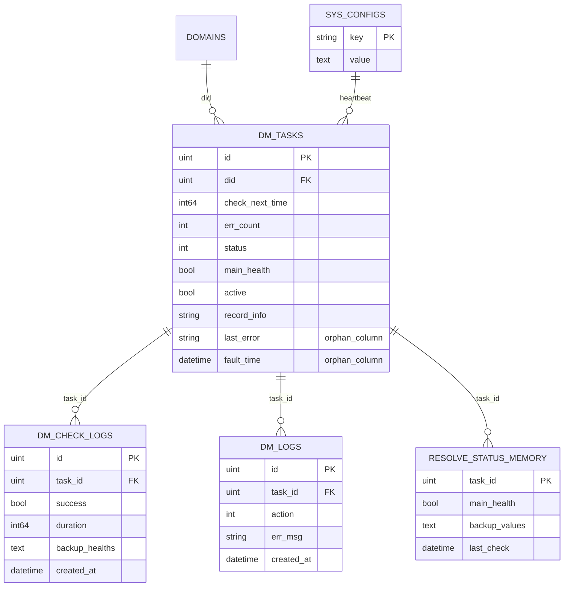
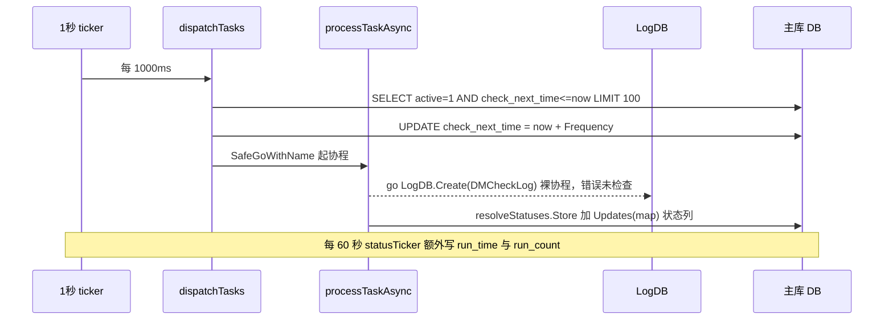
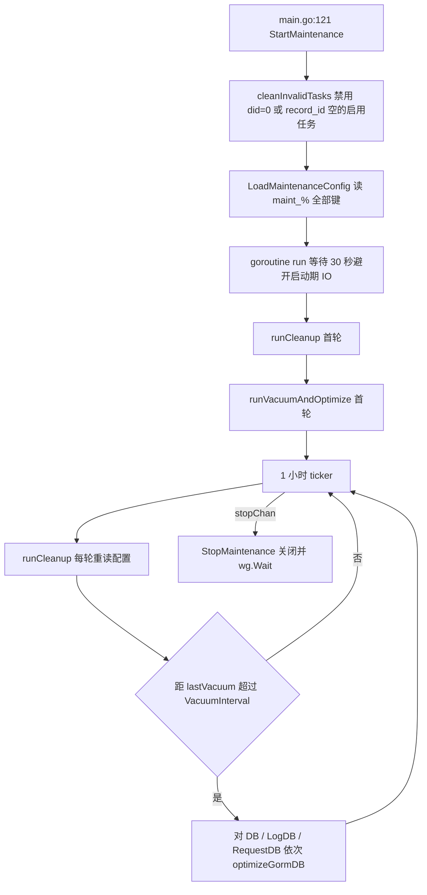
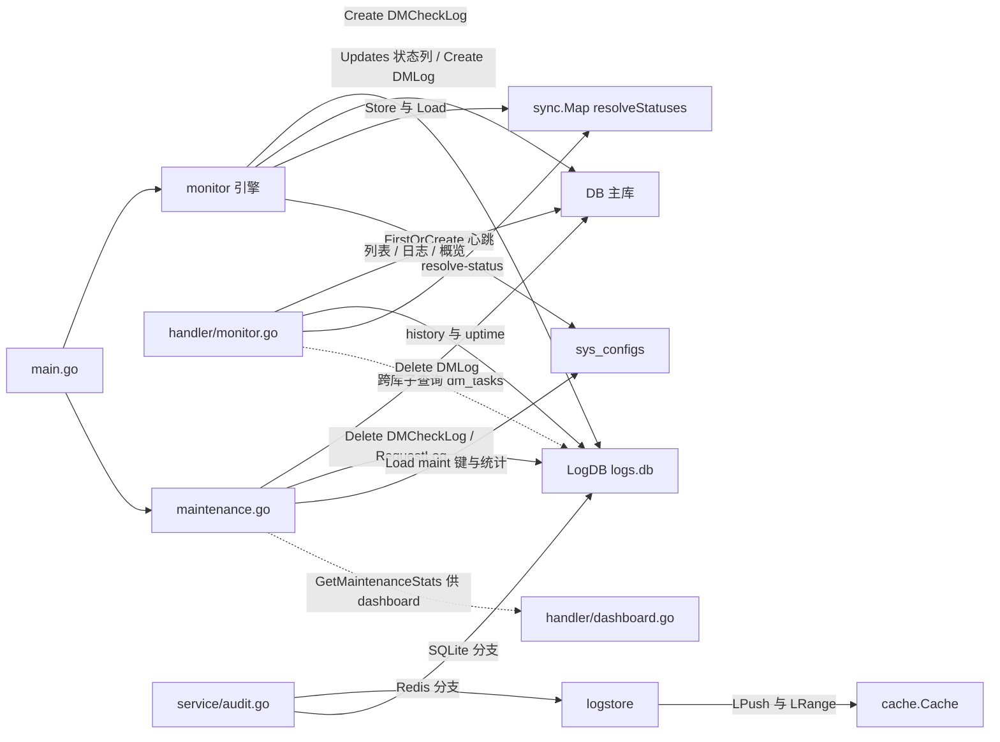

# 监控数据存储

<cite>
**本文档引用的文件**
- [models.go](file://main/internal/models/models.go)
- [database.go](file://main/internal/database/database.go)
- [maintenance.go](file://main/internal/database/maintenance.go)
- [monitor.go](file://main/internal/monitor/monitor.go)
- [handler/monitor.go](file://main/internal/api/handler/monitor.go)
- [dashboard.go](file://main/internal/api/handler/dashboard.go)
- [store.go](file://main/internal/logstore/store.go)
- [cache.go](file://main/internal/cache/cache.go)
- [sysconfig.go](file://main/internal/sysconfig/sysconfig.go)
- [audit.go](file://main/internal/service/audit.go)
- [schedule.go](file://main/internal/service/schedule.go)
- [config.go](file://main/internal/config/config.go)
- [main.go](file://main/main.go)
- [router.go](file://main/internal/api/router.go)
- [routes_batch1.go](file://main/internal/apiv1/routes_batch1.go)
- [api.ts](file://web/lib/api.ts)
- [monitor/page.tsx](file://web/app/(dashboard)/dashboard/monitor/page.tsx)
- [dashboard/page.tsx](file://web/app/(dashboard)/dashboard/page.tsx)
</cite>

## 目录

1. [简介](#简介)
2. [项目结构](#项目结构)
3. [核心组件](#核心组件)
4. [架构总览](#架构总览)
5. [详细组件分析](#详细组件分析)
6. [依赖关系分析](#依赖关系分析)
7. [性能考虑](#性能考虑)
8. [故障排查指南](#故障排查指南)
9. [结论](#结论)
10. [附录](#附录)

## 简介

监控告警域的数据落地由四类载体组成，它们的**生命周期、写入频率、可靠性契约完全不同**，用同一套排查方法必然失效：

| 数据类别 | 物理载体 | Go 类型 | 写入点 | 生命周期 |
|----------|----------|---------|--------|----------|
| 结果快照 | 主库 `dm_tasks` 状态列 | `models.DMTask` | `monitor.go:334` | 与任务同生命周期，不清理 |
| 探测历史 | 日志库 `dm_check_logs` | `models.DMCheckLog` | `monitor.go:253-265` | 默认保留 72 小时 |
| 切换日志 | 主库 `dm_logs` | `models.DMLog` | `monitor.go:930-937` | 默认保留 60 天 |
| 实时解析快照 | 进程内存 `sync.Map` | `monitor.ResolveStatus` | `monitor.go:274` | 进程生命周期，重启即空 |

先澄清命名口径：本域不存在名为 `MonitorResult` 或 `SwitchLog` 的 Go 类型，大纲所指的"结果快照 / 历史 / 切换日志"在代码中分别对应 `DMTask` 状态列、`DMCheckLog`、`DMLog`，加上一份只存在于内存的 `ResolveStatus`，后文统一使用代码里的真实标识符。存储侧的关键设计是**写入量由调度器节流，而非由保留策略兜底**：

| 节流参数 | 值 | 定义位置 | 作用 |
|----------|:--:|----------|------|
| tick 间隔 | 1 秒 | `monitor.go:110` | 到期判定粒度 |
| `maxDispatchPerTick` | 100 | `monitor.go:24` | 单轮最多派发任务数 |
| `maxConcurrentChecks` | 64 | `monitor.go:29` | 地址级探测并发上限 |
| 任务级 ctx 超时 | `Timeout + 10` 秒 | `monitor.go:192` | 单任务探测硬上限 |
| 历史查询点数上限 | 4000 | `handler/monitor.go:27`、`:852` | 单次读的最大行数 |

**章节来源**
- [monitor.go:24-29](file://main/internal/monitor/monitor.go#L24-L29)
- [monitor.go:110-192](file://main/internal/monitor/monitor.go#L110-L192)
- [monitor.go:253-334](file://main/internal/monitor/monitor.go#L253-L334)
- [handler/monitor.go:27](file://main/internal/api/handler/monitor.go#L27)

## 项目结构

存储相关代码分布在 5 个包，边界清晰：

```
main/internal/
├── models/models.go          # 表结构契约（DMTask / DMCheckLog / DMLog / SysConfig / Log / RequestLog）
├── database/
│   ├── database.go           # 三库装配（DB / LogDB / RequestDB）+ AutoMigrate + SQLite PRAGMA
│   └── maintenance.go        # 保留期配置、清理循环、VACUUM、维护统计
├── logstore/store.go         # Redis 旁路：RequestLog 与系统 Log，不承载 DM 数据
├── cache/cache.go + sysconfig/sysconfig.go  # Cache 接口双实现 / sys_configs 60 秒读穿缓存
└── monitor/monitor.go        # 所有写入点的调用方
```

| 文件 | 行数 | 存储域职责 | 关键符号 |
|------|:----:|------------|----------|
| `models/models.go` | 370 | 表结构与索引标签声明 | `DMTask:134-176`、`DMCheckLog:179-190`、`DMLog:193-199`、`SysConfig:314-317` |
| `database/database.go` | 496 | 三库打开、连接池、迁移 | `DB/LogDB/RequestDB:21-25`、`sqliteDSN:39-46`、`migrateLogDB:299-305` |
| `database/maintenance.go` | 445 | 保留期与清理 | `MaintenanceConfig:16-26`、`runCleanup:198-247`、`optimizeGormDB:283-320` |
| `logstore/store.go` | 417 | Redis 日志列表 | `SaveSystemLog:260-272`、`QuerySystemLogs:275-311` |
| `cache/cache.go` | 314 | 后端抽象 | `Cache:16-30`、`Init:46-84` |
| `monitor/monitor.go` | 1049 | 全部写入点 | `dispatchTasks:144-179`、`processTaskAsync:183-335` |
| `api/handler/monitor.go` | 1270 | 全部读取点 | `GetMonitorOverview:577-685`、`GetMonitorHistory:811-856` |

分库决策写死在 `database.go`：主库按配置支持 MySQL 或 SQLite（`:81-102`），但 **`LogDB` 与 `RequestDB` 无条件 `sqlite.Open`**（`:106`、`:114`），路径由主库路径推导为同目录的 `logs.db` / `request_logs.db`（`config.go:58-67`）—— 即 MySQL 部署下探测历史仍落本地单文件 SQLite，横向扩容时这一层无法共享。

**章节来源**
- [models.go:134-199](file://main/internal/models/models.go#L134-L199)
- [database.go:21-118](file://main/internal/database/database.go#L21-L118)
- [config.go:58-67](file://main/internal/config/config.go#L58-L67)
- [maintenance.go:16-26](file://main/internal/database/maintenance.go#L16-L26)

## 核心组件

### 结果快照载体：DMTask 的状态列

`DMTask` 一张表承载两种写入语义：配置列由 CRUD 接口改写，状态列由引擎独占改写。

| 状态列 | 类型 | 声明 | 写入点 | 语义 |
|--------|------|------|--------|------|
| `check_time` | `int64` | `models.go:156` | `monitor.go:276` | 最近一轮检测的 Unix 秒 |
| `check_next_time` | `int64` | `models.go:157` | `monitor.go:177` | 下次到期时间，调度唯一依据 |
| `err_count` | `int` | `models.go:159` | `monitor.go:288`、`:309` | 连续失败计数，达标即切换 |
| `status` | `int` | `models.go:160` | `monitor.go:296`、`:320` | 0 正常 / 1 已切换 |
| `switch_time` | `int64` | `models.go:158` | `monitor.go:297`、`:321` | 最近切换或回切时刻 |
| `main_health` | `bool` | `models.go:161` | `monitor.go:277` | 最近主源健康位 |
| `record_info` | `text(200)` | `models.go:163` | `monitor.go:926` | `TaskState` JSON 载体 |
| `last_error` | — | **模型无字段** | `monitor.go:278` | 引擎仍在写 |
| `backup_health` | — | **模型无字段** | `monitor.go:282` | 引擎仍在写 |
| `fault_time` | — | **模型无字段** | `monitor.go:316` | 引擎仍在写 |
| `recover_time` | — | **模型无字段** | `monitor.go:298` | 引擎仍在写 |

后四列是本文记录的首要结构性风险。`monitor.go:275-283`、`:298`、`:316` 通过 `Updates(map[string]interface{})` 写它们，而 `DMTask`（`models.go:134-176`）没有对应字段；`Updates` 按 map 键拼 SET 子句，列不存在即报错，`monitor.go:334` 未接收返回值，错误被静默丢弃。

对存量库做只读 DDL 导出（`main/data/data.db`）可见这四列确实存在，并额外残留 `uid`：

```sql
-- 来源：sqlite3 "file:main/data/data.db?mode=ro" ".schema dm_tasks"（节选）
`main_health` numeric DEFAULT true, `backup_health` text, `last_error` text,
`fault_time` datetime, `recover_time` datetime, `uid` text,
```

旧库因历史版本残留列而表现正常；以当前结构体 AutoMigrate 的新库不会创建这些列，而 AutoMigrate 只加列不减列，分叉无法靠重启自愈。另有一处类型口径冲突：`fault_time` / `recover_time` 在 `monitor.go:316`、`:298` 写入 `*time.Time`（实测列类型 `datetime`），前端却按秒级时间戳渲染 —— `monitor/page.tsx:1244`、`:1250` 直接对字段做 `* 1000`，即便列存在，展示的故障时间也会落在 1970 年附近。

**章节来源**
- [models.go:134-176](file://main/internal/models/models.go#L134-L176)
- [monitor.go:275-334](file://main/internal/monitor/monitor.go#L275-L334)
- [monitor.go:923-927](file://main/internal/monitor/monitor.go#L923-L927)
- [monitor/page.tsx:1237-1256](file://web/app/(dashboard)/dashboard/monitor/page.tsx#L1237-L1256)

### 历史载体：DMCheckLog

高频表，一次探测一行，落在独立的 `LogDB`：

| 字段 | 列名 | 类型/约束 | 来源 | 说明 |
|------|------|-----------|------|------|
| `ID` | `id` | `uint primaryKey` | `models.go:180` | 自增主键 |
| `TaskID` | `task_id` | `uint index` | `models.go:181` | 关联 `dm_tasks.id`，无外键 |
| `Success` | `success` | `bool index` | `models.go:182` | 与 `MainHealth` 同源 |
| `Duration` | `duration` | `int64` | `models.go:183` | 整轮耗时毫秒（`monitor.go:243`） |
| `Error` | `error` | `size:500` | `models.go:184` | 首个失败地址错误串，截断到 500 |
| `MainHealth` | `main_health` | `bool` | `models.go:185` | 主源整体健康 |
| `BackupHealths` | `backup_healths` | `type:text` | `models.go:186` | `map[string]bool` 的 JSON |
| `MainDuration` | `main_duration` | `int64` | `models.go:187` | 主源探测段耗时 |
| `BackupDuration` | `backup_duration` | `int64` | `models.go:188` | 备用源探测段耗时 |
| `CreatedAt` | `created_at` | `time.Time index` | `models.go:189` | 保留期与查询窗口过滤列 |

`Success` 与 `MainHealth` 都取同一个 `mainHealthy`（`monitor.go:256`、`:259`），构成语义冗余列。多主源时任一地址失败即整体判负（`monitor.go:210-212`），无比例或仲裁阈值；同一备用值解析出多地址时 `backupHealthMap[val]` 被后写覆盖（`monitor.go:227-233`）。实测 DDL 显示只有三个单列索引，缺少历史查询所需的复合索引：

```sql
-- 来源：sqlite3 "file:main/data/logs.db?mode=ro" ".schema dm_check_logs"
CREATE INDEX `idx_dm_check_logs_task_id` ON `dm_check_logs`(`task_id`);
CREATE INDEX `idx_dm_check_logs_created_at` ON `dm_check_logs`(`created_at`);
CREATE INDEX `idx_dm_check_logs_success` ON `dm_check_logs`(`success`);
```

**章节来源**
- [models.go:179-190](file://main/internal/models/models.go#L179-L190)
- [monitor.go:210-265](file://main/internal/monitor/monitor.go#L210-L265)

### 切换日志载体：DMLog

低频、审计型事件表，落主库：

| 字段 | 列名 | 约束 | 写入语义 | 来源 |
|------|------|------|----------|------|
| `TaskID` | `task_id` | `index` | 事件归属任务 | `models.go:195` |
| `Action` | `action` | `default:0` | 1 切备用 / 2 回主 | `models.go:196` |
| `ErrMsg` | `err_msg` | `size:100` | 事件描述 | `models.go:197`、`monitor.go:934` |
| `CreatedAt` | `created_at` | `time.Time` | 事件时刻 | `models.go:198` |

写入集中在 `logAction`（`monitor.go:930-937`），场景包括切换成功（`:322`）、切换失败（`:327`）、自动回切（`:300`）与手动切换。成功与失败**都记 `Action=1`**，只靠文案区分，程序化统计退化为字符串匹配。`truncate`（`monitor.go:1043-1049`）按**字节**切片，中文 UTF-8 被截半会产出非法字节串；`err_msg` 上限 100 字节（约 33 汉字），`error` 上限 500 字节，两条路径都有该风险。

**章节来源**
- [models.go:193-199](file://main/internal/models/models.go#L193-L199)
- [monitor.go:300-330](file://main/internal/monitor/monitor.go#L300-L330)
- [monitor.go:930-937](file://main/internal/monitor/monitor.go#L930-L937)
- [monitor.go:1043-1049](file://main/internal/monitor/monitor.go#L1043-L1049)

### 概览聚合视图：Overview

`GetMonitorOverview`（`handler/monitor.go:577-685`）不是存储实体，而是横跨主库、日志库、`sys_configs` 的即时聚合，9 个 goroutine 并发查询（`:605-643`）：

| 响应键 | 计算口径 | 数据来源 | 行号 |
|--------|----------|----------|------|
| `task_count` | 权限域内任务总数 | `dm_tasks` | `:609` |
| `active_count` | `active=1` | `dm_tasks` | `:613` |
| `healthy_count` | `active=1 AND status=0` | `dm_tasks` | `:617` |
| `faulty_count` | `status=1`（不含 active 条件） | `dm_tasks` | `:621` |
| `switch_count` | 近 24 小时 `dm_logs` 条数 | `dm_logs` | `:625` |
| `fail_count` | 近 24 小时 `action=1` 条数 | `dm_logs` | `:629` |
| `avg_uptime` | 近 24 小时 `success` 占比 | `dm_check_logs` | `:633`、`:645-648` |
| `run_time` / `run_count` | 心跳覆盖值 | `sys_configs` | `:641` |
| `run_state` | `run_time` 距今 < 15 秒 | 派生 | `:664-671` |

两处口径不一致：`healthy_count` 要求 `active=1` 而 `faulty_count` 不要求（`:617` 对比 `:621`），停用的已切换任务仍计入故障；`avg_uptime` 是"昨日窗口成功率"（`:582`），与 `GetMonitorUptime` 的"此刻往前推 24 小时"（`:891`）不在同一时间轴。前端 `MonitorOverview` 声明了 `run_error`（`api.ts:1219`），后端从未返回该键。

**章节来源**
- [handler/monitor.go:577-685](file://main/internal/api/handler/monitor.go#L577-L685)
- [handler/monitor.go:890-920](file://main/internal/api/handler/monitor.go#L890-L920)
- [api.ts:1215-1228](file://web/lib/api.ts#L1215-L1228)

## 架构总览

四类载体与三库、内存层的实体关系如下。`erDiagram` 按规范使用英文标识符，关系名为物理列名：



**图表来源**
- [models.go:134-199](file://main/internal/models/models.go#L134-L199)
- [models.go:314-317](file://main/internal/models/models.go#L314-L317)
- [monitor.go:31-53](file://main/internal/monitor/monitor.go#L31-L53)

图中三个结构信号：`task_id` 全是逻辑关联、没有数据库外键，删任务时只显式删 `dm_logs`（`handler/monitor.go:430`），`dm_check_logs` 未删（`:429-430`），历史表会积累孤儿行；`RESOLVE_STATUS_MEMORY` 由 `Monitor.resolveStatuses` 这个 `sync.Map` 承载（`monitor.go:62`、`:274`），重启即空且无淘汰逻辑；`DM_TASKS` 的四列 `orphan_column` 在模型层不存在，属于"引擎写、模型不认"，前端却依赖它们渲染故障时间线。

物理库归属：

| 表 | 连接 | 文件/引擎 | 迁移声明 |
|----|------|-----------|----------|
| `dm_tasks`、`dm_logs`、`sys_configs`、`domains`、`schedule_tasks` | `DB` | SQLite `data.db` 或 MySQL | `database.go:242-270` |
| `dm_check_logs`、`logs`、`cert_logs` | `LogDB` | 固定 SQLite `logs.db` | `database.go:299-305` |
| `request_logs` | `RequestDB` | 固定 SQLite `request_logs.db` | `database.go:307-311` |
| `ResolveStatus` | 进程内存 | 无 | 不适用 |

**章节来源**
- [database.go:242-311](file://main/internal/database/database.go#L242-L311)
- [handler/monitor.go:429-430](file://main/internal/api/handler/monitor.go#L429-L430)
- [monitor.go:62-64](file://main/internal/monitor/monitor.go#L62-L64)

## 详细组件分析

### 写入频率：一轮探测的四次落库



**图表来源**
- [monitor.go:107-179](file://main/internal/monitor/monitor.go#L107-L179)
- [monitor.go:183-334](file://main/internal/monitor/monitor.go#L183-L334)

写入量的解析式（由 `dispatchTasks` 与"一行/轮"事实推导，非压测结果）：稳态行数速率约等于 Σ(1 / Frequency_i) 行/秒，与主源地址数、备用值数无关；72 小时窗口行数上界约 Σ(259200 / Frequency_i)，以 1000 个 60 秒任务推算约 432 万行 —— 该数为**推算**，仅用于说明容量级差。实测样本（`main/data/logs.db` 只读查询）为另一侧对照：`dm_check_logs` 514 行，`created_at` 跨度 2026-10-07 12:52:42 至 2026-10-08 20:45:33（约 31.9 小时），`logs` 153 行，`cert_logs` 5 行，整库 184320 字节，`error + backup_healths` 平均 16.88 字节 —— 小规模单实例样本，不能外推为生产基线。

各写入路径的错误处理现状（均无返回值检查）：

| 写入 | 位置 | 是否异步 | 错误处理 |
|------|------|----------|----------|
| `LogDB.Create(DMCheckLog)` | `monitor.go:253-265` | 裸 `go func` | 返回值丢弃 |
| `DB.Updates(updates)` | `monitor.go:334` | 同步 | 返回值丢弃 |
| `DB.Update(check_next_time)` | `monitor.go:175-177` | 同步 | 返回值丢弃 |
| `DB.Update(record_info)` | `monitor.go:926` | 同步 | 返回值丢弃 |
| `DB.Create(DMLog)` | `monitor.go:931-936` | 同步 | 返回值丢弃 |

`Stop()` 只 `wg.Wait()` 等主循环（`monitor.go:93-104`），任务协程与历史落库都是裸协程（`:171`、`:253`）。停机窗口内已发生的 DNS 记录改写可能没写回 `record_info`，记录因此无法自动重建。

**章节来源**
- [monitor.go:93-104](file://main/internal/monitor/monitor.go#L93-L104)
- [monitor.go:144-179](file://main/internal/monitor/monitor.go#L144-L179)
- [monitor.go:243-283](file://main/internal/monitor/monitor.go#L243-L283)

### 保留策略：一张配置表管全库

`MaintenanceConfig`（`maintenance.go:16-26`）用 8 个整数维度定义全库保留期，键名以 `maint_` 前缀存 `sys_configs`（`:29-38`），默认值见 `:46-59`：

| 配置字段 | SysConfig 键 | 默认值 | 作用表 | 清理判据 | 位置 |
|----------|--------------|:------:|--------|----------|------|
| `CheckLogHours` | `maint_check_log_hours` | 72 小时 | `dm_check_logs` | `created_at < now-Nh` | `:218-224` |
| `MonitorLogDays` | `maint_monitor_log_days` | 60 天 | `dm_logs` | `created_at < now-Nd` | `:226-232` |
| `OperationLogDays` | `maint_operation_log_days` | 90 天 | `logs` | `created_at < now-Nd` | `:202-208` |
| `CertLogDays` | `maint_cert_log_days` | 60 天 | `cert_logs` | `created_at < now-Nd` | `:210-216` |
| `RequestLogDays` | `maint_request_log_days` | 7 天 | `request_logs` | `created_at < now-Nd` | `:235-240` |
| `RequestSuccessKeep` | `maint_request_success_keep` | 2000 条 | `request_logs` | 按 `id` 截断非错误行 | `:243`、`:249-268` |
| `RequestErrorKeep` | `maint_request_error_keep` | 1000 条 | `request_logs` | 按 `id` 截断错误行 | `:245`、`:249-268` |
| `VacuumIntervalH` | `maint_vacuum_interval_h` | 24 小时 | 三库 | 时间间隔 | `:187-193` |

两条硬约束：**无法关闭清理** —— `LoadMaintenanceConfig`（`:61-98`）对每个值执行 `fmt.Sscanf(c.Value, "%d", &val)`，`err != nil || val <= 0` 直接 `continue`（`:73-75`），设成 `0` 或负数会被忽略并回落默认值，不存在"无限保留"的合法配置；**每轮清理都重读配置** —— `runCleanup` 首行即 `m.config = LoadMaintenanceConfig()`（`:200`），管理员改完 `maint_*` 无需重启，下一个整点生效。按小时而非按天清理 `dm_check_logs`（`:218-224`）是唯一针对高频表的差异化设计；`dm_tasks` 状态列不参与任何清理，由 `monitor.go:334` 覆盖写。

**章节来源**
- [maintenance.go:16-98](file://main/internal/database/maintenance.go#L16-L98)
- [maintenance.go:198-268](file://main/internal/database/maintenance.go#L198-L268)

### 清理任务：启动序列与每小时循环



**图表来源**
- [main.go:121-122](file://main/main.go#L121-L122)
- [maintenance.go:110-196](file://main/internal/database/maintenance.go#L110-L196)
- [maintenance.go:270-320](file://main/internal/database/maintenance.go#L270-L320)

| 步骤 | 函数 | 影响对象 | 失败可见性 |
|------|------|----------|------------|
| 无效任务禁用 | `cleanInvalidTasks:134-152` | `dm_tasks.active=false` | `logger.Warn` 条数 |
| 高频历史与切换日志清理 | `runCleanup:218-232` | `dm_check_logs`、`dm_logs` | 仅 `RowsAffected>0` 才记 Info |
| 请求日志双轨清理 | `runCleanup:235-246` | `request_logs` | 同上 |
| WAL 检查点 | `optimizeGormDB:297` | 三库 | 未检查错误 |
| ANALYZE 与 optimize | `optimizeGormDB:300-303` | 统计与索引 | 未检查错误 |
| VACUUM | `optimizeGormDB:306-308` | 库文件收缩 | **唯一**检查错误并 Warn |

`cleanInvalidTasks` 的 COUNT 条件带 `AND active = true`（`:142-144`），紧随的 UPDATE 不带该条件（`:147-149`），两者谓词不一致 —— 日志报告条数可能小于实际禁用条数。维护统计经 `GetMaintenanceStats`（`:335-353`，25 秒 TTL）暴露：`handler/dashboard.go:470` 挂到 `db_maintenance`，前端在 `dashboard/page.tsx:524-546` 渲染 `last_vacuum` / `next_vacuum` / `main_db.size_text`；表行数取自 `sqlite_stat1`（`:408-420`）并显式标记 `tables_approx: true`（`:422`），是估算值而非 `COUNT(*)`。

**章节来源**
- [maintenance.go:110-196](file://main/internal/database/maintenance.go#L110-L196)
- [maintenance.go:270-424](file://main/internal/database/maintenance.go#L270-L424)
- [dashboard.go:470](file://main/internal/api/handler/dashboard.go#L470)
- [dashboard/page.tsx:524-546](file://web/app/(dashboard)/dashboard/page.tsx#L524-L546)

### 查询 API：六类读取端点与存储边界

| 端点 | Handler | 行号 | 目标存储 | 关键限额 |
|------|---------|------|----------|----------|
| `GET /monitor/tasks` | `GetMonitorTasks` | `124-169` | 主库 `dm_tasks` LEFT JOIN `domains` | `page_size` 默认 200、上限 500 |
| `GET /monitor/tasks/:id/logs` | `GetMonitorLogs` | `536-575` | 主库 `dm_logs` | `page_size` 默认 20，**无上限校验** |
| `GET /monitor/overview` | `GetMonitorOverview` | `577-685` | 主库 + `dm_logs` + `dm_check_logs` + `sys_configs` | 9 个并发查询 |
| `GET /monitor/tasks/:id/history` | `GetMonitorHistory` | `811-856` | `LogDB.dm_check_logs` | `period` 白名单，`LIMIT 4000` |
| `GET /monitor/tasks/:id/uptime` | `GetMonitorUptime` | `858-920` | `LogDB.dm_check_logs` | 3 窗口各 3 查询，串行 |
| `GET /monitor/tasks/:id/resolve-status` | `GetResolveStatus` | `1241-1270` | 进程内存 `sync.Map` | `Service==nil` 返回空数组 |
| `GET /monitor/status` | `GetMonitorStatus` | `791-809` | `sys_configs.run_time` | 10 秒阈值 |

`GetMonitorHistory` 的窗口白名单只匹配 `1h` / `7d` / `30d`，其余值（含 `24h`）走 `default` 取 1 天（`:838-848`）。取回后先按 `created_at DESC` 截断到 4000 行，再 `slices.Reverse` 转正序（`:851-853`）：

```go
database.LogDB.Where("task_id = ? AND created_at > ?", req.TaskID, since).
    Order("created_at DESC").Limit(maxMonitorHistoryPoints).Find(&logs)
slices.Reverse(logs)
```

这个组合意味着"最近 4000 点"而非"窗口内全部点"：60 秒间隔任务 30 天应约 43200 点，接口只返回最近约 1.7 天，前端 30 天曲线的横轴与实际覆盖范围不符。`GetMonitorUptime` 在同一循环里对 `LogDB` 串行发起 3 次查询（两次 `COUNT` 加一次 `AVG(duration)`，`:899-909`），`AVG` 用 `.Row().Scan(&avgDuration)` 忽略错误（`:908-909`）。

权限过滤在两类数据上实现不同：主库走 `dmTasksScoped`（`:98-105`）的 `did IN (子查询)`；日志库把子查询嵌进 `task_id IN (SELECT id FROM dm_tasks WHERE did IN (...))`（`:591-598`），即每次统计跨库引用主库表名。SQLite 场景下两表分处 `data.db` 与 `logs.db` 两个文件，该子查询能否解析取决于是否 `ATTACH`；本文未在 `database.go` 检索到 `ATTACH`，此处行为标注为**未知**。前端侧 `monitor/page.tsx:364` 每 15 秒轮询，成功后 `fetchAllTaskHistories`（`:292-295`）为每个任务并发 `history?period=1h`，详情面板另调 `getHistory(task.id,'24h')` 与 `getUptime`（`:539-540`）。

**章节来源**
- [handler/monitor.go:98-169](file://main/internal/api/handler/monitor.go#L98-L169)
- [handler/monitor.go:536-575](file://main/internal/api/handler/monitor.go#L536-L575)
- [handler/monitor.go:791-920](file://main/internal/api/handler/monitor.go#L791-L920)
- [handler/monitor.go:1241-1270](file://main/internal/api/handler/monitor.go#L1241-L1270)
- [monitor/page.tsx:292-364](file://web/app/(dashboard)/dashboard/monitor/page.tsx#L292-L364)

### logstore 旁路：只分流操作日志，不分流监控数据

`main/internal/logstore` 容易被误认为监控数据的第三种落盘形态。核对代码后结论明确：**它只承载 `models.RequestLog` 与 `models.Log`，`DM` 开头的三类数据完全不进 logstore**。五个能力方法各自操作一个 Redis / 内存 List —— `SaveSystemLog` 与 `QuerySystemLogs`、`PurgeSystemLogs` 走 `app:system_logs`（`store.go:260-311`、`:320-327`），`SaveRequestLog`、`CleanRequestLogs` 与各类 `app:request_logs` 查询走另一条列表，两者上限都是 `maxLogSize = 10000` 条（`store.go:16-22`）。

唯一交叠点是操作日志。审计服务在 Redis 可用时把 `models.Log` 写进 `app:system_logs`（`audit.go:20-26`），否则写 `LogDB.logs`；监控任务的删除、开关审计（`handler/monitor.go:431`、`:468`）因此可能落在两处不同介质。`logstore.Init`（`store.go:41-47`，`main.go:99` 调用）只打印后端类型，不做双写。定时切换执行器 `ScheduleRunner.addLog`（`service/schedule.go:254-259`）**直接** `database.LogDB.Create(&models.Log{...})`，绕过 `saveLog` 的 Redis 分支，该路径日志恒在 SQLite `logs` 表。裁剪策略也不对称：`SaveRequestLog` 每 64 次写入才检查一次长度（`store.go:63-69`，用 `saveLogTrimCounter`），`SaveSystemLog` 每次写入都做 `LLen`（`:269-271`）。

**章节来源**
- [store.go:16-70](file://main/internal/logstore/store.go#L16-L70)
- [store.go:244-327](file://main/internal/logstore/store.go#L244-L327)
- [audit.go:19-26](file://main/internal/service/audit.go#L19-L26)
- [schedule.go:254-259](file://main/internal/service/schedule.go#L254-L259)
- [main.go:99](file://main/main.go#L99)

## 依赖关系分析



**图表来源**
- [monitor.go:253-334](file://main/internal/monitor/monitor.go#L253-L334)
- [handler/monitor.go:577-920](file://main/internal/api/handler/monitor.go#L577-L920)
- [maintenance.go:198-247](file://main/internal/database/maintenance.go#L198-L247)
- [audit.go:19-26](file://main/internal/service/audit.go#L19-L26)

读写矩阵：

| 表 | 引擎写 | 引擎读 | handler 写 | handler 读 | 清理方 |
|----|:------:|:------:|:----------:|:----------:|:------:|
| `dm_tasks` | `:275-334` | `:150` | `:429`、`:467` | `:108-166`、`:609-621` | `maint:142-149` |
| `dm_check_logs` | `:253-265` | — | — | `:592`、`:851`、`:899` | `maint:218-224` |
| `dm_logs` | `:931-936` | — | `handler:430` | `:570-572`、`:584-589` | `maint:226-232` |
| `sys_configs` | `:132`、`:140` | — | 系统设置接口 | `:641`、`:798` | 不清理 |
| `ResolveStatus` | `:274` | `:940-948`、`:758` | — | `:1268` | 不清理 |

反向依赖有两处需要点名。其一，`handler/monitor.go` 直接引用 `database.LogDB` 全局变量而非 `WithContext(c)`（`:592`、`:851`、`:899`），日志库查询不带请求上下文，与 `database.go:372-375` 的回调范围注释一致。其二，`monitor` 包依赖 `database.DB` / `database.LogDB` 两个全局变量而非注入连接，`Service` 单例（`monitor.go:72`）又被 handler 侧读取，形成引擎与接口的双向耦合，`:495`、`:1263` 都必须先做空指针守卫。装配时序（`main.go`）为 `:99` `logstore.Init` → `:100` `RegisterDBCallbacks` → `:105-106` `monitor.New` 与 `Start` → `:113-115` 定时切换执行器 → `:121` `StartMaintenance`；注意 `defer mon.Stop()`（`:107`）先于 `defer StopMaintenance()`（`:122`）注册，按 LIFO 语义**维护服务可能先于监控引擎停止**，停机窗口最后一段写入会失去清理与统计支撑。

**章节来源**
- [monitor.go:62-74](file://main/internal/monitor/monitor.go#L62-L74)
- [handler/monitor.go:490-500](file://main/internal/api/handler/monitor.go#L490-L500)
- [handler/monitor.go:1263-1268](file://main/internal/api/handler/monitor.go#L1263-L1268)
- [database.go:358-375](file://main/internal/database/database.go#L358-L375)
- [main.go:99-122](file://main/main.go#L99-L122)

## 性能考虑

### 大表清理：DELETE 不缩文件，VACUUM 才缩

SQLite 的 `DELETE` 只把页放回 freelist，库文件不会变小。`optimizeGormDB`（`maintenance.go:283-320`）因此采用固定五步：`wal_checkpoint(TRUNCATE)` → `ANALYZE` → `PRAGMA optimize` → `VACUUM` → 恢复 `journal_mode=WAL`。

| 关注点 | 现状 | 位置 | 代价 |
|--------|------|------|------|
| 清理频率 | 每小时 | `:178` | 单轮全表 `DELETE` 扫描 |
| VACUUM 频率 | 每 24 小时（可配） | `:187-193` | 重写整个库文件 |
| VACUUM 时机 | 与清理同一 goroutine | `:191-192` | 阻塞同轮其他库优化 |
| 空间回收可观测 | `freelist_count * page_size` | `:399-404` | 仅统计，不提前触发 |
| 大事务 | `DELETE` 不带 `LIMIT` | `:221`、`:229` | 长写锁，WAL fsync 峰值 |

`dm_check_logs` 是唯一的高频大表，而 VACUUM 三库串行（`:274-276`）。WAL 下 `VACUUM` 需独占写权限，与探测写入的 `LogDB.Create`（`monitor.go:254`）竞争；连接池上限 8（`database.go:54`）、`busy_timeout(5000)`（`:42`）意味着写侧最多等 5 秒后报错，而该错误正好落在未检查返回值的路径上 —— 表现为"历史曲线出现空洞"而非日志报错。此外 `database.go:39-46` 的注释指出 `glebarez/go-sqlite` 只在每个新连接建立时应用 DSN 里的 `_pragma`，因此 `cache_size(-16000)`（约 16 MB）与 `mmap_size(67108864)`（64 MB）是**每连接**开销；三库各 8 连接的上限（`:54`）意味着极端情况下 page cache 可达 GB 量级。

**章节来源**
- [maintenance.go:178-193](file://main/internal/database/maintenance.go#L178-L193)
- [maintenance.go:270-320](file://main/internal/database/maintenance.go#L270-L320)
- [maintenance.go:399-404](file://main/internal/database/maintenance.go#L399-L404)
- [database.go:39-58](file://main/internal/database/database.go#L39-L58)

### 索引与读放大：缺复合索引叠加高频轮询

| 查询 | SQL 谓词 | 现有索引 | 缺口 |
|------|----------|----------|------|
| 派发扫描 | `active=1 AND check_next_time<=? ORDER BY check_next_time` | `idx_dm_tasks_active_next(active,check_next_time)` | 已覆盖 |
| 历史曲线 | `task_id=? AND created_at>? ORDER BY created_at DESC LIMIT 4000` | 两个单列索引 | 缺 `(task_id, created_at)` |
| 在线率 | `task_id=? AND created_at>?`（3 窗口） | 同上 | 同上 |
| 成功率 | `task_id=? AND created_at>? AND success=?` | `success` 单列 | 缺 `(task_id, created_at, success)` |
| 概览跨库 | `task_id IN (SELECT ...)` | `created_at` 单列 | 全窗口扫描 |
| 切换日志 | `task_id=? ORDER BY id DESC` | `idx_dm_logs_task_id` | 已覆盖 |

`dm_check_logs` 的三个单列索引都源自模型标签（`models.go:181`、`:182`、`:189`），实测 DDL 完全一致。`success` 是布尔列，选择性极低（样本库绝大多数行为成功），单列索引几乎无过滤收益，却给每次 `Create` 增加一次 B 树插入 —— 写多读少的历史表上，索引数量直接换算为写入放大。`dm_tasks` 另有索引名分叉：存量库是 `idx_dm_tasks_domain_id ON (did)`，当前标签是 `gorm:"column:did;index"`（`models.go:136`），GORM 按 `idx_dm_tasks_did` 命名新建；AutoMigrate 只加不减，旧索引不会被删，因此升级库可能出现 `(did)` 上两条同构索引 —— 此为**推断**，排查时可先 `SELECT name FROM sqlite_master WHERE type='index' AND tbl_name='dm_tasks'` 核对。

**章节来源**
- [models.go:136](file://main/internal/models/models.go#L136)
- [models.go:181-189](file://main/internal/models/models.go#L181-L189)
- [handler/monitor.go:851-852](file://main/internal/api/handler/monitor.go#L851-L852)

轮询侧的放大与上述索引缺口直接叠加。`monitor/page.tsx:364` 的 15 秒轮询先取任务列表（默认 200 条），成功后 `fetchAllTaskHistories`（`:292-295`）为每个任务并发一条 `history?period=1h`，单次至少产生一次 `dm_check_logs` 扫描（`handler/monitor.go:851-852`）。以 200 个任务计，每 15 秒 200 次历史查询，全部命中缺复合索引的表，并共用同一个 8 连接的 SQLite 池。

Overview 自身也在放大：`:605-643` 用 9 个 goroutine 打同一批连接，其中 4 个落在日志库。`GetMonitorTasks` 把 `count` 与 `list` 放进两个 goroutine 共用同一个 `*gin.Context`（`:151-166`），而 `database.WithContext(c)` 会读 `c.Request.Context()`（`database.go:358-360`），并发访问 gin 上下文并非安全用法。

**章节来源**
- [monitor/page.tsx:292-364](file://web/app/(dashboard)/dashboard/monitor/page.tsx#L292-L364)
- [handler/monitor.go:151-166](file://main/internal/api/handler/monitor.go#L151-L166)
- [handler/monitor.go:605-643](file://main/internal/api/handler/monitor.go#L605-L643)
- [database.go:358-360](file://main/internal/database/database.go#L358-L360)

## 故障排查指南

### 历史曲线空洞或整段为空

按存储链路自上而下排查，不要从前端开始：

| 序号 | 检查项 | 判据 | 依据 |
|:----:|--------|------|------|
| 1 | `LogDB` 是否初始化 | `LogDB==nil` 时直接返回空数组且不报错 | `handler/monitor.go:833-836` |
| 2 | 写入协程是否失败 | `LogDB.Create` 返回值被丢弃，只见 SQLite 忙等症状 | `monitor.go:254` |
| 3 | VACUUM 是否与写入争锁 | 空洞时间点是否与整点 +30 秒的维护轮次重合 | `maintenance.go:174-192` |
| 4 | 是否触发 4000 点截断 | 返回条数恰为 4000 | `handler/monitor.go:27`、`:852` |
| 5 | `period` 是否在白名单 | 非 `1h/7d/30d` 一律按 24 小时 | `handler/monitor.go:838-848` |
| 6 | 是否被清理任务删掉 | `created_at` 早于 `now - CheckLogHours` | `maintenance.go:218-224` |

**章节来源**
- [handler/monitor.go:833-852](file://main/internal/api/handler/monitor.go#L833-L852)
- [maintenance.go:174-224](file://main/internal/database/maintenance.go#L174-L224)

### 任务永不切换、永不告警

优先怀疑 `dm_tasks` 状态列缺失。判定链：`dm_check_logs` 稳定新增，但 `dm_tasks.check_time` 不更新、`err_count` 恒为 0 —— 说明探测在跑、`Updates` 在失败。

```
dm_check_logs 增长正常      monitor.go:253-265 正常     验证：SELECT COUNT(*)
dm_tasks.check_time = 0     monitor.go:334 静默失败     验证：.schema dm_tasks
err_count 恒为 0            models.go:159 默认 0         errCount = 0 + 1（monitor.go:308）
   → 1 >= Cycle(默认 3) 恒假 monitor.go:311              永不进入切换分支，也不告警
```

用 `sqlite3 "file:main/data/data.db?mode=ro" ".schema dm_tasks"` 核对列清单，`backup_health`、`last_error`、`fault_time`、`recover_time` 任一缺失即确认。修复方向是补齐 `DMTask` 字段并检查 `Updates` 返回错误，而不是清理数据。

故障时间线不显示属于同一根因的另一半：列表接口用 `SELECT dm_tasks.*` 扫描进 `struct{ models.DMTask; Domain string }`（`handler/monitor.go:108-110`、`:146-149`），**未在结构体声明的列会被丢弃**，前端 `:992`、`:1000-1001`、`:1237-1256` 的分支因此恒不渲染；若列存在而时间显示为 1970 年，则是 `*time.Time` 与秒时间戳的口径冲突（`monitor.go:316` 对比 `monitor/page.tsx:1244`）。

**章节来源**
- [handler/monitor.go:108-149](file://main/internal/api/handler/monitor.go#L108-L149)
- [monitor.go:308-334](file://main/internal/monitor/monitor.go#L308-L334)
- [monitor/page.tsx:992-1001](file://web/app/(dashboard)/dashboard/monitor/page.tsx#L992-L1001)

### 查询超时与表膨胀

| 排查顺序 | 操作 | 期望结论 |
|----------|------|----------|
| 1 | 读 `db_maintenance` 的 `log_db.size` / `reclaimable` | 区分数据量大与空间碎片 |
| 2 | `EXPLAIN QUERY PLAN` 历史查询 | 确认只用到单列索引 |
| 3 | 统计孤儿行（`task_id` 不在 `dm_tasks`） | 删除任务不清历史（`handler/monitor.go:429-430`） |
| 4 | 观察前端轮询并发 | 每 15 秒 N 条 history 请求 |
| 5 | 检查 5 秒忙等触发 | 错误被丢弃，无日志 |

`reclaimable` 来自 `freelist_count * page_size`（`maintenance.go:399-404`）。偏大说明 DELETE 生效但文件未收缩，属正常；若 `size` 也单调上升，则 VACUUM 可能持续失败 —— 只有 `:306-308` 会打 `logger.Warn`，这是清理链路唯一会告警的环节。表膨胀来源按可能性排序：

| 来源 | 机制 | 位置 |
|------|------|------|
| `Frequency` 被写成 0 | `check_next_time = now + 0`，每秒重复派发 | `monitor.go:177`、`handler/monitor.go:370-391` |
| 清理配置未生效 | `maint_check_log_hours` 非法或 ≤0 被忽略，回落 72h | `maintenance.go:73-75` |
| 清理任务未运行 | `StartMaintenance` 因 `maintService != nil` 早退 | `maintenance.go:111-114` |
| 历史孤儿行累积 | 删除任务不清 `dm_check_logs` | `handler/monitor.go:429-430` |

`dm_logs` 也能膨胀：`Cycle=0` 时 `errCount >= 0` 恒真（`monitor.go:311`），首次失败即进入切换；切换失败后 `status` 仍为 0（`:325-330`），下一轮再次命中，事件行以每 `Frequency` 秒一行的速度累积。

**章节来源**
- [handler/monitor.go:370-391](file://main/internal/api/handler/monitor.go#L370-L391)
- [handler/monitor.go:429-430](file://main/internal/api/handler/monitor.go#L429-L430)
- [maintenance.go:73-114](file://main/internal/database/maintenance.go#L73-L114)
- [maintenance.go:306-308](file://main/internal/database/maintenance.go#L306-L308)
- [monitor.go:175-177](file://main/internal/monitor/monitor.go#L175-L177)
- [monitor.go:311-330](file://main/internal/monitor/monitor.go#L311-L330)

### 内存快照与库里不一致

`resolveStatuses` 只在 `processTaskAsync` 中 `Store`（`monitor.go:274`），删除任务（`handler/monitor.go:402-433`）与开关任务（`:440-469`）都不清理，长期运行会残留失效条目。`isBackupHealthy` 在快照缺失时默认返回 `true`（`monitor.go:940-948`），即"没探测过的备用值"被视为健康备用。`resolve-status` 端点读的正是这份内存数据（`:1268`），因此**重启后该端点在下一轮探测之前必然返回空**（`monitor.go:757-764`）。运行状态显示异常同样属于阈值问题而非存储问题：`updateRunStatus` 由 60 秒 statusTicker 驱动（`monitor.go:114`、`:130-141`），而 `GetMonitorStatus` 只在 10 秒内判为运行（`handler/monitor.go:803`）、Overview 用 15 秒（`:664-671`），多数采样点会显示"监控未运行"。另外 `handler/monitor.go:798` 写成 `Where("key = ?", ...)`，未给 `key` 加反引号（同文件 `:641` 一律写作 `` "`key` = ?" ``），`key` 是 MySQL 保留字，MySQL 部署下该端点直接报错。

**章节来源**
- [handler/monitor.go:402-470](file://main/internal/api/handler/monitor.go#L402-L470)
- [handler/monitor.go:664-671](file://main/internal/api/handler/monitor.go#L664-L671)
- [handler/monitor.go:791-809](file://main/internal/api/handler/monitor.go#L791-L809)
- [monitor.go:114-141](file://main/internal/monitor/monitor.go#L114-L141)
- [monitor.go:757-764](file://main/internal/monitor/monitor.go#L757-L764)

### 通用只读核查清单

```bash
# 1. 三库是否齐全（路径由主库路径推导，见 config.go:58-67）
ls -la main/data/

# 2. dm_tasks 是否含模型外列；dm_check_logs 索引与规模
sqlite3 "file:main/data/data.db?mode=ro" ".schema dm_tasks"
sqlite3 "file:main/data/logs.db?mode=ro" ".schema dm_check_logs"
sqlite3 "file:main/data/logs.db?mode=ro" "SELECT COUNT(*) FROM dm_check_logs;"

# 3. 保留期当前值与心跳
sqlite3 "file:main/data/data.db?mode=ro" \
  "SELECT key, value FROM sys_configs WHERE key LIKE 'maint_%';"
sqlite3 "file:main/data/data.db?mode=ro" \
  "SELECT key, value FROM sys_configs WHERE key IN ('run_time','run_count');"

# 4. 主库任务数，与第 2 项历史行数比对判断孤儿行
sqlite3 "file:main/data/data.db?mode=ro" "SELECT COUNT(*) FROM dm_tasks;"
```

所有命令均以 `mode=ro` 只读执行，不修改库文件。两表分处不同文件无法直接 JOIN，只能靠数量比值提示历史表存在无主任务行。

**章节来源**
- [config.go:58-67](file://main/internal/config/config.go#L58-L67)
- [maintenance.go:29-44](file://main/internal/database/maintenance.go#L29-L44)
- [monitor.go:130-141](file://main/internal/monitor/monitor.go#L130-L141)

## 结论

监控数据存储是"三层落盘 + 一层内存 + 一层可选 Redis 旁路"的组合，分层本身相当清楚：配置与状态在 `dm_tasks`，高频历史独立在 `logs.db` 的 `dm_check_logs`，低频事件在 `dm_logs`，心跳在 `sys_configs`，实时解析快照只在进程内存；`logstore` 明确不参与 `DM` 数据，只分流 `RequestLog` 与系统 `Log`。

问题集中在三处契约脱钩，而非存储选型。其一，**写入契约与模型脱钩**：引擎按 map 写四列，模型不声明，`Updates` 返回值又不检查（`monitor.go:334`），旧库存量列掩盖了故障，新库静默失效，且直接终结"切换—告警—回切"整条链路。其二，**读写索引契约脱钩**：所有历史与在线率查询都是 `task_id + created_at` 双谓词，表上只有三个单列索引，其中 `success` 单列索引无读收益却持续放大写入。其三，**展示与存储时间语义脱钩**：`*time.Time` 写入的 `fault_time` / `recover_time` 被前端按秒时间戳解释，4000 点截断让"30 天曲线"实际覆盖约 1.7 天，Overview 的昨日窗口与 Uptime 的近 24 小时是两个时间轴。

按修复收益排序的建议：补齐 `DMTask` 四列并检查 `Updates` / `Create` 错误 → 为 `dm_check_logs` 增加 `(task_id, created_at)` 复合索引并评估 `success` 单列索引去留 → 收敛 history 截断与前端时间轴口径 → 删除任务时级联清理历史 → 让运行状态阈值与 60 秒心跳对齐 → 给 `dm_check_logs` 的写入加上错误日志，使停机窗口的丢失可见。

**章节来源**
- [monitor.go:275-334](file://main/internal/monitor/monitor.go#L275-L334)
- [models.go:134-199](file://main/internal/models/models.go#L134-L199)
- [maintenance.go:218-232](file://main/internal/database/maintenance.go#L218-L232)

## 附录

### 附录 A：dm_tasks 完整字段清单

| 字段 | 列名 | 类型 / 约束 | JSON 键 | 行号 |
|------|------|-------------|---------|:----:|
| `ID` | `id` | `uint primaryKey` | `id` | `135` |
| `DomainID` | `did` | `uint index` | `did` | `136` |
| `RR` | `rr` | `size:128 not null` | `rr` | `137` |
| `RecordID` | `record_id` | `size:60 not null` | `record_id` | `138` |
| `RecordType` | `record_type` | `size:20` | `record_type` | `139` |
| `RecordLine` | `record_line` | `size:64` | `record_line` | `140` |
| `Type` | `type` | `int default:0` | `type` | `141` |
| `MainValue` | `main_value` | `size:128` | `main_value` | `142` |
| `BackupValue` | `backup_value` | `size:128` | `backup_value` | `143` |
| `BackupValues` | `backup_values` | `size:1024` | `backup_values` | `144` |
| `BackupType` | `backup_type` | `size:16` | `backup_type` | `145` |
| `CheckType` | `check_type` | `int default:0` | `check_type` | `146` |
| `CheckURL` | `check_url` | `size:512` | `check_url` | `147` |
| `TCPPort` | `tcp_port` | `int` | `tcp_port` | `148` |
| `Frequency` | `frequency` | `int not null` | `frequency` | `149` |
| `Cycle` | `cycle` | `int default:3` | `cycle` | `150` |
| `Timeout` | `timeout` | `int default:2` | `timeout` | `151` |
| `Remark` | `remark` | `size:100` | `remark` | `152` |
| `UseProxy` | `use_proxy` | `bool default:false` | `use_proxy` | `153` |
| `CDN` | `cdn` | `bool default:false` | `cdn` | `154` |
| `AddTime` | `add_time` | `int64` | `add_time` | `155` |
| `CheckTime` | `check_time` | `int64` | `check_time` | `156` |
| `CheckNextTime` | `check_next_time` | `int64` 复合索引第 2 列 | `check_next_time` | `157` |
| `SwitchTime` | `switch_time` | `int64` | `switch_time` | `158` |
| `ErrCount` | `err_count` | `int default:0` | `err_count` | `159` |
| `Status` | `status` | `int default:0` | `status` | `160` |
| `MainHealth` | `main_health` | `bool default:true` | `main_health` | `161` |
| `Active` | `active` | `bool default:false` 复合索引第 1 列 | `active` | `162` |
| `RecordInfo` | `record_info` | `size:200` | `record_info` | `163` |
| `ExpectStatus` | `expect_status` | `size:64` | `expect_status` | `164` |
| `ExpectKeyword` | `expect_keyword` | `size:200` | `expect_keyword` | `165` |
| `MaxRedirects` | `max_redirects` | `int default:0` | `max_redirects` | `166` |
| `ProxyType` | `proxy_type` | `size:16` | `proxy_type` | `167` |
| `ProxyHost` | `proxy_host` | `size:255` | `proxy_host` | `168` |
| `ProxyPort` | `proxy_port` | `int default:0` | `proxy_port` | `169` |
| `ProxyUsername` | `proxy_username` | `size:128` | `proxy_username` | `170` |
| `ProxyPassword` | `proxy_password` | `size:256`，`json:"-"` | 不序列化 | `171` |
| `NotifyEnabled` | `notify_enabled` | `bool default:false` | `notify_enabled` | `172` |
| `NotifyChannels` | `notify_channels` | `type:text` | `notify_channels` | `173` |
| `AutoRestore` | `auto_restore` | `bool default:false` | `auto_restore` | `174` |
| `AllowInsecureTLS` | `allow_insecure_tls` | `bool default:false` | `allow_insecure_tls` | `175` |

行号均指 `main/internal/models/models.go`。模型未声明、但引擎读写且存量库实测存在的列：`last_error`、`backup_health`、`fault_time`、`recover_time`、`uid`。`record_info` 的 JSON 结构为 `TaskState`（`monitor.go:41-53`）：`backup_record_ids`、`original_value`、`deleted_record{type,line,ttl,mx,remark}`、`was_deleted`。

**章节来源**
- [models.go:134-176](file://main/internal/models/models.go#L134-L176)
- [monitor.go:41-53](file://main/internal/monitor/monitor.go#L41-L53)

### 附录 B：sys_configs 监控键与缓存 key

| 键 | 载体 | 写入点 | 读取点 | 语义 |
|----|------|--------|--------|------|
| `run_time` | `sys_configs` | `monitor.go:132` | `handler:641`、`:798` | 引擎心跳，格式 `2006-01-02 15:04:05` |
| `run_count` | `sys_configs` | `monitor.go:140` | `handler:641` | 累计轮次，读侧 `Sscanf` 解析 |
| `maint_check_log_hours` | `sys_configs` | 系统设置接口 | `maintenance.go:83` | 历史保留小时数 |
| `maint_monitor_log_days` | `sys_configs` | 系统设置接口 | `maintenance.go:82` | 切换日志保留天数 |
| `maint_vacuum_interval_h` | `sys_configs` | 系统设置接口 | `maintenance.go:91-92` | VACUUM 间隔小时 |
| `syscfg:<key>` | `cache.Cache` | `sysconfig.go:24`、`:36` | `sysconfig.go:19` | 60 秒读穿缓存 |
| `app:system_logs` | `logstore` | `store.go:265` | `store.go:275-311` | 系统日志列表，上限 10000 |
| `app:request_logs` | `logstore` | `store.go:59` | `store.go:77-118` | 请求日志列表，上限 10000 |
| `logstore:req_stats` | `cache.Cache` | `store.go:236-240` | `store.go:188` | 请求统计，TTL 2 分钟 |

`sys_configs` 主键是 `key`（`models.go:315`，`size:32`），`value` 为 `type:text`（`:316`）。本表不收录任何凭据类配置，机密值一律以 `{占位}` 形式出现在其他文档中。

**章节来源**
- [models.go:314-317](file://main/internal/models/models.go#L314-L317)
- [sysconfig.go:12-37](file://main/internal/sysconfig/sysconfig.go#L12-L37)
- [store.go:16-22](file://main/internal/logstore/store.go#L16-L22)
- [store.go:186-241](file://main/internal/logstore/store.go#L186-L241)

### 附录 C：前端类型与后端响应字段对照

| 前端字段（`api.ts`） | 声明行号 | 后端是否返回 | 依据 |
|----------------------|:--------:|:------------:|------|
| `MonitorCheckPoint.*` | `1141-1152` | 是 | `DMCheckLog` 直接序列化，`handler:850-855` |
| `MonitorTask.backup_health` | `1184-1185` | 否 | `DMTask` 无该字段，注释亦标"运行时注入" |
| `MonitorTask.fault_time` | `1201-1202` | 否 | 同上，且类型口径为秒对 `datetime` |
| `MonitorTask.recover_time` | `1203` | 否 | 同上 |
| `MonitorTask.last_error` | `1204` | 否 | 同上 |
| `MonitorLog.*` | `1207-1213` | 是 | `dm_logs` 直读，`handler:567-574` |
| `MonitorOverview.run_error` | `1219` | 否 | 响应键集合见 `handler:673-684` |
| `getStatus` 的 `last_run` | `605` | 否 | 后端返回 `run_time`，`handler:808` |
| `batchCreate` 的 `{tasks:[...]}` | `603` | 契约不符 | 后端要求 `domain_id` 加 `rr` 单任务结构 |

`MonitorTask.backup_values` 的注释（`api.ts:1164-1165`）"非空时优先于 `backup_value`"与后端 `getBackupValues`（`monitor.go:968-976`）一致，是少数完全对齐的字段说明。

**章节来源**
- [api.ts:581-605](file://web/lib/api.ts#L581-L605)
- [api.ts:1141-1228](file://web/lib/api.ts#L1141-L1228)
- [handler/monitor.go:567-684](file://main/internal/api/handler/monitor.go#L567-L684)
- [monitor.go:968-976](file://main/internal/monitor/monitor.go#L968-L976)

### 附录 D：路由挂载与实测口径

| 链路 | 位置 | 条数 | 观测类端点 |
|------|------|:----:|------------|
| 控制台 | `main/internal/api/router.go:169-183` | 15 | `logs:175`、`history:176`、`uptime:177`、`resolve-status:178`、`overview:179`、`status:183` |
| 对外 API | `main/internal/apiv1/routes_batch1.go:69-88` | 15 | `tasks/logs:79`、`tasks/history:80`、`tasks/uptime:81`、`tasks/resolve-status:82`、`overview:85`、`status:86` |

对外链路统一只带 `requireModuleMW("monitor")`（`routes_batch1.go:73-87`），没有入口限流。`history` 与 `uptime` 是最贵的两个读端点（各触发 `dm_check_logs` 全窗口扫描），把它们开放给对外 API 等同于把大表扫描能力交给任意持凭证调用方。术语对照：本文"结果快照"指 `monitor.go:275-283` 组装的 `updates` map，"探测历史"指 `models.DMCheckLog`，"切换日志"指 `models.DMLog`，"实时解析快照"指 `monitor.ResolveStatus`，"概览"指 `GetMonitorOverview` 的即时聚合而非实体。

实测口径：源码行号取自当前工作区快照（版本 1.0.11，工作区存在未提交改动）。数据库结论来自对 `main/data/logs.db`、`main/data/data.db` 的**只读**查询（连接串带 `mode=ro`），未执行任何写操作，路径均相对仓库根 `dns/`。明确未验证项：跨库子查询在 SQLite 双库下的实际可执行性；`dm_tasks` 上 `(did)` 索引是否重复并存（推断）；生产规模下的行宽与 QPS（仅有小规模样本）。

**章节来源**
- [router.go:169-183](file://main/internal/api/router.go#L169-L183)
- [routes_batch1.go:69-88](file://main/internal/apiv1/routes_batch1.go#L69-L88)
- [handler/monitor.go:858-920](file://main/internal/api/handler/monitor.go#L858-L920)
