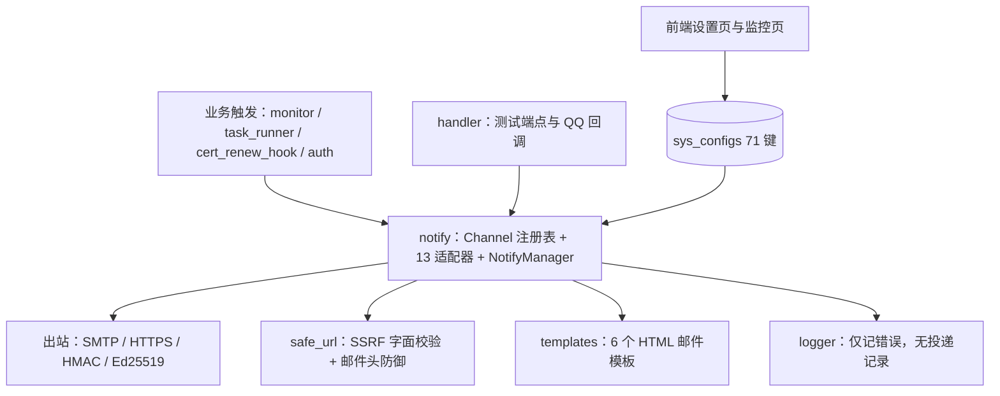
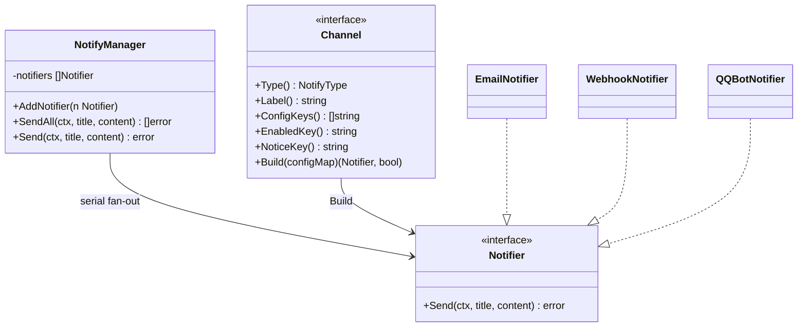
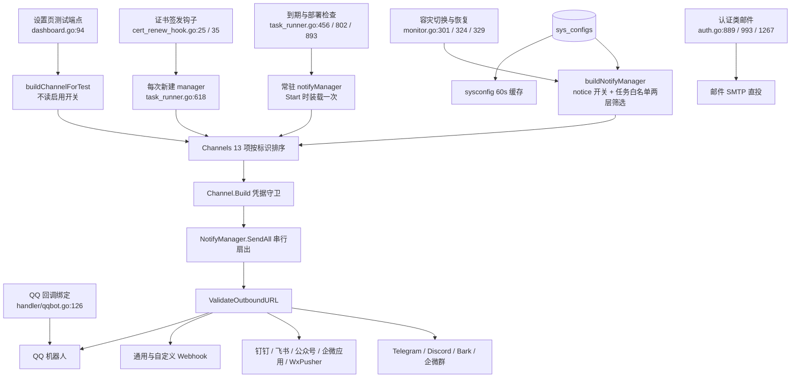
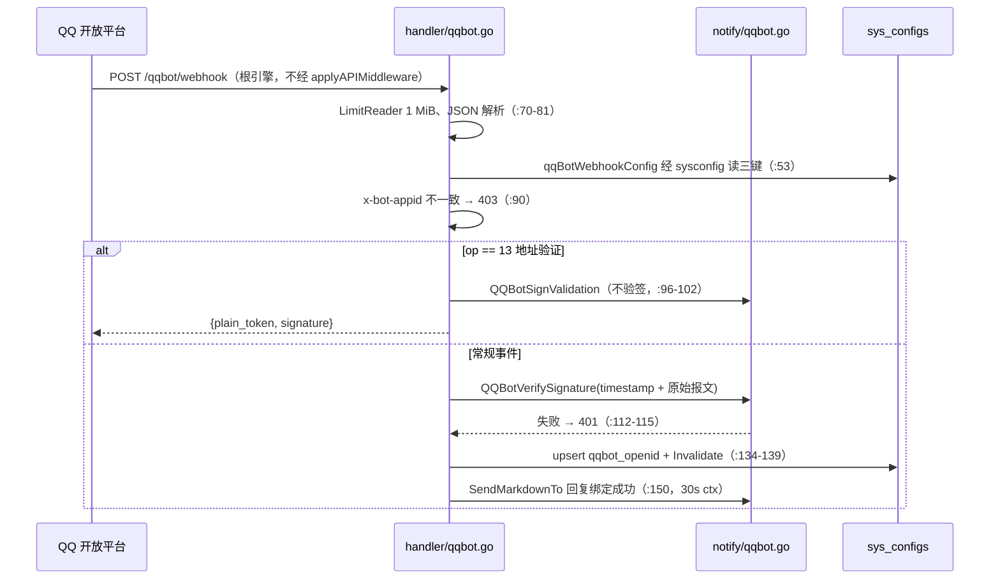
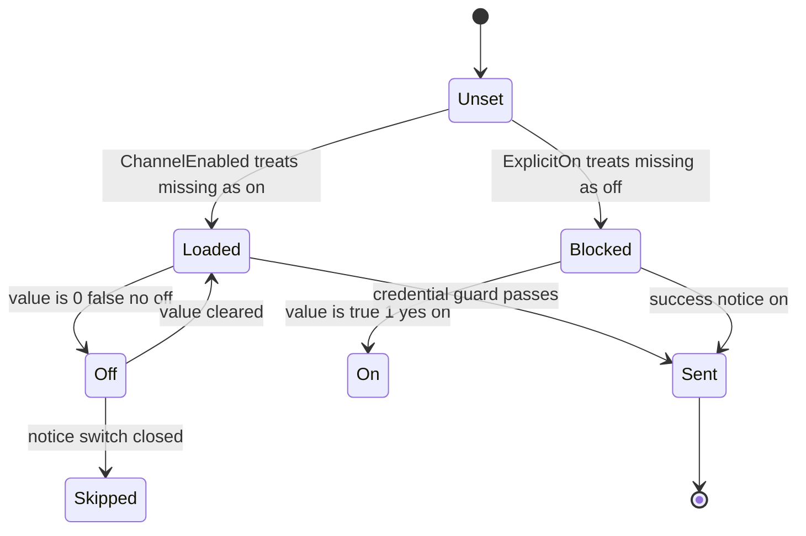
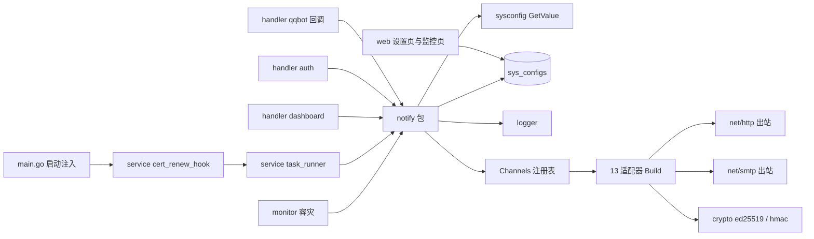
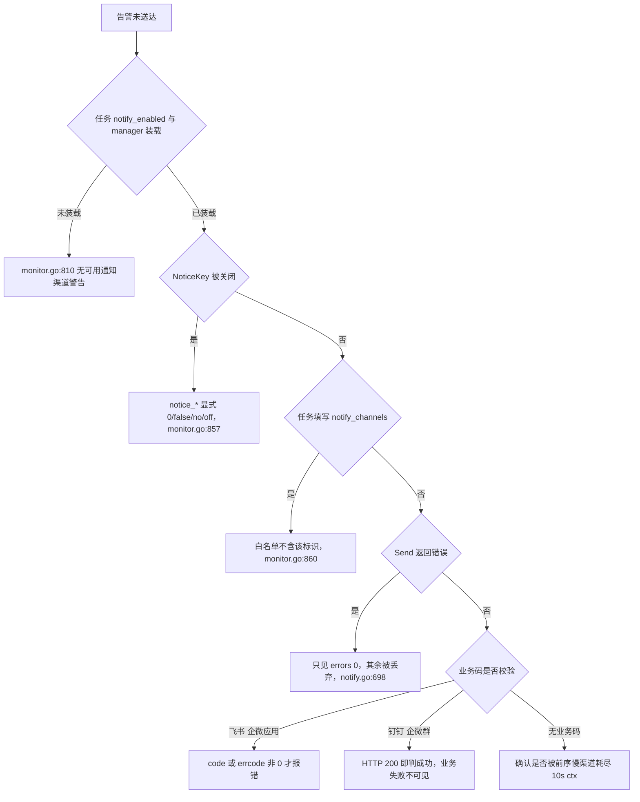

# 通知系统

<cite>
**本文档引用的文件**
- [notify.go](file://main/internal/notify/notify.go)
- [channel_registry.go](file://main/internal/notify/channel_registry.go)
- [channel_adapters.go](file://main/internal/notify/channel_adapters.go)
- [channel.go](file://main/internal/notify/channel.go)
- [safe_url.go](file://main/internal/notify/safe_url.go)
- [strip_tags.go](file://main/internal/notify/strip_tags.go)
- [custom_webhook.go](file://main/internal/notify/custom_webhook.go)
- [dingtalk.go](file://main/internal/notify/dingtalk.go)
- [feishu.go](file://main/internal/notify/feishu.go)
- [wxwork_app.go](file://main/internal/notify/wxwork_app.go)
- [wxtpl.go](file://main/internal/notify/wxtpl.go)
- [wxpusher.go](file://main/internal/notify/wxpusher.go)
- [mail_sendcloud.go](file://main/internal/notify/mail_sendcloud.go)
- [mail_aliyun.go](file://main/internal/notify/mail_aliyun.go)
- [mail_recipients.go](file://main/internal/notify/mail_recipients.go)
- [templates.go](file://main/internal/notify/templates.go)
- [qqbot.go](file://main/internal/notify/qqbot.go)
- [qqbot.go](file://main/internal/api/handler/qqbot.go)
- [dashboard.go](file://main/internal/api/handler/dashboard.go)
- [auth.go](file://main/internal/api/handler/auth.go)
- [user.go](file://main/internal/api/handler/user.go)
- [router.go](file://main/internal/api/router.go)
- [monitor.go](file://main/internal/monitor/monitor.go)
- [ssrf.go](file://main/internal/monitor/ssrf.go)
- [task_runner.go](file://main/internal/service/task_runner.go)
- [cert_renew_hook.go](file://main/internal/service/cert_renew_hook.go)
- [sysconfig.go](file://main/internal/sysconfig/sysconfig.go)
- [models.go](file://main/internal/models/models.go)
- [main.go](file://main/main.go)
- [page.tsx](file://web/app/(dashboard)/dashboard/settings/page.tsx)
- [page.tsx](file://web/app/(dashboard)/dashboard/monitor/page.tsx)
- [api.ts](file://web/lib/api.ts)
</cite>

## 目录

1. [简介](#简介)
2. [项目结构](#项目结构)
3. [核心组件](#核心组件)
4. [架构总览](#架构总览)
5. [详细组件分析](#详细组件分析)
6. [依赖关系分析](#依赖关系分析)
7. [性能考虑](#性能考虑)
8. [故障排查指南](#故障排查指南)
9. [结论](#结论)
10. [附录](#附录)

## 简介

通知系统是 DNSPlane 唯一的出站消息投递层，落在 `main/internal/notify` 一个包内，把 13 个互不兼容的第三方协议压平成同一句 `Notifier.Send(ctx, title, content)`，供容灾监控、证书签发与部署、域名到期、认证类邮件、控制台测试端点、QQ 回调绑定六类业务共用。与解析链路「22 家服务商一个 `dns.Provider`」同构，本域的核心矛盾同样是厂商差异收敛，只是方向相反。

题面列举的「邮件/Webhook/Telegram/钉钉/飞书/QQBot/Discord」是主干渠道，注册表实际暴露 13 个标识，另有 Bark、企业微信群机器人、企业微信应用、公众号模板消息、WxPusher、自定义 Webhook 六个。以 `Channel` 接口为唯一事实源逐渠道累加 `ConfigKeys` + `EnabledKey` + `NoticeKey`（`channel_registry.go:108-129`），得到 **71 个配置键**（含 6 个不隶属任何渠道的 `notice_*` 开关），全部以 key-value 散落在 `sys_configs`（`models.go:314-317`），不存在独立的渠道配置表或发送记录表。

| 维度 | 实测值 | 取证位置 |
|------|:------:|----------|
| 已注册渠道 | 13 | `channel_adapters.go:330-344` 的 `init()` |
| 聚合配置键 | 71（含 6 个 `notice_*`） | `channel_registry.go:108-129` 求和去重 |
| 通知包规模 | 38 个 `.go`、7202 行（生产 3558） | 目录 `wc -l`，最大 `notify.go` 914 行 |
| HTTP 渠道超时 | 固定 30s（14 处） | `notify.go:322,416,720,777,819` 等 |
| SMTP 超时 | 拨号 12s、单阶段 15s | `notify.go:173-174`、`setSMTPDeadline:176` |
| 调用方 deadline | 容灾/证书/到期 10s，测试端点 30s | `monitor.go:814`、`task_runner.go:477,620,880,948` |
| 渠道内限流 / 重试 | 均不存在 | 生产文件 `rate.`/`limiter`/`retry` 零命中 |

一处口径要先说清：**「渠道可用性」与「渠道启用」是两层判定**。前者由 `Channel.Build` 的凭据守卫决定（缺键即不装载），后者由 `ChannelEnabled`（`channel.go:22-25`）决定，语义反直觉——未配置视为启用，仅显式 `0`/`false`/`no`/`off` 才关闭。注释给出的理由是这些 `*_enabled` 键引入前从未被后端消费，按「未配置即关」会让全部存量实例的通知在一次升级后静默失效（`channel.go:8-11`）。

**章节来源**
- [channel.go:5-25](file://main/internal/notify/channel.go#L5-L25)
- [channel_registry.go:101-129](file://main/internal/notify/channel_registry.go#L101-L129)

## 项目结构

通知域由「一个纯实现包 + 两个 handler 装配点 + 两个业务消费方 + 两个前端页面」构成。

```text
main/internal/notify/
├── channel_registry.go  channel_adapters.go  channel.go   接口与注册表（129）、13 适配器 + init 注册 + 邮件三路分发（460）、三态判定（25）
├── notify.go            7 个通知器 + NotifyManager + 正文适配（914 行）
├── custom_webhook.go  dingtalk.go  feishu.go  wxwork_app.go  wxtpl.go  wxpusher.go  qqbot.go（218/84/69/111/116/83/327 行）
├── mail_sendcloud.go  mail_aliyun.go  mail_recipients.go（108/220/18 行）
└── safe_url.go  strip_tags.go  templates.go（84/64/318 行：出站校验与邮件头防御、标签剥离状态机、6 模板 + 2 构造器）

main/internal/api/handler/  dashboard.go（测试端点）、qqbot.go（回调）、auth.go（第二套邮件装配）
main/internal/{monitor,service}/  monitor.go 两层筛选、task_runner.go 到期与部署通知
web/app/(dashboard)/dashboard/{settings,monitor}/page.tsx、web/lib/api.ts
```



**图表来源**
- [channel_registry.go:20-39](file://main/internal/notify/channel_registry.go#L20-L39)
- [channel_adapters.go:330-344](file://main/internal/notify/channel_adapters.go#L330-L344)

| 路径 | 职责 | 语言 | 文件数 | 代表文件 | 对外暴露 |
|------|------|:----:|:------:|----------|----------|
| `main/internal/notify` | 渠道实现、注册表、模板、出站校验 | Go | 38（19 测试） | `channel_registry.go` | `Channel`、`Notifier`、`NotifyManager`、`NotifyConfigKeys` |
| `main/internal/api/handler` | 测试端点、QQ 回调、认证邮件装配 | Go | 3 | `dashboard.go` | `TestXxxNotification`、`QQBotWebhook` |
| `main/internal/api` | 路由挂载 | Go | 1 | `router.go` | 11 条测试 + 1 条回调 |
| `main/internal/monitor` | 容灾告警装载与筛选 | Go | 1 | `monitor.go` | `buildNotifyManager`（私有） |
| `main/internal/service` | 到期/部署/签发通知 | Go | 2 | `task_runner.go` | `SendCertIssueFailNotification` 等 |
| `web/…/settings`、`web/…/monitor` | 渠道表单、任务白名单选单 | TSX | 2 | `page.tsx` | 12 组开关、9 项白名单 |

**章节来源**
- [router.go:249-259](file://main/internal/api/router.go#L249-L259)
- [api.ts:735-749](file://web/lib/api.ts#L735-L749)

## 核心组件

分层遵循「接口—注册—实现—派发」，派发层对渠道数量零感知。



**图表来源**
- [channel_registry.go:20-39](file://main/internal/notify/channel_registry.go#L20-L39)
- [notify.go:665-704](file://main/internal/notify/notify.go#L665-L704)

图中未列注册表入口（`RegisterChannel`/`Channels`/`LookupChannel`/`ChannelConfigKeys`，`channel_registry.go:35-129`）与 `mailContentAdapter`（`notify.go:94-100`，包装邮件后端使其接受纯文本契约），且只列 3 个通知器作代表，其余九个通知器同样实现 `Notifier`（`notify.go:38-41`）。

**章节来源**
- [notify.go:38-41](file://main/internal/notify/notify.go#L38-L41)
- [channel_adapters.go:16-344](file://main/internal/notify/channel_adapters.go#L16-L344)

### Channel 接口六法契约

| 方法 | 契约 | 违规后果 | 位置 |
|------|------|----------|------|
| `Type()` | 渠道唯一标识，白名单与前端选单取值依据 | 重复注册直接 panic | `channel_registry.go:22`、`:62-64` |
| `Label()` | 显示名，用于错误提示与测试文案 | 空名使报错缺主语 | `channel_registry.go:24`、`dashboard.go:73` |
| `ConfigKeys()` | 全部业务键，**不含**两个开关 | 漏键 → `IN` 查询读不到 → 渠道静默失效 | `channel_registry.go:26`、`monitor.go:832` |
| `EnabledKey()` | 启用开关键，无开关返回空串 | 空串渠道不受开关管辖 | `channel_registry.go:28`、`channel_adapters.go:284` |
| `NoticeKey()` | 容灾告警开关键，不受管辖返回空串 | 空串跳过告警开关判定 | `channel_registry.go:30`、`monitor.go:857` |
| `Build()` | 必须装配配置结构全部字段 | 少传字段即重演「三条装载路径行为不一致」缺陷 | `channel_registry.go:32`、`channel_adapters.go:8-14` |

**章节来源**
- [channel_registry.go:20-99](file://main/internal/notify/channel_registry.go#L20-L99)
- [channel_adapters.go:8-14](file://main/internal/notify/channel_adapters.go#L8-L14)

### 注册表与装载点

`registeredChannels` + `registeredTypes` 由 `sync.RWMutex` 保护（`channel_registry.go:35-39`）；`Channels()` 返回**副本**并按标识排序（`:76-85`），把装载顺序与注册顺序解耦；`RegisterChannel(nil)` 与重复标识均 panic（`:59-66`）——启动期失败优于运行期静默取其一。

| 装载函数 | 位置 | 调用方 | 配置来源 | manager 生命周期 |
|----------|------|--------|----------|------------------|
| `LoadNotifiersFromConfig` | `notify.go:908-914` | `LoadNotifiersWithGetter` 与单测 | 传入 `configMap` | 调用方持有 |
| `LoadNotifiersWithGetter` | `notify.go:873-882` | `task_runner.go:86,619,686` | 逐键 `sysconfig.GetValue` | 常驻 1 次 / 每次新建 |
| `Monitor.buildNotifyManager` | `monitor.go:825-873` | `sendNotification`（`:808`） | `WHERE key IN (71 键)` 直查主库 | 每次告警新建 |
| `buildChannelForTest` | `dashboard.go:56-76` | 11 个测试端点 | `IN (ch.ConfigKeys())`，**有意排除开关键** | 单次请求 |
| `LoadMailNotifier` | `notify.go:892-899` | 仅测试 | 传入 `configMap` | 生产零调用 |

`buildChannelForTest` 把开关键排除在查询之外（`dashboard.go:63`），使「渠道已关闭但凭据正确」仍可测试——注释写明这是与生产装载的唯一差异（`dashboard.go:46-50`）。派发层 `SendAll`（`notify.go:688-696`）是顺序 for 循环，`Send`（`:698-704`）只回传 `errors[0]`，该层没有并发、超时、重试与投递落库。

**章节来源**
- [channel_registry.go:35-99](file://main/internal/notify/channel_registry.go#L35-L99)
- [dashboard.go:43-76](file://main/internal/api/handler/dashboard.go#L43-L76)

## 架构总览



**图表来源**
- [monitor.go:301-329](file://main/internal/monitor/monitor.go#L301-L329)
- [monitor.go:766-873](file://main/internal/monitor/monitor.go#L766-L873)
- [safe_url.go:15-43](file://main/internal/notify/safe_url.go#L15-L43)

四条主链路的差异**只集中在 manager 生命周期**：

1. **容灾告警**：tick 判定 → `sendNotification(task, eventType, errMsg)`（`monitor.go:767`）→ `task.NotifyEnabled` 门禁（`:768`）→ 标题/正文三分支生成（`:788-805`）→ 直查 `sys_configs`（`:832`）→ 两层筛选（`:855-867`）→ 10s ctx → `manager.Send`（`:817`）→ 失败仅 `logger.Error`（`:818`）。
2. **到期与部署**：`Start` 调 `loadNotifyConfig`（`task_runner.go:56` → `:84-86`）一次性装载常驻 manager；`checkCertExpire`（`:893`）、`checkDomainExpire`（`:802`）、`sendDeployNotification`（`:456`）共用它，成功后回写 `expire_notice_at`（`:954-955`）或 `notice_time`（`:885`）作为下轮冷却依据。
3. **签发结果**：`main.go:110` 注入钩子实现（`cert_renew_hook.go:17`），落到 `sendCertNotification`（`task_runner.go:617`）每次新建 manager（`:618-619`）；续期失败链同样每次新建（`:686`）。
4. **认证邮件**：`getEmailConfig`（`auth.go:751`）是注册表之外的第二套装配点，只读 9 键、不含 `mail_recv`；`enqueueNotifyMail`（`:827`）起协程并受 `mailSendSem`（`:824`，容量 32）约束，失败只记日志、HTTP 已先返回。

第 1、3 条每次新建、第 2 条常驻不重载，直接导致「同一份配置在两条链路上生效时点不同」。

**章节来源**
- [monitor.go:766-822](file://main/internal/monitor/monitor.go#L766-L822)
- [task_runner.go:84-87](file://main/internal/service/task_runner.go#L84-L87)
- [cert_renew_hook.go:5-42](file://main/internal/service/cert_renew_hook.go#L5-L42)

## 详细组件分析

### 邮件渠道：SMTP、Sendcloud 与 DirectMail

`buildMailNotifier`（`channel_adapters.go:364-400`）按 `mail_type` 三路分发：`1` → Sendcloud（`:374-380`），`2` → DirectMail（`:381-387`），`0` 或空 → SMTP（`:388-397`）。三路守卫**统一使用回退后的 `mailTo`**：`mail_recv` 为空回退 `mail_from`（`:365-368`），注释写明用 `mail_recv` 会让回退不可达而静默失效（`:354-356`）。端口经 `mailPortOrDefault`（`:454-460`）非法即回 25，加密由 `MailSecureFromConfig`（`:416-429`）解析——`mail_secure` 显式 `none` 不被历史键 `mail_tls` 改写，鉴权由 `MailAuthFromConfig`（`:442-451`）给出 `plain`/`login`/`crammd5`。

`EmailNotifier.Send`（`notify.go:113-170`）依次做头部注入防御（`:115-131`）、拼 `名称 <地址>` 与 `Content-Type: text/html; charset=UTF-8` 报文（`:134-141`）、选鉴权（`:146-154`，`login` 走自实现 `LoginAuth:282`）、选加密分支（`:157-169`），最终由 `sendViaClient`（`:255-275`）统一 Auth/Mail/Rcpt/Data。SMTP 无连接池，每次新建 TCP：拨号 12s、单阶段 15s（`:173-174`）；SSL 与 STARTTLS 均 `InsecureSkipVerify: true`（`:202`、`:243`），不校验证书链——账号口令存在中间人风险。

| 项 | Sendcloud | 阿里云 DirectMail |
|----|-----------|-------------------|
| 端点 | `http://api.sendcloud.net/apiv2/mail/send`（`mail_sendcloud.go:14`，**明文**） | `https://dm.aliyuncs.com/`（`mail_aliyun.go:20`） |
| 正文字段 | `html`（`:79`） | `HtmlBody`（`:85`） |
| 签名 | 无 | RPC HMAC-SHA1（`aliyunRPCSignature:148`、`sha1.New` 在 `:151`） |
| 头部防御 | `:53-70` 四次 `SanitizeMailHeader` | `:58-75` 同样四次 |
| 收件人拆分 | `splitMailRecipients`（`mail_recipients.go:9`） | 同一函数（`:67`） |
| 成功判据 | `statusCode == 200`（`:104`） | HTTP 200 且响应可解析为 JSON 对象（`:93-96`） |
| 出站校验 | **不调用** `ValidateOutboundURL` | **不调用** |

两后端的 `apiURL` 均做成实例字段（`mail_sendcloud.go:29-30`、`mail_aliyun.go:38-39`），注释说明是为测试注入本地服务端；HMAC-SHA1 属厂商协议要求，非本地选型。

**章节来源**
- [channel_adapters.go:346-460](file://main/internal/notify/channel_adapters.go#L346-L460)
- [notify.go:113-300](file://main/internal/notify/notify.go#L113-L300)
- [mail_sendcloud.go:14-108](file://main/internal/notify/mail_sendcloud.go#L14-L108)

### 邮件模板与正文契约

`templates.go` 共 6 个模板 + 2 个链接构造器，全部以 `<!DOCTYPE html>` 起始、内联 `<style>`，无外部模板引擎：`RenderPasswordResetEmail:18`、`RenderTOTPResetEmail:75`、`RenderAdminResetEmail:133`、`RenderMagicLoginEmail:208`、`RenderVerificationCodeEmail:281`、`RenderTestEmail:237`、`BuildResetLink:193`、`BuildMagicLoginLink:202`。验证码场景表在 `:282-286`（`register`/`bindmail`/`forgot_password`/`forgot_totp`），未匹配回退「验证操作」。构造器只对 token 做 `url.QueryEscape`（`:196`、`:205`），基址来自 `getSiteURL()`（`auth.go:810`），未配置 `site_url` 时回退本地监听地址。

告警正文契约写在 `notify.go:66-87` 与 `:680-687` 的注释里：`NotifyManager` 的 `content` 是**纯文本 + `\n`**，而三个邮件后端都按 HTML 投递，故统一经 `mailContentAdapter.Send`（`:98-100`）调用 `emailHTMLContent`（`:78-87`）转义，判定依据是首个非空字符是否为 `<`（`:79`）。模板邮件不经该函数——`dashboard.go:112` 的注释说明模板本身就是 HTML，首字符判定会原样透传。

**章节来源**
- [templates.go:18-318](file://main/internal/notify/templates.go#L18-L318)
- [notify.go:66-100](file://main/internal/notify/notify.go#L66-L100)

### Telegram、Discord 与 Bark 渠道

三个「直投单条消息」渠道的差异只在报文承载。

`telegramChannel.Build`（`channel_adapters.go:48-60`）要求 `tgbot_token` 与 `tgbot_chatid` 同时非空且开关未显式关闭，五键全量装配（含 `tgbot_topicid`/`tgbot_url`/`tgbot_proxy`）。`buildTelegramPayload`（`notify.go:347-357`）里 `text` 为 `<b>标题</b>\n\n正文`（`:350`）、`parse_mode: "HTML"`（`:351`），`TopicID` 经 `strconv.Atoi` 且 `> 0` 才附加 `message_thread_id`（`:353-355`）。基址由 `telegramBaseURL`（`:331-338`）决定：仅 `ProxyMode == "2"` 且 `ServerURL` 非空时走自定义反代。`Send`（`:359-386`）先校验基址（`:362`）再拼 `{base}/bot{token}/sendMessage`（`:365`）；成功判据 `StatusCode == 200`（`:380`）。

Discord 用 `embeds[0]{title, description, color: 5814783}` 单卡片投递（`notify.go:724-757`），先校验 URL（`:726`），成功判据 `StatusCode < 400`（`:752`），凭据是含 token 的完整 webhook 地址（`channel_adapters.go:135-140`）。Bark 走 GET 路径分段：`fmt.Sprintf("%s/%s/%s/%s", server, deviceKey, title, content)`（`notify.go:786`），**无 `url.PathEscape`**，校验只作用于拼接前的 `server`（`:783`）；`ServerURL` 为空回退 `https://api.day.app`（`:772-774`），`barkChannel.Build` 兼容早期键 `bark_url`（`channel_adapters.go:160-163`）。

两个 Telegram 反直觉点：令牌在 URL 路径而非头部，失效表现为 401/400 而非可区分的错误类；正文无 `html.EscapeString`，含 `<`、`&` 的告警文本会被判非法 HTML 而 400 整条丢失。设置页只渲染 token 与 chatid（`page.tsx:1268-1294`），话题与自建反代只能直接写库启用。Bark 在真实告警文本下大概率失败，见[报文陷阱小节](#bark-与-telegram-的报文陷阱)。

**章节来源**
- [channel_adapters.go:36-60](file://main/internal/notify/channel_adapters.go#L36-L60)
- [channel_adapters.go:125-168](file://main/internal/notify/channel_adapters.go#L125-L168)
- [notify.go:302-386](file://main/internal/notify/notify.go#L302-L386)

### 通用 Webhook 渠道

`WebhookNotifier`（`notify.go:389-497`）是「一渠道承载多协议」的实现：`buildBody`（`:428-452`）先按 `webhook_content_format` 转换正文（`markdown`/`text` 两档去标签，`:429-434`），再用 `detectWebhookBot`（`:529-539`）按地址识别群机器人。

| 识别串 | 常量 | 原生报文 | 位置 |
|--------|------|----------|------|
| `oapi.dingtalk.com` | `webhookBotDingTalk` | `msgtype: markdown`，正文加 `### ` 前缀、`\n` 改行尾双空格，@ 走 `at.atMobiles`/`isAtAll` | `:555-570` |
| `qyapi.weixin.qq.com` | `webhookBotWechatWork` | `msgtype: markdown`，`## 标题\n正文`，无 @ | `:571-577` |
| `open.feishu.cn` / `open.larksuite.com` | `webhookBotFeishu` | `schema 2.0` 交互卡片，@ 以 `<at>` 追加，配色按标题关键字 | `:578-626` |

未命中回退用户模板：`webhook_body` 非空则 `{title}`/`{content}` 字面替换（`:448-449`），为空输出通用 JSON（`:440-447`）。序列化统一走 `marshalJSONNoHTMLEscape`（`:507-516`），避免 `<`、`&` 被转义成 `\u003c` 破坏卡片渲染。`post`（`:474-497`）按配置方法与 `Content-Type` 发送并逐条覆盖自定义头（`:481-483`），成功判据 `StatusCode < 400`（`:491`）。

两处强度差异值得警惕：识别用 `strings.Contains`，`webhook_url` 为 `https://attacker.example/?x=oapi.dingtalk.com` 会被误判为钉钉；`webhookChannel.Build`（`channel_adapters.go:77-90`）不在构造期校验 URL，而 `customWebhookChannel.Build`（`:112`）会校验。配色函数 `feishuCardTemplate`（`notify.go:644-654`）硬编码「发生告警/失败/恢复正常/到期提醒」，而实际标题形如「【容灾告警】…」（`monitor.go:790`），命中关系需按当前模板逐条比对（推断，本环境未实测）。

**章节来源**
- [notify.go:389-497](file://main/internal/notify/notify.go#L389-L497)
- [notify.go:499-654](file://main/internal/notify/notify.go#L499-L654)
- [channel_adapters.go:62-123](file://main/internal/notify/channel_adapters.go#L62-L123)

### 自定义 Webhook 渠道

与通用 Webhook 的分界写在注释里（`custom_webhook.go:24-30`）：本渠道不做机器人识别，方法、头、模板、内容格式全部照配置执行。`sendCustomWebhook`（`:67-123`）抽为包级函数以便测试注入 `http.Client`（`:54-59`）。流程：`ValidateOutboundURL`（`:69`）→ 方法与 `Content-Type` 取默认（`:73-80`）→ `formatCustomWebhookContent`（`:169-178`）三档转换 → `buildCustomWebhookBody`（`:187-192`）占位替换，未配模板时用内置 `{"title":"{title}","content":"{content}"}` → `GET` 走 `customWebhookGETURL` 把正文转查询串（`:132-158`）；非 GET 且 JSON 非法时**回退**通用报文（`:92-101`），避免占位符替换出的引号破坏整条通知。请求头由 `parseWebhookHeaders`（`:200-218`）按「每行 `Name: Value`、首个冒号分隔」解析。成功判据 `2xx`（`:118`）。用户可注入任意请求头（`:108-110`）与任意 HTTP 方法（`:73-76`），这是该渠道的能力边界。

**章节来源**
- [custom_webhook.go:14-123](file://main/internal/notify/custom_webhook.go#L14-L123)
- [custom_webhook.go:125-218](file://main/internal/notify/custom_webhook.go#L125-L218)

### 钉钉与飞书渠道

两个群机器人的 `Build` 都只强约束 webhook 键、`secret` 可选（`channel_adapters.go:197-205`、`:217-225`），签名算法却落在完全不同的位置。

| 项 | 钉钉（`dingtalk.go:38-84`） | 飞书（`feishu.go:31-69`） |
|----|------------------------------|---------------------------|
| 时间戳 | 毫秒（`:45`） | 秒（`:40`） |
| 签名载体 | 查询串 `timestamp` + `sign`（`:55`） | payload 字段（`:43-44`） |
| 签名算法 | `HMAC-SHA256(ts + "\n" + secret)` → base64 → `QueryEscape`（`:46-55`） | 同算法但不进 URL（`:41-42`） |
| 消息格式 | `msgtype: markdown`，`## 标题\n正文`（`:58-64`） | `msg_type: text`，`标题\n正文`（`:35-38`） |
| 成功判据 | `StatusCode < 400`（`:79`） | `< 400`（`:58`）**且** `code == 0`（`:65`） |

飞书是 13 个渠道里唯一能区分「传输成功但投递失败」的群机器人；钉钉以 200 返回的业务失败（关键词不匹配、签名过期）会被判成功。分隔符按 URL 是否已含 `?` 选择（`dingtalk.go:51-54`）。

**章节来源**
- [dingtalk.go:19-84](file://main/internal/notify/dingtalk.go#L19-L84)
- [feishu.go:17-69](file://main/internal/notify/feishu.go#L17-L69)

### 企业微信群机器人与企业微信应用

| 项 | 群机器人 `wechat` | 应用消息 `wxwork_app` |
|----|-------------------|------------------------|
| 适配器 | `channel_adapters.go:171-185` | `channel_adapters.go:228-250` |
| 凭据 | `wechat_webhook` | `wxwork_corpid`/`agentid`/`secret`/`touser` |
| 令牌 | 不需要 | `getToken`（`wxwork_app.go:33-65`），TTL `expires_in - 300`（`:63`） |
| 报文 | `msgtype: markdown`，`## 标题\n正文`（`notify.go:828-833`） | `textcard`：`title`/`description`/`url`/`btntxt`（`:80-85`） |
| 收件人 | 群 | `touser`，空则 `@all`（`:72-75`） |
| 成功判据 | `HTTP < 400`，不校验 errcode（`notify.go:848`） | `errcode == 0`（`:107`） |
| 已知缺陷 | 业务失败静默 | `textcard.url` 硬编码 `https://localhost.invalid`（`:83`），配置结构（`:14-19`）无承接站点地址的字段 |

`getToken` 的缓存是进程内 `sync.Mutex` 保护的 `cachedToken`/`tokenExpire`（`:24-26`），多实例部署下各自刷新。

**章节来源**
- [notify.go:805-853](file://main/internal/notify/notify.go#L805-L853)
- [wxwork_app.go:14-111](file://main/internal/notify/wxwork_app.go#L14-L111)

### 公众号模板消息与 WxPusher

`wxTplChannel.Build`（`channel_adapters.go:264-277`）要求 appid/appsecret/template_id/users 四键全非空。`Send`（`wxtpl.go:69-116`）逗号拆分 `ToUsers`（`:74`）后逐 OpenID 循环 `POST /cgi-bin/message/template/send`（`:92`），字段固定映射：`first`←标题、`keyword1`←正文、`keyword2`←当前时间、`remark`←常量 `DNSPlane`（`:84-89`）；任一收件人 `errcode != 0` 即 `return`（`:111-113`），后续收件人不再投递——「部分成功」语义在该渠道不存在。`getToken`（`:35-67`）与企微同构。

`wxPusherChannel` 有两个例外：`EnabledKey()` 返回空串（`channel_adapters.go:284-286`，无启用开关），`NoticeKey()` 返回 `notice_wxtpl`（`:293`）——注释裁决该键含义为「WxPusher 的容灾告警开关」，与 `wxtpl` 渠道无关（`:288-292`）。端点为常量 `https://wxpusher.zjiecode.com/api/send/message`（`wxpusher.go:13`），`Send` 对常量也执行校验（`:40`），payload 的 `contentType` 固定 `3`（markdown）、`summary` 取标题、`uids` 单元素（`:44-50`），成功判据 `success == true`（`:76`）。配置键 `wechat_apptoken`/`wechat_appuid` 属微信生态但**设置页无输入框**。

**章节来源**
- [wxtpl.go:15-116](file://main/internal/notify/wxtpl.go#L15-L116)
- [wxpusher.go:13-83](file://main/internal/notify/wxpusher.go#L13-L83)
- [channel_adapters.go:252-305](file://main/internal/notify/channel_adapters.go#L252-L305)

### QQ 机器人渠道

凭据三键 `qqbot_appid`/`qqbot_appsecret`/`qqbot_openid`，任一为空即不装载，无启用开关（`channel_adapters.go:312-328`）。

| 项 | 取值 | 位置 |
|----|------|------|
| 凭证 / 消息端点 | `POST /app/getAppAccessToken`、`POST /v2/users/{openid}/messages` | `qqbot.go:22-23`、`:159`、`:284` |
| 鉴权头 | `Authorization: QQBot {token}` | `:294` |
| 两级缓存 | 实例字段 + `cache.C` 键 `qqbot_access_token_{sha256(appid:secret) 前 8 字节 hex}` | `:37-41`、`:140-148`、`:205-207` |
| TTL 计算 | `max(120, expires_in)` → `-120` → `max(60, ttl)` | `:194-201` |
| 命中后本地有效期 | 硬编码 `now + 1h`，与实际 TTL 无关 | `:145` |
| 消息格式 | `msg_type: 2`，正文 `# 标题\n\n正文` | `:274-277`、`QQBotToMarkdown:124` |
| 回复约束 / 成功判据 | `msg_id` 非空附带 `msg_seq: 1`；响应 `id` 非空 | `:278-281`、`:312` |

`QQBotToMarkdown`（`:124-131`）先做 `<br/>`→`\n`、`<b>`→`**`，再 `stripTags`（`strip_tags.go:5`）与 `html.UnescapeString`。`stripTags` 是手写状态机：引号态（`:35-40`）、`<` 嵌套深度（`:44-50`），**未闭合标签时丢弃起始 `<` 之后的全部内容**（`:54`）——长正文中一个裸 `<` 可截断内容。`qqBotEscapeOpenID`（`qqbot.go:216-232`）按 RFC 3986 未保留字符集逐字节百分号编码，防止 openid 逃逸路径段；拼接后的最终地址再过一次校验（`:286`）。`qqBotInt`（`:235-250`）宽容解析数字或字符串形态的 `expires_in`。

**章节来源**
- [qqbot.go:21-250](file://main/internal/notify/qqbot.go#L21-L250)
- [qqbot.go:252-327](file://main/internal/notify/qqbot.go#L252-L327)
- [strip_tags.go:5-64](file://main/internal/notify/strip_tags.go#L5-L64)

### QQ 机器人回调与绑定链

Ed25519 体系四函数：`QQBotSecretToSeed`（`qqbot.go:55-64`）把 AppSecret 自重复翻倍至 ≥32 字节再截断；`QQBotPrivateKey`（`:71-77`）在 seed 非 32 时返回 `nil`，规避 `NewKeyFromSeed` panic；`QQBotSignValidation`（`:82-92`）对 `event_ts + plain_token` 签名；`QQBotVerifySignature`（`:97-119`）校验 `timestamp + body`，要求 hex 解码后长度恰为 `SignatureSize`（`:104`），并拒绝最后一字节高 3 位非零的签名（`:107`，抗签名 malleability）。



**图表来源**
- [router.go:23-32](file://main/internal/api/router.go#L23-L32)
- [handler/qqbot.go:38-154](file://main/internal/api/handler/qqbot.go#L38-L154)

回调不经过 `applyAPIMiddleware` 的 CORS/RequestTrace/Recovery/CSRF/AuditLog，也不在任何鉴权组内，链首只有 `SecurityHeaders` + `gin.Recovery` + `Logger`（`router.go:24-32`）。绑定回复失败不影响绑定结果，仅记日志（`handler/qqbot.go:141-152`）。对外 V1 API 明确不迁移通知测试端点，理由是只读库中配置、不发任何入参，且每次调用都会真实外发一条消息。

**章节来源**
- [handler/qqbot.go:38-154](file://main/internal/api/handler/qqbot.go#L38-L154)
- [qqbot.go:52-119](file://main/internal/notify/qqbot.go#L52-L119)

### 开关三态语义

三套布尔判定共用同一组「显式关闭字面量」，但默认方向相反。



**图表来源**
- [channel.go:22-25](file://main/internal/notify/channel.go#L22-L25)
- [monitor.go:918-921](file://main/internal/monitor/monitor.go#L918-L921)

| 判定函数 | 位置 | 未配置时 | 触发字面量 | 用途 |
|----------|------|:--------:|------------|------|
| `ChannelEnabled` | `channel.go:22-25` | **启用** | `0`/`false`/`no`/`off` 关闭 | 渠道是否装载 |
| `monitor.noticeEnabled` | `monitor.go:918-921` | **开启** | 同上 | 容灾告警是否走该渠道 |
| `sysconfigBoolDefaultTrue` | `task_runner.go:737` | **true** | 同上 | 失败类通知开关 |
| `sysconfigBoolExplicitOn` | `task_runner.go:746` | **false** | 仅 `true`/`1`/`yes`/`on` 开启 | 成功类通知开关 |

注释解释前两者为何不合并：语境不同，混用会让容灾告警的开关语义被渠道开关改写（`channel.go:13-16`）。成功类开关仅用于 `cert_issue_success_notice_enabled`（`task_runner.go:634`）与 `cert_deploy_success_notice_enabled`（`:458`）。一处界面缺口：设置页没有 `mail_enabled` 开关（`page.tsx` 的 `*_enabled` 集合无此键），但后端会读取（`channel_adapters.go:21-23`），用户既关不掉也看不出邮件渠道当前态。

**章节来源**
- [channel.go:5-25](file://main/internal/notify/channel.go#L5-L25)
- [task_runner.go:456-465](file://main/internal/service/task_runner.go#L456-L465)

### 限流、超时、重试与可观测性现状

| 维度 | 现状 | 证据 |
|------|------|------|
| 渠道级限流 | **不存在**：无令牌桶、无熔断、无并发闸 | 生产文件 `rate.`/`limiter`/`semaphore` 零命中 |
| 渠道级重试 | **不存在**：单次 `Send` 失败即返回错误 | 13 个 `Send` 均单次请求 |
| 扇出与错误聚合 | 串行 for 循环共享单一 ctx；`Send` 只回传 `errors[0]` | `notify.go:688-704`、`monitor.go:814` |
| 公开邮件限流 | 信号量并发 32 + IP/邮箱固定窗口 | `auth.go:824`、`auth.go:857` |
| 告警冷却 | 域名到期 1 天、证书到期按 `cert_expire_notice_interval_days` | `task_runner.go:859-864`、`:767` |
| 连接期 SSRF 拦截 | **无** `DialContext`/`net.Resolver` 定制 | 全包零命中，对照 `monitor/ssrf.go:29-31` |
| 渠道配置表 / 发送记录表 | **均不存在**，仅有业务表冷却字段 | `models.go` 全文无该模型、`task_runner.go:885` |

唯一有闸的位置是认证邮件链路：`mailSendSem` 容量 32，注释写明四个公开接口即便有 IP/邮箱粒度限制，仍可被大量邮箱 + 多 IP 堆积出大量 SMTP goroutine（`auth.go:820-824`）；协程用 `context.Background()`（`:833`）不带 deadline，靠 SMTP 阶段超时兜底。11 条测试路由（`router.go:249-259`）全部指向同一实现 `testChannelNotification`（`dashboard.go:94-121`）：`checkAdmin` 门禁 → `buildChannelForTest` → 30s ctx → 统一文案，邮件渠道改用美化模板（`:111-114`），前端一一对应 `api.ts:739-749`。因此无法回答「这条告警是否发过、发到哪些渠道、哪个渠道在何时失败」，也无法做投递成功率统计或跨渠道抑制。

**章节来源**
- [notify.go:688-704](file://main/internal/notify/notify.go#L688-L704)
- [auth.go:820-846](file://main/internal/api/handler/auth.go#L820-L846)
- [dashboard.go:88-121](file://main/internal/api/handler/dashboard.go#L88-L121)

## 依赖关系分析



**图表来源**
- [channel_registry.go:76-99](file://main/internal/notify/channel_registry.go#L76-L99)
- [main.go:108-110](file://main/main.go#L108-L110)

### 调用方 × notify 符号依赖矩阵

| 调用方 | 使用的 notify 符号 | 位置 | 依赖强度 |
|--------|--------------------|------|----------|
| `monitor` | `Channels`、`Channel`、`NewManager`、`NotifyConfigKeys` | `monitor.go:832,845,855` | 强（遍历注册表） |
| `service/task_runner` | `NewManager`、`LoadNotifiersWithGetter`、`NotifyManager.Send` | `task_runner.go:85-86,618-622,882,950` | 强 |
| `handler/dashboard` | `LookupChannel`、`Channel.Build`、`RenderTestEmail` | `dashboard.go:57,71,113` | 中 |
| `handler/auth` | `EmailConfig`、`NewEmailNotifier`、6 个 `RenderXxx`、`MailSecureFromConfig`、`MailAuthFromConfig` | `auth.go:751,781,832` | 中（第二套装配） |
| `handler/qqbot` | `QQBotSignValidation`、`QQBotVerifySignature`、`NewQQBotNotifier`、`SendMarkdownTo` | `handler/qqbot.go:97,112,146,150` | 中 |
| `service/cert_renew_hook` | 不直接依赖，靠 `main.go` 注入函数变量 | `cert_renew_hook.go:10-22` | 弱（依赖倒置） |

证书通知钩子是本域唯一显式的**依赖倒置**：handler 侧调用 `CertIssueSuccessNotify`/`CertIssueFailNotify`（`cert_renew_hook.go:25`、`:35`），实现由 `main.go:110` 注入，未注入时为空操作（`:29`、`:39`），注释说明目的是让 `api/handler` 面向抽象、不反向耦合具体通知实现（`:6-9`）。`MailSecureFromConfig`/`MailAuthFromConfig` 被导出正是为两个邮件装配点共用（`channel_adapters.go:410-412`、`:434-437`）。

**章节来源**
- [monitor.go:824-873](file://main/internal/monitor/monitor.go#L824-L873)
- [cert_renew_hook.go:5-42](file://main/internal/service/cert_renew_hook.go#L5-L42)
- [channel_adapters.go:402-451](file://main/internal/notify/channel_adapters.go#L402-L451)

### 外部服务依赖

| 渠道 | 端点 | 协议 | 凭据（脱敏） | 传输安全 |
|------|------|------|--------------|----------|
| 邮件 SMTP | 用户配置 `host:port` | SMTP/SSL/STARTTLS | `{mail_password}` | SSL 与 STARTTLS 跳过证书校验 |
| 邮件 Sendcloud | `http://api.sendcloud.net/apiv2/mail/send` | HTTP 表单 | `{apiUser}` `{apiKey}` | **明文** |
| 邮件 DirectMail | `https://dm.aliyuncs.com/` | HTTPS RPC | `{AccessKeySecret}` | TLS |
| Telegram | `https://api.telegram.org/bot{token}/sendMessage` 或反代 | HTTPS JSON | `{tgbot_token}` | TLS |
| Discord / 企微群 / Bark | 用户配置 webhook、`qyapi.weixin.qq.com`、`https://api.day.app` | HTTPS JSON / GET 路径 | URL 内含 token、`{deviceKey}` | TLS |
| 钉钉 / 飞书 | `oapi.dingtalk.com` / `open.feishu.cn` | HTTPS JSON | `{secret}` | TLS |
| 企微应用 / 公众号 | `qyapi.weixin.qq.com`、`api.weixin.qq.com` | HTTPS JSON | `{wxwork_secret}` `{wxtpl_appsecret}` | TLS |
| WxPusher / QQ 机器人 | `wxpusher.zjiecode.com`、`https://api.bot.qq.com` | HTTPS JSON | `{appToken}` `{qqbot_appsecret}` | TLS |

13 渠道中仅 5 个的出站地址来自用户配置（SMTP、通用 Webhook、自定义 Webhook、Bark、Telegram 反代），全部经 `ValidateOutboundURL`；Sendcloud 与 DirectMail 两个 API 后端不经该函数。

**章节来源**
- [safe_url.go:10-77](file://main/internal/notify/safe_url.go#L10-L77)
- [mail_sendcloud.go:14](file://main/internal/notify/mail_sendcloud.go#L14)
- [mail_aliyun.go:19-22](file://main/internal/notify/mail_aliyun.go#L19-L22)
- [qqbot.go:21-24](file://main/internal/notify/qqbot.go#L21-L24)

## 性能考虑

**问题一：串行扇出共享单一 deadline。** `SendAll` 顺序遍历（`notify.go:688-696`），调用方给单个 10s ctx（`monitor.go:814`、`task_runner.go:477,620,694,880,948`），而每渠道 `http.Client.Timeout` 是 30s。首渠道慢（SMTP 最坏 27s）即吃满 10s，其后渠道在 ctx 已超时下必然失败；`Send` 只回传 `errors[0]`（`:698-704`），后续渠道的失败原因被丢弃。**优化**：并发扇出 + 每渠道独立超时，全部错误逐条落日志。**效果**：靠后渠道不再被首个慢渠道饿死，日志可定位「到底哪个渠道没发出去」；失败比例未在真实环境测量，判定为推断。

**问题二：容灾告警每次直查 71 键。** `buildNotifyManager` 每次告警执行一次 `WHERE key IN (…)` 直查主库（`monitor.go:832`），不走 `sysconfig` 的 60s 缓存（`sysconfig.go:14`）；`task_runner` 侧却走 `GetValue`（`task_runner.go:86`）。按 `maxConcurrentChecks = 64`、`maxDispatchPerTick = 100`（`monitor.go:24`、`:29`）的派发规模，批量域名同时抖动时每次切换/恢复新增一次配置查询——恰在最需要告警时给主库加压。**优化**：读取改走缓存或引入带失效通知的进程内快照。**效果**：读放大与告警次数解耦，放大倍数为推断。

**问题三：常驻 manager 不重载。** `r.notifyManager` 只在 `Start` 装载一次（`task_runner.go:56` → `:84-87`），`ReloadNotifyConfig`（`:976-977`）全仓零调用方，`UpdateSystemConfig` 只写库并 `sysconfig.Invalidate`（`user.go:673`）。改凭据后到期与部署链继续用旧值直到重启，而签发与续期链（每次新建）立即用新值。**优化**：`UpdateSystemConfig` 命中 `notify.NotifyConfigKeys()` 时触发重载，或常驻路径改按需构造。**效果**：四条链生效时点一致。

**问题四：令牌缓存粒度不一致。**

| 缓存点 | 层级 | TTL 口径 | 多实例一致 | 位置 |
|--------|------|----------|:----------:|------|
| 企微 / 公众号 access_token | 进程内 | `expires_in - 300` | 否 | `wxwork_app.go:33-65`、`wxtpl.go:35-67` |
| QQBot access_token | 进程内 + 共享 | `max(60, expires_in-120)`（命中后本地按 1h） | 是 | `qqbot.go:134-209` |
| 系统配置读取 | 共享缓存 | 固定 60s | 是 | `sysconfig.go:12-26` |
| 容灾告警配置读取 | **无缓存** | — | 是（每次直查） | `monitor.go:832` |

多实例下企微/公众号各自刷新令牌，厂商侧「同 corpid 重复取 token 互相挤掉」的行为本环境未实测，标注为未知。

**章节来源**
- [notify.go:688-704](file://main/internal/notify/notify.go#L688-L704)
- [monitor.go:20-29](file://main/internal/monitor/monitor.go#L20-L29)
- [monitor.go:824-873](file://main/internal/monitor/monitor.go#L824-L873)
- [task_runner.go:976-977](file://main/internal/service/task_runner.go#L976-L977)
- [sysconfig.go:12-26](file://main/internal/sysconfig/sysconfig.go#L12-L26)
- [qqbot.go:134-209](file://main/internal/notify/qqbot.go#L134-L209)

## 故障排查指南



**图表来源**
- [monitor.go:767-822](file://main/internal/monitor/monitor.go#L767-L822)
- [monitor.go:845-873](file://main/internal/monitor/monitor.go#L845-L873)

| 症状 | 可能原因 | 排查依据 | 处置 |
|------|----------|----------|------|
| 钉钉配好但容灾不通知钉钉 | 任务白名单缺该渠道 | `monitor/page.tsx:1998` 仅 9 项 | 白名单留空（`useAll`）或前端补选项 |
| 勾选 WxPusher/QQ 机器人无效果 | 凭据键无处填写 | 设置页无 `wechat_app*`/`qqbot_*` | 直接写 `sys_configs`，并补测试端点 |
| 改完凭据部分链路仍用旧值 | 常驻 manager 不重载 | `ReloadNotifyConfig` 零调用 | 重启进程 |
| Bark 大概率失败 | 标题正文裸拼 URL 路径 | `notify.go:786` 无 `PathEscape` | 见报文陷阱小节 |
| Telegram 整条丢失仅一句错误 | HTML 未转义 | `notify.go:350-351` | 正文含 `<`/`&` 时必现 |
| 邮件提示成功但收不到 | `getEmailConfig` 读错键 | `auth.go:789-792` 历史键兜底 | 核对 `mail_user` |
| 企微卡片点击无效 | `textcard.url` 硬编码 | `wxwork_app.go:83` | 需新增键或复用 `site_url` |

**章节来源**
- [monitor.go:767-822](file://main/internal/monitor/monitor.go#L767-L822)
- [wxwork_app.go:80-85](file://main/internal/notify/wxwork_app.go#L80-L85)

### 邮件头注入

`SanitizeMailHeader`（`safe_url.go:79-84`）只拒绝 `\r`、`\n`、`\0`，作用点有三处后端：SMTP 的 Subject/From/FromName/To（`notify.go:115-131`）、Sendcloud（`mail_sendcloud.go:53-70`）、DirectMail（`mail_aliyun.go:58-75`）。排查顺序：① 报错为「邮件头字段 X 包含非法控制字符」说明防御生效，来源通常是上游自由文本（`monitor.go:792` 的 `errMsg`）被截入标题；② 内容而非报错异常时查 `emailHTMLContent` 判定（`notify.go:79`）是否把以 `<` 开头的纯文本当 HTML 原样投递；③ 模板邮件样式错乱时确认调用点是否绕过适配器直传 HTML。真实缺口不在 SMTP 而在模板：用户名与链接以 `fmt.Sprintf` 直插（`templates.go:47`、`:50`、`:61`），`site_url` 含引号可逃逸 `href` 属性——两者均需注册期或管理员可控，危害等级低。

**章节来源**
- [safe_url.go:79-84](file://main/internal/notify/safe_url.go#L79-L84)
- [notify.go:113-141](file://main/internal/notify/notify.go#L113-L141)
- [templates.go:40-65](file://main/internal/notify/templates.go#L40-L65)

### SSRF via Webhook

`ValidateOutboundURL`（`safe_url.go:15-43`）做四件事：scheme 白名单 `http`/`https`（`:10-13`、`:24-27`）、host 非空（`:28-31`）、保留域名拒绝（`localhost`/`.localhost`/`.internal`/`.local`，`:32-36`）、**仅当 host 是 IP 字面量**时判私网（`:37-41` → `isPrivateOrReservedIP:45-77`，覆盖回环、链路本地、组播、`IsPrivate`、`100.64.0.0/10` CGNAT、`169.254.169.254`、`240.0.0.0/4`）。

关键缺口是**不做 DNS 解析**，且 notify 包内不存在 `DialContext`/`net.Resolver`/`CheckRedirect`（本环境零命中），默认客户端自动跟随最多 10 次重定向。对照同仓 monitor：`validateCheckURL` 的注释明确「本函数不做 DNS 解析，Dialer 通过 `ssrfDialControl` 在连接阶段二次拦截解析后指向私网的地址（防 DNS rebinding）」（`ssrf.go:29-31`）——通知侧缺的正是第二道拦截。利用面：`webhook_url`、`custom_webhook_url`、`bark_server`、`tgbot_url` 填一个解析到 `127.0.0.1` 或元数据地址的域名即可绕过；`custom_webhook` 还可注入任意头（`custom_webhook.go:108-110`）与任意方法（`:73-76`）。风险等级取决于权限边界：`UpdateSystemConfig` 已是 admin-only（`user.go:676`），属「管理员可持有内网探针」，非未授权 RCE。

**章节来源**
- [safe_url.go:10-77](file://main/internal/notify/safe_url.go#L10-L77)
- [ssrf.go:21-31](file://main/internal/monitor/ssrf.go#L21-L31)
- [user.go:673-676](file://main/internal/api/handler/user.go#L673-L676)

### Bark 与 Telegram 的报文陷阱

bot token 位于 URL 路径（`notify.go:365`），令牌被吊销或机器人被移出群组表现为 401/400，`Send` 统一按「非 200 即失败」处理并把响应体整段拼进错误（`:380-383`）。定位方法：响应体的 `description` 字段可区分 `Unauthorized`（令牌失效）、`chat not found`（`tgbot_chatid` 错）与 `Failed to parse an entity`（HTML 转义）。第三类**是结构性缺陷而非配置错误**：以 `parse_mode: "HTML"` 发送未转义文本（`:350-351`），站内告警正文含 `<` 或 `&` 即整条丢失。

Bark 把标题与正文直接拼进 GET 路径（`:786`），校验只覆盖拼接前的 `server`（`:783`）。站内正文普遍含 `\n`（`monitor.go:791-802`），`http.NewRequest` 对含控制字符的 URL 直接报错；含 `/`、`?`、`#`、`%` 或中文时改变路由语义。

| 渠道 | 报文承载 | 是否编码 | 后果 |
|------|----------|:--------:|------|
| Bark | URL 路径分段 | 否 | 控制字符直接报错，特殊字符改路由 |
| Telegram | JSON body + HTML | 否（正文） | 含 `<`/`&` 时 400 |
| 通用 Webhook | JSON body | 是（`json.Marshal`） | 安全 |
| 自定义 Webhook | 模板字面替换 | 否 | 非法 JSON 时回退通用报文 |
| QQ 机器人 | JSON body + Markdown | 是（`stripTags`） | 未闭合 `<` 截断正文 |

**章节来源**
- [notify.go:340-386](file://main/internal/notify/notify.go#L340-L386)
- [notify.go:759-803](file://main/internal/notify/notify.go#L759-L803)
- [strip_tags.go:41-56](file://main/internal/notify/strip_tags.go#L41-L56)

### 渠道静默不装载与白名单缺失

| 检查点 | 判据 | 位置 |
|--------|------|------|
| 凭据守卫 | 任一必需键为空即 `ok=false` | 各 `Build`，如 `channel_adapters.go:320` |
| `ConfigKeys` 完整性 | 漏键 → `IN` 读不到 → 守卫必失败 | `channel_registry.go:118-124`、`monitor.go:832` |
| 容灾开关 | `notice_*` 显式关闭 | `monitor.go:857` |
| 任务白名单 | 标识精确匹配，别名仅两组 | `monitor.go:885-899`、`:905-908` |
| 前端可选项 | 9 项，缺 4 渠道 | `monitor/page.tsx:1998-2018` |

白名单按渠道标识精确比对，`channelAliases` 只补 `mail`/`email` 与 `wxwork`/`wxwork_app`（`monitor.go:905-908`），因此 `dingtalk`、`feishu`、`wxwork_app`、`wxtpl` 四个已注册且可正常装载的渠道，一旦任务显式填写 `notify_channels`（`models.go:173`）就不可能命中，只有留空（`useAll`，`:849`）才发出。新增渠道的最小闭环是四步：实现 `Send`（用户可配地址则先过 `ValidateOutboundURL`）→ 加 `NotifyType` 常量（`notify.go:21-36`）→ 加适配器并在 `init()` 注册（`channel_adapters.go:330-344`）→ 补测试；此后所有装载点自动生效，但测试端点、前端卡片、任务白名单三处仍需人工改动——这正是 `wxpusher`/`qqbot` 缺口的来源。

**章节来源**
- [channel_adapters.go:297-328](file://main/internal/notify/channel_adapters.go#L297-L328)
- [monitor.go:845-908](file://main/internal/monitor/monitor.go#L845-L908)
- [page.tsx:1998-2018](file://web/app/(dashboard)/dashboard/monitor/page.tsx#L1998-L2018)

### QQ 回调劫持与令牌失效

回调位于公开根路由（`router.go:342`），不经 CSRF、AuditLog、RequestTrace 落库，链首只有三个基础中间件（`:24-32`）。三个可分别验证的现象：`op == 13` 分支**不验签**即执行 Ed25519 签名运算并回显结果（`handler/qqbot.go:96-108`），构成未认证路径上的可重复计算点；验签通过的任意 `C2C_MESSAGE_CREATE` 都会把 `user_openid` **覆盖**写入 `sys_configs.qqbot_openid`（`:134-138`）并无条件 `Invalidate`（`:139`），即能向该机器人发私聊的人可把后续全部告警的收件人改指向自己——属**收件人劫持**而非伪造发送；除 1 MiB 报文上限（`:70`）外无入口限流。

令牌侧的隐性风险是命中共享缓存后本地有效期硬编码 1 小时（`notify/qqbot.go:145`）。若厂商 `expires_in` 小于 1 小时，进程会持有已过期 token 直接发请求，表现为发送失败错误串（`:323-326`）而非自动刷新；排障时先确认 `cache.C` 是否被其他实例写入同一摘要键（`:140-141`）。

**章节来源**
- [handler/qqbot.go:68-154](file://main/internal/api/handler/qqbot.go#L68-L154)
- [qqbot.go:134-209](file://main/internal/notify/qqbot.go#L134-L209)

### 凭据明文回写与键长风险

`GetSystemConfig`（`user.go:625-640`）把 `sys_configs` 全表原样返回，含 `mail_password`、`tgbot_token`、`discord_webhook` 等，有 `requireAdmin` 门禁（`:629`）但**无掩码**；同仓已有 `******` 掩码 + 哨兵回写保护的先例，通知侧未采用。表本身不加密（`models.go:315-316`，`Value` 为 `text`）。`UpdateSystemConfig`（`:673` 起）对任意 key 一律 upsert，仅 `proxy_type`/`proxy_port` 有校验（`proxyConfigRejectReason:725`），无通知键白名单。

另有方言相关隐患：`cert_issue_success_notice_enabled`（33 字符）与 `cert_deploy_success_notice_enabled`（34 字符）超出 `models.go:315` 的 `size:32`。SQLite 不强制变长上限，默认部署无异常；MySQL 下 AutoMigrate 建 `varchar(32)`，写入触发 1406 或被静默截断（取决于 `sql_mode`），截断后键名不再等于读取键 → 两个「成功通知」开关勾选无效果。该结论为**推断**：键长度与模型声明已实测，MySQL 行为未在本环境验证。

**章节来源**
- [user.go:625-640](file://main/internal/api/handler/user.go#L625-L640)
- [user.go:673-743](file://main/internal/api/handler/user.go#L673-L743)
- [models.go:313-317](file://main/internal/models/models.go#L313-L317)

## 结论

**成果**：13 个渠道的键集合、构造守卫、报文格式、成功判据逐项落到行号；4 条装载路径与 3 类 manager 生命周期厘清；QQBot 的 Ed25519 体系与回调绑定链还原；邮件双装配点的口径统一程度确认。键总数 71 由注册表逐渠道累加自证，未依赖外部清单。

**原则映射**：**DRY** —— 注册表 + `ChannelConfigKeys()` 聚合（`channel_registry.go:108-129`）+ `MailSecureFromConfig`/`MailAuthFromConfig` 双装配点共用，已消除「三处装载各维护一份渠道清单」的分叉，剩余分叉是 `auth.go:751` 的第二套邮件装配。**OCP** —— 后端新增渠道确实只需注册（`channel_adapters.go:330-344`），但测试端点、前端卡片、任务白名单三处仍需手工改动，开闭只在后端成立。**KISS** —— `SendAll` 串行 + 单 ctx + 只回传首个错误，是最简单但不可靠的实现。**SRP** —— `notify.go` 914 行同时承载 7 个通知器 + `NotifyManager` + 正文适配 + 群机器人报文构造，属可拆分的巨石文件，按渠道拆独立文件是既有正确方向。

**已验证事实**：无渠道级限流与重试；Sendcloud 端点为明文 HTTP；`textcard.url` 硬编码无效域名；`LoadMailNotifier`、`NewMailContentAdapter`、`ReloadNotifyConfig` 生产零调用；设置页缺 `mail_enabled`/`qqbot_*`/`wechat_app*`；任务白名单缺 4 渠道。**未验证**：MySQL 下 33/34 字符键的落库行为、Bark 与 Telegram 在真实上游的失败率、飞书卡片配色命中关系、多实例令牌互斥行为。

**建议优先级**：渠道可达性（白名单补 4 项 + 两渠道补配置入口与测试路由）→ manager 重载 → 扇出并发化与错误逐条落日志 → 凭据掩码与回调鉴权 → 连接期 SSRF 拦截 → MySQL 键长 → 投递记录表。

**章节来源**
- [channel_registry.go:101-129](file://main/internal/notify/channel_registry.go#L101-L129)
- [notify.go:688-704](file://main/internal/notify/notify.go#L688-L704)
- [monitor.go:845-908](file://main/internal/monitor/monitor.go#L845-L908)

## 附录

### 渠道 × 能力矩阵

| 渠道标识 | 显示名 | 传输 | 报文格式 | 签名或令牌 | 出站校验 | 业务码校验 | 重试 | 限流 | 测试端点 | 设置页 | 容灾管辖 |
|----------|--------|------|----------|:----------:|:--------:|:----------:|:----:|:----:|:--------:|:------:|:--------:|
| `email` | 邮件 | SMTP/HTTP | HTML | 部分（API） | 部分 | — | ✗ | 仅认证链路 | ✓ | 部分 | `notice_mail` |
| `telegram` | Telegram | HTTPS | HTML | token | ✓（基址） | ✗ | ✗ | ✗ | ✓ | 部分 | `notice_tgbot` |
| `webhook` | Webhook | 用户指定 | 三种原生 + 模板 | ✗ | ✓ | ✗ | ✗ | ✗ | ✓ | ✓ | `notice_webhook` |
| `custom_webhook` | 自定义Webhook | 用户指定 | 用户模板 | ✗ | ✓ | ✗ | ✗ | ✗ | ✓ | ✓ | `notice_custom_webhook` |
| `discord` | Discord | HTTPS | embeds | URL 内 token | ✓ | ✗ | ✗ | ✗ | ✓ | ✓ | 不受管辖 |
| `bark` | Bark | HTTPS GET | 路径分段 | deviceKey | 部分 | ✗ | ✗ | ✗ | ✓ | ✓ | 不受管辖 |
| `wechat` | 企业微信群机器人 | HTTPS | markdown | URL 内 key | ✓ | ✗ | ✗ | ✗ | ✓ | ✓ | 不受管辖 |
| `dingtalk` | 钉钉 | HTTPS | markdown | HMAC-SHA256 | ✓ | ✗ | ✗ | ✗ | ✓ | ✓ | 不受管辖 |
| `feishu` | 飞书 | HTTPS | text | HMAC-SHA256 | ✓ | ✓ | ✗ | ✗ | ✓ | ✓ | 不受管辖 |
| `wxwork_app` | 企业微信应用 | HTTPS | textcard | access_token | —（硬编码） | ✓ | ✗ | ✗ | ✓ | ✓ | 不受管辖 |
| `wxtpl` | 公众号模板消息 | HTTPS | template | access_token | —（硬编码） | ✓ | ✗ | ✗ | ✓ | ✓ | 不受管辖 |
| `wxpusher` | WxPusher | HTTPS | markdown | appToken | —（硬编码） | ✓ | ✗ | ✗ | ✗（缺口） | ✗（缺口） | `notice_wxtpl` |
| `qqbot` | QQ机器人 | HTTPS | markdown | Ed25519 + token | ✓ | ✓ | ✗ | ✗ | ✗（缺口） | ✗（缺口） | `notice_qqbot` |

「—（硬编码）」表示端点为代码常量、不经用户输入，故无需 `ValidateOutboundURL`；「业务码校验 ✗」表示仅以 HTTP 状态码判成功，厂商侧业务失败会被当作投递成功；「部分」表示仅某条后端分支或仅基址受校验。

**章节来源**
- [channel_adapters.go:16-328](file://main/internal/notify/channel_adapters.go#L16-L328)
- [notify.go:113-853](file://main/internal/notify/notify.go#L113-L853)
- [router.go:249-259](file://main/internal/api/router.go#L249-L259)

### 配置键与术语速查

| 组 | 键数 | 代表键 | 归属 |
|----|:----:|--------|------|
| 邮件 | 13 + 2 | `mail_host`、`mail_port`、`mail_user`、`mail_password`、`mail_from`、`mail_recv`、`mail_secure`、`mail_tls`、`mail_type`、`mail_api_user`、`mail_api_key`、`mail_from_name`、`mail_auth` | `email` + `mail_enabled` + `notice_mail` |
| Telegram | 5 + 2 | `tgbot_token`、`tgbot_chatid`、`tgbot_topicid`、`tgbot_url`、`tgbot_proxy` | `telegram` |
| 通用 Webhook | 7 + 2 | `webhook_url`、`webhook_method`、`webhook_content_type`、`webhook_headers`、`webhook_body`、`webhook_content_format`、`webhook_user` | `webhook` |
| 自定义 Webhook | 6 + 2 | `custom_webhook_url`、`custom_webhook_method`、`custom_webhook_headers`、`custom_webhook_body` 等 | `custom_webhook` |
| 海外与移动 | 5 | `discord_webhook`、`bark_url`、`bark_server`、`bark_key`、`wechat_webhook` | `discord`/`bark`/`wechat` |
| 国内 IM | 4 | `dingtalk_webhook`、`dingtalk_secret`、`feishu_webhook`、`feishu_secret` | `dingtalk`/`feishu` |
| 微信生态 | 9 | `wxwork_corpid`、`wxwork_agentid`、`wxwork_secret`、`wxwork_touser`、`wxtpl_appid`、`wxtpl_appsecret`、`wxtpl_template_id`、`wxtpl_users`、`wxtpl_url` | `wxwork_app`/`wxtpl` |
| WxPusher 与 QQ | 5 | `wechat_apptoken`、`wechat_appuid`、`qqbot_appid`、`qqbot_appsecret`、`qqbot_openid` | `wxpusher`/`qqbot` |
| 容灾专属开关 | 6 | `notice_mail`、`notice_wxtpl`、`notice_tgbot`、`notice_qqbot`、`notice_webhook`、`notice_custom_webhook` | `channel_registry.go:47-49` |
| 业务门禁 | 7 | `domain_expire_notice_enabled`、`cert_expire_notice_enabled`、`cert_issue_notice_enabled`、`cert_renew_fail_notice_enabled`、`cert_deploy_notice_enabled`、两个 `*_success_notice_enabled` | `task_runner.go:458,634,661,682,803,894` |

前 9 组共 71 键由注册表聚合（口径见[简介](#简介)）；最后一组不属渠道注册表，由 `task_runner` 直读。历史键 `mail_username` 不在 `ConfigKeys` 内，仅 `auth.go:789-792` 兜底读取。

术语速查：

| 术语 | 英文 | 含义 | 同义/易混 | 出处 |
|------|------|------|-----------|------|
| 通知渠道 | Channel | 一种厂商投递协议的适配器 | 与「通知器」区分：`Build` 的产物才是通知器 | `channel_registry.go:20-33` |
| 通知器 | Notifier | 单方法接口 `Send(ctx, title, content)` | 与 `dns.Provider` 无关系 | `notify.go:38-41` |
| 装载 | Build | 凭据守卫 + 构造通知器，`ok=false` 即静默不装载 | 与「启用」不同层 | `channel_registry.go:32` |
| 容灾告警开关 | `notice_*` | 该渠道是否参与 monitor 告警 | 与 `*_enabled` 不等价 | `monitor.go:857` |
| 任务渠道白名单 | `notify_channels` | 任务级 JSON 数组，留空即全渠道 | 与容灾开关叠加（AND） | `models.go:173` |
| 常驻 manager | — | `Start` 时装载一次，不随配置变更重载 | 与「每次新建」相对 | `task_runner.go:84-87` |
| 正文契约 | content contract | `content` 为纯文本 + `\n`，不含 HTML 标签 | 模板邮件例外 | `notify.go:66-100` |
| 回调绑定 | C2C binding | QQ 私聊把 `user_openid` upsert 为告警收件人 | 属收件人变更，非鉴权绑定 | `handler/qqbot.go:126-154` |

**章节来源**
- [channel_adapters.go:25-106](file://main/internal/notify/channel_adapters.go#L25-L106)
- [channel_adapters.go:134-328](file://main/internal/notify/channel_adapters.go#L134-L328)
- [channel_registry.go:20-33](file://main/internal/notify/channel_registry.go#L20-L33)
