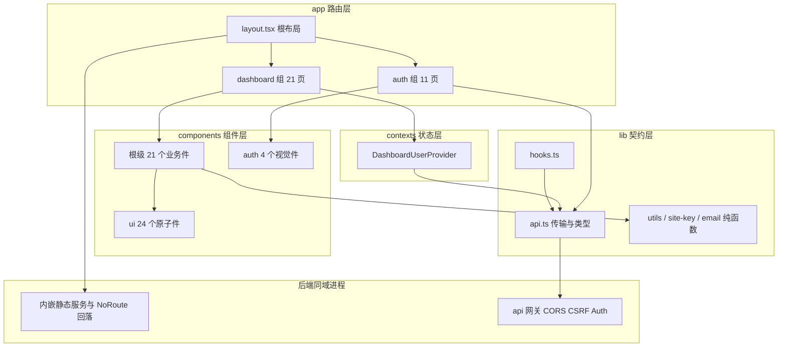
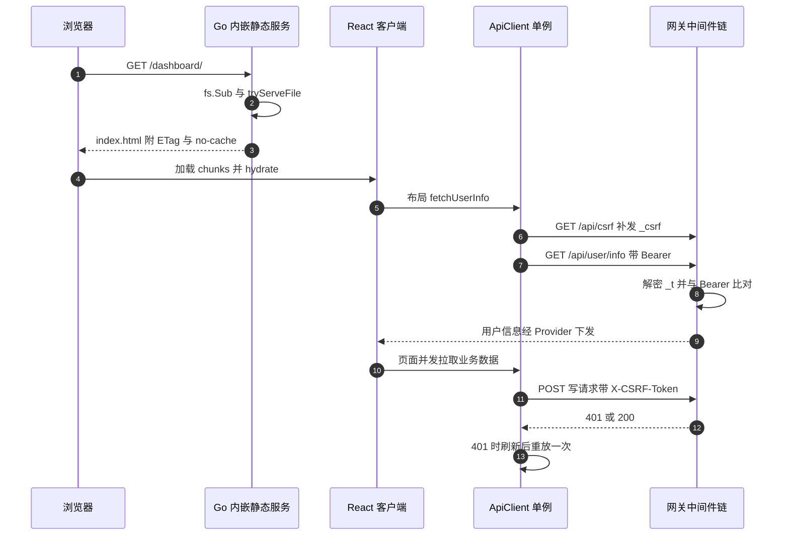
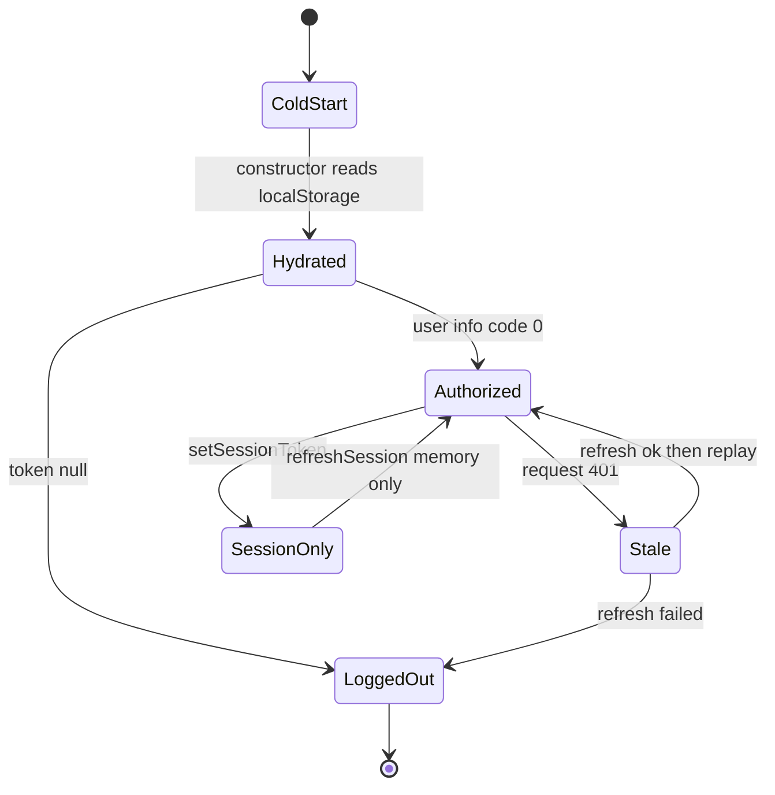
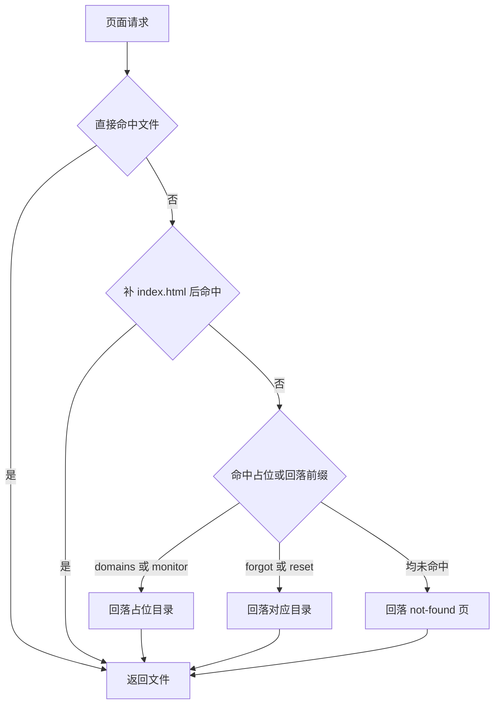
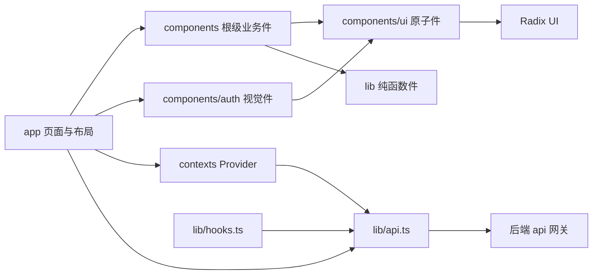

# 前端架构

<cite>
**本文档引用的文件**
- [package.json](file://web/package.json)
- [next.config.ts](file://web/next.config.ts)
- [tsconfig.json](file://web/tsconfig.json)
- [components.json](file://web/components.json)
- [postcss.config.mjs](file://web/postcss.config.mjs)
- [eslint.config.mjs](file://web/eslint.config.mjs)
- [app/layout.tsx](file://web/app/layout.tsx)
- [app/page.tsx](file://web/app/page.tsx)
- [app/globals.css](file://web/app/globals.css)
- [app/error.tsx](file://web/app/error.tsx)
- [app/global-error.tsx](file://web/app/global-error.tsx)
- [app/(auth)/layout.tsx](file://web/app/(auth)/layout.tsx)
- [app/(auth)/login/page.tsx](file://web/app/(auth)/login/page.tsx)
- [app/(auth)/reset-password/page.tsx](file://web/app/(auth)/reset-password/page.tsx)
- [app/(auth)/magic-login/page.tsx](file://web/app/(auth)/magic-login/page.tsx)
- [app/(dashboard)/layout.tsx](file://web/app/(dashboard)/layout.tsx)
- [app/(dashboard)/dashboard/page.tsx](file://web/app/(dashboard)/dashboard/page.tsx)
- [app/(dashboard)/dashboard/domains/[id]/page.tsx](file://web/app/(dashboard)/dashboard/domains/[id]/page.tsx)
- [app/(dashboard)/dashboard/domains/[id]/client.tsx](file://web/app/(dashboard)/dashboard/domains/[id]/client.tsx)
- [app/(dashboard)/dashboard/cloudflare/hostnames/page.tsx](file://web/app/(dashboard)/dashboard/cloudflare/hostnames/page.tsx)
- [app/(dashboard)/dashboard/settings/page.tsx](file://web/app/(dashboard)/dashboard/settings/page.tsx)
- [contexts/dashboard-user-context.tsx](file://web/contexts/dashboard-user-context.tsx)
- [lib/api.ts](file://web/lib/api.ts)
- [lib/hooks.ts](file://web/lib/hooks.ts)
- [lib/utils.ts](file://web/lib/utils.ts)
- [lib/deploy-config-form.ts](file://web/lib/deploy-config-form.ts)
- [lib/crypto.ts](file://web/lib/crypto.ts)
- [lib/site-key.ts](file://web/lib/site-key.ts)
- [lib/email.ts](file://web/lib/email.ts)
- [components/theme-provider.tsx](file://web/components/theme-provider.tsx)
- [components/theme-toggle.tsx](file://web/components/theme-toggle.tsx)
- [components/route-progress.tsx](file://web/components/route-progress.tsx)
- [components/page-tabs.tsx](file://web/components/page-tabs.tsx)
- [components/global-error-handler.tsx](file://web/components/global-error-handler.tsx)
- [components/error-boundary.tsx](file://web/components/error-boundary.tsx)
- [components/client-error-boundary.tsx](file://web/components/client-error-boundary.tsx)
- [components/account-form.tsx](file://web/components/account-form.tsx)
- [components/provider-icon.tsx](file://web/components/provider-icon.tsx)
- [components/auth-captcha-fields.tsx](file://web/components/auth-captcha-fields.tsx)
- [components/go-captcha-dialog.tsx](file://web/components/go-captcha-dialog.tsx)
- [components/captcha-dialog.tsx](file://web/components/captcha-dialog.tsx)
- [components/turnstile-widget.tsx](file://web/components/turnstile-widget.tsx)
- [components/turnstile-gate-notice.tsx](file://web/components/turnstile-gate-notice.tsx)
- [components/oauth-callback-view.tsx](file://web/components/oauth-callback-view.tsx)
- [app/(auth)/reset-totp/page.tsx](file://web/app/(auth)/reset-totp/page.tsx)
- [app/(auth)/magic-login/totp/page.tsx](file://web/app/(auth)/magic-login/totp/page.tsx)
- [components/deploy/DynamicForm.tsx](file://web/components/deploy/DynamicForm.tsx)
- [components/auth/auth-animated-layout.tsx](file://web/components/auth/auth-animated-layout.tsx)
- [scripts/sync-main-web.cjs](file://web/scripts/sync-main-web.cjs)
- [README.md](file://web/README.md)
- [main.go](file://main/main.go)
- [router.go](file://main/internal/api/router.go)
- [auth.go (中间件)](file://main/internal/api/middleware/auth.go)
- [csrf.go](file://main/internal/api/middleware/csrf.go)
- [handler/auth.go](file://main/internal/api/handler/auth.go)
- [Dockerfile](file://Dockerfile)
- [build.yml](file://.github/workflows/build.yml)
</cite>

## 目录

1. [简介](#简介)
2. [项目结构](#项目结构)
3. [核心组件](#核心组件)
4. [架构总览](#架构总览)
5. [详细组件分析](#详细组件分析)
6. [依赖关系分析](#依赖关系分析)
7. [性能考虑](#性能考虑)
8. [故障排查指南](#故障排查指南)
9. [结论](#结论)
10. [附录](#附录)

## 简介

`web/` 是 DNSPlane 的唯一前端应用：Next.js 16.2.4（App Router）+ React 19.2.4 + Tailwind CSS 4 + Radix UI，UI 约定为 shadcn `new-york` 风格。它不是常规的前后端分离站点，而是**纯静态导出的单二进制内嵌控制台**：`output: 'export'`（`web/next.config.ts:4`）让产物成为一份纯 HTML/JS/CSS 目录树，由 `web/scripts/sync-main-web.cjs:4-13` 同步进 `main/web`，再由 `main/main.go:63-64` 的 `//go:embed all:web` 编译进 Go 可执行文件，运行时同一个 Gin 进程既发页面又发 `/api` 网关。

这决定了本文全部技术判断的基线：**前端没有服务端运行时**。没有 Server Action、没有 ISR、没有 middleware 重写、没有流式 SSR，鉴权、权限过滤、数据获取都在浏览器完成。

### 分析范围与证据口径

本文覆盖 `web/` 的 `app/`、`components/`、`contexts/`、`lib/`、`scripts/` 五个源码目录，以及与产物落位耦合的 Go 侧静态服务链（`main/internal/api/router.go:344-461`）。下表为本次会话实测值。

| 维度 | 实测值 | 口径 |
| --- | --- | --- |
| 框架版本 | Next.js 16.2.4、React 19.2.4 | `web/package.json:34,38` |
| 样式方案 | Tailwind 4，仅 `@tailwindcss/postcss` 一个插件、无 tailwind.config | `web/package.json:44,50`、`web/postcss.config.mjs:3` |
| UI 基座 | 15 个 `@radix-ui/*` 单包 + `radix-ui` + `cmdk` + `sonner` | `web/package.json:13-41`、`web/components.json:3` |
| 页面数 | 33 个 `page.tsx`（根 1 + `(auth)` 11 + `(dashboard)` 21），其中 28 个顶层带 `'use client'`、5 个为服务端薄壳 | `web/app` 与各 `page.tsx:1` 实测 |
| 组件数 | 50 个 TSX（根 21、`auth/` 4、`deploy/` 1、`ui/` 24 共 1948 行） | `web/components` 与 `wc -l components/ui/*.tsx` 实测 |
| Context / hook | 1 个 Context、2 个自定义 hook | `contexts/dashboard-user-context.tsx:6`、`lib/hooks.ts:12,69` |
| 产物体积 | `web/out` 6.7 MB 且与 `main/web` 同尺寸 | `du -sh` 实测 |

**章节来源**
- [package.json](file://web/package.json)
- [next.config.ts](file://web/next.config.ts)
- [main.go](file://main/main.go)

### 三条关键设计取舍

- **静态导出换单二进制分发**：代价是动态段必须由客户端自行解析，收益是零依赖运行与 `distroless` 终态镜像（`Dockerfile:32-37`）。
- **客户端鉴权换同域简化**：凭据由 `SetAuthCookies` 写入 HttpOnly Cookie（`main/internal/api/middleware/auth.go:296-311`），前端只持有 access token，`Auth` 中间件再做双值比对（`auth.go:143-150`）；代价是权限可见性必须在前端复刻（`app/(dashboard)/layout.tsx:232-250`）。
- **无表单库换可控性**：`web/package.json:12-53` 未引入 zod / yup / react-hook-form，校验为手写条件加 `toast.error`，配合 `lib/email.ts:2-6`、`lib/site-key.ts:7-9` 这类最小校验器。

**章节来源**
- [Dockerfile](file://Dockerfile)
- [lib/email.ts](file://web/lib/email.ts)
- [lib/site-key.ts](file://web/lib/site-key.ts)

## 项目结构

### 目录树

```
web/
├── app/                        # App Router 路由树（49 个 TS/TSX，21933 行）
│   ├── layout.tsx              # RootLayout：ThemeProvider + RouteProgress + 错误边界 + Toaster
│   ├── page.tsx                # '/' 客户端重定向壳 → /login
│   ├── globals.css             # Tailwind 4 入口 + 主题令牌 + 动画（448 行）
│   ├── error.tsx / global-error.tsx / not-found.tsx
│   ├── (auth)/                 # layout + loading + error + 11 页
│   │   ├── login/ register/ forgot-password/ forgot-totp/
│   │   ├── reset-password/ reset-totp/ magic-link/ magic-login/totp/
│   │   └── oauth-callback/ github-callback/
│   └── (dashboard)/            # layout + loading + error + not-found
│       └── dashboard/          # 21 页
│           ├── domains/[id]/   # page.tsx 壳 + client.tsx 实现体
│           ├── cloudflare/hostnames/ 与 tunnels/  # 同为壳 + client.tsx
│           └── settings/       # 页面 + auth-control-settings + optimize-ip-settings
├── components/                 # 50 个 TSX：ui 24 / 根级 21 / auth 4 / deploy 1
├── contexts/                   # dashboard-user-context.tsx（24 行，全项目唯一 Context）
├── lib/                        # 10 个模块：api.ts 独占 1713 行
├── public/icons/               # 56 个服务商图标
├── scripts/sync-main-web.cjs   # out/ → main/web
└── next.config.ts / tsconfig.json / components.json / postcss.config.mjs / eslint.config.mjs
```

**章节来源**
- [app/layout.tsx](file://web/app/layout.tsx)
- [app/globals.css](file://web/app/globals.css)

### 结构职责表

| 目录 | 职责边界 | 含副作用 | 关键入口与行号 | 依赖方向 |
| --- | --- | --- | --- | --- |
| `app/` | 路由、布局、页面级编排 | 是 | `app/layout.tsx:15-36`、`app/(dashboard)/layout.tsx:95` | → components / contexts / lib |
| `components/ui/` | Radix 原子件 + cva 变体 | 否 | `components.json:3` 决定 `new-york` 风格 | → Radix、`lib/utils.ts:4` |
| `components/`（根） | 业务复用件 | 部分 | `account-form.tsx:253`、`provider-icon.tsx:253` | → ui / lib |
| `components/auth/` | 认证页视觉壳与骨架 | 是 | `auth-animated-layout.tsx:23,114` | → ui / CSS Module |
| `contexts/` | 跨子树下发已登录用户 | 是 | `dashboard-user-context.tsx:6,8-20,22-24` | → `lib/api` 类型 |
| `lib/` | HTTP 传输、类型契约、纯函数 | `api.ts` 有 | `api.ts:24-293`、`hooks.ts:12,69` | 不依赖 components/app |
| `scripts/` | 产物落位（`fs.rmSync` 后 `cpSync`） | 是 | `sync-main-web.cjs:12-13` | 无 |

**章节来源**
- [components/account-form.tsx](file://web/components/account-form.tsx)
- [contexts/dashboard-user-context.tsx](file://web/contexts/dashboard-user-context.tsx)
- [lib/api.ts](file://web/lib/api.ts)

### 五大模块划分



**图表来源**
- [app/layout.tsx](file://web/app/layout.tsx)
- [app/(dashboard)/layout.tsx](file://web/app/(dashboard)/layout.tsx)
- [router.go](file://main/internal/api/router.go)

**章节来源**
- [app/(auth)/layout.tsx](file://web/app/(auth)/layout.tsx)
- [contexts/dashboard-user-context.tsx](file://web/contexts/dashboard-user-context.tsx)

## 核心组件

### UI 基座：Radix 与 shadcn 生成层

`components.json:3-13` 声明 `style: new-york`、`rsc: true`、`baseColor: neutral`、`cssVariables: true`、图标库 `lucide`；`:14-20` 给出别名 `@/components`、`@/components/ui`、`@/lib`，配合 `tsconfig.json:21-23` 的 `@/* -> ./*` 生效。两处偏差值得记录：`components.json:19` 声明了 `hooks: "@/hooks"` 但 `web/hooks/` 目录不存在，hook 全部落在 `lib/hooks.ts`；`rsc: true` 与页面普遍 `'use client'` 并存，说明 shadcn 生成件保持了可被服务端薄壳引用的能力。`components/ui` 共 24 个文件、1948 行。

| 原子件 | 行数 | 底层包 | 主要消费方 |
| --- | --- | --- | --- |
| `dropdown-menu.tsx` | 257 | `@radix-ui/react-dropdown-menu` | `app/(dashboard)/layout.tsx:400-430` 用户菜单 |
| `alert-dialog.tsx` / `dialog.tsx` | 196 / 158 | Radix Dialog 系 | 各页新增编辑与删除确认 |
| `select.tsx` | 190 | `@radix-ui/react-select` | `account-form.tsx`、部署表单 |
| `tabs.tsx` / `sheet.tsx` | 91 / 143 | `@radix-ui/react-tabs`、Dialog 系 | `settings` 八 Tab、移动端抽屉 |
| `table.tsx` / `command.tsx` | 117 / 103 | 原生 table、`cmdk` | 列表页主体、命令面板 |
| 其余 16 件 | 13-64 | 对应 Radix 单包 | 表单原子控件与 `Toaster` |

**章节来源**
- [components.json](file://web/components.json)
- [tsconfig.json](file://web/tsconfig.json)
- [app/(dashboard)/layout.tsx](file://web/app/(dashboard)/layout.tsx)

### 业务复用与认证视觉组件

| 组件 | 导出与行号 | 职责与消费者 |
| --- | --- | --- |
| `account-form.tsx` | `Provider`(129)、`AccountForm`(253)、`ConfigField`(148) | DNS/证书/部署三类账户通用动态表单，分类常量 `DNS_CATEGORIES`(23)/`CERT_CATEGORIES`(29)/`DEPLOY_CATEGORIES`(35)；三个 `add` 页复用 |
| `provider-icon.tsx` | `ProviderIcon`(253)、`getProviderName`(286)、`ProviderBadge`(303) | 服务商配色与首字徽章，未命中回落灰底首字母（`:254-259`）；accounts/domains/记录页消费 |
| `auth-captcha-fields.tsx` | `AuthCaptchaValue`(13)、`AuthCaptchaFields`(33) | 图形/内置行为/第三方三形态验证码输入，`login/page.tsx:17` |
| `turnstile-widget.tsx` / `turnstile-gate-notice.tsx` | `TurnstileWidget`(16) / `TurnstileGateNotice`(23) | 独立 Turnstile 与密钥缺失时的显式报错，forgot/reset 三页消费 |
| `pagination.tsx` / `sortable-header.tsx` | `Pagination`(27) / `SortableHeader`(16)、`handleSortToggle`(39) | 分页与表头排序，domains 与日志类页面 |
| `table-skeleton.tsx` / `empty-state.tsx` | `TableSkeleton`(14) / `EmptyState`(30) | 加载骨架与空态，12 个列表页共用 |
| `page-tabs.tsx` | `PageTabs`(61)、`STORAGE_KEY`(13)、`MAX_TABS`(14)、`PATH_TITLES`(16-33) | 多页签导航与 localStorage 持久化，挂在布局 `:434` |
| `route-progress.tsx` | `RouteProgress`(12) | 纯 DOM 顶部进度条，替代 NProgress（`:6-11` 注释），挂在 `app/layout.tsx:24-26` |
| `oauth-callback-view.tsx` | `OAuthCallbackView`(269) | verifying/success/error 三阶段回调视图，两个回调页共用 |
| `custom-webhook-fields.tsx` | `CustomWebhookFields`(38) | 设置页 Webhook 模板字段编辑 |
| `auth/auth-animated-layout.tsx` | `AuthAnimatedLayout`(23)、`AuthAnimatedLoading`(114) | 认证页双栏壳；配套 `auth-form-skeleton.tsx:22` 锁定卡片高度防抖动、`auth-footer-nav.tsx:21` 依 `register_enabled` 决定注册入口 |

**章节来源**
- [components/account-form.tsx](file://web/components/account-form.tsx)
- [components/provider-icon.tsx](file://web/components/provider-icon.tsx)
- [components/auth/auth-animated-layout.tsx](file://web/components/auth/auth-animated-layout.tsx)

### Context 提供者

全项目只有一个 Context，作用域极窄：`contexts/dashboard-user-context.tsx:6` 建 `createContext<User | null>(null)`，`:8-20` 的 Provider 接收已取到的 `user` 直接透传，`:22-24` 的 `useDashboardUser` 读取。它不含任何请求逻辑——用户信息在 `app/(dashboard)/layout.tsx:156-188` 拉取、`:261` 包裹、`:440` 闭合；页面侧唯一消费者是 `app/(dashboard)/dashboard/page.tsx:28,34`。这是刻意取舍：列表页各自持有局部 state 并直接经 `lib/api.ts` 取数，不引入全局数据层，代价是同一资源跨页重复请求，收益是零缓存一致性问题。

**章节来源**
- [contexts/dashboard-user-context.tsx](file://web/contexts/dashboard-user-context.tsx)
- [app/(dashboard)/layout.tsx](file://web/app/(dashboard)/layout.tsx)

### API 客户端

`lib/api.ts`（1713 行）同时是传输层与类型契约中心：`API_BASE = '/api'`（`:1`）、`ApiResponse<T>`（`:6-11`）、`readCookie`（`:14-22`）、`class ApiClient`（`:24-293`）、单例 `api`（`:295`），外部再挂 17 个分组对象（见「API 客户端与后端契约」）。其关键机制如下。

| 机制 | 行号 | 要点 |
| --- | --- | --- |
| CSRF 双提交 | `api.ts:41-64` | 先读 `_csrf` cookie，缺失则 `GET /api/csrf` 引导，`csrfInFlight`（`:29,44`）合并并发 |
| 令牌存取 | `api.ts:66-119` | access 落 localStorage 的 `token`，`refresh_token` 一律不落本地（`:73-74,81-90`） |
| 一次性会话 | `api.ts:99-105` | `setSessionToken` 供 OAuth 回调使用，反向清除 localStorage |
| 会话刷新 | `api.ts:127-172` | `POST /auth/refresh` 仅靠 HttpOnly Cookie `_rt`，`refreshInFlight` 合并并发 |
| 请求主链 | `api.ts:179-253` | 非 GET 附 `X-CSRF-Token`（`:197-200`）、`credentials: 'include'`（`:205`）、401 先刷新再重放（`:216-237`） |
| 短路白名单 | `api.ts:218-223` | `/auth/refresh`、`/login`、`/install`、`/install/status` 不触发刷新重放 |
| 方法封装 | `api.ts:255-292` | `get` 自动序列化 query，`post` 支持 `timeoutMs` 转 `AbortSignal.timeout` |
| 明文约定 | `api.ts:297-303` | `encryptedPost` 当前直转 `api.post`，与注释「后端为明文 JSON body」一致 |

**章节来源**
- [lib/api.ts](file://web/lib/api.ts)

### 全局反馈与错误边界

错误处理分四层且互不重叠：`app/global-error.tsx` 兜根布局崩溃并自带 `<html>`；`app/error.tsx`、`app/(auth)/error.tsx`、`app/(dashboard)/error.tsx` 兜各路由段渲染错误，控制台段可展开复制 `digest`；`components/error-boundary.tsx:20` 的类组件经 `client-error-boundary.tsx:5` 挂在 `app/layout.tsx:27-29`，兜底 UI 为 `ErrorFallback`（`:138`）；`components/global-error-handler.tsx:14-55` 监听 `window` 错误与未处理拒绝并转 toast，其中 `Script error.`、`ResizeObserver`、`AbortError`、`Failed to fetch` 四类被显式忽略（`:19,22,34,37`），避免与 api 层提示重复。

**章节来源**
- [app/layout.tsx](file://web/app/layout.tsx)
- [components/error-boundary.tsx](file://web/components/error-boundary.tsx)
- [components/global-error-handler.tsx](file://web/components/global-error-handler.tsx)

## 架构总览

浏览器与后端同 Origin，页面由 Go 的 `NoRoute` 回落到内嵌 `index.html`，随后数据面完全由客户端 React 接管。



**图表来源**
- [router.go](file://main/internal/api/router.go)
- [lib/api.ts](file://web/lib/api.ts)
- [auth.go (中间件)](file://main/internal/api/middleware/auth.go)

### 渲染模型：静态壳加水合

`app/layout.tsx` 是唯一的根布局且自身不含 `'use client'`，只负责 `metadata`（`:10-13`，标题 `DNSPlane - DNS管理系统`）与四个全局挂载点（`:23-31`）。`<html lang="zh-CN" suppressHydrationWarning>`（`:21`）是全库唯一的 hydration 豁免点，用于容忍 `next-themes` 写入 `<html>` class。本次检索未发现 `dangerouslySetInnerHTML`，也未发现任何 `next/image` 导入：图标在 `provider-icon.tsx:253` 用首字与配色渲染，仅 `account-form.tsx:308-313` 用原生 `` 加载 `/icons/*`，这也是 `next.config.ts:6-8` 的 `images.unoptimized` 当前无实际作用的原因。33 页中 28 页直接标 `'use client'`，其余 5 页为服务端薄壳。

**章节来源**
- [app/layout.tsx](file://web/app/layout.tsx)
- [next.config.ts](file://web/next.config.ts)
- [components/account-form.tsx](file://web/components/account-form.tsx)

### 请求主链与网关侧顺序

前端发出 `/api/*` 后，服务端在 `main/internal/api/router.go:44-53` 依次挂载 `CORS → RequestTrace → Recovery → CSRF → AuditLog`，`Auth` 与 `Permission` 再叠加到受保护子组（`router.go:95-104`），链首另有 `SecurityHeaders + gin.Recovery + Logger`（`router.go:24-32`）。静态资源不经这条链，缓存由 `tryServeFile`（`router.go:384-405`）单独决定：HTML 与 txt 为 `no-cache`，其余 `public, max-age=31536000`，并以内容 SHA-256 作 `ETag` 处理 `If-None-Match` → 304（`:396-402`）。

**章节来源**
- [router.go](file://main/internal/api/router.go)

## 详细组件分析

### 路由组与页面树

| 路由组 | 组内非页面文件 | 页面数 | 鉴权与呈现特征 |
| --- | --- | --- | --- |
| 根 | `error.tsx`、`global-error.tsx`、`not-found.tsx` | 1 | `/` 客户端 `router.replace('/login')`（`app/page.tsx:10`） |
| `(auth)` | `layout.tsx`、`loading.tsx`、`error.tsx`（无 `not-found.tsx`） | 11 | 匿名可访问，`animate-auth-route` 入场动画（`app/(auth)/layout.tsx:9`） |
| `(dashboard)` | `layout.tsx`、`loading.tsx`、`error.tsx`、`not-found.tsx` | 21 | 强制登录 + 权限过滤侧栏 + `PageTabs` |

`(auth)` 的 11 页分四簇：口令簇（`login`、`register`）、找回簇（`forgot-password`、`forgot-totp`）、重置簇（`reset-password`、`reset-totp`）、免密与第三方簇（`magic-link`、`magic-login`、`magic-login/totp`、`oauth-callback`、`github-callback`）。`github-callback` 的注释标明它仅为兼容旧书签而保留。

**章节来源**
- [app/page.tsx](file://web/app/page.tsx)
- [app/(auth)/layout.tsx](file://web/app/(auth)/layout.tsx)
- [app/(dashboard)/layout.tsx](file://web/app/(dashboard)/layout.tsx)

### 组件层次

控制台布局是「守卫 → 下发 → 装饰 → 内容」四段式，全部在同一文件线性展开：

| 顺序 | 位置 | 行为 |
| --- | --- | --- |
| 1 | `app/(dashboard)/layout.tsx:143-151` | 清理历史遗留的 `?token=` 与 `?refresh_token=` 查询串（安全审计 H-4） |
| 2 | `:190-194` | `api.getToken()` 为空则 `router.replace('/login')` 并中止 effect |
| 3 | `:156-188` | `fetchUserInfo` 拉用户，非未登录类错误最多重试 2 次（`:153-154,167-173`） |
| 4 | `:252-258` | `user` 为空只渲染 spinner，不渲染业务内容 |
| 5 | `:261` 与 `:440` | `DashboardUserProvider` 包裹整棵子树 |
| 6 | `:232-250` | `filteredNavigation` 先按 `adminOnly` 加 `user.level >= 2`，再按 `hasModuleAccess` 过滤父子两级 |
| 7 | `:209-220` | `isActive` 精确匹配，注释说明为避免 `/dashboard/cert` 命中 `/dashboard/cert-accounts` |
| 8 | `:398,434,437` | `ThemeToggle`、`PageTabs`、`<main>{children}</main>` |

`navigation`（`:55-93`）是硬编码常量，含 Cloudflare、SSL 证书、自动部署三个带 `children` 的分组；`NavItem`（`:45-53`）的 `module` 字段与「用户管理」页的功能权限 key 一致，使同一口径在布局、`users/page.tsx`、记录页三处复用。

**章节来源**
- [app/(dashboard)/layout.tsx](file://web/app/(dashboard)/layout.tsx)
- [lib/utils.ts](file://web/lib/utils.ts)

### Context 与状态边界

会话状态由 `ApiClient` 独占，React 侧不镜像它。access token 的状态机如下：



**图表来源**
- [lib/api.ts](file://web/lib/api.ts)

Turnstile 门控是另一条独立状态机，五态定义在 `lib/hooks.ts:36-46`，判定主体在 `:69-109`：`getConfig()` 失败为 `unavailable`，`turnstile_standalone_required === false` 为 `off`，站点密钥通过 `isValidSiteKey` 为 `ready`，否则 `misconfigured`。`:58-67` 的注释给出关键理由——判据以「后端是否会拒绝」为准而非「前端能否渲染」，否则会出现提交被拒但组件不显示的僵死；`retry`（`:106`）通过 `reloadNonce` 重新触发 effect。

**章节来源**
- [lib/hooks.ts](file://web/lib/hooks.ts)
- [lib/api.ts](file://web/lib/api.ts)

### 表单与验证

未使用表单库，验证分三类：

| 类型 | 实现位置 | 触发与失败表现 |
| --- | --- | --- |
| 提交前必填校验 | `components/account-form.tsx:371-393` | 遍历 `provider.config` 的 `required` 项，跳过 `isDeployFieldVisible` 判为隐藏者；失败 `toast.error` 并阻止提交 |
| 格式白名单 | `lib/email.ts:2-6`、`lib/site-key.ts:7-9` | 正则与长度检查返回布尔，文案由调用方决定 |
| 后端驱动字段显隐 | `lib/deploy-config-form.ts:3-34` | 对服务端下发的 `show` 表达式求值，支持 `==`、`!=`、`&&`、`\|\|`；不成立则整字段不渲染 |

`ProviderConfigField`（`lib/api.ts:1320`）是动态表单的契约载体：`account-form.tsx:148` 的 `ConfigField` 按 `type` 渲染 input / textarea / password / select，`resolveSelectFieldValue`（`lib/deploy-config-form.ts:62-72`）专门处理 Radix Select「value 必须命中某一选项」的硬约束，回落顺序为原值 → 字段默认值 → 首项。登录页的验证最复杂，需在安装态、验证码三形态、TOTP、第三方登录间切换：`isBuiltinBehavioralCaptcha`（`app/(auth)/login/page.tsx:38-40`）同时接受 `behavioral` 与 `go-captcha` 两种拼法，`:231-242` 把三形态归一为互斥布尔，`:242` 用 `isValidSiteKey` 决定第三方组件能否渲染，`GoCaptchaDialog` 以 `lazy()` 按需加载（`:20`），`checkInstallStatus`、`checkAuthConfig`、`loadCaptcha`、`loadOAuthProviders` 四个初始化函数分别在 `:129`、`:162`、`:188`、`:152`。

**章节来源**
- [components/account-form.tsx](file://web/components/account-form.tsx)
- [lib/deploy-config-form.ts](file://web/lib/deploy-config-form.ts)
- [app/(auth)/login/page.tsx](file://web/app/(auth)/login/page.tsx)

### 主题与响应式

主题令牌集中在 `app/globals.css`（448 行）：`:1-2` 导入 tailwind 与 `tw-animate-css`；`:38` 的 `@custom-variant dark (&:is(.dark *))` 定义暗色变体选择器；`:40` 的 `@theme inline` 把语义变量映射为 Tailwind 颜色；`:83` 的 `:root` 与 `:118` 的 `.dark` 提供两套 oklch 令牌；`:34-36` 的 `.animate-auth-route` 被认证组布局使用；`:425-427` 的 `.bs-form-control` 是遗留兼容类。`components/theme-provider.tsx:16-27` 用 `attribute="class"` 把 `.dark` 写到 `<html>`，`:5-15` 注释说明此前的缺陷——暗色样式早已写好却没有任何代码挂 `.dark`；`defaultTheme="system"` 加 `enableSystem` 加 `disableTransitionOnChange` 让首选项跟随系统且切换无闪烁。

`components/theme-toggle.tsx:27` 用 `useSyncExternalStore(emptySubscribe, () => true, () => false)` 取代 `useState + useEffect` 的挂载判定，`:8-14` 说明动机是避免 effect 内同步 `setState` 触发级联渲染，`:35` 在挂载前固定按浅色高亮以避免选中态闪动。响应式完全依赖 Tailwind 断点类：侧栏切换按钮与顶部菜单并存（`app/(dashboard)/layout.tsx:386-394`），主内容 `p-4 sm:p-6`（`:437`），用户名 `hidden sm:inline-block`（`:408`），移动端抽屉绑定 Esc 关闭并在打开期间锁定 `body` 滚动、卸载还原（`:120-133`）。

**章节来源**
- [app/globals.css](file://web/app/globals.css)
- [components/theme-provider.tsx](file://web/components/theme-provider.tsx)
- [app/(dashboard)/layout.tsx](file://web/app/(dashboard)/layout.tsx)

### API 客户端与后端契约

`lib/api.ts` 导出 17 个分组对象，与后端路由一一对应。

| 分组 | 定义行 | 端点前缀 |
| --- | --- | --- |
| `authApi` | `api.ts:348` | `/login`、`/logout`、`/auth/captcha`、`/auth/config`、`/user/info`、`/install`、`/auth/forgot-*`、`/auth/magic-link*`、`/auth/register` |
| `authControlApi` | `:455` | `/system/auth-control`，`get/update` 与 `getConfig/updateConfig` 同义兼容 |
| `accountApi` | `:475` | `/accounts`、`/accounts/:id/domains` |
| `domainApi` | `:487` | `/domains`、`/domains/:id/records*`、`/whois`、`/loginurl`、`/aliases`、`/domains/dns-check`、`/domains/:id/accel*` |
| `domainCategoryApi` | `:561` | `/domains/categories`、`/domains/category` |
| `scheduleApi` | `:571` | `/schedule/tasks` 含 `toggle` 与 `batch` |
| `monitorApi` | `:582` | `/monitor/tasks*`、`/monitor/lookup`、`/monitor/overview`、`/monitor/status` |
| `certApi` | `:609` | `/cert/accounts`、`/cert/orders*`、`/cert/deploys`、`/cert/cnames`、`/cert/providers` |
| `userApi` | `:663` | `/users`、`/users/:id/permissions*`、`/users/:id/reset-*` |
| `logApi` | `:697` | `/logs` 多维过滤含 `date_from` 与 `date_to`、`/logs/clean` |
| `systemApi` | `:736` | `/system/config`、12 个 `/system/*/test` 通道、`/system/proxy/test`、`/system/cron`、`/dns/providers`、`/dashboard/system/info`、`/system/accel/*`、`/system/optimizeip/*` |
| `dashboardApi` | `:793` | `/dashboard/stats` |
| `totpApi` | `:798` | `/user/totp/*` |
| `oauthApi` | `:817` | `/auth/oauth/providers`、`/user/oauth/bind-url`、`/user/oauth/unbind`、`/auth/oauth/exchange` |
| `requestLogApi` | `:842` | `/request-logs/*`，全部 POST |
| `cloudflareApi` | `:862` | `/cloudflare/hostnames/*`、`/cloudflare/fallback/*`、`/cloudflare/tunnels/*`、CIDR 与主机名路由 |
| `quotaApi` | `:1687` | `/user/quota`、`/system/plans*`、`/system/user-quotas*`、`/system/quota-default` |

类型契约与后端响应结构对齐：`AuthPublicConfig`（`api.ts:306`）逐字段对齐 `handler.GetAuthConfig`，`User`（`:1018`）含 `level`、`permissions`、`totp_open`，是侧栏过滤的输入。`oauthApi.exchange`（`:831-838`）在 `mode === 'login'` 时额外调用 `api.refreshSession({ persist: false })`，理由写在 `:823-830`：服务端只下发 HttpOnly cookie、响应体不含令牌，而 `Auth` 仍要求 `Authorization` 与 cookie 会话一致，缺头一律 401。

**章节来源**
- [lib/api.ts](file://web/lib/api.ts)
- [handler/auth.go](file://main/internal/api/handler/auth.go)
- [auth.go (中间件)](file://main/internal/api/middleware/auth.go)

### 静态导出对路由设计的约束

`output: 'export'`（`next.config.ts:4`）带来三条可验证的约束。

**约束一：动态段用壳加客户端解析绕过。** `app/(dashboard)/dashboard/domains/[id]/page.tsx:2` 设 `dynamicParams = false`，`:4-6` 的 `generateStaticParams` 固定返回 `[{ id: '_' }]`，于是产物里只有 `main/web/dashboard/domains/_/index.html`（已实测存在），真实 id 由 `client.tsx` 运行时从路径取出。`cloudflare/hostnames/page.tsx:1-5` 与 `cloudflare/tunnels/page.tsx` 同样采用薄壳加 `client.tsx` 的实现体分离。



**图表来源**
- [router.go](file://main/internal/api/router.go)

回落链实现在 `main/internal/api/router.go:411-461`，与前端目录结构形成隐式契约。一处需要注意：`:432-438` 仍保留 `/dashboard/monitor/_` 分支，但 `web/app/(dashboard)/dashboard/monitor/` 下并无 `[id]` 目录、`web/out/dashboard/monitor/` 中也不存在 `_` 子目录，该分支目前只会继续向下匹配；是否属历史遗留标记为**未知**，需与产品确认是否曾存在监控详情页。

**约束二：`useSearchParams` 必须有 Suspense 边界。** 已正确包裹的四处在 `app/(auth)/reset-password/page.tsx:340-348`、`app/(auth)/reset-totp/page.tsx:216-224`、`app/(auth)/magic-login/page.tsx:26-28`、`app/(auth)/magic-login/totp/page.tsx:21-23`，根布局另为 `RouteProgress` 包了一层（`app/layout.tsx:24-26`）。

**约束三：鉴权与授权全部前移到客户端。** `hasModuleAccess`（`lib/utils.ts:118-128`）的语义是未携带 `module` 或未返回 `permissions` 一律放行，以兼容老用户；因此前端过滤只是可见性控制而非安全边界，真正的拒绝发生在服务端 `Permission` 中间件（`router.go:104`）。

**章节来源**
- [app/(dashboard)/dashboard/domains/[id]/page.tsx](file://web/app/(dashboard)/dashboard/domains/[id]/page.tsx)
- [app/(auth)/magic-login/page.tsx](file://web/app/(auth)/magic-login/page.tsx)
- [router.go](file://main/internal/api/router.go)

## 依赖关系分析

### 分层依赖图与矩阵



**图表来源**
- [lib/api.ts](file://web/lib/api.ts)
- [lib/hooks.ts](file://web/lib/hooks.ts)
- [components/account-form.tsx](file://web/components/account-form.tsx)

| 消费方 ↓ / 被依赖 → | contexts | lib/api | lib/hooks | lib/utils | lib 其余 | components/ui | components 根 |
| --- | --- | --- | --- | --- | --- | --- | --- |
| `app/**` | 布局 `:42` | 全部页面 | 三个认证页 | `cn` 与 `hasModuleAccess` | `deploy-config-form`、`cert-order-display` | 大量直接使用 | `account-form`、`PageTabs` 等 |
| `components/`（根） | 无 | 类型与 `api` | `turnstile-gate-notice.tsx:4` | 多数导入 `cn` | `account-form` 用 `deploy-config-form` | 是 | 互相引用极少 |
| `components/ui` | 无 | 无 | 无 | `cn` | 无 | — | 无 |
| `contexts/` 与 `lib/` | — | `contexts` 仅类型 `User`；`lib` 不反向依赖 | `hooks.ts:4` 导入 `authApi` | 无 | 彼此独立 | 无 | 无 |

唯一值得注意的反向依赖是 `oauth-callback-view.tsx` 作为根级组件却引用了 `components/auth/` 的 CSS Module，方向仍在「业务 → 视觉」上，不构成环。`components/ui` 对 `contexts` 与 `lib/api` 零依赖，是其可替换性的保证。

**章节来源**
- [lib/hooks.ts](file://web/lib/hooks.ts)
- [contexts/dashboard-user-context.tsx](file://web/contexts/dashboard-user-context.tsx)
- [components/oauth-callback-view.tsx](file://web/components/oauth-callback-view.tsx)

### 第三方依赖与未声明引用

| 依赖 | 声明位置 | 用途 | 状态 |
| --- | --- | --- | --- |
| `@radix-ui/react-*` 15 个单包 | `package.json:13-27` | shadcn 原子件底层 | 已声明 |
| `radix-ui` 聚合包 | `package.json:37` | 部分新式导入 | 已声明，与单包并存 |
| `class-variance-authority` 加 `clsx` 加 `tailwind-merge` | `package.json:29-30,41` | `cn()` 组合（`lib/utils.ts:4-6`） | 已声明 |
| `next-themes` / `sonner` / `cmdk` | `package.json:35,40,31` | 主题、toast、命令面板 | 已声明 |
| `qrcode` / `go-captcha-react` | `package.json:36,32` | TOTP 二维码、内置行为验证码 | 已声明 |
| `@radix-ui/react-visually-hidden` | **未声明** | `captcha-dialog.tsx:5`、`go-captcha-dialog.tsx:5` 直接导入 | 靠其它 Radix 包的传递依赖提升到顶层，一次 `npm ci` 的关系变化即可让构建失败，建议显式补声明 |

**章节来源**
- [package.json](file://web/package.json)
- [components/go-captcha-dialog.tsx](file://web/components/go-captcha-dialog.tsx)
- [components/captcha-dialog.tsx](file://web/components/captcha-dialog.tsx)

### 冗余与死代码

| 项 | 体量 | 证据 |
| --- | --- | --- |
| `lib/crypto.ts` | 373 行 | 检索 `hybridEncrypt`、`decryptResponse`、`getSignTokens` 仅命中该文件自身（`:180`、`:243`、`:327`），`lib/api.ts` 未导入它，故 `encryptedPost` 为明文直传 |
| `components/captcha-dialog.tsx` | 233 行 | 检索 `captcha-dialog` 仅命中 `login/page.tsx:20` 对 `go-captcha-dialog` 的懒加载，两文件结构同构，属重复实现 |
| `components/deploy/DynamicForm.tsx` | 102 行 | 检索 `DynamicForm` 仅命中自身 `:7,14,102`，`deploy` 与 `cert` 页各自内联渲染 `ProviderConfigField` |
| 文案常量重复 | 8 项与 2 份 | `QUOTA_DIMENSIONS` 在 `users/page.tsx:55-65` 与 `plans/page.tsx:25-35` 逐字一致，`CERT_STATUS_MAP` 在 `lib/utils.ts:62` 与 `cert/page.tsx:36` 各有一份 |

**章节来源**
- [lib/crypto.ts](file://web/lib/crypto.ts)
- [components/deploy/DynamicForm.tsx](file://web/components/deploy/DynamicForm.tsx)
- [lib/utils.ts](file://web/lib/utils.ts)

## 性能考虑

### 构建链路：Turbopack dev 与 webpack build

| 命令 | 定义 | 真实行为 | 可用性 |
| --- | --- | --- | --- |
| `npm run dev` | `package.json:6` | `next dev --turbopack`，HMR 与按需编译 | 仅本地 |
| `npm run build` | `package.json:7` | `set "ANALYZE=true"` 加 powershell 拷贝 | **仅 Windows**，Linux/macOS 必然失败 |
| `npm run build:ci` | `package.json:8` | `next build --webpack` 后执行同步脚本 | 跨平台唯一推荐入口 |
| `npm run lint` | `package.json:10` | `eslint`，配置见 `eslint.config.mjs:1-17` | 静态检查 |

dev 与 build 使用不同打包器不是疏忽，而是把速度与一致性分置两端：本地迭代吃 Turbopack 冷启动优势，发布产物由 webpack 保证稳定。两条链路的 chunk 图不同，因此「本地没问题」不可直接外推到发布产物。`next.config.ts:9-13` 移除 `typescript.ignoreBuildErrors`（安全审计 H-2），类型错误直接使 CI 失败；`tsconfig.json:7-8` 的 `strict: true` 加 `noEmit` 是前提。CI 与镜像均以 `build:ci` 为唯一入口：`Dockerfile:6-10` 在 `node:22-bookworm-slim` 内 `npm ci` 后构建，`Dockerfile:22` 用 `COPY --from=web /build/main/web ./web` 注入 Go 源码树；`.github/workflows/build.yml:43-65` 的 `frontend` 作业同理并把 `main/web` 存进 Actions cache，`binaries` 作业以 `needs: [frontend, release-init]`（`:67-68`）把前端产物设为二进制构建前置。

**章节来源**
- [package.json](file://web/package.json)
- [Dockerfile](file://Dockerfile)
- [build.yml](file://.github/workflows/build.yml)

### 产物体积与缓存

| 指标 | 实测值 | 说明 |
| --- | --- | --- |
| `web/out` 总体积 | 6.7 MB | 与 `main/web` 同尺寸，说明同步为全量覆盖 |
| `web/out/_next` | 2.6 MB | 全部为可长缓存资源 |
| JS 与 CSS | 67 个文件共 2.2 MB 未压缩（最大 chunk 227 KB）；CSS 为 146 KB 与 21 KB 两个文件 | 单页实际加载为其中一条依赖闭包，CSS 为 Tailwind 4 按需产物 |
| HTML 与 RSC 负载 | 35 个 HTML、254 个 `.txt` | 静态导出仍为每段生成序列化负载 |

缓存策略由服务端而非前端决定：`router.go:391-395` 对 `.html` 与 `.txt` 下发 `no-cache`，其余含全部 `_next` 资源下发一年强缓存；`:396-402` 以内容 SHA-256 作 `ETag` 并处理 304。因此发版后 HTML 立即更新，JS 与 CSS 靠文件名换代生效，无需额外清缓存动作。

**章节来源**
- [router.go](file://main/internal/api/router.go)

### 请求瀑布与并发合并

静态壳无法在服务端预取数据，首屏必然出现「壳加载 → 取用户 → 取业务数据」的串行瀑布。项目用三种手段压缩：

- **并发合并**：`csrfInFlight`（`api.ts:29,44`）与 `refreshInFlight`（`:27,128-130`）把首屏并发触发的 CSRF 引导与令牌刷新各合并为一次往返，避免 JTI 轮转被多次刷新互相踩掉。
- **页面内并发**：概览页并发拉统计与系统信息并设 30 秒自动刷新（`app/(dashboard)/dashboard/page.tsx:31-50`），证书页与部署页的 `loadData` 为四路并发。
- **本地持久化减少往返**：`usePageSize`（`lib/hooks.ts:12-26`）以 `page_size_<key>` 记忆每页条数并在无 window 时回落默认值，`PageTabs` 以 `dnsplane_page_tabs`（`components/page-tabs.tsx:13`）恢复页签、上限 `MAX_TABS = 15`（`:14`）。

尚未利用的一项：服务端在 access token 剩余不足 5 分钟时回写 `X-Token-Expiring`（`main/internal/api/middleware/auth.go:190-196`）并显式 `Expose`（`:525`），但本次检索未在 `web/` 找到任何读取该响应头的代码，即前端目前只在 401 之后被动刷新（`api.ts:216-237`），过期窗口内第一个请求必然多一次往返。这属可优化点而非缺陷。

**章节来源**
- [lib/api.ts](file://web/lib/api.ts)
- [lib/hooks.ts](file://web/lib/hooks.ts)
- [auth.go (中间件)](file://main/internal/api/middleware/auth.go)

## 故障排查指南

### 症状索引表

| 症状 | 最可能根因 | 定位手段 | 处置 |
| --- | --- | --- | --- |
| 刷新后掉回登录页且 401 `未登录` | `_t` cookie 不存在：跨主机名或端口、隐私模式、被清除 | Cookie 面板查 `_t` 是否存在且 path 为 `/` | 固定同一主机名与端口，确认代理未剥 `Cookie` |
| 401 `Token不一致` | localStorage 的 `token` 与 `_t` 解密结果不等 | 对照 `api.ts:192-194` 的 `Authorization` 与 `auth.go:143-150` 的比较 | 清 localStorage 重登，多标签页先关闭其余页签 |
| 401 `会话已过期` 且刷新也失败 | `_rt` 的 path 限定 `/api/auth/refresh`，未随请求发出 | 查 `POST /api/auth/refresh` 的 Request Cookie | 确认反向代理转发原协议 |
| 写请求 403 CSRF | 非 GET 未带 `X-CSRF-Token` | 查请求头与 `_csrf` cookie 是否同值 | 确认 `GET /api/csrf`（`router.go:68`）可达 |
| 暗色样式不生效 | 未给 `<html>` 挂 `.dark` | 查 `<html class>` | `theme-provider.tsx:19` 与 `globals.css:38` 必须同时存在 |
| 构建期 `useSearchParams` 告警 | 页面顶层调用未包 `Suspense`（已知点位 `monitor/page.tsx:153`、`cert/page.tsx:119`） | 对照约束二的四个正确点位 | 参照 `magic-login/page.tsx:26-28` 加壳 |
| 动态段页面 404 | 回落链未覆盖该前缀 | 查 `router.go:411-461` 与 `main/web` 是否有占位目录 | 补 `generateStaticParams` 占位并同步回落分支 |

**章节来源**
- [lib/api.ts](file://web/lib/api.ts)
- [router.go](file://main/internal/api/router.go)
- [auth.go (中间件)](file://main/internal/api/middleware/auth.go)

### Hydration 不匹配

本项目对 hydration 的处理是「一处豁免加一处避免」。豁免点唯一：`app/layout.tsx:21` 的 `suppressHydrationWarning`，因为 `next-themes` 会在客户端给 `<html>` 写 class，服务端产物没有该属性值；该属性只容忍元素属性差异，不掩盖子节点结构差异。避免点为 `components/theme-toggle.tsx:27` 用 `useSyncExternalStore` 而非 effect 内 `setState` 做挂载判定，且 `app/(dashboard)/layout.tsx:143`、`lib/hooks.ts:15`、`components/page-tabs.tsx:44` 均以 `typeof window === 'undefined'` 守卫本地存储访问。

若新组件出现 `Hydration failed`，先自查是否在 render 阶段直接读 `window`、`localStorage` 或 `Date.now()`，不要通过扩大 `suppressHydrationWarning` 范围来掩盖——它只应存在于根 `<html>`。

**章节来源**
- [app/layout.tsx](file://web/app/layout.tsx)
- [components/theme-toggle.tsx](file://web/components/theme-toggle.tsx)
- [components/page-tabs.tsx](file://web/components/page-tabs.tsx)

### Cookie 域、SameSite 与代理协议

`SetAuthCookies`（`main/internal/api/middleware/auth.go:296-311`）写两个 Cookie：`_t`（path `/`，Max-Age 为 access 有效期 15 分钟，见 `:91`）与 `_rt`（path `/api/auth/refresh`，7 天，见 `:92`），均为 HttpOnly 加 `SameSite=Strict`。三个易踩点：

- 未指定 `Domain`，因此是 host-only Cookie。用 `localhost:8080` 登录后再以 `127.0.0.1:8080` 打开即视为另一站点，表现为登录后立刻回到登录页。
- `Secure` 随协议：`isSecureRequest`（`:320-329`）先查 `c.Request.TLS`，再回落 `X-Forwarded-Proto: https`。代理若未转发该头，HTTPS 站点会得到非 Secure Cookie 并被浏览器在后续 HTTPS 请求中拒发。
- `SameSite=Strict` 意味着站外链接首次进入可能不带 Cookie。项目把这类场景改造为前端中转页：`app/(auth)/magic-login/page.tsx:36-41` 读 `token` 后 `window.location.assign('/api/quicklogin?token=')`，由同域跳转完成会话建立。

**章节来源**
- [auth.go (中间件)](file://main/internal/api/middleware/auth.go)
- [app/(auth)/magic-login/page.tsx](file://web/app/(auth)/magic-login/page.tsx)

### CORS 与预检

同域内嵌部署下 CORS 不生效，但中间件仍执行。`CORS()`（`auth.go:516-534`）的行为是：`Origin` 命中 `isAllowedOrigin` 才回显 `Access-Control-Allow-Origin` 并附 `Allow-Credentials: true`（`:519-522`），`Allow-Headers` 固定含 `Authorization`、`X-CSRF-Token`、`X-Refresh-Token`、`X-Secret-Token`（`:524`），`OPTIONS` 一律 204 中止（`:527-530`）。

`isAllowedOrigin`（`:542-571`）三级判定需按顺序理解：`localhost` 与 `127.0.0.1` 直接放行；否则若配置了 `site_url`，只允许与其 scheme 加 host 完全相等的 Origin；两者皆无时退化为「Origin 主机与本请求 Host 一致」。因此跨域前端接入**必须**把 `site_url` 配成前端实际访问的地址并逐字一致。另需注意 `Allow-Methods` 未列 `PUT` 与 `DELETE`（`:523`），而前端 `api.ts:286-292` 会发这两种方法：同域无碍，改为需预检的跨域调用则可能被拒。

**章节来源**
- [auth.go (中间件)](file://main/internal/api/middleware/auth.go)
- [csrf.go](file://main/internal/api/middleware/csrf.go)

### `_t` 与 Authorization 不一致

这是本项目特有且最易误判的一类故障。服务端 `Auth` 要求 `_t` 解密出的 access token 与 `Authorization: Bearer` **逐字相等**（`auth.go:143-150`），任一缺失或不等均返回 401 且 `msg` 为 `Token不一致`。前端令牌有两个来源：构造时读 localStorage（`api.ts:31-35`）与请求前 `syncTokenFromStorage`（`:107-114`），二者只保证「内存与本地存储对齐」，不保证「与 Cookie 对齐」。触发路径三条：

1. **多标签页**：A 页刷新成功换发新 `_t`，B 页仍持旧 localStorage 令牌，B 的下一个请求即不一致。前端仅有同页的 `refreshInFlight` 合并，无跨页同步机制。
2. **OAuth 回调**：`exchange` 后走 `refreshSession({ persist: false })`，令牌只存内存不落盘（`api.ts:99-105,169-172`），此时刷新页面会丢掉内存令牌，需重新登录。
3. **手动清 localStorage 而未退出**：`_t` 仍在但请求无 `Authorization`，命中 `headerToken == ""` 分支。

排查顺序：先在 DevTools 复制请求的 `Authorization`，再按 401 的 `msg` 精确区分 `未登录`、`会话已过期`、`Token不一致`、`Token无效或已过期`、`无效的Token类型`、`用户不存在`、`账户已被禁用` 七种（`auth.go:127-181`）。恢复手段统一为清本地令牌后重登（`app/(dashboard)/layout.tsx:163,178`、`api.ts:232`），因为服务端 `Logout` 只清 Cookie（`auth.go:313-318`），不会反向清理浏览器存储。

**章节来源**
- [lib/api.ts](file://web/lib/api.ts)
- [auth.go (中间件)](file://main/internal/api/middleware/auth.go)
- [app/(dashboard)/layout.tsx](file://web/app/(dashboard)/layout.tsx)

## 结论

- **形态**：`web/` 是 33 页、110 个源文件、约 3 万行的 Next.js 16 纯静态控制台。页面主体是客户端组件，服务端组件只剩根布局与五个转发薄壳，数据面完全经 `lib/api.ts:24-293` 的单例走同域 `/api/*`。
- **模块边界**：`app` 负责路由与守卫，`components/ui` 是无业务依赖的可替换层，`components` 根级与 `auth/` 分别是业务复用层与视觉层，`lib` 是传输与契约层，`contexts` 仅一个 24 行下发件。除 `oauth-callback-view` 引视觉层样式外未见跨层反向依赖与环。
- **静态导出的三条约束**都有明确对应物：占位 `generateStaticParams` 加客户端解析、薄壳加 `client.tsx`、`useSearchParams` 的 `Suspense` 边界；回落链在服务端 `router.go:411-461` 与前端目录之间构成隐式契约，改一侧必须同步另一侧。
- **质量口径已收紧**：`strict` 且移除 `ignoreBuildErrors`、`refresh_token` 不落 localStorage、URL 不再承载凭据。
- **需处理的最小集合**（按优先级）：补声明 `@radix-ui/react-visually-hidden`；删除 708 行死代码并合并两个验证码弹窗实现；把 `QUOTA_DIMENSIONS` 与 `CERT_STATUS_MAP` 收敛到 `lib` 单一来源；为 `monitor/page.tsx:153` 与 `cert/page.tsx:119` 的顶层 `useSearchParams` 补 `Suspense`；拆分 6 个超千行页面；把 `web/README.md` 从 `create-next-app` 模板改写为真实的 `build:ci` 口径。
- **本次未验证**：未执行 `npm run build:ci`、`npm run lint` 与 `tsc --noEmit`，因此「零告警」「类型全通过」为**未知**，现有 `web/out` 与 `main/web` 属历史产物，不构成本次结论。

**章节来源**
- [lib/api.ts](file://web/lib/api.ts)
- [router.go](file://main/internal/api/router.go)

## 附录

### 路由速查表

| 路径 | 文件 | 需登录 | 权限口径 |
| --- | --- | --- | --- |
| `/` | `app/page.tsx` | 否 | 客户端重定向 `/login` |
| `/login/`、`/register/` | `app/(auth)/login`、`register` | 否 | 匿名 + 安装态判定，`register_enabled` 控入口 |
| `/forgot-password/`、`/forgot-totp/` | `app/(auth)/forgot-*` | 否 | 受 `useTurnstileGate` 门控 |
| `/reset-password/`、`/reset-totp/` | `app/(auth)/reset-*` | 否 | 读 `token` / `preauth` 查询串 |
| `/magic-link/`、`/magic-login/`、`/magic-login/totp/` | `app/(auth)/magic-*` | 否 | 中转 `/api/quicklogin` |
| `/oauth-callback/`、`/github-callback/` | `app/(auth)/*-callback` | 否 | 换会话，不落 localStorage |
| `/dashboard/` | `dashboard/page.tsx` | 是 | 全登录用户 |
| `/dashboard/accounts/`、`/domains/`、`/domains/<id>/`、`/cloudflare/hostnames/`、`/cloudflare/tunnels/` | 同目录 `page.tsx`（后三者含 `client.tsx`） | 是 | `module: 'domain'` |
| `/dashboard/monitor/`、`/schedule/` | 对应 `page.tsx` | 是 | `module: 'monitor'` / `'domain'` |
| `/dashboard/cert-accounts/`、`/cert/` | 对应 `page.tsx` | 是 | `module: 'cert'` |
| `/dashboard/deploy-accounts/`、`/deploy/` | 对应 `page.tsx` | 是 | `module: 'deploy'` |
| `/dashboard/users/`、`/plans/`、`/logs/`、`/request-logs/`、`/settings/` | 对应 `page.tsx` | 是 | `adminOnly`，需 `level >= 2` |
| `/dashboard/profile/` | `profile/page.tsx` | 是 | 本人可访问 |

**章节来源**
- [app/(auth)/layout.tsx](file://web/app/(auth)/layout.tsx)
- [app/(dashboard)/layout.tsx](file://web/app/(dashboard)/layout.tsx)

### 关键文件清单

| 文件 | 行数 | 为什么关键 |
| --- | --- | --- |
| `web/next.config.ts` | 16 | `output: 'export'` 是全架构形态的根因 |
| `web/app/layout.tsx` | 36 | 唯一服务端组件与四个全局挂载点 |
| `web/app/(dashboard)/layout.tsx` | 442 | 客户端鉴权、权限过滤、页签、主题入口 |
| `web/lib/api.ts` | 1713 | 传输、CSRF、刷新、17 分组与全部类型契约 |
| `web/lib/hooks.ts` 与 `web/lib/utils.ts` | 109 与 128 | `usePageSize` 与 Turnstile 五态门控、`cn` 与 `hasModuleAccess` 权限语义 |
| `web/contexts/dashboard-user-context.tsx` | 24 | 全项目唯一 Context |
| `web/components/theme-provider.tsx` 与 `web/scripts/sync-main-web.cjs` | 27 与 13 | 暗色样式生效的挂载点；产物落位先删后拷 |
| `web/components/account-form.tsx` | 538 | 三类账户动态表单，三个 add 页复用 |
| `web/scripts/sync-main-web.cjs` | 13 | 产物落位，先删后拷 |
| `main/internal/api/router.go` | 464 | `NoRoute` 回落链即前端路由的隐性契约 |
| `main/internal/api/middleware/auth.go` | 未知（本次仅读取 `125-185`、`290-330`、`510-571` 三段） | Cookie 属性与双值比对规则 |

**章节来源**
- [next.config.ts](file://web/next.config.ts)
- [router.go](file://main/internal/api/router.go)
- [auth.go (中间件)](file://main/internal/api/middleware/auth.go)

### 度量汇总

| 指标 | 数值 | 口径 |
| --- | --- | --- |
| 源码行数 | 30460 | `app` 21933 加 `components` 5966 加 `lib` 2524 加 `contexts` 24 加 `scripts` 13 |
| 源文件数 | 110 | `app` 49 加 `components` 50 加 `lib` 10 加 `contexts` 1 |
| 页面 / 布局 / 反馈文件 | 33 / 3 / 8 | `page.tsx`、`layout.tsx`、`error` 与 `global-error` 与 `loading` 与 `not-found` |
| 超 500 行页面 | 6 | settings 2102、monitor 2100、记录页 1799、domains 1543、cert 1512、users 1387 |
| API 分组 / 服务商映射 | 17 / 39 键 | `authApi`(348) 至 `quotaApi`(1687)；`provider-icon.tsx:6` 起的 `providerConfig` |
| 死代码 | 708 行 / 3 处 | `lib/crypto.ts` 373 加 `captcha-dialog.tsx` 233 加 `DynamicForm.tsx` 102 |
| 产物 | 6.7 MB / 35 HTML / 67 JS | `web/out` 实测 |

**章节来源**
- [lib/api.ts](file://web/lib/api.ts)
- [components/provider-icon.tsx](file://web/components/provider-icon.tsx)
