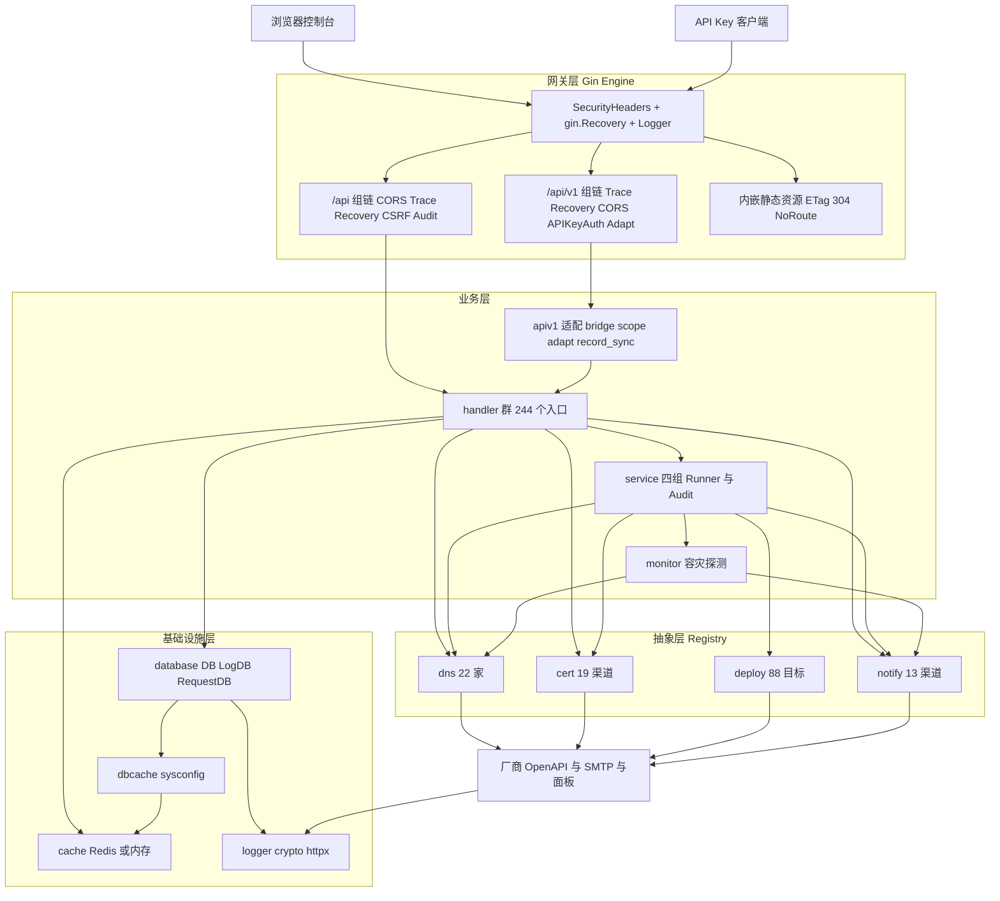
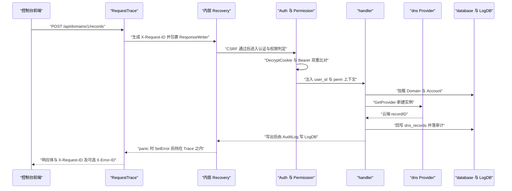
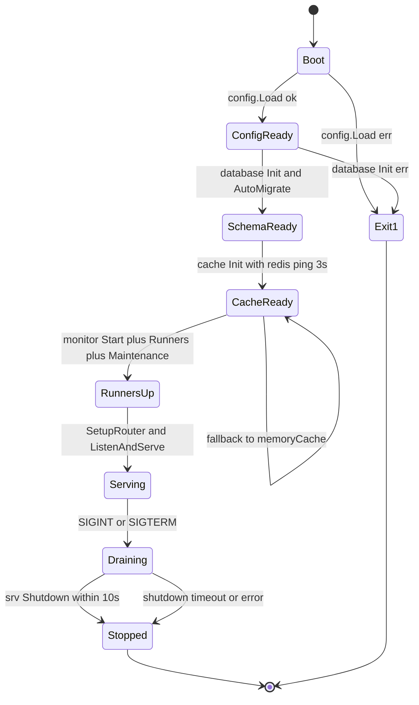
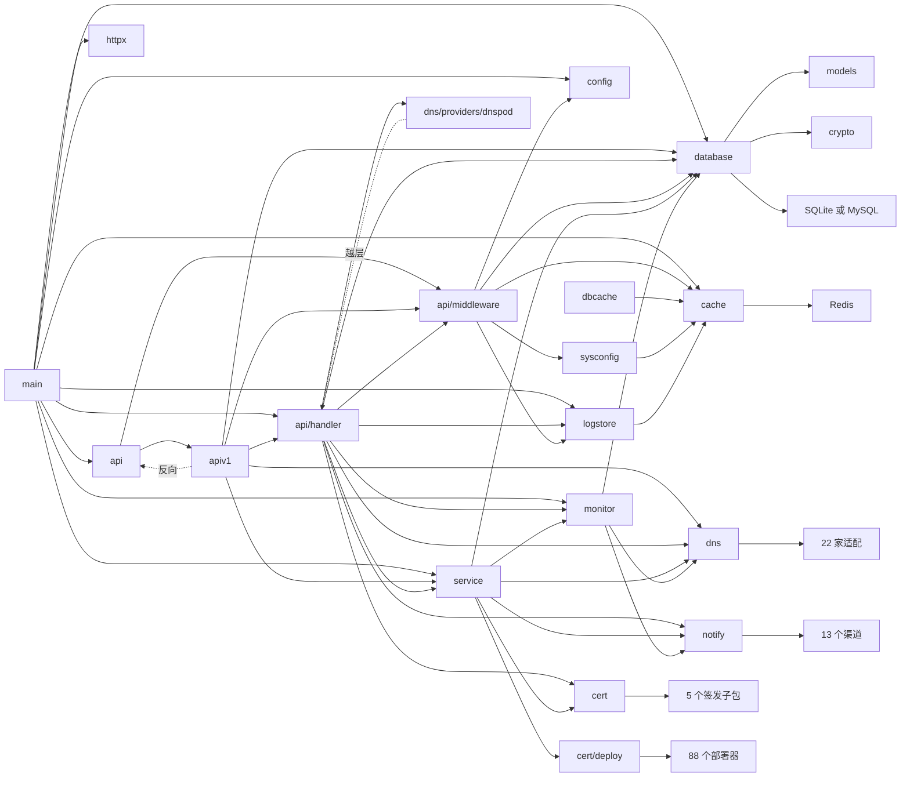

# 后端架构

<cite>
**本文档引用的文件**
- [main.go](file://main/main.go)
- [go.mod](file://main/go.mod)
- [router.go（控制台路由）](file://main/internal/api/router.go)
- [router.go（V1 路由）](file://main/internal/apiv1/router.go)
- [auth.go（中间件）](file://main/internal/api/middleware/auth.go)
- [permission.go](file://main/internal/api/middleware/permission.go)
- [request_trace.go](file://main/internal/api/middleware/request_trace.go)
- [recovery.go](file://main/internal/api/middleware/recovery.go)
- [logger.go（中间件）](file://main/internal/api/middleware/logger.go)
- [csrf.go](file://main/internal/api/middleware/csrf.go)
- [audit.go](file://main/internal/api/middleware/audit.go)
- [sign.go](file://main/internal/api/middleware/sign.go)
- [sanitize.go](file://main/internal/api/middleware/sanitize.go)
- [apikey.go](file://main/internal/api/middleware/apikey.go)
- [domain.go（处理器）](file://main/internal/api/handler/domain.go)
- [batch.go](file://main/internal/api/handler/batch.go)
- [auth.go（V1 认证）](file://main/internal/apiv1/auth.go)
- [adapt.go](file://main/internal/apiv1/adapt.go)
- [bridge.go](file://main/internal/apiv1/bridge.go)
- [scope.go](file://main/internal/apiv1/scope.go)
- [util.go](file://main/internal/apiv1/util.go)
- [record_sync.go（V1）](file://main/internal/apiv1/record_sync.go)
- [interface.go（DNS）](file://main/internal/dns/interface.go)
- [registry.go（DNS）](file://main/internal/dns/registry.go)
- [interface.go（证书）](file://main/internal/cert/interface.go)
- [registry.go（证书）](file://main/internal/cert/registry.go)
- [base.go（部署器）](file://main/internal/cert/deploy/base/base.go)
- [registry.go（部署器）](file://main/internal/cert/deploy/registry.go)
- [channel_registry.go](file://main/internal/notify/channel_registry.go)
- [channel_adapters.go](file://main/internal/notify/channel_adapters.go)
- [notify.go](file://main/internal/notify/notify.go)
- [task_runner.go](file://main/internal/service/task_runner.go)
- [record_sync.go（服务）](file://main/internal/service/record_sync.go)
- [schedule.go](file://main/internal/service/schedule.go)
- [audit.go（服务）](file://main/internal/service/audit.go)
- [cert_renew_hook.go](file://main/internal/service/cert_renew_hook.go)
- [database.go](file://main/internal/database/database.go)
- [maintenance.go](file://main/internal/database/maintenance.go)
- [trace_gin.go](file://main/internal/database/trace_gin.go)
- [store.go](file://main/internal/logstore/store.go)
- [cache.go](file://main/internal/cache/cache.go)
- [dbcache.go](file://main/internal/dbcache/dbcache.go)
- [keys.go](file://main/internal/dbcache/keys.go)
- [sysconfig.go](file://main/internal/sysconfig/sysconfig.go)
- [config.go](file://main/internal/config/config.go)
- [crypto.go](file://main/internal/crypto/crypto.go)
- [hooks.go](file://main/internal/models/hooks.go)
- [proxy.go](file://main/internal/httpx/proxy.go)
- [monitor.go](file://main/internal/monitor/monitor.go)
</cite>

## 目录
1. [简介](#简介)
2. [项目结构](#项目结构)
3. [核心组件](#核心组件)
4. [架构总览](#架构总览)
5. [详细组件分析](#详细组件分析)
6. [依赖关系分析](#依赖关系分析)
7. [性能考虑](#性能考虑)
8. [故障排查指南](#故障排查指南)
9. [结论](#结论)
10. [附录](#附录)

## 简介

DNSPlane 后端是一个 **单进程、单二进制、单体（Monolith）Go 服务**：同一进程同时承担 HTTP API 网关、业务编排、外部云厂商协议适配、后台定时调度与前端静态资源服务五种角色。没有消息队列、没有独立网关进程，所有边界以 Go 包划分而非进程划分。

### 技术栈与版本口径

| 层次 | 选型 | 版本 | 证据 |
| --- | --- | --- | --- |
| 语言 | Go | `go.mod` 声明 `go 1.26.2` | [go.mod:3](file://main/go.mod) |
| HTTP 框架 | Gin | `v1.12.0` | [go.mod:8](file://main/go.mod) |
| ORM | GORM | `v1.31.2`，MySQL 驱动 `v1.6.0` | [go.mod](file://main/go.mod) |
| 关系存储 | SQLite（默认）/ MySQL | `glebarez/sqlite v1.11.0`（纯 Go 无 CGO） | [database.go:48](file://main/internal/database/database.go) |
| 键值缓存 | Redis 或进程内存（可降级） | `redis/go-redis/v9 v9.23.0` | [cache.go:46](file://main/internal/cache/cache.go) |
| 前端承载 | `go:embed` 静态导出产物 | `//go:embed all:web` | [main.go:63-64](file://main/main.go) |

**章节来源**
- [go.mod:1-30](file://main/go.mod)
- [main.go:63-64](file://main/main.go)

### 架构基调与规模重心

最重要的结构性事实是 **入口分裂、业务复用**：控制台链路 `/api`（会话 Cookie + CSRF + JWT）与对外链路 `/api/v1`（API Key HMAC 签名 + 响应格式改写）共享同一批 `func X(c *gin.Context)` 处理函数。V1 只通过参数桥接补齐路径参数读取差异，并把 5 个解析记录写接口重写为同步实现。收益是业务逻辑零重复，代价是对外契约受控制台实现牵制。

按工作区当前实测（`rg --files -g '*.go'` 后 `cat | wc -l`，含 `main.go`）：非测试 71937 行、含测试 88829 行，分布在 22 个 `internal` 一级子包。规模重心不在 HTTP 层而在协议适配层：`internal/cert`（22842 行非测试，其中 `cert/deploy/` 占 18998 行）与 `internal/api`（20705 行）合计约占 60.5%。

**章节来源**
- [main.go:66-156](file://main/main.go)
- [router.go:18-20](file://main/internal/api/router.go)

## 项目结构

### 顶层目录布局

| 路径 | 角色 | 说明 |
| --- | --- | --- |
| `main/main.go` | 进程入口 | 156 行，承担全部装配（21 步，见附录） |
| `main/internal/` | 业务与基础设施 | 22 个一级子包，均为 Go 私有包 |
| `main/internal/api/` | HTTP 接入 | 根包 `router.go` + `handler/` + `middleware/` |
| `main/internal/apiv1/` | 对外 API 适配 | 14 个非测试文件，只依赖 `api/handler` 与 `api/middleware` |
| `main/web/` | 前端静态产物 | 经 `go:embed all:web` 编入二进制 |
| `main/data/` | 运行时 SQLite | 被 `.gitignore` 排除，不进版本库 |

**章节来源**
- [main.go:26-58](file://main/main.go)
- [router.go:344-346](file://main/internal/api/router.go)

### internal 22 个子包与行数分布

| 包 | 非测试 | 含测试 | 职责一句话 |
| --- | --- | --- | --- |
| `internal/api` | 20705 | 28903 | 路由装配 + 244 个 gin 入口 + 10 个中间件 |
| `internal/apiv1` | 1814 | 3276 | 对外 API：签名认证、参数桥接、响应改写 |
| `internal/cache` | 450 | 497 | KV + List 抽象，Redis 与内存双实现 |
| `internal/captcha` | 391 | 391 | 行为验证码（点选/滑动/旋转） |
| `internal/cert` | 22842 | 23436 | 证书签发渠道 + 部署器 |
| `internal/config` | 186 | 186 | `config.json` 加载与派生密钥 |
| `internal/crypto` | 173 | 173 | AES-256-GCM 字段级加解密 |
| `internal/database` | 1009 | 1009 | 三库连接、AutoMigrate、维护、SQL 追踪 |
| `internal/dbcache` | 116 | 116 | 热点列表读穿 JSON 缓存 |
| `internal/dns` | 11535 | 11698 | DNS 抽象 + 22 家适配 + DoH |
| `internal/httpx` | 76 | 560 | 替换 `http.DefaultTransport.Proxy` |
| `internal/logger` | 430 | 430 | 彩色控制台 + 文件滚动日志 |
| `internal/logstore` | 417 | 466 | 请求/系统日志存储（Redis 后端） |
| `internal/models` | 612 | 612 | 31 个 GORM 实体 + 加密钩子 |
| `internal/monitor` | 1685 | 2857 | 容灾探测调度与 SSRF 防护 |
| `internal/notify` | 3558 | 7202 | 13 个通知渠道与注册表 |
| `internal/oauth` | 633 | 633 | OAuth2 五家登录 |
| `internal/service` | 3968 | 5047 | 后台任务、上游编排、审计入口 |
| `internal/sysconfig` | 43 | 43 | `sys_configs` 单值旁路缓存 |
| `internal/utils` | 856 | 856 | `SafeGo`、RSA 混合加密、签名、TOTP |
| `internal/verify` | 130 | 130 | 邮箱验证码与固定窗口限流 |
| `internal/whois` | 152 | 152 | WHOIS 查询与到期解析 |

**章节来源**
- [main.go:14-24](file://main/main.go)

### 装配入口与内嵌静态资源

`main` 包仅 156 行，却是整个系统的 **组合根（Composition Root）**：所有全局单例（`database.DB`、`cache.C`、`logstore.Store`、`monitor.Service`、`service.Audit`）在此初始化，所有 provider 子包经 blank import 在 `init()` 阶段自注册（22 家 DNS + 5 个证书渠道包 + 4 个部署器分组）。前端不由独立 Web Server 提供，而是 `fs.Sub(staticFS, "web")` 挂到同一个 Gin 引擎，配合 ETag（内容 SHA-256）与 304 回落。

**章节来源**
- [main.go:26-64](file://main/main.go)
- [router.go:344-398](file://main/internal/api/router.go)

## 核心组件

### Router：两条链路一个引擎

`api.SetupRouter(staticFS embed.FS) *gin.Engine`（`router.go:18`）是唯一引擎构造入口，内部拆为三段以便测试复刻生产链路：`newBaseEngine`（`:24-32`，`gin.New()` + 关闭尾斜杠重定向 + 链首三件）、`applyAPIMiddleware`（`:44-53`，`/api` 组级五件）、`setupRouter`（`:55-464`，226 条控制台路由 + 静态服务 + `NoRoute`）。

关键装配事实：`apiv1.Setup(r)` 在 `router.go:63` 调用，**早于** `router.go:64` 的 `r.Group("/api")`。V1 因此挂在引擎根而非 `/api` 组内，不继承 CSRF 校验——API Key 客户端没有 cookie，也无从取得 token。

**章节来源**
- [router.go:18-65](file://main/internal/api/router.go)
- [apiv1/router.go:9-47](file://main/internal/apiv1/router.go)

### Middleware 链：10 个中间件文件

| 文件 | 行数 | 入口（起始行） | 职责 |
| --- | --- | --- | --- |
| `auth.go` | 572 | `Auth`:125、`SecurityHeaders`:483、`CORS`:516 | Cookie AES-GCM + JWT 双 token + 安全头 + 来源白名单 |
| `permission.go` | 400 | `Permission`:132 | 域名 / 子域 / 只读 / 功能模块四维判定 |
| `request_trace.go` | 372 | `RequestTrace`:135 | `X-Request-ID`、响应包裹、脱敏后异步落库 |
| `logger.go` | 246 | `Logger`:170 | 彩色输出、3s 慢请求阈值、分级落文件 |
| `sign.go` | 206 | `DecryptAndVerify`:17 | 统一响应封装与绑定 helper |
| `audit.go` | 176 | `AuditLog`:21 | 写方法审计落 `LogDB`，三层跳过清单 |
| `sanitize.go` | 169 | （纯工具） | 40 项敏感键 + 7 项敏感头脱敏 |
| `csrf.go` | 130 | `CSRF`:70、`IssueCSRFHandler`:119 | double-submit cookie，常量时间比较 |
| `apikey.go` | 112 | `APIKeyAuth`:44 | **无调用点**，被 `apiv1` 同名实现取代 |
| `recovery.go` | 78 | `Recovery`:21 | 区分 broken pipe 与真实 panic |

**章节来源**
- [apikey.go:27-108](file://main/internal/api/middleware/apikey.go)
- [logger.go（中间件）:14-246](file://main/internal/api/middleware/logger.go)

### Handler 群：244 个 gin.Context 入口

`internal/api/handler` 是 32 个非测试文件构成的扁平包，导出 244 个 `func X(c *gin.Context)`，同时被 `api/router.go` 与 4 个 `apiv1` 路由文件指向。该层不定义接口，直接以包级函数存在；细粒度校验（`requireAdmin`、`CheckQuota`、`requireCert*Owner`）写在处理函数主体内，因此权限覆盖不均只能逐函数核对。

**章节来源**
- [domain.go（处理器）:37-54](file://main/internal/api/handler/domain.go)

### Service 层与后台任务

`internal/service` 是唯一的「时间维度」组件：`TaskRunner`（证书续签与部署重试）、`ScheduleRunner`（定时切换）、`OptimizeRunner`（优选 IP）、`RecordSyncer`（记录对账）四组 Runner 加 `monitor.Monitor` 共五组常驻协程，全部由 `main.go` 启动并 `defer` 停止。`service.Audit`（`audit.go（服务）:216`）是系统日志唯一写入口：Redis 就绪走 `logstore`，否则写 `LogDB`。

**章节来源**
- [audit.go（服务）:20-216](file://main/internal/service/audit.go)

### 四个 Registry：DNS / Cert / Deploy / Notify

后端用 **注册表 + blank import + `init()` 自注册** 承载全部可扩展点，四套机制彼此独立：

| 注册表 | 注册函数 | 存储结构 | 条目数（实测） | 工厂签名 |
| --- | --- | --- | --- | --- |
| DNS | `dns.Register` `registry.go:18` | `providers` + `configs`，`sync.RWMutex` | 22 | `func(config map[string]string, domain, domainID string) Provider` |
| 证书 | `cert.Register` `registry.go:23` | 同上，按 `IsDeploy` 切两视图 | 19 | `func(config, ext map[string]interface{}) Provider` |
| 部署器 | `base.Register` `base.go:85` | 与 cert 表完全独立的第二套中心 | 88 | `func(config map[string]interface{}) DeployProvider` |
| 通知渠道 | `RegisterChannel` `channel_registry.go:56` | 有序 `[]Channel` + 去重 map | 13 | `Channel.Build(configMap) (Notifier, bool)` |

共同点：**启动期一次性注册、运行期只读、无热加载**。差异：DNS 与证书工厂每次调用新建实例；通知渠道按配置构造并遍历注册表装载；部署器另有四级名称回落解析（`deploy/registry.go:27`）。

**章节来源**
- [registry.go（DNS）:9-56](file://main/internal/dns/registry.go)
- [registry.go（证书）:9-114](file://main/internal/cert/registry.go)
- [base.go（部署器）:77-108](file://main/internal/cert/deploy/base/base.go)
- [channel_adapters.go:330-343](file://main/internal/notify/channel_adapters.go)

### Database 与 Logstore

`database` 暴露三个全局 `*gorm.DB`：`DB`（主库，SQLite 或 MySQL）、`LogDB`（恒 SQLite）、`RequestDB`（恒 SQLite），见 `database.go:21-25`。后两者硬编码驱动，**主库选 MySQL 时日志仍写本地文件**。`gorm.Config` 统一设置 `Logger: Silent` 与 `SkipDefaultTransaction: true`（`:76-79`）。`logstore.Store`（`store.go:34`）以 `cache.Cache` 的 List 语义为底座存请求与系统日志，上限 `maxLogSize = 10000`（`:16-22`）；非 Redis 时 `Init` 的 `else` 分支为空实现（`:41-48`），此时请求日志改由 `RequestTrace` 直写 `RequestDB`，两者互斥而非双写。

**章节来源**
- [database.go:21-118](file://main/internal/database/database.go)
- [store.go:16-76](file://main/internal/logstore/store.go)

## 架构总览

### 分层视图



**图表来源**
- [router.go:24-65](file://main/internal/api/router.go)
- [main.go:66-128](file://main/main.go)

分层不变式（上层可依赖下层、下层不得反向依赖上层）在数据流方向基本成立，控制流方向有两处穿透，详见「依赖关系分析」。

**章节来源**
- [apiv1/router.go:24-46](file://main/internal/apiv1/router.go)
- [registry.go（DNS）:18-37](file://main/internal/dns/registry.go)

### 一次控制台写请求的生命周期



**图表来源**
- [router.go:44-53](file://main/internal/api/router.go)
- [request_trace.go:135-302](file://main/internal/api/middleware/request_trace.go)
- [auth.go（中间件）:125-216](file://main/internal/api/middleware/auth.go)
- [permission.go:132-205](file://main/internal/api/middleware/permission.go)

**章节来源**
- [recovery.go:21-78](file://main/internal/api/middleware/recovery.go)
- [audit.go:21-88](file://main/internal/api/middleware/audit.go)

### 进程生命周期与优雅关闭



**图表来源**
- [main.go:70-155](file://main/main.go)
- [database.go:71-150](file://main/internal/database/database.go)
- [cache.go:46-86](file://main/internal/cache/cache.go)

关停顺序值得注意：`main.go` 用一串 `defer` 表达逆序清理（`database.Close` → `cache.Close` → `mon.Stop` → Runner cancel/Stop → `StopMaintenance`），而 `srv.Shutdown` 在 `defer` 链之前阻塞执行，因此 HTTP 排空早于后台协程停止，运行中的请求仍能写库。

**章节来源**
- [main.go:100-156](file://main/main.go)
- [monitor.go:68-100](file://main/internal/monitor/monitor.go)

## 详细组件分析

### 中间件链顺序与双层 Recovery 设计

控制台链的实际顺序必须按 `.Use` 书写顺序理解，不能按直觉排序：`SecurityHeaders` → `gin.Recovery` → `Logger`（以上引擎级，`router.go:28-30`）→ `CORS` → `RequestTrace` → `Recovery` → `CSRF` → `AuditLog`（以上 `/api` 组级，`router.go:45-52`）→ `Auth` → `Permission`（以上 `auth` 子组级，`router.go:96` 与 `:104`）→ handler；响应写出后回穿 `AuditLog`（落 `LogDB`）与 `RequestTrace`（落 `RequestDB` 或 Redis）。

双层 Recovery 不是冗余，而是 `router.go:34-43` 注释块记录的设计约束：

| 层次 | 位置 | 覆盖范围 | 存在理由 |
| --- | --- | --- | --- |
| 外层 `gin.Recovery()` | `router.go:29` | 静态资源、页面路由、`NoRoute` | 兜住不经 `RequestTrace` 的 panic |
| 内层 `middleware.Recovery()` | `router.go:48` | `/api` 组，**必须紧跟 `RequestTrace`** | `RequestTrace` 落库在 `c.Next()` 之后，panic 穿透到链首会让请求日志完全丢失 |

内层实现（`recovery.go:21-78`）区分两类异常：`net.OpError` + `os.SyscallError` 命中 broken pipe 或 connection reset 时只记 Warn 并 `c.Abort()`（`:26-35`、`:48-54`），避免客户端断开被当成服务端故障；真实 panic 记 8192 字节堆栈、调用 `SetError` 生成 `X-Error-ID` 并写 `ErrorStackKey`（`:56-67`），未写出响应时回 500。V1 链顺序不同（`apiv1/router.go:27-34`）：Trace、Recovery、CORS、`APIKeyAuth`、`JSONBodyToDecryptedData`、AuditLog、`AdaptResponse` 链末——`AdaptResponse` 必须最后注册，因为它包裹后续所有写出。

**章节来源**
- [router.go:22-53](file://main/internal/api/router.go)
- [recovery.go:21-78](file://main/internal/api/middleware/recovery.go)
- [apiv1/router.go:9-47](file://main/internal/apiv1/router.go)

### Handler 分组与巨型文件问题

| 分组 | 文件 | 行数 | 导出函数 | 说明 |
| --- | --- | --- | --- | --- |
| DNS | `domain.go` | 1748 | 16 | 域名与记录，写操作经 `utils.SafeGo` 异步派发 |
| DNS | `batch.go` | 495 | 4 | 批量增改删 + WHOIS |
| DNS | `domain_ext.go` | 418 | 10 | 别名、权重、分组、智能解析 |
| Cloudflare | `cloudflare.go` | 2509 | 28 | 主机名 / Tunnel / 回退源 / DCV，控制台与 V1 双挂 |
| 认证 | `auth.go` | 1573 | 25 | 登录注册、TOTP、魔法链接、安装 |
| 证书 | `cert.go` | 1519 | 19 | 账户 / 订单 / 部署 / 下载 |
| 证书 | `cert_deploy.go` | 1101 | 17 | 仅 `DeployAccount*` 6 个与 `DeployTypes` 可达 |
| 监控与加速 | `monitor.go` / `acceleration.go` | 1270 / 1000 | 16 / 10 | 任务 CRUD、主备切换；EO 与 ESA 一键加速 |
| 用户与配额 | `user.go` / `plan.go` | 743 / 671 | 14 / 14 | 系统配置类接口集中在 `user.go` |

`cloudflare.go`（2509 行）与 `domain.go`（1748 行）明显超出可维护单文件范围，各自承担「HTTP 适配 + 业务编排 + 厂商响应解读 + DTO 转换」四件事。按单一职责拆分，最自然的切分线是把每种资源的请求/响应结构与映射函数外移成独立文件，把上游调用下沉到 `service`——`service/cloudflare_enhance.go` 已是正确方向的尝试。另需注意 `cert_deploy.go` 与 `handler/oauth.go` 合计 12 个导出函数无任何路由指向，属可达性缺口而非设计冗余。

**章节来源**
- [domain.go（处理器）:37-54](file://main/internal/api/handler/domain.go)
- [batch.go:421-430](file://main/internal/api/handler/batch.go)

### Provider 注册机制的实现细节

四套注册表结构相近但各有取舍：

1. **证书注册表的「只补工厂」短路。** `cert.Register` 仅在 `factory != nil` 时覆盖工厂，在 `config.Type == "" && hadCfg` 时直接返回不覆盖表单（`registry.go:26-34`）。这让「`providers.go` 维护表单、子包 `init()` 只补实现」成为可能，代价是两处注册点必须同时存在。
2. **通知渠道重复注册即 panic。** `RegisterChannel` 对同一 `Type()` 二次注册直接 panic（`channel_registry.go:59-65`），把配置错误暴露在启动期；`Channels()` 按标识排序返回副本（`:76-85`），使装载顺序与注册顺序解耦；`ChannelConfigKeys()`（`:108-129`）由注册表推导而非手工维护。
3. **DNS 工厂没有 error 通道。** `ProviderFactory` 返回具体类型而非 `(Provider, error)`（`registry.go:9`），构造失败只能塞进实例的 `lastErr`，而 `registry.go:36` 仍返回 `err == nil`，后续方法调用即空指针 panic；唯一取错出口 `GetError()` 无生产调用方。
4. **部署器有两套名称空间。** `base.Register` 的键与 `cert` 表按 `IsDeploy` 切出的部署视图彼此独立，靠 `MergeDeployProviderConfigsForAPI` 合并、`deploy/registry.go:27` 做「原名 → `{type}_{product}`（任务）→ `{type}_{product}`（账户）→ `{type}_{cdn|acm|cloudfront}`」四级回落。

接口本身的规模差异也影响扩展成本：`dns.Provider` 是 15 方法单一大接口（`interface.go:41-86`），Go 编译期要求 22 家全部完整实现；`cert.Provider` 是 9 方法（`interface.go:52-79`）。扩展能力则靠类型断言（`RecordGrouper`、`DomainAliaser`、`SubdomainDelegator`）叠加，与 `ProviderFeatures` 布尔位是两套并行且不同步的口径来源。

**章节来源**
- [registry.go（证书）:23-35](file://main/internal/cert/registry.go)
- [channel_registry.go:51-129](file://main/internal/notify/channel_registry.go)
- [registry.go（DNS）:9-37](file://main/internal/dns/registry.go)
- [registry.go（部署器）:25-60](file://main/internal/cert/deploy/registry.go)
- [interface.go（DNS）:41-86](file://main/internal/dns/interface.go)

### Service 后台任务

| Runner | 启动点 | 周期与阈值 | 关键行为 |
| --- | --- | --- | --- |
| `TaskRunner.Start` | `main.go:114` | 证书扫描 + 到期提醒两路 | 部署重试退避 `{60,300,600,1800,3600}` 秒（`task_runner.go:23`），`releaseExpiredLocks`（`:421`）回收超时锁 |
| `ScheduleRunner.Start` | `main.go:115` | weekday + hh:mm | `nextWeekdayTime` 算下次执行，到期改主备记录 |
| `Monitor.Start` | `main.go:106` | 单 tick 派发上限 100（`monitor.go:24`），并发上限 64（`:29`） | 探测失败触发切换并扇出通知 |
| `StartOptimizeRunner` | `main.go:123` | 定时 | 按 `DEF/CT/CU/CM` 四线路对 A/AAAA 做集合差增删 |
| `StartRecordSync` | `main.go:125` | `record_sync_interval_min`，默认 30 分钟、下限 5 分钟 | 逐域名串行对账并差异写入 `dns_records` |
| `StartMaintenance` | `main.go:121` | 首次延迟 30s，此后每小时 | 清理六类日志 + 五步 SQLite 优化 |

`service` 与 `handler` 的解耦靠钩子注入而非直接依赖：`main.go:108` 把 `handler.TriggerCertOrderProcessing` 交给 `SetCertRenewProcessStarter`，`main.go:110` 把签发结果通知函数交给 `SetCertIssueNotifyHooks`（`cert_renew_hook.go:17-46`），因此 `service` 对 `api/handler` 零 import。

**章节来源**
- [main.go:105-126](file://main/main.go)
- [task_runner.go:23-68](file://main/internal/service/task_runner.go)
- [record_sync.go（服务）:110-127](file://main/internal/service/record_sync.go)
- [cert_renew_hook.go:17-46](file://main/internal/service/cert_renew_hook.go)

### GORM 事务与 dbcache 读穿缓存

GORM 层没有一处显式 `Transaction`，这是配置声明而非遗漏：`SkipDefaultTransaction: true`（`database.go:76-79`）的注释给出三条前提——无显式事务、无多行批量插入、库内无外键约束。收益是单条写只产生一次 WAL fsync；代价是跨行操作的原子性完全由业务顺序保证，中途崩溃会留下部分写入，`resetStuckOrders()`（`:152`）把 `CertOrder.status = 1` 重置为 0 正是对此的补偿。

| 缓存层 | 键空间 | TTL | 一致性策略 | 降级路径 |
| --- | --- | --- | --- | --- |
| `cache` | 业务键（`auth_user:`、`rtjti:` 等） | 各键自定 | 显式 `Delete` | Redis 不可用退内存（`cache.go:46-86`） |
| `dbcache` | `db:v1:*`（`keys.go:14-47`） | 60s（`dbcache.go:12`） | 写路径显式 `Bust*` | `cache.C == nil` 时直接回源 |
| `sysconfig` | `syscfg:*` | 60s（`sysconfig.go:13-14`） | `Invalidate` 逐键删 | 未命中则 `Pluck` 回库 |

`dbcache.GetOrSetJSON` 有一个刻意取舍：回填写入失败被显式吞掉（`dbcache.go:40-42`），保证缓存故障不影响返回值。绕过 `sysconfig` 直接写库的入口必须自行失效缓存，否则开关最长 60 秒不生效。

**章节来源**
- [database.go:71-160](file://main/internal/database/database.go)
- [dbcache.go:12-66](file://main/internal/dbcache/dbcache.go)
- [sysconfig.go:17-40](file://main/internal/sysconfig/sysconfig.go)

### Audit 与 RequestLog 落库

两条独立且容易混淆的落库路径：

| 维度 | AuditLog（操作审计） | RequestLog（请求日志） |
| --- | --- | --- |
| 挂载点 | `router.go:52`、`apiv1/router.go:32` | `router.go:47`、`apiv1/router.go:27` |
| 写入条件 | 仅 POST/PUT/DELETE/PATCH，`user_id` 为空不记 | `/api` 与 `/api/v1` 前缀全部记录 |
| 跳过清单 | 3 个前缀 + 15 个后缀 + 11 个精确路径 | 不适用 |
| 写入方式 | `utils.SafeGo` 异步（`audit.go:74`） | `go func` 异步（`request_trace.go:296`） |
| 目标库 | 恒为 `database.LogDB` | Redis 就绪写 `logstore`，否则写 `RequestDB` |
| 脱敏 | 只存业务摘要 | 40 项敏感键 + 7 项敏感头 + 长凭据正则，动作名由路径派生 |

请求日志的 body 与 headers 在写库前经 `SanitizeBodyForLog` / `SanitizeHeadersForLog` 替换为 `***REDACTED***`；敏感键清单在 `init()` 期预归一化，避免每次判断退化为「表大小次」的字符串分配。

**章节来源**
- [audit.go:21-171](file://main/internal/api/middleware/audit.go)
- [request_trace.go:135-302](file://main/internal/api/middleware/request_trace.go)
- [sanitize.go:13-155](file://main/internal/api/middleware/sanitize.go)

## 依赖关系分析

### 包依赖图



**图表来源**
- [main.go:14-58](file://main/main.go)
- [router.go:3-15](file://main/internal/api/router.go)
- [domain.go（处理器）:14-20](file://main/internal/api/handler/domain.go)

**章节来源**
- [apiv1/router.go:3-7](file://main/internal/apiv1/router.go)
- [database.go:10-18](file://main/internal/database/database.go)

### 依赖矩阵

`●` 直接依赖，`○` 无依赖，`△` 经全局单例间接依赖。

| 依赖方 \ 被依赖方 | api | apiv1 | handler | middleware | service | 抽象层 | database | models | cache |
| --- | --- | --- | --- | --- | --- | --- | --- | --- | --- |
| main | ● | ○ | ● | ○ | ● | ● | ● | ○ | ● |
| api | — | ● | ● | ● | ○ | ○ | ○ | ○ | ○ |
| apiv1 | ○ | — | ● | ● | ● | ● | ● | ● | ○ |
| handler | ○ | ○ | — | ● | ● | ● | ● | ● | ● |
| middleware | ○ | ○ | ○ | — | ○ | ○ | ● | ● | ● |
| service | ○ | ○ | ○ | ○ | — | ● | ● | ● | ○ |
| monitor | ○ | ○ | ○ | ○ | ○ | ● | ● | ● | ○ |
| dns / cert | ○ | ○ | ○ | ○ | ○ | — | ○ | ○ | △ |
| database | ○ | ○ | ○ | ○ | ○ | ○ | — | ● | ○ |
| models | ○ | ○ | ○ | ○ | ○ | ○ | ○ | — | ○ |

矩阵下三角（`database`、`models`、`cache` 不依赖任何上层）确认「基础设施层零反向依赖」成立：实测对这三个包检索 `main/internal/(api|service)` 命中 0 次。抽象层同样干净——`internal/dns` 根包与 `internal/cert` 根包对 `main/internal/*` 的引用不含任何 handler 或 api 包。

**章节来源**
- [database.go:10-18](file://main/internal/database/database.go)
- [registry.go（DNS）:1-15](file://main/internal/dns/registry.go)
- [apiv1/router.go:3-7](file://main/internal/apiv1/router.go)

### 违规依赖与耦合点

| 编号 | 判定 | 现象 | 位置 | 处置建议 |
| --- | --- | --- | --- | --- |
| V-01 | ✗ 违反 DIP | handler 直接 import 具体服务商实现 | `domain.go:14`，使用点 `:1652` | 把委派能力收进 `dns.SubdomainDelegator` 并由注册表返回，避免新增服务商要改 handler |
| V-02 | ✗ 双向耦合 | `api` import `apiv1`，`apiv1` import `api/handler` 与 `api/middleware` | `router.go:63`、`apiv1/router.go:6` | 不构成 Go 编译环，但两包必须同进同退；建议把 `Setup` 调用上提到 `main` |
| V-03 | ✗ 网关层穿透 | `middleware` 直接依赖 `database`、`logstore`、`sysconfig` | `audit.go:75-88`、`auth.go` | 中间件承担持久化职责难以独立测试，可下沉为上下文提供者接口 |
| V-04 | ✗ 测试依赖编入生产 | `apiv1/util.go` import `testing` 与 `net/http/httptest` | `util.go:6`、`:8` | 把 `newRecorder` 与 `decodeBody` 移入 `_test.go` |
| V-05 | ✗ 死代码 | `APIKeyAuth`、`JSONBodyToDecryptedData`、`DecryptAndVerify` 无挂载点 | `apikey.go:27-44`、`sign.go:17` | 与 `apiv1` 同名实现分叉，删除或让 `apiv1` 复用 |
| V-06 | △ 全局可变单例 | `database.DB/LogDB/RequestDB`、`cache.C`、`monitor.Service`、`service.Audit`、`logstore.Store` | `database.go:21-25`、`cache.go:33`、`monitor.go:19` | 隐式依赖且初始化顺序敏感（`httpx.Install` 必须晚于 `cache.Init`），长期改显式注入 |
| V-07 | △ 逻辑重复 | 按域名装配 provider 的五份实现 | `domain.go:37`、`batch.go:421`、`record_sync.go（服务）:270`、`schedule.go:271`、`record_sync.go（V1）:93` | 违反 DRY，权限口径易分叉，收敛为 `service` 内单一工厂 |

**章节来源**
- [domain.go（处理器）:14-20](file://main/internal/api/handler/domain.go)
- [util.go:1-46](file://main/internal/apiv1/util.go)
- [apikey.go:27-108](file://main/internal/api/middleware/apikey.go)
- [proxy.go:28-40](file://main/internal/httpx/proxy.go)

## 性能考虑

### 连接池与 SQLite 写串行化

| 场景 | MaxOpen | MaxIdle | MaxIdleTime | MaxLifetime | 位置 |
| --- | --- | --- | --- | --- | --- |
| 主库 SQLite | 8 | 4 | 5 min | 0（不限） | `database.go:48-58` |
| 主库 MySQL | 100 | 25 | 5 min | 1 h | `database.go:60-69` |
| Redis | `pool_size` 默认 10 | `min_idle_conns` 负数归零 | — | — | `cache.go:54-60` |

SQLite 连接数刻意压到 8，`database.go:52` 的注释说明「单文件写入串行化，连接数超出必要范围只增加 page cache 内存占用而无吞吐收益」；`LogDB` 与 `RequestDB` 复用同一套 SQLite 池参数（`database.go:105-118`）。同时 DSN 固化六条 PRAGMA（`journal_mode(WAL)`、`synchronous(NORMAL)`、`busy_timeout(5000)`、`cache_size(-16000)`、`temp_store(MEMORY)`、`mmap_size(67108864)`），且必须写进 DSN 才能覆盖连接池中每条新建连接（`:34-38`）。

**章节来源**
- [database.go:34-118](file://main/internal/database/database.go)
- [cache.go:46-60](file://main/internal/cache/cache.go)

### 读放大与 N+1 风险

| 风险点 | 位置 | 形态 | 代价 |
| --- | --- | --- | --- |
| provider 实例每请求重建 | `domain.go:37-54` | 查账户 → 解密配置 → 解 JSON → 新建 SDK client | 每次记录操作多 1 条 SQL 与 1 次对象构造 |
| 委派用户记录列表 | `domain.go:781-803` | 对每个授权子域串行调用 `GetDomainRecords(1,500)` 后本地二次过滤 | N 次厂商往返 |
| 记录列表的线路编目 | `domain.go:716` | 额外一次厂商调用，错误被忽略 | +1 次厂商往返 |
| SQL 追踪回调 | `database.go:427-496` | 仅当上下文已有 `db_queries` 键才记录，SQL 超 2000 字符截断 | 每查询一次 `Explain` |

追踪的门禁判断是必要的：若无「上下文键是否存在」的前置检查，每个查询都会走 `Explain` 高开销路径。但追踪以 **goroutine ID** 作为 gin 上下文关联键（`trace_gin.go:14`、`:35-42`），Go 会复用 goroutine ID，跨 goroutine 传递 DB 句柄或 cleanup 未执行时存在把 SQL 归到错误请求的窗口。

**章节来源**
- [domain.go（处理器）:37-54](file://main/internal/api/handler/domain.go)
- [database.go:373-496](file://main/internal/database/database.go)
- [trace_gin.go:12-69](file://main/internal/database/trace_gin.go)

### 外部云 API 串行化与并发上限

记录全量对账刻意不并发：`record_sync.go（服务）:122-127` 的注释写明「逐个域名处理而非并发拉取：DNS 服务商普遍按账户限流，并发会把配额瞬间打满，反而拖慢整体进度」，单域名失败只记日志并继续。抽象层与通知层则 **完全没有节流**：`internal/dns` 与 `internal/notify` 检索 `rate`/`limiter`/`throttle`/`backoff` 除签名函数外零命中；`NotifyManager.SendAll`（`notify.go:688-696`）串行遍历渠道并共享单一 deadline，靠后渠道可能被饿死，`Send` 只回传第一个错误（`:698-704`）。

作为对照，监控探测有仓内唯一的自适应并发控制：单 tick 派发上限 `maxDispatchPerTick = 100`（`monitor.go:24`），全局地址探测信号量容量 `maxConcurrentChecks = 64`（`:29`、`:64`）。

**章节来源**
- [record_sync.go（服务）:110-127](file://main/internal/service/record_sync.go)
- [notify.go:666-704](file://main/internal/notify/notify.go)
- [monitor.go:21-70](file://main/internal/monitor/monitor.go)

### V1 入口无限流与请求体截断

需如实记录两个事实：

1. **V1 不具备入口限流。** 全仓非测试代码的限流实现只有四处——`handler/auth.go:261` 附近的登录失败计数、`handler/quicklogin.go` 的 IP 每小时 30 次、`verify/code.go:108` 与 `:120` 的 IP + 邮箱固定窗口，均不在 `/api/v1` 链上。`apiv1/router.go:33` 注释中的「限流」目前不存在，属注释与实现不符。
2. **请求体在追踪中间件处被截断。** `RequestTrace` 用 `io.LimitReader` 读到 `MaxBodySize = 64KB`（`request_trace.go:24-32`）后回写 `c.Request.Body`；V1 的 `JSONBodyToDecryptedData` 随后 `io.ReadAll`（`auth.go（V1 认证）:154`）拿到的是截断内容，解析失败被 `_ =` 吞掉，`decrypted_data` 留空 map。受影响最重的是 `records/batch/add` 与 `monitor/tasks/auto-create`。

此外 `http.Server` 仅设 `ReadHeaderTimeout: 30s` 与 `IdleTimeout: 120s`（`main.go:133-138`），未设 `MaxHeaderBytes` 与读体上限，入口层没有背压。

**章节来源**
- [apiv1/router.go:24-46](file://main/internal/apiv1/router.go)
- [request_trace.go:24-32](file://main/internal/api/middleware/request_trace.go)
- [auth.go（V1 认证）:143-160](file://main/internal/apiv1/auth.go)
- [main.go:133-138](file://main/main.go)

## 故障排查指南

### 数据库锁与 SQLITE_BUSY

| 症状 | 首查 | 机制 | 处置 |
| --- | --- | --- | --- |
| `database is locked` | WAL 是否被外部工具破坏 | DSN 内建 `busy_timeout(5000)` 重试 | 缩短写事务、确认维护任务的 `VACUUM` 未与业务写重叠 |
| 库体积不降 | `PRAGMA freelist_count` | 五步优化仅 SQLite 有效（`maintenance.go:284-320`） | 手工触发一轮 `runVacuumAndOptimize` |
| 选 MySQL 后日志缺失 | `LogDB` / `RequestDB` 路径 | 两者硬编码 SQLite（`database.go:105-118`） | 容器多副本需共享卷或统一日志后端 |
| 维护统计行数陈旧 | `sqlite_stat1` 是否被 `ANALYZE` 刷新 | `maintenance.go:406-420` 读估算而非 `COUNT(*)` | 确认上一轮 `ANALYZE` 成功 |

**章节来源**
- [database.go:34-118](file://main/internal/database/database.go)
- [maintenance.go:284-320](file://main/internal/database/maintenance.go)

### JWT 校验失败

`Auth` 中间件（`auth.go（中间件）:125-202`）要求 **`_t` cookie 解密结果与 `Authorization: Bearer` 完全一致**。排查顺序：缺 cookie 或空值直接 401「未登录」；解密失败 401「会话已过期」（根因见下一小节）；双值不一致常见于前端只带 Bearer 未带 cookie；剩余有效期不足 5 分钟回写 `X-Token-Expiring: true`，前端据此触发 `POST /api/auth/refresh`；刷新失败先查 `rtjti:<uid>` 条目——`validateAndRevokeRefreshJTI`（`:353`）在「缓存就绪但条目缺失」时一律拒绝，这是 JTI 轮转与重用检测的预期行为；算法混淆面已由 `ParseToken`（`:423`）强制断言 `*jwt.SigningMethodHMAC` 收口。令牌实际有效期是硬编码常量 `AccessTokenExpire = 15m`、`RefreshTokenExpire = 7d`（`:91-92`），与 `config.json` 的 `jwt.expire_hour` **无关**，后者无任何读取点。

**章节来源**
- [auth.go（中间件）:88-202](file://main/internal/api/middleware/auth.go)
- [auth.go（中间件）:335-445](file://main/internal/api/middleware/auth.go)

### Cookie 解密失败与字段解密静默降级

`_t` cookie 不是 JWT，而是 `hex(nonce + ciphertext)` 的 AES-256-GCM 密文，密钥为 `sha256(JWT.Secret)`（`deriveKey` `:35`）。因此更换 `jwt.secret` 会立即让所有既有会话失效，表现为「全员掉线」。`config.Load` 在检测到历史默认 secret 或空值时会自动生成随机串并回写文件（`config.go:130-143`），若部署把 `config.json` 当模板反复覆盖就会出现偶发全量掉线；多副本必须固定 `jwt.secret` 或用 `DNSPLANE_JWT_SECRET` 注入。cookie 的 `Secure` 标志取决于 `isSecureRequest`（`:324`），它信任 `X-Forwarded-Proto`，反代未透传该头会使 HTTPS 下行为异常。CORS 侧 `isAllowedOrigin`（`:542`）按 `site_url` → 同 Host → localhost 三级判定；`_csrf` 刻意不设 `HttpOnly`（`csrf.go:62-66`），校验用 `subtle.ConstantTimeCompare`。

与 cookie 解密不同，模型层字段加密 **失败不报错**：`crypto.MustDecrypt`（`crypto.go:95-101`）解密失败时原样返回密文，`hooks.go` 的 `AfterFind`（`:23-51`）因此把 `enc:v1:...` 当明文交给上层。若服务商配置看起来是一串 `enc:v1:` 前缀文本，根因几乎必然是 `security.master_key` 变更或与库不匹配，而非厂商侧异常；密钥为空时 `deriveKey` 直接 panic（`crypto.go:26-36`），属启动期显式失败。

**章节来源**
- [auth.go（中间件）:35-96](file://main/internal/api/middleware/auth.go)
- [auth.go（中间件）:296-330](file://main/internal/api/middleware/auth.go)
- [config.go:84-143](file://main/internal/config/config.go)
- [crypto.go:16-101](file://main/internal/crypto/crypto.go)
- [hooks.go:9-51](file://main/internal/models/hooks.go)

### GORM AutoMigrate 冲突与遗留列

`AutoMigrate` 只新增表/列/索引，**不删除、不重命名、不缩窄类型**（`database.go:241-297`），因此存量库会长期带有：模型未声明的旧列（重命名或删除字段后残留）；同列双索引（字段改名后旧索引名仍在）；无对应模型的孤儿表；因未进入 `migrate()` 列表而始终不创建的新表；以及 MySQL 下 `SysConfig.Key` 声明 `size:32` 顶到上限导致的写入报错（SQLite 不校验长度，MySQL 会）。

启动期还会执行幂等修复：`migrateGitHubIDToOAuth`（`:280`）、`migrateOldData`（`:160`，把主库遗留日志表搬入 `LogDB`/`RequestDB` 后 DROP）、`crypto.MigratePlaintext`（`:137`）、`resetStuckOrders`（`:152`）、`initAdmin`（`:315`，空库不建默认账号，仅把 `id = 1` 且 `level < 2` 提到 2）。这些函数每次启动都跑，存量数据量大时构成固定启动开销。

**章节来源**
- [database.go:137-160](file://main/internal/database/database.go)
- [database.go:241-330](file://main/internal/database/database.go)
- [maintenance.go:111-162](file://main/internal/database/maintenance.go)

### panic 后请求日志丢失

若现象是「接口 500 但请求日志一条没有」，优先检查中间件顺序而非日志系统：`RequestTrace` 必须在内层 `Recovery` 之前注册（`router.go:47-48`，`apiv1/router.go:27-28` 同理），否则 panic 穿透到链首，`c.Next()` 之后的落库代码不执行。另需注意 `Logger` 对正常快速请求不写文件（5xx 或错误标记 → `FileError`，4xx → `FileWarn`，耗时 ≥ 3s → `FileWarn SLOW`），这是刻意的日志膨胀防护，不要误判为日志缺失故障。

**章节来源**
- [router.go:34-53](file://main/internal/api/router.go)
- [logger.go（中间件）:14-246](file://main/internal/api/middleware/logger.go)

### 排查速查表

| 症状 | 最可能位置 | 一条判据 |
| --- | --- | --- |
| 全量掉线 | `jwt.secret` 变更或自动回写 | `deriveKey` 与 `config.Load` 是否同时改动 |
| HTTPS 下 cookie 不下发 | `isSecureRequest` 依赖转发头 | 反代是否透传 `X-Forwarded-Proto` |
| 权限「没生效」或「越权」 | `Permission` 在无 `domain_id` 时放行 | `permission.go:143-148` |
| 系统开关最长 60 秒不生效 | `sysconfig` TTL | 写库入口是否调用 `Invalidate` |
| `unknown DNS provider` | blank import 缺失或类型名变更 | `main.go:31-52` 与 `dns.Register` 名称一致性 |
| 证书订单卡在「处理中」 | 进程重启丢失 goroutine | `resetStuckOrders` 是否已在下次启动执行 |

**章节来源**
- [permission.go:132-205](file://main/internal/api/middleware/permission.go)
- [sysconfig.go:13-40](file://main/internal/sysconfig/sysconfig.go)
- [main.go:26-58](file://main/main.go)

## 结论

后端是 **边界清晰但体量不均衡的单体**：以 Gin 引擎为唯一入口、以包为模块边界、以注册表承载全部可扩展点（22 家 DNS、19 个证书渠道、88 个部署目标、13 个通知渠道），用 71937 行非测试代码换来单二进制交付与零外部编排依赖。

按四条尺子衡量：**做得好的部分**是中间件顺序用注释与测试锁死而非依赖直觉、`newBaseEngine` 让测试能复刻生产链路、四套注册表统一遵循「启动期写 / 运行期读 / 读写锁 / 返回副本」、`service` 与 `handler` 之间用钩子注入实现依赖倒置、SQLite 池参数与 PRAGMA 有明确理由。**违背单一职责**的是 `middleware` 同时负责鉴权、审计落库与配置读取，以及 2509 行的 `cloudflare.go` 与 1748 行的 `domain.go` 把四件事写进一个文件。**违背开闭原则**的是 V-01 的具体服务商类型 import 使「新增服务商不改现有代码」的承诺失效。**违背 DRY** 的是 V-07 的五份装配实现与 V-05 的死代码分叉。**YAGNI 层面的冗余**包括无读取点的配置项、12 个无路由指向的导出 handler、4 个无人调用的 `service` 导出函数。

下一轮优先级最高的三项改进是：把 provider 装配收敛为单一工厂（消除 V-07）、在 V1 链补入口限流并修正 `apiv1/router.go:33` 的注释与实现矛盾、把 `apiv1/util.go` 的测试辅助迁出非测试文件（消除 V-04）。三者都不改动公共 API，可用现有测试与 `go build ./...` 验证。
## 附录

### 包清单与依赖反向索引

| 包 | 直接依赖（`main/internal/*`） | 被依赖方 |
| --- | --- | --- |
| `api` | `apiv1`、`api/handler`、`api/middleware` | `main` |
| `apiv1` | `api/handler`、`api/middleware`、`database`、`dns`、`models`、`service` | `api`（唯一入口） |
| `api/handler` | 25 个包，含 `dns/providers/dnspod` | `api`、`apiv1`、`main` |
| `api/middleware` | `cache`、`config`、`database`、`logger`、`logstore`、`models`、`sysconfig`、`utils` | `api`、`apiv1`、`handler` |
| `cache` | 无 | `main`、`sysconfig`、`dbcache`、`logstore`、`verify`、`captcha`、`middleware`、`notify`、两家 DNS provider |
| `dbcache` / `sysconfig` / `logstore` | 三者都依赖 `cache`；`dbcache` 仅此一项，`sysconfig` 另加 `database`、`models`，`logstore` 另加 `logger`、`models` | `handler`、`middleware`、`service`、`httpx` |
| `database` / `models` | `database` 依赖 `config`、`crypto`、`logger`、`models`；`models` 仅 `crypto` | 40+ 与 50+ 文件（近乎全部） |
| `dns` / `cert` | 根包零依赖，子包按需引用 `cache`、`logger` | `handler`、`service`、`apiv1`、`monitor` |
| `notify` | `cache` | `service` 2 个、`monitor`、`handler` 4 个 |
| `monitor` | `database`、`dns`、`logger`、`models`、`notify`、`utils` | `main`、`handler`、`service/schedule.go` |
| `service` | `cert`、`cert/deploy`、`database`、`dns`、`logstore`、`monitor`、`notify`、`sysconfig`、`whois` | `main`、`handler` 16 个、`apiv1` |
| `httpx` / `utils` | `httpx` 依赖 `cache`、`sysconfig`；`utils` 无业务依赖 | `main`、`middleware` 2 个、`handler` 8 个、`monitor` |

**章节来源**
- [main.go:14-24](file://main/main.go)
- [proxy.go:14-40](file://main/internal/httpx/proxy.go)
- [database.go:10-18](file://main/internal/database/database.go)

### main.go 装配 21 步

| 步 | 位置 | 调用 | 失败行为 |
| --- | --- | --- | --- |
| 1 | `main.go:67-68` | `flag.String("config", "config.json")` + `flag.Parse()` | 标准 flag 报错退出 |
| 2 | `main.go:70-74` | `config.Load(*configPath)` | `logger.Error` + `os.Exit(1)` |
| 3 | `main.go:76-80` | `database.Init(&cfg.Database)`，`defer Close()` | `os.Exit(1)` |
| 4 | `main.go:83-92` | `cache.Init(&cache.Config{...})`，`defer Close()` | Redis Ping 3s 超时退内存，不退出 |
| 5 | `main.go:93` | `httpx.Install()` | 必须在第 4 步之后（`proxy.go:28-34`） |
| 6 | `main.go:95-97` | `captcha.Init()` | 仅 `logger.Warn`，降级 |
| 7 | `main.go:99` | `logstore.Init()` | 无错误返回 |
| 8 | `main.go:100` | `database.RegisterDBCallbacks()` | 仅主库与 `LogDB`，不含 `RequestDB` |
| 9 | `main.go:102-104` | `gin.SetMode(gin.ReleaseMode)` | `server.mode` 为 `release` 时 |
| 10 | `main.go:105-107` | `monitor.New()` → `Start()`，`defer Stop()` | 赋值全局 `monitor.Service` |
| 11 | `main.go:108` | `SetCertRenewProcessStarter(handler.TriggerCertOrderProcessing)` | 反向依赖注入 |
| 12 | `main.go:110` | `SetCertIssueNotifyHooks(...)` | 同上 |
| 13 | `main.go:111-120` | `NewTaskRunner()` + `NewScheduleRunner()` 各起协程 | `defer` cancel + Stop |
| 14 | `main.go:121-122` | `StartMaintenance(LoadMaintenanceConfig())` | `defer StopMaintenance()` |
| 15 | `main.go:123-124` | `service.StartOptimizeRunner(taskCtx)` | `defer StopOptimizeRunner()` |
| 16 | `main.go:125-126` | `service.StartRecordSync(taskCtx)` | `defer StopRecordSync()` |
| 17 | `main.go:128` | `api.SetupRouter(staticFS)` | 静态子系统失败 `panic`（`router.go:346`） |
| 18 | `main.go:130-144` | `http.Server{30s, 120s}` + 协程 `ListenAndServe` | 非 `http.ErrServerClosed` 记 Error |
| 19 | `main.go:145-155` | `SIGINT`/`SIGTERM` → `srv.Shutdown`（10s） | 失败记 Error |
| 20 | `main.go:63-64` | `//go:embed all:web` → `staticFS` | 编译期决定 |
| 21 | `main.go:27-58` | blank import：5 个证书渠道包 + 22 家 DNS + 4 个部署分组 | 各包 `init()` 注册工厂 |

**章节来源**
- [main.go:26-156](file://main/main.go)
- [proxy.go:14-40](file://main/internal/httpx/proxy.go)

### 可复现的复核命令

```bash
cd main
# 包级行数（非测试 / 全部）
for d in internal/*/; do
  n=$(rg --files -g '*.go' -g '!*_test.go' "$d" | xargs -r cat | wc -l)
  t=$(rg --files -g '*.go' "$d" | xargs -r cat | wc -l)
  printf "%-24s %8s %8s\n" "$d" "$n" "$t"
done
# 三套注册表条目数与函数锚点
rg 'dns\.Register\(' internal/dns/providers -g '!*_test.go' -o | wc -l
rg -n '^func ' internal/api/middleware/auth.go
# 构建与静态检查
go build ./... && go vet ./internal/api/... ./internal/apiv1/...
```

**章节来源**
- [registry.go（DNS）:18-23](file://main/internal/dns/registry.go)
- [base.go（部署器）:85-90](file://main/internal/cert/deploy/base/base.go)
- [channel_registry.go:56-67](file://main/internal/notify/channel_registry.go)

### 口径说明

| 术语 | 本文口径 |
| --- | --- |
| 控制台链路 | `/api` 前缀 226 条路由，Cookie + CSRF + JWT |
| 对外链路 | `/api/v1` 前缀 145 条路由，全部 POST，API Key HMAC 签名 |
| 抽象层与非测试行数 | 抽象层指 `dns`、`cert`、`cert/deploy`、`notify`、`oauth` 五个含注册表的包；行数口径为排除 `*_test.go` 后按换行符统计（`wc -l`）；密钥、令牌、口令与连接串一律以 `{占位}` 表示，本文不含真实值 |

**章节来源**
- [router.go:63-342](file://main/internal/api/router.go)
- [apiv1/router.go:24-46](file://main/internal/apiv1/router.go)
