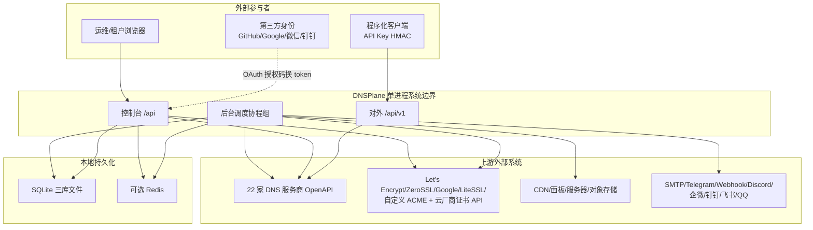
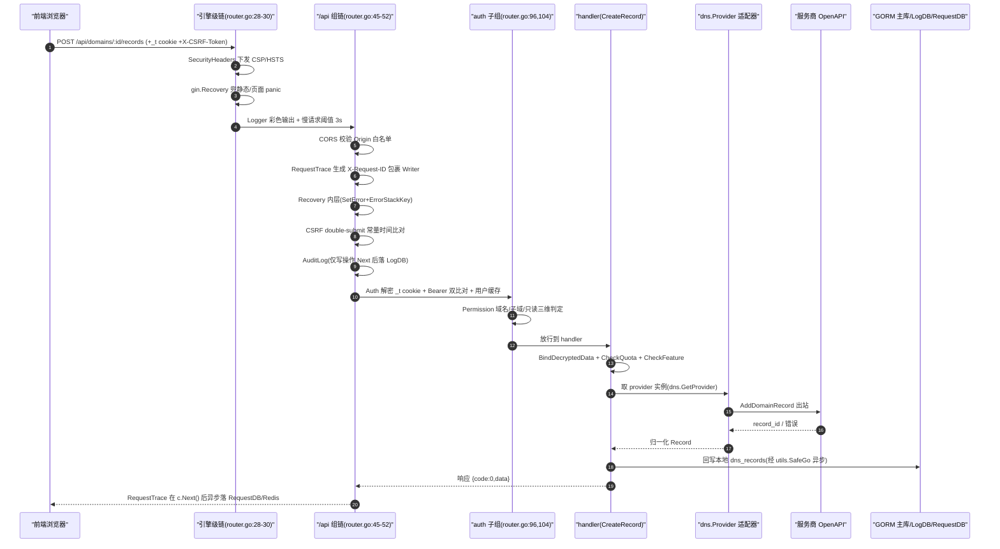
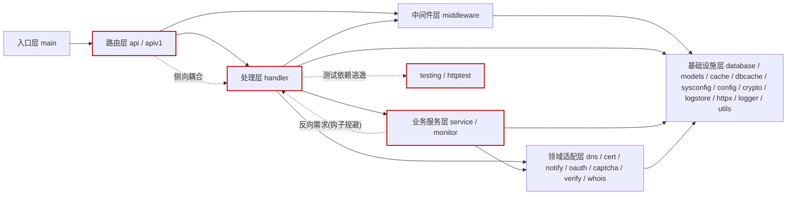
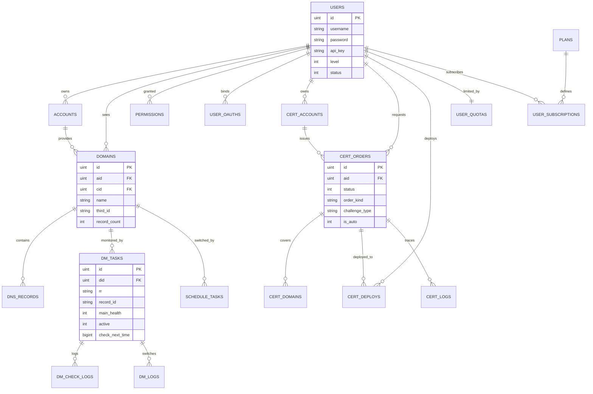
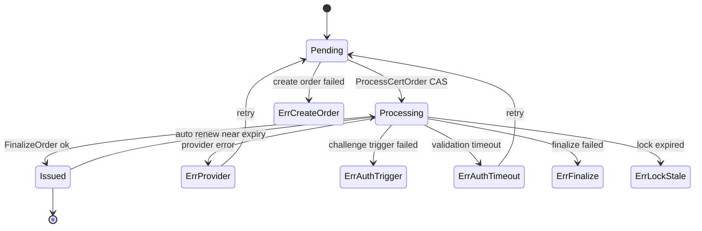
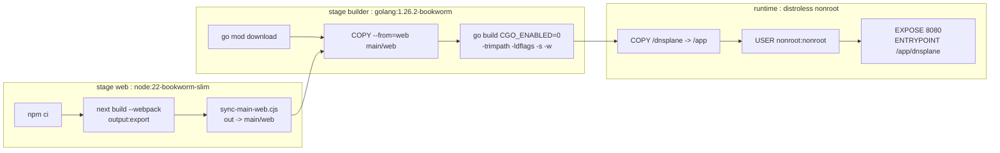

# DNSPlane 系统架构

<cite>
**本文档引用的文件**
- [main.go](file://main/main.go)
- [router.go](file://main/internal/api/router.go)
- [apiv1/router.go](file://main/internal/apiv1/router.go)
- [apiv1/util.go](file://main/internal/apiv1/util.go)
- [apiv1/auth.go](file://main/internal/apiv1/auth.go)
- [apiv1/adapt.go](file://main/internal/apiv1/adapt.go)
- [middleware/auth.go](file://main/internal/api/middleware/auth.go)
- [middleware/permission.go](file://main/internal/api/middleware/permission.go)
- [middleware/request_trace.go](file://main/internal/api/middleware/request_trace.go)
- [middleware/recovery.go](file://main/internal/api/middleware/recovery.go)
- [middleware/csrf.go](file://main/internal/api/middleware/csrf.go)
- [middleware/audit.go](file://main/internal/api/middleware/audit.go)
- [middleware/logger.go](file://main/internal/api/middleware/logger.go)
- [config.go](file://main/internal/config/config.go)
- [database.go](file://main/internal/database/database.go)
- [maintenance.go](file://main/internal/database/maintenance.go)
- [models.go](file://main/internal/models/models.go)
- [quota.go](file://main/internal/models/quota.go)
- [dns/interface.go](file://main/internal/dns/interface.go)
- [dns/registry.go](file://main/internal/dns/registry.go)
- [dns/ensure_challenge.go](file://main/internal/dns/ensure_challenge.go)
- [cert/interface.go](file://main/internal/cert/interface.go)
- [cert/registry.go](file://main/internal/cert/registry.go)
- [cert/acme/acme.go](file://main/internal/cert/acme/acme.go)
- [cert/deploy/registry.go](file://main/internal/cert/deploy/registry.go)
- [monitor/monitor.go](file://main/internal/monitor/monitor.go)
- [service/task_runner.go](file://main/internal/service/task_runner.go)
- [service/schedule.go](file://main/internal/service/schedule.go)
- [service/record_sync.go](file://main/internal/service/record_sync.go)
- [service/optimize_task.go](file://main/internal/service/optimize_task.go)
- [notify/channel_registry.go](file://main/internal/notify/channel_registry.go)
- [notify/channel_adapters.go](file://main/internal/notify/channel_adapters.go)
- [oauth/oauth.go](file://main/internal/oauth/oauth.go)
- [sysconfig/sysconfig.go](file://main/internal/sysconfig/sysconfig.go)
- [cache/cache.go](file://main/internal/cache/cache.go)
- [crypto/crypto.go](file://main/internal/crypto/crypto.go)
- [Dockerfile](file://Dockerfile)
- [build.yml](file://.github/workflows/build.yml)
- [package.json](file://web/package.json)
</cite>

> 说明：本文所有行号以当前工作区（版本 `1.0.11`，分支 `master`，非干净基线）实测文件为准。
> 工作区存在大量已暂存改动，行号不可与 `HEAD` 版本互换引用；`main.go`、`api/router.go`、
> `apiv1/router.go`、`apiv1/util.go` 四个文件的关键行号已在本次撰写中直接读取核对，其余以
> 本仓库浓缩素材为锚，标注为「约」。

## 目录

1. [概述](#概述)
2. [系统上下文](#系统上下文)
3. [整体架构](#整体架构)
4. [分层与依赖](#分层与依赖)
5. [模块清单](#模块清单)
6. [关键流程](#关键流程)
7. [数据模型](#数据模型)
8. [状态与生命周期](#状态与生命周期)
9. [部署拓扑](#部署拓扑)
10. [架构决策](#架构决策)
11. [演进路线](#演进路线)
12. [风险与技术债](#风险与技术债)
13. [附录](#附录)

## 概述

DNSPlane 是一个把「多服务商 DNS 管理 + 证书自动化 + 容灾监控 + 部署编排」收敛进**单一 Go 进程**
的控制台系统。它刻意不引入消息队列、独立缓存服务或微服务拆分：前端以 Next.js 静态导出产物
`go:embed all:web` 内嵌进二进制（`main/main.go:63-64`），持久化落到三个 SQLite 文件（可切 MySQL 主库），
横向扩展完全靠**注册表 + 工厂**的模式适配层——22 家 DNS 服务商、9 个证书签发渠道、
多个部署目标分组与 13 个通知渠道各自 `init()` 注册到全局表，装载函数无需随渠道增减而修改。

| 维度 | 内容 |
| --- | --- |
| 交付形态 | 单 Go 二进制，前端静态产物 `go:embed` 编入，容器镜像基于 distroless nonroot |
| 并发模型 | 一进程内 1 个 HTTP Server + 6 类后台协程组，共享 `cache.C` 与三个 `*gorm.DB` |
| 对外接口 | 控制台 `/api`（约 226 条）+ 对外 `/api/v1`（145 条，全 POST） |
| 规模重心 | `cert` 与 `api` 两线约占非测试代码 63% |

架构上有三个不可回避的张力，本文围绕它们展开：

- **一套 handler、两条链路**：控制台 `/api`（会话 Cookie + CSRF + JWT）与对外 `/api/v1`
  （API Key HMAC 签名 + 响应重编码）共享 `api/handler` 的 244 个 `gin.Context` 导出函数。
- **双层 panic 恢复**：`RequestTrace` 的落库代码在 `c.Next()` 之后，必须被一层 `middleware.Recovery`
  包裹，否则任何穿透到链首的 panic 都会让请求日志完全丢失（`api/router.go:34-43` 注释实测结论）。
- **进程内后台调度**：监控、证书续签、部署重试、日志清理、优选 IP、记录同步六类常驻协程
  与 HTTP 服务同生命周期，靠 `context.WithCancel` 与 `defer` 逆序优雅收尾。

**章节来源**
- [main.go:63-64](file://main/main.go#L63-L64)
- [router.go:34-43](file://main/internal/api/router.go#L34-L43)

## 系统上下文

### C4 L1：外部参与者与系统边界

DNSPlane 对外是一台 HTTP 服务器（默认 `0.0.0.0:8080`，`main/internal/config/config.go:89-90`），
对内是编排者：它把浏览器会话、程序化 API 调用翻译成对上游云厂商 OpenAPI、ACME CA、
身份提供方与通知网关的出站请求。所有对外调用均为出向，唯二例外是 `/qqbot/webhook` 与
QQ 机器人回调校验这两处入站通道。下图给出 C4 上下文层级的进程/系统边界。

**图表来源**
- [main.go:27-58](file://main/main.go#L27-L58)
- [config.go:89-90](file://main/internal/config/config.go#L89-L90)
- [notify/channel_adapters.go:330-344](file://main/internal/notify/channel_adapters.go#L330-L344)

上下文对上游是纯客户端：DNS 与证书调用为出向且除 ACME 外无自动重试；通知与容灾探测同样出向；
API Key 客户端仅有签名防重放，不具备入口频控。

**章节来源**
- [apiv1/auth.go:36-118](file://main/internal/apiv1/auth.go#L36-L118)
- [notify/channel_adapters.go:308-328](file://main/internal/notify/channel_adapters.go#L308-L328)

## 整体架构

### C4 L2：容器与进程内组件

整个交付物是一个静态链接二进制（`CGO_ENABLED=0`），进程内部署六类并发组件。它们共享
同一份 `cache.C`、三个 `*gorm.DB` 句柄与包级单例（`monitor.Service`、`config` 的 `sync.Once`），
因此不存在跨进程通信，只存在 goroutine 与 channel 协调。下图描述进程边界与其内外的连接关系。

```mermaid
flowchart TB
    subgraph Proc["DNSPlane 进程（单一 OS 进程，distroless nonroot）"]
        subgraph HTTP["Gin HTTP Server（main.go:128-144）"]
            Engine["gin.Engine 引擎级链<br/>SecurityHeaders-Recovery-Logger"]
            ConsoleG["/api 组链<br/>CORS-Trace-Recovery-CSRF-Audit-Auth-Perm"]
            V1G["/api/v1 组链<br/>Trace-Recovery-CORS-APIKeyAuth-Audit-Adapt"]
            StaticFS["embed 静态子文件系统<br/>NoRoute SPA 兜底 + ETag/304"]
        end
        subgraph BG["后台调度协程组（main.go:105-126）"]
            Mon["monitor.Monitor 主循环 1s tick"]
            Task["service.TaskRunner 证书/部署"]
            Sched["service.ScheduleRunner 定时切换"]
            Maint["database 维护协程 1h"]
            Opt["service.OptimizeRunner 优选 IP"]
            RecSync["service.RecordSyncer 记录同步"]
        end
        Notify["notify.NotifyManager"]
    end

    subgraph Data["持久化（进程外文件）"]
        DB[("SQLite 主库 data.db")]
        LogDB[("logs.db 恒 SQLite")]
        ReqDB[("request_logs.db 恒 SQLite")]
    end

    subgraph CacheTier["缓存"]
        Redis[("Redis 可选")]
        Mem["进程内存缓存回退"]
    end

    subgraph Cloud["外部云 SDK（blank import 注册）"]
        DNS["main/internal/dns/providers/* 22 家"]
        Cert["main/internal/cert/{acme,aliyun,tencent,huoshan,ucloud}"]
        Deploy["main/internal/cert/deploy/* providers/servers/panels/others"]
    end

    Engine --> ConsoleG
    Engine --> V1G
    Engine --> StaticFS
    ConsoleG --> DNS
    V1G --> DNS
    ConsoleG --> Cert
    Task --> Cert
    Task --> Deploy
    Mon --> DNS
    Mon --> Notify
    Task --> DNS
    HTTP --> DB
    HTTP --> LogDB
    HTTP --> ReqDB
    BG --> DB
    HTTP --> Redis
    Redis -.Ping 3s 超时降级.-> Mem
    BG --> Mem
    Task --> Cloud
```

**图表来源**
- [main.go:105-128](file://main/main.go#L105-L128)
- [router.go:24-65](file://main/internal/api/router.go#L24-L65)
- [apiv1/router.go:24-46](file://main/internal/apiv1/router.go#L24-L46)
- [cache.go:46-76](file://main/internal/cache/cache.go#L46-L76)

进程边界的三个关键约束：

- **Redis 是可选项**。`cache.Init` 在 Redis 启用且地址非空时 `PING`（3 秒超时），失败即降级为
  进程内存缓存并告警，不阻断启动（`main/internal/cache/cache.go:69-76`，`main.go:83-92`）。
- **日志库不受 driver 配置影响**。即便主库选 MySQL，`LogDB`/`RequestDB` 仍硬编码 SQLite 驱动
  （`database.go:106,114`），容器化多副本下日志互不可见。
- **注册靠 blank import**。`main.go:27-58` 以匿名导入拉起证书渠道、22 家 DNS provider、
  部署器分组，各包 `init()` 把工厂写进全局表；删除任一 import 即注销该能力。

**章节来源**
- [main.go:27-58](file://main/main.go#L27-L58)
- [cache.go:69-76](file://main/internal/cache/cache.go#L69-L76)
- [database.go:106-114](file://main/internal/database/database.go#L106-L114)

### 请求生命周期：一次 API 调用的完整链路

下图以「控制台创建一条解析记录」为例，展示请求穿过中间件双链、handler、领域适配、DB 与云端
的完整顺序。中间件顺序严格按 `api/router.go` 的 `.Use` 实参排列，不按直觉。

**图表来源**
- [router.go:24-104](file://main/internal/api/router.go#L24-L104)
- [request_trace.go:135-302](file://main/internal/api/middleware/request_trace.go#L135-L302)
- [auth.go:125-229](file://main/internal/api/middleware/auth.go#L125-L229)
- [permission.go:132-170](file://main/internal/api/middleware/permission.go#L132-L170)

链路中两处「顺序即正确性」的设计不可调换：

- **内层 Recovery 必须紧跟 RequestTrace**。若只保留外层 `gin.Recovery`，`RequestTrace` 在
  `c.Next()` 之后的落库代码永不执行，实测请求日志零记录（`api/router.go:34-43` 注释）。
- **CORS 必须在 RequestTrace 之前**。OPTIONS 预检不带业务语义，放在 Trace 之后会为每次预检
  生成一条无意义的请求日志（`api/router.go:46` 注释）。

**章节来源**
- [router.go:34-52](file://main/internal/api/router.go#L34-L52)
- [request_trace.go:135-302](file://main/internal/api/middleware/request_trace.go#L135-L302)
- [recovery.go:21-73](file://main/internal/api/middleware/recovery.go#L21-L73)

### 中间件双链对照

控制台链与对外 `/api/v1` 链共用引擎级三段，但组级顺序不同，且 V1 有意**不继承 CSRF**。
下表按 `.Use` 实参顺序列出两条链。

| 序 | 控制台 `/api` 链（注册位置） | 对外 `/api/v1` 链（注册位置） | 说明 |
| --- | --- | --- | --- |
| 1 | `SecurityHeaders`（引擎级 `router.go:28`） | `SecurityHeaders`（引擎级） | CSP 含三家验证码域名、HTTPS 下 HSTS |
| 2 | `gin.Recovery`（引擎级 `router.go:29`） | `gin.Recovery`（引擎级） | 兜静态/页面/NoRoute 的 panic |
| 3 | `middleware.Logger`（引擎级 `router.go:30`） | `middleware.Logger`（引擎级） | 彩色 stdout + 分级落文件 |
| 4 | `CORS`（组级 `router.go:45`） | `RequestTrace`（`apiv1/router.go:27`） | V1 先 Trace 后 CORS 与其注释顺序一致 |
| 5 | `RequestTrace`（`router.go:47`） | `Recovery`（`apiv1/router.go:28`） | 内层恢复挡在 Trace 之内 |
| 6 | `Recovery` 内层（`router.go:48`） | `CORS`（`apiv1/router.go:29`） | OPTIONS 预检不被认证拦 |
| 7 | `CSRF`（`router.go:50`） | `APIKeyAuth`（`apiv1/router.go:30`） | V1 无 CSRF：签名即身份与完整性凭据 |
| 8 | `AuditLog`（`router.go:52`） | `JSONBodyToDecryptedData`（`apiv1/router.go:31`） | 读 body 后立即还原，否则下游 EOF |
| 9 | `Auth`（`router.go:96`） | `AuditLog`（`apiv1/router.go:32`） | 审计读 `user_id`，须在认证之后 |
| 10 | `Permission`（`router.go:104`） | `AdaptResponse`（`apiv1/router.go:34`） | 链末包裹后续所有写出，重编码为 V1 契约 |
| — | handler 内 `requireAdmin`/`CheckQuota` | 路由级 `requireModuleMW`/`adminOnly` | 细粒度校验下沉 |

V1 挂在引擎根而非 `/api` 组内（`api/router.go:63` 早于 `router.go:64`）：API Key 客户端没有
`_csrf` cookie，继承 CSRF 链会让所有写请求被拒，而签名本身即身份与完整性凭据
（`apiv1/router.go:9-23` 注释）。

**章节来源**
- [router.go:24-104](file://main/internal/api/router.go#L24-L104)
- [apiv1/router.go:9-34](file://main/internal/apiv1/router.go#L9-L34)
- [csrf.go:70-119](file://main/internal/api/middleware/csrf.go#L70-L119)

## 分层与依赖

### 分层模型与内部依赖图

系统按「被依赖方向」可分为六层。正常依赖应当自上而下。下图 `graph LR` 给出层间实际依赖边，
带 `bad` 样式的节点标注跨层/侧向的非预期耦合。

**图表来源**
- [main.go:108-110](file://main/main.go#L108-L110)
- [apiv1/util.go:6-8](file://main/internal/apiv1/util.go#L6-L8)

**章节来源**
- [apiv1/util.go:6-8](file://main/internal/apiv1/util.go#L6-L8)
- [main.go:108-110](file://main/main.go#L108-L110)

### 依赖矩阵（违规格子用 ✗ 标出）

行为消费者、列为被依赖方。`✓` 为符合分层的向下依赖，`△` 为设计上容忍但需警惕的耦合，
`✗` 为违反分层原则的实际依赖，`—` 为无依赖。

| 消费者 \ 被依赖 | 路由层 | 处理层 | 中间件层 | 服务层 | 适配层 | 基础设施 |
| --- | --- | --- | --- | --- | --- | --- |
| 入口 main | ✓ | ✓(注入) | ✓ | ✓ | ✓(blank) | ✓ |
| 路由 apiv1 | — | ✗ 侧向 | ✓ | ✗ | △ | ✓ |
| 路由 api | — | ✓ | ✓ | △ | ✗ 见下 | ✓ |
| 处理 handler | — | — | ✓ | ✓ | ✓ | ✓ |
| 服务 service | — | ✗(已规避) | — | — | ✓ | ✓ |
| 适配层 | — | — | △(cache) | — | — | ✓ |
| 基础设施 | — | — | — | — | — | — |

逐格解释被标记的格子：

| 标记 | 依赖 | 证据 | 判定理由 |
| --- | --- | --- | --- |
| ✗ | `apiv1 → handler` | `apiv1/domain.go`、`apiv1/record_sync.go` 直接调 `handler.GetDomains` 等 | 「一套 handler 两条链路」的刻意侧向耦合，V1 复用控制台实现 |
| ✗ | `service → handler` | `main.go:108` 注入 `handler.TriggerCertOrderProcessing` | 潜在环，靠 `service/cert_renew_hook.go:46` 钩子规避；若直接 import 即成环 |
| ✗ | `apiv1 → testing/httptest` | `apiv1/util.go:6,8` import `net/http/httptest`、`testing` | 生产二进制携带测试框架依赖，见风险 R-5 |
| ✗ | `api → dns/cert 适配` | 控制台链路 handler 内直接取 provider | 路由层不应直达适配层，实际穿透发生在本应止于 handler 的边界 |
| △ | `apiv1 → 适配`、`适配 → cache` | dynv6/henet 用 `cache.C` 缓存会话 | 容忍但增加适配层对缓存就绪顺序的隐式依赖 |

**章节来源**
- [apiv1/util.go:6-8](file://main/internal/apiv1/util.go#L6-L8)
- [main.go:108-110](file://main/main.go#L108-L110)

## 模块清单

### 非测试代码规模重心

`main/internal` 一级子包 22 个，非测试 Go 约 71879 行（`go.mod` 声明 `go 1.26.2`）。
规模重心集中在证书与 API 两条主线，二者合计约占非测试代码 63%。

| 包 | 非测试行数(约) | 代表文件(行数) | 职责一句话 |
| --- | --- | --- | --- |
| `cert`（含 `cert/deploy`） | 22842 + 18998 | `deploy/config_cloud.go`(515)、`acme/acme.go`(1052) | 签发渠道 + 部署目标适配 |
| `api`（handler+middleware） | 22461 | `handler/cloudflare.go`(2509)、`middleware/auth.go`(572) | 两条链路 + 会话/权限/追踪 |
| `dns`（providers） | 464 + 10908 | `providers/aws/aws.go`(888)、`interface.go`(167) | 15 方法统一 DNS 抽象 + 22 家工厂 |
| `notify` | 3558 | `notify/notify.go`(914)、`channel_adapters.go`(460) | 13 渠道注册表 + SSRF/头净化 |
| `service` | 3968 | `task_runner.go`(1015)、`cloudflare_enhance.go`(733) | 后台任务与上游编排 |
| `monitor` | 1685 | `monitor.go`(1049)、`check.go`(372) | 容灾探测与主备切换 |
| `apiv1` | 1815 | `record_sync.go`(444)、`adapt.go`(148) | V1 桥接 + 同步写 + 响应重编码 |
| `database` | 1009 | `database.go`(496)、`maintenance.go`(444) | 三库打开/迁移/维护/查询追踪 |

**章节来源**
- [models.go:10-370](file://main/internal/models/models.go#L10-L370)
- [database.go:21-130](file://main/internal/database/database.go#L21-L130)

### 对外集成矩阵

系统的能力面由四类注册表 + 一组 OAuth provider 撑起。下表列出集成的外部系统类别与注册位置
（provider 名称取自 `ls internal/dns/providers`、`ls internal/cert`、`ls internal/oauth` 实测目录）。

| 集成类别 | 数量 | 代表成员 | 注册/装载位置 |
| --- | --- | --- | --- |
| DNS 服务商 SDK | 22 | `aliyun` `dnspod` `cloudflare` `aws` `huawei` `goedge` `powerdns` `technitium` `baidu` `qingcloud` `huoshan` `aliyunesa` `tencenteo` `dynv6` `henet` `namesilo` `spaceship` `west` `bt` `dnsla` `dnsmgr` `jdcloud` | 各 `providers/*` 包 `init()` → `dns.Register`，`main.go:31-52` blank import |
| 证书签发渠道 | 9 | ACME 家族 `letsencrypt`/`zerossl`/`google`/`litessl`/`customacme`；云厂商 `aliyun_cert`/`tencent`/`huoshan`/`ucloud` | `cert.Register`，`cert/acme/acme.go:46,57,70,73,76` 等 |
| 部署目标 | providers 56 文件 + servers/panels/others 分组 | CDN `aliyun_cdn`/`tencent_cdn`/`wangsu_cdn`、WAF `aliyun_waf`/`huawei_waf`、对象存储 `s3storage`/`qiniu`/`upyun`、面板 `btpanel`/`directadmin`、服务器 `k8s`/`ssh`/`local` | `cert/deploy/{providers,servers,panels,others}` → `base.Register` |
| 身份提供方 OAuth | 5 | `github`/`google`/`wechat`/`dingtalk`/`custom` | `oauth/oauth.go:71` `providerFactories` |
| 通知渠道 | 13 | `email`(SMTP/Sendcloud/DirectMail) `telegram` `webhook` `custom_webhook` `discord` `bark` `wechat` `dingtalk` `feishu` `wxwork_app` `wxtpl` `wxpusher` `qqbot` | `notify/channel_adapters.go:330-344` `init()` 内 13 次 `RegisterChannel` |
| 出站 HTTP 代理 | 全局 | `sys_configs` 的 `proxy_*` 键驱动 | `httpx/proxy.go:35` `Install()`（须在 `cache.Init` 之后） |

**章节来源**
- [registry.go:9-48](file://main/internal/dns/registry.go#L9-L48)
- [cert/registry.go:23-52](file://main/internal/cert/registry.go#L23-L52)
- [notify/channel_registry.go:20-85](file://main/internal/notify/channel_registry.go#L20-L85)
- [oauth.go:17-101](file://main/internal/oauth/oauth.go#L17-L101)

## 关键流程

系统可归纳为六条主干流程，覆盖「读配置、证明身份、动 DNS、出证书、推部署、保可用」。
下表给出每条流程的入口与终点，随后逐条展开。

| 流程 | 触发入口 | 关键组件 | 落库/副作用 |
| --- | --- | --- | --- |
| 配置流 | 启动 `config.Load`；运行期 `UpdateSystemConfig` | `config`、`sysconfig`、`sys_configs` 表 | 文件 0600 落盘；DB upsert + 缓存失效 |
| 认证流 | `POST /api/login`、OAuth 回调 | `middleware/auth.go`、`oauth`、`verify`、`captcha` | 双 token + `_t`/`_rt`/`_csrf` Cookie |
| DNS 操作流 | 记录 CRUD、`/api/v1/records/*` | `dns.Provider`、`record_sync` | 云端增删 + 本地 `dns_records` |
| 证书签发流 | `ProcessCertOrder` | `cert.Provider`、`dns.EnsureChallengeRecord`、`acme` | `cert_orders`/`cert_domains` + 通知 |
| 部署流 | `TaskRunner` 扫描 / `ProcessCertDeploy` | `cert/deploy`、`task_runner` | `cert_deploys` 状态机 + 退避重试 |
| 监控切换流 | `Monitor` 主循环 / 手动 `ManualSwitch` | `monitor`、`check.go`、`ssrf.go` | 改云端记录 + `dm_logs`/`dm_check_logs` + 告警 |

**章节来源**
- [config.go:84-169](file://main/internal/config/config.go#L84-L169)
- [sysconfig.go:17-34](file://main/internal/sysconfig/sysconfig.go#L17-L34)

### 配置流

配置分两级：文件级 `config.json` 由 `config.Load` 一次性加载，`sync.Once` 单例决定其**不可热更新**
（`main/internal/config/config.go:79-82,84`）；数据库级 `sys_configs` 表支持热更新，读写统一走
`sysconfig` 包并带 60 秒缓存（`sysconfig/sysconfig.go:13-14,17`）。两条关键不变量：

- 配置文件缺失时自动生成随机 JWT secret 与 master_key 并回写，目录 `0700`、文件 `0600`
  （`config.go:107-113,156-169`）。环境变量 `DNSPLANE_JWT_SECRET`/`DNSPLANE_MASTER_KEY` 覆盖优先级最高。
- 绕过 `sysconfig` 直接写库的入口必须自行失效缓存，否则开关最长 60 秒不生效
  （`handler/user.go` 的 `UpdateSystemConfig` 即先 upsert 再 `sysconfig.Invalidate`）。

**章节来源**
- [config.go:79-169](file://main/internal/config/config.go#L79-L169)
- [sysconfig.go:13-40](file://main/internal/sysconfig/sysconfig.go#L13-L40)

### 认证流

登录成功后签发双 token：Access 15 分钟、Refresh 7 天，均为硬编码常量
（`middleware/auth.go:91-92`，与 `config` 的 `expire_hour` 无关）。会话载体是三枚 Cookie：
`_t`（Access，AES-GCM 加密，key = `sha256(JWT.Secret)`）、`_rt`（Refresh，path 限定 `/api/auth/refresh`）、
`_csrf`（double-submit，非 HttpOnly）。`Auth` 中间件要求 `_t` 解密结果与 `Authorization: Bearer`
完全一致（`middleware/auth.go:125`），Refresh 走 JTI 轮转 + 重用检测（`:382`）。对外 V1 走另一条身份路线：
HMAC-SHA256 签名串 `uid + "\n" + timestamp + "\n" + METHOD + "\n" + PATH`，±5 分钟窗口，
`hmac.Equal` 常量时间比较（`apiv1/auth.go:44,93,96`）。

**章节来源**
- [auth.go:91-125](file://main/internal/api/middleware/auth.go#L91-L125)
- [apiv1/auth.go:44-118](file://main/internal/apiv1/auth.go#L44-L118)

### DNS 操作流

所有服务商被 `dns.Provider` 的 15 个方法抽象（`dns/interface.go:41-86`），实例经
`dns.GetProvider` 工厂动态取用，线路映射由 `dns/registry.go:58-80` 的 21 家静态表兜底。
控制台的写操作经 `utils.SafeGo` 异步下发，程序化调用需要拿到真实成败，故 `/api/v1` 的五个记录写接口
在 `apiv1/record_sync.go` 重写为**同步实现**：只给 `record_id` 时先回查云端取真实 rr 再做子域校验，
避免越权绕过（`apiv1/record_sync.go:121-337`）。

**章节来源**
- [dns/interface.go:41-86](file://main/internal/dns/interface.go#L41-L86)
- [dns/registry.go:58-80](file://main/internal/dns/registry.go#L58-L80)
- [apiv1/record_sync.go:121-337](file://main/internal/apiv1/record_sync.go#L121-L337)

### 证书签发流

`ProcessCertOrder` 先做 CAS 占位（`status!=1 OR updated_at 超 5 分钟`）避免并发重复处理，
ACME 客户端按 `PreferredChallenge` 选 `dns-01`/`http-01`（`cert/acme/acme.go:691-711`），
经 `dns.EnsureChallengeRecord` 幂等写入挑战 TXT/CNAME（`dns/ensure_challenge.go:48`），
`FinalizeOrder` 私钥本地生成从不外传，成功后写 order 并置 `status=3`（`handler/cert.go:803-811`）。
纯 IP 禁 `dns-01`、通配符禁 `http-01` 由 `validateChallengeChoice` 约束（`cert.go:321`）。
ACME 限流退避重试上限 12 次（`acme.go:39`）。

**章节来源**
- [cert/acme/acme.go:39-711](file://main/internal/cert/acme/acme.go#L39-L711)
- [dns/ensure_challenge.go:48-114](file://main/internal/dns/ensure_challenge.go#L48-L114)
- [cert/interface.go:53-79](file://main/internal/cert/interface.go#L53-L79)

### 部署流

证书就绪后由 `TaskRunner` 扫描 `cert_deploys` 执行推送，失败按 `60/300/600/1800/3600s`
五级退避重试（`service/task_runner.go:23` `deployRetryIntervals`，`executeDeployTasks:217`，
`retryFailedDeployTasks:244`）。过期锁回收 `releaseExpiredLocks:421` 处理进程崩溃遗留的
`is_lock` 行。部署目标覆盖 CDN、WAF、对象存储、面板与自建服务器，统一 `base.DeployProvider`
接口（`cert/deploy/base/base.go:45`）。

**章节来源**
- [task_runner.go:23-421](file://main/internal/service/task_runner.go#L23-L421)
- [cert/deploy/registry.go](file://main/internal/cert/deploy/registry.go)

### 监控切换流

`Monitor` 常驻协程以 1 秒 tick 派发探测，每轮最多 100 个任务、并发上限 64
（`monitor/monitor.go:24,29`，`dispatchTasks` 依据 `active=1 AND check_next_time<=now`，
`:150-153,174-178`）。探测类型含 Ping/TCP/HTTP/HTTPS（`check.go:55,163,206`），
探测 URL 先过 SSRF 校验拦私网（`ssrf.go:31,62,99`）。主源失败判定后改写云端记录切到备源并
`logAction(1)` + `notify("fault")`（`monitor.go:319-324`），切换失败再告警 `fault_switch_failed`
（`:325-330`）；仅当主源全绿且任务开启 `AutoRestore` 时回切（`:292,296-301`）。
手动路径 `ManualSwitch`（`monitor.go:711`）复用同一套切换逻辑。

**章节来源**
- [dns/interface.go:41-86](file://main/internal/dns/interface.go#L41-L86)
- [cert/acme/acme.go:39-711](file://main/internal/cert/acme/acme.go#L39-L711)
- [task_runner.go:23-421](file://main/internal/service/task_runner.go#L23-L421)
- [monitor.go:24-711](file://main/internal/monitor/monitor.go#L24-L711)

## 数据模型

### 三库分离与实体关系

持久化采用「三库分离 + 无外键 + 无显式事务」的 SQLite 优先设计，主库 26 张表由 GORM
`AutoMigrate` 建立（`database.go:242-270`），日志库 3 张、请求库 1 张。全库无外键声明，
关联完整性由业务层保证；无版本化迁移脚本。核心实体关系如下（标识符用英文）。

**图表来源**
- [models.go:10-370](file://main/internal/models/models.go#L10-L370)
- [quota.go:19-75](file://main/internal/models/quota.go#L19-L75)
- [database.go:242-270](file://main/internal/database/database.go#L242-L270)

**章节来源**
- [database.go:242-310](file://main/internal/database/database.go#L242-L310)
- [models.go:10-370](file://main/internal/models/models.go#L10-L370)

### 敏感列加密边界

字段级加密由 `crypto` 包的 AES-256-GCM 完成，密钥 = `SHA256(security.master_key)`，密文带
`enc:v1:` 前缀（`crypto/crypto.go:16-19,42-63`）。`models/hooks.go` 的 `BeforeSave`/`AfterFind`
对 7 表 10 列做透明加解密：`Account.Config`、`CertAccount.{Config,Ext}`、`CertOrder.{PrivateKey,Info}`、
`CertDeploy.{Config,Info}`、`DMTask.ProxyPassword`、`User.TOTPSecret`、`UserOAuth.{AccessToken,RefreshToken}`。
**未纳入加密**的高风险列：`users.api_key`（明文且会 JSON 序列化输出）、`sys_configs.value`
（内含 `mail_api_key`/`accel_esa_access_key_secret`/`qqbot_appsecret` 等凭据整列明文，一律 `{占位}` 化）。

**章节来源**
- [models.go:10-370](file://main/internal/models/models.go#L10-L370)
- [crypto.go:16-101](file://main/internal/crypto/crypto.go#L16-L101)
- [quota.go:19-75](file://main/internal/models/quota.go#L19-L75)

## 状态与生命周期

### 证书订单状态机

`CertOrder.status` 是部署/续签调度的核心状态字段，取值 0/1/3 与负数错误码。重启后
`resetStuckOrders` 会把 `status=1`（处理中）重置为 0，因为承载签发的 goroutine 已随进程丢失
（`database.go:147,152-157`）。状态标识符用英文。

**图表来源**
- [cert/acme/acme.go:39-711](file://main/internal/cert/acme/acme.go#L39-L711)
- [task_runner.go:23-445](file://main/internal/service/task_runner.go#L23-L445)
- [database.go:147-157](file://main/internal/database/database.go#L147-L157)

状态码值映射：`0 pending`、`1 validating/处理中`、`3 issued`；`-1..-6` 分别对应
provider 错误、建单失败、触发验证失败、验证超时、finalize 失败、锁过期
（`handler/cert.go` 各分支，`task_runner.go:445` 锁过期）。

**章节来源**
- [cert/acme/acme.go:691-711](file://main/internal/cert/acme/acme.go#L691-L711)
- [database.go:152-157](file://main/internal/database/database.go#L152-L157)
- [models.go:217-245](file://main/internal/models/models.go#L217-L245)

### 进程与后台任务生命周期

启动严格按序：`config.Load`（`main.go:70`）→ `database.Init`（`:76`）→ `cache.Init`（`:83`）→
`httpx.Install`（`:93`，必须在 cache 之后）→ `captcha.Init`/`logstore.Init`/`RegisterDBCallbacks`
（`:95-100`）→ `gin.SetMode`（`:102`）→ 后台协程组（`:105-126`）→ `SetupRouter`（`:128`）→
`ListenAndServe`（goroutine）。六类后台任务的启动位置如下。

| 后台任务 | 启动位置 | 周期/延迟 | 停止位置 |
| --- | --- | --- | --- |
| 容灾监控调度器 | `main.go:105-106`（`monitor.New/Start`） | 1s tick + 60s 状态刷新 | `main.go:107` `defer mon.Stop` |
| 证书续签/部署/到期提醒 | `main.go:112-114`（`NewTaskRunner` + `go Start`） | 证书/部署 5 分钟、域名到期 24 小时，首轮延迟 30s | `main.go:117-118` cancel + `TaskRunner.Stop` |
| 定时切换 Runner | `main.go:113,115`（`NewScheduleRunner`） | 60s 轮询，按 weekday+hh:mm | `main.go:119` `ScheduleRunner.Stop` |
| 日志清理/DB 维护 | `main.go:121`（`StartMaintenance`） | 首次延迟 30s，之后每小时 | `main.go:122` `defer StopMaintenance` |
| 优选 IP Runner | `main.go:123`（`StartOptimizeRunner`） | 按库内配置 | `main.go:124` `defer StopOptimizeRunner` |
| 记录同步 Runner | `main.go:125`（`StartRecordSync`） | `record_sync_interval_min` 默认 30 分钟 | `main.go:126` `defer StopRecordSync` |

优雅关闭：收到 `SIGINT`/`SIGTERM` 后 `srv.Shutdown`（10s 超时），`defer` 链逆序停后台任务，
再 `cache.Close`、`database.Close`（`main.go:145-155`）。两处需记录的收尾缺口：`ListenAndServe`
的非 `ErrServerClosed` 错误只记日志不退出（端口占用会「进程存活但不监听」）；`logger.Close()`
不在 `main` 的 defer 链中，依赖 OS 释放句柄。

**章节来源**
- [main.go:70-155](file://main/main.go#L70-L155)
- [task_runner.go:23-421](file://main/internal/service/task_runner.go#L23-L421)
- [schedule.go:28-113](file://main/internal/service/schedule.go#L28-L113)
- [optimize_task.go:303-316](file://main/internal/service/optimize_task.go#L303-L316)
- [record_sync.go:45-108](file://main/internal/service/record_sync.go#L45-L108)
- [maintenance.go:111-195](file://main/internal/database/maintenance.go#L111-L195)
- [monitor.go:68-93](file://main/internal/monitor/monitor.go#L68-L93)

## 部署拓扑

### 交付形态与 Docker 多阶段

交付物是「前端静态导出产物 embed 进单一 Go 二进制」。Dockerfile 为三阶段，
最终镜像是 `distroless/static-debian12:nonroot`（uid 65532），只含一个二进制。

**图表来源**
- [Dockerfile:4-37](file://Dockerfile#L4-L37)
- [package.json](file://web/package.json)

| 阶段 | 基础镜像 | 关键命令 | 产物 |
| --- | --- | --- | --- |
| web | `node:22-bookworm-slim`（`Dockerfile:4`） | `npm ci` → `next build --webpack` → `sync-main-web.cjs` | `main/web`（embed 源） |
| builder | `golang:1.26.2-bookworm`（`Dockerfile:12`） | `go mod download` → `COPY --from=web` → `go build -trimpath`（`CGO_ENABLED=0`） | `/dnsplane` 静态二进制 |
| runtime | `distroless/static-debian12:nonroot`（`Dockerfile:32`） | `COPY /dnsplane /app` → `USER nonroot` → `EXPOSE 8080` | 仅含一个二进制的最终镜像 |

关键约束与风险：

- `go:embed all:web` 是硬前置：`main/web/` 不入库，干净仓库直接 `go build` 会因缺目录失败，
  必须先跑 `build:ci` 同步产物（`web/package.json`）。
- 交叉编译靠 `GOOS/GOARCH/GOARM`（`linux/arm/v7` 可产）；前端只在 `BUILDPLATFORM` 构建一次，
  避免多架构并行 `npm ci` 拖垮网络。
- 运行阶段 `/app` 由 root 拥有而进程以 nonroot 运行，`config.Load` 与 `database.Init` 默认写相对
  cwd 路径——**不挂载可写卷或不显式指定 `-config` 路径时，容器可能在配置写入阶段退出**（推断，
  未实机验证）。部署配方：挂可写卷到 `/app` 或用 `-config /data/config.json`。
- CI 四 job（`release-init`/`frontend`/`binaries`/`docker`）互不跑测试：`build.yml` 全程无
  `go test`/`npm test`/lint，而仓库有 78 个 `*_test.go`。质量门禁仅覆盖前端类型与镜像构建。

**章节来源**
- [Dockerfile:4-37](file://Dockerfile#L4-L37)
- [build.yml:29-208](file://.github/workflows/build.yml#L29-L208)

### 运行时拓扑

单容器可水平多副本，但需知晓两处「进程本地状态」：日志库硬编码 SQLite（多副本日志互不可见），
监控实时解析快照 `resolveStatuses` 是进程内存 `sync.Map`（重启即空）。因此横向扩副本时监控状态与
请求日志不做跨副本聚合。

**章节来源**
- [Dockerfile:4-37](file://Dockerfile#L4-L37)
- [build.yml:29-208](file://.github/workflows/build.yml#L29-L208)
- [main.go:63-64](file://main/main.go#L63-L64)

## 架构决策

下表汇总关键取舍：决策、被否决的备选、选择原因与付出的代价。

| 决策 | 备选 | 选择原因 | 代价 |
| --- | --- | --- | --- |
| 单二进制 embed 前端 | 前后端分离双服务 | 部署只需一个进程/镜像，无跨域与独立编排 | 前端改动必须整体重构建；`build` 脚本 Windows-only |
| SQLite 优先三库分离 | 统一 MySQL | 零外部依赖即可跑，日志/请求库与业务库隔离 IO | MySQL 主库下日志仍写本地 SQLite；`VACUUM` 等维护仅 SQLite 可用 |
| 无外键 + 无显式事务 + AutoMigrate | 版本化 SQL 迁移 | 无 DBA 也能升级，`SkipDefaultTransaction` 降开销 | 只加列不减列，遗留死列/冗余索引长期驻留；无法回滚 |
| 注册表 + 工厂适配多服务商 | if/else 分派 | 新增渠道不改装载函数（开闭原则） | blank import 与包 `init()` 的装载顺序耦合 |
| 一套 handler、两条链路 | 控制台与 V1 各写一套 | 消除 244 个接口的重复实现 | `apiv1 → handler` 侧向耦合；参数读取差异靠 bridge 回填 |
| 双层 panic 恢复 | 仅外层 gin.Recovery | 保住 RequestTrace 在 `c.Next()` 后的落库 | 链更复杂，顺序被改坏即失去报警能力 |
| 钩子注入解耦 handler↔service | service 直接 import handler | 打破签发↔通知循环依赖（`main.go:108,110`） | 依赖注入分散在 main，可读性下降 |
| Access 15m / Refresh 7d 硬编码 | 复用 `config.expire_hour` | 常量清晰、避免配置歧义 | `expire_hour` 成为无读取点的死配置 |
| distroless nonroot 运行 | 完整 base 镜像 | 攻击面与体积最小 | 无可写 cwd，需显式挂卷；无 shell 调试 |
| V1 不继承 CSRF | 复用 `/api` 组链 | 签名即身份与完整性凭据，无 cookie 无法 double-submit | V1 与控制台鉴权语义分叉，需各自维护 |

**章节来源**
- [database.go:74-118](file://main/internal/database/database.go#L74-L118)
- [registry.go:9-48](file://main/internal/dns/registry.go#L9-L48)
- [router.go:24-65](file://main/internal/api/router.go#L24-L65)
- [apiv1/router.go:9-34](file://main/internal/apiv1/router.go#L9-L34)
- [config.go:41-76](file://main/internal/config/config.go#L41-L76)

## 演进路线

以下路线（v1.0 → v2.0）基于当前工作区实测缺口，按「低风险先行、破坏性靠后」排序。
仅列方向，不代表已实施。

| 阶段 | 目标 | 关键动作 | 退出判据 |
| --- | --- | --- | --- |
| v1.0（当前） | 功能完整、单体可交付 | 双链路 + 六类后台任务 + 四注册表 | 现状 |
| v1.1 加固 | 补入口限流与测试门禁 | 为 `/api/v1` 增限流中间件；CI 加 `go test`/`go vet`/lint | V1 有频控、CI 阻断回归 |
| v1.2 清理 | 去死代码、迁出测试依赖 | 移除 `middleware/apikey.go`/`DecryptAndVerify` 死链；`apiv1/util.go` 测试辅助迁 `*_test.go` | `go build` 产物不含 `testing` |
| v1.5 拆分 | 巨型 handler 按领域切片 | `cloudflare.go`/`domain.go`/`auth.go` 分解为子模块 | 单文件回到 500 行以内 |
| v2.0 平台化 | 迁移/多副本状态外置 | 引入版本化迁移（可回滚）；监控快照与日志跨副本聚合（Redis/中心库） | 存量库可无损升降级 |
| v2.0 配置热更 | 统一配置读取 | 消除 `expire_hour`/`base_url`/`proxy` 节等死配置，改为真正热加载 | 配置项均有读取点 |

**章节来源**
- [apiv1/router.go:33-46](file://main/internal/apiv1/router.go#L33-L46)
- [apiv1/util.go:6-46](file://main/internal/apiv1/util.go#L6-L46)
- [build.yml:29-208](file://.github/workflows/build.yml#L29-L208)

## 风险与技术债

下列条目均为实测发现，按严重度排序，供故障排查与迭代优先级参考。

| 编号 | 级别 | 风险/技术债 | 证据 | 影响 |
| --- | --- | --- | --- | --- |
| R-1 | 高 | 巨型 handler 违反 SRP | `handler/cloudflare.go` 2509、`domain.go` 1716、`auth.go` 1573、`cert.go` 1519 行 | 单文件承载多领域，测试与并发修改冲突面大 |
| R-2 | 高 | 敏感凭据明文入库 | `users.api_key` 明文且 JSON 输出；`sys_configs.value` 整列明文 | 备份/导出即泄露第三方密钥 |
| R-3 | 高 | 密钥变更后静默降级 | `crypto.MustDecrypt` 解密失败原样返回密文（`crypto.go:95-101`） | 上层把 `enc:v1:...` 当明文使用，不报错 |
| R-4 | 中 | 权限覆盖不均 | `auth` 组 201 条中 90 条仅 `Auth+Permission`，`Permission` 缺 `domain_id` 时放行（`permission.go:144-148`） | `/api/domains/sync`、`/api/system/config` 等待核查 |
| R-5 | 中 | 测试依赖逃逸进生产二进制 | `apiv1/util.go:6,8` import `testing`/`net/http/httptest` | 生产包携带测试框架，增大攻击面与体积 |
| R-6 | 中 | 死代码：签名中间件从未挂载 | `rg 'middleware.(APIKeyAuth/DecryptAndVerify)'` 命中 0；V1 用自身实现（`apiv1/auth.go:44`） | `BindDecryptedData` 在控制台侧永远走回落分支，权限分支失效 |
| R-7 | 中 | 陈旧注释与实际不符 | `apiv1/scope.go:91-92` 称 `Permission` 从未挂载，实际 `router.go:104` 已挂载 | 误导后续维护者做出错误判断 |
| R-8 | 中 | Cloudflare 特例逃逸统一抽象 | 无记录启停 API，用把主机记录改名 `xxx_pause`/根域 `__root__` 模拟；线路语义为代理开关 | 统一 `SetDomainRecordStatus` 语义在此失真，跨服务商不可平移 |
| R-9 | 中 | 双层 panic 恢复的脆弱性 | 内层 Recovery 必须紧跟 RequestTrace（`router.go:34-43`） | 顺序被改坏则请求日志全丢，靠注释与测试护栏 |
| R-10 | 中 | AutoMigrate 只加不减 | 遗留 `payment_*`/`promo_codes` 孤儿表、`plans.price`、`cert_orders.uid`、重复索引 | 无版本化迁移，无法回滚，长期膨胀 |
| R-11 | 中 | MySQL 主库下维护静默失效 | `optimizeGormDB` 五条全 SQLite 专用语句（`maintenance.go:284-320`） | 错误多数未检查，`VACUUM` 仅 Warn |
| R-12 | 中 | V1 无入口限流 | `apiv1/router.go:33` 注释称「须在限流之后」，但链中无限流中间件 | 对外 API 仅有签名防重放，无频控保护 |
| R-13 | 低 | 构建上下文污染 | `.dockerignore` 未排除 `main/main`(105MB)、`main/config.json`(含密钥 `{占位}`)、`main/web`、`main/data` | 密钥进入 builder 层缓存（不进最终镜像） |
| R-14 | 低 | `-X main.Version` 注入空操作 | `package main` 无 `Version` 变量，链接器静默忽略 | 二进制/镜像无法自证版本 |
| R-15 | 低 | 端口占用静默无服务 | `ListenAndServe` 非 `ErrServerClosed` 错误只记日志不退出 | 进程存活但不监听 |

**章节来源**
- [apiv1/util.go:6-8](file://main/internal/apiv1/util.go#L6-L8)
- [router.go:34-43](file://main/internal/api/router.go#L34-L43)
- [crypto.go:95-101](file://main/internal/crypto/crypto.go#L95-L101)
- [database.go:242-297](file://main/internal/database/database.go#L242-L297)
- [maintenance.go:284-320](file://main/internal/database/maintenance.go#L284-L320)
- [permission.go:144-148](file://main/internal/api/middleware/permission.go#L144-L148)

## 附录

### 关键复核命令

以下命令可在工作区直接复现本文行号与计数（`main/` 目录下执行）：`rg -n '^func '` 取函数起始行、
`rg '\.Use\(' internal/api internal/apiv1` 校验中间件挂载顺序、`ls internal/dns/providers/` 复核
22 家服务商目录、`awk 'END{print FILENAME, NR}' <file>` 复核单文件行数。

**章节来源**
- [router.go:24-104](file://main/internal/api/router.go#L24-L104)
- [registry.go:9-48](file://main/internal/dns/registry.go#L9-L48)

### 已知不精确项

- `service`/`monitor`/`handler`/`cert` 内部的具体行号锚点取自本仓库浓缩素材
  （`.wiki-context/scan-*.md`、`analysis-*.md`），而素材 §8.8 记录扫描窗口内源码在并发变更，
  `record_sync.go` 等文件行号曾整体后移；引用前应以 `rg -n '^func'` 复核。本文对 `main.go`、
  `api/router.go`、`apiv1/router.go`、`apiv1/util.go` 已做当次直读校验，其余标注为「约」。
- 「部署目标」总数以 `cert/deploy/providers`(56 文件) + `servers/panels/others` 分组表述，
  未给出跨分组去重后的单一整数（无法在当前素材中确证），如需精确值应枚举 `base.Register` 调用。
- 容器启动即退出（部署拓扑 R-2）为基于 distroless nonroot + 相对写路径的推断，未在真实 docker 环境验证。

**章节来源**
- [Dockerfile:32-37](file://Dockerfile#L32-L37)
- [apiv1/util.go:6-8](file://main/internal/apiv1/util.go#L6-L8)
- [cert/deploy/registry.go](file://main/internal/cert/deploy/registry.go)

本档共含 7 幅 Mermaid 图与 12 张表格，覆盖进程边界、请求链路、分层依赖、数据关系与状态机。
