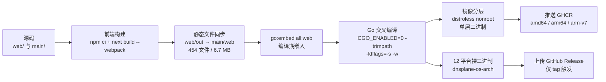
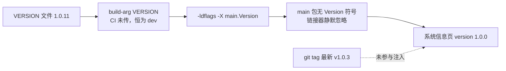
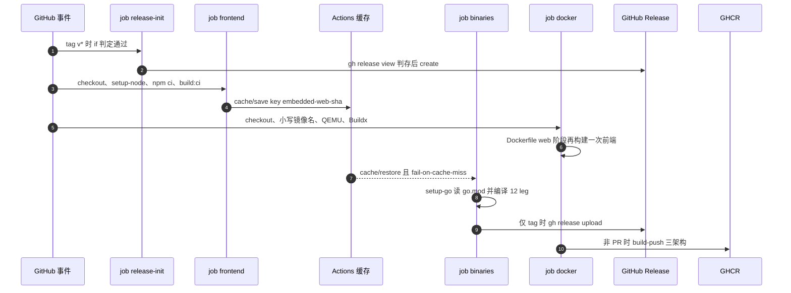
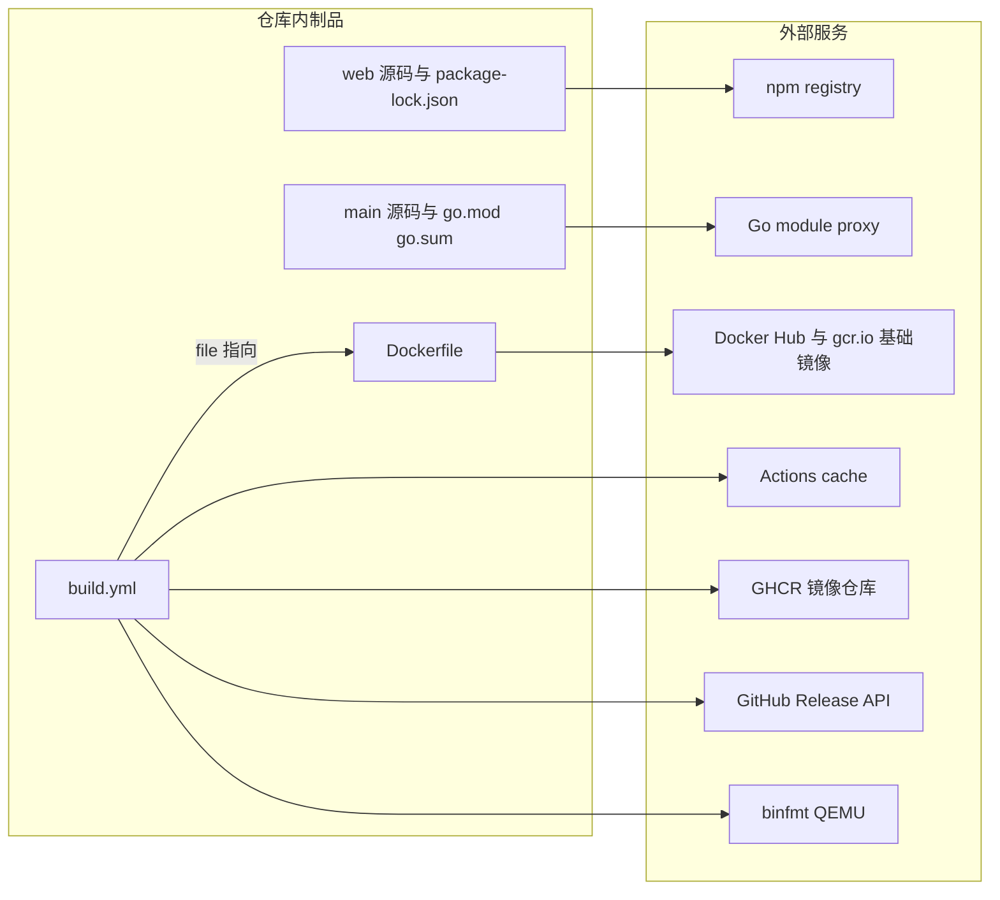
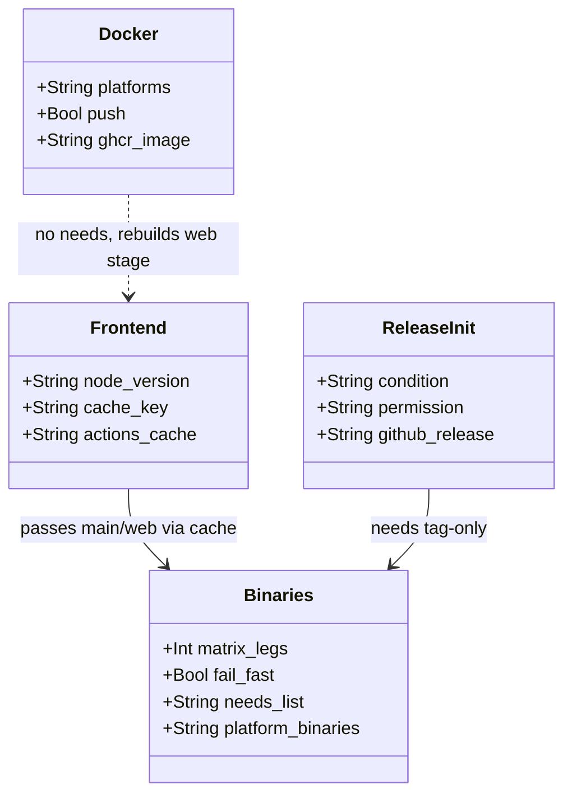
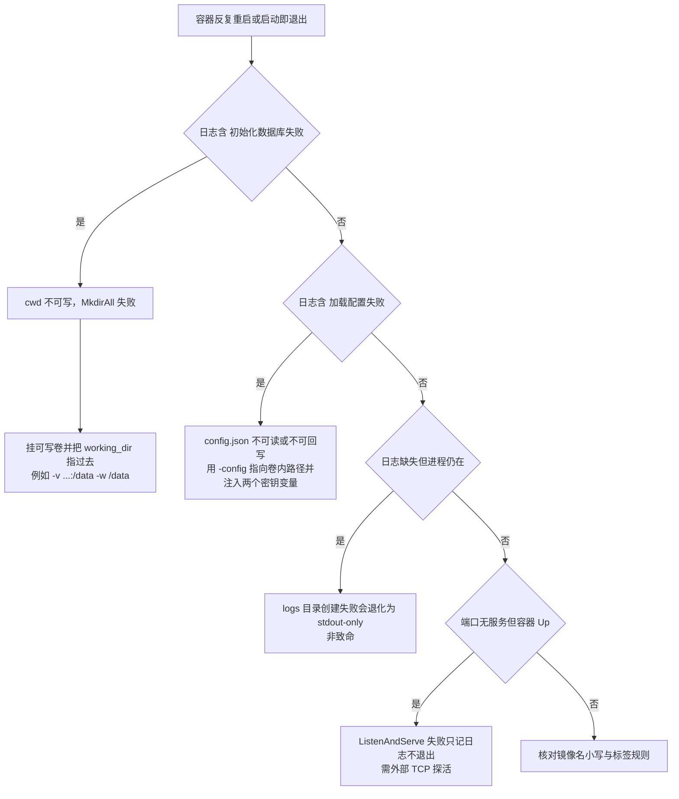

# 部署架构

<cite>
**本文档引用的文件**
- [Dockerfile](file://Dockerfile)
- [.dockerignore](file://.dockerignore)
- [.gitignore](file://.gitignore)
- [VERSION](file://VERSION)
- [README.md](file://README.md)
- [build.yml](file://.github/workflows/build.yml)
- [build.sh](file://scripts/build.sh)
- [docker-build.sh](file://scripts/docker-build.sh)
- [package.json](file://web/package.json)
- [next.config.ts](file://web/next.config.ts)
- [sync-main-web.cjs](file://web/scripts/sync-main-web.cjs)
- [main.go](file://main/main.go)
- [go.mod](file://main/go.mod)
- [config.go](file://main/internal/config/config.go)
- [database.go](file://main/internal/database/database.go)
- [router.go](file://main/internal/api/router.go)
- [dashboard.go](file://main/internal/api/handler/dashboard.go)
- [logger.go](file://main/internal/logger/logger.go)
- [cache.go](file://main/internal/cache/cache.go)
- [check.go](file://main/internal/monitor/check.go)
- [local.go](file://main/internal/cert/deploy/servers/local.go)
</cite>

## 目录

1. [简介](#简介)
2. [项目结构](#项目结构)
3. [核心组件](#核心组件)
4. [架构总览](#架构总览)
5. [详细组件分析](#详细组件分析)
6. [依赖关系分析](#依赖关系分析)
7. [性能考虑](#性能考虑)
8. [故障排查指南](#故障排查指南)
9. [结论](#结论)
10. [附录](#附录)

## 简介

DNSPlane 的部署模型可以压缩成一句话：**前端静态导出产物被 `go:embed` 编进一个 Go 二进制，该二进制再被塞进 distroless 非 root 镜像，最终同时以"容器镜像"与"多平台裸二进制"两条通道交付。**

三个设计动机：

- **零依赖落地**：运行阶段基础镜像为 `gcr.io/distroless/static-debian12:nonroot`（[Dockerfile:32](file://Dockerfile#L32)），除二进制与 CA 证书外没有任何发行版内容，目标机器无需安装 Node、Go 或额外系统库。
- **单进程交付**：`//go:embed all:web` 与 `staticFS`（[main.go:63-64](file://main/main.go#L63-L64)）让控制台页面与 API 由同一进程、同一端口提供（默认 `0.0.0.0:8080`，[config.go:89-90](file://main/internal/config/config.go#L89-L90)），不存在静态服务器与跨域配置。
- **交叉编译友好**：`CGO_ENABLED=0`（[Dockerfile:24](file://Dockerfile#L24)、[build.yml:140](file://.github/workflows/build.yml#L140)）使一次宿主机构建即可产出 12 个 GOOS/GOARCH 组合。

关于"双流水线"必须澄清口径：**当前仓库只有 GitHub Actions 一条在用流水线**。CNB 的 `.cnb.yml` 已在提交 `66f4799` 中整体删除（`git show --stat` 实测 `.cnb.yml -360` 行、`build.yml +208` 行），`git cat-file -e HEAD:.cnb.yml` 报"路径不在 HEAD 中"，其演进序列（`6f89682` 新增、`119c9cd`/`f668f88`/`42f3a23`/`20f3865`/`156e21c`/`be8bab4`/`b374fcf` 迭代）全部失效。CNB 唯一残留是 `scripts/docker-build.sh:13` 的默认镜像仓库名与 `:47` 的 OCI source label，见第 5.7 节。

| 维度 | 当前口径 | 证据 |
| --- | --- | --- |
| 版本 | `VERSION` 为 `1.0.11`；`git tag` 最新为 `v1.0.3`；系统信息页 `version` 硬编码 `"1.0.0"` | [VERSION](file://VERSION)、`git tag` 实测、[dashboard.go:457](file://main/internal/api/handler/dashboard.go#L457) |
| 在用 CI | `build.yml`（208 行、4 个 job），全仓无其他流水线 `*.yml` | 目录遍历实测 |
| 编排与发布工具 | 无 `docker-compose*`、无 `.goreleaser.yml`；Release 由 `gh release create/upload` 直接完成 | 目录遍历实测、[build.yml:36-41](file://.github/workflows/build.yml#L36-L41) |
| 交付制品 | GHCR 多架构镜像（amd64/arm64/arm-v7）＋ Release 12 平台二进制 | [build.yml:73-110](file://.github/workflows/build.yml#L73-L110)、[build.yml:199-208](file://.github/workflows/build.yml#L199-L208) |
| 质量门禁 | 流水线**不含 `go test` / `golangci-lint` / `npm test`**；唯一实际门禁是前端 TypeScript 类型检查 | [build.yml:27-208](file://.github/workflows/build.yml#L27-L208)、[next.config.ts:9-13](file://web/next.config.ts#L9-L13) |

**章节来源**
- [Dockerfile:24-37](file://Dockerfile#L24-L37)
- [main/main.go:63-64](file://main/main.go#L63-L64)
- [main/internal/config/config.go:89-90](file://main/internal/config/config.go#L89-L90)
- [.github/workflows/build.yml:27-208](file://.github/workflows/build.yml#L27-L208)

## 项目结构

### 部署相关文件清单

部署面由"1 个镜像配方 + 1 条流水线 + 2 个本地脚本 + 1 个前端同步脚本"构成：

```text
dns/
├── Dockerfile                    三阶段镜像配方（37 行）
├── .dockerignore                 构建上下文排除（6 行）
├── .gitignore                    嵌入产物与密钥的入库边界（38 行）
├── VERSION                       版本单行源（1.0.11）
├── .github/workflows/build.yml   唯一在用流水线（208 行，4 job）
├── scripts/
│   ├── build.sh                  本地一键编译 + SHA256SUMS（69 行）
│   └── docker-build.sh           buildx 多架构构建/推送（67 行）
├── web/
│   ├── package.json              build:ci 入口
│   ├── next.config.ts            output: export（静态导出根因）
│   └── scripts/sync-main-web.cjs web/out → main/web（13 行）
└── main/
    ├── go.mod / go.sum           依赖清单（go 1.26.2），无 vendor 目录
    ├── main.go                   //go:embed all:web 与优雅关闭
    └── web/                      嵌入目标（被 .gitignore 忽略，454 文件 / 6.7 MB）
```

| 文件 | 行数 | 职责 | 变更影响面 |
| --- | --- | --- | --- |
| [Dockerfile](file://Dockerfile) | 37 | 三个阶段与交叉编译参数 | 所有镜像与 GHCR 制品 |
| [.dockerignore](file://.dockerignore) | 6 | 排除 `.git`、`.github` 与前端构建残留 | 上下文体积与缓存层内容 |
| [build.yml](file://.github/workflows/build.yml) | 208 | 四个 job 的编排、矩阵与推送条件 | Release 附件与镜像标签 |
| [build.sh](file://scripts/build.sh) | 69 | 本地 linux 二进制与 `SHA256SUMS` | 本地与私有化交付 |
| [docker-build.sh](file://scripts/docker-build.sh) | 67 | buildx 多架构构建与可选推送 | 私有仓库镜像名与 OCI label |
| [sync-main-web.cjs](file://web/scripts/sync-main-web.cjs) | 13 | 静态产物搬运进嵌入目录 | 二进制内前端是否为最新 |

**章节来源**
- [Dockerfile:1-37](file://Dockerfile#L1-L37)
- [.github/workflows/build.yml:1-208](file://.github/workflows/build.yml#L1-L208)
- [scripts/build.sh:1-69](file://scripts/build.sh#L1-L69)
- [web/scripts/sync-main-web.cjs:1-13](file://web/scripts/sync-main-web.cjs#L1-L13)

### 忽略规则与构建上下文卫生

`.dockerignore` 只有 6 条：`.git`(1)、`.github`(2)、`web/node_modules`(3)、`web/.next`(4)、`web/out`(5)、`**/*.md`(6)。它挡住了体积最大的垃圾，却没挡住最敏感的东西：`.gitignore` 挡住了 `main/config.json`(28)、`main/data/`(31)、`main/logs/`(30)、`main/web/`(33)、`main/main`(34) 与 `.cnb-token.local`(36)，但 `COPY main/ ./`（[Dockerfile:21](file://Dockerfile#L21)）读的是文件系统而不是 git 索引，两个边界彼此独立。

| 未被排除的路径 | 性质 | 进入构建上下文的后果 |
| --- | --- | --- |
| `main/config.json` | 本地配置，含 `jwt.secret` 与 `security.master_key` 实值（本文一律记为 `{JWT_SECRET_占位}` / `{MASTER_KEY_占位}`） | 进入 builder 层与 buildkit/Actions 缓存层；最终镜像只 `COPY /dnsplane`（[Dockerfile:34](file://Dockerfile#L34)），密钥不入产物但入缓存 |
| `main/main` | 上一轮编译的陈旧二进制 | 无谓放大上下文与层体积 |
| `main/data/`、`main/logs/` | 运行期 SQLite 与应用日志 | 真实业务数据与访问 IP 进入缓存层 |
| `main/web/` | 上一轮嵌入产物（454 文件 / 6.7 MB） | 与 [Dockerfile:22](file://Dockerfile#L22) 的覆盖写入冗余；`web` 阶段失败时可能静默残留旧前端 |

建议（属运维口径，非现状）：`.dockerignore` 追加 `main/config.json`、`main/data/`、`main/logs/`、`main/main`、`main/dist/`，把"密钥与运行数据永不进构建层"变成机制而非约定。

**章节来源**
- [.dockerignore:1-6](file://.dockerignore#L1-L6)
- [.gitignore:25-38](file://.gitignore#L25-L38)
- [Dockerfile:21-22](file://Dockerfile#L21-L22)

## 核心组件

### 三个镜像阶段

| 阶段 | 基础镜像 | 平台指令 | 逐行动作 | 产物落位 |
| --- | --- | --- | --- | --- |
| `web` | `node:22-bookworm-slim`（[Dockerfile:4](file://Dockerfile#L4)） | `--platform=$BUILDPLATFORM`（全架构只构建一次） | `WORKDIR /build/web`(5)、先拷两份清单(6)、三个 `npm config` 重试参数(7)、`npm ci`(8)、`COPY web/ ./`(9)、`npm run build:ci`(10) | `/build/web/out` → `/build/main/web` |
| `builder` | `golang:1.26.2-bookworm`（[Dockerfile:12](file://Dockerfile#L12)） | `--platform=$BUILDPLATFORM` + `GOOS/GOARCH/GOARM` | 4 个 `ARG`（`TARGETOS`/`TARGETARCH`/`TARGETVARIANT`/`VERSION=dev`）(13-16)、`WORKDIR /src/main`(17)、拷清单(19)、`go mod download`(20)、`COPY main/ ./`(21)、`COPY --from=web`(22)、`RUN set -eux` 编译(23-30) | `/dnsplane` |
| 运行 | `gcr.io/distroless/static-debian12:nonroot`（[Dockerfile:32](file://Dockerfile#L32)） | `--platform=$TARGETPLATFORM` | `WORKDIR /app`(33)、`COPY --from=builder`(34)、`USER nonroot:nonroot`(35)、`EXPOSE 8080`(36)、`ENTRYPOINT ["/app/dnsplane"]`(37) | 单层二进制，无 `HEALTHCHECK`、无 `VOLUME`、无 `LABEL` |

两个易被误读的细节：

- `web` 阶段产物在容器里的绝对路径是 `/build/main/web`，而非 `/build/web/main/web`。`sync-main-web.cjs:5` 用 `path.join(__dirname, "..", "..", "main", "web")` 上跳两级，容器内 `__dirname` 为 `/build/web/scripts`，最终落到 `/build/main/web`，与 [Dockerfile:22](file://Dockerfile#L22) 的取值路径对齐。
- `main/web` 被写入两次：`COPY main/ ./`(21) 带进宿主机残留产物，随后 `COPY --from=web ... ./web`(22) 覆盖。**生效的是第 22 行**，第 21 行那份只是缓存污染。

**章节来源**
- [Dockerfile:4-37](file://Dockerfile#L4-L37)
- [web/scripts/sync-main-web.cjs:4-13](file://web/scripts/sync-main-web.cjs#L4-L13)
- [main/main.go:63-64](file://main/main.go#L63-L64)

### CI 的四个 job

| job | 行号 | 触发条件 | needs | 关键 step | 产物 |
| --- | --- | --- | --- | --- | --- |
| `release-init` | 29-41 | `if: startsWith(github.ref, 'refs/tags/v')`(30) | 无 | `gh release view` 判存，不存在则 `gh release create --generate-notes`(39-40)，凭 `GH_TOKEN: github.token`(35) | 幂等 Release，规避矩阵并发创建竞争（28 行注释） |
| `frontend` | 43-65 | 所有触发 | 无 | `checkout@v7`(46)、`setup-node@v7` 带 `node-version: "22"` 与 `cache: npm`(48-52)、`npm ci && npm run build:ci`(57-59)、`cache/save@v5`(62-65) | 缓存条目 `embedded-web-<sha>`，路径 `main/web` |
| `binaries` | 67-158 | 所有触发，但受 needs 语义抑制（见第 6.2 节） | `[frontend, release-init]`(68) | `checkout@v7`(113)、`cache/restore@v5` 且 `fail-on-cache-miss: true`(115-119)、`setup-go@v7` 带 `go-version-file: main/go.mod`(121-124)、`Go build`(127-141)、`Upload release asset`(143-158) | 12 平台二进制，仅 tag 上传 |
| `docker` | 160-208 | 所有触发，**不 needs frontend** | 无 | `checkout@v7`(163)、镜像名小写(166-171)、QEMU(173-174)、Buildx(176-177)、login(179-185)、metadata(187-195)、build-push(197-208) | GHCR 多架构镜像 |

`docker` 不依赖 `frontend`，是因为镜像内前端由 `Dockerfile` 的 `web` 阶段自建；代价是一次 workflow 运行会**把前端构建两遍**（npm 缓存与 buildx `type=gha` 缓存只能部分抵消）。

**章节来源**
- [.github/workflows/build.yml:27-208](file://.github/workflows/build.yml#L27-L208)
- [Dockerfile:4-10](file://Dockerfile#L4-L10)

## 架构总览

从源码到可运行制品的完整数据流，六个节点分别对应"源码 → 前端构建 → 静态文件同步 → Go 交叉编译 → 镜像分层 → 推送"：



**图表来源**
- [Dockerfile:4-37](file://Dockerfile#L4-L37)
- [web/package.json:8](file://web/package.json#L8)
- [web/scripts/sync-main-web.cjs:4-13](file://web/scripts/sync-main-web.cjs#L4-L13)
- [.github/workflows/build.yml:127-158](file://.github/workflows/build.yml#L127-L158)

链路上有四条"缺一即失败"的硬约束：

| 约束 | 位置 | 失败表现 |
| --- | --- | --- |
| `main/web` 必须存在，否则 `//go:embed all:web` 无法匹配 | [main.go:63](file://main/main.go#L63)，该目录被 [.gitignore:33](file://.gitignore#L33) 忽略 | 干净仓库直接 `go build` 报 `pattern all:web: no matching files` |
| CI 用 `actions/cache` 而非 `artifact` 传递 `main/web` | [build.yml:61-65](file://.github/workflows/build.yml#L61-L65)、[build.yml:115-119](file://.github/workflows/build.yml#L115-L119) | `fail-on-cache-miss: true` 显式失败，不退回空目录 |
| `web/out` 不存在时同步脚本主动退出 | [sync-main-web.cjs:7-10](file://web/scripts/sync-main-web.cjs#L7-L10) | 打印 `missing out/ — run next build first` 并 `exit 1` |
| 前端类型错误中断构建 | [next.config.ts:9-13](file://web/next.config.ts#L9-L13)（`typescript.ignoreBuildErrors` 已移除） | 这是流水线目前唯一真实存在的质量门禁 |

运行侧形态与构建侧同样重要：`ENTRYPOINT` 为 exec 形式，PID 1 即业务进程；进程注册 `SIGINT`/`SIGTERM`（[main.go:146](file://main/main.go#L146)）并以固定 10 秒超时执行 `srv.Shutdown`（[main.go:150-154](file://main/main.go#L150-L154)），因此 `docker stop` 链路可用；而 `ListenAndServe` 失败只记日志不退出（[main.go:141-143](file://main/main.go#L141-L143)）这一事实，直接决定第 8.4 节的探活方案。

**章节来源**
- [Dockerfile:1-37](file://Dockerfile#L1-L37)
- [.github/workflows/build.yml:61-119](file://.github/workflows/build.yml#L61-L119)
- [main/main.go:63-64](file://main/main.go#L63-L64)
- [main/main.go:141-154](file://main/main.go#L141-L154)

## 详细组件分析

### 阶段一 web：前端构建单元

`web` 阶段是整条流水线里唯一被"平台"刻意绕开的阶段。[Dockerfile:2](file://Dockerfile#L2) 的注释写明动机：**前端只在 `BUILDPLATFORM` 上构建一次，避免多架构并行 `npm ci` 拖垮网络导致超时**。因此三架构镜像共享同一份前端产物，只有 Go 编译与运行阶段跟随 `TARGETPLATFORM`。

依赖层与源码层在第 6 行与第 9 行之间切开：先拷 `package.json` 与 `package-lock.json`，再 `npm ci`，最后才 `COPY web/ ./`。清单不变则改业务代码不触发重装依赖。第 7 行把 npm 的 HTTP 重试次数设为 5、最小重试间隔 20 秒、最大重试超时 120 秒，是对"到 registry 链路抖动"的直接补偿。

构建命令来自 [package.json:8](file://web/package.json#L8) 的 `build:ci`：`next build --webpack && node scripts/sync-main-web.cjs`。两点值得注意：显式 `--webpack`（不使用 `dev` 脚本里的 Turbopack）；同文件的 `build` 脚本（第 7 行）是 **Windows-only**，命令含 `set "ANALYZE=true"` 与 `powershell -NoProfile -Command ...`，而 [README.md:58](file://README.md#L58) 与 [README.md:151](file://README.md#L151) 恰恰引导 `bun run build` 并声称产物在 `../main/web/out`——实际产物落在 `main/web`（无 `out` 子目录）。

静态导出能力由 [next.config.ts:4-8](file://web/next.config.ts#L4-L8) 决定：`output: 'export'`、`trailingSlash: true`、`images.unoptimized: true`。`trailingSlash` 与后端 `NoRoute` 的逐级回退（[router.go:411-456](file://main/internal/api/router.go#L411-L456)）是配套设计，否则嵌入 FS 里的 `xxx/index.html` 无法被路径拼中。

**章节来源**
- [Dockerfile:2-10](file://Dockerfile#L2-L10)
- [web/package.json:5-11](file://web/package.json#L5-L11)
- [web/next.config.ts:3-13](file://web/next.config.ts#L3-L13)
- [README.md:58](file://README.md#L58)

### 阶段二 builder：Go 交叉编译单元

第 19-20 行是模块模式的核心：先只拷 `main/go.mod` 与 `main/go.sum`，再 `go mod download`，[Dockerfile:18](file://Dockerfile#L18) 的注释解释意图为"依赖不变即可复用 download 层"。仓库内**不存在 `main/vendor` 目录**（实测），故构建必然需要访问模块代理，[build.yml:3-4](file://.github/workflows/build.yml#L3-L4) 的注释同样写明这一点。

交叉编译参数逐行看：

- 第 23 行 `set -eux`：任何一步失败立刻中断，并把命令回显到日志，便于 CI 排障。
- 第 24 行导出 `CGO_ENABLED=0`、`GOOS=${TARGETOS}`、`GOARCH=${TARGETARCH}`。本阶段跑在 `BUILDPLATFORM`，`TARGET*` 可与宿主架构不同，这正是"一台 runner 出三架构"的前提。
- 第 25-27 行处理 ARM 变体：仅当 `TARGETARCH=arm` 且 `TARGETVARIANT` 非空时，用 `${TARGETVARIANT#v}` 去前缀赋给 `GOARM`，于是 Buildx 的 `linux/arm/v7` 翻译成 `GOARM=7`，与矩阵里的 `goarm: "7"`（[build.yml:82](file://.github/workflows/build.yml#L82)）口径一致。
- 第 28-30 行 `go build -buildvcs=false -trimpath -ldflags="-s -w -X main.Version=${VERSION}" -o /dnsplane .`。`-buildvcs=false` 让镜像构建不强依赖已被排除的 `.git`（[.dockerignore:1](file://.dockerignore#L1)），`-trimpath` 保证层可复现，`-s -w` 剥符号表与 DWARF。

第 22 行的 `COPY --from=web /build/main/web ./web` 把前端产物放进嵌入目录（`WORKDIR` 为 `/src/main`，相对 `./web` 即 `main/web`），至此 `//go:embed all:web` 才有内容可嵌。

**章节来源**
- [Dockerfile:12-30](file://Dockerfile#L12-L30)
- [.dockerignore:1](file://.dockerignore#L1)
- [.github/workflows/build.yml:3-4](file://.github/workflows/build.yml#L3-L4)
- [main/main.go:63-64](file://main/main.go#L63-L64)

### 阶段三 runtime：distroless 非 root 运行单元

| 行 | 指令 | 部署含义 | 副作用 |
| --- | --- | --- | --- |
| 33 | `WORKDIR /app` | 进程 cwd 为 `/app`，一切相对路径以此为基准 | 该目录由 root 创建，切到 `nonroot`（uid 65532）后**不可写** |
| 34 | `COPY --from=builder /dnsplane /app/dnsplane` | 最终镜像只有一个文件 | 未带 `--chown`，二进制属 root |
| 35 | `USER nonroot:nonroot` | 非 root 运行，满足最小权限与多数集群基线 | 无 `CAP_NET_RAW`，ICMP 探测降级 TCP:80（[check.go:68](file://main/internal/monitor/check.go#L68)、[check.go:151-160](file://main/internal/monitor/check.go#L151-L160)） |
| 36 | `EXPOSE 8080` | 与 [config.go:89](file://main/internal/config/config.go#L89) 默认 `Port: 8080` 对齐 | 运行期改端口则元数据失真；`EXPOSE` 本身不做映射 |
| 37 | `ENTRYPOINT ["/app/dnsplane"]` | exec 形式，可正常接收 `docker stop` 的 `SIGTERM` | 不带 `-config`，默认读相对 cwd 的 `config.json`（[main.go:67](file://main/main.go#L67)） |

这里是全文最重要的一处冲突：**进程在启动早期就要写盘**。`database.Init` 按 `cfg.FilePath`（默认 `data/dnsplane.db`，[config.go:95](file://main/internal/config/config.go#L95)）的目录执行 `os.MkdirAll(dir, 0755)`（[database.go:94](file://main/internal/database/database.go#L94)），日志器要建相对 cwd 的 `logs` 目录（[logger.go:53-54](file://main/internal/logger/logger.go#L53-L54)、[logger.go:70](file://main/internal/logger/logger.go#L70)），配置器在文件缺失时还要回写 `config.json`（[config.go:105-111](file://main/internal/config/config.go#L105-L111)，`saveConfig` 以 `0700`/`0600` 落盘）。三者都相对 cwd，而 `/app` 不可写 → `MkdirAll` 失败 → `database.Init` 返回错误 → `os.Exit(1)`（[main.go:76-79](file://main/main.go#L76-L79)）→ **容器 CrashLoop**。

可行配方是把可写卷变成进程 cwd 并显式指定配置路径：

```bash
docker run -d --name dnsplane \
  -p 127.0.0.1:8080:8080 -v $HOME/dnsplane-data:/data -w /data \
  -e DNSPLANE_JWT_SECRET='{JWT_SECRET_占位}' \
  -e DNSPLANE_MASTER_KEY='{MASTER_KEY_占位}' \
  dnsplane:local -config /data/config.json
```

三个要点：`-w /data` 让 `data/`、`logs/` 落到可写卷；`-config /data/config.json` 保证密钥回写可成功；两个环境变量（[config.go:122-127](file://main/internal/config/config.go#L122-L127)）固定 `jwt.secret` 与 `security.master_key`，避免容器重建时随机换密钥导致既有密文不可解。除这两个键外**没有任何其他环境变量能覆盖配置**（全仓 `os.Getenv` 仅命中这两处），`GIN_MODE` 一类标准变量一律无效。

**章节来源**
- [Dockerfile:32-37](file://Dockerfile#L32-L37)
- [main/internal/config/config.go:89-127](file://main/internal/config/config.go#L89-L127)
- [main/internal/database/database.go:94](file://main/internal/database/database.go#L94)
- [main/main.go:67-79](file://main/main.go#L67-L79)

### 版本注入：-ldflags 的三段链

版本值有三条注入路径，但**三条都没有落地**：

| 入口 | 版本来源 | 注入形式 | 实际效果 |
| --- | --- | --- | --- |
| Docker | `ARG VERSION=dev`（[Dockerfile:16](file://Dockerfile#L16)），CI 的 `build-push-action` 未传 `build-args`（[build.yml:197-208](file://.github/workflows/build.yml#L197-L208)） | `-X main.Version=${VERSION}`（[Dockerfile:29](file://Dockerfile#L29)） | 恒为 `dev`，且无落地符号 |
| `scripts/build.sh` | 优先级：环境变量 `VERSION` > 根 `VERSION` 文件（`tr -d '[:space:]'`）> `git describe --tags --always --dirty` > `dev`（[build.sh:38-44](file://scripts/build.sh#L38-L44)） | `-X main.Version=${VERSION}`（[build.sh:45](file://scripts/build.sh#L45)） | 值可正确解析，同样无落地符号 |
| CI `binaries` job | 完全不解析版本 | 仅 `-ldflags="-s -w"`（[build.yml:141](file://.github/workflows/build.yml#L141)） | 连 `-X` 都没有 |



**图表来源**
- [Dockerfile:16-30](file://Dockerfile#L16-L30)
- [scripts/build.sh:38-45](file://scripts/build.sh#L38-L45)
- [main/internal/api/handler/dashboard.go:457](file://main/internal/api/handler/dashboard.go#L457)

根因在 Go 侧：`-X importpath.Name=value` 只能写入**已存在的** string 变量。实测 `main/*.go`（该目录下仅 `main.go` 一个文件）全文不含 `Version` 标识符，链接器对未定义符号静默忽略、构建不报错，于是运行版本的唯一可见来源变成系统信息接口的硬编码 `"1.0.0"`（[dashboard.go:457](file://main/internal/api/handler/dashboard.go#L457)），并与 `VERSION` 的 `1.0.11`、`git tag` 的 `v1.0.3` 形成三处口径分裂。

最小修复（属建议，非现状）：`main.go` 增加 `var Version = "dev"` 并让 `GetSystemInfo` 返回它；`build-push-action` 加 `build-args: VERSION=${{ github.ref_name }}`；`Go build` 步骤补 `-X main.Version=...`。三处改动都不触碰业务逻辑。

**章节来源**
- [Dockerfile:16-30](file://Dockerfile#L16-L30)
- [scripts/build.sh:38-45](file://scripts/build.sh#L38-L45)
- [main/main.go:66-68](file://main/main.go#L66-L68)
- [main/internal/api/handler/dashboard.go:457](file://main/internal/api/handler/dashboard.go#L457)

### 多架构矩阵：12 leg 二进制与 3 平台镜像

`binaries` 用 `matrix.include` 显式列举 12 条 leg（[build.yml:73-110](file://.github/workflows/build.yml#L73-L110)）而非笛卡尔积，以便精确控制存在的组合：

| GOOS | GOARCH 组合 | GOARM | artifact 后缀 |
| --- | --- | --- | --- |
| linux | amd64、arm64、arm、386、ppc64le、riscv64 | arm 一条为 `7` | `linux-amd64`、`linux-arm64`、`linux-armv7`、`linux-386`、`linux-ppc64le`、`linux-riscv64` |
| darwin | amd64、arm64 | 无 | `darwin-amd64`、`darwin-arm64` |
| windows | amd64、arm64 | 无 | `windows-amd64`、`windows-arm64`，均追加 `.exe`（[build.yml:138](file://.github/workflows/build.yml#L138)） |
| freebsd | amd64、arm64 | 无 | `freebsd-amd64`、`freebsd-arm64` |

需指出大纲口径与代码事实的差异：**ARM leg 是 `GOARM=7`（armv7），矩阵里不存在 armv6**。[Dockerfile:25-27](file://Dockerfile#L25-L27) 与镜像平台 `linux/arm/v7`（[build.yml:203](file://.github/workflows/build.yml#L203)）同样只覆盖 v7。若要覆盖 armv6，必须新增 `goarm: "6"` 的 leg 并把 `linux/arm/v6` 加进镜像平台列表，二者都是改动而非现状。

矩阵策略为 `fail-fast: false`（[build.yml:70-71](file://.github/workflows/build.yml#L70-L71)）：单 leg 失败不中断其余 leg，但整个 job 仍判失败。上传只在 tag 时执行（[build.yml:144](file://.github/workflows/build.yml#L144)），且先 `shopt -s nullglob` 再判空目录（[build.yml:151-156](file://.github/workflows/build.yml#L151-L156)），避免把字面量 `*` 传给 `gh`。镜像侧条件（[build.yml:203-204](file://.github/workflows/build.yml#L203-L204)）：PR 只构建 `linux/amd64`，其余构建三架构；`push` 要求非 PR 且分支为 `main`/`master` 或 ref 为 `v*` tag。QEMU（[build.yml:173-174](file://.github/workflows/build.yml#L173-L174)）只服务运行阶段的平台差异，编译仍在宿主架构上完成。

**章节来源**
- [.github/workflows/build.yml:70-110](file://.github/workflows/build.yml#L70-L110)
- [.github/workflows/build.yml:138-158](file://.github/workflows/build.yml#L138-L158)
- [.github/workflows/build.yml:173-208](file://.github/workflows/build.yml#L173-L208)

### 前端 build:ci 与 sync-main-web.cjs

同步脚本只有 13 行，语义是"全删重建"：源 `web/out`(4)、目标 `main/web`(5)、缺源即报错退出(7-10)、`fs.rmSync(recursive, force)` + `fs.cpSync(recursive)`(12-13)。

| 特性 | 现状 | 影响 |
| --- | --- | --- |
| 增量与校验 | 无（不比对文件数、不生成摘要） | 每次全量拷贝 454 文件 / 6.7 MB，无法自证 `main/web` 与 `web/out` 一致 |
| 白名单 | 无（全量递归） | `out` 内任何意外文件都会被嵌进二进制 |
| 原子性 | 先删后拷 | 中断会留下半个嵌入目录，需重跑 |
| 失败可见性 | 有（缺 `out` 主动 `exit 1`） | 这是防"空前端打进二进制"的唯一保险 |

CI 里前后端产物通过 Actions 缓存跨 job 传递，时序如下：



**图表来源**
- [.github/workflows/build.yml:43-208](file://.github/workflows/build.yml#L43-L208)
- [web/scripts/sync-main-web.cjs:1-13](file://web/scripts/sync-main-web.cjs#L1-L13)
- [Dockerfile:4-10](file://Dockerfile#L4-L10)

用 `actions/cache` 而非 `artifact` 的取舍写在 [build.yml:61](file://.github/workflows/build.yml#L61) 的注释里：**避开 artifact 存储配额**。代价是缓存 key 含 `github.sha`（[build.yml:64](file://.github/workflows/build.yml#L64)、[build.yml:117](file://.github/workflows/build.yml#L117)），同一 commit 重跑时 key 已存在，`cache/save` 在重复 key 下的行为（覆盖或报错）本次未验证，属**未知**；若为报错，"重跑失败 job"这条路会被卡住。

**章节来源**
- [web/scripts/sync-main-web.cjs:4-13](file://web/scripts/sync-main-web.cjs#L4-L13)
- [.github/workflows/build.yml:61-65](file://.github/workflows/build.yml#L61-L65)
- [.github/workflows/build.yml:115-119](file://.github/workflows/build.yml#L115-L119)

### 本地脚本与 CI 的口径差异

| 维度 | Dockerfile（镜像） | build.yml binaries job | scripts/build.sh | scripts/docker-build.sh |
| --- | --- | --- | --- | --- |
| 前端命令 | `npm ci && npm run build:ci`(8、10) | 同 `build:ci`(57-59) | 有 `bun` 且有 `bun.lock` 走 bun，否则 npm(20-33) | 交由 Dockerfile |
| Go 命令 | `-buildvcs=false -trimpath`(28) | `CGO_ENABLED=0 ... `(140-141) | `CGO_ENABLED=0 GOOS=linux GOARCH=$ARCH`(52-55) | `docker buildx build --platform`(43-64) |
| ldflags | `-s -w -X main.Version`(29) | `-s -w`(141) | `-s -w -X main.Version`(45) | 继承 Dockerfile |
| 平台覆盖 | `TARGET*` 驱动，CI 三架构 | 12 leg | **只出 linux**（`GOOS=linux` 硬编码于 52） | 默认 amd64、arm64(14) |
| 产物 | `/dnsplane` → 镜像层 | `main/dist/dnsplane-<artifact>` | `dist/dnsplane-linux-<arch>` + `SHA256SUMS`(60-67) | 多架构镜像 + `:latest`(45-46) |
| 镜像仓库 | CI 推 `ghcr.io/${{ github.repository }}`(25) | — | — | 默认 `docker.cnb.cool/neko_kernel/dnsplane`(13)，OCI source label 指向 `https://cnb.cool/Neko_Kernel/DNSPlane`(47) |

分叉的实际后果：**本地脚本推的镜像与 CI 推的不是同一仓库**，且 OCI 元数据里的源码地址指向已停用的 CNB；`--load` 只在"平台恰好等于本机单架构"时执行（[docker-build.sh:56-65](file://scripts/docker-build.sh#L56-L65)），多架构默认不导出，需 `--push`。另一处缺口是校验和：`SHA256SUMS` 只有 [build.sh:60-67](file://scripts/build.sh#L60-L67) 会生成，CI 的上传步骤不产摘要（[build.yml:143-158](file://.github/workflows/build.yml#L143-L158)），因此 Release 上的 12 个二进制**没有官方摘要**。

**章节来源**
- [Dockerfile:16-30](file://Dockerfile#L16-L30)
- [.github/workflows/build.yml:25](file://.github/workflows/build.yml#L25)
- [scripts/build.sh:20-67](file://scripts/build.sh#L20-L67)
- [scripts/docker-build.sh:13-65](file://scripts/docker-build.sh#L13-L65)

## 依赖关系分析

### 构建期外部服务依赖



**图表来源**
- [Dockerfile:4-32](file://Dockerfile#L4-L32)
- [.github/workflows/build.yml:48-52](file://.github/workflows/build.yml#L48-L52)
- [.github/workflows/build.yml:115-124](file://.github/workflows/build.yml#L115-L124)
- [.github/workflows/build.yml:173-208](file://.github/workflows/build.yml#L173-L208)

| 外部服务 | 被谁依赖 | 具体取用 | 失败影响 | 网络强度 |
| --- | --- | --- | --- | --- |
| npm registry | `web` 阶段、`frontend` job | `npm ci` 按 `web/package-lock.json` 精确安装 | 前端无法产出，`go:embed` 随后失败 | 强（一次性大流量，已用 `fetch-retries` 补偿） |
| Go module proxy | `builder` 阶段、`binaries` job | `go mod download`，无 `vendor` 兜底 | `go build` 直接失败 | 强 |
| Docker Hub / `gcr.io` | 三个镜像阶段 | `node:22-bookworm-slim`、`golang:1.26.2-bookworm`、`distroless/static-debian12:nonroot` | 阶段无法启动 | 中（buildx 缓存可缓解） |
| Actions cache | `frontend` → `binaries` | key `embedded-web-<sha>`，`fail-on-cache-miss: true` | `binaries` 显式失败 | 平台内部 |
| GitHub Release API | `release-init`、`binaries` | `gh release view/create/upload`，凭自动注入令牌(35、146) | tag 构建无法发布附件 | 中 |
| GHCR | `docker` job | 以 `github.actor` + `secrets.GITHUB_TOKEN`(181-185) 登录后推送 | 镜像不推送（PR 本就不推） | 中 |
| QEMU binfmt | `docker` job | 三架构运行阶段模拟(173-174) | 非宿主架构无法组装 | 平台内部 |

`secrets` 面只有一个自动注入的平台令牌：全文件未引用任何仓库级或组织级自定义 secret，即流水线**不含需要人工保管的凭据**，镜像推送权限完全由 workflow 级 `packages: write`（[build.yml:20-22](file://.github/workflows/build.yml#L20-L22)）承担并被四个 job 全部继承——按最小权限原则应下推到真正需要的 job。

**章节来源**
- [Dockerfile:4-32](file://Dockerfile#L4-L32)
- [.github/workflows/build.yml:20-22](file://.github/workflows/build.yml#L20-L22)
- [.github/workflows/build.yml:115-119](file://.github/workflows/build.yml#L115-L119)
- [.github/workflows/build.yml:173-185](file://.github/workflows/build.yml#L173-L185)

### job 依赖与 needs 传导

`binaries` 的 `needs: [frontend, release-init]`（[build.yml:68](file://.github/workflows/build.yml#L68)）与 `release-init` 的 tag-only `if`（[build.yml:30](file://.github/workflows/build.yml#L30)）组合出一个反直觉结果。按 Actions 语义——被依赖 job 失败或被跳过时，依赖它的 job 同样被跳过，除非该 job 自己写了继续条件表达式（本文件 `binaries` 未写 `if: !cancelled()`）——**推断**：非 tag 触发时 `binaries` 整体跳过，各平台二进制只在打 tag 时产出。这与 [build.yml:6-9](file://.github/workflows/build.yml#L6-L9) 的注释声明一致，但与"push 到 main/master 也该出二进制"的直觉不一致；该结论来自语义推导，未在真实 Actions 环境复现，属**待确认**。



**图表来源**
- [.github/workflows/build.yml:29-68](file://.github/workflows/build.yml#L29-L68)
- [.github/workflows/build.yml:160-204](file://.github/workflows/build.yml#L160-L204)

流水线**未配置 `concurrency` 组**（全文检索零命中），也未设 `timeout-minutes`。前者意味着同一分支连续 push 会并行跑多份完整流水线，GHCR 的 `:latest` 与分支标签存在被后发运行覆盖的竞态；后者意味着卡死的运行会占用 Actions 默认的 360 分钟额度。

**章节来源**
- [.github/workflows/build.yml:6-9](file://.github/workflows/build.yml#L6-L9)
- [.github/workflows/build.yml:29-30](file://.github/workflows/build.yml#L29-L30)
- [.github/workflows/build.yml:68](file://.github/workflows/build.yml#L68)
- [.github/workflows/build.yml:160-204](file://.github/workflows/build.yml#L160-L204)

### 镜像标签与运行期依赖

标签规则集中在 `docker/metadata-action@v6`（[build.yml:187-195](file://.github/workflows/build.yml#L187-L195)），镜像名先经一步小写化（[build.yml:166-171](file://.github/workflows/build.yml#L166-L171)），因为仓库名可能含大写而 OCI 仓库名必须小写：

| 规则 | 触发场景 | 产出标签 |
| --- | --- | --- |
| `type=ref,event=branch` | push 到 `main`/`master` | `ghcr.io/<repo>:main` |
| `type=semver,pattern={{version}}` | tag `v1.0.11` | `:1.0.11` |
| `type=semver,pattern={{major}}.{{minor}}` | tag `v1.0.11` | `:1.0` |
| `type=sha,prefix=` | 非 PR 触发 | 短提交 SHA 标签 |

运行期依赖只有三项：SQLite 文件（默认 `data/dnsplane.db`）、可选 Redis、可选出网代理。Redis 的容错是**降级而非失败**：`cache.Init` 用 3 秒超时的 `Ping`（[cache.go:69-70](file://main/internal/cache/cache.go#L69-L70)），不通则 `logger.Warn` 回退内存缓存并继续启动（[cache.go:73](file://main/internal/cache/cache.go#L73)）。因此"Redis 挂了 DNSPlane 起不来"不成立，但语义会从共享缓存退化为进程内缓存，多副本部署时尤其要注意。

**章节来源**
- [.github/workflows/build.yml:166-195](file://.github/workflows/build.yml#L166-L195)
- [main/internal/config/config.go:94-95](file://main/internal/config/config.go#L94-L95)
- [main/internal/cache/cache.go:69-73](file://main/internal/cache/cache.go#L69-L73)

## 性能考虑

### 构建性能：缓存边界与重复工作

构建时长由"哪一层被迫重做"决定，当前配方把缓存边界切在三处：

| 边界 | 机制 | 位置 | 命中条件 | 失效代价 |
| --- | --- | --- | --- | --- |
| npm 依赖层 | 先拷两份清单再 `npm ci` | [Dockerfile:6-8](file://Dockerfile#L6-L8) | 两份清单未变 | 否则重装全部前端依赖（分钟级） |
| Go 模块层 | 先拷 `go.mod`/`go.sum` 再 `go mod download` | [Dockerfile:19-20](file://Dockerfile#L19-L20) | 依赖清单未变 | 否则重下所有模块 |
| Actions 侧缓存 | `cache: npm`、`setup-go` 模块缓存、buildx `type=gha,mode=max` | [build.yml:48-52](file://.github/workflows/build.yml#L48-L52)、[build.yml:121-124](file://.github/workflows/build.yml#L121-L124)、[build.yml:207-208](file://.github/workflows/build.yml#L207-L208) | 锁文件与 `go.sum` 参与 key | 冷缓存时网络流量翻倍 |
| 跨 job 产物 | `cache/save` + `cache/restore` | [build.yml:62-65](file://.github/workflows/build.yml#L62-L65) | 同一 `github.sha` | miss 时 `binaries` 直接失败 |

两处结构性浪费：`docker` job 不复用 `main/web`，前端在 Actions 层与镜像层各构建一遍；无 `concurrency` 组，重复 push 会把上述工作乘以运行份数。前者可让 `docker` 从缓存恢复 `main/web` 并在 Dockerfile 加开关跳过 `web` 阶段，后者一行 `concurrency` 配置即可解决。

**章节来源**
- [Dockerfile:6-20](file://Dockerfile#L6-L20)
- [.github/workflows/build.yml:48-124](file://.github/workflows/build.yml#L48-L124)
- [.github/workflows/build.yml:203-208](file://.github/workflows/build.yml#L203-L208)

### 交叉编译与制品体积

`CGO_ENABLED=0` 出现在 [Dockerfile:24](file://Dockerfile#L24)、[build.yml:140](file://.github/workflows/build.yml#L140)、[build.sh:52](file://scripts/build.sh#L52) 三处，收益是同一条：产物不链接 libc，因此可在 `BUILDPLATFORM` 上为任意 GOOS/GOARCH 编译，运行阶段才可选 distroless。反面代价同样要写清：SQLite 走纯 Go 驱动（`main/go.mod` 里的 `github.com/glebarez/sqlite`），这是为可移植性付的固定成本；需要 shell 或系统工具的运行时行为在容器内必然失败（见第 8.3 节）；无 CGO 时 `net` 包走纯 Go 解析，在复杂 hosts/mDNS 环境下行为可能与 glibc 不同（推断，未在本项目复现）。

| 项 | 量级 | 依据与置信度 |
| --- | --- | --- |
| 嵌入前端 | 6.7 MB / 454 文件 | 本次 `du` 实测 |
| 压缩后二进制 | 约 22 MB（量级参考） | 分析阶段本机实测（`go1.27.1`，与 CI 锚定的 `go 1.26.2` 不同），本次未复测 |
| Release 附件 | 12 个二进制，**无校验和** | [build.yml:73-110](file://.github/workflows/build.yml#L73-L110)、[build.yml:143-158](file://.github/workflows/build.yml#L143-L158) |
| 多架构 manifest | 3 个平台（v7，不含 v6） | [build.yml:203](file://.github/workflows/build.yml#L203) |

**章节来源**
- [Dockerfile:24-28](file://Dockerfile#L24-L28)
- [main/go.mod:3](file://main/go.mod#L3)
- [.github/workflows/build.yml:73-158](file://.github/workflows/build.yml#L73-L158)

### 运行期容量与观测

部署形态直接影响进程行为，容量规划时必须考虑三点：

- HTTP 服务器只设 `ReadHeaderTimeout: 30s` 与 `IdleTimeout: 120s`（[main.go:133-138](file://main/main.go#L133-L138)），没有 `ReadTimeout`/`WriteTimeout`，前置 LB 与慢客户端会让连接与 goroutine 长期堆积，容器 limit 是唯一兜底。
- `GOMAXPROCS` 未显式设置（`main.go` 全文无该调用），建议显式配置 CPU limit，使调度份额与容器配额一致。
- 静态资源已由 embed 免去磁盘 IO：HTML/txt 走 `no-cache`，其余走 `max-age=31536000` 加 sha256 `ETag` 与 304 复用（[router.go:392-398](file://main/internal/api/router.go#L392-L398)）；`RedirectTrailingSlash`/`RedirectFixedPath` 被关闭（[router.go:26-27](file://main/internal/api/router.go#L26-L27)），省掉每请求一次的重定向查找。

**章节来源**
- [main/main.go:133-138](file://main/main.go#L133-L138)
- [main/internal/api/router.go:26-27](file://main/internal/api/router.go#L26-L27)
- [main/internal/api/router.go:392-398](file://main/internal/api/router.go#L392-L398)

## 故障排查指南

### npm ci 超时与依赖漂移

- 镜像与 CI 的容错不对称：`web` 阶段有 [Dockerfile:7](file://Dockerfile#L7) 的三个 `npm config`（重试 5 次、间隔 20 秒、上限 120 秒），而 `frontend` job 只是裸 `npm ci`（[build.yml:57-59](file://.github/workflows/build.yml#L57-L59)）。出现 `ECONNRESET`/`ETIMEDOUT` 时，先在 job 前补一步 `npm config set`，或使用带镜像源的 `.npmrc`（当前仓库不存在该文件，属未知缺省）。
- 依赖解析可能漂移：仓库同时存在 `web/package-lock.json` 与 `web/bun.lock`，Docker 与 CI 走 npm 锁（[Dockerfile:6](file://Dockerfile#L6)、[build.yml:52](file://.github/workflows/build.yml#L52)），而 [build.sh:23-29](file://scripts/build.sh#L23-L29) 检测到 `bun` 时优先走 bun 锁。需要与官方产物一致时显式使用 `npm ci`。
- 本地在 Linux 执行 `npm run build` 报 `set: command not found` 或 `powershell: not found`：这是 [package.json:7](file://web/package.json#L7) 的 Windows-only 脚本，CI/镜像一律走第 8 行的 `build:ci`，README 的引导不可照搬。

**章节来源**
- [Dockerfile:6-8](file://Dockerfile#L6-L8)
- [.github/workflows/build.yml:52-59](file://.github/workflows/build.yml#L52-L59)
- [scripts/build.sh:20-33](file://scripts/build.sh#L20-L33)
- [web/package.json:5-11](file://web/package.json#L5-L11)

### go mod download 失败与嵌入缺失

| 症状 | 根因 | 定位 | 处置 |
| --- | --- | --- | --- |
| `go: downloading ...` 后网络错误 | 无 `vendor` 目录，模块代理不可达 | [Dockerfile:19-20](file://Dockerfile#L19-L20)、[build.yml:3-4](file://.github/workflows/build.yml#L3-L4) | 保证 GOPROXY 可达；离线场景需自建 vendor（当前不支持） |
| `pattern all:web: no matching files found` | `main/web` 不存在（未入库且未先跑前端） | [main.go:63](file://main/main.go#L63)、[.gitignore:33](file://.gitignore#L33) | 先 `npm run build:ci`，或 `SKIP_FRONTEND=1 scripts/build.sh` 复用已有产物 |
| 二进制里没有前端但构建成功 | 嵌入目录为空 | [sync-main-web.cjs:7-13](file://web/scripts/sync-main-web.cjs#L7-L13) | 脚本缺源会 `exit 1`，未报错即 `out` 非空；再核对 `next build` 日志 |
| `binaries` 突然不产出任何二进制 | `release-init` 被跳过触发 needs 传导，或缓存 miss | [build.yml:30](file://.github/workflows/build.yml#L30)、[build.yml:68](file://.github/workflows/build.yml#L68)、[build.yml:119](file://.github/workflows/build.yml#L119) | 确认事件是否为 `v*` tag；`frontend` 失败则 `binaries` 必然不跑 |
| 构建报 VCS 相关错误 | 上下文里没有 `.git`（已被排除） | [.dockerignore:1](file://.dockerignore#L1)、[Dockerfile:28](file://Dockerfile#L28) | 保留 `-buildvcs=false`，不要移除 |

**章节来源**
- [Dockerfile:19-28](file://Dockerfile#L19-L28)
- [.github/workflows/build.yml:3-4](file://.github/workflows/build.yml#L3-L4)
- [main/main.go:63](file://main/main.go#L63)
- [web/scripts/sync-main-web.cjs:7-13](file://web/scripts/sync-main-web.cjs#L7-L13)

### distroless 缺工具与非 root 权限

`distroless/static` 是刻意"什么都没有"的镜像：没有 shell、没有包管理器。由此产生三类必然故障：

- `docker exec -it <c> sh` 直接失败。调试只能靠 `docker logs`，或用同基础镜像另起一个带 shell 的调试容器挂载同一卷。
- **证书"本地服务器"渠道在容器内必然失败**：[local.go:122-124](file://main/internal/cert/deploy/servers/local.go#L122-L124) 按平台拼 `exec.CommandContext(ctx, "cmd", "/c", line)` 或 `("sh", "-c", line)`，而 `nonroot` 镜像两者皆无，命令以"文件不存在"结束。应改用 SSH 渠道，或把私钥目录以可写卷暴露给外部进程处理。
- 网络能力受限：`nonroot` 无 `CAP_NET_RAW`，原始套接字失败后代码内建降级——`icmp.ListenPacket("ip4:icmp", ...)`（[check.go:68](file://main/internal/monitor/check.go#L68)）失败即调用 `checkTCPFallback` 拨 `host:80`（[check.go:151-160](file://main/internal/monitor/check.go#L151-L160)），错误串为 `icmp unavailable, tcp80 failed`，看到它不代表源站故障。

权限与写盘是最常见的"起不来"：



**图表来源**
- [main/internal/database/database.go:94](file://main/internal/database/database.go#L94)
- [main/internal/config/config.go:156-169](file://main/internal/config/config.go#L156-L169)
- [main/internal/logger/logger.go:70](file://main/internal/logger/logger.go#L70)
- [main/main.go:141-143](file://main/main.go#L141-L143)

补充：SQLite 目录用 `0755` 创建（[database.go:94](file://main/internal/database/database.go#L94)），日志文件 `0644`（[logger.go:112](file://main/internal/logger/logger.go#L112)），都比 `config.json` 的 `0600`（[config.go:169](file://main/internal/config/config.go#L169)）宽。裸机同机部署时其他账号可读库文件；容器化时卷的宿主目录属主需与 uid 65532 对齐，否则目录存在也会写失败（推断，未实机 `docker run` 验证）。

**章节来源**
- [main/internal/cert/deploy/servers/local.go:122-124](file://main/internal/cert/deploy/servers/local.go#L122-L124)
- [main/internal/monitor/check.go:68](file://main/internal/monitor/check.go#L68)
- [main/internal/monitor/check.go:151-160](file://main/internal/monitor/check.go#L151-L160)
- [main/internal/database/database.go:94](file://main/internal/database/database.go#L94)
- [main/internal/logger/logger.go:112](file://main/internal/logger/logger.go#L112)

### 探活与发布故障

健康检查目前**只能 TCP 探活**：`Dockerfile` 无 `HEALTHCHECK`，路由表内也没有 `/health`、`/healthz`、`/ping`、`/metrics` 或 pprof（实测 `router.go` 零命中）。最接近可用的是无鉴权的 `GET /api/install/status`（[router.go:75-76](file://main/internal/api/router.go#L75-L76)），它真实访问数据库并返回 `installed`，能同时验证 HTTP 栈与 DB 连通性，但语义是"安装态"而非"健康态"。另一个陷阱是 `NoRoute` 会把任意路径逐级回退到某个 `index.html`（[router.go:411-456](file://main/internal/api/router.go#L411-L456)），**拼错的路径也可能返回 200**，因此"200 即健康"的判定在本项目不成立。

| 症状 | 根因 | 处置 |
| --- | --- | --- |
| tag 构建报 Release 创建竞争 | 矩阵各 leg 并发创建（已用 `release-init` 幂等规避） | 检查令牌的 `contents: write`（[build.yml:20-22](file://.github/workflows/build.yml#L20-L22)） |
| `gh release upload` 报 `No files in main/dist` | 该 leg 编译未产出，多为 `main/web` 缺失 | 看 `frontend` 与 `cache/restore` 两步日志（[build.yml:115-119](file://.github/workflows/build.yml#L115-L119)） |
| 镜像拉不到或名字 404 | 仓库名含大写导致推送失败 | 依赖小写化步骤（[build.yml:166-171](file://.github/workflows/build.yml#L166-L171)） |
| PR 上"镜像没推上去" | 设计如此：`push` 与 login 的 `if` 都排除 PR | [build.yml:180](file://.github/workflows/build.yml#L180)、[build.yml:204](file://.github/workflows/build.yml#L204) |
| 容器内版本显示 `dev` 或与预期不符 | 未传 `build-args` 且无落地符号 | 见第 5.4 节 |
| 本地推送到了另一个仓库 | `docker-build.sh` 默认镜像名仍是 CNB | [docker-build.sh:13](file://scripts/docker-build.sh#L13)、[docker-build.sh:47](file://scripts/docker-build.sh#L47) |

**章节来源**
- [main/internal/api/router.go:75-76](file://main/internal/api/router.go#L75-L76)
- [main/internal/api/router.go:411-456](file://main/internal/api/router.go#L411-L456)
- [.github/workflows/build.yml:166-204](file://.github/workflows/build.yml#L166-L204)
- [scripts/docker-build.sh:13-47](file://scripts/docker-build.sh#L13-L47)

## 结论

部署面的取舍非常清晰：**用 `go:embed` 把前端折叠进二进制，用 `CGO_ENABLED=0` 把平台差异折叠进交叉编译，用 distroless 把运行时折叠进一个文件**。叠加之后交付物只剩 GHCR 多架构镜像与 Release 上的 12 个裸二进制，部署方无需理解 Node、Go 或反向代理的组装关系；GitHub Actions 是唯一在用流水线，历史 CNB 流水线已在 `66f4799` 整体删除，仅剩 `docker-build.sh` 的默认仓库名与 OCI label 需要订正。

已验证的优点：层缓存边界切得准确（清单与源码分两次 `COPY`）、交叉编译避免在 QEMU 里跑 `npm ci`、矩阵 `fail-fast: false`、Release 创建幂等、跨 job 用 Actions 缓存规避 artifact 配额、Redis 不可达时降级不阻断启动。

需要正视的短板（均有正文证据）：流水线无测试与 lint 门禁；`-X main.Version` 空操作导致版本三处分裂；distroless `nonroot` 与写盘需求硬冲突，官方镜像开箱不可用；无 `HEALTHCHECK` 与健康端点，叠加"监听失败不退出"使编排层难以区分"活着"与"能服务"；`.dockerignore` 过薄使密钥与运行数据进入缓存层；一次运行构建前端两遍且无 `concurrency`/`timeout-minutes`。

优先级建议：补齐 `.dockerignore` → 运行阶段预留可写目录或 `--chown=nonroot` → 增加 `HEALTHCHECK` 与真正的健康端点 → `main` 包补 `Version` 符号并让 CI 传 `build-args` → `docker` job 复用 `main/web` 并加 `concurrency` 组 → CI 增加 `go test ./...` 与静态检查。前四项均为纯部署面收敛，不改业务逻辑。

**章节来源**
- [Dockerfile:1-37](file://Dockerfile#L1-L37)
- [.github/workflows/build.yml:27-208](file://.github/workflows/build.yml#L27-L208)
- [main/internal/config/config.go:105-127](file://main/internal/config/config.go#L105-L127)
- [main/internal/database/database.go:94](file://main/internal/database/database.go#L94)

## 附录

### Dockerfile 全文（不含任何机密值）

```dockerfile
# syntax=docker/dockerfile:1
# 前端只在 BUILDPLATFORM 上构建一次，避免多架构并行 npm ci 拖垮网络/超时；Go 在宿主编译器上按 TARGET* 交叉编译。

FROM --platform=$BUILDPLATFORM node:22-bookworm-slim AS web
WORKDIR /build/web
COPY web/package.json web/package-lock.json ./
RUN npm config set fetch-retries 5 && npm config set fetch-retry-mintimeout 20000 && npm config set fetch-retry-maxtimeout 120000
RUN npm ci
COPY web/ ./
RUN npm run build:ci

FROM --platform=$BUILDPLATFORM golang:1.26.2-bookworm AS builder
ARG TARGETOS
ARG TARGETARCH
ARG TARGETVARIANT
ARG VERSION=dev
WORKDIR /src/main
# 模块模式：先只拷贝依赖清单，命中层缓存时后续依赖不变即可复用 download 层
COPY main/go.mod main/go.sum ./
RUN go mod download
COPY main/ ./
COPY --from=web /build/main/web ./web
RUN set -eux; \
  export CGO_ENABLED=0 GOOS="${TARGETOS}" GOARCH="${TARGETARCH}"; \
  if [ "${TARGETARCH}" = "arm" ] && [ -n "${TARGETVARIANT:-}" ]; then \
    export GOARM="${TARGETVARIANT#v}"; \
  fi; \
  go build -buildvcs=false -trimpath \
    -ldflags="-s -w -X main.Version=${VERSION}" \
    -o /dnsplane .

FROM --platform=$TARGETPLATFORM gcr.io/distroless/static-debian12:nonroot
WORKDIR /app
COPY --from=builder /dnsplane /app/dnsplane
USER nonroot:nonroot
EXPOSE 8080
ENTRYPOINT ["/app/dnsplane"]
```

**章节来源**
- [Dockerfile:1-37](file://Dockerfile#L1-L37)

### CI 触发条件速查

| 触发 | release-init | frontend | binaries | docker 构建 | 登录 | 推送 | 平台 |
| --- | --- | --- | --- | --- | --- | --- | --- |
| tag `v*` | 执行 | 执行 | 执行并上传 Release | 执行 | 执行 | 执行 | amd64、arm64、arm-v7 |
| push `main` | 跳过 | 执行 | 预计跳过（needs 传导，推断） | 执行 | 执行 | 执行 | 三架构 |
| push `master` | 跳过 | 执行 | 预计跳过（同上） | 执行 | 执行 | 执行 | 三架构 |
| `pull_request` | 跳过 | 执行 | 预计跳过（同上） | 执行 | 跳过(180 行 if) | 跳过 | 仅 amd64 |
| `workflow_dispatch` | 跳过（ref 非 `refs/tags/v`） | 执行 | 预计跳过（同上） | 执行 | 执行 | 跳过(204 行条件不含 dispatch) | 三架构 |

关键表达式原文：`if: startsWith(github.ref, 'refs/tags/v')`（30、144）、`if: github.event_name != 'pull_request'`（180）、`push: ${{ github.event_name != 'pull_request' && (github.ref == 'refs/heads/main' || github.ref == 'refs/heads/master' || startsWith(github.ref, 'refs/tags/v')) }}`（204）。

**章节来源**
- [.github/workflows/build.yml:13-30](file://.github/workflows/build.yml#L13-L30)
- [.github/workflows/build.yml:144-204](file://.github/workflows/build.yml#L144-L204)

### 部署形态对照

| 形态 | 制品 | 运行身份 | 可写路径要求 | 适用场景 |
| --- | --- | --- | --- | --- |
| GHCR 镜像 | `ghcr.io/<repo>` 多架构 | `nonroot`（uid 65532） | `working_dir` 必须指向挂载卷，卷内产出 `data/`、`logs/`、`config.json` | 标准化交付、集群 |
| 本地 buildx 镜像 | `docker-build.sh` 指定仓库 | `nonroot` | 同上 | 私有仓库、离线分发 |
| Release 二进制 | `dnsplane-<os>-<arch>` 共 12 种 | 启动用户 | 相对 cwd 的 `data/`、`logs/` | 裸机、边缘设备 |
| 本地脚本产物 | `dist/dnsplane-linux-<arch>` 与 `SHA256SUMS` | 当前用户 | 同上 | 开发自测、单机部署 |

密钥注入只有两个环境变量入口：`DNSPLANE_JWT_SECRET`、`DNSPLANE_MASTER_KEY`（[config.go:122-127](file://main/internal/config/config.go#L122-L127)），文档与编排文件中一律以 `{占位}` 书写。运维红线：`security.master_key` 变更后既有 `enc:v1:` 前缀的密文不可解密，因此**无状态容器不得依赖随机生成的密钥**——要么挂可写卷持久化 `config.json`，要么用环境变量固定，二者必取其一。仓库未提供任何备份、导出或恢复实现，数据资产即那几个 SQLite 文件，备份属外部职责。

**章节来源**
- [main/internal/config/config.go:122-127](file://main/internal/config/config.go#L122-L127)
- [scripts/build.sh:47-67](file://scripts/build.sh#L47-L67)
- [scripts/docker-build.sh:43-54](file://scripts/docker-build.sh#L43-L54)

### 术语说明

| 术语 | 含义 |
| --- | --- |
| `BUILDPLATFORM` | Buildx 注入的宿主平台，`web`/`builder` 阶段固定用它，实现一次构建服务多目标 |
| `TARGETPLATFORM` | 本次要产出的目标平台，运行阶段用它，决定最终镜像架构 |
| `TARGETVARIANT` | ARM 变体（如 `v7`），经 `${TARGETVARIANT#v}` 转为 `GOARM` |
| 嵌入产物 | `main/web`，静态导出后被 `go:embed` 读进二进制的目录，不入库 |
| leg | 矩阵中的一条平台组合，本流水线共 12 条 |

**章节来源**
- [Dockerfile:4-32](file://Dockerfile#L4-L32)
- [.github/workflows/build.yml:73-110](file://.github/workflows/build.yml#L73-L110)
