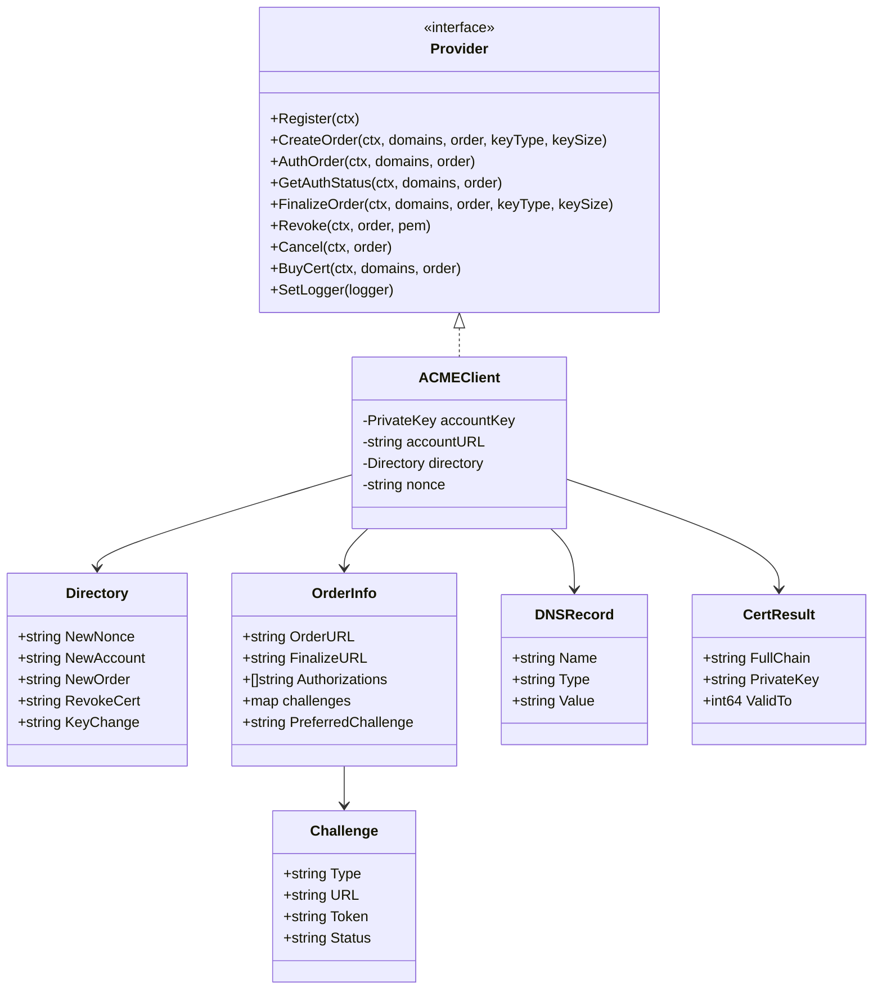
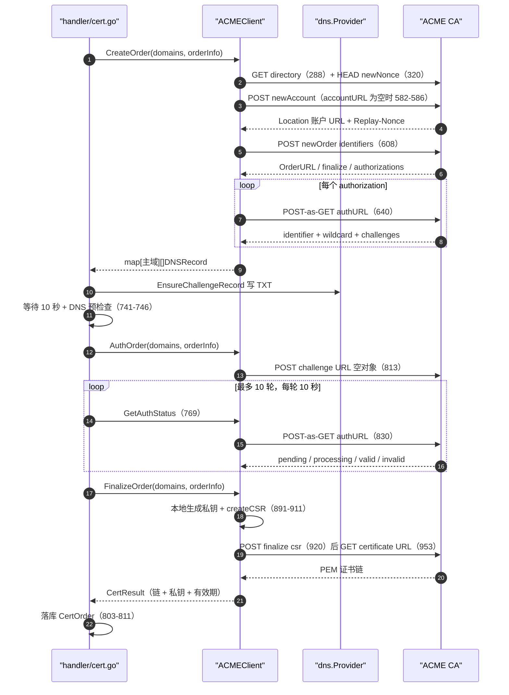
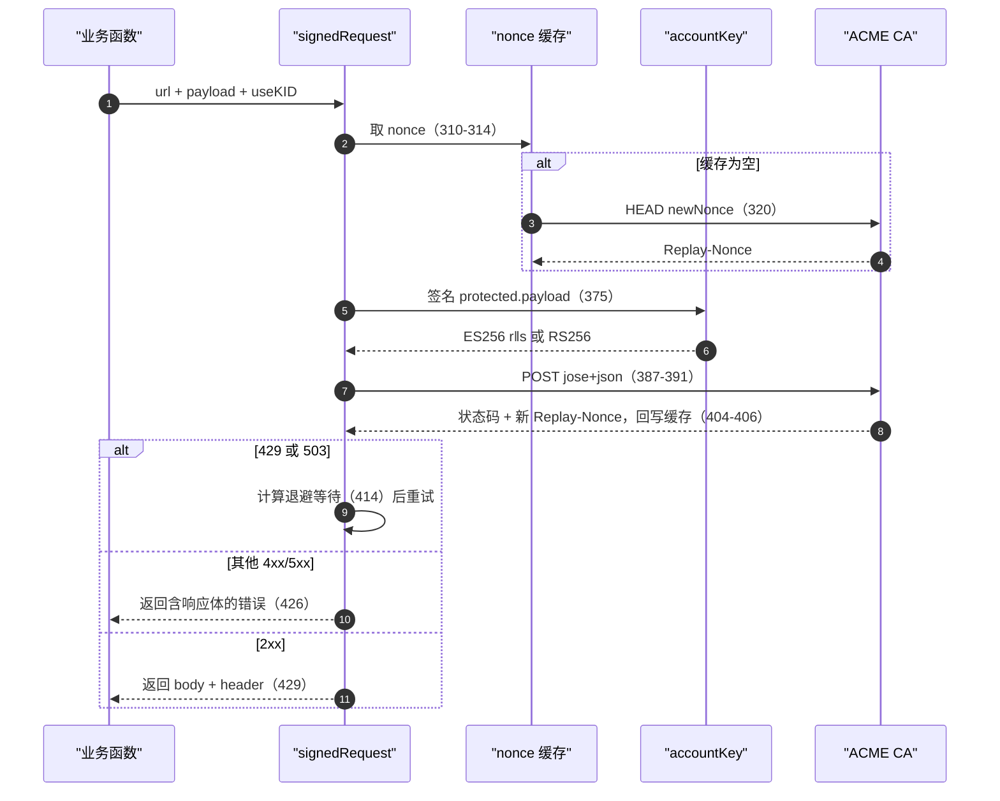
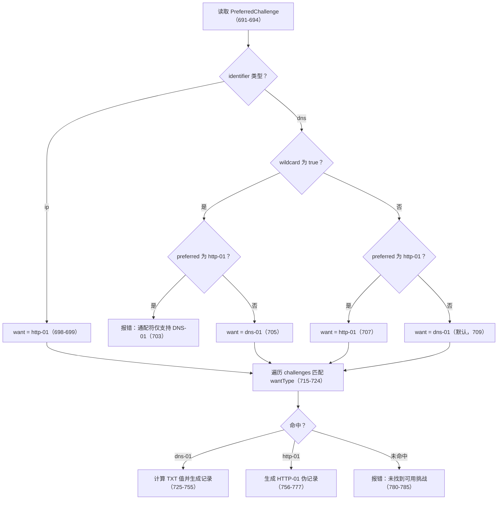
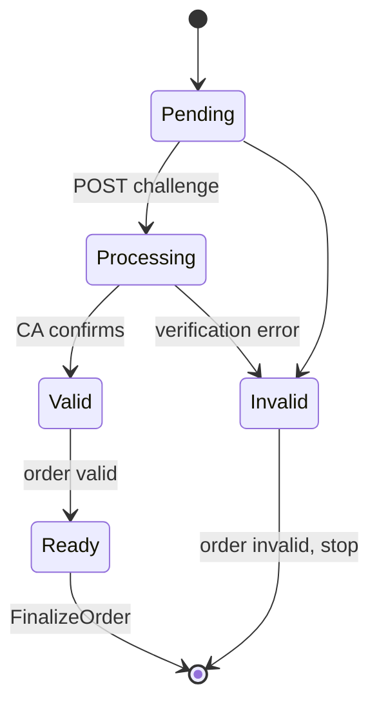
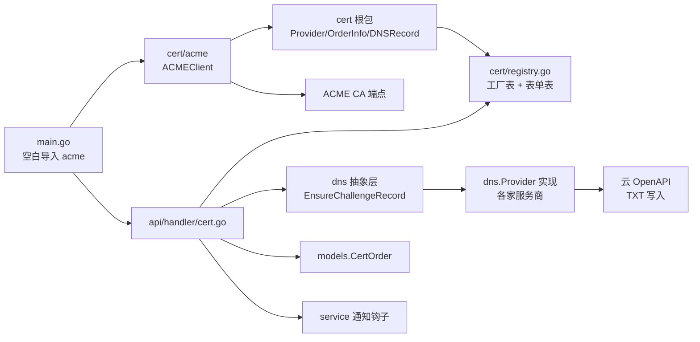
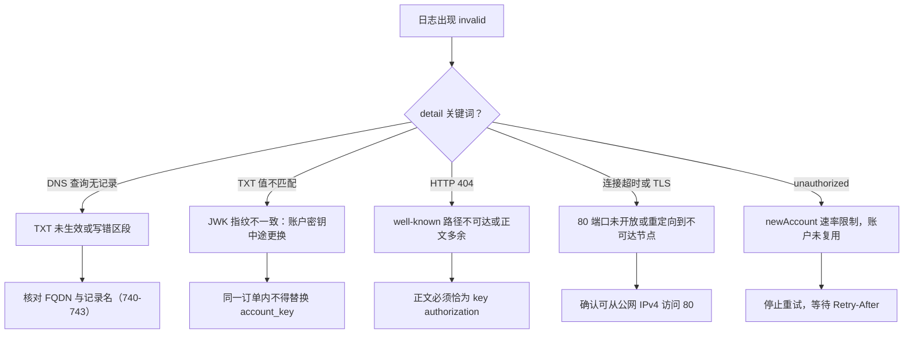

# ACME 协议实现

<cite>
**本文档引用的文件**
- [acme.go](file://main/internal/cert/acme/acme.go)
- [interface.go](file://main/internal/cert/interface.go)
- [providers.go](file://main/internal/cert/providers.go)
- [registry.go](file://main/internal/cert/registry.go)
- [cert.go](file://main/internal/api/handler/cert.go)
- [ensure_challenge.go](file://main/internal/dns/ensure_challenge.go)
- [interface.go](file://main/internal/dns/interface.go)
- [registry.go](file://main/internal/dns/registry.go)
- [doh.go](file://main/internal/dns/doh/doh.go)
- [models.go](file://main/internal/models/models.go)
- [main.go](file://main/main.go)
- [cert_renew_hook.go](file://main/internal/service/cert_renew_hook.go)
- [task_runner.go](file://main/internal/service/task_runner.go)
</cite>

## 目录

1. [简介](#简介)
2. [项目结构](#项目结构)
3. [核心组件](#核心组件)
4. [架构总览](#架构总览)
5. [详细组件分析](#详细组件分析)
6. [依赖关系分析](#依赖关系分析)
7. [性能考虑](#性能考虑)
8. [故障排查指南](#故障排查指南)
9. [结论](#结论)
10. [附录](#附录)

## 简介

`main/internal/cert/acme/acme.go` 是本系统唯一的 ACME v2（RFC 8555）客户端，**完全手写**：单文件 1052 行，导入清单（`acme.go:3-28`）只含 Go 标准库（`crypto/*`、`encoding/*`、`net/http`、`regexp`）与内部包 `main/internal/cert`，未引入 `github.com/go-acme/lego` 之类第三方 ACME 库。JWS 签名、nonce 管理、`Retry-After` 解析、CSR 构造、证书链解析全部是本包内可行级定位的代码。

客户端通过 `cert.Provider` 接口（`interface.go:52-79`）向上传象，`init()`（`acme.go:45-77`）一次注册 5 个 CA：Let's Encrypt、ZeroSSL、Google Trust Services、LiteSSL（freessl.cn）、自定义 ACME；装配点是 `main.go:27` 的空白导入。

| 特征 | 落点 | 一句话结论 |
|------|------|------------|
| 账户密钥算法 | `acme.go:493` | 默认 ECDSA P-256（JWS `ES256`），RSA 仅在 `ext.account_key` 回读时生效 |
| 挑战选型 | `acme.go:691-711` | 由 `PreferredChallenge` + 标识符类型 + `wildcard` 决定，无自动降级 |
| 私钥边界 | `acme.go:891-911` | 证书私钥本地生成并本地编码，从不进入任何 HTTP 请求体 |
| 限速自愈 | `acme.go:344`、`acme.go:408-422` | 429/503 在客户端内部重试，上限 12 次，退避 10 秒～2 小时 |

口径纠正：**`CreateOrder` 不返回证书**。它返回 `map[主域名][]cert.DNSRecord`（`acme.go:577`、`acme.go:789`），即"要往 DNS 里写什么"；CA 侧的订单 URL、finalize URL、authorization 列表挂在入参 `*cert.OrderInfo` 上带回（`acme.go:614-634`），供后续三次调用复用。

**章节来源**
- [acme.go:3-28](file://main/internal/cert/acme/acme.go#L3-L28)
- [acme.go:577-789](file://main/internal/cert/acme/acme.go#L577-L789)
- [interface.go:52-79](file://main/internal/cert/interface.go#L52-L79)
- [main.go:27](file://main/main.go#L27)

## 项目结构

acme 是证书域最"瘦"的子包：目录内只有 `acme.go`，无 `_test.go`，无二级子目录。与兄弟包对比可直接看出定位差异。

```text
main/internal/cert/
├── acme/acme.go          1052 行  ACME v2 客户端 + 5 个 CA 工厂 + init 注册（零测试）
├── interface.go           116 行  Provider / OrderInfo / Challenge / DNSRecord / CertResult
├── providers.go           623 行  表单定义（google / litessl / customacme）
├── registry.go            115 行  Register / GetProvider / 配置快照
├── aliyun/aliyun.go       512 行  阿里云免费 SSL（云 API，非 ACME）
├── tencent/tencent.go     495 行  腾讯云免费 SSL（云 API，非 ACME）
├── huoshan/huoshan.go     488 行  火山引擎证书（云 API，非 ACME）
├── ucloud/ucloud.go       445 行  UCloud 证书（云 API，非 ACME）
└── deploy/                         部署侧配置与注册中心（与 ACME 无直接依赖）
```

| 关注点 | 归属 | 判定依据 |
|--------|------|----------|
| 协议细节（JWS/nonce/退避） | `acme/acme.go` 唯一载体 | `acme.go:288-433` 三个函数构成全部 HTTP 通道 |
| 表单字段与展示说明 | `cert` 根包 `providers.go` | `providers.go:11-32`、`:33-44`、`:81-92` |
| 工厂实现 | `acme.go` 的 5 个 `New*Provider` | `acme.go:100`、`:117`、`:143`、`:173`、`:199` |
| DNS 写入与生效判定 | handler + dns 抽象层，**不在 acme 包内** | `cert.go:718`、`cert.go:894-988` |
| 私钥与证书落库 | `models.CertOrder` | `models.go:239-240` |

一个反直觉但必须遵守的约定：`acme.go` 的 `init()` 对 `google`/`litessl`/`customacme` 只传 `cert.ProviderConfig{}`（`acme.go:70`、`:73`、`:76`），表单在 `providers.go`；`registry.Register` 识别"`Type` 为空且已有配置"并跳过覆盖（`registry.go:30-34`），所以这三处只是**补工厂**。而 `letsencrypt`/`zerossl` 的表单只存在于 `acme.go:46-67`，因为 `providers.go` 未定义它们。Go 的包初始化顺序（被依赖的 `cert` 先于 `acme`）是这套"两写一补"成立的前提。

**章节来源**
- [acme.go:45-77](file://main/internal/cert/acme/acme.go#L45-L77)
- [providers.go:11-92](file://main/internal/cert/providers.go#L11-L92)
- [registry.go:23-35](file://main/internal/cert/registry.go#L23-L35)

## 核心组件

### ACMEClient 会话状态

`ACMEClient`（`acme.go:79-90`）是**每个订单新建一个实例**的短生命周期对象，由 `cert.GetProvider` 在 handler 中构造（`cert.go:436`、`:506`、`:593`）。8 个字段构成 ACME 会话全部可变态：

| 字段 | 类型 | 写入点 | 语义 |
|------|------|--------|------|
| `directoryURL` | string | 5 个工厂函数 | CA 目录地址，决定后续所有端点 |
| `email` | string | `getString(config,"email")` | 账户联系人 `mailto:` |
| `eabKID` / `eabHMACKey` | string | 工厂函数 | 外部账户绑定凭据，二者同时非空才启用 |
| `accountKey` | crypto.PrivateKey | `Register`（`:497`）或 `parsePrivateKey` | JWS 签名密钥 |
| `accountURL` | string | 响应 `Location`（`:518`） | 后续请求的 `kid` |
| `directory` | \*Directory | `getDirectory`（`:304-305`） | 端点缓存，nil 时懒加载 |
| `client` | \*http.Client | 工厂函数 | 统一 30 秒超时 |
| `nonce` | string | `signedRequest`（`:404-406`） | 防重放令牌缓存 |

`nonce` 与 `accountURL` 是两个"有状态"关键点：前者省掉一次 `HEAD`，后者决定 JWS 用 `kid` 还是内嵌 `jwk`。`Directory`（`:92-98`）只解析 5 个端点，**没有 `Meta`**，因此不读取 CA 的服务条款版本或"必填外部账户"提示；`KeyChange` 被解析但全文件无使用点，账户密钥轮换（RFC 8555 §7.3.5）未实现。



**图表来源**
- [acme.go:79-98](file://main/internal/cert/acme/acme.go#L79-L98)
- [interface.go:6-46](file://main/internal/cert/interface.go#L6-L46)
- [interface.go:52-79](file://main/internal/cert/interface.go#L52-L79)

**章节来源**
- [acme.go:79-98](file://main/internal/cert/acme/acme.go#L79-L98)
- [acme.go:351-368](file://main/internal/cert/acme/acme.go#L351-L368)
- [cert.go:436](file://main/internal/api/handler/cert.go#L436)

### 挑战与记录的中转结构

`Challenge`（`interface.go:25-30`）保存 CA 下发的类型、URL、token、status，由 `CreateOrder` 回填到 `order.Challenges[challengeKey]`（`acme.go:733-738`、`:761-766`）。**key 的构造**最值得注意：

```go
challengeKey := fmt.Sprintf("auth_%d_%s", authIdx, domain)   // acme.go:679
if isWildcard {
    challengeKey = "wildcard_" + domain                        // acme.go:681
}
```

`*.example.com` 与 `example.com` 的 `identifier.value` 可能同为 `example.com`，用域名作 key 会让两条授权互相覆盖，`AuthOrder` 漏触发一个授权，finalize 必然失败。索引前缀 + 通配符前缀是这套 key 方案的全部动机（`acme.go:678` 行内注释即出处）。

`DNSRecord`（`interface.go:33-37`）是 acme 包与 DNS 抽象层之间唯一的值通道，但 `Type` 被**复用**成两种语义：`"TXT"`（走 DNS 写入）与 `"HTTP-01"`（仅用于渲染路径与正文，`cert.go:697-703`），可由 `certCountChallengeRecords`（`cert.go:341-352`）与 `certPreVerifyDNS`（`cert.go:1410-1419`）的分支反证。

**章节来源**
- [acme.go:678-682](file://main/internal/cert/acme/acme.go#L678-L682)
- [acme.go:725-777](file://main/internal/cert/acme/acme.go#L725-L777)
- [interface.go:25-37](file://main/internal/cert/interface.go#L25-L37)
- [cert.go:341-352](file://main/internal/api/handler/cert.go#L341-L352)

## 架构总览

一次完整签发从 handler 视角是"四个 Provider 方法 + 中间夹 DNS 写入与轮询"。下图同时画出 `acme.go` 的协议调用与 `cert.go` 的编排，消息方向全部取自实际调用点。



**图表来源**
- [cert.go:646-822](file://main/internal/api/handler/cert.go#L646-L822)
- [acme.go:288-332](file://main/internal/cert/acme/acme.go#L288-L332)
- [acme.go:487-640](file://main/internal/cert/acme/acme.go#L487-L640)
- [acme.go:810-977](file://main/internal/cert/acme/acme.go#L810-L977)
- [ensure_challenge.go:48-111](file://main/internal/dns/ensure_challenge.go#L48-L111)

| 阶段 | CA 端点 | acme.go 函数 | handler 动作 |
|------|---------|--------------|--------------|
| 端点发现 | `GET {directory}` | `getDirectory`（`:288`） | 隐式（首次请求触发） |
| 防重放 | `HEAD newNonce` | `getNonce`（`:308`） | 无 |
| 账户注册 | `POST newAccount` | `Register`（`:487`） | 无（`CreateOrder` 内部自调） |
| 下单 | `POST newOrder` | `CreateOrder`（`:577`） | `cert.go:656` |
| 授权详情 | `POST-as-GET authz` | `CreateOrder`（`:640`） | 无 |
| 写校验记录 | —— | 返回 `DNSRecord` | `addDNSRecord`（`cert.go:718`） |
| 触发验证 | `POST challenge` | `AuthOrder`（`:810`） | `cert.go:754` |
| 轮询状态 | `POST-as-GET authz` | `GetAuthStatus`（`:827`） | `cert.go:765-790` |
| 签发 | `POST finalize` | `FinalizeOrder`（`:887`） | `cert.go:793` |
| 下载链 | `POST-as-GET cert` | `FinalizeOrder`（`:953`） | 落库 `cert.go:803-811` |
| 吊销 | `POST revokeCert` | `Revoke`（`:1032`） | **无调用方** |

关键取舍：**DNS 写入不放在 acme 包内**。若 `CreateOrder` 自己写 TXT，acme 包就要依赖 `dns` 抽象层与数据库，测试与替换成本上升；当前切法让 acme 保持"纯协议 + 纯计算"，把 IO 与用户数据归属留给 handler，代价是 `CreateOrder` 无法感知记录是否真的写成功。

**章节来源**
- [acme.go:288-977](file://main/internal/cert/acme/acme.go#L288-L977)
- [cert.go:646-822](file://main/internal/api/handler/cert.go#L646-L822)

## 详细组件分析

### JWK 与 JWS 签名

所有 ACME 请求（除 `GET {directory}`）都必须封装成 JWS。实现把这件事收敛进 `signedRequest`（`acme.go:334-433`），其余业务函数只传 URL 与 payload。`protected` 头构造（`:354-368`）：

| 字段 | 取值 | 生成逻辑 |
|------|------|----------|
| `alg` | `ES256` / `RS256` | 按 `accountKey` 具体类型判定（`:350-353`） |
| `nonce` | Replay-Nonce | `getNonce`（`:345`） |
| `url` | 请求目标 URL | 必须与实际 POST 目标一致 |
| `kid` | 账户 URL | `useKID && accountURL != ""` 时启用（`:360-361`） |
| `jwk` | JWK 对象 | 否则内嵌公钥（`:363-367`），注册类请求走此路 |

`getJWK`（`:435-461`）处理了两个易错细节：ECDSA 分支把 `X`/`Y` 按曲线字节长度**左补零**对齐（`:439-445`），RSA 分支把公钥指数转大端字节（`:456`）。少了左补零时，P-256 坐标高位为零会返回 31 字节，CA 直接报 `malformed`。`sign`（`:463-485`）对 ES256 采用 **r‖s 定长拼接**（`:471-479`）而非 ASN.1 DER；RS256 走 `rsa.SignPKCS1v15` + SHA-256（`:481`）。签名输入为 `b64url(protected) + "." + b64url(payload)`（`:374`），输出为三字段 JSON（`:380-384`），Content-Type 固定 `application/jose+json`（`:391`）。

**POST-as-GET 的实现方式**值得单列：payload 传 `nil` 时 `payloadBytes` 保持 nil（`:335-342`），`RawURLEncoding` 编码 nil 得空串，`payload` 字段即为 `""`——正是 RFC 8555 规定的形态；而"触发验证"传 `map[string]interface{}{}`（`:813`），编码后是 `{}` 的 base64，二者不可混用。



**图表来源**
- [acme.go:308-332](file://main/internal/cert/acme/acme.go#L308-L332)
- [acme.go:334-433](file://main/internal/cert/acme/acme.go#L334-L433)
- [acme.go:435-485](file://main/internal/cert/acme/acme.go#L435-L485)

**章节来源**
- [acme.go:308-332](file://main/internal/cert/acme/acme.go#L308-L332)
- [acme.go:334-485](file://main/internal/cert/acme/acme.go#L334-L485)
- [acme.go:810-825](file://main/internal/cert/acme/acme.go#L810-L825)

### Nonce 与 Directory 缓存

`getDirectory`（`:288-306`）是**普通 GET**，不签名、不带 nonce，并以 `c.directory != nil` 短路（`:289-291`），因此单个客户端生命周期内目录只取一次。`getNonce`（`:308-332`）优先消费缓存 nonce，缓存为空才 `HEAD newNonce`；真正的复用发生在 `signedRequest` 的成功响应里——只要响应头带 `Replay-Nonce` 就写回 `c.nonce`（`:404-406`），下次请求从缓存取值并清空（`:311-313`）。

效果是 N 次签名请求最多只产生 1 次 `HEAD`，减少约 N-1 次往返，也降低触碰 `newNonce` 速率限制的概率。风险：`getNonce` 的 `HEAD` 分支没有 429/503 重试（`:325-331` 直接读响应头），被限流时返回空 nonce，随后的 `POST` 会收到 `badNonce`，而它属于 4xx，`signedRequest` 会**直接失败**（`:424-427`）而不重试。

**章节来源**
- [acme.go:288-306](file://main/internal/cert/acme/acme.go#L288-L306)
- [acme.go:308-332](file://main/internal/cert/acme/acme.go#L308-L332)
- [acme.go:404-427](file://main/internal/cert/acme/acme.go#L404-L427)

### 账户注册与 EAB

`Register`（`:487-539`）四步：取目录 → 无账户密钥则生成 P-256（`:492-498`）→ 组装 payload（`termsOfServiceAgreed: true` + `contact: mailto:{email}`，`:500-503`）→ `POST newAccount` 且**内嵌 jwk**（`useKID=false`，`:513`）；账户 URL 取响应 `Location`（`:518`）。返回值刻意设计成可持久化形态——`map[string]interface{}` 含 `account_key`（EC 或 RSA PRIVATE KEY 的 PEM）与 `account_url` 两项（`:521-538`）。

5 个工厂都有回读能力（`:107-112`、`:126-131`、`:156-161`、`:182-187`、`:208-213`），`parsePrivateKey`（`:225-240`）依次尝试 `ParseECPrivateKey` → `ParsePKCS1PrivateKey` → `ParsePKCS8PrivateKey`。**但当前链路里这两个值从未落库**：`CreateOrder` 丢弃 `Register` 返回值（`:583`），handler 写 `cert_accounts.ext` 时只写 `order_info`（`cert.go:726-733`）。

EAB 由 `createEAB`（`:541-565`）实现，本质是"用 CA 给的 HMAC 密钥对账户 JWK 再签一个 JWS"：

| 步骤 | 实现 | 常见踩坑 |
|------|------|----------|
| 取账户公钥 | `getJWK`（`:542`） | —— |
| protected | `alg=HS256`、`kid=eabKID`、`url=newAccount`（`:545-549`） | `url` 写成订单 URL 会被拒 |
| payload | JWK 的 base64url（`:552`） | 必须是 JWK 本身，不是账户请求体 |
| 密钥解码 | `RawURLEncoding.DecodeString`（`:554-557`） | 复制来的 key 常带 `=` 填充或标准 base64 变体 |
| 签名 | `hmacSHA256`（`:558`、`:567-571`） | —— |
| 挂载 | `payload["externalAccountBinding"]`（`:510`） | 仅当 `eabKID` 与 `eabHMACKey` **同时**非空 |

**章节来源**
- [acme.go:100-240](file://main/internal/cert/acme/acme.go#L100-L240)
- [acme.go:487-571](file://main/internal/cert/acme/acme.go#L487-L571)
- [cert.go:726-733](file://main/internal/api/handler/cert.go#L726-L733)

### 订单创建与标识符

`CreateOrder`（`:577-790`）是最长的函数，做四件事：补齐账户 → 构造 identifiers → POST newOrder → 逐个拉取 authorization 并挑选挑战。标识符支持 `dns` 与 `ip`（`:588-599`），后者由 `net.ParseIP` 判定，并要求至少一个有效标识符（`:600-602`）。响应的 `status`/`finalize`/`authorizations` 与 `Location` 里的订单 URL 一并写回 `OrderInfo`（`:614-634`）。

每个 authorization 解析 `identifier.value`、`identifier.type`、`wildcard`（`:650-666`）。主域名由 `getMainDomain`（`:799-808`）计算：去掉 `*.` 后取**最后两段**。该规则对 `example.com` 正确，对 `example.co.uk` 会得到 `co.uk`——本文件不改动该行为，但它是 TXT 落到错误区段的根因之一，处置见[故障排查指南](#故障排查指南)。

挑战选型全在 `:691-711`，且**没有回退路径**：



**图表来源**
- [acme.go:691-711](file://main/internal/cert/acme/acme.go#L691-L711)
- [acme.go:715-785](file://main/internal/cert/acme/acme.go#L715-L785)

| 场景 | `PreferredChallenge` | 结果 | 代码 |
|------|----------------------|------|------|
| 公网 IP | 任意 | 强制 `http-01` | `:698-699` |
| 通配符域名 | 空 / `dns-01` | `dns-01` | `:701-705` |
| 通配符域名 | `http-01` | **立即失败** | `:702-704` |
| 普通域名 | 空 | `dns-01`（默认） | `:708-710` |
| 普通域名 | `http-01` | `http-01` | `:706-707` |
| 普通域名 | 其他值 | 归一为空 → `dns-01` | `:692-694` |

handler 侧还有一层同源约束：`normalizeCertChallengeType`（`cert.go:309-319`）归一 `http`/`http01` 等写法，`validateChallengeChoice`（`:321-339`）在创建订单时就拒绝"纯 IP + dns-01"与"通配符 + http-01"，避免白跑一次 CA 往返；`OrderInfo.PreferredChallenge` 由 `order.ChallengeType` 注入（`cert.go:651-653`，字段 `models.go:223`）。

**章节来源**
- [acme.go:577-808](file://main/internal/cert/acme/acme.go#L577-L808)
- [cert.go:309-352](file://main/internal/api/handler/cert.go#L309-L352)
- [cert.go:651-653](file://main/internal/api/handler/cert.go#L651-L653)
- [models.go:223](file://main/internal/models/models.go#L223)

### dns-01 keyAuthorization 与 TXT 值

DNS-01 的记录值不是 token 本身，而是 `base64url(sha256(keyAuthorization))`。`keyAuthorization` 由 `getKeyAuthorization`（`:792-797`）产生，即 `token + "." + b64url(sha256(JWK JSON))`。

JWK 指纹要求对 JWK 的 JSON（即 `getKeyAuthorization` 中 `json.Marshal(getJWK())` 的产物，`acme.go:793-796`）取 SHA-256，再与 token 以 `.` 拼接后做 base64url。这里直接对 map 序列化结果哈希，Go 对 map 键**按字典序**输出，EC 分支键序为 `crv,kty,x,y`、RSA 为 `e,kty,n`，与 CA 侧规范化结果一致——这是实现能通过的隐含前提，改动 `getJWK` 的键名会直接破坏签发。

TXT 记录名（`:740-743`）：

| 申请标识符 | `mainDomain` | 记录名 `Name` | 完整 FQDN |
|------------|--------------|---------------|-----------|
| `example.com` | `example.com` | `_acme-challenge` | `_acme-challenge.example.com` |
| `www.example.com` | `example.com` | `_acme-challenge.www` | `_acme-challenge.www.example.com` |
| `*.example.com` | `example.com` | `_acme-challenge` | `_acme-challenge.example.com` |
| `api.internal.example.com` | `example.com` | `_acme-challenge.api.internal` | `_acme-challenge.api.internal.example.com` |

第 3 行说明通配符与其同名根域的校验记录名**完全相同**、值也必须相同，这是 TXT 需允许并存多条不同值的原因之一（`ensure_challenge.go:89-95` 对 TXT 采取"异值追加不覆盖"）。

**章节来源**
- [acme.go:725-808](file://main/internal/cert/acme/acme.go#L725-L808)
- [ensure_challenge.go:89-95](file://main/internal/dns/ensure_challenge.go#L89-L95)

### http-01 well-known 校验

HTTP-01 没有独立函数，在 `CreateOrder` 的 `chType == "http-01"` 分支生成（`:756-777`）：`token` 放进 `DNSRecord.Name`、`keyAuthorization` 放进 `Value`、`Type` 写成字面量 `"HTTP-01"`。路径拼装发生在 handler：`path := "/.well-known/acme-challenge/" + r.Name`（`cert.go:698`），正文即 `r.Value`。

对外硬性要求（`cert.go:702`、`:748` 日志原文）是：标识符所在主机对公网开放 80，`GET /.well-known/acme-challenge/{token}` 返回**正文恰为 key authorization 的纯文本**，重定向必须可达最终节点。

自动流程上 HTTP-01 不调用任何 DNS API：`runAutoAuth` 要求 `addedRecords > 0`，或"只有 HTTP-01 且订单为自动模式"（`cert.go:735`）；后者成立时只等 5 秒（`:749`）就向 CA 发起验证。混合订单（同时含 TXT 与 HTTP-01）会额外提示两条校验路径都需就绪（`:677-680`）。

**章节来源**
- [acme.go:756-777](file://main/internal/cert/acme/acme.go#L756-L777)
- [cert.go:677-680](file://main/internal/api/handler/cert.go#L677-L680)
- [cert.go:697-703](file://main/internal/api/handler/cert.go#L697-L703)
- [cert.go:735-750](file://main/internal/api/handler/cert.go#L735-L750)

### 验证触发与状态轮询

`AuthOrder`（`:810-825`）遍历 `order.Challenges`，对每个挑战 URL POST 空 JSON 对象 `{}`（`:813`），即"我准备好了，请验证"；它不据返回状态判断，只写日志（`:821-822`）。判定交给 `GetAuthStatus`（`:827-885`）：

| CA 状态 | 返回 | 行为 |
|---------|------|------|
| `pending` / `processing` | `(false, nil)`（`:848-863`） | 继续轮询，打印各挑战 `status` 与 `error.detail` |
| `valid` | 计为通过（`:882`） | 全部 valid 时返回 `(true, nil)` |
| `invalid` | `(false, error)`（`:865-880`） | 提取挑战 `error` 的 `type` 与 `detail` 组成错误串 |
| 无 `status` 字段 | `(false, error)`（`:840-844`） | 视为响应格式异常 |



**图表来源**
- [acme.go:848-881](file://main/internal/cert/acme/acme.go#L848-L881)
- [acme.go:931-933](file://main/internal/cert/acme/acme.go#L931-L933)

轮询节律由 handler 决定，acme 包不控制：`maxAttempts = 10`，每轮**先睡 10 秒再查**（`cert.go:765-769`），最长约 100 秒；单次查询失败不终止（`:770-773` 记日志后 `continue`），耗尽轮次则订单置 `-4` 并提示检查 TXT/HTTP-01（`:780-787`）。

**章节来源**
- [acme.go:810-885](file://main/internal/cert/acme/acme.go#L810-L885)
- [cert.go:754-790](file://main/internal/api/handler/cert.go#L754-L790)

### Finalize、CSR 与证书链

`FinalizeOrder`（`:887-977`）第一步在本地生成**证书私钥**（与账户密钥是两把不同的钥匙）：

| `keyType` | `keySize` | 实际算法 | 代码 |
|-----------|-----------|----------|------|
| `EC` / `ECDSA` | `384` | P-384 | `:894-895` |
| `EC` / `ECDSA` | 其他 | P-256 | `:896-898` |
| 其他（含 `RSA`） | `4096` | RSA-4096 | `:902-904` |
| 其他 | 其他 | RSA-2048（默认） | `:901` |

默认值来自创建订单时（`cert.go:379-383`：`RSA` + `2048`），落库字段 `models.go:220-221`。`createCSR`（`:979-1008`）把标识符按 `net.ParseIP` 分成 `DNSNames` 与 `IPAddresses`，CN 取第一个 DNS 名（无 DNS 名时取第一个 IP，`:996-1001`），一次请求覆盖全部 SAN。CSR 以 base64url 放进 `{"csr": ...}`（`:916-918`）POST 到 `order.FinalizeURL`，随后：

1. 订单状态 `invalid` 立即失败（`:931-933`）；
2. 若响应无 `certificate` 且 `OrderURL` 存在，`Sleep(2 秒)` 后改为 POST-as-GET 订单 URL 再查一次（`:935-947`）——**不重复 finalize**，避免对同一订单二次提交 CSR；
3. 仍无 URL 则报"未获取到证书下载地址"（`:949-951`）；
4. POST-as-GET 证书 URL 取回 PEM 链（`:953`）；
5. 私钥按类型编码为 `EC PRIVATE KEY` / `RSA PRIVATE KEY`（`:958-965`）；
6. `parseCertificate`（`:1016-1030`）只解第一张叶证书，取 `Issuer.CommonName` 与 `NotBefore`/`NotAfter` 的 Unix 秒。

链的处理是**原样透传**：`FullChain: string(certBody)`（`:971`），不重排、不校验中间证书可达性、不检查是否含根证书。落库时 `order.FullChain`/`order.PrivateKey` 直接写入（`cert.go:803-804`），有效期转 `time.Time`（`:806-809`）并置状态 `3`（`:810`），随后触发签发成功通知钩子（`:812`，钩子注册 `cert_renew_hook.go:17-45`）。

**章节来源**
- [acme.go:887-1030](file://main/internal/cert/acme/acme.go#L887-L1030)
- [cert.go:379-383](file://main/internal/api/handler/cert.go#L379-L383)
- [cert.go:793-816](file://main/internal/api/handler/cert.go#L793-L816)
- [cert_renew_hook.go:17-45](file://main/internal/service/cert_renew_hook.go#L17-L45)

### 私钥存储与三个空实现方法

| 密钥种类 | 生成位置 | 是否离开本机 | 持久化位置 |
|----------|----------|--------------|------------|
| 账户签名密钥（P-256） | `acme.go:493` | 私钥不出，仅公钥 JWK 上送（`:363-367`、`:542`） | 设计为 `ext.account_key`，**当前未写入** |
| EAB HMAC 密钥 | CA 线下签发，用户录入 | 不上送原文，仅本地 HMAC（`:558`） | 账户 `config`（本文脱敏为 `{占位}`） |
| 证书私钥 | `acme.go:899` / `:905` | **从不进入任何请求**，只上送 CSR | `cert_orders.private_key` |

"当前未写入"是唯一与代码意图不一致项：`Register` 明确返回 `account_key`/`account_url`（`:535-538`），工厂也明确会回读，中间的回写环节缺失。另外三个方法属接口占位，易被误判为"已实现功能"：

| 方法 | 实现体 | 实际效果 |
|------|--------|----------|
| `BuyCert`（`:573-575`） | `return nil` | ACME 免费签发无需购买，恒成功空操作 |
| `Cancel`（`:1050-1052`） | `return nil` | 不下达订单 `deactivated`，空操作 |
| `Revoke`（`:1032-1048`） | 完整实现 | PEM → DER base64url → POST `revokeCert`，但**全仓无调用方** |

`Revoke` 需强调：协议侧已就绪（`useKID=true`），但因账户密钥未持久化，进程重启后即使补上入口，也无法以原账户密钥签名吊销请求——"实现存在但链路断裂"的典型组合。

**章节来源**
- [acme.go:100-216](file://main/internal/cert/acme/acme.go#L100-L216)
- [acme.go:487-575](file://main/internal/cert/acme/acme.go#L487-L575)
- [acme.go:1032-1052](file://main/internal/cert/acme/acme.go#L1032-L1052)
- [models.go:239-240](file://main/internal/models/models.go#L239-L240)

## 依赖关系分析

acme 包的直接依赖只有一条：`main/internal/cert`（`acme.go:20`）。DNS-01 所需的解析写入通过**返回值**而非调用完成，因此不存在 `acme → dns` 的编译期依赖。



**图表来源**
- [acme.go:20](file://main/internal/cert/acme/acme.go#L20)
- [main.go:27](file://main/main.go#L27)
- [cert.go:894-988](file://main/internal/api/handler/cert.go#L894-L988)
- [registry.go:38-49](file://main/internal/cert/registry.go#L38-L49)

| 上游 | 下游 | 契约载体 | 代码位置 |
|------|------|----------|----------|
| `cert.GetProvider` | 5 个 `New*Provider` | `ProviderFactory` 签名 | `registry.go:9`、`:38-49` |
| handler | `ACMEClient.CreateOrder` | `cert.Provider` 接口 | `cert.go:656`、`interface.go:60` |
| handler | `dns.GetProvider` | 账户类型 + 域名 + 第三方 ID | `cert.go:965`、`dns/registry.go:26` |
| handler | `dns.EnsureChallengeRecord` | `(ctx, Provider, subHost, type, value, line, ttl, remark)` | `cert.go:977`、`ensure_challenge.go:48` |
| handler | `cert.GetProviderConfig` | `ProviderConfig.CNAME` 开关 | `cert.go:673-675`、`interface.go:90` |
| `ACMEClient` | HTTP 层 | `net/http` + 30 秒超时 | `acme.go:104`、`:387-393` |
| handler | 通知钩子 | `CertIssueSuccessNotify` / `CertIssueFailNotify` | `cert.go:812`、`cert_renew_hook.go:25-45` |

TXT 写入细节全在 dns 抽象层，acme 只给 `Name`/`Type`/`Value` 三元组，落地三段处理与成功率直接相关：**线路与 TTL** 由 `dns.DefaultDNSLine(account.Type)` 决定（`cert.go:971`），TTL 固定 600 秒、`namesilo` 为 3600 秒（`:972-975`），而 `EnsureChallengeRecord` 会把越界 TTL 收敛到 60 秒（`ensure_challenge.go:54-57`）；**幂等与异值并存**指同值 TXT 跳过（`:79-87`）、不同值 TXT **追加不删除**（`:89-95`）；**CNAME 代理**在 `ProviderConfig.CNAME=true`（`acme.go:54`、`:66`，`providers.go:31`、`:43`、`:91`）时把校验域重定向到本系统托管区再写记录（`cert.go:898-904`）。

**章节来源**
- [acme.go:20](file://main/internal/cert/acme/acme.go#L20)
- [registry.go:9-49](file://main/internal/cert/registry.go#L9-L49)
- [cert.go:673-675](file://main/internal/api/handler/cert.go#L673-L675)
- [cert.go:894-988](file://main/internal/api/handler/cert.go#L894-L988)
- [interface.go:41-70](file://main/internal/dns/interface.go#L41-L70)
- [ensure_challenge.go:48-111](file://main/internal/dns/ensure_challenge.go#L48-L111)

## 性能考虑

ACME 签发耗时由三段构成：CA 往返、DNS 生效等待、退避睡眠。固定参数全部可逐行定位：

| 参数 | 值 | 位置 | 影响 |
|------|----|------|------|
| HTTP 客户端超时 | 30 秒 | `acme.go:104` 等 5 个工厂 | 单次 CA 请求上限 |
| 限流重试上限 | 12 次 | `acme.go:39`、`:344` | 含首次请求 |
| 退避区间 | 10 秒 ～ 2 小时 | `acme.go:253-254` | 单订单最长阻塞 |
| 兜底退避公式 | `30 + 30×attempt` 秒 | `acme.go:284` | 无 `Retry-After` 时 |
| DNS 生效等待 | 10 秒 | `cert.go:741` | 写记录后固定睡眠 |
| HTTP-01 前置等待 | 5 秒 | `cert.go:749` | 仅纯 HTTP-01 订单 |
| 状态轮询节律 | 10 秒 × 10 轮 | `cert.go:765-767` | 最长约 100 秒 |
| finalize 补查 | 2 秒 | `acme.go:937` | 仅当响应无 `certificate` |
| DNS 预检查 | 最多 3 轮 × 10 秒 | `cert.go:1432-1449` | 全部生效则提前返回 |
| 单次 TXT 查询超时 | 3 秒 | `cert.go:1479-1483` | 3 台公共 DNS 并发 |
| DoH 回退超时 | `2 × doh.Timeout` | `cert.go:1507`、`doh.go:41` | UDP 全部未命中时 |

已生效的优化有两处：nonce 复用省掉主要往返（`acme.go:310-314`、`:404-406`）——一次典型签发约 12～16 次签名请求，若每次都 `HEAD` 会多出同等数量请求；`getDirectory` 短路使目录只取一次（`:289-291`）。一处可优化点：轮询是"先睡后查"（`cert.go:766-769`），最快也要 10 秒才能确认成功，而 CA 常在 1～3 秒内完成验证；改为"立即查一次再进入睡眠"可缩短平均耗时，当前实现选择保守节律以降低被判高频轮询的概率。

两点风险必须记录：`processCertOrderAsync` 使用 `context.Background()`（`cert.go:647`），不继承超时或取消信号，配合 12 次重试与最长 2 小时退避，单协程理论上可存活数小时且**不受优雅关闭约束**——退避睡眠本身用 `select` 同时监听 `ctx.Done()`（`acme.go:416-420`），逻辑正确，但因 ctx 永不变，该取消路径实际永不触发；另外 DNS 预检查失败不阻塞主流程（`cert.go:1458-1462` 只打印日志），注释已写明意图：公共 DNS 传播慢于权威 NS，提前失败反而误伤。

**章节来源**
- [acme.go:252-286](file://main/internal/cert/acme/acme.go#L252-L286)
- [acme.go:310-433](file://main/internal/cert/acme/acme.go#L310-L433)
- [cert.go:647](file://main/internal/api/handler/cert.go#L647)
- [cert.go:741-790](file://main/internal/api/handler/cert.go#L741-L790)
- [cert.go:1432-1519](file://main/internal/api/handler/cert.go#L1432-L1519)
- [doh.go:41](file://main/internal/dns/doh/doh.go#L41)

## 故障排查指南

### 429 与账户速率限制

`signedRequest` 对 429/503 的处理集中在 `acme.go:408-422`：解析 `Retry-After`（数字秒或 HTTP 时间，`:266-273`）→ 再解析 LE `problem+json` 的 `detail` 文本中的 UTC 时刻（正则 `:43`，解析 `:278-283`）→ 最后落到 `30+30×attempt` 兜底（`:284`），结果统一钳制到 10 秒～2 小时。日志文案 `ACME 限流或服务繁忙 (HTTP %d)，等待约 %s 后重试 (%d/%d)` 出自 `:415`。

最容易撞上的限制是 `newAccount`，而本实现有一个放大它的缺陷：`CreateOrder` 在 `accountURL` 为空时自调 `Register` 并丢弃返回值（`acme.go:583`），handler 又不把 `account_key`/`account_url` 写回 `cert_accounts.ext`（`cert.go:726-733`），工厂的回读能力永远读到空值——于是**每单新建一个 CA 账户**；LE 注册限制被触发后进入最长 12 次 × 2 小时退避，表现为订单长时间停在处理中且日志反复出现"限流"。

| 现象 | 定位 | 处置 |
|------|------|------|
| 日志多次出现 `ACME 限流或服务繁忙 (HTTP 429)` | `acme.go:411-415` | 停发该账户订单，按日志时长恢复；勿靠重启重试 |
| 错误含 `重试次数已用尽` | `acme.go:412` | 已达 12 次上限，需人工改期，订单置失败 |
| 每次签发都出现 `账户注册成功:` | `acme.go:519` | 账户密钥未复用，需补齐 `ext` 回写链路 |
| 订单长时间停在处理中 | `cert.go:647` + `acme.go:254` | 单协程最长存活数小时，属预期而非死锁 |
| `badNonce` 直接失败 | `acme.go:325-331`、`:424-427` | `HEAD newNonce` 未重试，重跑订单即可 |

**章节来源**
- [acme.go:43](file://main/internal/cert/acme/acme.go#L43)
- [acme.go:264-286](file://main/internal/cert/acme/acme.go#L264-L286)
- [acme.go:325-331](file://main/internal/cert/acme/acme.go#L325-L331)
- [acme.go:408-433](file://main/internal/cert/acme/acme.go#L408-L433)
- [cert.go:647-733](file://main/internal/api/handler/cert.go#L647-L733)

### 挑战失败与错误文案

`GetAuthStatus` 在 `invalid` 时把 CA 的 `error.type` 与 `error.detail` 拼成错误串（`acme.go:865-880`），这是排查的一手证据；`pending`/`processing` 分支也会打印每个挑战的 `status` 与错误详情（`:848-863`），日志前缀 `验证失败详情:`。



**图表来源**
- [acme.go:740-743](file://main/internal/cert/acme/acme.go#L740-L743)
- [acme.go:792-797](file://main/internal/cert/acme/acme.go#L792-L797)
- [acme.go:848-881](file://main/internal/cert/acme/acme.go#L848-L881)
- [cert.go:697-703](file://main/internal/api/handler/cert.go#L697-L703)

| 错误文案（原文） | 出处 | 触发条件 |
|------------------|------|----------|
| `ACME 订单缺少有效标识符` | `acme.go:601` | 域名列表全为空串 |
| `通配符域名 %s 仅支持 DNS-01 验证` | `acme.go:703` | `preferred=http-01` 且 `wildcard` |
| `ACME 未提供 HTTP-01 挑战: %s` | `acme.go:782` | 指定 HTTP-01 但 CA 未下发该挑战 |
| `ACME 未找到可用挑战: identifier=...` | `acme.go:784` | CA 下发的挑战类型均不在期望列表 |
| `EAB HMAC Key 解码失败（需要 Base64URL 格式）` | `acme.go:556` | 填了带 `=` 填充或标准 base64 的 key |
| `不支持的密钥类型` | `acme.go:459`、`:483` | `accountKey` 既非 ECDSA 也非 RSA |
| `证书签发失败: 订单状态为 invalid` | `acme.go:932` | finalize 时订单已失效 |
| `证书签发失败: 未获取到证书下载地址` | `acme.go:950` | 补查订单后仍无 `certificate` |
| `未找到托管域名: %s` | `cert.go:950` | 主域判定错误，本地无该托管区 |
| `纯 IP 订单仅支持 HTTP-01 验证` | `cert.go:327` | 创建订单阶段前置校验 |

**章节来源**
- [acme.go:556-601](file://main/internal/cert/acme/acme.go#L556-L601)
- [acme.go:703-784](file://main/internal/cert/acme/acme.go#L703-L784)
- [acme.go:810-977](file://main/internal/cert/acme/acme.go#L810-L977)
- [cert.go:321-339](file://main/internal/api/handler/cert.go#L321-L339)
- [cert.go:950](file://main/internal/api/handler/cert.go#L950)

### EAB 与配置陷阱

| CA | 表单键 | 工厂读取键 | 一致性 |
|----|--------|------------|--------|
| ZeroSSL | `eab_kid` / `eab_hmac_key`（`acme.go:63-64`） | 同名（`:121-122`） | 一致 |
| Google SSL | `kid` / `key`（`providers.go:23-24`） | `kid` / `key`（`:151-152`） | 一致 |
| Google SSL | `mode`（`providers.go:26-29`） | `mode`（`:145`） | 一致，`staging` 切测试目录 |
| Google SSL | `eab_mode`（`providers.go:19`） | —— | **无实现**，选"自动获取"不产生任何效果 |
| LiteSSL | `kid` / `key`（`providers.go:40-41`） | `kid` / `key`（`:177-178`） | 一致 |
| 自定义 ACME | `directory` / `kid` / `key`（`providers.go:86-89`） | 同名（`:201-204`） | 一致，`kid`/`key` 留空即不启用 EAB |

另有两处同链路缺陷：其一，`LetsEncryptStaging` 常量（`acme.go:32`）在工厂中未被使用，无法通过账户配置切到 LE 测试环境；其二，`order.ProcessID = orderInfo.OrderURL`（`cert.go:670`）把订单 URL 存进 `size:32` 的列（`models.go:224`），LE 订单 URL 长度远超 32，SQLite 表现为静默截断、MySQL 严格模式报字段超长。**本文仅记录现象与定位，未修改任何行为。**

**章节来源**
- [acme.go:30-77](file://main/internal/cert/acme/acme.go#L30-L77)
- [acme.go:100-216](file://main/internal/cert/acme/acme.go#L100-L216)
- [providers.go:19-92](file://main/internal/cert/providers.go#L19-L92)
- [cert.go:670](file://main/internal/api/handler/cert.go#L670)
- [models.go:224](file://main/internal/models/models.go#L224)

## 结论

`acme.go` 用 1052 行标准库代码覆盖 ACME v2 完整主链路：目录发现、nonce 复用、JWK/JWS（ES256 与 RS256 双支持、定长坐标与定长签名拼接）、账户注册与 EAB、订单与授权、DNS-01/HTTP-01 挑战值生成、finalize 与证书链下载、本地私钥生成。抽象层面通过 `cert.Provider` 的 9 个方法与其余 4 个云 API provider 统一，`registry.go` 的"表单与工厂分离注册"让 5 个 CA 的接入保持单文件内聚。

值得肯定的实现细节有四处：429/503 的退避与 `Retry-After` 三级解析完全下沉（`acme.go:264-286`、`:408-422`）；`challengeKey` 的索引前缀规避通配符与根域同名覆盖（`:678-682`）；finalize 后缺 `certificate` 时改为查订单而非重复提交 CSR（`:936-947`）；证书私钥严格本地生成、只上送 CSR（`:891-918`）。

需正视的缺口有三处，均属链路断裂而非协议能力不足：账户密钥不持久化导致每单新建 CA 账户（`acme.go:583` + `cert.go:726-733`）；`Revoke` 已实现却无调用入口（`acme.go:1032-1048`，同类的 ACME 失败通知函数 `task_runner.go:701` 也无调用方）；签发成功后 `_acme-challenge` TXT 从不清理且异值追加（`ensure_challenge.go:89-95`）。此外 `acme` 包零单元测试，JWK 指纹、JWS 编码、退避计算这三类纯函数最易测却完全未测。

最小改进切口（仅建议，本文未实施）：把 `Register` 返回值写回 `cert_accounts.ext` 并让工厂真正回读；`processCertOrderAsync` 改用带超时的 context；为 `getJWK`/`sign`/`getKeyAuthorization`/`acmeComputeRetryWait` 补表驱动测试。

**章节来源**
- [acme.go:264-1048](file://main/internal/cert/acme/acme.go#L264-L1048)
- [cert.go:646-822](file://main/internal/api/handler/cert.go#L646-L822)
- [registry.go:23-49](file://main/internal/cert/registry.go#L23-L49)
- [task_runner.go:701](file://main/internal/service/task_runner.go#L701)

## 附录

### CA 端点表

| 提供商类型 | 展示名 | Directory 地址 | EAB | 必填表单字段 | 工厂函数 | 注册行 |
|------------|--------|----------------|:---:|--------------|----------|--------|
| `letsencrypt` | Let's Encrypt | `https://acme-v02.api.letsencrypt.org/directory` | 否 | `email` | `NewLetsEncryptProvider` | `acme.go:46`、`:31` |
| `zerossl` | ZeroSSL | `https://acme.zerossl.com/v2/DV90` | 是 | `email`、`eab_kid`、`eab_hmac_key` | `NewZeroSSLProvider` | `acme.go:57`、`:33` |
| `google` | Google SSL | `https://dv.acme-v02.api.pki.goog/directory` | 是 | `email`、`kid`、`key` | `NewGoogleProvider` | `acme.go:70`、`:34` |
| `google`（staging） | Google SSL | `https://dv.acme-v02.test-api.pki.goog/directory` | 是 | `mode=staging` 切换 | 同上 | `:35`、`:145` |
| `litessl` | LiteSSL | `https://acme.freessl.cn/v2/DV90` | 是 | `email`、`kid`、`key` | `NewLiteSSLProvider` | `acme.go:73`、`:36` |
| `customacme` | 自定义 ACME | 用户填写 `directory` | 可选 | `directory`、`email` | `NewCustomACMEProvider` | `acme.go:76`、`:201` |

Let's Encrypt 的表单说明原文（`acme.go:50`）界定了能力边界：域名可选 DNS-01（自动写解析）或 HTTP-01（需在域名解析到的服务器上开放 80 端口），公网 IP 仅 HTTP-01，通配符仅 DNS-01。

**章节来源**
- [acme.go:30-77](file://main/internal/cert/acme/acme.go#L30-L77)
- [acme.go:143-216](file://main/internal/cert/acme/acme.go#L143-L216)
- [providers.go:11-92](file://main/internal/cert/providers.go#L11-L92)

### 方法与协议动作映射表

| 方法 | 行号 | ACME 动作 | 是否修改 `OrderInfo` |
|------|:----:|-----------|----------------------|
| `Register` | `acme.go:487` | 账户新注册（内嵌 jwk） | 否（仅写 `accountURL`） |
| `BuyCert` | `acme.go:573` | 空实现 | 否 |
| `CreateOrder` | `acme.go:577` | 下单 + 取授权 + 选挑战 | 是：`OrderURL`/`Status`/`FinalizeURL`/`Authorizations`/`Challenges` |
| `getKeyAuthorization` | `acme.go:792` | keyAuthorization 计算 | 否 |
| `AuthOrder` | `acme.go:810` | 触发验证 | 否 |
| `GetAuthStatus` | `acme.go:827` | 查授权状态 | 否 |
| `FinalizeOrder` | `acme.go:887` | finalize + 下载链（内部调 `createCSR`，`:979`） | 否（结果走 `CertResult`） |
| `Revoke` | `acme.go:1032` | 吊销 | 否 |
| `Cancel` | `acme.go:1050` | 空实现 | 否 |

**章节来源**
- [acme.go:242-577](file://main/internal/cert/acme/acme.go#L242-L577)
- [acme.go:792-1052](file://main/internal/cert/acme/acme.go#L792-L1052)

### 关键常量速查

| 常量 | 值 | 位置 |
|------|----|------|
| `LetsEncryptURL` / `LetsEncryptStaging` | `acme-v02.api.letsencrypt.org/directory` / `acme-staging-v02...`（后者**未被工厂使用**） | `acme.go:31-32` |
| `ZeroSSLURL` | `acme.zerossl.com/v2/DV90` | `acme.go:33` |
| `GoogleACMEURL` / `GoogleStagingURL` | `dv.acme-v02.api.pki.goog` / `dv.acme-v02.test-api.pki.goog` | `acme.go:34-35` |
| `LiteSSLURL` | `acme.freessl.cn/v2/DV90` | `acme.go:36` |
| `acmeRateLimitMaxAttempts` | `12` | `acme.go:39` |
| 退避钳制区间 | `[10s, 2h]` | `acme.go:253-254` |
| 兜底退避 | `30 + 30×attempt` 秒 | `acme.go:284` |
| TXT 记录名前缀 | `_acme-challenge` | `acme.go:740` |
| 术语：POST-as-GET | payload 为空串的签名查询 | `acme.go:640`、`:830`、`:953` |
| 术语：challengeKey | 挑战在 `OrderInfo` 内的唯一键 | `acme.go:679-682` |

**章节来源**
- [acme.go:30-43](file://main/internal/cert/acme/acme.go#L30-L43)
- [acme.go:253-284](file://main/internal/cert/acme/acme.go#L253-L284)
- [acme.go:640-740](file://main/internal/cert/acme/acme.go#L640-L740)
- [acme.go:779-953](file://main/internal/cert/acme/acme.go#L779-L953)
