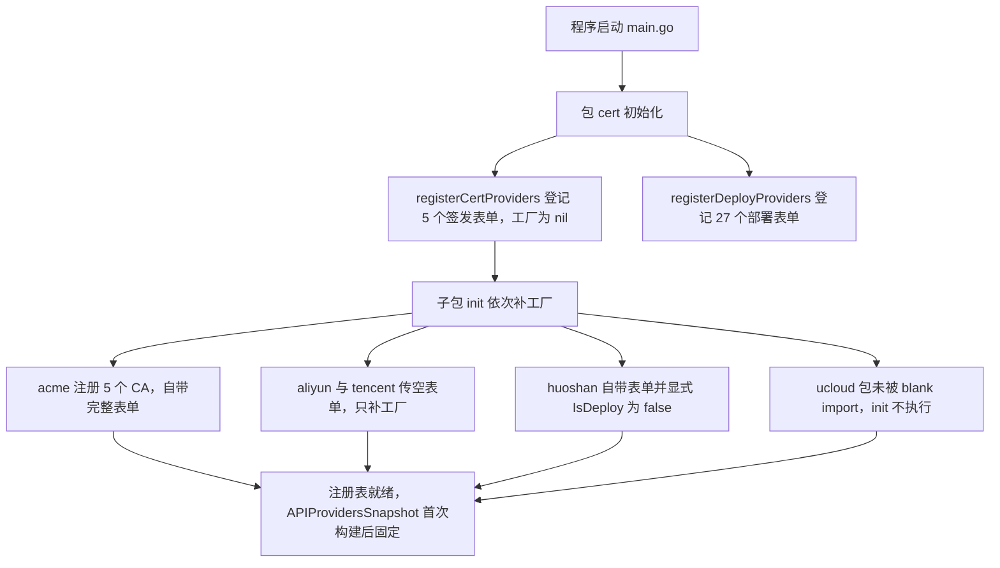
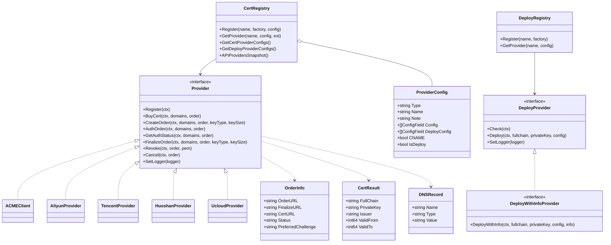
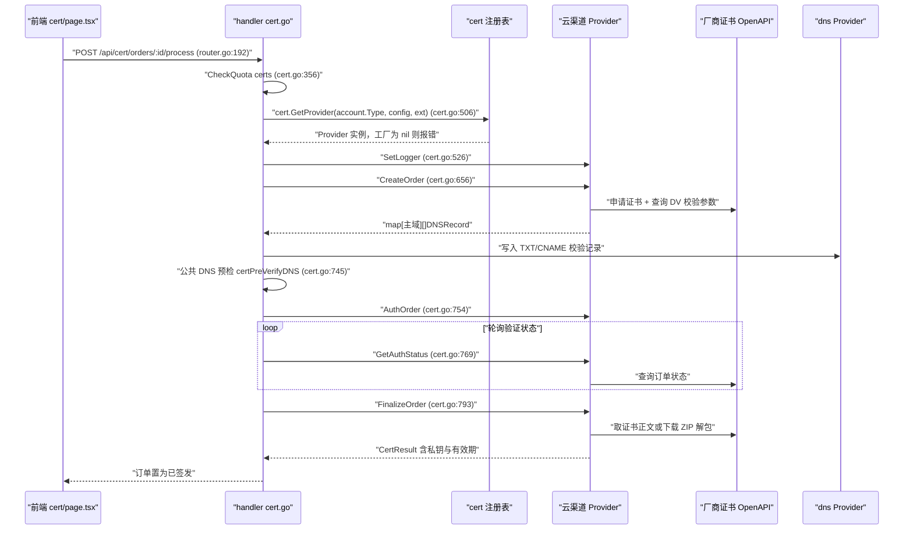
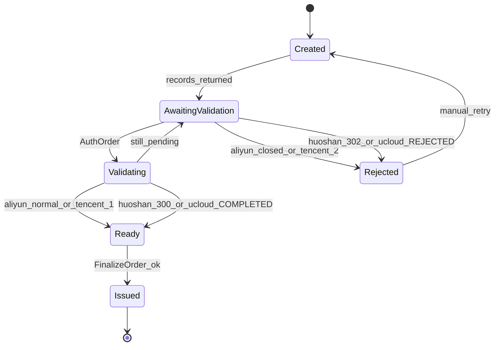
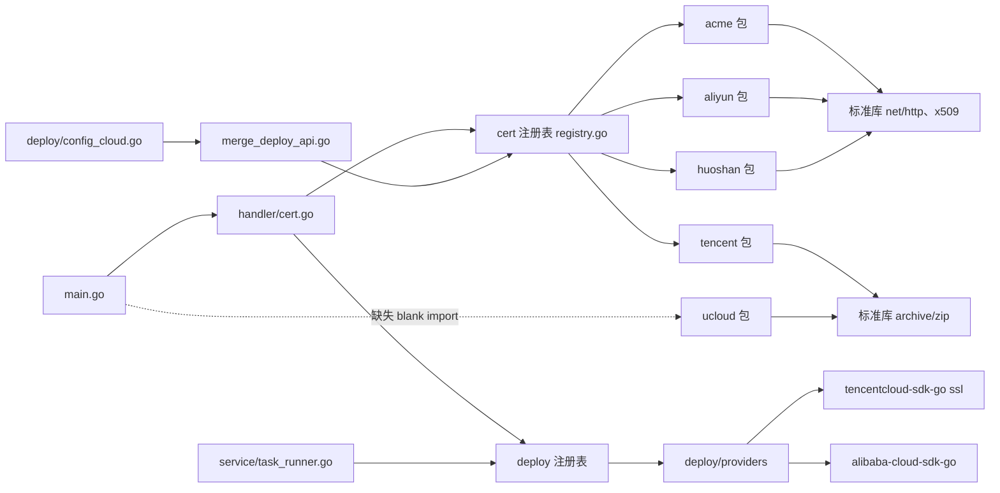

# 证书提供商集成

<cite>
**本文档引用的文件**
- [main.go](file://main/main.go)
- [interface.go](file://main/internal/cert/interface.go)
- [registry.go](file://main/internal/cert/registry.go)
- [providers.go](file://main/internal/cert/providers.go)
- [acme.go](file://main/internal/cert/acme/acme.go)
- [aliyun.go](file://main/internal/cert/aliyun/aliyun.go)
- [aliyun_test.go](file://main/internal/cert/aliyun/aliyun_test.go)
- [tencent.go](file://main/internal/cert/tencent/tencent.go)
- [tencent_test.go](file://main/internal/cert/tencent/tencent_test.go)
- [huoshan.go](file://main/internal/cert/huoshan/huoshan.go)
- [ucloud.go](file://main/internal/cert/ucloud/ucloud.go)
- [config.go](file://main/internal/cert/deploy/config.go)
- [config_cloud.go](file://main/internal/cert/deploy/config_cloud.go)
- [merge_deploy_api.go](file://main/internal/cert/deploy/merge_deploy_api.go)
- [deploy-registry.go](file://main/internal/cert/deploy/registry.go)
- [base.go](file://main/internal/cert/deploy/base/base.go)
- [aliyun_base.go](file://main/internal/cert/deploy/providers/aliyun_base.go)
- [aliyun_cas.go](file://main/internal/cert/deploy/providers/aliyun_cas.go)
- [aliyun_cdn.go](file://main/internal/cert/deploy/providers/aliyun_cdn.go)
- [tencent_cdn.go](file://main/internal/cert/deploy/providers/tencent_cdn.go)
- [huoshan_cdn.go](file://main/internal/cert/deploy/providers/huoshan_cdn.go)
- [ucloud_cdn.go](file://main/internal/cert/deploy/providers/ucloud_cdn.go)
- [cert.go](file://main/internal/api/handler/cert.go)
- [cert_deploy.go](file://main/internal/api/handler/cert_deploy.go)
- [router.go](file://main/internal/api/router.go)
- [task_runner.go](file://main/internal/service/task_runner.go)
- [go.mod](file://main/go.mod)
</cite>

## 目录

1. [简介](#简介)
2. [项目结构](#项目结构)
3. [核心组件](#核心组件)
4. [架构总览](#架构总览)
5. [详细组件分析](#详细组件分析)
6. [依赖关系分析](#依赖关系分析)
7. [性能考虑](#性能考虑)
8. [故障排查指南](#故障排查指南)
9. [结论](#结论)
10. [附录](#附录)

## 简介

`main/internal/cert` 是证书签发域唯一的厂商差异收敛点。它把「ACME 协议族」与「四家国内云厂商自有证书 OpenAPI」两套完全不同的业务模型压平成同一个 Go 接口 `cert.Provider`（`interface.go:52-79`，9 个方法），使 `handler/cert.go` 的签发流水线（`cert.go:656` → `:754` → `:769` → `:793`）看不到任何厂商 SDK 类型或签名细节。

本文聚焦**云证书渠道**与承载它们的注册表机制，口径以当前工作区实读为准：

| 渠道 key | 名称 | 实现文件 | 行数 | 注册位置 | 接入状态 |
|----------|------|----------|:----:|----------|----------|
| `letsencrypt` | Let's Encrypt | `cert/acme/acme.go` | 1052 | `acme.go:46` | 已接入（`main.go:27`） |
| `zerossl` | ZeroSSL | `cert/acme/acme.go` | 共用 | `acme.go:57` | 已接入 |
| `google` | Google SSL | `cert/acme/acme.go` | 共用 | `acme.go:70` 工厂 + `providers.go:11` 表单 | 已接入 |
| `litessl` | LiteSSL | `cert/acme/acme.go` | 共用 | `acme.go:73` + `providers.go:33` | 已接入 |
| `customacme` | 自定义 ACME | `cert/acme/acme.go` | 共用 | `acme.go:76` + `providers.go:81` | 已接入 |
| `aliyun_cert` | 阿里云免费 SSL | `cert/aliyun/aliyun.go` | 512 | `aliyun.go:37` + `providers.go:65` | 已接入（`main.go:28`） |
| `tencent` | 腾讯云免费 SSL | `cert/tencent/tencent.go` | 495 | `tencent.go:42` + `providers.go:51` | 已接入（`main.go:30`） |
| `huoshan` | 火山引擎 | `cert/huoshan/huoshan.go` | 488 | `huoshan.go:27`（表单与工厂同源） | 已接入（`main.go:29`） |
| `ucloud` | UCloud | `cert/ucloud/ucloud.go` | 445 | `ucloud.go:24` | **未接入**：`main.go` 无该包 blank import |

必须点明的口径纠正：`ucloud` 的签发实现完整存在（`ucloud.go:110-364` 覆盖 `CreateOrder`/`GetAuthStatus`/`FinalizeOrder`），但在 `main` 目录全文检索 `internal/cert/ucloud` **零命中**，`main.go:27-30` 只 blank import 了 `acme`/`aliyun`/`huoshan`/`tencent` 四个包。因此其 `init()` 不会执行，注册表里 `ucloud` 这一项仍是 `providers.go:549-562` 的部署形态定义（`IsDeploy: true`、工厂为 `nil`），`cert.GetProvider("ucloud", ...)` 会命中 `registry.go:45-47` 的 `has no implementation (nil factory)` 分支。按注册点穷举，签发视图（`registry.go:71-81` 按 `!v.IsDeploy` 过滤）实际生效 **8 个 key**：5 个 ACME + `aliyun_cert`/`tencent`/`huoshan`。所谓「5 家云证书渠道」是按**实现包**口径（四个云包 + `acme` 协议包），而非运行时可签发的 key 数。

**章节来源**
- [interface.go:52-79](file://main/internal/cert/interface.go#L52-L79)
- [main.go:26-30](file://main/main.go#L26-L30)
- [providers.go:549-562](file://main/internal/cert/providers.go#L549-L562)
- [registry.go:45-47](file://main/internal/cert/registry.go#L45-L47)
- [registry.go:71-81](file://main/internal/cert/registry.go#L71-L81)

## 项目结构

证书域按「接口与注册表在根包、每家厂商一个子包、部署器独立第二套注册中心」三层组织，本文涉及的结构如下（行数为 `wc -l` 实测）：

```text
main/internal/cert/
├── interface.go            115  接口 + 5 个跨渠道数据结构
├── registry.go             114  双 map 注册中心 + 双视图切分 + API 快照
├── providers.go            623  32 处 Register：5 处签发表单 + 27 处部署表单
├── acme/acme.go           1052  ACME v2 客户端，一个实现服务 5 个 CA key
├── aliyun/aliyun.go        512  CAS RPC + HMAC-SHA1 签名（手写，无 SDK），另含 279 行测试
├── tencent/tencent.go      495  SSL API + TC3-HMAC-SHA256（手写，无 SDK），另含 315 行测试
├── huoshan/huoshan.go      488  certificate_service + Sig v4 风格签名（零测试）
├── ucloud/ucloud.go        445  api.ucloud.cn + SHA1 签名（未接入装配、零测试）
└── deploy/                          ← 与签发接口完全隔离
    ├── base/base.go        339  DeployProvider + 独立注册表
    ├── config.go            49  DeployProviderConfig + AllDeployConfigs（表单见 config_cloud.go 515 行）
    ├── registry.go          73  四级回落解析 {type}_{product}
    └── merge_deploy_api.go  64  cert 表 + AllDeployConfigs 双源合并
```

| 层次 | 载体 | 职责边界 | 越界风险 |
|------|------|----------|----------|
| 契约层 | `cert/interface.go` | 只定义跨渠道可表达的最小公约字段 | 厂商专有字段（如 `instance_id`）只能借 `OrderInfo.OrderURL` 传递 |
| 装配层 | `cert/registry.go` + `cert/providers.go` | 工厂与表单双写、按 `IsDeploy` 切视图 | `init()` 顺序决定谁覆盖谁 |
| 适配层 | `acme`/`aliyun`/`tencent`/`huoshan`/`ucloud` | 签名、请求、响应解析 | 表单字段与实现读取的键名不一致 |
| 调用层 | `handler/cert.go` | 配额、鉴权、DNS 写入、轮询编排 | 未调用 `Revoke`/`Cancel`/`BuyCert` |
| 部署层 | `cert/deploy/*` | 把已签发的证书推到目标产品 | 与签发注册表同名不同义（`ucloud`） |

`OrderInfo.OrderURL` 被四家云渠道复用为「厂商侧订单/实例主键」，这是理解全部云适配代码的前提：`aliyun.go:203` 存 `InstanceId`、`tencent.go:143` 存 `CertificateId`、`huoshan.go:166` 存 `instanceID`、`ucloud.go:104` 存 `CertificateID`；而 ACME 存的是 CA 返回的订单 URL。字段名与语义不一致，导致模型侧的长度约束只对 ACME 路径有冲突风险。

**章节来源**
- [interface.go:6-16](file://main/internal/cert/interface.go#L6-L16)
- [aliyun.go:203](file://main/internal/cert/aliyun/aliyun.go#L203)
- [huoshan.go:166](file://main/internal/cert/huoshan/huoshan.go#L166)
- [tencent.go:143](file://main/internal/cert/tencent/tencent.go#L143)
- [ucloud.go:104](file://main/internal/cert/ucloud/ucloud.go#L104)
- [registry.go:71-81](file://main/internal/cert/registry.go#L71-L81)

## 核心组件

### CertProvider 接口

接口共 9 个方法（`interface.go:52-79`），按「最大公约数」设计：`Register`（`:54`）、`BuyCert`（`:57`）、`CreateOrder`（`:60`）、`AuthOrder`（`:63`）、`GetAuthStatus`（`:66`）、`FinalizeOrder`（`:69`）、`Revoke`（`:72`）、`Cancel`（`:75`）、`SetLogger`（`:78`）。配套的 5 个数据结构同样是公约数：`OrderInfo`（`:6-16`）、`Identifier`（`:19-22`）、`Challenge`（`:25-30`）、`DNSRecord`（`:33-37`）、`CertResult`（`:40-46`）。

下表按实读逐方法核对每个渠道的实现语义，「空实现」指函数体直接返回 `nil`（或等价 no-op）：

| 方法 | acme | aliyun | tencent | huoshan | ucloud |
|------|------|--------|---------|---------|--------|
| `Register` | 真实：newAccount（`acme.go:487`） | `ListInstances` 探活（`aliyun.go:93`） | `DescribeCertificates`（`tencent.go:104`） | `CertificateGetInstance`（`huoshan.go:83`） | `GetCertificateList`（`ucloud.go:86`） |
| `BuyCert` | 空实现（`acme.go:573-575`） | 查待用测试实例（`aliyun.go:102-116`） | 空实现（`tencent.go:111-113`） | 校验信息模板存在（`huoshan.go:87-112`） | 真实购买 TrustAsia 免费证书（`ucloud.go:90-108`） |
| `CreateOrder` | newOrder + 挑战（`acme.go:577`） | `UpdateInstance`+`ApplyCertificate`（`aliyun.go:170-187`） | `ApplyCertificate`（`tencent.go:134`） | `QuickApplyCertificate`（`huoshan.go:153`） | `ComplementCSRInfo`（`ucloud.go:149-171`） |
| `AuthOrder` | POST challenge（`acme.go:810`） | 空实现（`aliyun.go:253-255`） | `CompleteCertificate`（`tencent.go:204`） | `CertificateProgressInstanceOrder`（`huoshan.go:221`） | 空实现（`ucloud.go:231-235`） |
| `GetAuthStatus` | GET authorization（`acme.go:827`） | `GetInstanceDetail` 状态（`aliyun.go:260-276`） | `DescribeCertificate` 状态（`tencent.go:217-235`） | `order_status`/`certificate_exist`（`huoshan.go:243-252`） | `StateCode`（`ucloud.go:252-262`） |
| `FinalizeOrder` | finalize + 下载（`acme.go:887`） | `GetUserCertificateDetail`（`aliyun.go:294-306`） | ZIP 下载解包（`tencent.go:248-269`） | 复用 `CertificateGetInstance`（`huoshan.go:273-307`） | ZIP 下载解包（`ucloud.go:269-363`） |
| `Revoke` | 已实现（`acme.go:1032`） | `RevokeCertificate`（`aliyun.go:309-315`） | `RevokeCertificate`（`tencent.go:272-277`） | progress+revoke（`huoshan.go:310-320`） | `RevokeCertificate`（`ucloud.go:366-374`） |
| `Cancel` | 空实现 `return nil`（`acme.go:1050`） | 仅 `pending` 才撤（`aliyun.go:320-336`） | `CancelAuditCertificate`（`tencent.go:280-285`） | progress+cancel（`huoshan.go:322-331`） | cancel + delete（`ucloud.go:376-390`） |
| `SetLogger` | `acme.go:242` | `aliyun.go:79` | `tencent.go:87` | `huoshan.go:68` | `ucloud.go:69` |

`Revoke`/`Cancel`/`BuyCert` 三个方法在签发主链路（`cert.go:656`/`:754`/`:769`/`:793`）均无调用点，属接口预留；`ucloud.go:120` 是 `BuyCert` 的唯一调用方（由自家 `CreateOrder` 兜底调用）。

**章节来源**
- [interface.go:52-79](file://main/internal/cert/interface.go#L52-L79)
- [acme.go:573-575](file://main/internal/cert/acme/acme.go#L573-L575)
- [aliyun.go:253-255](file://main/internal/cert/aliyun/aliyun.go#L253-L255)
- [ucloud.go:120](file://main/internal/cert/ucloud/ucloud.go#L120)
- [cert.go:656-793](file://main/internal/api/handler/cert.go#L656-L793)

### Registry 注册中心

`registry.go` 用两张全局 map 承载「工厂」与「表单」，由 `sync.RWMutex` 保护（`:12-14`）：

| 符号 | 位置 | 语义要点 |
|------|------|----------|
| `ProviderFactory` | `:9` | `func(config, ext map[string]interface{}) Provider`，`ext` 专供 ACME 复用账户密钥 |
| `Register` | `:23-35` | `factory != nil` 才覆盖工厂（`:27-29`）；`config.Type == "" && hadCfg` 时直接 `return`，只补工厂不覆盖表单（`:31-33`） |
| `GetProvider` | `:38-49` | 未注册报 `unknown cert provider`（`:43`）；注册了但工厂为 `nil` 报 `nil factory`（`:46`） |
| `GetProviderConfig` | `:52-57` | 只查 cert 表，不回退 `AllDeployConfigs` |
| `GetCertProviderConfigs` | `:71-81` | 按 `!IsDeploy` 切签发视图（`:76`） |
| `GetDeployProviderConfigs` | `:95-105` | 按 `IsDeploy` 切部署视图（`:100`） |
| `APIProvidersSnapshot` | `:108-114` | `sync.Once` 只构建一次，前提注释明确「init 注册完毕后不变」（`:16`） |

`Register` 的短路条件是理解本域装配的关键：它**只保护 `Type` 为空**的情形。若子包带非空 `Type` 重新注册，表单会被整体覆盖——`huoshan.go:27-42` 与 `ucloud.go:24-37` 就是自带完整表单的写法，而 `aliyun.go:37`、`tencent.go:42` 与 `acme.go:70/73/76` 传 `cert.ProviderConfig{}` 走短路，把表单留在 `providers.go`。`providers.go:45-50` 的注释记录了这一耦合约定，并警告删掉该处注册会让 `/api/cert/providers` 丢表单。

`tencent_test.go:205-223` 的 `TestRegistrationKeepsFormConfig` 专门锁定该语义：先断言 `cert.GetProvider("tencent", …)` 能拿到非 nil 实现，再断言 `cert.GetProviderConfig("tencent")` 的 `Name` 仍为「腾讯云免费SSL」且 `len(cfg.Config) != 0`。

**章节来源**
- [registry.go:9-49](file://main/internal/cert/registry.go#L9-L49)
- [registry.go:71-114](file://main/internal/cert/registry.go#L71-L114)
- [providers.go:45-50](file://main/internal/cert/providers.go#L45-L50)
- [aliyun.go:35-38](file://main/internal/cert/aliyun/aliyun.go#L35-L38)
- [huoshan.go:26-43](file://main/internal/cert/huoshan/huoshan.go#L26-L43)
- [tencent_test.go:201-223](file://main/internal/cert/tencent/tencent_test.go#L201-L223)

### init() 注册与装配顺序

Go 的包初始化保证「被导入包先于导入包完成 `init()`」。`cert` 是 `acme`/`aliyun`/`tencent`/`huoshan`/`ucloud` 的被导入方，因此顺序恒为：`providers.go:3-6` 先登记全部表单（工厂传 `nil`），随后各子包 `init()` 补工厂。



**图表来源**
- [main.go:26-30](file://main/main.go#L26-L30)
- [providers.go:3-6](file://main/internal/cert/providers.go#L3-L6)
- [acme.go:45-77](file://main/internal/cert/acme/acme.go#L45-L77)
- [aliyun.go:35-38](file://main/internal/cert/aliyun/aliyun.go#L35-L38)
- [huoshan.go:26-43](file://main/internal/cert/huoshan/huoshan.go#L26-L43)

三处注册来源与冲突处置：

| 来源 | 位置 | 数量（实测） | 冲突处置 |
|------|------|:----:|----------|
| `providers.go` 签发表单 | `:8-93` | 5 | 键名唯一，无冲突 |
| `providers.go` 部署表单 | `:95-623` | 27（`IsDeploy: true` 计 27 处） | 与部署子包同名时，见下行 |
| `acme.go` init | `:45-77` | 5 | `letsencrypt`/`zerossl` 自带表单；`google`/`litessl`/`customacme` 传空表单走短路 |
| 云渠道子包 init | 各包首段 | 4 | `aliyun`/`tencent` 传空表单；`huoshan`/`ucloud` 自带完整表单 |
| `deploy/providers` 子包 | 10 个文件 | 10 | 全部 `IsDeploy: true`，只登记表单不补工厂 |

`cert.Register` 的部署视图最终由 `deploy.MergeDeployProviderConfigsForAPI`（`merge_deploy_api.go:5-47`）在 `cert` 表基础上叠加 `AllDeployConfigs`，且仅 `ssh`/`ftp`/`local` 三类在 `patchServer` 白名单内允许覆盖（`:12`）；已登记为 `IsDeploy` 的键直接跳过（`:40-43`）。

**章节来源**
- [providers.go:3-95](file://main/internal/cert/providers.go#L3-L95)
- [acme.go:45-77](file://main/internal/cert/acme/acme.go#L45-L77)
- [merge_deploy_api.go:5-47](file://main/internal/cert/deploy/merge_deploy_api.go#L5-L47)

## 架构总览

签发侧与部署侧是**两套互不依赖的注册中心**：`cert.Provider`（9 方法，面向「拿到证书」）与 `deploy/base.DeployProvider`（3 方法，面向「把证书放上去」）。这一分层由接口定义直接体现，而非靠目录约定。



**图表来源**
- [main.go:26-30](file://main/main.go#L26-L30)
- [interface.go:6-92](file://main/internal/cert/interface.go#L6-L92)
- [registry.go:23-114](file://main/internal/cert/registry.go#L23-L114)
- [acme.go:79-90](file://main/internal/cert/acme/acme.go#L79-L90)
- [aliyun.go:41-48](file://main/internal/cert/aliyun/aliyun.go#L41-L48)
- [tencent.go:46-54](file://main/internal/cert/tencent/tencent.go#L46-L54)
- [huoshan.go:45-50](file://main/internal/cert/huoshan/huoshan.go#L45-L50)
- [ucloud.go:40-48](file://main/internal/cert/ucloud/ucloud.go#L40-L48)
- [base.go:45-105](file://main/internal/cert/deploy/base/base.go#L45-L105)

一次签发从 HTTP 到厂商 API 的完整链路（以云渠道为例）：



**图表来源**
- [router.go:190-197](file://main/internal/api/router.go#L190-L197)
- [cert.go:356](file://main/internal/api/handler/cert.go#L356)
- [cert.go:506-526](file://main/internal/api/handler/cert.go#L506-L526)
- [cert.go:656](file://main/internal/api/handler/cert.go#L656)
- [cert.go:745-793](file://main/internal/api/handler/cert.go#L745-L793)

`/api/cert/providers`（`router.go:245` → `cert.go:1387-1397`）把两个视图一次性下发：`cert` 视图直接取 `GetCertProviderConfigs()`，`deploy` 视图经 `MergeDeployProviderConfigsForAPI` 合并。前端 `cert-accounts/add` 与 `deploy-accounts/add` 页面按 `ProviderConfig.Config` 动态渲染表单，因此**表单定义即用户可见的唯一入口**——注册表里的短路保护（`registry.go:31-33`）之所以关键，正是它保证「补工厂」不会顺带清空表单。

**章节来源**
- [cert.go:506-526](file://main/internal/api/handler/cert.go#L506-L526)
- [cert.go:1387-1397](file://main/internal/api/handler/cert.go#L1387-L1397)
- [registry.go:31-33](file://main/internal/cert/registry.go#L31-L33)
- [router.go:245](file://main/internal/api/router.go#L245)

## 详细组件分析

### 阿里云免费 SSL（aliyun_cert）

**认证与签名**。凭据为 `access_key_id`/`access_key_secret`（`providers.go:71-72`），`NewProvider` 只读取这两项（`aliyun.go:54-61`），表单额外收集的「姓名/手机号码/邮箱地址」（`providers.go:73-75`）在该包内**无任何读取点**——联系人实际由云端 `ListContact` 提供（`aliyun.go:149-161`）。签名走阿里云 RPC 规范：`signedBody` 补齐 8 个公共参数（`aliyun.go:382-397`），`SignatureMethod` 固定 `HMAC-SHA1`、`SignatureVersion` 固定 `1.0`、版本号固定 `2020-04-07`（`:24`），`signForm` 以 `access_key_secret + "&"` 为密钥对 `POST&%2F&<规范化查询>` 求 HMAC 再 Base64（`:399-404`），`percentEncode` 把 `+` 还原为 `%20`（`:438-440`）。全部实现为手写，不依赖官方 SDK。

**拉取列表**。`Register` 用 `ListInstances` 探活（`aliyun.go:89-97`）；`BuyCert` 调 `GetInstanceSummary` 并读 `InactiveCount`，为 0 时返回「没有待使用的测试证书实例，请先购买测试证书」（`:102-116`）。实例类型硬编码为 `TEST`（`:29`）。

**上传与申请**。`CreateOrder`（`aliyun.go:122-205`）顺序为：`ListInstances`（`Status=inactive`）取首个实例 → `ListContact` 取首个联系人 → `UpdateInstance` 写入域名/算法/联系人并固定 `ValidateType=DNS`、`AutoReissue=disable`（`:170-180`）→ `ApplyCertificate`（`:182-187`）→ `waitTaskDone` 轮询 `GetTaskAttribute`（`:210-230`，上限 30 次 × 1 秒）→ `GetInstanceDetail` 取 `DomainValidationList`。密钥算法映射：默认 `RSA_2048`，`keyType` 为 ECC 时 `ECC_256`，`keySize == "3072"` 时 `RSA_3072`（`:162-168`）。

**校验记录**。`buildDNSRecords`（`:235-251`）把 `ValidationKey + "." + RootDomain` 去掉主域后缀，类型直接取云端 `ValidationType`（即可能是 TXT 或 CNAME），并按 `getMainDomain` 计算的主域分组。`AuthOrder` 为空实现（`:253-255`），`GetAuthStatus` 读 `GetInstanceDetail` 的 `Status`：`normal` 成功、`closed` 报「证书审核失败」、其余继续等（`:260-276`）。

**有效期与状态**。`FinalizeOrder` 从实例详情取 `CertificateId`，再 `GetUserCertificateDetail` 取 `Cert`/`Key`（`:281-307`）；有效期与颁发者由 `buildCertResult` 解析 PEM 首张证书的 `NotBefore`/`NotAfter`/`Issuer.CommonName` 得出（`:486-502`），**不信任云端返回的时间字段**。`Cancel` 仅在 `Status == "pending"` 时调 `CancelPendingCertificate`，否则直接返回 nil（`:320-336`）。

**部署到本云**。签发侧无部署能力；部署由 `deploy/providers` 承担：`aliyun_cdn.go:14-15` 注册 `aliyun_cdn`/`aliyun_dcdn`，`aliyun_upload.go:12` 注册纯上传型 `aliyun_upload`。二者复用 `AliyunProviderBase.client`（`aliyun_base.go:42-51`），该处使用官方 SDK 并显式 `WithScheme("https")`，注释说明原因：`UploadUserCertificate` 会把私钥全文放进查询参数，明文传输会泄露私钥（`aliyun_base.go:46-48`）。证书主键解析在 `aliyun_cas.go`：中国内地用 `cas.aliyuncs.com`、`ap-southeast-1` 切新加坡接入点（`:14-16`、`:58-61`），先 `ListUserCertificateOrder` 按通用名查重（`:67-75`），命中即复用 `CertId`，否则上传。

**章节来源**
- [aliyun.go:54-61](file://main/internal/cert/aliyun/aliyun.go#L54-L61)
- [aliyun.go:89-205](file://main/internal/cert/aliyun/aliyun.go#L89-L205)
- [aliyun.go:210-251](file://main/internal/cert/aliyun/aliyun.go#L210-L251)
- [aliyun.go:260-336](file://main/internal/cert/aliyun/aliyun.go#L260-L336)
- [aliyun.go:382-404](file://main/internal/cert/aliyun/aliyun.go#L382-L404)
- [providers.go:65-78](file://main/internal/cert/providers.go#L65-L78)
- [aliyun_cas.go:13-75](file://main/internal/cert/deploy/providers/aliyun_cas.go#L13-L75)

### 腾讯云免费 SSL（tencent）

**认证与签名**。凭据 `secret_id`/`secret_key`/`email`（`providers.go:57-59`），`email` 在 `CreateOrder` 中作为 `ContactEmail` 使用（`tencent.go:130`）。接入点 `ssl.tencentcloudapi.com`、服务名 `ssl`、版本 `2019-12-05`（`:30-34`）。签名 `sign()` 完整实现 TC3-HMAC-SHA256：规范化请求头固定 `content-type;host`，密钥按「日期 → 服务 → `tc3_request`」逐级派生（`:358-383`），请求头写 `X-TC-Action`/`X-TC-Version`/`X-TC-Timestamp`（`:307-309`）。响应外层是 `Response` 节点，内部 `Error` 存在则抛「腾讯云API错误: Code - Message」（`:325-334`）。

**拉取列表**。`Register` 用 `DescribeCertificates` 探活，且先做必填校验，缺任一项直接报「必填参数不能为空」（`:100-108`）。`BuyCert` 为空实现——免费额度由云端管理，表单说明写明「一个账号有50张免费证书额度」（`providers.go:55`）。

**上传与申请**。`CreateOrder` 以 `DvAuthMethod=DNS` 调 `ApplyCertificate`，加密参数映射为 `CsrEncryptAlgo=keyType` + `CsrKeyParameter`：默认 `2048`，ECC 时 `prime256v1`（`:118-133`）；拿回 `CertificateId` 存入 `OrderInfo.OrderURL`（`:139-143`），立刻 `DescribeCertificate` 取 `DvAuthDetail.DvAuths`。

**校验记录**。`buildDNSRecords`（`:158-191`）从 `DvAuthKey` 去主域后缀，类型取 `DvAuthVerifyType`，**空值时兜底为 `CNAME`**（`:179-182`）。`AuthOrder` 先查状态，仅当 `Status` 为 0 或 4 时调 `CompleteCertificate` 触发验证并固定 `Sleep 3s`（`:196-212`）。`GetAuthStatus` 中 `Status==1` 成功、`Status==2` 携带 `StatusMsg` 报「证书审核失败」、其余继续等（`:217-235`）。

**有效期与状态**。`FinalizeOrder` 第一步就调 `ModifyCertificatesExpiringNotificationSwitch` 打开该证书的到期通知（`:241-246`），再 `DescribeDownloadCertificateUrl`（`ServiceType=nginx`，`:36`）取地址 → `download` → `extractCertificate` 解 ZIP：按文件名排序后取 `.key` 与 `.crt`（`:421-454`），最终由 `buildCertResult` 解析 x509 得到颁发者与有效期（`:469-485`），与阿里云一样不采信云端时间字段。`Revoke`/`Cancel` 分别映射 `RevokeCertificate`/`CancelAuditCertificate`（`:272-285`）。

**部署到本云**。`tencent_cdn.go:36-51` 用同一个 `NewTencentProvider` 注册 16 个名字（`tencent_cdn`/`tencent_teo`/`tencent_clb`/`tencent_cos`/`tencent_waf`/`tencent_live`/`tencent_vod`/`tencent_tke`/`tencent_scf`/`tencent_upload`/`tencent_lighthouse`/`tencent_ddos`/`tencent_tse`/`tencent_tcb`/`tencent_update`/`tencent_update_new`）。与签发侧不同，这里**直接使用官方 SDK** `tencentcloud-sdk-go/.../ssl/v20191205`（`tencent_cdn.go:16-18`，`go.mod:17-19`）：`uploadCert` 调 `UploadCertificate` 并生成 `dnsplane-<unix>` 别名、`Repeatable=false`，返回 `CertificateId` 后固定等 300 毫秒（`:124-148`），通用部署走 `DeployCertificateInstance`（`:155`），TKE/CLB 等特殊产品各有分支（`:220-249`、`:333`、`:454`）。任务表单以 `product` 选择器驱动条件字段，`update`/`update_new` 两种模式分别对应「保 ID 更新」与「新建可选删旧」（`config_cloud.go:111-112`）。

**章节来源**
- [tencent.go:28-68](file://main/internal/cert/tencent/tencent.go#L28-L68)
- [tencent.go:100-153](file://main/internal/cert/tencent/tencent.go#L100-L153)
- [tencent.go:158-235](file://main/internal/cert/tencent/tencent.go#L158-L235)
- [tencent.go:240-285](file://main/internal/cert/tencent/tencent.go#L240-L285)
- [tencent.go:305-383](file://main/internal/cert/tencent/tencent.go#L305-L383)
- [providers.go:51-62](file://main/internal/cert/providers.go#L51-L62)
- [tencent_cdn.go:16-51](file://main/internal/cert/deploy/providers/tencent_cdn.go#L16-L51)
- [config_cloud.go:67-112](file://main/internal/cert/deploy/config_cloud.go#L67-L112)

### 火山引擎（huoshan）

**认证与签名**。四个常量固定接入面：`open.volcengineapi.com`、`cn-north-1`、`certificate_service`、`2021-06-01`（`huoshan.go:20-23`）。凭据键名为**大驼峰** `AccessKeyId`/`SecretAccessKey`（`:32-33`），`NewProvider` 用包内 `getString` 精确匹配读取（`:52-59`、`:61-66`）——无大小写或驼峰回落，键名拼错会静默变成空凭据。签名是 SigV4 风格：规范化请求含方法、URI、查询串、头集合与正文 SHA256（`:400-407`），凭证范围 `日期/cn-north-1/certificate_service/request`（`:411`），密钥链 `secretAccessKey → date → region → service → request` 逐层 HMAC-SHA256（`:424-429`），`Authorization` 头拼 `Credential/SignedHeaders/Signature`（`:432-438`）。有正文时把 `content-type:application/json` 纳入签名头，无正文时只用 `host;x-date`（`:390-395`）。查询串把 `+` 替换成 `%20`（`:386`）。

**拉取列表**。`Register` 用 `CertificateGetInstance`（`limit=1&offset=0`）探活（`:78-85`）。`BuyCert` 调 `CertificateGetOrganization`，`content` 为空即报「请先在火山引擎控制台添加信息模板」（`:87-112`）。该处注释明确解释为何不缓存组织 ID：`OrderInfo` 无字段可承载，而 `OrderURL` 要留给实例 ID（`:105-109`），因此 `CreateOrder` 会**重新查询一次组织 ID**（`:121-133`），构成一次额外往返。

**上传与申请**。`CreateOrder` 调 `QuickApplyCertificate`，套餐固定 `digicert_free_standard_dv`、校验方式固定 `dns_txt`（`:145-153`）；密钥算法把 `keyType` 转小写，`ec`/`ecdsa` 归一为 `ecc`，空值兜底 `rsa`（`:136-143`）。返回体兼容 `result` 与 `Result` 两种大小写（`:157-164`），实例 ID 存入 `OrderURL` 后固定 `Sleep 3s`（`:166-168`），再 `CertificateGetDcvParam` 取校验参数。

**校验记录**。按 `validation_type` 决定记录类型：`dns_cname` → `CNAME`，否则 `TXT`（`:181-185`）；主机名从 `validation_domain` 去掉所申请域名后缀（`:196-199`）。注意分组键用的是**申请域名本身**而非主域（`:201`），与阿里云/腾讯云的 `getMainDomain` 口径不同，多级子域名场景下分组结果会更细。`AuthOrder` 调 `CertificateProgressInstanceOrder` 并传 `action: ""`（`:212-223`）——用空动作触发推进，语义依赖云端实现。

**有效期与状态**。`GetAuthStatus` 判定条件为 `order_status == 300 && certificate_exist == 1` 成功、`order_status == 302` 报申请失败（`:243-252`）。`FinalizeOrder` 复用 `CertificateGetInstance`，把 `ssl.certificate.chain` 数组顺序拼接为 fullchain（`:282-291`）、取 `private_key`（`:293`）、颁发者直接取 `info.issuer` 字符串（`:295`），有效期取毫秒字段并整除 1000（`:298-306`）。这是四家云渠道中**唯一不自建 x509 解析**的实现，颁发者与有效期完全依赖云端返回。`Cancel` 忽略请求错误恒返回 nil（`:322-331`）。

**部署到本云**。`huoshan_cdn.go:23` 注册单一名 `huoshan_cdn`，内部按 `product` 分派 9 个分支：`cdn`/`dcdn`/`tos`/`live`/`imagex`/`clb`/`alb`/`vod`/`upload`，`upload` 仅导入证书库不绑定域名，`product` 缺省为 `cdn`（`:280-302`）。签名逻辑与签发侧同族但独立实现（`:98` 拼 `Action`/`Version` 查询、`:222-224` 派生密钥链）。

**章节来源**
- [huoshan.go:19-59](file://main/internal/cert/huoshan/huoshan.go#L19-L59)
- [huoshan.go:78-133](file://main/internal/cert/huoshan/huoshan.go#L78-L133)
- [huoshan.go:136-207](file://main/internal/cert/huoshan/huoshan.go#L136-L207)
- [huoshan.go:212-253](file://main/internal/cert/huoshan/huoshan.go#L212-L253)
- [huoshan.go:255-331](file://main/internal/cert/huoshan/huoshan.go#L255-L331)
- [huoshan.go:351-482](file://main/internal/cert/huoshan/huoshan.go#L351-L482)
- [huoshan_cdn.go:280-302](file://main/internal/cert/deploy/providers/huoshan_cdn.go#L280-L302)
- [config_cloud.go:243-267](file://main/internal/cert/deploy/config_cloud.go#L243-L267)

### UCloud（ucloud，实现存在但未接入装配）

**认证与签名**。接入点 `https://api.ucloud.cn/`（`ucloud.go:20`）。表单要求 5 项：`public_key`、`private_key`、`username`、`phone`、`email`（`:29-33`），前两项为凭据、后三项用于 CSR 主体信息。签名最轻：把 `PublicKey` 并入参数，按参数名排序做 `key+value` 无分隔串接，追加私钥后取 **SHA1** 十六进制作为 `Signature`（`:392-410`），POST JSON 提交，仅以 `RetCode == 0` 判定成功（`:435-440`）。

**拉取列表**。`Register` 调 `GetCertificateList`（`Mode=free`、`Limit=1`）探活（`:79-88`）。`BuyCert` 是本渠道**唯一真正需要下单**的实现：`PurchaseCertificate` 固定品牌 `TrustAsia`、型号 `TrustAsiaC1DVFree`、`DomainsCount=1`、`ValidYear=1`，把返回的 `CertificateID` 写入 `OrderURL`（`:90-108`）。`CreateOrder` 在 `OrderURL` 为空时自行回落调用 `BuyCert`，注释说明原因是 handler 的主流程不调 `BuyCert`（`:115-123`）——这是「接口方法未被上层使用」在实现层留下的补偿痕迹。

**上传与申请**。`ComplementCSRInfo` 一次提交 CSR 算法、企业信息与管理人信息：算法 `RSA`/`ECDSA`，密钥参数按 `keyType`/`keySize` 映射为 `2048`/`4096`/`prime256v1`/`prime384v1`（`:129-147`），`CSROnline=1` 表示云端生成私钥，公司字段全部硬编码为占位值（`CompanyName=Individual` 等，`:156-163`），`DVAuthMethod=DNS`。随后固定 `Sleep 3s` 再 `GetDVAuthInfo` 取 `Auths`（`:175-185`）。

**校验记录**。`AuthType` 为 `DNS_CNAME` 时转 `CNAME`，否则 `TXT`（`:196-204`）；分组键同样是申请域名本身（`:220`）。`AuthOrder` 为空实现，注释说明 UCloud 无显式触发验证接口、由云端自动进行（`:231-235`）。

**有效期与状态**。`GetAuthStatus` 读 `CertificateInfo.StateCode`：`COMPLETED`/`RENEWED` 成功，`REJECTED`/`SECURITY_REVIEW_FAILED` 报拒绝原因（`:252-262`）。`FinalizeOrder` 调 `DownloadCertificate` 取 `CertificateUrl`，用**独立的 60 秒超时客户端**下载 ZIP（`:269-288`），按扩展名 `.key` 与 `.pem`/`.crt` 取私钥与证书链（`:304-328`），再 `GetCertificateDetailInfo` 取 `CaOrganization` 作为颁发者、`IssuedDate`/`ExpiredDate` 作为有效期（`:335-363`）——同样不自建 x509 解析。`Cancel` 先 `CancelCertificateOrder`（**忽略错误**，`:381`）再 `DeleteSSLCertificate`，返回后者的错误（`:376-390`）。

**未接入后果与口径说明**。`main.go:26-30` 未包含该包，`providers.go:549-562` 因此成为 `ucloud` 键的唯一登记点：`IsDeploy: true` + 工厂 `nil` + 表单只有 `public_key`/`private_key`（无 `username`/`phone`/`email`）。直接后果有三条：签发视图不含 `ucloud`；`cert.GetProvider("ucloud", …)` 返回 `nil factory` 错误（`registry.go:45-47`）；`/api/cert/providers` 的 `deploy` 视图把它当部署渠道展示。`deploy/providers/ucloud_cdn.go:24-34` 另以 `ucloud_cdn` 键注册部署表单与实现，与 `ucloud` 键并存。

**部署到本云**。`ucloud_cdn.go:22` 注册 `ucloud_cdn` 实现，`Check` 用 `GetCertificateList`（`Mode=free`）验凭据（`:53-63`），`Deploy` 走三步：`AddCertificate`（把 `cert already exist` 当可继续而非失败，`:86-94`）→ `GetUcdnDomainConfig` 按 `DomainId.0` 取域名与 `HttpsStatusCn`/`CertNameCn` 等现状（`:100-118`）→ 按地域开关回写证书。凭据键名在该表单为大驼峰 `PublicKey`/`PrivateKey`（`:30-31`），与签发侧 `ucloud.go:29-30` 的小写蛇形不同，读取靠部署侧 `base.GetString` 的四级键匹配回落（`base.go:198-228`）才能互通。

**章节来源**
- [ucloud.go:19-60](file://main/internal/cert/ucloud/ucloud.go#L19-L60)
- [ucloud.go:79-147](file://main/internal/cert/ucloud/ucloud.go#L79-L147)
- [ucloud.go:149-235](file://main/internal/cert/ucloud/ucloud.go#L149-L235)
- [ucloud.go:237-330](file://main/internal/cert/ucloud/ucloud.go#L237-L330)
- [ucloud.go:335-441](file://main/internal/cert/ucloud/ucloud.go#L335-L441)
- [providers.go:549-562](file://main/internal/cert/providers.go#L549-L562)
- [ucloud_cdn.go:21-118](file://main/internal/cert/deploy/providers/ucloud_cdn.go#L21-L118)
- [base.go:198-228](file://main/internal/cert/deploy/base/base.go#L198-L228)

### ACME 通用客户端（5 个 CA key 共用一套实现）

`ACMEClient`（`acme.go:79-90`）一份代码通过工厂参数服务 5 个 CA：`letsencrypt`（`:46`、URL `:31`）、`zerossl`（`:57`、URL `:33`）、`google`（`:70` + 表单 `providers.go:11-32`，URL `:34`）、`litessl`（`:73`、URL `:36`）、`customacme`（`:76` + 表单 `providers.go:81-92`，目录由用户填 `directory`，`:201`）。差异只有三处：目录 URL、是否需要 EAB、是否可切 staging（`google` 用 `mode == "staging"` 切换，`:143-147`）。

EAB 必需性由 `zerossl`/`google`/`litessl` 的表单强制（`acme.go:63-64`、`providers.go:23-24`、`:40-41`），`customacme` 允许留空（`providers.go:88-89`）。账户密钥复用是本渠道独有设计：工厂会从 `ext` 读 `account_key`/`account_url` 注入已有账户（`acme.go:106-113`），`Register` 返回这两个字段（`:487` 起），但 `CreateOrder` 在 `accountURL` 为空时内部自调 `Register` 并丢弃返回值（`:582-586`），若上层不回写 `cert_accounts.ext` 就会每单新建账户。

标识符支持 `dns` 与 `ip` 两类（`:594-598`），私钥始终本地生成（RSA 2048/4096、EC P-256/P-384，`:891-906`），结果字段由解析证书得出（`:973-975`）。云渠道与 ACME 在这一点上语义一致（aliyun/tencent 也自建解析），但火山/UCloud 依赖云端返回。

**章节来源**
- [acme.go:30-40](file://main/internal/cert/acme/acme.go#L30-L40)
- [acme.go:45-77](file://main/internal/cert/acme/acme.go#L45-L77)
- [acme.go:100-147](file://main/internal/cert/acme/acme.go#L100-L147)
- [acme.go:199-205](file://main/internal/cert/acme/acme.go#L199-L205)
- [acme.go:487-540](file://main/internal/cert/acme/acme.go#L487-L540)
- [acme.go:577-600](file://main/internal/cert/acme/acme.go#L577-L600)
- [providers.go:11-32](file://main/internal/cert/providers.go#L11-L32)

### 各渠道状态口径对照

四家云渠道都用「厂商私有状态」表达订单进展，但主键名、取值域与终态判定各不相同。以下枚举值全部取自实现代码的判定分支：



**图表来源**
- [aliyun.go:268-275](file://main/internal/cert/aliyun/aliyun.go#L268-L275)
- [tencent.go:224-234](file://main/internal/cert/tencent/tencent.go#L224-L234)
- [huoshan.go:243-252](file://main/internal/cert/huoshan/huoshan.go#L243-L252)
- [ucloud.go:252-262](file://main/internal/cert/ucloud/ucloud.go#L252-L262)

| 渠道 | 状态字段来源 | 成功判据 | 失败判据 | 进行中判据 | 有效期来源 |
|------|--------------|----------|----------|------------|------------|
| `aliyun_cert` | `GetInstanceDetail.Status` | `normal` | `closed`（报「证书审核失败」） | 其他值返回 `(false, nil)` | 本地 x509 解析（`aliyun.go:486-502`） |
| `tencent` | `DescribeCertificate.Status`（整数） | `1` | `2` + `StatusMsg` | `0`/`4` 及其他 | 本地 x509 解析（`tencent.go:469-485`） |
| `huoshan` | `CertificateGetInstance.content[0]` | `order_status==300` 且 `certificate_exist==1` | `order_status==302` | 其他值 | 云端 `certificate_not_*_ms / 1000` |
| `ucloud` | `GetCertificateDetailInfo.StateCode` | `COMPLETED`/`RENEWED` | `REJECTED`/`SECURITY_REVIEW_FAILED` | 其他值 | 云端 `IssuedDate`/`ExpiredDate` |
| ACME 5 渠道 | CA 订单/授权对象 | `GetAuthStatus` 返回 true | `invalid` 且取 `error.detail` | `pending`/`processing` | 解析签发证书（`acme.go:973-975`） |

「进行中」统一返回 `(false, nil)` 而非 error，是 handler 侧轮询循环能持续运转的前提；任何把厂商未知状态误判为终态的改动都会提前终止轮询。

**章节来源**
- [aliyun.go:260-307](file://main/internal/cert/aliyun/aliyun.go#L260-L307)
- [tencent.go:217-285](file://main/internal/cert/tencent/tencent.go#L217-L285)
- [huoshan.go:225-308](file://main/internal/cert/huoshan/huoshan.go#L225-L308)
- [ucloud.go:237-364](file://main/internal/cert/ucloud/ucloud.go#L237-L364)
- [acme.go:827-886](file://main/internal/cert/acme/acme.go#L827-L886)

## 依赖关系分析

签发与部署两条链的依赖面完全不同：签发侧只依赖标准库，部署侧才引入各厂商官方 SDK。



**图表来源**
- [main.go:26-30](file://main/main.go#L26-L30)
- [cert.go:506](file://main/internal/api/handler/cert.go#L506)
- [registry.go:23-49](file://main/internal/cert/registry.go#L23-L49)
- [aliyun.go:3-20](file://main/internal/cert/aliyun/aliyun.go#L3-L20)
- [tencent_cdn.go:16-18](file://main/internal/cert/deploy/providers/tencent_cdn.go#L16-L18)
- [aliyun_base.go:20-23](file://main/internal/cert/deploy/providers/aliyun_base.go#L20-L23)
- [merge_deploy_api.go:5-47](file://main/internal/cert/deploy/merge_deploy_api.go#L5-L47)

渠道 × 功能依赖矩阵（✓ 表示有真实实现，○ 表示空实现或语义等价 no-op，— 表示该渠道不适用）：

| 功能 | acme | aliyun_cert | tencent | huoshan | ucloud |
|------|:----:|:-----------:|:-------:|:-------:|:------:|
| 凭据探活（`Register`） | ✓ | ✓ | ✓ | ✓ | ✓ |
| 下单/额度前置（`BuyCert`） | ○ | ✓ | ○ | ✓ | ✓ |
| 申请 + 返回校验记录 | ✓ | ✓ | ✓ | ✓ | ✓ |
| 触发验证（`AuthOrder`） | ✓ | ○ | ✓ | ✓ | ○ |
| 状态轮询（`GetAuthStatus`） | ✓ | ✓ | ✓ | ✓ | ✓ |
| 取回证书（`FinalizeOrder`） | ✓ | ✓ | ✓ | ✓ | ✓ |
| 吊销（`Revoke`） | ✓ 无调用方 | ✓ 无调用方 | ✓ 无调用方 | ✓ 无调用方 | ✓ 无调用方 |
| 取消（`Cancel`） | ○ | ✓ 无调用方 | ✓ 无调用方 | ✓ 无调用方 | ✓ 无调用方 |
| 通配符 / IP 标识符 | ✓ / ✓ | — | — | — | — |
| CNAME 代理校验 | ✓ | ✗ | ✗ | ✗ | ✗ |
| 本云证书库上传 | — | ✓ | ✓ | ✓ | ✓ |

CNAME 列的依据是表单标记：ACME 五家 `CNAME: true`（`acme.go:54`、`:66`、`providers.go:31`、`:43`、`:91`），云渠道全部 `false`（`providers.go:61`、`:77`、`huoshan.go:40`、`ucloud.go:35`）。`cert.go:673` 只在 `pc.CNAME` 为真时才启用托管区代理解析，因此云渠道只能直接写本域记录。

签名与依赖实现对照（体现「签发不引 SDK、部署引 SDK」的非对称）：

| 渠道 | 签发侧签名 | 签发侧依赖 | 部署侧依赖 |
|------|------------|------------|------------|
| `aliyun_cert` | RPC HMAC-SHA1（`aliyun.go:399-404`） | 仅标准库 | `alibaba-cloud-sdk-go`（`aliyun_base.go:20-23`） |
| `tencent` | TC3-HMAC-SHA256（`tencent.go:358-383`） | 仅标准库 + `archive/zip` | `tencentcloud-sdk-go/ssl`（`tencent_cdn.go:18`、`go.mod:19`） |
| `huoshan` | SigV4 风格 HMAC-SHA256 链（`huoshan.go:424-429`） | 仅标准库 | 同族手写（`huoshan_cdn.go:222-224`） |
| `ucloud` | SHA1 串接签名（`ucloud.go:400-409`） | 标准库 + `archive/zip` | 手写（`ucloud_cdn.go` 复用同规则） |
| ACME | JWS + ES256/RS256（`acme.go:334`、`:463`） | 仅标准库 | 无（不适用） |

`deploy.GetProvider` 的四级回落是部署侧最关键的解析规则（`deploy/registry.go:27-68`）：先用账户类型原名（`:29`），再用任务配置的 `product` 拼 `{type}_{product}`（`:34-45`），接着用账户配置里的历史 `product`（`:47-56`），最后按 `cdn`/`acm`/`cloudfront` 后缀兜底（`:58-65`），全部失败才报 `unknown deploy provider`（`:67`）。调用点有三处，其中 `cert_deploy.go:305` 未传 `taskConfig`，只能依赖后两级回落，另两处（`cert.go:1369`、`cert_deploy.go:803`）与调度器（`task_runner.go:322`）都带上任务配置。

**章节来源**
- [registry.go:27-68](file://main/internal/cert/deploy/registry.go#L27-L68)
- [base.go:85-105](file://main/internal/cert/deploy/base/base.go#L85-L105)
- [config.go:20-49](file://main/internal/cert/deploy/config.go#L20-L49)
- [cert_deploy.go:305](file://main/internal/api/handler/cert_deploy.go#L305)
- [go.mod:13-19](file://main/go.mod#L13-L19)

## 性能考虑

| 项目 | 取值 | 位置 | 影响 |
|------|------|------|------|
| API 客户端超时（4 家云 + acme 各工厂） | 30 秒 | `aliyun.go:26`、`tencent.go:37`、`huoshan.go:56`、`ucloud.go:57` | 单请求上限，不含重试 |
| 证书 ZIP 下载超时 | 腾讯复用 30 秒客户端；UCloud 独立 60 秒 | `tencent.go:402`、`ucloud.go:284` | 大包下载在腾讯侧更易超时 |
| 申请任务轮询 | 阿里云 30 次 × 1 秒 | `aliyun.go:31-32`、`:210-230` | 最坏 30 秒阻塞在一次 `CreateOrder` 内 |
| 固定 sleep | 腾讯 `AuthOrder` 3 秒；火山 `CreateOrder` 3 秒；UCloud `CreateOrder` 3 秒；腾讯部署 `uploadCert` 300 毫秒 | `tencent.go:209`、`huoshan.go:168`、`ucloud.go:175`、`tencent_cdn.go:148` | 均为不可取消的阻塞等待 |
| ACME 退避 | 429/503 最多 12 次 | `acme.go:39` | 单请求可拉长到数十分钟 |
| 火山信息模板重复查询 | `BuyCert` 与 `CreateOrder` 各一次 | `huoshan.go:89`、`:121` | 因 `OrderInfo` 无处存 org id（`:105-109` 注释） |
| 证书正文解析 | 阿里云/腾讯走 x509，火山/UCloud 直取云端字段 | `aliyun.go:486`、`tencent.go:469`、`huoshan.go:295-306`、`ucloud.go:345-355` | 后两者省去解析，但失去一致性校验 |
| 提供商列表构建 | `sync.Once` 快照，仅构建一次 | `registry.go:17`、`:108-114` | `/api/cert/providers` 无重复遍历成本 |

云渠道与 ACME 的成本结构差异明显：ACME 是**多轮短请求**（一次签发十余次 HTTP 往返，无固定 sleep），云渠道是**少轮长等待**（3 次左右往返 + 30 秒级轮询或 3 秒固定 sleep）。这决定了排障策略不同：前者看速率限制，后者看等待是否足够。

三条值得关注的工程代价：

- 云渠道 `CreateOrder` 内部自带等待（轮询或 sleep），意味着 handler 协程在整个 `CreateOrder` 期间不可中断，鉴权与配额逻辑无法在此期间介入。
- `getMainDomain` 只保留「倒数两段」（`aliyun.go:505-512`、`tencent.go:488-495`），对 `com.cn` 之类二级后缀会把主域算错；火山与 UCloud 不做该折算，改用申请域名原样分组（`huoshan.go:201`、`ucloud.go:220`），因此同一份代码库存在两套分组口径。部署侧 `tencent_cdn.go:147-148` 的 300 毫秒注释为「等待证书处理」，属经验值，批量部署同一账户时会线性叠加。

**章节来源**
- [aliyun.go:22-33](file://main/internal/cert/aliyun/aliyun.go#L22-L33)
- [aliyun.go:210-230](file://main/internal/cert/aliyun/aliyun.go#L210-L230)
- [aliyun.go:486-512](file://main/internal/cert/aliyun/aliyun.go#L486-L512)
- [tencent.go:196-212](file://main/internal/cert/tencent/tencent.go#L196-L212)
- [tencent.go:397-416](file://main/internal/cert/tencent/tencent.go#L397-L416)
- [huoshan.go:105-109](file://main/internal/cert/huoshan/huoshan.go#L105-L109)
- [ucloud.go:175](file://main/internal/cert/ucloud/ucloud.go#L175)
- [ucloud.go:284](file://main/internal/cert/ucloud/ucloud.go#L284)
- [acme.go:38-40](file://main/internal/cert/acme/acme.go#L38-L40)
- [registry.go:108-114](file://main/internal/cert/registry.go#L108-L114)
- [tencent_cdn.go:147-148](file://main/internal/cert/deploy/providers/tencent_cdn.go#L147-L148)

## 故障排查指南

| 现象 / 报错文本 | 触发点 | 根因 | 处置 |
|-----------------|--------|------|------|
| `unknown cert provider: xxx` | `registry.go:43` | 账户 `type` 与注册键不符 | 核对 `/api/cert/providers` 的 `cert` 视图键名 |
| `cert provider ucloud has no implementation (nil factory)` | `registry.go:46` | `ucloud` 包未接入装配，仅有表单无工厂 | 在 `main.go` 增加 blank import，或改用 `ucloud_cdn` 部署 |
| `必填参数不能为空` | `aliyun.go:91`、`tencent.go:102` | `Register` 前置校验，键名大小写不符也会命中 | 按表单 `Key` 精确填写 |
| `没有待使用的测试证书实例，请先购买测试证书` | `aliyun.go:112` | `InactiveCount == 0` | 云端购买测试证书实例 |
| `待使用的测试证书实例列表为空` | `aliyun.go:138`、`:146` | `ListInstances` 无 `inactive` 项或首项无 ID | 同上 |
| `联系人列表为空，请先添加联系人` | `aliyun.go:155` | 云端未建联系人 | 在 CAS 控制台补联系人 |
| `申请证书超时：任务长时间处于 processing 状态` | `aliyun.go:229` | 30 次 × 1 秒轮询耗尽 | 记录 `InstanceId` 到云端核查任务 |
| `证书审核失败` / `证书审核失败: <StatusMsg>` | `tencent.go:231` | `Status == 2` | 按 `StatusMsg` 判断域名或资料问题 |
| `证书申请失败，CertificateId为空` | `tencent.go:141` | `ApplyCertificate` 未回 ID | 检查域名与邮箱权限、额度 |
| `请先在火山引擎控制台添加信息模板` | `huoshan.go:96`、`:127` | `CertificateGetOrganization` 空 | 建信息模板后重试 |
| `failed to get instance id from response` | `huoshan.go:163` | 返回体既无 `result` 也无 `Result` | 抓响应体确认结构变更 |
| `certificate application failed` | `huoshan.go:249` | `order_status == 302` | 按域名校验失败处理 |
| `certificate rejected: <State>` | `ucloud.go:259` | `REJECTED`/`SECURITY_REVIEW_FAILED` | 核对企业与管理人资料 |
| `补全 CSR 信息失败` | `ucloud.go:172` | `ComplementCSRInfo` 非 0 RetCode | 检查 `keySize` 组合是否被支持 |
| `解压后的证书文件夹内未找到证书文件` | `tencent.go:451` | ZIP 内无 `.key`/`.crt` | 确认下载 `ServiceType=nginx`（`tencent.go:36`） |
| `could not find certificate files in zip` | `ucloud.go:331` | ZIP 内无 `.key` 且无 `.pem`/`.crt` | 同上，按渠道模板核对 |
| `返回数据解析失败` | `aliyun.go:376`、`tencent.go:329` | 非 JSON 或外层结构变更 | 抓原始响应体；腾讯要确认 `Response` 节点 |
| 部署报 `unknown deploy provider` | `deploy/registry.go:67` | 四级回落全失败 | 核对账户 `type` 与任务 `product` 组合是否存在 |

四类最容易踩的实现约束：

- **键名精确匹配陷阱**：`huoshan.go:54-55` 与 `ucloud.go:52-57` 用包内 `getString`（`:61-66`/`:62-67`）做精确匹配，没有部署侧 `base.GetString` 的四级回落（`base.go:199-227`）。火山表单是大驼峰 `AccessKeyId`/`SecretAccessKey`，UCloud 是小写 `public_key`/`private_key`——照搬部署表单写法去建签发账户会静默拿到空凭据。
- **被忽略的错误**：`huoshan.go:329` 的 `Cancel` 与 `ucloud.go:381` 的 `CancelCertificateOrder` 都丢弃返回值，取消失败时上层无法感知；`ucloud.go:315`、`:325` 的 ZIP 读取同样忽略 `io.ReadAll` 错误。
- **签名时间偏差**：阿里云用 UTC 秒级 `Timestamp`（`aliyun.go:391`），火山用 `x-date`（`:354`、`:448`），腾讯用 Unix 秒（`:298`、`:308`）。任一家对时钟偏差敏感时，主机时钟漂移会让三家同时报签名错误，排查应先比对 NTP。
- **测试基线现状**：`internal/cert` 下仅 `aliyun`（11 个测试函数）与 `tencent`（9 个）有单测，`huoshan`/`ucloud`/`acme` 无测试文件。实测 `go test ./internal/cert/aliyun/ ./internal/cert/tencent/ ./internal/cert/huoshan/ ./internal/cert/ucloud/ ./internal/cert/acme/`（工具链 `go1.27.2 linux/amd64`）结果为 `ok aliyun 2.017s`、`ok tencent 0.012s`、其余三包 `[no test files]`。`aliyun_test.go:89-229` 覆盖了签名自洽、错误透出与假服务端全流程；`tencent_test.go:205-223` 覆盖注册不覆盖表单、`:229` 起覆盖 `FinalizeOrder` 端到端。新增渠道时这两份测试可直接作为样板复用。

**章节来源**
- [registry.go:43-46](file://main/internal/cert/registry.go#L43-L46)
- [aliyun.go:89-161](file://main/internal/cert/aliyun/aliyun.go#L89-L161)
- [aliyun.go:210-230](file://main/internal/cert/aliyun/aliyun.go#L210-L230)
- [aliyun.go:343-397](file://main/internal/cert/aliyun/aliyun.go#L343-L397)
- [tencent.go:100-153](file://main/internal/cert/tencent/tencent.go#L100-L153)
- [tencent.go:217-235](file://main/internal/cert/tencent/tencent.go#L217-L235)
- [tencent.go:293-336](file://main/internal/cert/tencent/tencent.go#L293-L336)
- [tencent.go:421-454](file://main/internal/cert/tencent/tencent.go#L421-L454)
- [huoshan.go:52-66](file://main/internal/cert/huoshan/huoshan.go#L52-L66)
- [huoshan.go:87-163](file://main/internal/cert/huoshan/huoshan.go#L87-L163)
- [huoshan.go:225-331](file://main/internal/cert/huoshan/huoshan.go#L225-L331)
- [ucloud.go:170-331](file://main/internal/cert/ucloud/ucloud.go#L170-L331)
- [base.go:199-227](file://main/internal/cert/deploy/base/base.go#L199-L227)
- [registry.go:27-67](file://main/internal/cert/deploy/registry.go#L27-L67)
- [aliyun_test.go:89-229](file://main/internal/cert/aliyun/aliyun_test.go#L89-L229)
- [tencent_test.go:205-229](file://main/internal/cert/tencent/tencent_test.go#L205-L229)

## 结论

1. **接口收敛是有效的**。四家云厂商与 ACME 的 9 方法接口（`interface.go:52-79`）让 `handler/cert.go:656-793` 的签发流水线保持厂商无关，任何新增渠道只需实现一个包并 `cert.Register`，无需改调用层——这是 OCP 的直接体现。
2. **「表单与工厂分离 + `Type` 空值短路」是 clever 但脆弱的约定**。`registry.go:31-33` 让子包能安全补工厂（`aliyun.go:37`、`tencent.go:42`），但该保护不覆盖 `Type` 非空的整表单重写；`providers.go:45-50` 的注释与 `tencent_test.go:205-223` 是这个隐式契约唯一的显式记录。
3. **`ucloud` 是「实现完成、装配缺失」的典型**。代码完整（`ucloud.go:110-364`）、签名最简（SHA1 串接，`:400-409`），但因缺少 blank import 而不可用，且注册表把它当纯部署项（`providers.go:549-562`）。要启用需两处协同：加 `main.go` 导入 + 处理与既有 `ucloud` 部署键的覆盖关系（`registry.go:26-34` 的短路对它无效，因为 `ucloud.go:24-37` 带非空 `Type`）。
4. **状态与有效期口径不统一**。阿里云与腾讯云用本地 x509 解析（`aliyun.go:486-502`、`tencent.go:469-485`），火山与 UCloud 采信云端字段（`huoshan.go:295-306`、`ucloud.go:345-355`）；终态判定各自私有（`normal`/`1`/`300+1`/`COMPLETED`）。跨渠道一致性校验若缺失，续期判断会出现「同一张证书不同到期时间」的观感差异。
5. **吊销/取消/购买是接口层预留、应用层未接线**的能力（`Revoke`/`Cancel`/`BuyCert` 无上层调用点，`ucloud.go:120` 是唯一自调用）。证书数量因此只增不减，额度型渠道（腾讯 50 张、阿里每年 20 张，`providers.go:55`/`:69`）存在耗尽风险。
6. **测试基线偏向阿里与腾讯**（合计 20 个测试函数，`huoshan`/`ucloud`/`acme` 为零），任何厂商响应结构变更只能靠生产暴露。下一步建议按优先级：补 `ucloud` 装配或明确移除该包 → 为四个云渠道补与 `aliyun_test.go` 同构的假服务端测试 → 在 `Provider` 与部署接口之间补一个统一的状态归一化函数，替代各包私有判定。

**章节来源**
- [interface.go:52-79](file://main/internal/cert/interface.go#L52-L79)
- [registry.go:26-46](file://main/internal/cert/registry.go#L26-L46)
- [providers.go:45-69](file://main/internal/cert/providers.go#L45-L69)
- [ucloud.go:110-364](file://main/internal/cert/ucloud/ucloud.go#L110-L364)
- [main.go:26-30](file://main/main.go#L26-L30)

## 附录

### 证书渠道 × API 端点总表

所有凭据值一律以 `{占位}` 表示，本文档不含真实密钥。

| 渠道 | 接入点 | 版本/服务标识 | 认证要素 | 关键 Action（按调用顺序） |
|------|--------|---------------|----------|---------------------------|
| `letsencrypt` | `https://acme-v02.api.letsencrypt.org/directory`（`acme.go:31`） | ACME v2 | 邮箱 + 本地账户密钥 | `newAccount`、`newOrder`、授权、`finalize`、证书下载 |
| `zerossl` | `https://acme.zerossl.com/v2/DV90`（`acme.go:33`） | ACME v2 + EAB | `email`、`eab_kid`、`eab_hmac_key` | 同上 |
| `google` | `https://dv.acme-v02.api.pki.goog/directory`（`acme.go:34`，staging `:35`） | ACME v2 + EAB | `email`、`kid`、`key`、`mode` | 同上 |
| `litessl` | `https://acme.freessl.cn/v2/DV90`（`acme.go:36`） | ACME v2 + EAB | `email`、`kid`、`key` | 同上 |
| `customacme` | 用户填写 `directory`（`acme.go:201`） | ACME v2 | `directory`、`email`，EAB 可选 | 同上 |
| `aliyun_cert` | `https://cas.aliyuncs.com/`（`aliyun.go:23`、`:59`） | `2020-04-07`（`:24`） | `{access_key_id 占位}`、`{access_key_secret 占位}` | `ListInstances`、`ListContact`、`UpdateInstance`、`ApplyCertificate`、`GetTaskAttribute`、`GetInstanceDetail`、`GetUserCertificateDetail`、`RevokeCertificate`、`CancelPendingCertificate`、`GetInstanceSummary` |
| `tencent` | `https://ssl.tencentcloudapi.com/`（`tencent.go:30`、`:66`） | 服务 `ssl`，版本 `2019-12-05`（`:32-34`） | `{secret_id 占位}`、`{secret_key 占位}`、`email` | `DescribeCertificates`、`ApplyCertificate`、`DescribeCertificate`、`CompleteCertificate`、`ModifyCertificatesExpiringNotificationSwitch`、`DescribeDownloadCertificateUrl`、`RevokeCertificate`、`CancelAuditCertificate` |
| `huoshan` | `https://open.volcengineapi.com/`（`huoshan.go:20`、`:440`） | 服务 `certificate_service`，版本 `2021-06-01`，区域 `cn-north-1`（`:21-23`） | `{AccessKeyId 占位}`、`{SecretAccessKey 占位}` | `CertificateGetInstance`、`CertificateGetOrganization`、`QuickApplyCertificate`、`CertificateGetDcvParam`、`CertificateProgressInstanceOrder` |
| `ucloud`（未接入） | `https://api.ucloud.cn/`（`ucloud.go:20`、`:413`） | 无版本参数 | `{public_key 占位}`、`{private_key 占位}` + `username`/`phone`/`email` | `GetCertificateList`、`PurchaseCertificate`、`ComplementCSRInfo`、`GetDVAuthInfo`、`GetCertificateDetailInfo`、`DownloadCertificate`、`RevokeCertificate`、`CancelCertificateOrder`、`DeleteSSLCertificate` |
| `aliyun_cdn`/`aliyun_upload` | CAS `cas.aliyuncs.com` 或 `cas.ap-southeast-1.aliyuncs.com`（`aliyun_cas.go:14-16`） | `2020-04-07`（`:18`） | `{access_key_id 占位}` | `ListUserCertificateOrder`、`UploadUserCertificate` + 各产品绑定接口 |
| `tencent_*`（16 名） | SSL SDK `ssl/v20191205`（`tencent_cdn.go:18`） | SDK 内置 | `{SecretId 占位}`、`{SecretKey 占位}` | `UploadCertificate`、`DeployCertificateInstance`（`:155`）+ TEO/CLB 分支 |
| `huoshan_cdn` | `open.volcengineapi.com`（`huoshan_cdn.go:98` 拼 Action/Version） | 同签发同族签名 | `{AccessKeyId 占位}` | 按 `product` 分派 9 个分支（`:286-302`），含 `upload` |
| `ucloud_cdn` | `api.ucloud.cn`（`ucloud_cdn.go`） | 无版本参数 | `{public_key 占位}` | `GetCertificateList`、`AddCertificate`（`:86`）、`GetUcdnDomainConfig`（`:100`） |

**章节来源**
- [acme.go:30-40](file://main/internal/cert/acme/acme.go#L30-L40)
- [acme.go:199-205](file://main/internal/cert/acme/acme.go#L199-L205)
- [aliyun.go:22-33](file://main/internal/cert/aliyun/aliyun.go#L22-L33)
- [tencent.go:28-38](file://main/internal/cert/tencent/tencent.go#L28-L38)
- [huoshan.go:19-24](file://main/internal/cert/huoshan/huoshan.go#L19-L24)
- [ucloud.go:19-21](file://main/internal/cert/ucloud/ucloud.go#L19-L21)
- [aliyun_cas.go:13-18](file://main/internal/cert/deploy/providers/aliyun_cas.go#L13-L18)

### 凭据键名对照（签发侧与部署侧不一致处）

| 渠道 | 签发侧键名（表单 `Key`） | 部署侧键名 | 读取方式差异 |
|------|--------------------------|------------|--------------|
| `aliyun_cert` / `aliyun` | `access_key_id`、`access_key_secret`（`providers.go:71-72`） | `AccessKeyId`、`AccessKeySecret`（`config_cloud.go:18-19`） | 签发侧精确匹配（`aliyun.go:63-68`），部署侧四级回落（`base.go:199-227`） |
| `tencent` | `secret_id`、`secret_key`、`email`（`providers.go:57-59`） | `SecretId`、`SecretKey`（`config_cloud.go:73-74`） | 同上 |
| `huoshan` | `AccessKeyId`、`SecretAccessKey`（`huoshan.go:32-33`） | 同名（`config_cloud.go:249-250`） | 两侧一致 |
| `ucloud` / `ucloud_cdn` | `public_key`、`private_key`（`ucloud.go:29-30`） | `PublicKey`、`PrivateKey`（`config_cloud.go:233-234`、`ucloud_cdn.go:30-31`） | 部署侧靠回落互通 |

说明：`providers.go:159-166` 的 `aliyun_cdn` 老表单用的是小写键，`config_cloud.go:12-19` 的 `aliyun` 部署表单用大驼峰键，最终生效者取决于 `MergeDeployProviderConfigsForAPI` 的白名单规则（`ssh`/`ftp`/`local` 之外的键保留 cert 表定义，`merge_deploy_api.go:12`、`:15-38`）。

**章节来源**
- [providers.go:57-72](file://main/internal/cert/providers.go#L57-L72)
- [providers.go:159-166](file://main/internal/cert/providers.go#L159-L166)
- [aliyun.go:54-68](file://main/internal/cert/aliyun/aliyun.go#L54-L68)
- [huoshan.go:32-33](file://main/internal/cert/huoshan/huoshan.go#L32-L33)
- [ucloud.go:29-30](file://main/internal/cert/ucloud/ucloud.go#L29-L30)
- [config_cloud.go:12-19](file://main/internal/cert/deploy/config_cloud.go#L12-L19)
- [config_cloud.go:73-74](file://main/internal/cert/deploy/config_cloud.go#L73-L74)
- [merge_deploy_api.go:12-38](file://main/internal/cert/deploy/merge_deploy_api.go#L12-L38)

### 新增云证书渠道的最小步骤

| 步骤 | 动作 | 落点参考 |
|------|------|----------|
| 1 | 新建 `internal/cert/<name>` 包，实现 9 个方法 | `aliyun.go:41-336` |
| 2 | `init()` 中 `cert.Register(key, NewProvider, cfg)`；若表单已在 `providers.go` 定义，则 `cfg` 传 `cert.ProviderConfig{}` 以走短路 | `aliyun.go:35-38`、`huoshan.go:26-43` |
| 3 | 若自带表单，务必显式设置 `IsDeploy: false`，否则会挤掉部署视图同键项 | `huoshan.go:40-41` |
| 4 | 在 `main.go` 增加 `_ "main/internal/cert/<name>"` | `main.go:27-30` |
| 5 | 返回 `map[主域][]cert.DNSRecord`，由 `cert.go:656` 之后统一写记录 | `aliyun.go:235-251` |
| 6 | `FinalizeOrder` 返回 `cert.CertResult`，颁发者与有效期建议本地解析 | `aliyun.go:486-502` |
| 7 | 补假服务端测试，至少覆盖签名自洽、错误透出、端到端取回 | `aliyun_test.go:89-229`、`tencent_test.go:229` |

验证命令（本工作区实测通过）：

```bash
cd main
go test ./internal/cert/aliyun/ ./internal/cert/tencent/ ./internal/cert/huoshan/ ./internal/cert/ucloud/ ./internal/cert/acme/
```

本文档口径边界：`ucloud` 是否计划接入、火山 `action: ""` 触发验证的云端契约、以及各厂商状态码在非文本情况下的稳定性，均为**未知**，正文只描述代码当前行为，不推断厂商侧语义。

**章节来源**
- [aliyun.go:35-38](file://main/internal/cert/aliyun/aliyun.go#L35-L38)
- [aliyun.go:235-251](file://main/internal/cert/aliyun/aliyun.go#L235-L251)
- [aliyun.go:486-502](file://main/internal/cert/aliyun/aliyun.go#L486-L502)
- [huoshan.go:26-43](file://main/internal/cert/huoshan/huoshan.go#L26-L43)
- [cert.go:656](file://main/internal/api/handler/cert.go#L656)
