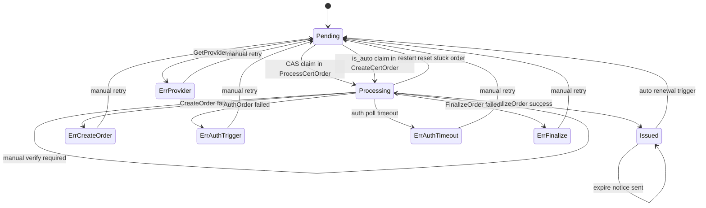
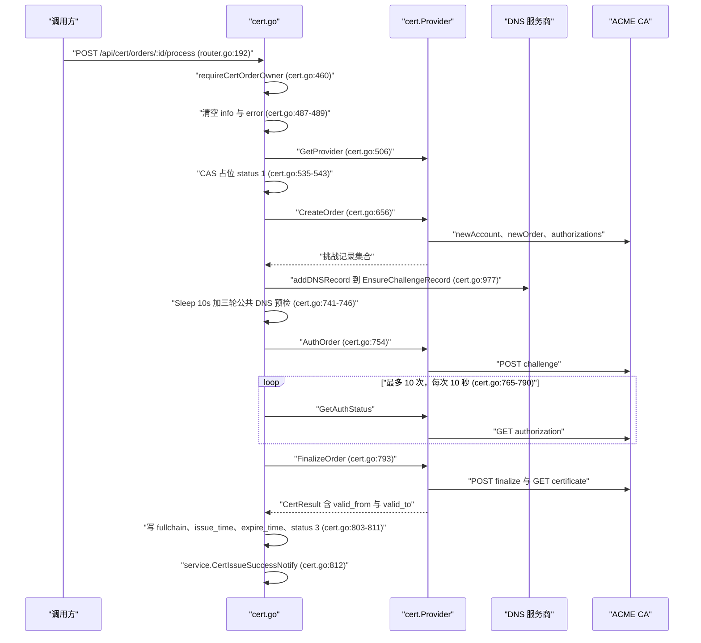
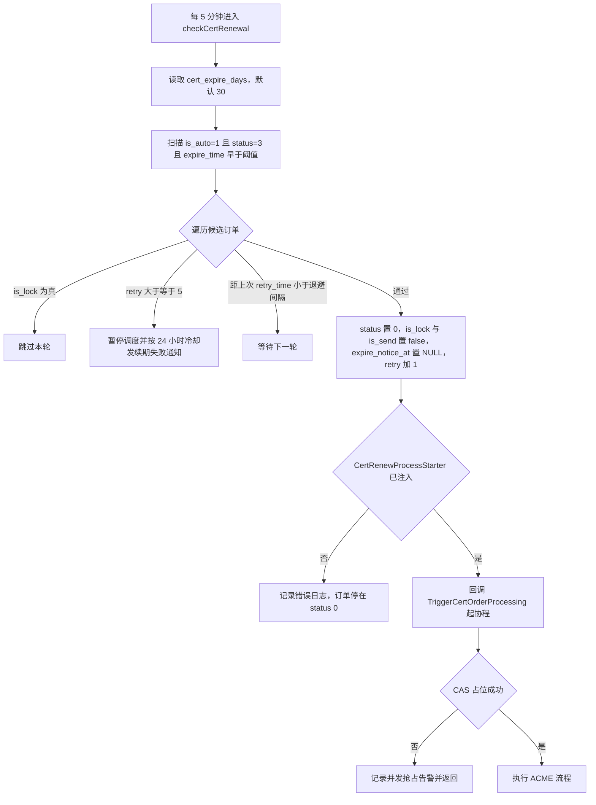
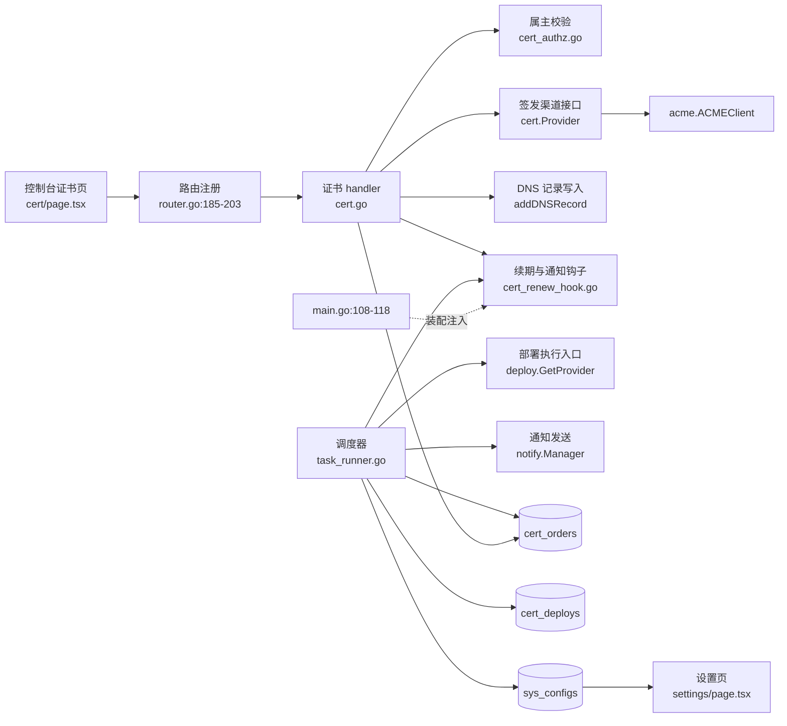
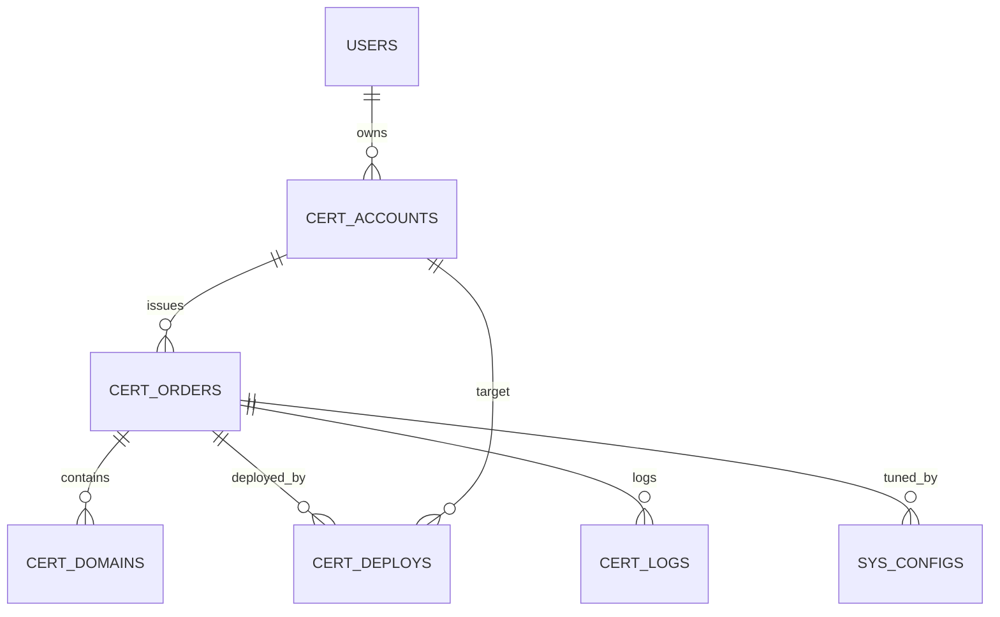

# 证书生命周期管理

<cite>
**本文档引用的文件**
- [cert.go](file://main/internal/api/handler/cert.go)
- [cert_authz.go](file://main/internal/api/handler/cert_authz.go)
- [schedule.go](file://main/internal/api/handler/schedule.go)
- [task_runner.go](file://main/internal/service/task_runner.go)
- [cert_renew_hook.go](file://main/internal/service/cert_renew_hook.go)
- [schedule.go](file://main/internal/service/schedule.go)
- [cert_issue_notice_test.go](file://main/internal/service/cert_issue_notice_test.go)
- [models.go](file://main/internal/models/models.go)
- [hooks.go](file://main/internal/models/hooks.go)
- [database.go](file://main/internal/database/database.go)
- [interface.go](file://main/internal/cert/interface.go)
- [acme.go](file://main/internal/cert/acme/acme.go)
- [aliyun.go](file://main/internal/cert/aliyun/aliyun.go)
- [ucloud.go](file://main/internal/cert/ucloud/ucloud.go)
- [aliyun_test.go](file://main/internal/cert/aliyun/aliyun_test.go)
- [router.go](file://main/internal/api/router.go)
- [main.go](file://main/main.go)
- [page.tsx](file://web/app/(dashboard)/dashboard/cert/page.tsx)
- [page.tsx](file://web/app/(dashboard)/dashboard/settings/page.tsx)
- [api.ts](file://web/lib/api.ts)
</cite>

## 目录

1. [简介](#简介)
2. [项目结构](#项目结构)
3. [核心组件](#核心组件)
4. [架构总览](#架构总览)
5. [详细组件分析](#详细组件分析)
6. [依赖关系分析](#依赖关系分析)
7. [性能考虑](#性能考虑)
8. [故障排查指南](#故障排查指南)
9. [结论](#结论)
10. [附录](#附录)

## 简介

本文聚焦 DNSPlane 证书域中「一张证书从待申请到过期」的全生命周期实现，覆盖状态机、定时调度、
自动续期钩子、部署联动与到期通知五条主线。所有结论均来自当前工作区实际读取的代码与行号。

### 生命周期阶段与阅读前提

| 阶段 | 承载代码 | 触发方式 | 可观测状态 |
|------|----------|----------|------------|
| 待申请 | `CreateCertOrder` 建单 | 用户提交 | `status = 0` |
| 申请中 | `processCertOrderAsync` | 手动 process 或 `is_auto` | `status = 1` |
| 签发完成 | `FinalizeOrder` 回写 | ACME `finalize` 成功 | `status = 3` + `issue_time` + `expire_time` |
| 部署下发 | `executeDeployTasks` | 签发成功或证书更新检测 | 部署任务 `status` 1/2/-1 |
| 自动续期 | `checkCertRenewal` | 每 5 分钟心跳 | `status` 由 3 复位为 0 |
| 到期提醒 | `checkCertExpire` | 每 24 小时心跳 | `is_send` + `expire_notice_at` |
| 失败终态 | 六类负值状态 | 各阶段错误分支 | `status = -1 ~ -5` |

阅读前提有三条：其一，签发渠道与部署器实现清单见「证书部署策略」子文档，本文不重复枚举 88 个
部署器；其二，只有「签发—续期—到期」这条主线是全自动的，吊销与取消在当前工作区无任何入口，
属接口预留而非可用能力，证据见[吊销与取消](#吊销与取消能力存在但链路不可达)；其三，文中所有密钥、
令牌、口令一律以 `{占位}` 表示，不出现真实值。

**章节来源**
- [cert.go:354-452](file://main/internal/api/handler/cert.go#L354-L452)
- [task_runner.go:141-215](file://main/internal/service/task_runner.go#L141-L215)

## 项目结构

证书生命周期横跨 HTTP 层、调度层、抽象层与数据层，涉及文件如下。

### 文件与职责

| 文件 | 行数 | 在生命周期中的职责 |
|------|:----:|--------------------|
| `main/internal/api/handler/cert.go` | 1519 | 建单、状态推进、CAS 占位、ACME 异步编排、DNS 记录写入、手动重处理 |
| `main/internal/api/handler/cert_authz.go` | 116 | 账户/订单/部署三类属主校验与列表 scope |
| `main/internal/service/task_runner.go` | 1015 | 续期扫描、部署执行与重试、锁兜底、到期通知、通知文案构建 |
| `main/internal/service/cert_renew_hook.go` | 48 | handler 与 service 之间的双向钩子 |
| `main/internal/models/models.go` | 370 | `CertOrder`/`CertDeploy` 表结构与续期扫描复合索引 |
| `main/internal/models/hooks.go` | — | 落库前加解密钩子，决定哪些字段参与续期比对 |
| `main/internal/database/database.go` | — | 进程启动时把卡住的 `status = 1` 全量复位 |
| `main/internal/cert/interface.go` | 115 | `Provider` 九方法契约，含未被调用的 `Revoke`/`Cancel` |
| `main/internal/cert/acme/acme.go` | 1052 | ACME 账户、订单、挑战、签发、限流退避 |
| `main/internal/api/router.go` | — | 19 条 `/api/cert/*` 控制台路由注册 |

**章节来源**
- [cert.go:1-1519](file://main/internal/api/handler/cert.go#L1-L1519)
- [task_runner.go:1-1015](file://main/internal/service/task_runner.go#L1-L1015)
- [router.go:185-279](file://main/internal/api/router.go#L185-L279)

### 关于 handler/schedule.go 的归属修正

大纲把 `handler/schedule.go` 列入本域，实读后必须修正归属：该文件是 **DNS 解析记录定时切换**
（`ScheduleTask` 的 `type` 为 0 改/1 启/2 停/3 删，`cycle` 为 0 单次/1 每日/2 每周/3 每月）的
CRUD 入口，执行者是 `service/schedule.go` 的 `ScheduleRunner`，与证书续期调度器 `TaskRunner`
完全独立，两者不共享任务表、不共享 ticker。

| 调度器 | 实现位置 | 首跑延迟 | 周期 | 作用对象 |
|--------|----------|:--------:|:----:|----------|
| `TaskRunner` | `task_runner.go:46` | 30 秒 / 60 秒双协程 | 5 分钟 / 24 小时 | 证书续期、部署、到期通知 |
| `ScheduleRunner` | `schedule.go:32` | 20 秒 | 60 秒 | DNS 记录定时切换 |

**章节来源**
- [schedule.go:16-45](file://main/internal/api/handler/schedule.go#L16-L45)
- [schedule.go:66-90](file://main/internal/service/schedule.go#L66-L90)
- [task_runner.go:38-139](file://main/internal/service/task_runner.go#L38-L139)

## 核心组件

### 组件清单与职责边界

| 组件 | 入口符号 | 位置 | 单一职责 |
|------|----------|------|----------|
| 状态机 | `CertOrder.Status` | `models.go:228` | 以整型编码生命周期阶段 |
| 心跳调度 | `runCertTask` | `task_runner.go:89` | 30 秒首跑 + 5 分钟周期，串行四个子任务 |
| 到期心跳 | `runExpireNotice` | `task_runner.go:115` | 60 秒首跑 + 24 小时周期 |
| 续期筛选 | `checkCertRenewal` | `task_runner.go:153` | 按 `is_auto`/`status`/`expire_time` 挑选候选 |
| 续期启动器 | `CertRenewProcessStarter` | `cert_renew_hook.go:44` | 让 service 反向调用 handler 的 ACME 流程 |
| 签发结果通知 | `CertIssueSuccessNotify`/`CertIssueFailNotify` | `cert_renew_hook.go:25`/`:35` | handler 只面向抽象，实现在装配期注入 |
| 部署联动 | `executeDeployTasks` | `task_runner.go:217` | 依 `issue_time` 差异决定是否重下发 |
| 失败重试 | `retryFailedDeployTasks` | `task_runner.go:244` | 对 `status = -1` 的部署任务按退避重试 |
| 锁兜底 | `releaseExpiredLocks` | `task_runner.go:421` | 释放超时部署锁与订单锁 |
| 到期通知 | `checkCertExpire` | `task_runner.go:893` | 提前 N 天推送并按天数间隔去重 |

协作原则有三点。**依赖倒置**：`service` 不 import `handler`，续期需要执行 ACME 时通过
`SetCertRenewProcessStarter(handler.TriggerCertOrderProcessing)`（`main.go:108`）把函数指针注入
`service` 的包级变量，反向依赖仅存在于装配期。**单一职责**：`task_runner.go` 只管「何时做」，
`cert.go` 只管「怎么做」，状态写入点集中在 `cert.go:509-820` 与 `task_runner.go:198-205`。
**开闭原则**：新增签发渠道不改动生命周期代码，只需实现 `cert.Provider` 九方法
（`interface.go:52-79`）并在自身 `init()` 注册。

**章节来源**
- [cert_renew_hook.go:10-48](file://main/internal/service/cert_renew_hook.go#L10-L48)
- [main.go:108-118](file://main/main.go#L108-L118)
- [interface.go:52-79](file://main/internal/cert/interface.go#L52-L79)
- [task_runner.go:153-215](file://main/internal/service/task_runner.go#L153-L215)

## 架构总览

### 状态机

下图按**当前工作区实测赋值点**绘制订单状态机，状态标识符使用英文，与 `models.go:228` 注释中的
`validating`/`validated`/`revoked` 命名并不完全对应（差异见下节）。

**图表来源**
- [cert.go:443-546](file://main/internal/api/handler/cert.go#L443-L546)
- [cert.go:593-821](file://main/internal/api/handler/cert.go#L593-L821)
- [task_runner.go:198-205](file://main/internal/service/task_runner.go#L198-L205)
- [database.go:152-157](file://main/internal/database/database.go#L152-L157)

注意 `ErrProvider` 的源状态是 `Pending` 而非 `Processing`：两条入口路径都在 CAS 之前取 provider（`cert.go:506` 早于 `:536`，`:593` 早于 `:615`），失败时 `status` 仍是 0。

**章节来源**
- [cert.go:505-623](file://main/internal/api/handler/cert.go#L505-L623)
- [models.go:226-230](file://main/internal/models/models.go#L226-L230)

### 三层状态语义对照

同一状态值在「模型注释」「通知文案」「实际赋值」三处口径不同，是本域最容易误判的地方。

| 状态 | 模型注释（`models.go:228`） | 通知文案（`certIssueStatusName`） | 实际赋值点与含义 |
|:----:|-----------------------------|-----------------------------------|------------------|
| 0 | pending | 「失败」 | 待申请；自动续期每轮复位值 |
| 1 | validating | 未映射 | 处理中；`runAutoAuth` 为假时也停在 1 等待人工验证 |
| 2 | validated | 未映射 | **无赋值点**，属幻影状态 |
| 3 | issued | 未映射 | 已签发，唯一进入续期扫描的状态 |
| 4 | revoked | 未映射 | **无赋值点**，无吊销入口 |
| -1 | errors | 购买证书失败 | 获取签发渠道失败（`cert.go:509`、`:518`、`:596`、`:603`） |
| -2 | errors | 创建订单失败 | `CreateOrder` 失败（`cert.go:659`） |
| -3 | errors | 添加 DNS 失败 | 触发 CA 验证失败（`cert.go:756`），与文案不符 |
| -4 | errors | 验证 DNS 失败 | 验证轮询 10 次超时（`cert.go:782`） |
| -5 | errors | 验证订单失败 | `FinalizeOrder` 签发失败（`cert.go:796`），与文案不符 |
| -6 | errors | 订单验证未通过 | 订单锁超时释放（`task_runner.go:445`），实际不可达 |
| -7 | errors | 签发证书失败 | **无赋值点**，通知映射为死条目 |

**章节来源**
- [models.go:217-244](file://main/internal/models/models.go#L217-L244)
- [task_runner.go:543-563](file://main/internal/service/task_runner.go#L543-L563)
- [cert.go:505-820](file://main/internal/api/handler/cert.go#L505-L820)

## 详细组件分析

### 申请：建单与自动占位

`CreateCertOrder`（`cert.go:354`）在写库前完成四道校验，任一失败即返回且不产生订单：
配额 `CheckQuota(c, "certs")`（`:356`）、属主 `requireCertAccountOwner`（`:366`，实现
`cert_authz.go:32`）、标识合法性 `validateCertOrderDomains`（`:374` 调用，定义 `:265`）、
校验方式约束 `validateChallengeChoice`（`:391` 调用，定义 `:321`，纯 IP 禁 `dns-01`、
通配符禁 `http-01`）。

订单以 `Status: 0` 落库（`:403`），随后按用户提交顺序写入 `cert_domains`（`:411-418`，`sort` 递增）。
若 `is_auto` 为真且能取到签发渠道，建单请求**就地占位**：`order.Status = 1`（`:443`）→ `Save`（`:444`）
→ `go processCertOrderAsync(...)`（`:446`），首张证书无需再调 process 接口。

加密边界由 GORM 钩子固定：`CertOrder.BeforeSave` 只加密 `PrivateKey` 与 `Info`（`hooks.go:38-39`），
`FullChain` 与 `DNS` 为明文列（`models.go:239-240`）；续期与部署比对依赖的
`expire_time`/`issue_time` 均为明码时间列（`models.go:225-226`）。

**章节来源**
- [cert.go:354-452](file://main/internal/api/handler/cert.go#L354-L452)
- [cert.go:265-341](file://main/internal/api/handler/cert.go#L265-L341)
- [cert_authz.go:30-65](file://main/internal/api/handler/cert_authz.go#L30-L65)
- [hooks.go:38-44](file://main/internal/models/hooks.go#L38-L44)

### 签发：ACME 端到端时序

`ProcessCertOrder`（`cert.go:454`）与 `TriggerCertOrderProcessing`（`cert.go:552`）共用
`processCertOrderAsync`（`cert.go:646`）；前者带 HTTP 语义，后者供续期调度回调，两者以同一条
CAS 语句占位。

**图表来源**
- [cert.go:454-812](file://main/internal/api/handler/cert.go#L454-L812)
- [router.go:190-203](file://main/internal/api/router.go#L190-L203)
- [acme.go:577-887](file://main/internal/cert/acme/acme.go#L577-L887)

自动触发验证的判定为 `runAutoAuth = addedRecords > 0 || (http01Count > 0 && dnsRecCount == 0 && order.IsAuto)`
（`cert.go:735`）。只要有一条挑战记录写入 DNS 成功即自动推进到 CA 验证；反之若域名不在本站托管、
DNS 写入失败，流程落在 `else` 分支：把 `status` 重新写回 1（`:819`）并留下「请手动完成验证后再次
点击处理」的日志（`:818`），**没有独立的「待人工」状态**。

账户扩展字段仅在 `account.Ext == ""` 时写入一次（`cert.go:726-733`），内容只有 `order_info`，
ACME 账户私钥并未回写，因此每次续期都会重新 `newAccount`。

**章节来源**
- [cert.go:646-822](file://main/internal/api/handler/cert.go#L646-L822)
- [cert.go:895-988](file://main/internal/api/handler/cert.go#L895-L988)

### 部署：签发结果驱动的自动下发

部署任务不在证书状态机内，而是通过 `issue_time` 与订单建立因果关系。`executeDeployTasks`
（`task_runner.go:217`）每轮拉取 `active = true AND is_lock = false AND status IN (0, 2)`（`:219-220`），
过滤条件为：订单必须 `status = 3` 且 `fullchain`、`private_key` 均非空（`:227`）；
已部署过的任务仅当 `order.IssueTime` **严格晚于** `deployTask.IssueTime` 时才重下发（`:230-239`）。

`executeSingleDeploy`（`task_runner.go:281`）用一条带 `is_lock = false` 条件的 UPDATE 完成加锁
（`:284-291`，`RowsAffected == 0` 即让位），部署上下文带 5 分钟硬超时（`:345`），成功回写
`status = 2`、`retry = 0`、`log_content`、`last_time`、`issue_time`（`:364-377`），并把部署器回传的
配置增量合并进任务配置（`:374`）。失败经 `updateDeployFailed`/`updateDeployFailedWithLog` 写
`status = -1` 与 `retry + 1`（`:395-419`）。

手动入口只有 `ProcessCertDeploy`（`cert.go:1315`）一条：同步执行 `provider.Deploy`（`:1376`），
**只更新 `updated_at`**（`:1382`），既不写 `status`、也不写 `log_content`，更不参与重试与通知。

| 部署触发路径 | 加锁 | 写 `log_content` | 更新 `status` | 通知 |
|--------------|:----:|:----------------:|:-------------:|:----:|
| `executeSingleDeploy` | 是 | 是 | 2 / -1 | 失败时 |
| `retryFailedDeployTasks` | 是 | 是 | 2 / -1 | 达上限时 |
| 手动 `ProcessCertDeploy` | 否 | 否 | 否 | 否 |

**章节来源**
- [task_runner.go:217-242](file://main/internal/service/task_runner.go#L217-L242)
- [task_runner.go:281-419](file://main/internal/service/task_runner.go#L281-L419)
- [cert.go:1315-1385](file://main/internal/api/handler/cert.go#L1315-L1385)

### 续期：扫描、退避与复位

`checkCertRenewal`（`task_runner.go:153`）是自动续期唯一入口。

**图表来源**
- [task_runner.go:153-215](file://main/internal/service/task_runner.go#L153-L215)
- [cert_renew_hook.go:44-48](file://main/internal/service/cert_renew_hook.go#L44-L48)
- [cert.go:614-623](file://main/internal/api/handler/cert.go#L614-L623)

| 参数 | 值 | 读取点 |
|------|----|--------|
| 心跳周期 | 5 分钟，首跑 30 秒 | `task_runner.go:41`、`:96`、`:100` |
| 续期窗口 | `cert_expire_days`，默认 30 天 | `task_runner.go:154-159` |
| 扫描条件 | `is_auto AND status = 3 AND expire_time < now + 窗口` | `task_runner.go:163-164` |
| 重试上限 | 5 次 | `task_runner.go:172` |
| 退避序列 | 300/600/1800/3600/7200 秒 | `task_runner.go:185` |
| 失败通知冷却 | 24 小时 | `task_runner.go:729-734` |
| 复位字段 | `status`、`is_lock`、`is_send`、`expire_notice_at`、`retry`、`retry_time` | `task_runner.go:198-205` |

续期成功**不会把 `retry` 归零**：成功分支（`cert.go:803-812`）与 `TriggerCertOrderProcessing` 都不重置
该列，全仓仅部署任务在 `task_runner.go:369` 归零。以 90 天有效期证书计，每 30 天进入一次续期窗口、
每轮 +1，约 15 个月后 `retry` 累计到 5，`:172` 将永久跳过该订单并发出「已连续尝试 5 次仍未成功，
系统已暂停调度」的**误报**。

**章节来源**
- [task_runner.go:153-215](file://main/internal/service/task_runner.go#L153-L215)
- [task_runner.go:729-734](file://main/internal/service/task_runner.go#L729-L734)
- [cert.go:803-812](file://main/internal/api/handler/cert.go#L803-L812)

### 吊销与取消：能力存在但链路不可达

`cert.Provider` 声明了 `Revoke`（`interface.go:72`）与 `Cancel`（`:75`）。ACME 侧 `Revoke` 有完整实现
（`acme.go:1032`，向 `directory.RevokeCert` 提交 JWS，`:1046`），`Cancel` 是空实现直接 `return nil`
（`acme.go:1050`）；阿里云渠道另实现 `Revoke`（`aliyun.go:309`，`RevokeCertificate`）与
`Cancel`（`aliyun.go:320`，`CancelPendingCertificate`）。

但全仓检索显示，除 `ucloud.go:120` 自调 `BuyCert` 与 `aliyun_test.go:255` 的单元测试外，
`.Revoke(`、`.Cancel(`、`.BuyCert(` **没有任何应用层调用点**；`router.go:185-203` 的 19 条证书路由中
也没有吊销或取消端点。由此得出三条结论：订单不会出现 `status = 4`，模型注释中的该取值仅为规划；
已签发证书无法在本站撤销，删除订单（`cert.go:990-999`）只是删数据库记录，不会向 CA 发起吊销，
证书在有效期内继续可用；需要吊销时必须回到 CA 或云厂商控制台操作，属当前实现的已知边界。

**章节来源**
- [interface.go:52-79](file://main/internal/cert/interface.go#L52-L79)
- [acme.go:1032-1052](file://main/internal/cert/acme/acme.go#L1032-L1052)
- [aliyun.go:309-332](file://main/internal/cert/aliyun/aliyun.go#L309-L332)
- [ucloud.go:118-122](file://main/internal/cert/ucloud/ucloud.go#L118-L122)
- [cert.go:990-999](file://main/internal/api/handler/cert.go#L990-L999)

### 到期提醒

`checkCertExpire`（`task_runner.go:893`）由 24 小时心跳驱动（`runExpireNotice` 首跑 60 秒，
`:115-139`）。进入函数先执行一条补偿 UPDATE：把 `status = 3 AND is_send = true AND expire_notice_at IS NULL`
的订单补写 `expire_notice_at`（`:902-904`），避免历史数据因该列为空而被无限重发；随后才扫描候选
（`:907-908`）。推送文案按剩余天数分三档：

| 剩余天数 | 标题前缀 | 正文要点 |
|:--------:|----------|----------|
| ≤ 0 | 【证书已过期】 | 已于 `{expire_time}` 过期，请立即续期或检查自动续期任务 |
| 1 至 7 | 【证书即将过期】 | 将在 N 天后过期，请及时续期 |
| 8 至提前窗口 | 【证书到期提醒】 | 将在 `{expire_time}` 过期（剩余 N 天） |

提前量由 `certExpireNoticeLeadDays`（`:751`，优先 `cert_expire_notice_days`，回退 `cert_expire_days`，
再默认 30）决定，去重由 `certExpireNoticeIntervalDays`（`:766`，默认 1 天）决定；发送成功才回写
`is_send = true` 与 `expire_notice_at`（`:950-958`），失败仅记日志、下一轮重试。自动续期复位时会把
`expire_notice_at` 清为 `NULL`、`is_send` 置 false（`:200-205`），因此每次续期后提醒重新计数。

**章节来源**
- [task_runner.go:893-961](file://main/internal/service/task_runner.go#L893-L961)
- [task_runner.go:751-773](file://main/internal/service/task_runner.go#L751-L773)
- [task_runner.go:115-139](file://main/internal/service/task_runner.go#L115-L139)

### 自动与手动路径对比

| 维度 | 自动路径 | 手动路径 |
|------|----------|----------|
| 建单即申请 | `is_auto = true` 时 `cert.go:443-446` | `is_auto = false` 需再调 process |
| 触发者 | `TaskRunner` → `CertRenewProcessStarter` | 控制台 5 秒轮询加用户点击（`cert/page.tsx:164-173`） |
| 状态占位 | CAS `cert.go:615-622` | CAS `cert.go:536-543` |
| 失败重试 | 由 `retry` 与退避序列驱动 | 无自动重试，用户再次点击 |
| 续期窗口 | `expire_time < now + cert_expire_days` | 不受窗口限制，任何时候可点 |
| 自动开关 | `ToggleCertOrderAuto`（`cert.go:1140-1158`） | 同一开关的关闭态 |
| 通知 | 续期失败通知加到期提醒 | 签发失败通知（默认开启） |

**章节来源**
- [cert.go:421-449](file://main/internal/api/handler/cert.go#L421-L449)
- [cert.go:536-623](file://main/internal/api/handler/cert.go#L536-L623)
- [cert.go:1140-1158](file://main/internal/api/handler/cert.go#L1140-L1158)
- [page.tsx:164-173](file://web/app/(dashboard)/dashboard/cert/page.tsx#L164-L173)

### 失败重试与锁兜底

证书侧与部署侧的重试是两套互不相干的策略。

| 维度 | 证书续期重试 | 部署任务重试 |
|------|--------------|--------------|
| 候选条件 | `is_auto = 1 AND status = 3` 且进入续期窗口 | `active = 1 AND status = -1 AND is_lock = 0`（`:246-247`） |
| 上限 | 固定 5（`:172`） | `MaxRetry`，为 0 时取 5（`:251-253`） |
| 退避序列 | 300/600/1800/3600/7200 秒（`:185`） | 60/300/600/1800/3600 秒（`:23`） |
| 成功归零 | **否** | 是（`:369`） |
| 上限后通知 | 是，24 小时冷却（`:173-179`） | 是，最后一次失败时（`:358-360`） |

锁兜底 `releaseExpiredLocks`（`task_runner.go:421`）每轮最后执行：部署锁 10 分钟超时释放并置
`status = -1`（`:422-433`）；订单锁 15 分钟超时释放并置 `status = -6`，随后逐个补发签发失败通知
（`:435-453`）。但订单分支的条件是 `is_lock = true AND status = 1`（`:442`），而全仓没有任何代码把
`cert_orders.is_lock` 置为 `true`（两条 CAS 只更新 `status`），因此 **-6 实际不可达**，
`checkCertRenewal` 里的 `order.IsLock` 跳过（`:167`）也永远不成立。协程泄漏时订单只能靠 5 分钟
`updated_at` 陈旧判定由人工重处理解锁（`cert.go:535-542`）。

进程重启是另一条兜底路径：`resetStuckOrders` 在初始化末尾把 `status = 1` 全量改回 0
（`database.go:147`、`:152-157`），使重启后的续期可被重新调度。

**章节来源**
- [task_runner.go:244-279](file://main/internal/service/task_runner.go#L244-L279)
- [task_runner.go:421-454](file://main/internal/service/task_runner.go#L421-L454)
- [database.go:146-157](file://main/internal/database/database.go#L146-L157)
- [cert.go:535-543](file://main/internal/api/handler/cert.go#L535-L543)

## 依赖关系分析

### 组件依赖图

**图表来源**
- [main.go:108-118](file://main/main.go#L108-L118)
- [task_runner.go:141-215](file://main/internal/service/task_runner.go#L141-L215)
- [cert.go:454-623](file://main/internal/api/handler/cert.go#L454-L623)
- [router.go:185-203](file://main/internal/api/router.go#L185-L203)

图中 `sys_configs` 同时被调度器（读取窗口与开关）与设置页（写入）访问，是生命周期唯一的运行时参数来源。

**章节来源**
- [task_runner.go:153-159](file://main/internal/service/task_runner.go#L153-L159)
- [task_runner.go:893-899](file://main/internal/service/task_runner.go#L893-L899)
- [cert_authz.go:67-115](file://main/internal/api/handler/cert_authz.go#L67-L115)

### 定时任务矩阵

| 任务 | 所属协程 | 首跑延迟 | 周期 | 依赖配置键 | 影响的数据列 |
|------|----------|:--------:|:----:|------------|--------------|
| `checkCertRenewal` | `runCertTask` | 30 秒 | 5 分钟 | `cert_expire_days` | `status`、`retry`、`retry_time`、`is_send`、`expire_notice_at` |
| `executeDeployTasks` | `runCertTask` | 30 秒 | 5 分钟 | 无 | `status`、`issue_time`、`last_time`、`log_content` |
| `retryFailedDeployTasks` | `runCertTask` | 30 秒 | 5 分钟 | 无 | `status`、`retry`、`retry_time` |
| `releaseExpiredLocks` | `runCertTask` | 30 秒 | 5 分钟 | 无 | `is_lock`、`lock_time`、`status` |
| `checkDomainExpire` | `runExpireNotice` | 60 秒 | 24 小时 | `domain_expire_notice_enabled` | 域名到期提醒状态 |
| `checkCertExpire` | `runExpireNotice` | 60 秒 | 24 小时 | 4 个到期通知键 | `is_send`、`expire_notice_at` |

两个协程由 `Start` 一并拉起（`task_runner.go:57-59`），`wg.Add(2)` 配合 `Stop` 等待退出（`:68-82`），
`ctx` 取消时由监听协程触发 `Stop`（`:62-65`）；每个子任务外层都有 `recover` 兜底
（`executeCertTask` 的 `:142-146`、`executeExpireNotice` 的 `:788-792`），单个子任务 panic 不会终止心跳。

**章节来源**
- [task_runner.go:46-151](file://main/internal/service/task_runner.go#L46-L151)
- [task_runner.go:787-799](file://main/internal/service/task_runner.go#L787-L799)

### 数据实体关系

**图表来源**
- [models.go:201-290](file://main/internal/models/models.go#L201-L290)
- [cert_authz.go:20-23](file://main/internal/api/handler/cert_authz.go#L20-L23)

级联行为实测：删除订单会连带删除 `cert_domains`（`cert.go:996`），但**不删** `cert_deploys`，
残留任务的 `oid` 悬空后由调度器静默 `continue`（`task_runner.go:224`）；删除证书账户
（`cert.go:206-212`）不检查关联订单。`idx_cert_orders_auto_scan` 由 `is_auto`（priority 1）、
`status`（priority 2）、`expire_time`（priority 3）三列组成（`models.go:230`、`:228`、`:226`），
列序与续期扫描条件完全对应。

**章节来源**
- [cert.go:206-212](file://main/internal/api/handler/cert.go#L206-L212)
- [cert.go:990-999](file://main/internal/api/handler/cert.go#L990-L999)
- [models.go:216-244](file://main/internal/models/models.go#L216-L244)
- [task_runner.go:217-242](file://main/internal/service/task_runner.go#L217-L242)

## 性能考虑

### 续期并发

单个心跳周期内 `checkCertRenewal` 对候选列表**串行遍历并同步触发协程**
（`task_runner.go:166-214`、`cert.go:623`），没有任何并发上限。若重启或配置变更后同时有 N 张证书
进入续期窗口，会一次性拉起 N 个 ACME 协程，每个协程内部又包含 `time.Sleep(10s)` 加最多 10 轮轮询
（`cert.go:767-790`），单协程最短存活约 110 秒。叠加放大因素如下：

| 因素 | 实测取值 | 后果 |
|------|----------|------|
| ACME 限流退避 | 最多 12 次（`acme.go:39`、`:344`） | 单请求可等待至小时级 |
| 协程上下文 | `context.Background()`（`cert.go:647`） | 优雅关闭无法取消，`taskCancel()` 只作用于调度器 |
| ACME 账户复用 | 未持久化（`cert.go:726-733`） | 每单每轮都 `newAccount`，易撞 newAccount 速率限制 |
| 挑战记录清理 | 签发成功后无删除逻辑（`cert.go:977` 单向写入） | 同域名多次续期后 TXT 记录堆积 |

改进方向按投入产出排序为：给续期协程加 `context.WithTimeout`、限制并发协程个位数、
把账户密钥与 `account_url` 以 `{占位}` 形式回写 `cert_accounts.ext`、签发成功后清理 `_acme-challenge`。

**章节来源**
- [task_runner.go:163-214](file://main/internal/service/task_runner.go#L163-L214)
- [cert.go:646-790](file://main/internal/api/handler/cert.go#L646-L790)
- [acme.go:334-415](file://main/internal/cert/acme/acme.go#L334-L415)

### 批量到期与日志写放大

**批量到期**：续期扫描走 `idx_cert_orders_auto_scan`，订单量到万级时应观察 `expire_time` 范围扫描的
实际执行计划（`task_runner.go:163-164`）。到期通知的候选查询只带
`status = 3 AND expire_time < ?`（`:907-908`），**未把** `is_send`/`expire_notice_at` 作为 SQL 过滤条件，
去重全在 Go 侧循环完成；同一轮内每张待通知证书都要走一次域名查询（`:923-924`）与一次 10 秒超时的
同步发送（`:948-950`），批量到期会显著拉长 24 小时心跳的单轮耗时。

**日志写放大**：`appendOrderLog`（`cert.go:626-633`）每次追加都执行 `order.Info += line` 后
`Update("info", order.Info)`，即整串重写并重新 AES-GCM 加密（`hooks.go:38-39`）。一张证书的完整
ACME 流程通常写入数十条日志，代价随日志长度呈平方增长；同一函数又用 `fmt.Printf` 直写 stdout
（`:632`），绕过 logger 的级别控制与轮转。

**章节来源**
- [task_runner.go:893-961](file://main/internal/service/task_runner.go#L893-L961)
- [cert.go:626-633](file://main/internal/api/handler/cert.go#L626-L633)
- [hooks.go:38-44](file://main/internal/models/hooks.go#L38-L44)

## 故障排查指南

### 续期失败

| 症状 | 首要证据 | 定位路径 |
|------|----------|----------|
| 订单长期 `status = 3` 且 `retry = 0` | 未开 `is_auto` | `ToggleCertOrderAuto`（`cert.go:1140`）或列表页开关 |
| 订单卡在 `status = 0`，日志出现「未注册 CertRenewProcessStarter」 | 装配缺失 | `main.go:108`、`task_runner.go:209-213` |
| `status = -1` | 取不到签发渠道 | `cert.go:593-607`，核对账户 `type` 与注册表 |
| `status = -2` | `CreateOrder` 失败 | `cert.go:656-664`，注意 CA 速率限制 |
| `status = -3` | CA 验证触发失败 | `cert.go:754-761`，**不是** DNS 写入失败 |
| `status = -4` | 10 轮轮询超时 | `cert.go:765-790`，检查 TXT 生效与域名匹配 |
| `status = -5` | 签发失败 | `cert.go:793-801` |
| 反复出现「已连续尝试 5 次仍未成功」 | `retry` 成功不归零 | `task_runner.go:172`、`:203` |
| 订单停在 `status = 1` 无法再次处理 | 协程泄漏且 `updated_at` 未过 5 分钟 | `cert.go:535-542`，重启后由 `database.go:152` 复位 |
| 返回「订单没有域名」而状态不变 | `cert_domains` 缺失 | `cert.go:469-472` |

排查顺序建议：先读订单日志接口 `/api/cert/orders/:id/log`（`cert.go:1001-1026`，把 `error`、`DNS`、
`info` 三段拼接返回，其中 `info` 需经 `hooks.go:41` 解密），再看 `error` 字段，最后核对
`retry`/`retry_time` 是否仍在退避等待窗口内。

**章节来源**
- [cert.go:593-801](file://main/internal/api/handler/cert.go#L593-L801)
- [cert.go:1001-1026](file://main/internal/api/handler/cert.go#L1001-L1026)
- [task_runner.go:167-205](file://main/internal/service/task_runner.go#L167-L205)
- [hooks.go:38-44](file://main/internal/models/hooks.go#L38-L44)

### 部署未生效

| 检查点 | 判据 | 依据 |
|--------|------|------|
| 任务是否启用 | `active = true` | `task_runner.go:219-220` |
| 订单是否已签发 | `status = 3` 且 `fullchain`、`private_key` 非空 | `task_runner.go:227` |
| 是否被 `issue_time` 判定跳过 | `order.IssueTime` 未晚于 `deploy.IssueTime` | `task_runner.go:230-239` |
| 是否卡在锁 | `is_lock = true` 且 `lock_time` 未超 10 分钟 | `task_runner.go:284-291`、`:422-433` |
| 是否已达重试上限 | `retry ≥ MaxRetry`，默认 5 | `task_runner.go:251-259` |
| 手动部署为何看不到状态变化 | 手动路径不写 `status` 与 `log_content` | `cert.go:1376-1384` |
| 悬空引用 | 订单已删，任务 `oid` 无对应记录 | `cert.go:997`、`task_runner.go:224` |
| 属主不符导致 404 | 部署任务 `uid` 非当前用户 | `cert_authz.go:96-107` |

若证书确已续期而部署未跟随，优先看 `issue_time` 比对这一项：它是唯一门闩，调度器不会因为
订单 `status` 变化而重下发。

**章节来源**
- [task_runner.go:217-291](file://main/internal/service/task_runner.go#L217-L291)
- [task_runner.go:422-433](file://main/internal/service/task_runner.go#L422-L433)
- [cert.go:1315-1385](file://main/internal/api/handler/cert.go#L1315-L1385)
- [cert_authz.go:86-107](file://main/internal/api/handler/cert_authz.go#L86-L107)

### 通知未达

通知链路有四个独立门闩，任一不满足即静默返回：

1. **总开关**：`cert_expire_notice_enabled`（`task_runner.go:894`）、`cert_issue_notice_enabled`（`:661`）、
   `cert_renew_fail_notice_enabled`（`:682`）为默认开启；`cert_issue_success_notice_enabled`（`:634`）
   与 `cert_deploy_success_notice_enabled`（`:458`）为**显式开启**语义（`sysconfigBoolExplicitOn`，`:746`）。
2. **提前窗口与去重**：剩余天数需进入 `cert_expire_notice_days` 窗口，且距 `expire_notice_at`
   不少于 `cert_expire_notice_interval_days`（`:898-920`）。
3. **冷却**：续期失败通知 24 小时冷却（`:729-734`，时间戳存 `renew_fail_notice_at`，
   `models.go:241`）。
4. **渠道配置**：`sendCertNotification` 每次新建 `notify.Manager` 并按 `sys_configs` 重新装载渠道
   （`:617-625`），渠道未配置时只在日志留下「发送证书通知失败」。

另有一项与数据库方言相关的风险：`cert_issue_success_notice_enabled`（33 字符）与
`cert_deploy_success_notice_enabled`（34 字符）超过 `SysConfig.Key` 声明的 `size:32`（`models.go:315`）。
SQLite 不强制变长上限，默认部署无异常；MySQL 下写入可能截断，截断后的键名与读取键不一致，
表现为设置页勾选成功但通知永远不发。此项属**推断**，本环境未实测 MySQL 行为。

此外 `MaybeNotifyCertAutoRenewACMEFailure`（`task_runner.go:701`）在 `cert_renew_fail_notice_enabled`
判定之后便无任何调用方，属死代码，不应作为排障线索。

**章节来源**
- [task_runner.go:617-734](file://main/internal/service/task_runner.go#L617-L734)
- [task_runner.go:893-960](file://main/internal/service/task_runner.go#L893-L960)
- [models.go:241-242](file://main/internal/models/models.go#L241-L242)
- [models.go:314-317](file://main/internal/models/models.go#L314-L317)
- [page.tsx:541-600](file://web/app/(dashboard)/dashboard/settings/page.tsx#L541-L600)

## 结论

### 成果、缺口与原则评价

证书生命周期在本项目中已是**闭环可用**的：建单、DNS-01/HTTP-01 自动写入、CA 验证轮询、本地生成
私钥签发、`issue_time` 驱动的部署联动、5 分钟心跳的自动续期与 24 小时心跳的到期提醒共同构成完整
链路；核心并发风险由 CAS 状态占位（`cert.go:535-542`）与部署锁（`task_runner.go:284-291`）覆盖。

需要正视的缺口有五项：状态语义三处不一致，`2`/`4`/`-6`/`-7` 无实际赋值路径且通知文案与真实失败阶段
错位；续期计数永不归零，约 15 个月后自动续期停摆并产生误报；订单锁形同虚设，`is_lock` 无置位点使
`-6` 分支与 `IsLock` 跳过均为死逻辑；吊销能力不可达，接口与 ACME 实现均就绪但无路由与调用方；
手动部署不写状态，`ProcessCertDeploy` 与调度器行为不对称，观测面缺失。

原则视角的结论是：按 KISS，生命周期本身足够简洁，单一 `status` 整型列加单一心跳协程即驱动全部行为；
按 YAGNI，`Revoke`/`Cancel`/`BuyCert` 与 `status` 2/4 属预留而未收敛的设计，建议要么补齐入口、
要么从接口与注释中删除以免误导排障；按 SRP 与 DIP，钩子注入（`cert_renew_hook.go`）让调度层与
HTTP 层互不 import，是本域最干净的一处解耦。

**章节来源**
- [cert.go:454-623](file://main/internal/api/handler/cert.go#L454-L623)
- [cert_renew_hook.go:10-48](file://main/internal/service/cert_renew_hook.go#L10-L48)
- [task_runner.go:153-454](file://main/internal/service/task_runner.go#L153-L454)

## 附录

### 状态枚举与转换表

| 当前状态 | 目标状态 | 触发条件 | 写入位置 |
|:--------:|:--------:|----------|----------|
| — | 0 | 建单 | `cert.go:403` |
| 0 | 1 | `is_auto` 建单即申请 | `cert.go:443` |
| 0 | 1 | 手动 process，CAS 成功 | `cert.go:536-543` |
| 0 | 1 | 续期触发，CAS 成功 | `cert.go:615-622` |
| 0 | -1 | 取不到签发渠道 | `cert.go:509`、`:518`、`:596`、`:603` |
| 1 | 1 | 需人工完成验证 | `cert.go:819` |
| 1 | -2 | `CreateOrder` 失败 | `cert.go:659` |
| 1 | -3 | `AuthOrder` 失败 | `cert.go:756` |
| 1 | -4 | 验证轮询超时 | `cert.go:782` |
| 1 | -5 | `FinalizeOrder` 失败 | `cert.go:796` |
| 1 | 3 | 签发成功 | `cert.go:810` |
| 1 | 0 | 进程重启复位 | `database.go:153` |
| 3 | 0 | 自动续期复位 | `task_runner.go:198-205` |
| -1 至 -5 | 0 | 人工再次 process 或续期复位 | `cert.go:536`、`task_runner.go:198` |
| 1 | -6 | 声明于 `task_runner.go:445`，因 `is_lock` 无置位点而**不可达** | — |

部署任务状态独立于订单：`0` 待执行（`models.go:266` 默认值）、`1` 执行中（`task_runner.go:287`）、
`2` 已部署（`:366`）、`-1` 失败或超时（`:398`、`:411`、`:429`）。

**章节来源**
- [cert.go:403-810](file://main/internal/api/handler/cert.go#L403-L810)
- [task_runner.go:266-445](file://main/internal/service/task_runner.go#L266-L445)

### 生命周期相关配置键

| 键名 | 语义 | 读取点 | 默认 | 设置页 |
|------|------|--------|:----:|:------:|
| `cert_expire_days` | 续期窗口天数 | `task_runner.go:155` | 30 | 是（`:541`） |
| `cert_expire_notice_days` | 到期提醒提前天数 | `task_runner.go:752` | 回退上一键 | 是（`:564`） |
| `cert_expire_notice_interval_days` | 同订单最小重发间隔 | `task_runner.go:767` | 1 | 是（`:586`） |
| `cert_expire_notice_enabled` | 到期提醒总开关 | `task_runner.go:894` | 开 | 是 |
| `cert_issue_notice_enabled` | 签发失败通知 | `task_runner.go:661` | 开 | 是 |
| `cert_issue_success_notice_enabled` | 签发成功通知 | `task_runner.go:634` | 关，需显式开 | 是（`:690`） |
| `cert_renew_fail_notice_enabled` | 续期失败通知 | `task_runner.go:682` | 开 | 是（`:662`） |
| `cert_deploy_notice_enabled` | 部署失败通知 | `task_runner.go:462` | 开 | 是 |
| `cert_deploy_success_notice_enabled` | 部署成功通知 | `task_runner.go:458` | 关，需显式开 | 是（`:648`） |

「设置页」列的读取点为 `web/app/(dashboard)/dashboard/settings/page.tsx`，
类型声明见 `web/lib/api.ts:1382-1387`。

**章节来源**
- [task_runner.go:155-894](file://main/internal/service/task_runner.go#L155-L894)
- [page.tsx:541-692](file://web/app/(dashboard)/dashboard/settings/page.tsx#L541-L692)
- [api.ts:1382-1387](file://web/lib/api.ts#L1382-L1387)

### 关键代码索引

| 主题 | 符号 | 位置 |
|------|------|------|
| 建单 | `CreateCertOrder` | `cert.go:354` |
| 手动处理 | `ProcessCertOrder` | `cert.go:454` |
| 续期入口 | `TriggerCertOrderProcessing` | `cert.go:552` |
| ACME 编排 | `processCertOrderAsync` | `cert.go:646` |
| DNS 写入 | `addDNSRecord` | `cert.go:895` |
| 公共 DNS 预检 | `certPreVerifyDNS` | `cert.go:1401` |
| 自动续期开关 | `ToggleCertOrderAuto` | `cert.go:1140` |
| 心跳 | `runCertTask` | `task_runner.go:89` |
| 续期扫描 | `checkCertRenewal` | `task_runner.go:153` |
| 部署联动 | `executeDeployTasks` | `task_runner.go:217` |
| 部署重试 | `retryFailedDeployTasks` | `task_runner.go:244` |
| 锁兜底 | `releaseExpiredLocks` | `task_runner.go:421` |
| 到期通知 | `checkCertExpire` | `task_runner.go:893` |
| 续期启动器注入 | `SetCertRenewProcessStarter` | `cert_renew_hook.go:46` |
| 通知钩子注入 | `SetCertIssueNotifyHooks` | `cert_renew_hook.go:17` |
| 重启复位 | `resetStuckOrders` | `database.go:152` |

**章节来源**
- [cert.go:354-1467](file://main/internal/api/handler/cert.go#L354-L1467)
- [cert_renew_hook.go:17-48](file://main/internal/service/cert_renew_hook.go#L17-L48)
- [database.go:152-157](file://main/internal/database/database.go#L152-L157)

### 验证清单

| 序 | 检查动作 | 预期结果 | 不成立时的指向 |
|:-:|----------|----------|----------------|
| 1 | 建一张 `is_auto = false` 的订单 | 列表显示 `status = 0`，无协程 | `cert.go:421` 分支 |
| 2 | 调用 process 后立即重复调用 | 第二次返回「订单正在处理中，请勿重复提交」 | `cert.go:539-541` |
| 3 | 签发成功后查 `issue_time` 与 `expire_time` | 两列均非空且 `status = 3` | `cert.go:806-811` |
| 4 | 把 `cert_expire_days` 调到大于剩余有效期 | 5 分钟内出现 `auto_renew` 日志 | `task_runner.go:207` |
| 5 | 续期成功后再看 `retry` | 当前实现为累计值，不归零 | `task_runner.go:203` |
| 6 | 删除订单后查看部署任务 | 任务仍在，调度器静默跳过 | `cert.go:997`、`task_runner.go:224` |
| 7 | 运行通知门禁单测 | `sysconfigBoolExplicitOn` 语义符合预期 | `cert_issue_notice_test.go:216-247` |

**章节来源**
- [task_runner.go:198-224](file://main/internal/service/task_runner.go#L198-L224)
- [cert_issue_notice_test.go:216-247](file://main/internal/service/cert_issue_notice_test.go#L216-L247)
