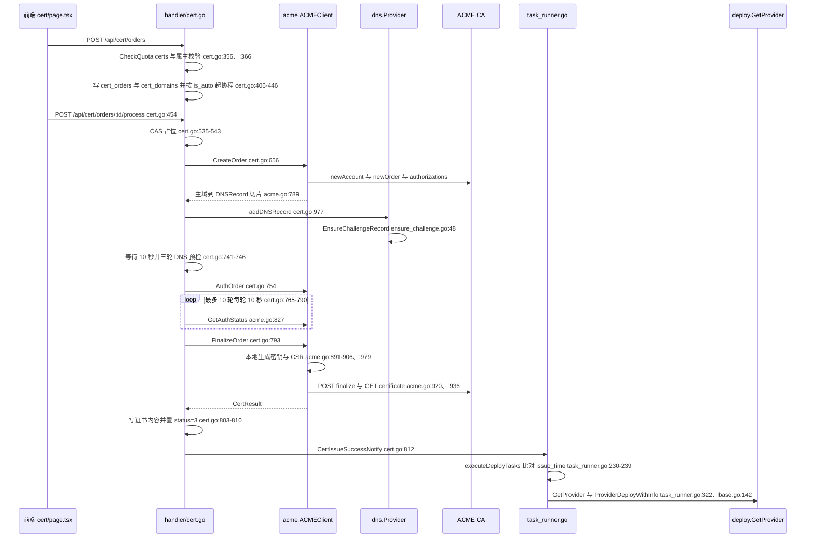
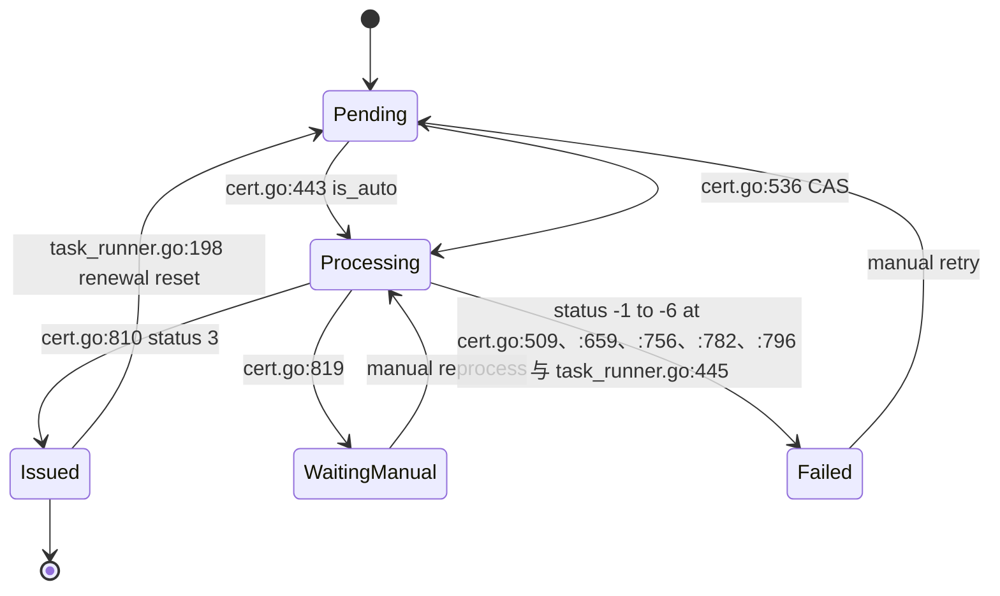
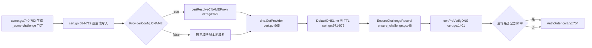
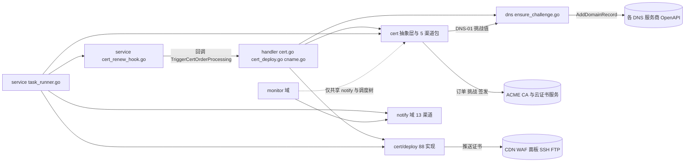
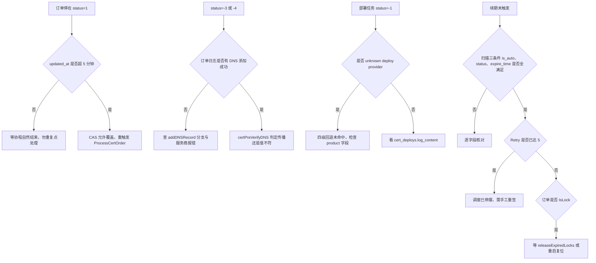

# 证书管理功能

<cite>
**本文档引用的文件**
- [main.go](file://main/main.go)
- [interface.go](file://main/internal/cert/interface.go)
- [registry.go](file://main/internal/cert/registry.go)
- [providers.go](file://main/internal/cert/providers.go)
- [acme.go](file://main/internal/cert/acme/acme.go)
- [aliyun.go](file://main/internal/cert/aliyun/aliyun.go)
- [tencent.go](file://main/internal/cert/tencent/tencent.go)
- [huoshan.go](file://main/internal/cert/huoshan/huoshan.go)
- [ucloud.go](file://main/internal/cert/ucloud/ucloud.go)
- [base.go](file://main/internal/cert/deploy/base/base.go)
- [registry.go (deploy)](file://main/internal/cert/deploy/registry.go)
- [config.go](file://main/internal/cert/deploy/config.go)
- [config_cloud.go](file://main/internal/cert/deploy/config_cloud.go)
- [config_server.go](file://main/internal/cert/deploy/config_server.go)
- [merge_deploy_api.go](file://main/internal/cert/deploy/merge_deploy_api.go)
- [ssh.go](file://main/internal/cert/deploy/servers/ssh.go)
- [local.go](file://main/internal/cert/deploy/servers/local.go)
- [cert.go](file://main/internal/api/handler/cert.go)
- [cert_deploy.go](file://main/internal/api/handler/cert_deploy.go)
- [cert_authz.go](file://main/internal/api/handler/cert_authz.go)
- [cname.go](file://main/internal/api/handler/cname.go)
- [quota.go](file://main/internal/api/handler/quota.go)
- [router.go](file://main/internal/api/router.go)
- [routes_batch1.go](file://main/internal/apiv1/routes_batch1.go)
- [task_runner.go](file://main/internal/service/task_runner.go)
- [cert_renew_hook.go](file://main/internal/service/cert_renew_hook.go)
- [models.go](file://main/internal/models/models.go)
- [hooks.go](file://main/internal/models/hooks.go)
- [ensure_challenge.go](file://main/internal/dns/ensure_challenge.go)
- [database.go](file://main/internal/database/database.go)
- [request_trace.go](file://main/internal/api/middleware/request_trace.go)
- [sanitize.go](file://main/internal/api/middleware/sanitize.go)
- [cert/page.tsx](file://web/app/(dashboard)/dashboard/cert/page.tsx)
- [account-form.tsx](file://web/components/account-form.tsx)
</cite>

## 目录

1. [简介](#简介)
2. [项目结构](#项目结构)
3. [核心组件](#核心组件)
4. [架构总览](#架构总览)
5. [详细组件分析](#详细组件分析)
6. [依赖关系分析](#依赖关系分析)
7. [性能考虑](#性能考虑)
8. [故障排查指南](#故障排查指南)
9. [结论](#结论)
10. [附录](#附录)

## 简介

证书管理功能域覆盖一张 TLS 证书从「无」到「线上生效」再到「过期前被替换」的闭环，四段串成一条可自动运转的流水线：**申请**（向 ACME CA 或云厂商下单取得验证挑战）、**部署**（把 `fullchain + privateKey` 推送到 CDN/WAF/负载均衡/面板/容器/远程主机）、**续期**（调度器按剩余天数复位订单重签并联动重部署）、**吊销**（接口层已声明，应用层无入口）。

实测规模界定本域边界：

| 维度 | 规模 | 说明 |
| --- | --- | --- |
| 签发渠道实现包 | 5 个 | `acme`、`aliyun`、`tencent`、`huoshan`、`ucloud`；`ucloud` 未被链接，实际生效 4 个 |
| ACME 品牌键 | 5 个 | `letsencrypt`、`zerossl`、`google`、`litessl`、`customacme`（`acme.go:46/:57/:70/:73/:76`） |
| 部署器分组与实现 | 5 组 / 88 个 | `base`/`providers`/`servers`/`panels`/`others`；`main.go:55-58` blank import 4 组（`base` 无实现）；`base.Register` 去重实测 providers 77、servers 3、panels 3、others 5 |
| 部署表单条目 | 53 条 | `AllDeployConfigs`：cloud 23、selfhosted 26、server 4 |
| 域内非测试代码 | 22842 行 | `internal/cert`（含测试 23436）；`deploy/` 子树 18998 行且零测试文件 |

设计取向一句话：**签发侧走统一抽象，部署侧走「注册表 + 表单」双轨**。签发侧用 9 方法接口（`cert/interface.go:52-79`）把 ACME 与云厂商压成同一条状态流；部署侧因 88 个目标平台在认证方式、幂等语义与返回信息上没有公约数，退化为每文件自成实现，靠 `base` 层薄契约粘住。逐部署器的字段级说明与重试参数全表归属《证书部署策略》。

**章节来源**

- [main/internal/cert/interface.go](file://main/internal/cert/interface.go)
- [main/internal/cert/acme/acme.go](file://main/internal/cert/acme/acme.go)
- [main/main.go](file://main/main.go)

## 项目结构

后端按「抽象层 → 渠道实现层 → 部署器层 → 接口层 → 调度层」五段切分，层间只有单向引用。

```text
main/internal/cert/                    22842 行非测试（含测试 23436）
├── interface.go          115   Provider 9 方法 + OrderInfo/CertResult/DNSRecord/ProviderConfig
├── registry.go           114   工厂与表单双写注册中心，读写锁保护两张全局表
├── providers.go          623   签发渠道表单 + 36 项 IsDeploy 部署登记
├── acme/acme.go         1052   ACME v2 客户端，5 品牌共用一份实现
├── aliyun/aliyun.go      512   CAS 免费证书申领
├── tencent/tencent.go    495   SSL 证书，TC3-HMAC-SHA256 签名
├── huoshan/huoshan.go    488   certificate_service QuickApply
├── ucloud/ucloud.go      445   TrustAsia 免费证书（未链接进二进制）
└── deploy/                       18998 行，零测试
    ├── base/base.go       339   DeployProvider / DeployWithInfoProvider / BaseProvider
    ├── registry.go         73   四级键回退解析（别名层）
    ├── config.go           49   三分类常量 + AllDeployConfigs + registerDeployConfig
    ├── config_cloud.go    515   23 条云服务表单 · config_server.go 121 行 4 条服务器表单
    ├── merge_deploy_api.go 64   与 cert 注册表合并出 API 视图
    └── providers 56 文件 15727 行 · servers 6/655 · panels 3/356 · others 5/604
```

接口层与调度层的挂载点：

| 层 | 文件 | 行数 | 职责 |
| --- | --- | --- | --- |
| HTTP | `api/handler/cert.go` | 1519 | 账户、订单、下载、部署任务；19 个导出 handler |
| HTTP | `api/handler/cert_deploy.go` | 1101 | 部署账户 6 个 + `DeployTypes`；另 10 个 handler 未被路由 |
| HTTP | `api/handler/cert_authz.go` | 115 | 三类属主校验 + 三类列表 scope |
| HTTP | `api/handler/cname.go` | 179 | CNAME 托管记录（管理员专属） |
| 路由 | `api/router.go:185-279` | — | 控制台 22 条 `/api/cert/*` |
| 路由 | `apiv1/routes_batch1.go:27-67` | — | 对外 25 条 `/api/v1/cert/*` |
| 调度 | `service/task_runner.go` | 1015 | 续期扫描、部署执行、失败重试、锁回收、到期提醒 |
| 装配 | `service/cert_renew_hook.go` | 48 | 3 个函数变量钩子，切断 handler 对通知的反向依赖 |

前端 7 个页面共 3772 行（`cert/page.tsx` 1512、`deploy/page.tsx` 786、`cert-accounts` 508、`deploy-accounts` 545），表单字段全部由后端 `ProviderConfig.Config` / `DeployConfig` 元数据驱动渲染（`web/components/account-form.tsx:148`），前端不硬编码任何渠道字段。任务清单中与证书并列的 `dashboard/schedule/page.tsx`（421 行）实为 DNS 记录定时切换，与本域无关。

**章节来源**

- [main/internal/cert/deploy/config.go](file://main/internal/cert/deploy/config.go)
- [main/internal/api/router.go](file://main/internal/api/router.go)
- [main/internal/apiv1/routes_batch1.go](file://main/internal/apiv1/routes_batch1.go)
- [web/components/account-form.tsx](file://web/components/account-form.tsx)

## 核心组件

| 组件 | 位置 | 职责 | 关键契约 |
| --- | --- | --- | --- |
| ACME 客户端 | `acme/acme.go:242-1052` | JWS 签名、订单、挑战、finalize、吊销 | `cert.Provider` 9 方法全实现；`Revoke` 已实现但无调用方 |
| 云证书 Provider | `aliyun`/`tencent`/`huoshan`/`ucloud` | 厂商私有下单流程收敛到同一 `OrderInfo` | 同一 `cert.Register(name, factory, config)` 入口 |
| 证书注册表 | `cert/registry.go:23` | 工厂与表单双写，按 `IsDeploy` 切两视图 | `GetCertProviderConfigs:71` / `GetDeployProviderConfigs:95` |
| 部署器注册中心与解析层 | `deploy/base/base.go:85`、`deploy/registry.go:27` | 88 个键到工厂的映射，与证书注册表完全独立；键由账户 `type` + `product` 组合 | `Register:85` / `GetProvider:92` / `ListProviders:108`；四级回落：原名 → 任务 product → 账户 product → 后缀猜测 |
| 部署表单注册与视图合并 | `deploy/config*.go`、`deploy/merge_deploy_api.go:4` | 53 条 `DeployProviderConfig` 决定界面可见性；cert 表为基底叠加 `AllDeployConfigs` | 只做 `base.Register` 不登记表单，界面上就不存在；`patchServer` 白名单（`merge_deploy_api.go:12`）仅 `ssh`/`ftp`/`local` 可覆盖 |
| HTTP Handler 与权限层 | `handler/cert.go`、`handler/cert_authz.go` | 订单 CRUD、异步签发编排、下载、部署 CRUD；属主链判定与列表 scope | `TriggerCertOrderProcessing:552` 供调度器回调；`isAdmin`（level ≥ 2）是所有判定的短路首条 |
| 调度器与钩子注入 | `service/task_runner.go:141`、`service/cert_renew_hook.go` | 5 分钟一轮：续期 → 部署 → 重试 → 锁回收；3 个函数变量断开反向依赖 | 四段顺序固定且带 panic 兜底；装配点 `main.go:108`、`:110` |
| CNAME 托管区 | `cname.go` + `cert.go:879` | 把 `_acme-challenge` 委托到本系统托管域 | 仅 `ProviderConfig.CNAME == true` 的渠道启用 |

两个注册中心的分离是理解本域的第一道门槛：**`cert.Register` 管签发表单与工厂，`base.Register` 管部署实现**，键空间部分重叠但语义独立。`deploy/registry.go:6-18` 又把 `base` 的符号别名导出为 `deploy.Register` / `deploy.ListProviders`，这层历史兼容包装至今仍在。

**章节来源**

- [main/internal/cert/registry.go](file://main/internal/cert/registry.go)
- [main/internal/cert/deploy/base/base.go](file://main/internal/cert/deploy/base/base.go)
- [main/internal/cert/deploy/merge_deploy_api.go](file://main/internal/cert/deploy/merge_deploy_api.go)

## 架构总览

一次「自动签发 + 自动部署」的链路穿过 6 个包与 2 类进程外系统（CA 与云服务商）：



**图表来源**

- [main/internal/api/handler/cert.go](file://main/internal/api/handler/cert.go)
- [main/internal/cert/acme/acme.go](file://main/internal/cert/acme/acme.go)
- [main/internal/service/task_runner.go](file://main/internal/service/task_runner.go)

订单状态机（语义以代码赋值点为准，模型注释存在偏差）：



**图表来源**

- [main/internal/api/handler/cert.go](file://main/internal/api/handler/cert.go)
- [main/internal/service/task_runner.go](file://main/internal/service/task_runner.go)
- [main/internal/models/models.go](file://main/internal/models/models.go)

三处状态空洞值得单列：`2` 与 `4` 在 `models.go:228` 注释里命名为 `validated` 与 `revoked`，但全仓无赋值点；`-7` 在通知映射（`task_runner.go:543-563`）占一个名字，同样无赋值点。

**章节来源**

- [main/internal/models/models.go](file://main/internal/models/models.go)
- [main/internal/service/task_runner.go](file://main/internal/service/task_runner.go)

## 详细组件分析

### 证书账户与部署账户

`cert_accounts` 一张表承载两类账户，靠 `is_deploy` 区分（`models.go:202`）。这不是泛化设计，而是两侧表单结构高度重合的结果——都是「一个 `type` + 一份 JSON 凭据」。

| 属性 | 证书账户（`is_deploy=false`） | 部署账户（`is_deploy=true`） |
| --- | --- | --- |
| 类型键来源 | `cert.GetCertProviderConfigs()`（`registry.go:71`） | `MergeDeployProviderConfigsForAPI` 的 deploy 视图 |
| `config` / `ext` 列 | AES-256-GCM 密文（`hooks.go:35`）；`ext` 写 `order_info` | 密文；`ext` 当前无写入方 |
| 属主判定 | `requireCertAccountOwner`（`cert_authz.go:32`） | 同函数逐条 `uid` 比对 |
| 创建端点 | `POST /api/cert/accounts`（`cert.go:152`） | `/api/v1/cert/deploy-accounts/create`（`cert_deploy.go:62`） |
| 删除副作用 | 仅软删，不检查关联订单（`cert.go:206-214`） | 控制台无检查；对外按 `aid` 计数拒绝（`cert_deploy.go:187-193`） |

凭据键一律脱敏描述，真实值不落文档：`AccessKeyId={占位}`、`SecretKey={占位}`、`password={占位}`。`CreateCertAccount`（`cert.go:152`）把请求体 `type` 透传入库而不校验其是否存在于注册表，后果是写入未知 `type` 后账户在界面显示为未知类型，直到取 provider 才报 `provider not found`。

**章节来源**

- [main/internal/api/handler/cert.go](file://main/internal/api/handler/cert.go)
- [main/internal/api/handler/cert_authz.go](file://main/internal/api/handler/cert_authz.go)
- [main/internal/models/hooks.go](file://main/internal/models/hooks.go)

### 申请与签发

`CreateCertOrder`（`cert.go:354`）是纯落库阶段，不做任何出站调用。三段前置校验各有明确边界：

| 校验 | 函数 | 位置 | 规则 |
| --- | --- | --- | --- |
| 域名标识 | `validateCertOrderDomains` | `cert.go:265` | 长度 ≤ 253、禁空白；纯 IP 放行 |
| 订单类型 | `detectCertOrderKind` | `cert.go:287` | 返回 `dns` / `ip` / `mixed` |
| 验证方式 | `validateChallengeChoice` | `cert.go:321` | 纯 IP 禁 `dns-01`；通配符禁 `http-01` |

真正出站的是 `processCertOrderAsync`（`cert.go:646`），按 ACME 四段式驱动，每段失败独立映射到一个负状态并触发失败通知：

| 阶段 | 调用点 | 失败状态 | 通知点 |
| --- | --- | --- | --- |
| 取 provider | `cert.GetProvider` `cert.go:506` | `-1`（`:509`/`:518`） | `cert.go:596` 同类分支 |
| 创建订单 | `provider.CreateOrder` `cert.go:656` | `-2`（`:659`） | `cert.go:662` |
| 触发验证 | `provider.AuthOrder` `cert.go:754` | `-3`（`:756`） | `cert.go:759` |
| 轮询状态 | `provider.GetAuthStatus` `cert.go:769` | `-4`（`:782`） | `cert.go:785` |
| 完成签发 | `provider.FinalizeOrder` `cert.go:793` | `-5`（`:796`） | `cert.go:799` |

`FinalizeOrder`（`acme.go:887`）内私钥与 CSR 全部本地生成（`acme.go:891-906`、`:979`），**私钥从不出站**——这是整条链路最重要的安全性质；支持 `RSA 2048/4096` 与 `EC P-256/P-384`。

一处关键缺陷：`CreateOrder` 在 `accountURL` 为空时自调 `Register`（`acme.go:582-586`），但返回值被丢弃（`if _, err := c.Register(ctx)`），handler 也不写回 `cert_accounts.ext`（`cert.go:726-733` 只写 `order_info`）。后果是每单新建一个 CA 账户，撞上 Let's Encrypt `newAccount` 限流（每 IP 3 小时 5 个）后被 429 卡住。

**章节来源**

- [main/internal/api/handler/cert.go](file://main/internal/api/handler/cert.go)
- [main/internal/cert/acme/acme.go](file://main/internal/cert/acme/acme.go)

### DNS-01 挑战自动化

这是证书域与 DNS 域唯一的强耦合点：ACME 侧只算「该写什么记录」，写与验都交给 DNS 抽象。



**图表来源**

- [main/internal/cert/acme/acme.go](file://main/internal/cert/acme/acme.go)
- [main/internal/api/handler/cert.go](file://main/internal/api/handler/cert.go)
- [main/internal/dns/ensure_challenge.go](file://main/internal/dns/ensure_challenge.go)

实现要点：

- **记录名冲突规避**：`acme.go:678-682` 用 `auth_%d_%s` 与 `wildcard_%s` 作 challengeKey，避免同主域多标识符互相覆盖
- **TTL 策略**：`dns.DefaultDNSLine(account.Type)` 取线路，TTL 默认 600，`namesilo` 强制 3600（`cert.go:971-975`）
- **TXT 语义**：`ensure_challenge.go:89-95` 对 TXT 走「同值跳过、异值追加」，非 TXT 走「删旧建新」（`:97-107`）
- **华为云合并**：`mergeHuaweiTXTRecordsForCert`（`cert.go:825`）把同主机名多值合成 `"a","b"` 一条
- **公共 DNS 预检**：`certCheckTXTRecord`（`cert.go:1467`）并行查 `8.8.8.8`/`1.1.1.1`/`223.5.5.5`，全失败回退 DoH
- **自动触发条件**：`runAutoAuth = addedRecords > 0 || (纯 http-01 且 is_auto)`（`cert.go:735`）
- **清理缺失**：签发成功后全仓无删除挑战记录的逻辑，长期续期会在 `_acme-challenge` 堆积过期 TXT

`certPreVerifyDNS` 只等待不修复，注释（`cert.go:1399-1400`）记录了这一取舍：记录已由 provider API 写入成功，公共 DNS 传播需要时间，任何「重试写入」都可能与 CA 已看到的值冲突。

**章节来源**

- [main/internal/cert/acme/acme.go](file://main/internal/cert/acme/acme.go)
- [main/internal/dns/ensure_challenge.go](file://main/internal/dns/ensure_challenge.go)
- [main/internal/api/handler/cert.go](file://main/internal/api/handler/cert.go)

### 部署执行

部署侧抽象刻意比签发侧薄，`base` 层只给三方法接口加一个可选扩展接口：

| 符号 | 位置 | 语义 |
| --- | --- | --- |
| `DeployProvider` | `base/base.go:45` | `Check` / `Deploy` / `SetLogger` |
| `DeployWithInfoProvider` | `base/base.go:69` | 独立接口而非并入前者，避免 `BaseProvider` 方法提升造成误判（`:137-141` 注释） |
| `ProviderDeployWithInfo` | `base/base.go:142` | 类型断言分派，未实现则退化为普通 `Deploy` |
| `InfoUpdates` | `base/base.go:156` | `info.Config` 合入 `cert_deploys.config`，`info.Data` 合入 `cert_deploys.info` |
| `GetString` | `base/base.go:199` | 四级键匹配：精确 → 忽略大小写 → 下划线转驼峰 → 驼峰转下划线 |
| `GetConfigDomains` | `base/base.go:306` | `domainList` → `domains` → `domain` 三级取值 |

两条执行路径的行为差异是本域最容易被误解的点：

| 维度 | 调度器 `executeSingleDeploy` | 手动 `ProcessCertDeploy` |
| --- | --- | --- |
| 位置 | `task_runner.go:281-393` | `cert.go:1315-1385` |
| 并发保护 | `is_lock` CAS 占位（`:284-291`） | 无锁 |
| context | 5 分钟超时（`:337-338`） | `context.Background()`（`cert.go:1373`） |
| 调用方式 | `base.ProviderDeployWithInfo` | `provider.Deploy` 直接调用 |
| 状态与日志回写 | `status=2`、`retry=0`、`issue_time`、`last_time`、`log_content` 全量落库 | 仅 `updated_at`，不写日志 |
| 通知与配置回填 | `sendDeployNotification` + `base.InfoUpdates` | 均不产生 |

「界面上点部署成功」与「调度器部署成功」留下的信息量因此并不相同：前者只更新一行时间戳。幂等样板值得单列——`nginxproxymanager.go:56-120` 优先用任务配置里的证书 `id`，未填时按域名匹配 Proxy Host，**匹配到多个不同证书 ID 时直接报冲突而不猜测**（`:116`），成功后经 `DeployInfo.Config` 回写 ID 使后续执行幂等。`local` 类型部署等同服务端命令执行，`checkLocalDeployAllowed`（`cert.go:1250`）强制 `checkAdmin`（注释标注安全审计 H-3），`CreateCertDeploy` 把属主校验排在它之前（`cert.go:1213-1226`）。

**章节来源**

- [main/internal/cert/deploy/base/base.go](file://main/internal/cert/deploy/base/base.go)
- [main/internal/service/task_runner.go](file://main/internal/service/task_runner.go)
- [main/internal/api/handler/cert.go](file://main/internal/api/handler/cert.go)
- [main/internal/cert/deploy/providers/nginxproxymanager.go](file://main/internal/cert/deploy/providers/nginxproxymanager.go)

### 续期与到期提醒

调度器每 5 分钟一轮（`task_runner.go:41`），启动后 30 秒首跑（`:96`），一轮内固定四段顺序执行且带 panic 兜底（`executeCertTask` `:141-151`）。`checkCertRenewal`（`:153`）筛出候选后复位订单，再经 `CertRenewProcessStarter`（`:208`）回调 `handler.TriggerCertOrderProcessing`（`cert.go:552`），复用与 HTTP 完全相同的 CAS 流程。

| 参数 | 值 | 位置 |
| --- | --- | --- |
| 调度间隔 | 5 分钟，首跑延迟 30 秒 | `task_runner.go:41`、`:96` |
| 续期阈值 | `cert_expire_days`，默认 30 天 | `task_runner.go:154-159` |
| 失败上限与退避 | `Retry >= 5` 停止调度；300/600/1800/3600/7200 秒 | `task_runner.go:172`、`:185` |
| 复位字段 | `status=0`、`is_lock=false`、`is_send=false`、`expire_notice_at=NULL`、`retry+1` | `task_runner.go:198-205` |
| 部署退避与上限 | 60/300/600/1800/3600 秒；`MaxRetry` 为 0 取 5 | `task_runner.go:23`、`:253` |
| 锁超时 | 部署 10 分钟、订单 15 分钟 | `task_runner.go:422`、`:437` |
| 重启复位 | `status=1` 全量改回 0 | `database.go:152` |
| 到期提醒 | 提前量 `cert_expire_notice_days` → 回退 `cert_expire_days` → 30；重发间隔 `cert_expire_notice_interval_days` 默认 1 | `task_runner.go:751`、`:766` |
| 扫描索引 | `idx_cert_orders_auto_scan(is_auto, status, expire_time)` | `models.go:226-230` |

`Retry` 语义有一处硬伤：`task_runner.go:203` 每轮续期都 `+1`，但成功路径（`cert.go:810`）与 `TriggerCertOrderProcessing` 都不重置，全仓只有部署任务的 `retry` 会被归零。90 天有效期的 LE 证书约 15 个月累计到 5 次后，`task_runner.go:172` 永久停摆并误报「已连续尝试5次仍未成功」。

通知开关全为 `sys_configs` 键，两类读取函数默认值相反（`sysconfigBoolDefaultTrue:737` 与 `sysconfigBoolExplicitOn:746`）：

| 键 | 读取点 | 默认 |
| --- | --- | --- |
| `cert_issue_notice_enabled` | `task_runner.go:661` | 开 |
| `cert_issue_success_notice_enabled` | `task_runner.go:634` | 关，需显式开 |
| `cert_renew_fail_notice_enabled` | `task_runner.go:682`、`:702` | 开 |
| `cert_deploy_notice_enabled` | `task_runner.go:462` | 开 |
| `cert_deploy_success_notice_enabled` | `task_runner.go:458` | 关，需显式开 |
| `cert_expire_notice_enabled` | `task_runner.go:894` | 开 |

后两个键名长度为 33 与 34，超过 `SysConfig.Key` 声明的 `size:32`（`models.go:315`）。SQLite 不强制变长上限，默认部署无异常；MySQL 下写入会被截断或报 1406，截断后键名不再等于读取键，表现为勾选无效果。MySQL 行为部分属推断，本环境未实测。

**章节来源**

- [main/internal/service/task_runner.go](file://main/internal/service/task_runner.go)
- [main/internal/models/models.go](file://main/internal/models/models.go)
- [main/internal/database/database.go](file://main/internal/database/database.go)

### 吊销与取消

接口层声明了三个终点动作，实测结论是**这条链路整体不可达**：

| 方法 | 声明 | 实现 | 应用层调用方 |
| --- | --- | --- | --- |
| `Revoke` | `interface.go:72` | `acme.go:1032` 已完整实现；`aliyun.go:309` 等厂商侧亦有 | 无 |
| `Cancel` | `interface.go:75` | `acme.go:1050` 空实现 `return nil` | 无 |
| `BuyCert` | `interface.go:57` | `acme.go:573` 空实现 | 无（`ucloud.go:120` 为包内自调） |

没有任何 handler、路由或调度器路径调用这三个方法，因此证书只增不减、`status=4` 永不出现。这不是 bug 而是未完成的功能面：`interface.go` 按最大公约数声明能力，落地时只实现 CA 侧，缺一层「已签发订单 → 吊销」的业务动作与端点。用户可见行为是界面无吊销按钮，删除订单（`cert.go:990`）硬删本地记录而不通知 CA；若需废止只能到 CA 或厂商控制台外部操作。

**章节来源**

- [main/internal/cert/interface.go](file://main/internal/cert/interface.go)
- [main/internal/cert/acme/acme.go](file://main/internal/cert/acme/acme.go)
- [main/internal/api/handler/cert.go](file://main/internal/api/handler/cert.go)

### 权限与配额

三类资源的属主链不同，这一点在 `cert_authz.go:20-23` 与 `:88-91` 的注释里被显式区分，也是排查「403 但账户正常」的关键：**订单属主经 `aid → cert_accounts.uid` 推导，而 `CertDeploy.uid` 是独立属主字段，其 `aid` 指向部署账户而非证书账户。**

判定与校验矩阵（实读统计）：

| 入口 | 属主校验 | 模块校验 | 配额 | 位置 |
| --- | --- | --- | --- | --- |
| `GetCertAccounts` / `CreateCertAccount` | 列表 scope / 强制 `uid = 当前` | 无 | 无 | `cert.go:71`、`:87`、`:152`、`:162` |
| `Update` / `DeleteCertAccount` | `requireCertAccountOwner` | 无 | 无 | `cert.go:179`/`:206` |
| `GetCertOrders` | 手工 `if !isAdmin` 过滤 | 无 | 无 | `cert.go:217`、`:228` |
| `CreateCertOrder` | 账户属主 | 无 | `certs` | `cert.go:354`、`:356` |
| `ProcessCertOrder` / `DownloadCertOrder` | 订单属主（前者另加 CAS） | 无 | 无 | `cert.go:454`、`:535-543`、`:1068`、`:1073` |
| `CreateCertDeploy` | 账户 + 订单属主 | 无 | `deploys` | `cert.go:1197`、`:1199`、`:1213-1222` |
| `ProcessCertDeploy` | 部署属主 | 无 | 无 | `cert.go:1315`、`:1320` |
| `GetCertCNAMEs` | 无属主概念 | `cert` | 无 | `cname.go:26` |
| `Create`/`Delete`/`VerifyCertCNAME` | `checkAdmin` | 无 | 无 | `cname.go:64`/`:115`/`:154` |
| `DeployAccount*` 6 个 | 逐条 `uid` 比对 | `deploy` | 仅 Add | `cert_deploy.go:29-324` |

配额只在创建入口生效：`CheckQuota`（`quota.go:120`）经 `quotaLimitOf` 取上限、`quotaUsed` 统计已用量（`quota.go:178-250`），`certs` 按 `cert_orders` JOIN `cert_accounts.uid` 计数、`deploys` 按 `cert_deploys.uid` 计数。重复签发同一张证书不会被拦下，即 `CheckQuota` 挡不住 CA 配额消耗。

模块白名单链路 `requireUserModule` → `UserModuleAllowed`（`middleware/permission.go:383`）有一条默认行为需要记录：账户未配置 permissions JSON 时对非管理员一律放行（`:364` 注释），即模块开关默认是开的。`local` 部署的 RCE 等价性单独设卡，账户查不到时该函数放行，让后续取 provider 的逻辑报错，避免泄露「哪个账户 ID 存在」。

**章节来源**

- [main/internal/api/handler/cert_authz.go](file://main/internal/api/handler/cert_authz.go)
- [main/internal/api/handler/quota.go](file://main/internal/api/handler/quota.go)
- [main/internal/api/handler/cname.go](file://main/internal/api/handler/cname.go)

### 计划任务与数据落库

证书域的计划任务全部集中在 `TaskRunner`：`runCertTask`（5 分钟，`task_runner.go:89-113`）驱动续签与部署，`runExpireNotice`（24 小时，`:115-139`）驱动 `checkCertExpire`（`:893-961`），`loadNotifyConfig` 每轮开始重载通知配置（`:84-87`）。装配由 `main.go` 三行完成反向依赖注入：`:108` 注入 `handler.TriggerCertOrderProcessing`、`:110` 注入两个签发结果通知实现、`:114` 启动调度协程树。

加密边界（`hooks.go` 的 `BeforeSave`/`AfterFind` 对称处理）：

| 表 | 位置 | 密文列 | 明文列 | 索引 |
| --- | --- | --- | --- | --- |
| `cert_accounts` | `models.go:202` | `config`、`ext`（`hooks.go:35-36`） | — | `uid`、软删 |
| `cert_orders` | `models.go:217` | `private_key`、`info`（`hooks.go:38-44`） | `fullchain`、`dns` | 复合 `auto_scan`；`aid` 无索引 |
| `cert_domains` | `models.go:248` | — | `domain` | `oid` |
| `cert_deploys` | `models.go:256` | `config`、`info`（`hooks.go:46-52`） | `log_content` | `uid`、复合 `idx_cert_deploys_scan` |
| `cert_cnames` | `models.go:283` | — | 全部 | 无 |
| `cert_logs` | `models.go:338` | — | `content`（LogDB） | `idx_cert_logs_order_id` |

存储层三处落差：

- **列长不足**：`cert.go:670` 把 ACME 订单 URL 写入 `ProcessID`，而 `models.go:224` 声明 `size:32`；LE 订单 URL 实测 70+ 字符，SQLite 静默截断，MySQL 严格模式报 1406
- **级联缺失**：删除订单（`cert.go:996-997`）清 `cert_domains` 并硬删订单但不删 `cert_deploys`，`oid` 悬空后 `task_runner.go:224` 静默 `continue`
- **私钥两处暴露面**：`GetCertOrders`（`cert.go:219-253`）内嵌 `models.CertOrder`，`private_key`/`fullchain` 的 tag 是 `omitempty`（`models.go:239-240`），一次 GET 把全部订单私钥下发到浏览器；`DownloadCertOrder` 用 `c.String` 输出 PEM（`cert.go:1098-1104`），`RequestTrace` 无条件截取响应体（`request_trace.go:244`）后交给 `SanitizeBodyForLog`——该函数只识别 JSON 与 form（`sanitize.go:109`、`:118`），PEM 原样落入 `request_logs.response`

**章节来源**

- [main/internal/service/task_runner.go](file://main/internal/service/task_runner.go)
- [main/main.go](file://main/main.go)
- [main/internal/models/models.go](file://main/internal/models/models.go)
- [main/internal/api/middleware/request_trace.go](file://main/internal/api/middleware/request_trace.go)

## 依赖关系分析



**图表来源**

- [main/internal/api/handler/cert.go](file://main/internal/api/handler/cert.go)
- [main/internal/service/task_runner.go](file://main/internal/service/task_runner.go)
- [main/internal/service/cert_renew_hook.go](file://main/internal/service/cert_renew_hook.go)

| 关系 | 方向 | 强度 | 证据 | 失效后果 |
| --- | --- | --- | --- | --- |
| cert → dns | 单向调用 | 硬依赖 | `cert.go:965` 取 provider、`:977` 写记录 | DNS-01 无法自动化，只能手工填 TXT |
| cert → deploy | 同域两注册表 | 弱耦合 | `cert.go:1369`、`task_runner.go:322` 各自 `GetProvider` | 键解析失败，报 `unknown deploy provider` |
| cert → notify | 反向注入 | 抽象依赖 | `main.go:110` 注入两个函数变量 | 未注入时通知为空操作，签发不受影响 |
| cert ↔ monitor | 无包级引用 | 仅共享基础设施 | `monitor/monitor.go:7-12` 不 import cert | 到期与可用性是两套判断 |

「cert 与 monitor 无直接依赖」值得强调：监控域不做 X.509 到期检测（`monitor/monitor.go` 全文无 `tls`/`x509` 引用），证书到期提醒完全由 `task_runner.go:893` 基于数据库 `expire_time` 驱动，两域只在 `notify` 与调度协程树交汇。

注册表一致性是最脆弱的隐式契约——`cert` 视图、`AllDeployConfigs`、`base` 实现表三者键集合必须对齐，但无编译期或测试期手段保证：`providers.go:549-562` 以 `IsDeploy:true` 登记 `ucloud`，`ucloud.go:24-37` 随后以 `IsDeploy:false` 重写，而 `registry.go:31` 的短路只保护「Type 为空」，故 cert 部署视图实际少一项；`ucloud` 的 base 侧实现叫 `ucloud_cdn`，账户类型 `ucloud` 只能靠 `deploy/registry.go:59-66` 的后缀猜测解析；`cert.APIProvidersSnapshot`（`registry.go:108`）用 `sync.Once` 缓存，前提是「init 后不变」，但 API 视图实际走 `MergeDeployProviderConfigsForAPI` 每请求重算。

**章节来源**

- [main/internal/cert/registry.go](file://main/internal/cert/registry.go)
- [main/internal/cert/deploy/registry.go](file://main/internal/cert/deploy/registry.go)
- [main/internal/monitor/monitor.go](file://main/internal/monitor/monitor.go)

## 性能考虑

### 并发签发

签发是全域唯一的长耗时出站操作集合，实现选择了「每单一个协程、串行等待 CA」：

| 行为 | 位置 | 代价 |
| --- | --- | --- |
| 每单起独立协程 | `cert.go:546`（另有 `:446`、`:623`） | 无并发上限，批量下单同时挂 N 个协程 |
| 无 context 超时 | `cert.go:647` `context.Background()` | 无法随优雅关闭取消 |
| 固定 10 秒写入等待 + 10 轮 × 10 秒轮询 + 三轮 DNS 预检 | `cert.go:741`、`:765-790`、`:1401-1460` | 每单最短约 20 秒，最长数百秒纯等待 |
| ACME 退避上限 | `acme.go:39` 12 次、`:252-261` 钳制 10 秒~2 小时 | 单订单协程可存活数小时 |

`context.Background()` 与 `main.go:111-120` 的 `taskCancel()` 是两个不同的 ctx 根：后者只覆盖调度器协程树，签发协程不在其作用域。这解释了停止服务时已下单的签发流程会跑完，而重启后 `resetStuckOrders`（`database.go:152`）把它们复位成 0。日志成本同样计入：`appendOrderLog`（`cert.go:626-633`）每次把整条 `info` 重写并重新 AES-GCM 加密，长流程是 O(n²) 写放大，且用 `fmt.Printf` 直写 stdout（`cert.go:629-632`）绕过 logger 的级别、轮转与脱敏，因此日志文件里查不到证书流程记录。

**章节来源**

- [main/internal/api/handler/cert.go](file://main/internal/api/handler/cert.go)
- [main/internal/cert/acme/acme.go](file://main/internal/cert/acme/acme.go)
- [main/main.go](file://main/main.go)

### 云 API 限流

限流分三处，成熟度差异很大：

| 层 | 机制 | 位置 | 评价 |
| --- | --- | --- | --- |
| ACME | 429/503 退避，上限 12 次 | `acme.go:344`、`:409-422` | 完整；`Retry-After` → HTTP 时间 → LE `detail` 中 UTC 正则 → `30+30*attempt` 兜底 |
| ACME nonce | 复用 `Replay-Nonce` 响应头 | `acme.go:309-314`、`:404` | 有效减少 `newNonce` 出站 |
| 云证书渠道 | 各包自行重试或不重试 | `aliyun`/`tencent`/`huoshan`/`ucloud` | 无统一策略，细节未知 |
| 部署器 | 单次失败即返回 | `base/base.go` 无重试层 | 由 `retryFailedDeployTasks` 补偿 |

真正的容量约束来自 CA 而非本系统：账户密钥未持久化（`acme.go:583` 丢弃 `Register` 返回值）使每单都打 `newAccount`，而 LE 的账户创建速率远低于证书签发速率。修复这一处（把 `account_url` 写入 `cert_accounts.ext` 并复用 KID）可把续期成本从「随单量线性上升」降回常数。

部署侧策略是「失败退避而非事前节流」：`task_runner.go:23` 的 60/300/600/1800/3600 秒序列加 `MaxRetry` 上限（默认 5）。同一账户的多个部署任务在同一轮 `executeDeployTasks` 中顺序执行（`task_runner.go:217-242`），不会并发打同一个云 API——这是当前实现的一处隐性保护，但没有显式声明。

**章节来源**

- [main/internal/cert/acme/acme.go](file://main/internal/cert/acme/acme.go)
- [main/internal/service/task_runner.go](file://main/internal/service/task_runner.go)

## 故障排查指南

四类高频故障定位路径不同，先按现象分流：



**图表来源**

- [main/internal/api/handler/cert.go](file://main/internal/api/handler/cert.go)
- [main/internal/service/task_runner.go](file://main/internal/service/task_runner.go)
- [main/internal/cert/deploy/registry.go](file://main/internal/cert/deploy/registry.go)

### 证书签发失败

先读订单日志再看状态码。日志入口 `GetCertOrderLog`（`cert.go:1001`），前端在 `status === 1` 时 5 秒轮询（`cert/page.tsx:163-175`）。

| 状态 | 真实含义（赋值点） | 通知里的名字 | 首要排查动作 |
| --- | --- | --- | --- |
| -1 | 取 provider 失败（`cert.go:509`/`:596`） | 购买证书失败 | 核对 `cert_accounts.type` 是否在注册表；`ucloud` 账户必然失败 |
| -2 | `CreateOrder` 失败（`cert.go:659`） | 创建订单失败 ✓ | 看 CA 报错；429 说明新建账户撞限流 |
| -3 | 触发 CA 验证失败（`cert.go:756`） | 添加 DNS 失败 ✗ | 实为 `AuthOrder` 报错，不是 DNS 写入问题 |
| -4 | 验证轮询超时（`cert.go:782`） | 验证 DNS 失败 ≈ | 由 `certPreVerifyDNS` 日志区分传播延迟与值不匹配 |
| -5 | `FinalizeOrder` 失败（`cert.go:796`） | 验证订单失败 ✗ | 订单已 valid，问题在 CSR 或下载阶段 |
| -6 | 订单锁超时被释放（`task_runner.go:445`） | 订单验证未通过 ✗ | 实际几乎不出现，见下文锁说明 |

模型注释、通知映射、实际赋值三处互相错位会直接把排障引向错误方向：用户收到「添加 DNS 失败」时 DNS 记录其实早已写入成功。排障以本表状态码为准。

订单锁形同虚设：`ProcessCertOrder` 与 `TriggerCertOrderProcessing` 只做 `status` 的 CAS（`cert.go:536-543`、`:615-622`），从不置 `is_lock`/`lock_time`；而 `releaseExpiredLocks` 的订单分支要求 `is_lock = true AND status = 1`（`task_runner.go:439-441`）。协程泄漏时订单会一直停在 `status=1`，只能等 `updated_at` 超 5 分钟后由人工重触发覆盖。

**章节来源**

- [main/internal/api/handler/cert.go](file://main/internal/api/handler/cert.go)
- [main/internal/service/task_runner.go](file://main/internal/service/task_runner.go)

### 部署失败

先看走的是哪条路径——两条路径留下的证据不同：

| 现象 | 可能原因 | 证据位置 |
| --- | --- | --- |
| `unknown deploy provider` | 四级回退未命中 | `deploy/registry.go:27-68`；账户 `type` 与任务 `product` 组合 |
| 表单能选 pfx/jks 但运行报「仅支持 PEM」 | 表单与实现矛盾 | `config_server.go:29-40`、`:84-95` 对比 `ssh.go:143`、`local.go:56` |
| 界面点部署成功但线上没变 | 手动路径不写状态与结果 | `cert.go:1373-1384` 仅更新 `updated_at` |
| 部署任务长期 `-1` 后恢复 | 退避重试正常工作 | `task_runner.go:244-279` |
| 部署锁 10 分钟被强制释放 | 单次执行超 5 分钟或进程异常 | `task_runner.go:421-434` |
| NPM 证书冲突报错 | 按域名匹配到多个证书 ID | `nginxproxymanager.go:116` |
| 私有化面板连接异常 | 6 个部署器固定跳过 TLS 校验 | `synology.go:42`、`cloudpanel.go:49`、`directadmin.go:58`、`proxmox.go:39`、`k8s.go:301`、`qzyun.go:80-81` |

最后一项同时是安全问题：部署时把 `fullchain + privateKey` 发往可被 MITM 的对端，与 `ssh.go:109-121` 已实现的主机密钥校验形成不一致基线；自建面板类部署建议走内网直连或先修正其 TLS 证书。

`DeployProcess`（`cert_deploy.go:723`）含完整的加锁、异步与回写逻辑，但 `router.go` 与 `routes_batch1.go` 都未注册它；同组未路由的还有 `DeployList:331`、`DeployDetail:439`、`DeployAdd:502`、`DeployEdit:587`、`DeployDelete:643`、`DeployToggle:681`、`DeployReset:883`、`DeployLog:925`、`DeployBatch:969`，共约 700 行。若某部署接口返回 404，先确认它是否属于这 10 个。

**章节来源**

- [main/internal/cert/deploy/registry.go](file://main/internal/cert/deploy/registry.go)
- [main/internal/cert/deploy/config_server.go](file://main/internal/cert/deploy/config_server.go)
- [main/internal/api/handler/cert_deploy.go](file://main/internal/api/handler/cert_deploy.go)

### 续期未触发

按扫描条件逐字段核对（顺序即 SQL WHERE 顺序，`task_runner.go:163-165`）：`is_auto = true` → `status = 3` → `expire_time` 非空且早于阈值 → `IsLock == false`（`:167`）→ `Retry < 5`（`:172`，累计值且永不归零）→ 距 `retry_time` 超过退避间隔（`:185`）。

六项全过仍不续期时，检查 `CertRenewProcessStarter` 是否被注入——`task_runner.go:210` 未注入只打一条 `logger.Error` 且不重试，日志文案含「请在 main 中注册 handler.TriggerCertOrderProcessing」。

部署不联动的排查点：`executeDeployTasks` 仅在 `order.IssueTime` 严格晚于 `deploy.IssueTime` 时重部署（`task_runner.go:230-239`），两者任一为 `nil` 即走 `continue`（`:236`），表现为续期成功但线上证书不更新；该字段只在部署成功路径回填（`:384`）。此外 `MaybeNotifyCertAutoRenewACMEFailure`（`:701`）无任何调用方，因此「ACME 续期失败」这一类通知目前不会发出。

**章节来源**

- [main/internal/service/task_runner.go](file://main/internal/service/task_runner.go)
- [main/internal/api/handler/cert.go](file://main/internal/api/handler/cert.go)

## 结论

证书域实现了「签发 + 部署 + 续期」三段闭环，缺「吊销」一段。

做得扎实的部分：ACME 客户端的限流退避与 nonce 复用（`acme.go:265`、`:334`）已达到可直接投产的成熟度；私钥本地生成、从不出站（`acme.go:891-920`）是正确的核心不变式；三类账户与订单的敏感列走 AES-256-GCM（`hooks.go:35-52`）；属主链把 `CertDeploy.uid` 与 `CertOrder → CertAccount.uid` 显式区分（`cert_authz.go:88-91`）；`local` 部署单独设卡；钩子注入让 handler 不反向依赖通知实现。

| 优先级 | 待改进项 | 证据 |
| --- | --- | --- |
| P0 | 私钥经 PEM 下载落入 `request_logs` | `cert.go:1098-1104` + `request_trace.go:244` + `sanitize.go:109` |
| P0 | 订单与账户列表内联下发全部私钥 | `cert.go:219-253`、`models.go:239-240` |
| P0 | 6 个部署器固定跳过 TLS 校验 | `synology.go:42` 等 6 处 |
| P1 | ACME 账户密钥未持久化；续期 `retry` 永不归零 | `acme.go:583`、`cert.go:726-733`、`task_runner.go:203` |
| P1 | 吊销、取消、购买全链路不可达 | `interface.go:57/72/75` |
| P1 | 约 700 行部署 handler 未路由 | `cert_deploy.go:331-1032` |
| P2 | 状态语义三处不一致，`2`/`4`/`-7` 为幻影 | `models.go:228` vs `task_runner.go:543-563` vs 赋值点 |
| P2 | 订单锁从未被置位；`process_id` 列 32 字符装不下订单 URL | `cert.go:536-543`、`task_runner.go:439-441`、`models.go:224` vs `cert.go:670` |
| P2 | 挑战 TXT 签发后不清理 | `cert.go:718`、`ensure_challenge.go:89-95` |
| P3 | `ucloud` 未链接、表单与实现矛盾、日志 O(n²)、测试近乎空白 | `main.go:27-30`、`config_server.go:29-40`、`cert.go:626-633` |

结构层面最值得优先做的一件事是**把三个部署入口收敛成一个**：`ProcessCertDeploy`（手动、无锁、无回写）与 `executeSingleDeploy`（调度、有锁、全回写）语义不一致，而设计更完整的 `DeployProcess` 却未路由。三者收敛后状态机与日志才有单一事实源。

**章节来源**

- [main/internal/cert/acme/acme.go](file://main/internal/cert/acme/acme.go)
- [main/internal/api/handler/cert.go](file://main/internal/api/handler/cert.go)
- [main/internal/service/task_runner.go](file://main/internal/service/task_runner.go)
- [main/internal/api/handler/cert_deploy.go](file://main/internal/api/handler/cert_deploy.go)

## 附录

### 证书渠道速查

| 名称 | 类型 key | 实现 | 注册地址 | CA 端点 | 验证方式 | EAB |
| --- | --- | --- | --- | --- | --- | --- |
| Let's Encrypt | `letsencrypt` | `acme/acme.go` | `acme.go:46` | `acme-v02.api.letsencrypt.org/directory` | DNS-01 / HTTP-01 | 不适用 |
| ZeroSSL | `zerossl` | `acme/acme.go` | `acme.go:57` | `acme.zerossl.com/v2/DV90` | 同上 | `eab_kid`/`eab_hmac_key` |
| Google SSL | `google` | `acme/acme.go` | 表单 `providers.go:11` + 工厂 `acme.go:70` | `dv.acme-v02.api.pki.goog` | 同上 | `kid`/`key` |
| LiteSSL | `litessl` | `acme/acme.go` | 表单 `providers.go:33` + 工厂 `acme.go:73` | `acme.freessl.cn/v2/DV90` | 同上 | 是 |
| 自定义 ACME | `customacme` | `acme/acme.go` | 表单 `providers.go:81` + 工厂 `acme.go:76` | 用户填 `directory` | 同上 | 可空（`acme.go:199`） |
| 阿里云免费 SSL | `aliyun_cert` | `aliyun/aliyun.go` | 表单 `providers.go:65` + 工厂 `aliyun.go:37` | `cas.aliyuncs.com` | DNS 校验 | — |
| 腾讯云免费 SSL | `tencent` | `tencent/tencent.go` | 表单 `providers.go:51` + 工厂 `tencent.go:42` | `ssl.tencentcloudapi.com`（TC3） | DNS / CNAME | — |
| 火山引擎 | `huoshan` | `huoshan/huoshan.go` | `huoshan.go:27`（表单与工厂同源） | `open.volcengineapi.com` | 信息模板校验 | — |
| UCloud | `ucloud` | `ucloud/ucloud.go` | `ucloud.go:24`（覆盖 `providers.go:549`） | `api.ucloud.cn` | DV 授权信息 | — |

前 5 项共用一份 ACME 实现，后 4 项为厂商私有下单流程；`ucloud` 行对应的包未被链接，实际不可用。三种注册风格并存：`letsencrypt`/`zerossl`/`huoshan` 在子包内一次写全表单与工厂；`google`/`litessl`/`customacme`/`aliyun_cert`/`tencent` 传空 `ProviderConfig{}` 只补工厂、表单留在 `providers.go`；`ucloud` 表单在子包内并覆盖 `providers.go`。该约定由 `providers.go:45-50` 注释锁定，无测试守护。

**章节来源**

- [main/internal/cert/acme/acme.go](file://main/internal/cert/acme/acme.go)
- [main/internal/cert/providers.go](file://main/internal/cert/providers.go)
- [main/internal/cert/aliyun/aliyun.go](file://main/internal/cert/aliyun/aliyun.go)
- [main/internal/cert/tencent/tencent.go](file://main/internal/cert/tencent/tencent.go)
- [main/internal/cert/huoshan/huoshan.go](file://main/internal/cert/huoshan/huoshan.go)
- [main/internal/cert/ucloud/ucloud.go](file://main/internal/cert/ucloud/ucloud.go)

### 部署方式速查

分组规模与代表注册名（88 个键全部由 `base.Register` 实测得到）：

| 组 | 文件数 / 行数 | 注册名数 | 注册名（节选） | 认证要素（脱敏） |
| --- | --- | --- | --- | --- |
| base | 1 / 339 | 0 | 仅提供 `DeployProvider`、注册中心与配置工具 | — |
| providers | 56 / 15727 | 77 | `aliyun_cdn`、`aliyun_esa`、`aliyun_oss`、`aliyun_waf`、`aliyun_clb`、`aliyun_alb`、`aliyun_ga`、`aliyun_upload` 等 19 项；`tencent_cdn`、`tencent_teo`、`tencent_clb`、`tencent_cos`、`tencent_update_new` 等 16 项；`huawei_cdn`、`huawei_elb`、`huawei_obs` 5 项；`aws_cloudfront`、`aws_acm`；`huoshan_cdn`（按 `product` 分派）；`baidu_cdn`、`baishan_cdn`、`ctyun_cdn`、`ksyun_cdn`、`ucloud_cdn`、`wangsu_cdn`、`qiniu`、`upyun`、`doge`、`gcore`、`cachefly`、`goedge`、`cdnfly`、`lecdn`、`axisnow`、`qzyun`；面板 16 项含 `btpanel`、`nginxproxymanager`、`kangle`、`synology`、`proxmox`、`safeline`；`k8s`、`s3storage` | 各家 `AccessKeyId={占位}` / `SecretKey={占位}` / 面板 API key / kubeconfig 文本 |
| servers | 6 / 655 | 3 | `ssh`（`ssh.go:20`）、`ftp`（`ftp.go:18`）、`local`（`local.go:16`） | 密码或私钥，`passphrase={占位}` |
| panels / others | 3+5 / 356+604 | 3+5 | `acepanel`（`:19`）、`amh`（`:17`）、`btwin`（`:17`）、`west`（`:19`）、`rainyun`（`:17`）、`unicloud`（`:18`）、`uusec`（`:18`）、`kuocai`（`:17`） | 令牌 ID / apikey / 账号 + 密码或 ApiKey |

格式支持：`ssh`、`ftp`、`local`、`s3storage` 四类只落地 PEM——`ssh.go:143`、`ftp.go:77`、`local.go:56` 三处对非 PEM 显式报错，但 `config_server.go:29-40` 的 SSH 表单提供 pfx + IIS 选项、`:84-95` 的 local 表单提供 jks 选项，属于表单能力大于实现能力的已知矛盾。云厂商类部署器的 pfx/jks 支持由各家 API 决定，细节归《证书部署策略》。

**章节来源**

- [main/internal/cert/deploy/config_server.go](file://main/internal/cert/deploy/config_server.go)
- [main/internal/cert/deploy/config_cloud.go](file://main/internal/cert/deploy/config_cloud.go)
- [main/internal/cert/deploy/servers/ssh.go](file://main/internal/cert/deploy/servers/ssh.go)
- [main/internal/cert/deploy/servers/local.go](file://main/internal/cert/deploy/servers/local.go)

### API 端点

控制台路由（`router.go:185-203`、`:245`、`:276-279`，共 22 条）：

| 分组 | 路径 | 条数 | 路由位置 | Handler 位置 |
| --- | --- | --- | --- | --- |
| 证书账户 | `/api/cert/accounts`（GET/POST/`:id`/`:id/delete`） | 4 | `router.go:185-188` | `cert.go:71/152/179/206` |
| 证书订单 | `/api/cert/orders`（含 `:id/process`、`log`、`detail`、`download`、`auto`、`delete`） | 8 | `router.go:190-197` | `cert.go:217/354/454/990/1001/1029/1068/1140` |
| 部署任务 | `/api/cert/deploys`（含 `:id/process`、`delete`、`:id`） | 5 | `router.go:199-203` | `cert.go:1160/1197/1266/1301/1315` |
| 渠道元数据 | `/api/cert/providers` | 1 | `router.go:245` | `cert.go:1387` |
| CNAME 托管 | `/api/cert/cnames`（含 `:id/delete`、`:id/verify`） | 4 | `router.go:276-279` | `cname.go:26/64/115/154` |

对外 v1 路由（`apiv1/routes_batch1.go:27-67`，共 25 条，全部 POST 且需模块开关）：`cert/accounts/*` + `cert/providers` 5 条（`:31-35`，模块 `cert`）、`cert/orders/*` 8 条（`:39-46`，模块 `cert`）、`cert/deploys/*` 5 条（`:50-54`，模块 `deploy`）、`cert/deploy-accounts/*` + `cert/deploy-types` 7 条（`:60-66`，模块 `deploy`）。`paramAlias` 把 URL 的 `:id` 桥接为 body 的 `account_id`/`order_id`/`deploy_id`。

前端契约四处偏差（实读核对）：

| 前端方法 | 期望 | 后端实际 | 结论 |
| --- | --- | --- | --- |
| `certApi.getOrders` | `{total, list}` | 返回数组（`cert.go:253`） | 前端 `Array.isArray` 双兼容，`total` 恒缺 |
| `certApi.getOrderLog` | `{log: string}` | `data` 为字符串（`cert.go:1026`） | 前端有 `typeof` 兜底 |
| `certApi.downloadOrder(id, format)` | query `format` | 读 `c.Query("type")`（`cert.go:1070`） | 参数名不一致；页面裸 `fetch` 传 `type`（`cert/page.tsx:622-627`） |
| `certApi.processOrder(id, reset)` | body `{reset}` | 不读 `reset` | 传参无效 |

**章节来源**

- [main/internal/api/router.go](file://main/internal/api/router.go)
- [main/internal/apiv1/routes_batch1.go](file://main/internal/apiv1/routes_batch1.go)
- [web/app/(dashboard)/dashboard/cert/page.tsx](file://web/app/(dashboard)/dashboard/cert/page.tsx)

### 术语与口径

| 术语 | 本文件口径 |
| --- | --- |
| 渠道 | `cert.Register` 登记的签发实现，键为 `ProviderConfig.Type` |
| 部署器 | `base.Register` 登记的推送实现，键为账户 `type` 或 `{type}_{product}` |
| 表单条目 | `deploy.AllDeployConfigs` 的一个键，决定界面可见性；与实现可一一对应也可多对一 |
| 属主 | `cert_accounts.uid`；订单经 `aid` 传递，部署任务用自身 `uid` |
| 行数与机密值 | 行数为非测试行，标「含测试」时为全部 `.go` 求和（`wc -l` 实测）；机密值一律 `{占位}`，本文不含真实密钥、令牌、口令或连接串 |

关于 `deploy/README.md`：该文件的目录结构（列 `interface.go`/`executor.go`）与文件计数（providers 16、panels 15）均与实测不符，实际 `deploy/` 根只有 `config*.go`、`registry.go`（别名层）、`merge_deploy_api.go`。本文所有数字以代码实测为准。

**章节来源**

- [main/internal/cert/deploy/config.go](file://main/internal/cert/deploy/config.go)
- [main/internal/cert/registry.go](file://main/internal/cert/registry.go)
