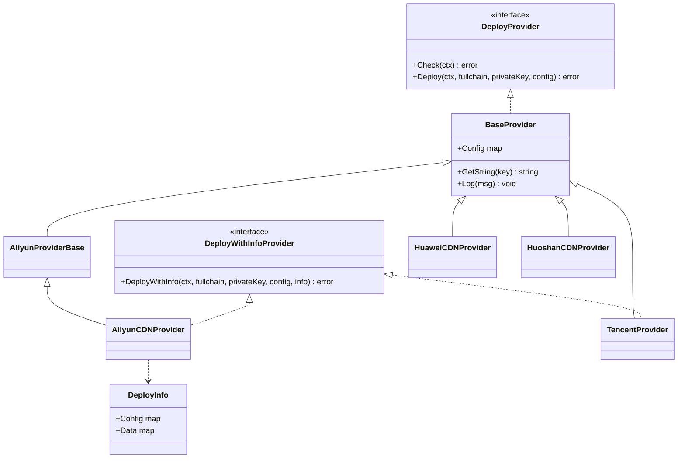
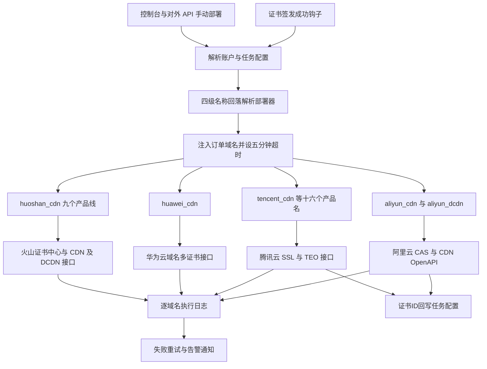
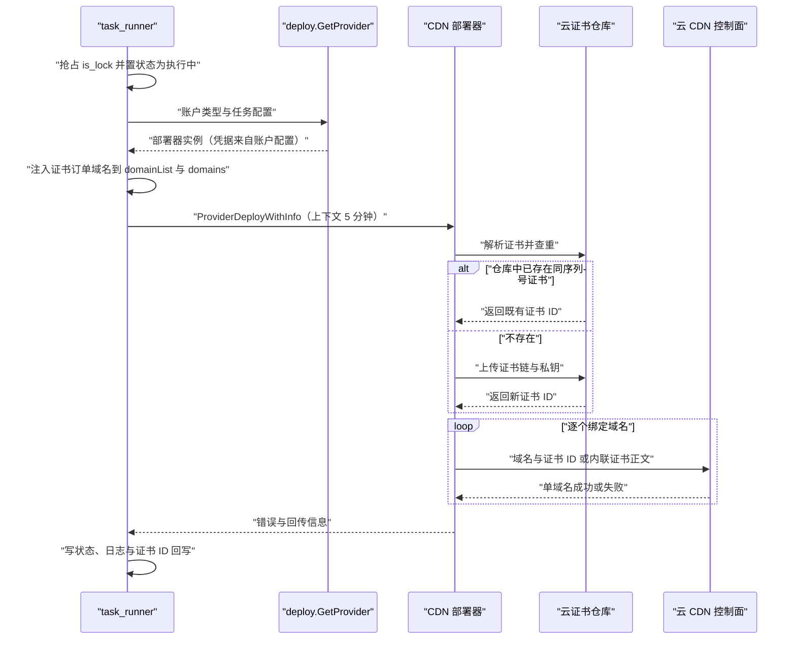
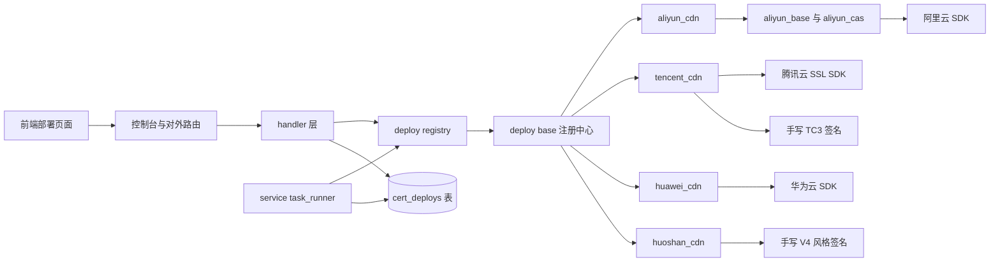
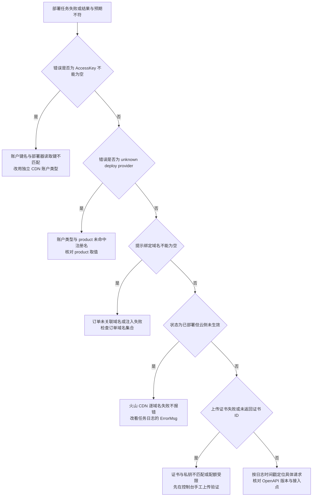

# CDN证书部署

<cite>
**本文档引用的文件**
- [base.go](file://main/internal/cert/deploy/base/base.go)
- [registry.go](file://main/internal/cert/deploy/registry.go)
- [config.go](file://main/internal/cert/deploy/config.go)
- [config_cloud.go](file://main/internal/cert/deploy/config_cloud.go)
- [merge_deploy_api.go](file://main/internal/cert/deploy/merge_deploy_api.go)
- [README.md](file://main/internal/cert/deploy/README.md)
- [aliyun_cdn.go](file://main/internal/cert/deploy/providers/aliyun_cdn.go)
- [aliyun_base.go](file://main/internal/cert/deploy/providers/aliyun_base.go)
- [aliyun_cas.go](file://main/internal/cert/deploy/providers/aliyun_cas.go)
- [aliyun_esa.go](file://main/internal/cert/deploy/providers/aliyun_esa.go)
- [tencent_cdn.go](file://main/internal/cert/deploy/providers/tencent_cdn.go)
- [tencent_update.go](file://main/internal/cert/deploy/providers/tencent_update.go)
- [huawei_cdn.go](file://main/internal/cert/deploy/providers/huawei_cdn.go)
- [huawei_common.go](file://main/internal/cert/deploy/providers/huawei_common.go)
- [huoshan_cdn.go](file://main/internal/cert/deploy/providers/huoshan_cdn.go)
- [wangsu_cdn.go](file://main/internal/cert/deploy/providers/wangsu_cdn.go)
- [baidu_cdn.go](file://main/internal/cert/deploy/providers/baidu_cdn.go)
- [providers.go](file://main/internal/cert/providers.go)
- [models.go](file://main/internal/models/models.go)
- [task_runner.go](file://main/internal/service/task_runner.go)
- [cert.go](file://main/internal/api/handler/cert.go)
- [cert_deploy.go](file://main/internal/api/handler/cert_deploy.go)
- [router.go](file://main/internal/api/router.go)
- [routes_batch1.go](file://main/internal/apiv1/routes_batch1.go)
- [deploy/page.tsx](file://web/app/(dashboard)/dashboard/deploy/page.tsx)
- [deploy-config-form.ts](file://web/lib/deploy-config-form.ts)
</cite>

## 目录

1. [简介](#简介)
2. [项目结构](#项目结构)
3. [核心组件](#核心组件)
4. [架构总览](#架构总览)
5. [详细组件分析](#详细组件分析)
6. [依赖关系分析](#依赖关系分析)
7. [性能考虑](#性能考虑)
8. [故障排查指南](#故障排查指南)
9. [结论](#结论)
10. [附录](#附录)

## 简介

CDN 证书部署解决的是「证书已签发，但边缘节点仍在用旧证书」这一段最后一公里问题：
把签发的 PEM 证书链与私钥直接下发到云厂商 CDN 控制面，无需人工登录控制台粘贴。本文聚焦四家主流云。

- **阿里云 CDN / DCDN**：先把证书上传到证书管理服务 CAS 换取 `CertId`，再按域名逐个绑定
- **腾讯云 CDN**：先把证书上传到 SSL 证书服务换取 `CertificateId`，再调统一部署接口
- **华为云 CDN**：不走证书仓库，直接把证书正文与私钥写入域名的 HTTPS 配置
- **火山引擎 CDN**：导入证书到证书中心换取 `InstanceId`，再批量下发到域名

### 目标与价值

| 目标 | 具体含义 | 落地位置 |
|------|----------|----------|
| 免人工介入 | 证书续期成功后自动触发云 CDN 更新 | `task_runner.go` 的 `executeDeployTasks` |
| 多云统一 | 一个 `DeployProvider` 契约覆盖四家云差异 | `base.go` 的接口定义 |
| 凭据集中 | AccessKey 只存部署账户表，任务表不重复保存 | `models.go` 的 `CertAccount.Config` |
| 可观测 | 逐域名日志落库，控制台可回放 | `models.go` 的 `CertDeploy.LogContent` |
| 幂等可重放 | 云侧已有同序列号证书时复用而非重复上传 | `aliyun_cas.go` 的查重复用分支 |

阅读前提：证书订单已签发且 `FullChain` 与 `PrivateKey` 均非空，否则三条执行路径都会在入口跳过
或返回「证书尚未签发」；已创建 `is_deploy = true` 且可被解析链命中 CDN 部署器的部署账户。
本文所有密钥均以 `{占位}` 表示，不含真实凭据值。

**章节来源**
- [base.go](file://main/internal/cert/deploy/base/base.go#L44-L74)
- [models.go](file://main/internal/models/models.go#L255-L280)
- [task_runner.go](file://main/internal/service/task_runner.go#L217-L242)

## 项目结构

CDN 部署器全部位于 `main/internal/cert/deploy/`，按「基础层 + 实现层 + 配置层」三分。

```text
main/internal/cert/deploy/
├── base/base.go          # 接口、注册中心、BaseProvider、配置工具（339 行）
├── providers/            # 云厂商与自建 CDN/WAF/面板/对象存储（56 文件 15727 行）
│   ├── aliyun_base.go    # 阿里云 RPC 客户端与签名公共件（275 行）
│   ├── aliyun_cas.go     # CAS 证书查重复用与上传（128 行）
│   ├── aliyun_cdn.go     # CDN/DCDN 域名绑定（123 行）
│   ├── aliyun_esa.go     # ESA 站点证书与配额回收（449 行）
│   ├── tencent_cdn.go    # 腾讯云 16 个产品名共用实现（506 行）
│   ├── tencent_update.go # update 与 update_new 原地更新并回写证书 ID
│   ├── huawei_cdn.go     # 华为云 CDN 多证书刷新（126 行）
│   └── huoshan_cdn.go    # 火山引擎 9 个产品线分派（699 行）
├── servers/ panels/ others/  # 主机 6 文件 655 行、面板 3 文件 356 行、小众 5 文件 604 行
├── config.go             # DeployProviderConfig 结构与分类常量（49 行）
├── config_cloud.go       # 云服务类表单注册（515 行）
├── merge_deploy_api.go   # 对外 API 的表单合并（64 行）
└── registry.go           # 部署器名四级回落解析（73 行）
```

### 结构职责与规模

| 路径 | 职责 | 文件数 | 代表文件 | 对外暴露 |
|------|------|:------:|----------|----------|
| `deploy/base/` | 部署器契约与注册中心 | 1 | `base/base.go` | `DeployProvider`、`Register`、`DeployInfo` |
| `deploy/providers/` | 云厂商与自建 CDN 实现 | 56 | `providers/aliyun_cdn.go` | 77 个 `base.Register` 注册名 |
| `servers/`、`panels/`、`others/` | 主机、面板与小众平台 | 14 | `servers/ssh.go` | 3、3、5 个注册名 |
| `deploy/`（根） | 表单注册与解析回落 | 6 | `config_cloud.go` | `AllDeployConfigs`、`GetProvider` |

文件名带 `cdn` 的实现共 12 个，另有 `qiniu`、`upyun`、`doge`、`gcore`、`cachefly`、`goedge`、
`aws_cloudfront` 等以 CDN 或边缘分发为主目标；四家主流云实现行数合计 1454。
其中 10 个文件在 `init` 内同时调用 `base.Register` 与 `cert.Register` 自登记表单
（`baidu_cdn`、`baishan_cdn`、`cachefly`、`ctyun_cdn`、`doge`、`gcore`、`huoshan_cdn`、
`ksyun_cdn`、`ucloud_cdn`、`wangsu_cdn`），这类类型在 `AllDeployConfigs` 中无对应条目，
表单以 `cert` 注册表为准——`merge_deploy_api.go` 在 `cert.GetProviderConfig` 命中且
`IsDeploy` 为真时会跳过补入。

**章节来源**
- [merge_deploy_api.go](file://main/internal/cert/deploy/merge_deploy_api.go#L5-L47)
- [aliyun_cdn.go](file://main/internal/cert/deploy/providers/aliyun_cdn.go#L13-L16)
- [config_cloud.go](file://main/internal/cert/deploy/config_cloud.go#L1-L10)

### 技术栈矩阵

| 层次 | 选型 | 所在位置 | 职责 | 备注 |
|------|------|----------|------|------|
| 阿里云调用 | `sdk.Client` + `CommonRequest` | `providers/aliyun_base.go` | RPC 风格 OpenAPI | 强制 https |
| 腾讯云调用 | `tencentcloud-sdk-go` 的 `ssl` 客户端 | `providers/tencent_cdn.go` | SSL 服务接口 | TC3-HMAC-SHA256 |
| 腾讯云补充 | 手写 `net/http` + TC3 签名 | `tencent_cdn.go` 的 `callTencentAPI` | EdgeOne 专用接口 | SDK 未覆盖 |
| 华为云调用 | `huaweicloud-sdk-go-v3` 的 `cdn` 客户端 | `providers/huawei_cdn.go` | 域名多证书刷新 | 固定 `CN_NORTH_1` |
| 火山引擎调用 | 手写 `net/http` + V4 风格签名 | `providers/huoshan_cdn.go` 的 `Volcengine` | 证书中心与产品线 | 无官方 SDK 依赖 |
| 编排层与前端 | Go 协程 + `context`；Next.js + Radix UI | `task_runner.go`、`dashboard/deploy*` | 调度重试、动态表单 | 单任务 5 分钟上限 |

**章节来源**
- [base.go](file://main/internal/cert/deploy/base/base.go#L1-L150)
- [huoshan_cdn.go](file://main/internal/cert/deploy/providers/huoshan_cdn.go#L1-L20)

## 核心组件

### 组件清单

| 组件 | 路径 | 职责 | 核心符号 | 被依赖 |
|------|------|------|----------|--------|
| 部署契约与注册中心 | `deploy/base/base.go` | 接口、回传结构、名字到工厂映射 | `DeployProvider`、`Register`、`GetProvider` | 所有部署器 |
| 名称回落 | `deploy/registry.go` | 账户类型加产品映射部署器名 | `GetProvider` | handler、task_runner |
| 云表单注册 | `deploy/config_cloud.go` | 账户字段与任务字段 | `registerDeployConfig` | 前端表单 |
| 阿里云公共件 | `providers/aliyun_base.go` | 客户端与请求封装、CAS 查重上传 | `client`、`callAliyun`、`getAliyunCertID` | 全部 `aliyun_*` |
| 腾讯云实现 | `providers/tencent_cdn.go` | 上传、部署与分产品 | `TencentProvider` | 16 个注册名 |
| 华为云实现 | `providers/huawei_cdn.go` | 域名多证书刷新 | `HuaweiCDNProvider` | `huawei_cdn` |
| 火山引擎实现 | `providers/huoshan_cdn.go` | 证书中心与 9 产品线 | `HuoshanCDNProvider` | `huoshan_cdn` |
| 执行编排 | `service/task_runner.go` | 自动部署与失败重试 | `executeSingleDeploy` | 后台调度 |

**章节来源**
- [base.go](file://main/internal/cert/deploy/base/base.go#L44-L117)
- [registry.go](file://main/internal/cert/deploy/registry.go#L20-L67)
- [config_cloud.go](file://main/internal/cert/deploy/config_cloud.go#L11-L114)

### 契约关系



**图表来源**
- [base.go](file://main/internal/cert/deploy/base/base.go#L44-L150)
- [aliyun_cdn.go](file://main/internal/cert/deploy/providers/aliyun_cdn.go#L22-L69)
- [tencent_update.go](file://main/internal/cert/deploy/providers/tencent_update.go#L43-L56)
- [huoshan_cdn.go](file://main/internal/cert/deploy/providers/huoshan_cdn.go#L57-L67)

三条设计约束：`DeployWithInfoProvider` 单独拆出而不并入 `DeployProvider`，是为了让既有部署器
无需改动即可满足契约；`BaseProvider` 与 `AliyunProviderBase` 都刻意**不**实现 `DeployWithInfo`，
否则嵌入它们的部署器会因方法提升被误判为支持回传，真实部署逻辑会被默认实现吞掉；
回传信息经 `base.InfoUpdates` 合并进 `cert_deploys` 的 `config` 与 `info` 两个字段。

**章节来源**
- [base.go](file://main/internal/cert/deploy/base/base.go#L137-L183)
- [aliyun_base.go](file://main/internal/cert/deploy/providers/aliyun_base.go#L26-L54)

## 架构总览

四家云 CDN 归为两种范式：**「先入库再绑定」**（阿里云、腾讯云、火山引擎）与
**「直接写域名」**（华为云）。前者多一次证书仓库往返，换来可复用证书 ID；
后者每次把私钥随请求发出，链路最短但无法复用。



**图表来源**
- [registry.go](file://main/internal/cert/deploy/registry.go#L27-L67)
- [task_runner.go](file://main/internal/service/task_runner.go#L281-L381)
- [aliyun_cdn.go](file://main/internal/cert/deploy/providers/aliyun_cdn.go#L74-L116)
- [huoshan_cdn.go](file://main/internal/cert/deploy/providers/huoshan_cdn.go#L276-L430)

### 分层与上下文

| 层 | 组成 | 核心职责 | 允许依赖 | 禁止依赖 | 代表位置 |
|----|------|----------|----------|----------|----------|
| 接入层 | 控制台页面、对外 API | 表单渲染、请求转发 | 编排层 | 云 SDK | `web/app/(dashboard)/dashboard/deploy` |
| 编排层 | handler、task_runner | 配置解析、超时、锁、重试 | 部署器层与基础设施 | 接入层 | `service/task_runner.go` |
| 部署器层 | `deploy/providers` | 厂商协议适配 | `deploy/base` 与云 SDK | handler | `providers/aliyun_cdn.go` |
| 基础设施层 | 云控制面、`cert_deploys` 表 | 外部 IO 与状态持久化 | 无 | 部署器层 | `models/models.go` |

| 外部实体 | 类型 | 交互方向 | 协议 | 失败影响 | 容错处理 |
|----------|------|:--------:|------|----------|----------|
| 阿里云 CAS 与 CDN | 云服务商 | 出向 | RPC + https | 域名仍用旧证书 | 失败后按间隔重试 |
| 腾讯云 SSL 与 TEO | 云服务商 | 出向 | TC3 + SDK/HTTP | 域名仍用旧证书 | 部署记录轮询加重试 |
| 华为云 CDN | 云服务商 | 出向 | AK/SK 签名 SDK | 域名仍用旧证书 | 无（风险） |
| 火山证书中心与 CDN | 云服务商 | 出向 | V4 风格签名 HTTP | 域名仍用旧证书 | 逐域名状态回报 |

**章节来源**
- [config.go](file://main/internal/cert/deploy/config.go#L5-L30)
- [task_runner.go](file://main/internal/service/task_runner.go#L281-L392)
- [models.go](file://main/internal/models/models.go#L202-L214)

## 详细组件分析

### 名称回落与凭据键名兼容

部署任务表只存 `aid`，账户表只存 `type`（如 `aliyun`、`tencent`、`huawei`、`huoshan`）。
把账户类型映射到具体 CDN 部署器的责任落在 `deploy/registry.go` 的四级回落：
原名 → `{type}_{product}`（任务配置）→ `{type}_{product}`（账户配置）→
依次追加 `cdn`、`acm`、`cloudfront` 后缀。关键事实是 `providers/` 内**没有**裸名注册：
`base.Register` 从未注册这四个纯账户类型名，因此聚合账户能否命中 CDN 部署器完全依赖
第二级或第四级回落。账户连通性检测调用 `GetProvider(account.Type, accConfig)` 时不传任务
配置，只能靠第四级后缀命中 `*_cdn`，检测语义实际是「用 CDN 通道验证凭据是否可用」。

凭据键名由 `base.GetString` 的四步查找兼容：精确匹配 → 大小写不敏感 → 下划线转驼峰 →
驼峰转下划线。由此产生如下效果：

| 部署器 | 代码读取的键 | 聚合账户表单键 | 独立账户表单键 | 匹配结果 |
|--------|--------------|----------------|----------------|----------|
| 阿里云 CDN | `access_key_id`、`access_key_secret` | `AccessKeyId`、`AccessKeySecret` | 同左（snake） | 命中（下划线转驼峰） |
| 腾讯云 CDN | `SecretId`、`SecretKey` | `SecretId`、`SecretKey` | `secret_id`、`secret_key` | 命中（驼峰转下划线） |
| 华为云 CDN | `access_key_id`→`access_key`、`access_key_secret`→`secret_key` | `AccessKeyId`、`SecretAccessKey` | `access_key`、`secret_key` | 独立账户命中；聚合账户 SK 两条链均不匹配 |
| 火山引擎 CDN | `access_key_id`、`access_key_secret` | `AccessKeyId`、`SecretAccessKey` | 同左 | AK 命中；SK 在 `SecretAccessKey` 下不命中 |

华为云 CDN 没有复用 `huawei_common.go` 的 `huaweiAccessKeys`（按
`AccessKeyId`→`access_key`、`SecretAccessKey`→`secret_key` 读取），而是自行读取另一组键名；
火山引擎 `getClient` 同理。按键名逐条比对可推断这两家聚合账户会返回「AccessKey不能为空」，
属**推断**级别，需用对应账户类型实跑一次部署确认。

**章节来源**
- [registry.go](file://main/internal/cert/deploy/registry.go#L20-L67)
- [base.go](file://main/internal/cert/deploy/base/base.go#L198-L256)
- [huawei_cdn.go](file://main/internal/cert/deploy/providers/huawei_cdn.go#L31-L55)
- [huawei_common.go](file://main/internal/cert/deploy/providers/huawei_common.go#L13-L26)
- [cert_deploy.go](file://main/internal/api/handler/cert_deploy.go#L305-L321)

### 执行链路、状态与重试

| 序号 | 入口 | 位置 | 异步 | 加锁 | 回传信息 | 超时 | 日志落库 |
|:----:|------|------|:----:|:----:|:--------:|:----:|:--------:|
| 1 | 自动部署（签发或续期后） | `task_runner.go:217-242` | 是 | 是 | 是 | 5 分钟 | 是 |
| 2 | 对外 API 手动部署 | `cert_deploy.go:773-876` | 是 | 是 | 是 | 5 分钟 | 是 |
| 3 | 控制台立即部署 | `cert.go:1315-1385` | 否 | 否 | 否 | 无 | 否 |



**图表来源**
- [task_runner.go](file://main/internal/service/task_runner.go#L281-L392)
- [aliyun_cas.go](file://main/internal/cert/deploy/providers/aliyun_cas.go#L52-L111)
- [base.go](file://main/internal/cert/deploy/base/base.go#L137-L183)

三条入口语义不一致是最值得注意的点：控制台同步路径直接调 `provider.Deploy`，不触发
`DeployWithInfo`，因此 `cert_id` 一类回传值不会写回任务配置，`log_content` 与 `status`
也不更新，只有 `updated_at` 被刷新。另两条路径都走 `base.ProviderDeployWithInfo` 加
`base.InfoUpdates`，且进入前都完成 `requireCertDeployOwner` 越权校验——源码注释写明
这是「私钥外送的最后一环」。

`executeDeployTasks` 的捞取条件是 `active = true AND is_lock = false AND status IN (0, 2)`，
状态语义为 0 待部署、1 执行中、2 已部署、-1 失败（前端 `DEPLOY_STATUS_MAP` 一一对应）；
已部署任务只有在「订单签发时间晚于任务 `issue_time`」时才重新下发。失败重试由
`retryFailedDeployTasks` 独立处理，间隔序列 `60, 300, 600, 1800, 3600` 秒，
`max_retry` 为 0 时兜底 5 次。

**章节来源**
- [task_runner.go](file://main/internal/service/task_runner.go#L23-L23)
- [cert_deploy.go](file://main/internal/api/handler/cert_deploy.go#L773-L876)
- [cert.go](file://main/internal/api/handler/cert.go#L1315-L1385)
- [deploy/page.tsx](file://web/app/(dashboard)/dashboard/deploy/page.tsx#L35-L40)

### 阿里云 CDN 与 DCDN

`aliyun_cdn` 与 `aliyun_dcdn` 两个注册名共用 `AliyunCDNProvider`，差异集中在 `targetOf`
返回的接入点、版本与 Action 三元组。

| product | 接入点 | OpenAPI 版本 | Action |
|---------|--------|--------------|--------|
| `cdn`（含留空） | `cdn.aliyuncs.com` | `2018-05-10` | `SetCdnDomainSSLCertificate` |
| `dcdn` | `dcdn.aliyuncs.com` | `2018-01-15` | `SetDcdnDomainSSLCertificate` |
| 其它取值 | — | — | 返回「未知的产品类型」 |

第一步证书入仓由 `getAliyunCertID` 完成：`parseAliyunCert` 用 `pem.Decode` 与
`x509.ParseCertificate` 取链首证书的序列号（十六进制小写）、`CommonName`（去掉 `*.`）与
`NotBefore`，证书名规则为 `{去星号CN}-{NotBefore 秒级时间戳}`；以 CN 作 `Keyword` 调
`ListUserCertificateOrder`（`OrderType=CERT`）查重，命中条件为序列号相等或云侧序列号包含
本地序列号；未命中则调 `UploadUserCertificate`，成功后等待 500 毫秒保证仓库可见；接入点按地域
在 `cas.aliyuncs.com` 与 `cas.ap-southeast-1.aliyuncs.com` 间切换。

第二步按域名绑定，参数固定 `CertType=cas` 与 `SSLProtocol=on`；域名集合来自
`base.GetConfigDomains`，为空时报「CDN绑定域名不能为空」。传输安全有一处硬性约束：
`AliyunProviderBase.client` 显式指定 `WithScheme("https")`，因为 `UploadUserCertificate`
把私钥全文放进查询参数，而 SDK 默认 scheme 为 HTTP，明文传输即泄露私钥。

ESA（边缘安全加速）与 CDN 共用证书入仓，但绑定语义更复杂：`ListSites` 取 `SiteId`，
`ListCertificates` 判断是否已有覆盖目标域名的证书（`aliyunESACertCoversDomains` 要求 SAN
完全覆盖），必要时查 `ListInstanceQuotasWithUsage` 的 `customHttpCert` 配额并在满额时删除
最旧证书，最后调 `SetCertificate`；已存在同 `CasId` 证书时跳过写入并直接回传信息。

**章节来源**
- [aliyun_cdn.go](file://main/internal/cert/deploy/providers/aliyun_cdn.go#L13-L116)
- [aliyun_base.go](file://main/internal/cert/deploy/providers/aliyun_base.go#L42-L128)
- [aliyun_cas.go](file://main/internal/cert/deploy/providers/aliyun_cas.go#L12-L111)
- [aliyun_esa.go](file://main/internal/cert/deploy/providers/aliyun_esa.go#L13-L240)

### 腾讯云 CDN

`init` 一次性注册 **16 个**名字（`tencent_cdn`、`tencent_teo`、`tencent_clb`、`tencent_cos`、
`tencent_waf`、`tencent_live`、`tencent_vod`、`tencent_tke`、`tencent_scf`、`tencent_upload`、
`tencent_lighthouse`、`tencent_ddos`、`tencent_tse`、`tencent_tcb`、`tencent_update`、
`tencent_update_new`），全部指向 `NewTencentProvider`，真正分支靠运行时 `product` 决定。

| 顺序 | 条件 | 走向 | 位置 |
|:----:|------|------|------|
| 1 | `product` 为空 | 默认取 `cdn` | `tencent_cdn.go:93-96` |
| 2 | `update` 或 `update_new` | 委托 `DeployWithInfo` | `tencent_cdn.go:99-101` |
| 3 | `upload` | 仅 `uploadCert`，不绑定域名 | `tencent_cdn.go:104-107` |
| 4 | `teo` | `deployTEO` 走 EdgeOne 专用接口 | `tencent_cdn.go:110-112` |
| 5 | `clb` | `deployCLB` 组装 CLB 实例 ID | `tencent_cdn.go:115-117` |
| 6 | 其余 | `deployCommon` 走 `DeployCertificateInstance` | `tencent_cdn.go:120` |

CDN 主体在 `deployCommon`：先以 `UploadCertificate` 上传（`Alias` 为 `dnsplane-{Unix 秒}`，
`Repeatable=false`，成功后等待 300 毫秒），再把每个实例 ID 补成「域名加竖线加 on」以同时
开启 HTTPS；随后调 `DeployCertificateInstance`，`ResourceType` 直接取 `product`。
返回的 `DeployRecordId` 进入 `queryDeployResult` 轮询：每 2 秒一次、最多 10 次，
成功或执行中即返回，失败则从 `DeployRecordDetailList[0].ErrorMsg` 提取原因写日志。

实例 ID 组装集中在 `buildInstanceIDs`：CDN、WAF、LIVE、VOD、SCF 走 default 分支，
优先用任务字段 `domain`，为空时回落 `GetConfigDomains`，并按逗号拆成多实例。
COS 为「地域ID\|桶名\|域名」，TKE 为「集群ID\|命名空间\|Secret 名」，DDoS 为
「实例ID\|域名\|443」；`cos`、`tke`、`waf`、`scf`、`lighthouse` 会把 `regionid`
（可回落 `region`）传给 SSL 客户端。

EdgeOne 是唯一走手写 TC3 签名的分支：`callTencentAPI` 自行构造规范请求与派生密钥链
（`TC3{SecretKey}` → date → service → `tc3_request`），调 `ModifyHostsCertificate`，接入点按
`site_type` 在 `teo.tencentcloudapi.com` 与 `teo.intl.tencentcloudapi.com` 间切换。
`update` 与 `update_new` 由 `tencent_update.go` 承接，后者通过 `setDeployCertID` 把新证书 ID
写进 `info.Config`；关联资源清单靠 `CreateCertificateBindResourceSyncTask` 加轮询获取。

**章节来源**
- [tencent_cdn.go](file://main/internal/cert/deploy/providers/tencent_cdn.go#L34-L330)
- [tencent_cdn.go](file://main/internal/cert/deploy/providers/tencent_cdn.go#L333-L451)
- [tencent_update.go](file://main/internal/cert/deploy/providers/tencent_update.go#L18-L80)
- [config_cloud.go](file://main/internal/cert/deploy/config_cloud.go#L66-L114)

### 华为云 CDN

华为云是四家中链路最短的实现：不查证书仓库，直接调 `UpdateDomainMultiCertificates`，
把证书正文与私钥随请求体写入域名 HTTPS 配置，每个域名一次独立请求。

| 字段 | 取值 | 说明 |
|------|------|------|
| `DomainName` | 循环内的单个域名 | 逐域名串行请求 |
| `CertName` | `cert-{域名点号换横线}-{Unix 秒}` | 每轮部署生成新名称 |
| `Certificate` 与 `PrivateKey` | `fullchain`、`privateKey` | PEM 全文随请求体下发 |
| `HttpsSwitch` 与 `CertificateType` | 1 与 0 | 开启 HTTPS；0 表示自有证书 |
| `ForceRedirectHttps` | 1（可选） | 由 `force_https` 布尔值或字符串 `"1"` 触发 |

凭据读取有 `access_key_id`→`access_key` 与 `access_key_secret`→`secret_key` 两级回落，
客户端固定使用 `region.CN_NORTH_1`，地域不可配置；`Check` 用 `ListDomains`（`PageSize=1`）
做连通性验证；域名集合优先 `GetConfigDomains`，为空时回落账户配置里的 `domain`。
与其它华为云部署器的差异在于：`huawei_elb`、`huawei_waf`、`huawei_obs`、`huawei_upload`
通过 `huawei_common.go` 的 `huaweiCredentials` 传项目 ID，并用 `huaweiRegion`
以「服务名.区域ID.myhuaweicloud.com」覆盖默认 endpoint，而 CDN 两者都不需要。

**章节来源**
- [huawei_cdn.go](file://main/internal/cert/deploy/providers/huawei_cdn.go#L17-L122)
- [huawei_common.go](file://main/internal/cert/deploy/providers/huawei_common.go#L28-L83)
- [config_cloud.go](file://main/internal/cert/deploy/config_cloud.go#L117-L142)

### 火山引擎 CDN

`huoshan_cdn` 是 `providers/` 内唯一**同时**调用 `base.Register` 与 `cert.Register` 的 CDN 实现：
前者提供工厂，后者就地登记表单（账户字段 `AccessKeyId` 与 `SecretAccessKey`，任务字段含
产品类型、域名、`bucket_domain`、`vod_space_name`、`vod_domain_type`、`listener_id`）。

签名层是自研 `Volcengine` 客户端，风格与 AWS V4 同构：`X-Date` 用 `20060102T150405Z` 格式，
配合 `X-Content-Sha256`，参与签名的头部为 `content-type`、`host`、`x-content-sha256`、
`x-date`，凭据作用域为 `{date}/{region}/{service}/request`，派生密钥链为
`secretAccessKey` → date → region → service → `request`，算法标识 `HMAC-SHA256`；
错误从 `ResponseMetadata.Error` 取 `Code` 与 `Message`，载荷取 `Result`。

| product | 证书获取 | 绑定接口 | 接入点、service、版本、地域 |
|---------|----------|----------|----------------------------|
| `cdn` | 证书中心导入 | `BatchDeployCert` | `cdn.volcengineapi.com`、`cdn`、`2021-03-01`、`cn-north-1` |
| `dcdn` | 证书中心导入 | `CreateCertBind` | `open.volcengineapi.com`、`dcdn`、`2021-04-01`、`cn-north-1` |
| `tos` | 证书中心导入 | 仅打印日志 | 无云侧调用 |
| `live` | `CreateCert` | `BindCert` | `live.volcengineapi.com`、`live`、`2023-01-01`、`cn-north-1` |
| `vod`、`imagex`、`clb`、`alb` | 证书中心导入 | 各产品线绑定 | — |
| `upload` 与其它 | 证书中心导入 | 不绑定或不支持 | 其它取值返回「不支持的产品类型」 |

证书入仓 `getCertID` 调 `certificate-service.volcengineapi.com`（service `certificate_service`、
版本 `2024-10-01`、地域 `cn-beijing`）的 `ImportCertificate`，载荷含 `Tag`（证书名，规则与
阿里云一致）、`Repeatable=false` 与 `CertificateInfo{CertificateChain, PrivateKey}`；
新上传返回 `InstanceId`，已存在则返回 `RepeatId`，两者都作为绑定用的证书 ID。新上传后追加一次
`CertificateUpdateInstance` 把 `ExpiredNotice` 置为 `Disabled`，让到期提醒统一由 DNSPlane 承担。

CDN 分支把多域名拼成单个 `Domain` 参数一次性提交，再遍历响应的 `DeployResult` 逐域名打印
成功或 `ErrorMsg`；**单个域名失败既不中断流程也不返回错误**，是四家中唯一「部分失败仍报成功」
的实现，必须结合任务日志而非状态位判断真实结果。`tos` 分支注释写明「TOS 使用特殊的签名方式，
这里简化处理」，实际只读 `bucket_domain` 并打日志、无任何云侧调用即返回 `nil`，属已知未完成
实现。`Check` 用 `open.volcengineapi.com` 加 service `cdn` 调 `ListCertInfo`，与部署用的
`cdn.volcengineapi.com` 不同源，检测通过不代表部署链路可用。

**章节来源**
- [huoshan_cdn.go](file://main/internal/cert/deploy/providers/huoshan_cdn.go#L22-L120)
- [huoshan_cdn.go](file://main/internal/cert/deploy/providers/huoshan_cdn.go#L172-L238)
- [huoshan_cdn.go](file://main/internal/cert/deploy/providers/huoshan_cdn.go#L263-L457)
- [huoshan_cdn.go](file://main/internal/cert/deploy/providers/huoshan_cdn.go#L459-L509)

### 证书格式与域名绑定约定

证书格式在四家云之间统一为 PEM，差异在于提交粒度与私钥位置：

| 云厂商 | 证书链参数 | 私钥参数 | 私钥传输位置 | 前置入仓 |
|--------|-----------|----------|--------------|:--------:|
| 阿里云 | `Cert` | `Key` | RPC 查询参数 | 是 |
| 腾讯云 | `CertificatePublicKey` | `CertificatePrivateKey` | SDK 请求体 | 是 |
| 华为云 | `Certificate` | `PrivateKey` | SDK 请求体 | 否 |
| 火山引擎 | `CertificateChain` | `PrivateKey` | JSON 请求体 | 是 |

四家都只接收 `fullchain`（链首证书用于取名与序列号比对），不做 PFX 或 JKS 转换；
`pfx`、`jks` 选项只存在于服务器类部署表单，与 CDN 路径无关。网宿是例外：它在部署器内部
对私钥做额外加密（`encryptPrivateKey`）以适配 CDN Pro 上传。

域名解析优先级是排他式的：`base.GetConfigDomains` 先看 `domainList`，命中即返回，之后才看
`domains` 与 `domain`。而自动部署与对外 API 都会在进入部署器前注入 `domainList`（证书订单域名，
按 `sort` 升序），只要任务配置没有该键就一定被注入。

| 部署器 | 实际生效的域名来源 | 依据 |
|--------|--------------------|------|
| 阿里云 CDN | 证书订单域名（`domainList`） | `GetConfigDomains` 优先 `domainList` |
| 华为云 CDN | 证书订单域名（`domainList`） | 同上 |
| 火山引擎 CDN | 证书订单域名（`domainList`） | `getDomains` 先走 `GetConfigDomains` |
| 腾讯云 CDN | 任务字段 `domain` 优先，空时回落订单域名 | `buildInstanceIDs` 先读 `domain` |

也就是说在阿里云、华为云、火山三家的 CDN 任务里手填域名不会改变下发范围，
真正决定范围的是订单域名集合；只有腾讯云尊重任务的 `domain` 字段。
表单显隐完全由后端下发的 `show` 表达式驱动：`web/lib/deploy-config-form.ts` 按 `||` 外层、
`&&` 内层求值，支持 `==` 与 `!=`，异常时一律可见；`mergeProviderFieldDefaults` 先把字段默认值
补进表单，保证 `product` 默认值参与条件判断。独立账户表单（`aliyun_cdn`、`huawei_cdn`、
`aws_cloudfront`）在 `config_cloud.go` 与 `cert/providers.go` 各登记一份且内容一致。

**章节来源**
- [base.go](file://main/internal/cert/deploy/base/base.go#L287-L339)
- [task_runner.go](file://main/internal/service/task_runner.go#L328-L340)
- [cert.go](file://main/internal/api/handler/cert.go#L1356-L1367)
- [tencent_cdn.go](file://main/internal/cert/deploy/providers/tencent_cdn.go#L258-L285)
- [wangsu_cdn.go](file://main/internal/cert/deploy/providers/wangsu_cdn.go#L27-L96)
- [deploy-config-form.ts](file://web/lib/deploy-config-form.ts#L3-L57)
- [providers.go](file://main/internal/cert/providers.go#L158-L187)

## 依赖关系分析



**图表来源**
- [registry.go](file://main/internal/cert/deploy/registry.go#L27-L67)
- [aliyun_cdn.go](file://main/internal/cert/deploy/providers/aliyun_cdn.go#L62-L116)
- [tencent_cdn.go](file://main/internal/cert/deploy/providers/tencent_cdn.go#L65-L120)
- [huawei_cdn.go](file://main/internal/cert/deploy/providers/huawei_cdn.go#L31-L55)

### 内部依赖矩阵

| 依赖方 | 被依赖方 | 依赖内容 | 方向 | 备注 |
|--------|----------|----------|:----:|------|
| `deploy/providers` | `deploy/base` | `BaseProvider`、`Register`、`GetConfigDomains` | 单向 | 无环 |
| `deploy/providers` | `cert`（根包） | `cert.Logger`、`cert.Register`、`cert.ConfigField` | 单向 | 10 个文件自登记表单 |
| `task_runner` 与 `api/handler` | `deploy` 与 `deploy/base` | `GetProvider`、`ProviderDeployWithInfo`、`InfoUpdates` | 单向 | 编排层与两个入口 |
| `deploy` | `dns` 模块、数据库 | 无 | — | 不触碰解析记录，状态由上层落库 |

`deploy` 包不直接访问数据库，也不反向依赖 handler；部署器拿到的 `config` 是上层从
`cert_accounts.config` 反序列化后的 map，写回也只通过 `DeployInfo` 由上层落库。

**章节来源**
- [base.go](file://main/internal/cert/deploy/base/base.go#L1-L12)
- [config.go](file://main/internal/cert/deploy/config.go#L1-L3)
- [merge_deploy_api.go](file://main/internal/cert/deploy/merge_deploy_api.go#L1-L4)

### 外部服务依赖

| 外部实体 | 接入点 | 认证 | 超时 | 失败影响 | 容错处理 |
|----------|--------|------|:----:|----------|----------|
| 阿里云 CAS | `cas.aliyuncs.com` 或新加坡端点 | AK/SK | 无显式 | 取不到证书 ID | 返回错误并进入重试 |
| 阿里云 CDN 与 DCDN | `cdn.aliyuncs.com` 或 `dcdn.aliyuncs.com` | AK/SK | 无显式 | 域名不生效 | 单域名失败即中断 |
| 腾讯云 SSL | SDK 默认接入点 | SecretId 与 SecretKey | SDK 默认 | 上传或绑定失败 | 轮询取失败原因 |
| 腾讯云 EdgeOne | `teo.tencentcloudapi.com` 或国际站 | TC3 | 30 秒 | EO 域名不生效 | 无（风险） |
| 华为云 CDN | SDK `CN_NORTH_1` 默认端点 | AK/SK | SDK 默认 | 域名不生效 | 无（风险） |
| 火山 CDN 与 DCDN | `cdn.volcengineapi.com`、`open.volcengineapi.com` | V4 风格签名 | 30 秒 | 部分域名未更新 | 逐域名日志但不报错 |

**章节来源**
- [aliyun_cas.go](file://main/internal/cert/deploy/providers/aliyun_cas.go#L12-L19)
- [aliyun_esa.go](file://main/internal/cert/deploy/providers/aliyun_esa.go#L13-L29)
- [tencent_cdn.go](file://main/internal/cert/deploy/providers/tencent_cdn.go#L361-L429)
- [huoshan_cdn.go](file://main/internal/cert/deploy/providers/huoshan_cdn.go#L263-L274)

## 性能考虑

### 热点与现状

| 问题 | 现状 | 影响面 | 优化方向 |
|------|------|--------|----------|
| 域名串行绑定 | 阿里云与华为云为逐域名 for 循环请求 | 多域名订单线性耗时 | 分组并发并限流 |
| 仓库可见性等待 | 阿里云固定 500 毫秒、腾讯云固定 300 毫秒 | 每次部署一次常数延迟 | 改轮询确认可去掉固定等待 |
| 部署记录轮询 | 腾讯云最长 10 次乘 2 秒即 20 秒 | 占用单任务时间片 | 复用异步通知或缩短上限 |
| 私钥随请求外发 | 华为云每次提交私钥全文 | 无缓存收益且请求体偏大 | 迁移到仓库复用 ID |
| 任务级超时 | 单任务 5 分钟，无域名级子超时 | 大订单可能被截断 | 按域名拆分上下文 |

批量性上三家各有取舍：阿里云只上传一次证书、随后按域名各发一次绑定请求；火山引擎把
多域名拼成单个 `Domain` 参数一次提交，请求数由 N 降为 1，代价是失败信息只能从响应
`DeployResult` 逐条读取；华为云是标准的 N 次独立请求。单次部署成本约为「1 次证书入仓 +
N 次域名绑定 + 常数等待」：N 较大时由 N 主导，N 等于 1 时常数项反而是主要成本。

**章节来源**
- [aliyun_cdn.go](file://main/internal/cert/deploy/providers/aliyun_cdn.go#L95-L112)
- [tencent_cdn.go](file://main/internal/cert/deploy/providers/tencent_cdn.go#L124-L330)
- [task_runner.go](file://main/internal/service/task_runner.go#L345-L346)

### 配额与容量

阿里云 ESA 的 `customHttpCert` 配额满额时会触发删除最旧证书的动作，使 ESA 部署次数与
云侧配额强相关；火山引擎 `ImportCertificate` 以 `Repeatable=false` 提交，重复内容返回
既有 `RepeatId`，不会无限增长；腾讯云 `update` 模式要求证书 ID 不变，表单注明需联系加白。

**章节来源**
- [aliyun_esa.go](file://main/internal/cert/deploy/providers/aliyun_esa.go#L212-L240)
- [huoshan_cdn.go](file://main/internal/cert/deploy/providers/huoshan_cdn.go#L314-L359)
- [config_cloud.go](file://main/internal/cert/deploy/config_cloud.go#L110-L112)

## 故障排查指南



**图表来源**
- [huawei_cdn.go](file://main/internal/cert/deploy/providers/huawei_cdn.go#L31-L55)
- [registry.go](file://main/internal/cert/deploy/registry.go#L58-L67)
- [aliyun_cdn.go](file://main/internal/cert/deploy/providers/aliyun_cdn.go#L80-L83)
- [huoshan_cdn.go](file://main/internal/cert/deploy/providers/huoshan_cdn.go#L384-L402)

### 问题清单

| 症状 | 原因 | 排查动作 | 方案 |
|------|------|----------|------|
| 华为云聚合账户部署 CDN 报「AccessKey不能为空」 | 部署器读 `access_key_secret` 与 `secret_key`，聚合表单是 `SecretAccessKey` | 比对表单键名与 `getClient` | 改用独立「华为云CDN」账户 |
| 控制台点部署后状态仍是待部署 | 该路径只更新 `updated_at` | 查 `cert_deploys.status` | 走自动部署或对外异步接口 |
| 腾讯云 CDN 部署后 HTTPS 未开 | 实例 ID 未补竖线加 on，或域名与云侧不一致 | 看日志中的实例 ID 列表 | 校正任务 `domain` |
| 火山引擎 TOS 显示成功但云侧无变化 | `deployTOS` 仅打印日志 | 检查日志是否只有成功行 | 视为未实现能力 |
| 阿里云报「未知的产品类型」 | `product` 不在 `cdn`、`dcdn` 白名单 | 打印任务 `product` | 修正产品选择 |
| 部署卡在「执行中」不释放 | 进程异常退出未复位 `is_lock` | 查 `lock_time` 是否超期 | 用任务重置接口清锁 |
| 域名下发范围与填写不一致 | 三家云以订单域名集合为准 | 对比订单域名与任务域名 | 以证书域名集合规划 |

**章节来源**
- [huawei_cdn.go](file://main/internal/cert/deploy/providers/huawei_cdn.go#L31-L55)
- [aliyun_cdn.go](file://main/internal/cert/deploy/providers/aliyun_cdn.go#L41-L59)
- [aliyun_cas.go](file://main/internal/cert/deploy/providers/aliyun_cas.go#L31-L47)
- [task_runner.go](file://main/internal/service/task_runner.go#L281-L292)

### 定位所需最小信息集

需要同时具备：任务 ID、账户类型与 `product`、任务配置 JSON（脱敏）、`log_content` 全文、
关联订单域名集合。`log_content` 由部署器 `Log` 加时间戳前缀拼装，是唯一能还原
「哪个域名失败」的载体；`info` 记录云侧回传的 `cert_id` 与 `cert_name`，可与控制台核对。
账户连通性检测结论只写服务日志（前缀 `[DeployAccountCheck]`），不落库。

**章节来源**
- [huoshan_cdn.go](file://main/internal/cert/deploy/providers/huoshan_cdn.go#L432-L457)
- [cert.go](file://main/internal/api/handler/cert.go#L1369-L1384)
- [cert_deploy.go](file://main/internal/api/handler/cert_deploy.go#L311-L321)

## 结论

四家云 CDN 部署器在同一个 `DeployProvider` 契约下形成两条技术路线：「证书仓库加域名绑定」
两段式（阿里云、腾讯云、火山引擎）与「域名直写」一段式（华为云）。名称回落解析、
键名四级兼容、`DeployInfo` 回传合并三块公共能力，使新增一家云 CDN 只需在 `providers/`
增加一个文件并在 `init` 注册；优势是凭据与任务分离、幂等有实装、多云差异被封装在部署器
内部、逐域名日志可回放。

需要正视的不足有五条：三条执行入口语义不对齐，控制台同步路径缺加锁、状态回写、日志与
`info` 回传；华为云与火山引擎 CDN 未复用凭据读取公共件，聚合账户存在键名不匹配风险；
火山 CDN 的部分域名失败不产生错误；火山 TOS 分支是空实现但表单选项可见可选；
`deploy/README.md` 的规模数字与目录树（含 `interface.go`、`executor.go`）与实际不符。

建议后续：把控制台 `POST /api/cert/deploys/:id/process` 收敛到 `cert_deploy.go` 的异步实现；
两家云凭据读取统一走公共件或在 `base.GetString` 增加候选键序列；火山 CDN 把逐域名结果
聚合为错误或写入 `info` 供告警消费；表单层标注未实现的 `product` 选项；校正 README 口径。

[本节为总结，无需特定文件来源]

## 附录

### CDN × 认证方式表

「账户认证字段」取自实际登记的表单字段，密钥值一律脱敏为 `{占位}`。

| 部署器名 | 厂商 | 账户认证字段 | 任务关键字段 | 签名或协议 | 需证书入仓 |
|----------|------|--------------|--------------|------------|:----------:|
| `aliyun_cdn`、`aliyun_dcdn` | 阿里云 | `access_key_id` 与 `access_key_secret` | `domains`（每行一个） | RPC + https | 是 |
| `aliyun_esa`、`aliyun_esa_saas` | 阿里云 | `AccessKeyId` 与 `AccessKeySecret` | `esa_sitename`、`region` | RPC + https | 是 |
| `tencent_cdn`、`tencent_update` 等 | 腾讯云 | `SecretId` 与 `SecretKey` | `domain` 或 `cert_id` | TC3 + SSL SDK | 是 |
| `tencent_teo` | 腾讯云 | 同上 | `site_id`、`site_type` | 手写 TC3 + HTTP | 是 |
| `huawei_cdn` | 华为云 | `access_key` 与 `secret_key` | `domains`（每行一个） | AK/SK SDK | 否 |
| `huawei_elb`、`huawei_waf` | 华为云 | `AccessKeyId` 与 `SecretAccessKey` | `project_id`、`region_id`、`cert_id` | AK/SK 加项目 ID | 否 |
| `huoshan_cdn` | 火山引擎 | `AccessKeyId` 与 `SecretAccessKey` | `product`、`domain` | V4 风格 HMAC-SHA256 | 是 |
| `baidu_cdn` | 百度云 | `AccessKeyId` 与 `SecretAccessKey` | `product`、`domain` | 自研签名 HTTP | 是 |
| `wangsu_cdn` | 网宿 | `username` 与 `apiKey`（可选 `spKey`） | `domains`、`domain`、`cert_id` | HTTP 加私钥加密 | 是 |
| `ctyun_cdn`、`ksyun_cdn` | 天翼云、金山云 | `AccessKeyId` 与 `SecretAccessKey` | `product`、`domain` | 自研签名 HTTP | 未知 |
| `ucloud_cdn` | UCloud | `PublicKey` 与 `PrivateKey` | `domain_id` | 公私钥 | 未知 |
| `baishan_cdn`、`gcore`、`cachefly` | 白山云、Gcore、Cachefly | `account` 与 `token` 或 `apikey` | `id`、`name` 或无 | Token 或 API 令牌 | 否 |
| `qiniu`、`doge`、`upyun` | 七牛、多吉、又拍 | `AccessKey`/`SecretKey` 或账号密码 | `domain` 或无 | AK/SK 或口令 | 未知 |
| `aws_cloudfront` | AWS | `access_key_id` 与 `access_key_secret` | `distribution_id`（留空仅入仓） | AK/SK | 是 |

「未知」表示该厂商的证书入仓环节未在本次实读范围内确认，不做推断；
「签名或协议」对未逐行读取实现的厂商，仅按 `config_cloud.go` 的凭据形态归类。

**章节来源**
- [config_cloud.go](file://main/internal/cert/deploy/config_cloud.go#L11-L514)
- [providers.go](file://main/internal/cert/providers.go#L158-L224)
- [providers.go](file://main/internal/cert/providers.go#L533-L562)

### 接口与配置项速查

| 方法 | 路径 | handler | 用途 | 注册位置 |
|------|------|---------|------|----------|
| GET | `/api/cert/providers` | `GetCertProviders` | 拉取表单定义 | `router.go:245` |
| GET | `/api/cert/deploys` | `GetCertDeploys` | 部署任务列表 | `router.go:199` |
| POST | `/api/cert/deploys/:id/process` | `ProcessCertDeploy` | 控制台立即部署 | `router.go:203` |
| POST | `/api/v1/deploys/process` | `ProcessCertDeploy` | 对外触发部署 | `routes_batch1.go:54` |
| POST | `/api/v1/deploy-accounts/check` | `DeployAccountCheck` | 账户连通性检测 | `routes_batch1.go:65` |

| 键 | 所属 | 取值 | 说明 |
|----|------|------|------|
| `product` | 任务配置 | `cdn`、`dcdn`、`teo`、`tos` 等 | 决定回落解析出的部署器名 |
| `domainList` | 任务配置（自动注入） | 字符串数组 | `GetConfigDomains` 第一优先级 |
| `domains`、`domain` | 任务配置 | 逗号或换行分隔 | 第二、第三优先级；腾讯云优先读 `domain` |
| `force_https` | 任务配置 | 布尔值或 `"1"` | 华为云强制跳转 HTTPS |
| `site_id`、`site_type` | 任务配置 | ZoneId 与 `cn`\|`intl` | 腾讯云 EdgeOne 定位 |
| `cert_id` | 任务配置 | 云侧证书 ID | 由 `DeployInfo.Config` 回写 |

**章节来源**
- [router.go](file://main/internal/api/router.go#L185-L203)
- [routes_batch1.go](file://main/internal/apiv1/routes_batch1.go#L49-L66)
- [cert.go](file://main/internal/api/handler/cert.go#L1387-L1395)
- [models.go](file://main/internal/models/models.go#L255-L280)
