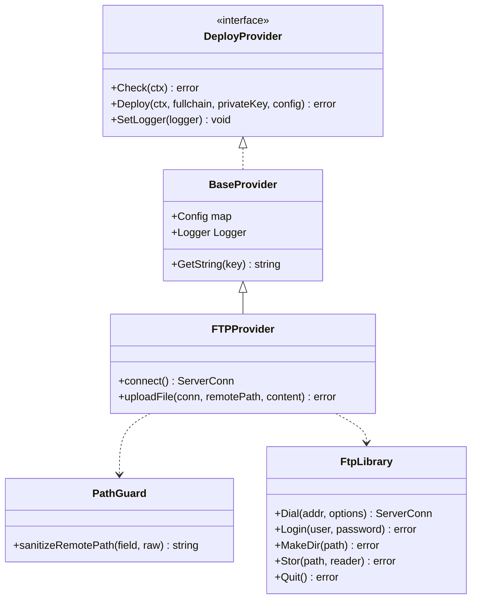
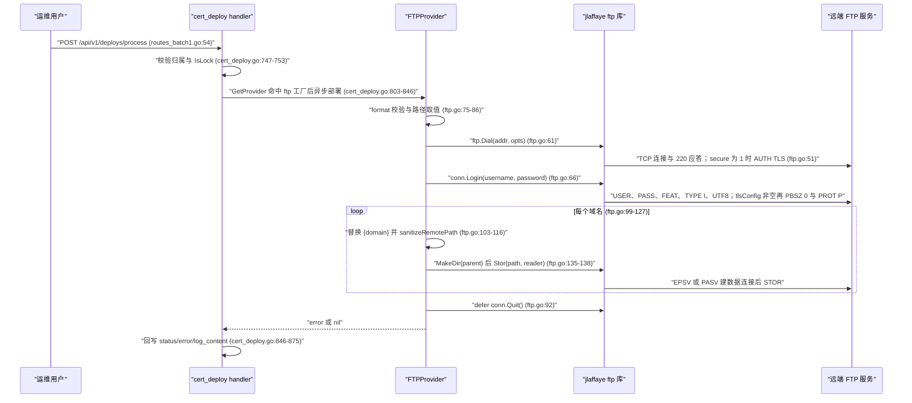
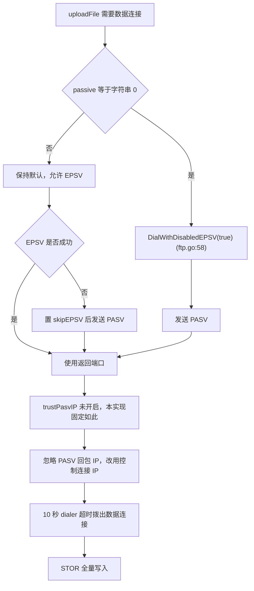
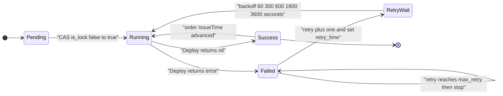
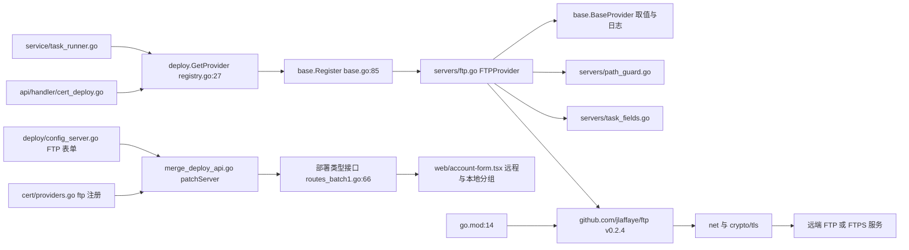

# FTP文件部署

<cite>
**本文档引用的文件**
- [ftp.go](file://main/internal/cert/deploy/servers/ftp.go)
- [path_guard.go](file://main/internal/cert/deploy/servers/path_guard.go)
- [task_fields.go](file://main/internal/cert/deploy/servers/task_fields.go)
- [exec_lines.go](file://main/internal/cert/deploy/servers/exec_lines.go)
- [ssh.go](file://main/internal/cert/deploy/servers/ssh.go)
- [local.go](file://main/internal/cert/deploy/servers/local.go)
- [base.go](file://main/internal/cert/deploy/base/base.go)
- [config.go](file://main/internal/cert/deploy/config.go)
- [config_server.go](file://main/internal/cert/deploy/config_server.go)
- [registry.go](file://main/internal/cert/deploy/registry.go)
- [merge_deploy_api.go](file://main/internal/cert/deploy/merge_deploy_api.go)
- [providers.go](file://main/internal/cert/providers.go)
- [task_runner.go](file://main/internal/service/task_runner.go)
- [cert_deploy.go](file://main/internal/api/handler/cert_deploy.go)
- [cert.go](file://main/internal/api/handler/cert.go)
- [routes_batch1.go](file://main/internal/apiv1/routes_batch1.go)
- [models.go](file://main/internal/models/models.go)
- [go.mod](file://main/go.mod)
- [account-form.tsx](file://web/components/account-form.tsx)
- [provider-icon.tsx](file://web/components/provider-icon.tsx)
</cite>

## 目录

1. [简介](#简介)
2. [项目结构](#项目结构)
3. [核心组件](#核心组件)
4. [架构总览](#架构总览)
5. [详细组件分析](#详细组件分析)
6. [依赖关系分析](#依赖关系分析)
7. [性能考虑](#性能考虑)
8. [故障排查指南](#故障排查指南)
9. [结论](#结论)
10. [附录](#附录)

## 简介

FTP 文件部署是证书部署体系中「服务器类」（`ClassServer = 3`，`main/internal/cert/deploy/config.go:9`）
的最简形态：把已签发订单的 `fullchain` 与 `privateKey` 以 PEM 文本上传到一台 FTP/FTPS 服务器的
指定路径，不执行任何远端命令。实现只有 143 行，集中在 `main/internal/cert/deploy/servers/ftp.go`，
协议细节整体委托给 `github.com/jlaffaye/ftp v0.2.4`（`main/go.mod:14`）。

一次部署由三段构成：`connect`（`ftp.go:40-72`）读取账户级 `host`/`port`/`username`/`password`/
`secure`/`passive` 并登录；`Deploy`（`ftp.go:74-131`）按任务级 `cert_path`/`key_path`（兼容
`pem_cert_file`/`pem_key_file`）展开 `{domain}` 占位符并逐域名上传；`uploadFile`（`ftp.go:133-139`）
对父目录发一次 `MKD`，随后用 `STOR` 全量覆写。

**能力边界**（均为实读代码所得，不含推测性补全）：

| 边界项 | 事实 | 依据 |
| --- | --- | --- |
| 证书格式 | 只接受 PEM，`format` 为 `pfx`/`jks` 直接返回错误 | `ftp.go:75-78` |
| 表单一致性 | 任务表单仍提供「PFX格式（IIS/Tomcat）」与 `pfx_file`/`pfx_pass` | `config_server.go:61-68` |
| 命令执行 | 无 exec 能力，无法 `nginx -s reload` | `ftp.go` 无命令分支（对比 `ssh.go:165-170`、`local.go:117-133`） |
| 连接参数作用域 | `host`/`port`/凭据只从账户配置取，任务配置无法覆盖 | `ftp.go:41-47` |
| 传输模式 | 库层只有被动模式，`passive` 为 `"0"` 仅表示禁用 EPSV | `ftp.go:57-59` |
| 断点与原子性 | `Stor` 偏移 0，无 `REST` 续传、无「临时文件 + RNFR/RNTO」 | `ftp.go:138` |
| 远端权限 | 未发 `SITE CHMOD`，落盘权限由服务端账号与 umask 决定 | `ftp.go` 无权限调用 |
| 信息回传 | 未实现 `DeployWithInfoProvider`，不回写 `config`/`info` | `ftp.go:21-23` |

本文档面向需要配置、排障或扩展 FTP 部署器的人员，行号以当前工作区为准。涉及第三方库处一律标注
「库源码」并给出 `v0.2.4` 的 `ftp.go` 行号；该库不在本仓库内，故不出现在文首 cite 清单。

**章节来源**
- [ftp.go](file://main/internal/cert/deploy/servers/ftp.go#L1-L143)
- [config.go](file://main/internal/cert/deploy/config.go#L6-L16)
- [config_server.go](file://main/internal/cert/deploy/config_server.go#L44-L70)
- [go.mod](file://main/go.mod#L14-L14)

## 项目结构

FTP 部署器位于证书部署子系统的 `servers` 分组，与 `providers`（云厂商与自建 CDN/WAF）、`panels`
（面板）、`others`（其他平台）并列。`servers` 目录共 6 文件、655 行、3 个 `base.Register` 注册项
（`ssh`、`ftp`、`local`）。

```
main/internal/cert/deploy/
├── base/base.go                  # 契约、注册中心、BaseProvider、配置取值、回传合并
├── servers/
│   ├── ftp.go                    # FTP/FTPS 上传部署器（本文主角）
│   ├── ssh.go                    # 同组参照：SCP 上传 + 远端命令
│   ├── local.go                  # 同组参照：本机写入 + 本机命令
│   ├── path_guard.go             # 远端/本机路径安全网（安全审计 H-1）
│   ├── task_fields.go            # 多键名回落取值 firstStringInMap
│   └── exec_lines.go             # 多行命令拆分（FTP 链路不使用）
├── config.go                     # DeployProviderConfig 结构与 Class 常量
├── config_server.go              # ssh/ftp/local/s3storage 四份表单登记
├── registry.go                   # 向后兼容别名层 + 子产品名解析链
└── merge_deploy_api.go           # API 视图表单合并（patchServer 白名单）
```

各文件在 FTP 链路中的实际参与度：

| 文件 | 行数 | 在 FTP 链路中的职责 | 关键符号与位置 |
| --- | --- | --- | --- |
| `servers/ftp.go` | 143 | 拨号、登录、逐域名上传、错误包装 | `connect`（`:40`）、`Deploy`（`:74`）、`uploadFile`（`:133`） |
| `servers/path_guard.go` | 63 | 上传前路径校验 | `sanitizeRemotePath`（`:22`）、`sanitizeWithMode`（`:31`） |
| `servers/task_fields.go` | 22 | `cert_path`/`pem_cert_file` 多键名回落 | `firstStringInMap`（`:7`） |
| `servers/exec_lines.go` | 19 | 同包工具，FTP 不调用 | `splitExecLines`（`:6`） |
| `base/base.go` | 339 | 契约、注册中心、取值与域名解析 | `DeployProvider`（`:45`）、`Register`（`:85`）、`GetString`（`:199`）、`GetConfigDomains`（`:306`） |
| `config_server.go` | 121 | FTP 账户与任务字段声明 | FTP 段（`:45-70`） |
| `cert/providers.go` | 623 | cert 侧 `ftp` 注册（工厂为 `nil`，仅登记 API 视图） | FTP 段（`:319-L338`） |
| `service/task_runner.go` | 1015 | 自动调度、加锁、重试、日志落库 | `executeSingleDeploy`（`:281`） |
| `api/handler/cert_deploy.go` | 1101 | 连通性检测与手动触发入口 | `DeployAccountCheck`（`:269`）、`DeployProcess`（`:723`） |

`registry.go`（73 行，`GetProvider` 在 `:27`）与 `merge_deploy_api.go`（64 行，白名单在 `:12`）
构成解析与表单合并两侧，详见「依赖关系分析」。

**章节来源**
- [ftp.go](file://main/internal/cert/deploy/servers/ftp.go#L1-L143)
- [path_guard.go](file://main/internal/cert/deploy/servers/path_guard.go#L9-L63)
- [exec_lines.go](file://main/internal/cert/deploy/servers/exec_lines.go#L1-L19)
- [task_fields.go](file://main/internal/cert/deploy/servers/task_fields.go#L1-L22)
- [providers.go](file://main/internal/cert/providers.go#L319-L338)

## 核心组件

`FTPProvider` 内嵌 `base.BaseProvider`，实现 `DeployProvider` 三方法（`Check`/`Deploy`/`SetLogger`，
契约 `base.go:45-54`），并在 `init()` 中以名字 `ftp` 注册进全局工厂表（`ftp.go:17-19`）。它未实现
可选接口 `DeployWithInfoProvider`（`base.go:69-74`），因此 `base.ProviderDeployWithInfo`
（`base.go:142-150`）退化为直接调用 `Deploy`，不回传附加信息。



**图表来源**
- [base.go](file://main/internal/cert/deploy/base/base.go#L45-L117)
- [ftp.go](file://main/internal/cert/deploy/servers/ftp.go#L17-L143)
- [path_guard.go](file://main/internal/cert/deploy/servers/path_guard.go#L21-L31)

组件职责与关键约束：

| 组件 | 位置 | 职责 | 关键约束 |
| --- | --- | --- | --- |
| `init` 注册 | `ftp.go:17-19` | 把 `ftp` 绑定到 `NewFTPProvider` | 名字必须与 `config_server.go:46` 的 `Type` 一致 |
| `NewFTPProvider` | `ftp.go:25-29` | 以**账户配置**构造实例 | 任务配置只作为 `Deploy` 形参出现 |
| `Check` | `ftp.go:31-38` | 建连后立即 `Quit`，验证能否登录 | 不验证目录存在与写权限 |
| `connect` | `ftp.go:40-72` | 组装拨号选项、登录、包装错误 | 超时固定 10 秒（`:50`），表单不可调 |
| `Deploy` | `ftp.go:74-131` | 格式校验、路径取值、域名循环 | 任一文件失败立即 `return`，后续域名不处理 |
| `uploadFile` | `ftp.go:133-139` | 单层 `MKD` + `STOR` 覆写 | `MakeDir` 错误被丢弃（`:135`） |
| `sanitizeRemotePath` | `path_guard.go:22-24` | 拒绝 `..`、控制字符、非 `/` 开头 | 校验在占位符替换之后（`ftp.go:100-116`） |
| `firstStringInMap` | `task_fields.go:7-21` | 按序取首个非空字符串并 `TrimSpace` | 只识别 `string` 值；logger 未注入时 `Log` 静默丢弃（`base.go:131-135`） |

**章节来源**
- [ftp.go](file://main/internal/cert/deploy/servers/ftp.go#L17-L143)
- [base.go](file://main/internal/cert/deploy/base/base.go#L45-L150)
- [task_fields.go](file://main/internal/cert/deploy/servers/task_fields.go#L7-L21)

## 架构总览

FTP 部署有**两条**触发路径，最终汇聚到同一个 `FTPProvider.Deploy`。自动路径由 `runCertTask` 每 5
分钟一轮（`task_runner.go:41`、`:89-L100`，首跑延迟 30 秒见 `:96`），`executeDeployTasks` 串行扫描
（`:217-L242`），`executeSingleDeploy` CAS 抢锁后执行（`:281-L392`），并额外承担重试与通知
（`:350-381`）。手动路径由 `DeployProcess`（`cert_deploy.go:723-L881`，路由 `dep.POST("/process", ...)`
见 `routes_batch1.go:54`）置锁（`:818-L824`）后 `utils.SafeGo` 异步执行（`:837` 起）。两条路径都带
5 分钟整体时限（`task_runner.go:345`、`cert_deploy.go:843`），并把 `p.Log` 累积进
`cert_deploys.log_content`（`task_runner.go:341-344`、`:370`）。



**图表来源**
- [ftp.go](file://main/internal/cert/deploy/servers/ftp.go#L40-L139)
- [cert_deploy.go](file://main/internal/api/handler/cert_deploy.go#L723-L881)
- [task_runner.go](file://main/internal/service/task_runner.go#L281-L392)
- [registry.go](file://main/internal/cert/deploy/registry.go#L27-L68)

权限口径值得单独强调：`checkLocalDeployAllowed` 只对 `local` 做管理员限制（`cert.go:1250-L1264`，
调用点 `:1226`、`:1276`），`ftp` 与 `ssh` 对所有具备 `deploy` 模块权限的登录用户开放
（`cert_deploy.go:503-505`），但非管理员只能绑定自己的部署账户（`:533-L536`）。

**章节来源**
- [task_runner.go](file://main/internal/service/task_runner.go#L89-L242)
- [cert_deploy.go](file://main/internal/api/handler/cert_deploy.go#L502-L536)
- [cert.go](file://main/internal/api/handler/cert.go#L1226-L1276)
- [routes_batch1.go](file://main/internal/apiv1/routes_batch1.go#L49-L66)

## 详细组件分析

### 主机、端口与取值链路

`connect` 的六个参数全部来自 `p.GetString(key)`，即账户配置（`BaseProvider.Config`，`base.go:120-123`）：

| 参数 | 位置 | 表单字段 | 默认与规则 |
| --- | --- | --- | --- |
| `host` | `ftp.go:41` | FTP地址（`config_server.go:53`） | 无默认；空则地址残缺，拨号失败 |
| `port` | `ftp.go:42-45` | FTP端口（`:54`，默认 `21`） | 空字符串回落 `"21"`；仅字符串处理，无数字校验 |
| `username` | `ftp.go:46` | 用户名（`:55`） | 无默认 |
| `password` | `ftp.go:47` | 密码（`:56`） | 无默认；空串仍会发出 `PASS` |
| `secure` | `ftp.go:51` | 是否使用SSL（`:57`，默认 `0`） | **仅当值恰为字符串 `"1"`** 才启用显式 TLS |
| `passive` | `ftp.go:57` | 被动模式（`:58`，默认 `1`） | **值为字符串 `"0"`** 才禁用 EPSV |

`GetString` 具备四级匹配（精确 → 大小写不敏感 → 下划线转驼峰 → 驼峰转下划线，`base.go:199-228`），
因此 `Host` 之类命名差异仍可命中；但它对非字符串值直接跳过（`:201-203` 的类型断言），前端若把 radio
提交成数字 `1` 或布尔 `true`，`secure`/`passive` 都会被当成缺省值——`config` JSON 中这两项必须写成
字符串。地址用 `JoinHostPort` 拼装（`ftp.go:49`），IPv6 会正确加方括号；库在 `Dial` 后把 `c.host`
固定为**已解析的对端 IP**（库源码 `ftp.go:165`），该事实决定后文数据通道的 IP 处理。

**章节来源**
- [ftp.go](file://main/internal/cert/deploy/servers/ftp.go#L40-L61)
- [base.go](file://main/internal/cert/deploy/base/base.go#L198-L256)
- [config_server.go](file://main/internal/cert/deploy/config_server.go#L52-L59)

### 认证方式与登录时序

FTP 只支持**用户名 + 密码**一种凭据（`ftp.go:46-47`、`config_server.go:55-56`），没有匿名登录、没有
token、没有客户端证书。登录整体交给库的 `conn.Login`（`ftp.go:66`），库内时序为 `USER` →（按应答码
决定）`PASS` → `FEAT` → `TYPE I` 切二进制 → `UTF8 ON`（未禁用时）→ `tlsConfig` 非空时追加
`PBSZ 0` + `PROT P`（库源码 `ftp.go:364-L412`）。两点影响结果：`TYPE I` 使 PEM 按二进制传输、不被
ASCII 模式改写行尾；`PROT P` 只在开启 `secure` 时发出，未开启时**证书与私钥都走明文**，公网环境必须
开启。

| 错误消息 | 位置 | 触发条件 | 连接清理 |
| --- | --- | --- | --- |
| `FTP连接失败: %w` | `ftp.go:62-64` | 拨号超时、DNS 失败、220 缺失、`AUTH TLS` 失败 | 库内失败分支 `Quit` |
| `FTP登录失败: %w` | `ftp.go:66-69` | 口令错误、`FEAT`/`TYPE`/`PROT` 任一失败 | 显式 `conn.Quit()`（`:67`） |
| `上传证书失败: %w` | `ftp.go:119-121` | `STOR` 非 1xx/2xx，典型为 550 | `defer conn.Quit()`（`:92`） |
| `上传私钥失败: %w` | `ftp.go:124-126` | 同上，但证书已覆写成功 | 同上 |
| `FTP 部署当前仅支持 PEM 格式` | `ftp.go:77` | `format` 为 `pfx`/`jks` | 尚未建连 |
| `%s 不能为空`／`包含控制字符`／`必须为绝对路径` | `path_guard.go:33-55` | 路径校验失败 | 视循环轮次而定 |

**章节来源**
- [ftp.go](file://main/internal/cert/deploy/servers/ftp.go#L61-L131)
- [path_guard.go](file://main/internal/cert/deploy/servers/path_guard.go#L31-L55)
- [config_server.go](file://main/internal/cert/deploy/config_server.go#L55-L58)

### TLS 与 FTPS 支持范围

启用方式是**显式 TLS**：`ftp.DialWithExplicitTLS(&tls.Config{MinVersion: tls.VersionTLS12, ServerName: host})`
（`ftp.go:51-56`）。四条结论由此而来：最低版本锁死 TLS 1.2，服务端仅提供 1.0/1.1 时握手必失败；
`ServerName` 取 `host` 原文并走标准链校验，代码未设 `InsecureSkipVerify`、也没有「跳过校验」表单字段，
自签证书需把 CA 放进运行环境信任库；**不支持隐式 FTPS（990 端口）**，库的隐式模式对应 `DialWithTLS`
（库源码 `ftp.go:295`）而本实现未使用，填 `990` 会以明文发出 `AUTH TLS` 并表现为连接异常；数据通道
复用同一份 `tlsConfig`（库源码 `openDataConn`，`ftp.go:588-L620`），由于数据连接目标是控制连接对端 IP
而 `ServerName` 是原始 `host`，「域名解析到多 IP」或「控制与数据经不同 NAT」时可能出现主机名不匹配的
握手失败——该结论由库实现推导，标记为**推断**，现场以抓包为准。

**章节来源**
- [ftp.go](file://main/internal/cert/deploy/servers/ftp.go#L50-L56)

### 被动模式、EPSV 与防火墙

这是最容易被误解的一处，代码只做一件事——`passive == "0"` 时禁用扩展被动模式（`ftp.go:57-59`）。而库
在 `v0.2.4` **没有主动模式（PORT）实现**：`getDataConnPort`（库源码 `ftp.go:574`）先试 `EPSV`，失败则
置 `skipEPSV` 退回 `PASV`，两条路径都是「服务端给端口、客户端主动连接」。表单上「被动模式 = 否」的真
实语义因此是「禁用 EPSV、只用传统 PASV」。



**图表来源**
- [ftp.go](file://main/internal/cert/deploy/servers/ftp.go#L57-L59)
- [ftp.go](file://main/internal/cert/deploy/servers/ftp.go#L133-L139)

`DialWithTrustPasvIP`（库源码 `ftp.go:229`）未被调用，库在 `pasv()` 中直接返回控制连接的 host（库源码
`ftp.go:512-L562`）。该默认行为对「FTP 在 NAT 后、PASV 回包宣告内网地址」的常见站点**有利**；反之若
控制与数据端口被分发到不同节点（部分 LVS 化 FTP 集群），会连不上数据端口，而本部署器没有开关可以放开。

防火墙侧结论（部署必读）：出站方向必须放行 `port`（默认 21）**以及一段被动端口区间**；服务端「只开放
20 端口」的主动模式配置在此实现下无法工作；`DialWithTimeout(10s)`（`ftp.go:50`）同时作用于控制与数据
拨号，端口段配置错误表现为 10 秒后报「上传证书失败」而非立刻失败。

**章节来源**
- [ftp.go](file://main/internal/cert/deploy/servers/ftp.go#L50-L59)
- [ftp.go](file://main/internal/cert/deploy/servers/ftp.go#L133-L139)

### 路径取值、`{domain}` 占位符与域名循环

`Deploy` 对路径采用「任务优先 + 账户兜底 + 多键名兼容」三层取值：

| 目标 | 一级取值 | 二级兜底 | 位置 |
| --- | --- | --- | --- |
| 证书路径 | `cert_path`、`pem_cert_file` | `p.GetStringFrom(config, "cert_path")` | `ftp.go:79-82` |
| 私钥路径 | `key_path`、`pem_key_file` | `p.GetStringFrom(config, "key_path")` | `ftp.go:83-86` |

`firstStringInMap`（`task_fields.go:7-21`）按序返回首个 `TrimSpace` 后非空的字符串；`GetStringFrom`
（`base.go:246-256`）在未命中时回落到账户配置——这正是老任务的 `cert_path` 与新表单的 `pem_cert_file`
都能生效的原因。域名列表来自 `base.GetConfigDomains(config)`（`ftp.go:94`；实现 `base.go:306-339`），
优先级 `domainList` → `domains` → `domain`，支持 `[]string`、`[]interface{}` 与逗号/换行分隔串
（`SplitDomains`，`base.go:288-303`）。自动路径由调度器注入（`task_runner.go:335-337`；手动路径
`cert_deploy.go:809-815`）。列表为空时退化为单次部署（`ftp.go:95-97`），此时 `{domain}` 不会被替换。

每轮把两个路径中的 `{domain}` 全量替换为当前域名（`ftp.go:100-105`），随后进入安全校验与上传。
**多站点必须写占位符**，否则所有域名依次覆写同一份文件，最后一轮的证书链胜出。`Deploy` 的顺序与中止
点（`ftp.go:74-131`）：

1. `format` 为 `pfx`/`jks` → 立即返回「仅支持 PEM 格式」（`:77`），尚未建连
2. 取路径（`:79-86`）→ `connect`（`:88`），失败即返回连接或登录错误
3. 解析域名列表（`:94-97`）→ 每轮替换（`:103-104`）与双路径校验（`:108-115`），不通过则整体终止
4. 先传证书（`:119`）再传私钥（`:124`）；**私钥失败时证书已被覆写**，属已知中间态
5. 全部域名完成才打印「FTP部署完成」（`:129`），`defer conn.Quit()`（`:92`）收尾

**章节来源**
- [ftp.go](file://main/internal/cert/deploy/servers/ftp.go#L74-L127)
- [base.go](file://main/internal/cert/deploy/base/base.go#L246-L339)
- [task_runner.go](file://main/internal/service/task_runner.go#L328-L340)

### 远端路径安全校验

`path_guard.go` 是安全审计 H-1 的整改产物，文件头注释把规则列为五条（`:9-19`）。FTP 走
`sanitizeRemotePath`（`:22-24`），与 SSH 共用 `sanitizeWithMode(field, raw, true)`（`:31-63`）。

| 规则 | 判定 | 错误消息 | 位置 |
| --- | --- | --- | --- |
| 去空格后为空 | 直接拒绝 | `%s 不能为空` | `:32-35` |
| 含 `\x00`-`\x1f` 或 `0x7f` | 逐 rune 扫描拒绝 | `%s 包含控制字符` | `:36-41` |
| 含 `..` 段 | 同时按 `/` 与 `\` 拆分检查 | `%s 不允许包含上溯片段 ".."` | `:42-50` |
| 远端非绝对路径 | 不以 `/` 开头即拒绝 | `%s 必须为绝对路径（以 / 开头）` | `:51-55` |

设计上是**只校验不改写**：函数返回原串，不做 `filepath.Clean`（说明见 `:18`），避免误改写 `{domain}`
占位路径。控制字符校验与库层 `checkForCommandInjection`（拒绝命令串中的 CR/LF，库源码 `ftp.go:638`）
构成双层防御，FTP 命令注入面被封死。对使用者最实际的三条约束：路径必须以 `/` 开头，chroot 内的相对
路径会被拒；Windows 风格 `C:/ssl/cert.pem` 同样被拒；若 `{domain}` 数据被污染出 `..` 段也会拦截。

**章节来源**
- [path_guard.go](file://main/internal/cert/deploy/servers/path_guard.go#L9-L63)
- [ftp.go](file://main/internal/cert/deploy/servers/ftp.go#L107-L116)

### 目录创建与覆盖策略

`uploadFile` 全文只有 7 行（`ftp.go:133-139`）：取最后一个 `/` 之前的整段发一次 `MKD`，随后
`Stor(remotePath, strings.NewReader(content))`。

| 行为 | 实现细节 | 后果 |
| --- | --- | --- |
| 建目录 | 单次 `MKD`（`:134-136`） | 单层创建不递归，多级缺失时 `STOR` 报 550 |
| 忽略建目录错误 | 返回值未接收（`:135`） | 无法区分「目录已存在」与「无权限」 |
| 写入方式 | `Stor`，库内等价 `StorFrom(offset = 0)`（库源码 `ftp.go:944`） | 服务端 `STOR` 截断重写，旧文件不保留 |
| 备份与回滚 | 无 `RNFR`/`RNTO`/`RETR` 前备操作 | 中断可留半份 PEM，已成功域名不撤销 |
| 幂等判定 | 不比对远端 `Size`/`MDTM` | 内容级幂等，但每次全量重传 |
| 断点续传 | 未用 `StorFrom(offset)`（库源码 `ftp.go:971`） | 传输中断只能整体重传 |
| 权限设置 | 未发 `SITE CHMOD` | 落盘权限由账号与 umask 决定，与 SSH 的 `0600`（`ssh.go:202`）不可比 |

覆盖策略一句话：**同名文件无条件整体覆写，失败不回滚，已成功域名不撤销**。多域名任务在第 k 个失败时，
前 k-1 个已是新证书、第 k 个可能半写、k+1 之后仍是旧证书；下一轮重试会重推全部域名并最终收敛——这是
可接受但必须知晓的中间态。

**章节来源**
- [ftp.go](file://main/internal/cert/deploy/servers/ftp.go#L133-L139)
- [ssh.go](file://main/internal/cert/deploy/servers/ssh.go#L222-L245)

### 任务状态与重试

部署器自身没有任何重试逻辑，重试完全由调度层兜底。`cert_deploys` 相关字段（`models.go:256-L280`）：
`status` 取 0 待执行、1 执行中、2 成功、-1 失败（`:266`）；`is_lock`/`lock_time` 用于 CAS 抢锁
（`:273-274`）；`retry`/`max_retry`/`retry_time` 承载退避（`:269-272`）；`error` 受 `size:300` 限制
（`:267`）；`log_content` 存全量执行日志（`:277`）。



**图表来源**
- [task_runner.go](file://main/internal/service/task_runner.go#L244-L392)
- [models.go](file://main/internal/models/models.go#L256-L280)

退避梯度硬编码为 `deployRetryIntervals = []int{60, 300, 600, 1800, 3600}`（`task_runner.go:23`），
`getRetryInterval` 超出表长时固定取最后一档（`:775-L783`）。重试上限取任务 `MaxRetry`，为 0 时按 5
处理（`:251-254`），但模型层默认是 3（`models.go:270`）——两处默认值不一致，实际取决于记录里的值。
到期判定要求 `RetryTime` 非空（`:260-265`），最后一次失败仍触发通知（`:354-360`）。`Success → Running`
对应「证书更新后重跑」：对 `status = 2` 的任务只在 `order.IssueTime` 晚于任务记录时才执行（`:231-238`）。

**章节来源**
- [task_runner.go](file://main/internal/service/task_runner.go#L217-L280)
- [task_runner.go](file://main/internal/service/task_runner.go#L340-L405)
- [models.go](file://main/internal/models/models.go#L256-L280)

### 连通性检测的语义边界

`Check`（`ftp.go:31-38`）只做「建连 + 登录 + 立即 `Quit`」，由 `DeployAccountCheck` 异步调用
（`cert_deploy.go:269-L324`，路由 `g.POST("/deploy-accounts/check", ...)` 见 `routes_batch1.go:65`），
检测超时 30 秒（`:314`），结果只写服务端日志（`:317`、`:320`），接口固定返回「提交成功」（`:323`）。

| 检测项 | 是否覆盖 | 说明 |
| --- | --- | --- |
| TCP 可达与端口正确 | 是 | 拨号失败即报错 |
| 账号口令正确 | 是 | `Login` 失败即报错 |
| TLS 可用与证书受信 | 仅当 `secure` 为 `"1"` | 未开启则完全跳过 |
| 目标目录存在与写权限 | 否 | 未发 `CWD`/`MKD`/`STOR` 试探 |
| 磁盘配额 | 否 | 同上 |

因此「检测通过」不能推断「部署可用」，550 类错误只在真实部署时暴露；排障应以任务详情里的 `log_content`
为准（`DeployLog`，`cert_deploy.go:925`）。

**章节来源**
- [ftp.go](file://main/internal/cert/deploy/servers/ftp.go#L31-L38)
- [cert_deploy.go](file://main/internal/api/handler/cert_deploy.go#L269-L324)
- [routes_batch1.go](file://main/internal/apiv1/routes_batch1.go#L60-L66)

## 依赖关系分析

FTP 部署器处在「注册中心 + 调度器 + API」三者交汇点，自身只依赖标准库与单个第三方库。



**图表来源**
- [registry.go](file://main/internal/cert/deploy/registry.go#L27-L68)
- [ftp.go](file://main/internal/cert/deploy/servers/ftp.go#L1-L29)
- [merge_deploy_api.go](file://main/internal/cert/deploy/merge_deploy_api.go#L5-L33)
- [config_server.go](file://main/internal/cert/deploy/config_server.go#L44-L70)

| 依赖 | 类型 | 用途 | 依据 |
| --- | --- | --- | --- |
| `github.com/jlaffaye/ftp` v0.2.4 | 第三方 | `Dial`/`Login`/`MakeDir`/`Stor`/`Quit` | `ftp.go:14`、`go.mod:14` |
| `crypto/tls`、`net` | 标准库 | 显式 TLS 配置与最低版本、地址拼装 | `ftp.go:5`、`:8`、`:52-55`、`:49` |
| `context` | 标准库 | 形参存在但**未传给库**（库有 `DialWithContext`，未使用） | `ftp.go:4`、`:31`、`:74` |
| `strings`/`fmt`/`time` | 标准库 | 占位符替换、错误包装、超时值 | `ftp.go:6-11` |
| `deploy/base` | 内部 | 契约、注册中心、`GetString`、`GetConfigDomains` | `ftp.go:7`、`base.go:45-339` |
| `main/internal/cert` | 内部 | 仅取 `cert.Logger` 类型别名 | `ftp.go:12`、`base.go:42` |

双注册对 `ftp` 的实际影响：`cert.Register("ftp", nil, ProviderConfig{...})`（`providers.go:320`）工厂
位传 `nil`，cert 侧注册中心会跳过工厂登记（`registry.go:27-29`），因此 `ftp` 不能作为证书申请提供商，
只贡献 API 视图；又因 `ftp` 落在 `patchServer` 白名单（`merge_deploy_api.go:12`），**最终生效的表单来自
`config_server.go:45-70`**，`providers.go:326-337` 的 `cert_path`/`key_path`/`domain` 定义在 API 上已被
覆盖。实现层同时兼容两组键名（`ftp.go:79-86`），老数据仍可正常部署。改表单字段前必须确认改的是生效的
那一份。

**章节来源**
- [ftp.go](file://main/internal/cert/deploy/servers/ftp.go#L1-L15)
- [registry.go](file://main/internal/cert/deploy/registry.go#L22-L35)
- [merge_deploy_api.go](file://main/internal/cert/deploy/merge_deploy_api.go#L5-L33)
- [providers.go](file://main/internal/cert/providers.go#L319-L338)

## 性能考虑

- **连接复用**：`connect` 在域名循环之外（`ftp.go:88-92`），N 个域名共用一条控制连接与一次登录，只多
  付 N×2 次数据连接握手，取舍正确
- **往返成本**：每文件一次 `MKD` + 一次 `STOR`，即「数据连接建立 + 传输 + 226」。10 域名、链长 6 KB 约
  20 次数据连接；远端限制单 IP 并发或连接数时可能触发 421/425 类拒绝，这是多域名 FTP 任务的主要失败源
- **内存**：`strings.NewReader`（`:138`）不复制内容，PEM 为 KB 级可忽略；真正驻留的是
  `order.FullChain`/`order.PrivateKey`（`task_runner.go:350`），与 FTP 无关
- **超时层次**：单次拨号 10 秒且控制与数据共用同一 `dialer`（`ftp.go:50`）；库默认拨号上限 30 秒（库
  源码 `ftp.go:23`）；任务整体 5 分钟（`task_runner.go:345`、`cert_deploy.go:843`）；连通性检测 30 秒
  （`cert_deploy.go:314`）。未设置 `ShutTimeout`，长传输后读 226 不受额外 deadline 约束
- **上下文未透传**：`ctx` 形参（`ftp.go:31`、`:74`）没有用于 `ftp.Dial`，5 分钟到期时阻塞中的读写不会被
  主动打断，最终依赖锁清理（`releaseExpiredLocks`，`task_runner.go:421-L426`，10 分钟阈值）恢复。该结论
  由「未调用 `DialWithContext`」的代码事实得出，属**推断**
- **串行与重复传输**：同一轮内串行遍历所有任务（`task_runner.go:221-L241`），单个 FTP 任务卡满 10 秒会
  顺延同轮其他任务；且无内容比对，每次触发全量重传，配额型 FTP（按流量或连接数计费）需评估 `active`
  开关与任务数量

建议按当前需求排序：优先用「路径含 `{domain}` 的单任务」覆盖多站点，而非拆成多条任务；`secure` 应默认
开启；不建议新增连接池或并发上传——`KISS` 原则下现有实现已满足「把两个文本文件推上远端」这一目标，
`YAGNI` 原则下也不预留断点续传抽象。

**章节来源**
- [ftp.go](file://main/internal/cert/deploy/servers/ftp.go#L88-L139)
- [task_runner.go](file://main/internal/service/task_runner.go#L217-L241)
- [task_runner.go](file://main/internal/service/task_runner.go#L340-L352)
- [task_runner.go](file://main/internal/service/task_runner.go#L421-L442)

## 故障排查指南

### 症状对照表

| 现象 / 错误文本 | 首查项 | 代码依据 | 处置 |
| --- | --- | --- | --- |
| `FTP连接失败: dial tcp ...: i/o timeout` | 端口是否正确、防火墙是否放行 | `ftp.go:42-45`、`:61-64` | 核对 `port`，放通出站 21 与被动区间 |
| `FTP连接失败` 且端口填 `990` | 误用隐式 FTPS | `ftp.go:51-56` 只走显式 TLS | 改为显式端口（通常 21） |
| `FTP连接失败: EOF` 或 `connection reset` | 服务端强制 TLS 而 `secure` 为 `0` | `ftp.go:51` | `secure` 设为字符串 `"1"` |
| `FTP登录失败` | 账号口令、是否被禁用或 IP 白名单限制 | `ftp.go:66-69` | 同凭据手工登录验证 |
| 登录成功但 `上传证书失败: 550` | 目录不存在、无写权限、chroot 根与路径不符 | `ftp.go:119-121`、`:135` | 预建目录并赋写权限；路径以 `/` 开头（`path_guard.go:51-55`） |
| `上传私钥失败` 但证书已成功 | 目录不同、配额耗尽、中途断连 | `ftp.go:124-126` | 重跑任务即可整体覆盖收敛 |
| `cert_path 必须为绝对路径（以 / 开头）` | 用了相对路径或 Windows 盘符 | `path_guard.go:53-55` | 改为 chroot 视角的 POSIX 绝对路径 |
| `不允许包含上溯片段 ".."` 或 `包含控制字符` | 路径或 `{domain}` 被污染、粘贴带入换行 | `path_guard.go:36-49` | 清理路径并重新录入纯文本 |
| `FTP 部署当前仅支持 PEM 格式` | 任务选了 PFX | `ftp.go:75-78` 与 `config_server.go:63` 不一致 | 改为 `pem` 并填 `pem_cert_file`/`pem_key_file` |
| 多域名只更新了最后一个站点 | 路径未写 `{domain}` | `ftp.go:99-105` | 路径加入占位符 |
| TLS `certificate is valid for ... not ...` | `ServerName` 取 `host` 与证书 SAN 不符 | `ftp.go:52-55` | `host` 填证书覆盖的域名；无跳过校验开关 |
| TLS `protocol version not supported` | 服务端低于 TLS 1.2 | `ftp.go:53` | 升级服务端，或仅在内网关闭 `secure` |
| STOR 一直超时且无错误码 | PASV 端口段未放行 | `ftp.go:138` | 放通区间；仍失败把 `passive` 设为 `"0"` |
| 部署类型下拉里没有 FTP | `deploy` 模块权限或表单合并结果 | `cert_deploy.go:1039`、`merge_deploy_api.go:12` | 确认类型登记存在（`config_server.go:46`） |

**章节来源**
- [ftp.go](file://main/internal/cert/deploy/servers/ftp.go#L40-L139)
- [path_guard.go](file://main/internal/cert/deploy/servers/path_guard.go#L31-L63)
- [cert_deploy.go](file://main/internal/api/handler/cert_deploy.go#L1039-L1039)

### 被动模式与 NAT 的专项排查

数据连接是 FTP 排障重心，本实现的固定行为是「EPSV → PASV 回退，且数据 IP 取控制连接的 IP」。建议顺序：

1. 日志停在上传阶段且**没有** FTP 错误码，问题在数据连接而非权限
2. `secure` 为 `1` 时先查服务端日志确认 `PROT P` 协商成功（库源码 `ftp.go:405-412`）
3. 手工以 PASV 复现，观察 `227` 回包 IP：宣告内网 IP 属正常（本实现会忽略该 IP），宣告的端口不在防火墙
   放通区间则是典型病因
4. 服务端不支持 `EPSV` 时，把 `passive` 设为 `"0"` 跳过一次必然失败的 `EPSV` 往返（`ftp.go:57-59`）
5. 控制与数据分发到不同节点时本实现无法处理（未开启 `trustPasvIP`），只能改用单节点 FTP 或 SFTP——当前
   **没有 SFTP 部署器**，`servers` 目录仅 `ssh.go`/`ftp.go`/`local.go` 三个上传实现
6. 反复失败时核对本轮其他任务是否被顺延（串行调度 `task_runner.go:221-L241`）

复现与观测手段（通用指导，不依赖仓库代码）：用命令行客户端以相同参数手工走一遍，可最快区分「应用配置
问题」与「站点问题」，显式 TLS 对应 `--ftp-ssl`、被动对应 `--pasv`、`--epsv` 用于对比扩展被动模式；抓包
只看三类报文——`PASV`/`EPSV` 应答的 IP 与端口、随后的 TCP SYN 目标、`STOR` 之后的 1xx 与 5xx 应答；
服务端日志关注 `PROT` 结果与 550 的具体原因（后者通常只写在服务端）。

**章节来源**
- [ftp.go](file://main/internal/cert/deploy/servers/ftp.go#L51-L59)
- [ftp.go](file://main/internal/cert/deploy/servers/ftp.go#L133-L139)
- [task_runner.go](file://main/internal/service/task_runner.go#L217-L241)

### 已知不一致与风险清单

| 编号 | 问题 | 影响 | 证据 |
| --- | --- | --- | --- |
| 1 | 表单提供 `pfx`/`pfx_file`/`pfx_pass`，实现直接拒绝 | 可创建必然失败的任务 | `config_server.go:63-68` 与 `ftp.go:77` |
| 2 | `passive` 标签与实际语义（仅控制 EPSV）不符 | 被误认为主动模式开关 | `ftp.go:57-59` |
| 3 | `secure`/`passive` 依赖字符串 `"1"`/`"0"` | 非字符串值被当缺省，TLS 静默关闭 | `ftp.go:51`、`:57` 与 `base.go:201-203` |
| 4 | `MakeDir` 错误被丢弃 | 权限问题推迟到 `STOR` 才暴露 | `ftp.go:135` |
| 5 | `Check` 不验证写权限 | 检测通过仍可能部署失败 | `ftp.go:31-38` |
| 6 | 无原子替换与回滚 | 中断可留半份 PEM 并被服务加载 | `ftp.go:133-139` |
| 7 | `error` 字段限 300 字符 | 长错误链可能被截断 | `models.go:267` |
| 8 | `ctx` 未透传给拨号 | 超时无法中断阻塞读写 | `ftp.go:61` |
| 9 | `MaxRetry` 代码兜底 5、模型默认 3 | 重试次数与预期不符 | `task_runner.go:251-254` 与 `models.go:270` |
| 10 | 账户详情接口原样返回 `config` | FTP 口令随详情回传，依赖传输层加密封装 | `cert_deploy.go:254-261`、`models.go:207` |

第 10 条补充：`CertAccount.Config` 的 JSON tag 是 `-`（`models.go:207`），不会在通用序列化中输出；
`DeployAccountDetail` 是显式解析后再返回（`cert_deploy.go:245-259`），请求与响应走
`middleware.BindDecryptedData` 的加解密通道（`:224`）。是否还有其他日志出口，本文未逐一验证，标记为
**未知**。

**章节来源**
- [ftp.go](file://main/internal/cert/deploy/servers/ftp.go#L31-L139)
- [config_server.go](file://main/internal/cert/deploy/config_server.go#L60-L69)
- [cert_deploy.go](file://main/internal/api/handler/cert_deploy.go#L217-L261)
- [models.go](file://main/internal/models/models.go#L202-L214)

## 结论

FTP 部署器是 `deploy/servers` 三兄弟里最简单的一支：143 行代码、零命令执行能力、零状态回传，把协议复杂
性整体外包给 `jlaffaye/ftp`。它的价值在于覆盖那些「只给 FTP 账号、拿不到 SSH」的虚拟主机与老式站点；局限
也全部源于此——不能重载服务、不能设权限、不能原子替换、不能走主动模式。

架构上它严格遵守 `DeployProvider` 三方法契约（`base.go:45-54`）与注册中心机制（`base.go:85-105`），没有
特判逻辑渗透到调度层，替换或扩展都不影响其他部署器，符合单一职责与开闭原则；安全侧借助 `path_guard.go`
与库的命令注入检查形成双层防御，关闭了 H-1 路径遍历面。

后续可跟进三件事，按优先级排列：任务表单去掉 FTP 不支持的 `pfx` 选项以消除必然失败
（`config_server.go:63-68` 与 `ftp.go:77`）；把「被动模式」标签改为「EPSV 扩展被动模式」以避免误导排障
（`:58`）；若确有原子性诉求，实现「临时文件 + `RNFR`/`RNTO`」替换而不是引入断点续传。三者均属局部文案或
小范围逻辑调整，不需要新增抽象。

**章节来源**
- [ftp.go](file://main/internal/cert/deploy/servers/ftp.go#L1-L143)
- [base.go](file://main/internal/cert/deploy/base/base.go#L45-L117)
- [path_guard.go](file://main/internal/cert/deploy/servers/path_guard.go#L9-L19)

## 附录

### 配置样例（机密值已脱敏）

部署账户配置存于 `cert_accounts.config`，`type = ftp`；任务配置存于 `cert_deploys.config`（旧键名
`cert_path`/`key_path` 同样被兼容，`ftp.go:79-86`）：

```json
{
  "host": "ftp.example.com",
  "port": "21",
  "username": "{FTP 登录用户名}",
  "password": "{FTP 登录口令}",
  "secure": "1",
  "passive": "1"
}
```

```json
{
  "format": "pem",
  "pem_cert_file": "/etc/nginx/ssl/{domain}/fullchain.pem",
  "pem_key_file": "/etc/nginx/ssl/{domain}/privkey.pem"
}
```

表单静态提示为「请确保路径存在且有写入权限」（`config_server.go:51`），但实现不会预检目录，单层 `MKD`
只在上传前顺带执行（`ftp.go:135`）。

**章节来源**
- [ftp.go](file://main/internal/cert/deploy/servers/ftp.go#L79-L86)
- [config_server.go](file://main/internal/cert/deploy/config_server.go#L45-L70)

### 关键常量速查

| 常量 | 值 | 位置 |
| --- | --- | --- |
| 注册名 | `ftp` | `ftp.go:18`、`config_server.go:46`、`providers.go:320` |
| 默认端口 | `"21"` | `ftp.go:43-45` |
| 控制与数据拨号超时 | `10 * time.Second` | `ftp.go:50` |
| TLS 最低版本 | `tls.VersionTLS12` | `ftp.go:53` |
| 部署整体超时 | `5 * time.Minute` | `task_runner.go:345`、`cert_deploy.go:843` |
| 连通性检测超时 | `30 * time.Second` | `cert_deploy.go:314` |
| 重试退避梯度 | 60/300/600/1800/3600 秒 | `task_runner.go:23` |
| 重试上限 | 兜底 5（模型默认 3） | `task_runner.go:251-254`、`models.go:270` |
| 调度周期 | 5 分钟，首跑延迟 30 秒 | `task_runner.go:41`、`:96`、`:100` |
| 过期锁清理阈值 | 10 分钟 | `task_runner.go:421-L426` |
| FTP 库版本 | `github.com/jlaffaye/ftp v0.2.4` | `go.mod:14` |

**章节来源**
- [ftp.go](file://main/internal/cert/deploy/servers/ftp.go#L43-L53)
- [task_runner.go](file://main/internal/service/task_runner.go#L23-L41)

### 三套服务器部署器能力对比

| 维度 | FTP（`ftp.go`） | SSH（`ssh.go`） | 本地（`local.go`） |
| --- | --- | --- | --- |
| 传输协议 | FTP 或显式 FTPS | SSH 会话 + `scp -t`（`ssh.go:244`） | 本机文件写入 |
| 认证要素 | 用户名密码（`ftp.go:46-47`） | 密码或私钥可带口令（`ssh.go:58-81`） | 进程权限 |
| 身份可信校验 | 系统信任链 + `ServerName`（`ftp.go:52-55`） | 可选 `host_key` 固定校验（`ssh.go:109-121`） | 不适用 |
| 上传前后命令 | 均不支持 | `cmd_pre`（`ssh.go:165-170`）、`cmd`（`:207-216`） | `cmd`（`local.go:117-133`） |
| 私钥落盘权限 | 由服务端决定 | `0600`（`ssh.go:202`） | `0600`（`local.go:112`） |
| 实际支持格式 | 仅 PEM（`ftp.go:77`） | 仅 PEM（`ssh.go:143`） | 仅 PEM（`local.go:56`） |
| 目录创建 | 单层 `MKD`（`ftp.go:135`） | `mkdir -p`（`ssh.go:232`） | `os.MkdirAll`（`local.go:100`） |
| 使用人群 | 所有登录用户 | 所有登录用户 | 仅管理员（`cert.go:1250-L1264`） |
| 典型场景 | 虚拟主机、无 SSH 权限的站点 | 自建 Nginx/Apache 主机 | 与 DNSPlane 同机部署 |

**章节来源**
- [ftp.go](file://main/internal/cert/deploy/servers/ftp.go#L40-L139)
- [ssh.go](file://main/internal/cert/deploy/servers/ssh.go#L140-L245)
- [local.go](file://main/internal/cert/deploy/servers/local.go#L53-L133)

### 前端呈现与术语

FTP 在账户表单中被归入「远程与本地」分组（`web/components/account-form.tsx:36`），样式为主色 `#795548`、
文字标 `FT`、图标 `/icons/server2.png`（`:106`），服务商图标表同样登记 `ftp`
（`web/components/provider-icon.tsx:232-236`）。字段渲染完全由后端 `DeployTypes` 下发的表单描述驱动
（`cert_deploy.go:1039`），前端没有 FTP 专属硬编码分支，新增字段只需改 `config_server.go`。

| 术语 | 本文口径 |
| --- | --- |
| 部署账户 | `cert_accounts` 中 `is_deploy = true` 的记录，承载 FTP 连接参数（`models.go:202-L214`） |
| 部署任务 | `cert_deploys` 记录，绑定一个账户与一个已签发订单（`models.go:256-L280`） |
| 显式 TLS | 控制通道先明文建连再 `AUTH TLS` 升级，本实现唯一支持的 FTPS 形式 |
| 隐式 TLS | 建连即 TLS（典型 990 端口），本实现不支持 |
| EPSV | 扩展被动模式，仅返回端口；`passive = "0"` 时被禁用 |
| PASV | 传统被动模式，返回 IP 与端口；`trustPasvIP` 未开启时只取端口 |
| 覆盖策略 | 同名文件 `STOR` 截断重写，无备份、无原子改名、无回滚 |
| 解析链 | `deploy.GetProvider` 四段名字回落（`registry.go:27-L68`），`ftp` 在第一段命中 |
| `patchServer` 白名单 | API 表单合并时允许以部署侧覆盖 cert 侧定义的类型集合（`merge_deploy_api.go:12`） |

**章节来源**
- [account-form.tsx](file://web/components/account-form.tsx#L36-L36)
- [account-form.tsx](file://web/components/account-form.tsx#L106-L106)
- [provider-icon.tsx](file://web/components/provider-icon.tsx#L232-L236)
- [cert_deploy.go](file://main/internal/api/handler/cert_deploy.go#L1039-L1039)
- [registry.go](file://main/internal/cert/deploy/registry.go#L27-L68)

### 延伸阅读

- 同目录《SSH远程部署.md》：远端命令执行、主机密钥固定校验（H-2）与 SCP 上传细节
- 上级《证书部署策略.md》：部署器体系总览、五组划分与双注册合并规则全量统计
- 库源码定位（不在本仓库，`v0.2.4` 的 `ftp.go`）：`Dial`（`:111`）、`Login`（`:364`）、`epsv`（`:492`）、
  `pasv`（`:512`）、`getDataConnPort`（`:574`）、`openDataConn`（`:588`）、`checkForCommandInjection`
  （`:638`）、`Stor`（`:944`）、`StorFrom`（`:971`）、`MakeDir`（`:1099`）、`Quit`（`:1142`）

**章节来源**
- [SSH远程部署.md](file://docs/证书管理功能/证书部署策略/SSH远程部署.md)
- [证书部署策略.md](file://docs/证书管理功能/证书部署策略/证书部署策略.md)
