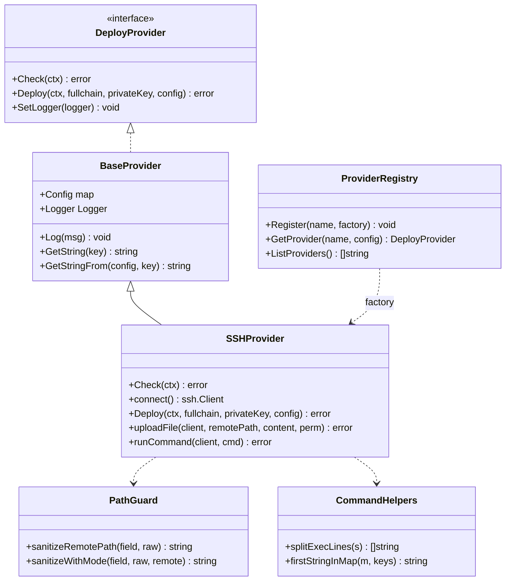
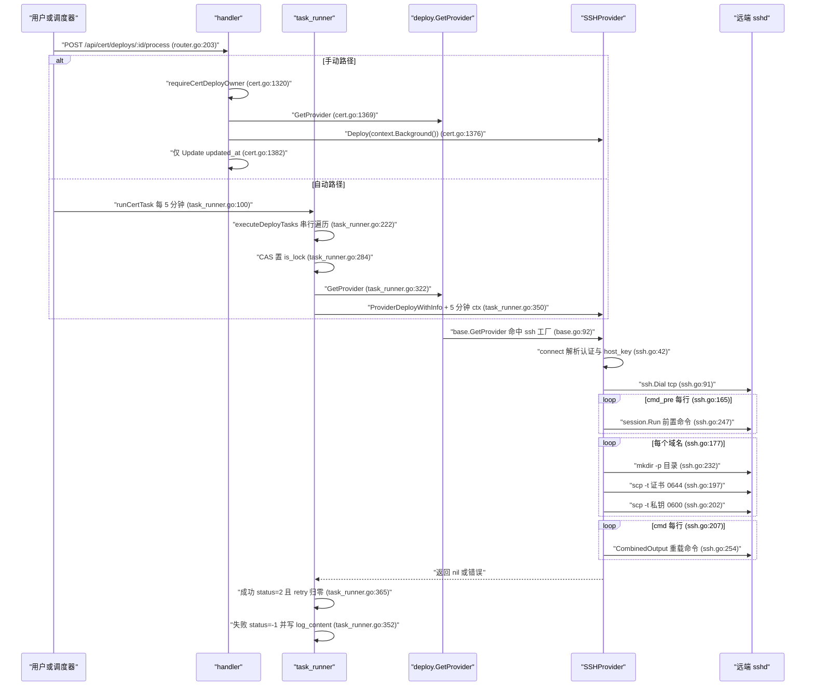
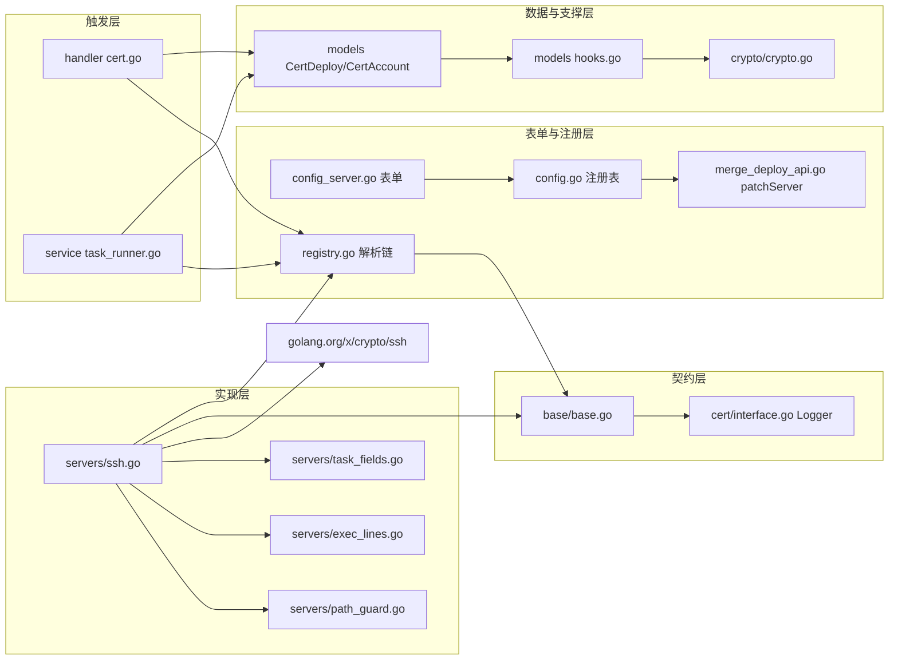
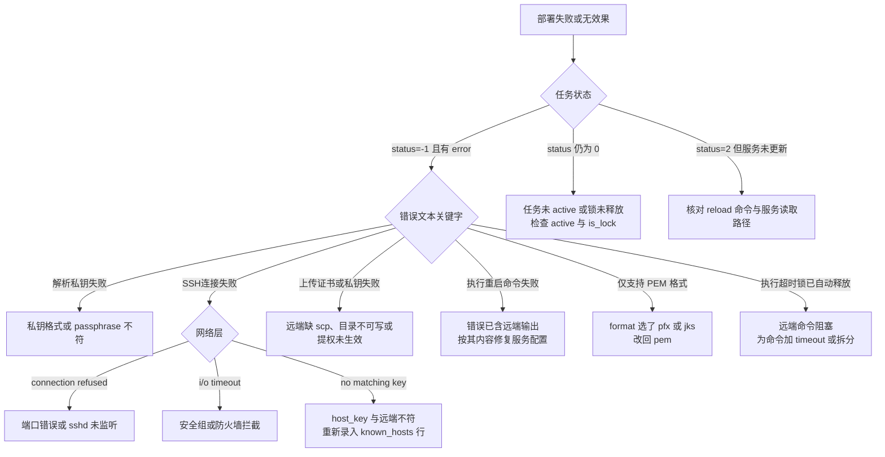

# SSH远程部署

<cite>
**本文档引用的文件**
- [ssh.go](file://main/internal/cert/deploy/servers/ssh.go)
- [ftp.go](file://main/internal/cert/deploy/servers/ftp.go)
- [local.go](file://main/internal/cert/deploy/servers/local.go)
- [path_guard.go](file://main/internal/cert/deploy/servers/path_guard.go)
- [exec_lines.go](file://main/internal/cert/deploy/servers/exec_lines.go)
- [task_fields.go](file://main/internal/cert/deploy/servers/task_fields.go)
- [base.go](file://main/internal/cert/deploy/base/base.go)
- [config.go](file://main/internal/cert/deploy/config.go)
- [config_server.go](file://main/internal/cert/deploy/config_server.go)
- [registry.go](file://main/internal/cert/deploy/registry.go)
- [merge_deploy_api.go](file://main/internal/cert/deploy/merge_deploy_api.go)
- [interface.go](file://main/internal/cert/interface.go)
- [cert.go](file://main/internal/api/handler/cert.go)
- [cert_deploy.go](file://main/internal/api/handler/cert_deploy.go)
- [router.go](file://main/internal/api/router.go)
- [routes_batch1.go](file://main/internal/apiv1/routes_batch1.go)
- [task_runner.go](file://main/internal/service/task_runner.go)
- [models.go](file://main/internal/models/models.go)
- [hooks.go](file://main/internal/models/hooks.go)
- [crypto.go](file://main/internal/crypto/crypto.go)
</cite>

## 目录

1. [简介](#简介)
2. [项目结构](#项目结构)
3. [核心组件](#核心组件)
4. [架构总览](#架构总览)
5. [详细组件分析](#详细组件分析)
6. [依赖关系分析](#依赖关系分析)
7. [性能考虑](#性能考虑)
8. [故障排查指南](#故障排查指南)
9. [结论](#结论)
10. [附录](#附录)

## 简介

SSH 远程部署是证书部署器体系中「服务器类」（`ClassServer`）形态之一，用于把已签发的
证书链与私钥写入远端主机文件系统，并在上传完成后触发服务重载命令（典型场景是
`service nginx reload`）。实现集中在 `main/internal/cert/deploy/servers/ssh.go`
（263 行），直接使用 `golang.org/x/crypto/ssh` 完成传输，不引入额外 SSH 封装库。

核心行为可概括为四步：

1. 用账户配置建立 SSH 连接（密码或私钥认证，私钥可带 passphrase）
2. 执行「上传前命令」`cmd_pre`（可选，多行逐条执行）
3. 按域名逐个把 `fullchain` 与 `privateKey` 通过 `scp -t` 写入远端路径，
   证书落盘 `0644`、私钥落盘 `0600`
4. 执行「上传完命令」`cmd`（等价 `restart_cmd`），逐行执行并聚合远端输出

**能力边界**（依据实读代码）：仅支持 PEM，`ssh.go:142-144` 对 `format` 为 `pfx` 或
`jks` 直接返回「SSH 部署当前仅支持 PEM 格式」，而部署表单却提供 PFX 与 IIS 选项；
一个部署任务对应一个远端主机，多主机需创建多条任务；无远端回滚，任一阶段失败即
中止且已写入文件不会被还原；不使用 SFTP 子系统而是驱动远端 `scp` 可执行文件
（`ssh.go:244`），目标机必须存在 `scp`。

本文档面向需要配置、排障或扩展 SSH 部署器的运维与二次开发人员，所有结论均标注
实际代码位置，行号以当前工作区文件为准。

**章节来源**
- [ssh.go](file://main/internal/cert/deploy/servers/ssh.go#L1-L263)
- [config_server.go](file://main/internal/cert/deploy/config_server.go#L11-L42)

## 项目结构

SSH 部署器位于证书部署子系统的 `servers` 分组，与 `providers`（云厂商）、`panels`
（面板）、`others`（其他平台）并列。

```
main/internal/cert/deploy/
├── base/base.go                  # 契约、注册中心、BaseProvider、配置取值
├── servers/{ssh,ftp,local}.go    # 服务器类三种部署器
├── servers/path_guard.go         # 路径安全校验（安全审计 H-1）
├── servers/exec_lines.go         # 多行命令拆分
├── servers/task_fields.go        # 多键名回落取值
├── config.go                     # 表单登记与 Class 常量
├── config_server.go              # ssh/ftp/local/s3storage 四份表单
├── registry.go                   # 对外别名层 + 子产品名解析链
└── merge_deploy_api.go           # API 视图表单合并（patchServer 白名单）
```

各文件在 SSH 链路中的职责与实测行数：

| 文件 | 行数 | 职责 | 关键符号与位置 |
| --- | --- | --- | --- |
| `servers/ssh.go` | 263 | 连接、认证、主机密钥校验、scp 上传、命令执行 | `connect`（`:42`）、`Deploy`（`:140`）、`uploadFile`（`:222`）、`runCommand`（`:247`） |
| `base/base.go` | 339 | 接口契约、全局注册中心、四级取值、回传合并 | `DeployProvider`（`:45`）、`Register`（`:85`）、`GetString`（`:199`）、`ProviderDeployWithInfo`（`:142`） |
| `servers/path_guard.go` | 63 | 远端 POSIX 路径校验 | `sanitizeRemotePath`（`:22`）、`sanitizeWithMode`（`:31`） |
| `servers/exec_lines.go` | 19 | 多行命令拆分 | `splitExecLines`（`:6`） |
| `servers/task_fields.go` | 22 | 多键名回落取值 | `firstStringInMap`（`:7`） |
| `config_server.go` | 121 | SSH 账户与任务字段声明 | SSH 段（`:11-42`） |
| `registry.go` | 73 | 部署器解析入口 | `GetProvider`（`:27`） |
| `merge_deploy_api.go` | 73 | `ssh` 在 `patchServer` 白名单内 | 白名单（`:12`） |

**章节来源**
- [ssh.go](file://main/internal/cert/deploy/servers/ssh.go#L19-L21)
- [base.go](file://main/internal/cert/deploy/base/base.go#L45-L117)
- [config.go](file://main/internal/cert/deploy/config.go#L9-L47)

## 核心组件

`SSHProvider` 内嵌 `base.BaseProvider`，实现 `DeployProvider` 的 `Check`、`Deploy`、
`SetLogger` 三方法（`base.go:45-54`）。它没有实现 `DeployWithInfoProvider`
（`base.go:69-74`），因此不会向 `cert_deploys` 回传额外配置或信息。



**图表来源**
- [base.go](file://main/internal/cert/deploy/base/base.go#L45-L117)
- [ssh.go](file://main/internal/cert/deploy/servers/ssh.go#L23-L97)
- [path_guard.go](file://main/internal/cert/deploy/servers/path_guard.go#L21-L31)

各组件职责与关键约束：

| 组件 | 位置 | 职责 | 关键约束 |
| --- | --- | --- | --- |
| `connect` | `ssh.go:42-97` | 组装认证方法与主机密钥回调并拨号 | 拨号超时固定 10 秒（`:87`），不可配置 |
| `buildHostKeyCallback` | `ssh.go:109-121` | 依据 `host_key` 返回校验回调 | 缺失或解析失败回退不校验并打 Warn |
| `parseHostKey` | `ssh.go:123-138` | 解析 known_hosts 整行或「algo base64」 | 两种格式都失败即报错 |
| `Deploy` | `ssh.go:140-220` | 编排前置命令、逐域名上传、后置命令 | 非 PEM 立即失败 |
| `uploadFile` | `ssh.go:222-245` | 建目录并以 `scp -t` 写入 | 依赖远端 `scp`；`mkdir` 错误被忽略（`:232`） |
| `runCommand` | `ssh.go:247-259` | 新建会话执行并合并输出 | 失败时把远端输出拼进错误（`:256`） |
| `splitExecLines` | `exec_lines.go:6-18` | 拆分多行命令 | 跳过空行与 `#` 注释（`:13`） |
| `sanitizeRemotePath` | `path_guard.go:22-24` | 远端路径安全网 | 拒绝 `..`、控制字符，强制 `/` 开头 |
| `firstStringInMap` | `task_fields.go:7-21` | 按序取首个非空键值 | 对取值做 `TrimSpace` |

**章节来源**
- [ssh.go](file://main/internal/cert/deploy/servers/ssh.go#L23-L138)
- [ssh.go](file://main/internal/cert/deploy/servers/ssh.go#L222-L259)
- [base.go](file://main/internal/cert/deploy/base/base.go#L120-L150)

## 架构总览

从触发到远端重载涉及 API 层、调度层与部署器层。系统存在**两条**执行路径：手动触发
走 `ProcessCertDeploy`（同步、无日志落库），自动触发走 `executeSingleDeploy`
（加锁、状态回写、含执行日志）。



**图表来源**
- [router.go](file://main/internal/api/router.go#L203)
- [cert.go](file://main/internal/api/handler/cert.go#L1315-L1385)
- [task_runner.go](file://main/internal/service/task_runner.go#L217-L382)
- [ssh.go](file://main/internal/cert/deploy/servers/ssh.go#L42-L259)

代码中还存在第三个部署 handler 群（`cert_deploy.go` 的 `DeployList`、
`DeployProcess` 等），其中 `DeployProcess` 具备加锁、`utils.SafeGo` 异步、
`log_content` 回写与审计记录等完整逻辑（`cert_deploy.go:817-869`），但在
`router.go` 与 `apiv1/routes_batch1.go` 中均未注册，实测只有 `ProcessCertDeploy`
两条入口（`router.go:203`、`routes_batch1.go:54`）。因此手动触发 SSH 部署不会
产出执行日志，也不会更新任务状态。

**章节来源**
- [cert.go](file://main/internal/api/handler/cert.go#L1315-L1385)
- [cert_deploy.go](file://main/internal/api/handler/cert_deploy.go#L803-L869)
- [routes_batch1.go](file://main/internal/apiv1/routes_batch1.go#L54)

## 详细组件分析

### 连接参数与认证方式

`connect` 读取 `host` 与 `port`，端口为空回落 `"22"`（`ssh.go:44-47`），再用
`net.JoinHostPort` 拼地址（`:90`）。字段取值统一走 `BaseProvider.GetString`
（`base.go:199-228`），它实现四级键匹配：精确 → 忽略大小写 → 下划线转驼峰 →
驼峰转下划线。这是 `host`/`Host`、`private_key`/`privateKey` 可混写而不报错的根因。

认证类型由 `auth_type` 决定；该键缺失时回落旧字段 `auth == "1"` 判定为密钥认证
（`ssh.go:49-56`），与表单 `auth` 的 `"0"`/`"1"` 取值吻合（`config_server.go:21`）。
凭据选择在 `ssh.go:58-62`：密钥模式用 `firstStringInMap` 依次尝试 `private_key`、
`privatekey`；密码模式读 `password`。

| 情形 | 条件 | 调用 | 失败表现 |
| --- | --- | --- | --- |
| 私钥带口令 | `passphrase` 非空 | `ParsePrivateKeyWithPassphrase`（`ssh.go:71`） | 口令错与格式错归为「解析私钥失败」（`:76`） |
| 私钥无口令 | `passphrase` 为空 | `ParsePrivateKey`（`ssh.go:73`） | 加密私钥因缺口令失败 |
| 密码认证 | `auth_type != "key"` | `ssh.Password`（`ssh.go:80`） | 由 `Dial` 返回「SSH连接失败」（`:93`） |

私钥与密码存于 `cert_accounts.config`，该列经 GORM 钩子做 AES-256-GCM 加解密
（`hooks.go:35-36`，实现见 `crypto.go:42`、`:65`）；模型字段 tag 为 `json:"-"`
（`models.go:207`），不会被 API 响应直接序列化。

**章节来源**
- [ssh.go](file://main/internal/cert/deploy/servers/ssh.go#L42-L97)
- [base.go](file://main/internal/cert/deploy/base/base.go#L199-L256)
- [hooks.go](file://main/internal/models/hooks.go#L35-L36)

### 主机密钥校验与 known_hosts

这是 SSH 部署器最重要的安全分支。`connect` 通过
`buildHostKeyCallback(host, p.GetString("host_key"))` 构造回调（`ssh.go:86`），
逻辑为：

```
host_key 为空      → logger.Warn + ssh.InsecureIgnoreHostKey()   (ssh.go:112-113)
host_key 解析失败  → logger.Warn + ssh.InsecureIgnoreHostKey()   (ssh.go:117-118)
host_key 解析成功  → ssh.FixedHostKey(pubKey)  严格比对           (ssh.go:120)
```

注释明确记录这是安全审计修复（H-2，`ssh.go:99-108`）：原实现固定使用
`InsecureIgnoreHostKey()`，攻击者可实施 MITM 截获上传的 `fullchain` 与 `privateKey`。
修复后 `parseHostKey` 依次尝试两种格式（`ssh.go:123-138`）：known_hosts 整行由
`ssh.ParseKnownHosts` 解析（`:125`）；「算法 空格 base64」两段式由 `strings.Fields`
+ `base64.StdEncoding.DecodeString` + `ssh.ParsePublicKey` 解析（`:129-137`）。
都失败时返回「host_key 格式无法识别」（`:131`），调用方仍退回不校验。

**当前可用性缺口（已验证）**：全仓检索 `host_key` 只命中 `ssh.go` 自身（`:86`、
`:99`、`:112`、`:117`、`:131`），`config_server.go` 的账户表单（`:18-27`）与任务
表单（`:28-41`）都**没有** `host_key` 字段。运维无法通过控制台配置主机密钥，只能
经对外 API 或直接写数据库。该缺口修复前，默认路径仍处于「跳过校验 + Warn 日志」
状态。

**章节来源**
- [ssh.go](file://main/internal/cert/deploy/servers/ssh.go#L83-L138)
- [config_server.go](file://main/internal/cert/deploy/config_server.go#L18-L41)

### 上传路径与遍历防御

任务字段解析在 `Deploy` 前半段（`ssh.go:141-157`），每个字段都有多键名回落以兼容
历史数据与不同表单版本。

| 用途 | 主键 | 兼容键 | 读取位置 |
| --- | --- | --- | --- |
| 证书路径 | `cert_path` | `pem_cert_file` → 账户级 `cert_path` | `ssh.go:145-148` |
| 私钥路径 | `key_path` | `pem_key_file` → 账户级 `key_path` | `ssh.go:149-152` |
| 上传前命令 | `cmd_pre` | 账户级同名键 | `ssh.go:153` |
| 上传完命令 | `cmd` | `restart_cmd` → 账户级 `cmd` | `ssh.go:154-157` |

域名来自 `base.GetConfigDomains(config)`（`ssh.go:172`），内部按 `domainList`
（支持 `[]string`/`[]interface{}`/逗号或换行字符串）→ `domains` → `domain` 三级取值
（`base.go:306-339`）。注入点在手动路径 `cert.go:1362-1367`、自动路径
`task_runner.go:335-340`；最终为空时用 `[]string{""}` 兜底跑一次（`ssh.go:173-175`）。
域名非空时路径里的 `{domain}` 被替换（`:180-183`），因此单任务可把证书按域名分别
落到 `/etc/nginx/{domain}/fullchain.pem` 这类目录。

每个目标路径上传前都经 `sanitizeRemotePath`（`ssh.go:186-194`），实现于
`path_guard.go:22-63`：空值报错（`:33-35`）、拒绝 `0x20` 以下与 `0x7f` 控制字符
（`:37-41`）、以 `/` 和 `\` 双分隔符拆段拒绝 `..`（`:44-50`）、远端模式必须 `/` 开头
（`:51-55`）。该防御对应安全审计 H-1，注释强调**只校验不改写**，避免把 `{domain}`
展开内容误判为上溯（`path_guard.go:9-19`）。

**遗留风险（推断）**：建目录使用字符串拼接 `"mkdir -p " + dir`（`ssh.go:232`），而
校验未禁止 `;`、`|`、`&`、`` ` ``、`$()` 等 shell 元字符。由于部署配置只能由登录
用户自填并经属主校验（`cert.go:1216-1222`），这属于「对用户自己的远端主机执行命令」
的既有能力范围，但仍是纵深防御上值得收紧的一处。

**章节来源**
- [ssh.go](file://main/internal/cert/deploy/servers/ssh.go#L141-L194)
- [path_guard.go](file://main/internal/cert/deploy/servers/path_guard.go#L9-L63)
- [base.go](file://main/internal/cert/deploy/base/base.go#L306-L339)

### scp 上传实现与落盘权限

`SSHProvider` 未用 SFTP 库，而是直接驱动远端 `scp` 的 sink 模式（`ssh.go:222-245`）。
流程为：`NewSession` 后，若路径含目录分隔符则用另一条会话执行 `mkdir -p dir`
（错误被忽略，`:229-234`）；随后起一个 goroutine 向 `StdinPipe` 依次写入
`C<四位八进制权限> <字节长度> <文件名>\n` 头部（`fmt.Fprintf`，`:239`，文件名取最后
一个 `/` 之后片段）、原样内容（`io.WriteString`，`:240`）与 `\x00` 结束符（`:241`）；
主协程执行 `session.Run("scp -t " + remotePath)`（`:244`）。

权限在调用处区分：

| 文件 | 权限 | 位置 | 理由 |
| --- | --- | --- | --- |
| `fullchain` 证书链 | `0644` | `ssh.go:197` | 公钥材料，服务进程需可读 |
| `privateKey` 私钥 | `0600` | `ssh.go:202` | 仅属主可读写，避免同机其他用户窃取 |

权限经 `scp` 协议头传递给远端，若远端 `umask` 或 `scp` 实现不支持该模式，实际权限
可能与设计不符；私钥属主等于登录用户，若 nginx 以其他用户非 root 启动，可能读不到
`0600` 私钥。上传失败分别包装为「上传证书失败」（`:198`）与「上传私钥失败」（`:203`）。

**章节来源**
- [ssh.go](file://main/internal/cert/deploy/servers/ssh.go#L196-L204)
- [ssh.go](file://main/internal/cert/deploy/servers/ssh.go#L222-L245)

### 触发命令与两条执行路径

`cmd_pre` 在上传前逐行执行（`ssh.go:165-170`），`cmd` 在所有域名上传完成后逐行执行
（`:207-213`）。两者先经 `splitExecLines` 拆分，该函数把 `\r\n`、`\r` 归一为 `\n`
并跳过空行与 `#` 注释行（`exec_lines.go:6-18`），与表单提示「每行一条命令，如：
service nginx reload」（`config_server.go:39`）吻合。命令由 `runCommand` 执行，每条
新建会话并调用 `session.CombinedOutput`（`ssh.go:247-258`），失败时把 Go 错误与远端
合并输出一起返回（`:256`），使排障能直接看到 `nginx: [emerg] ...` 之类的真实报错。
日志经 `p.Log` 走 `cert.Logger` 回调（`base.go:131-135`，类型定义 `interface.go:49`）。

两条路径差异显著：

| 维度 | 自动 `executeSingleDeploy` | 手动 `ProcessCertDeploy` |
| --- | --- | --- |
| 是否 SetLogger | 是，写入 `strings.Builder`（`task_runner.go:342-344`） | **否**，`Logger` 为 nil，`p.Log` 静默丢弃 |
| 落库 `log_content` | 成功与失败均写（`:370`、`:417`） | **不写**，仅 `Update("updated_at")`（`cert.go:1382`） |
| 状态回写 | 成功 `2`、失败 `-1` | 不回写 `status` |
| 超时 | ctx 5 分钟（`task_runner.go:345`） | `context.Background()` 无超时（`cert.go:1376`） |
| 并发保护 | CAS 置 `is_lock`（`task_runner.go:284-288`） | 无加锁 |
| 通知与审计 | `sendDeployNotification`（`:381`）+ 写 `LogDB`（`:384-391`） | 均无 |

`Deploy` 内部不检查 `ctx`（`ssh.go` 全文未使用该参数），所以上述 5 分钟超时对 SSH 是
**形式超时**，真正兜底靠锁清理：部署锁超 10 分钟强制释放并置 `status=-1`、错误
「执行超时，锁已自动释放」（`task_runner.go:421-433`）。

**章节来源**
- [ssh.go](file://main/internal/cert/deploy/servers/ssh.go#L165-L259)
- [exec_lines.go](file://main/internal/cert/deploy/servers/exec_lines.go#L5-L19)
- [interface.go](file://main/internal/cert/interface.go#L49)
- [task_runner.go](file://main/internal/service/task_runner.go#L341-L433)

### 失败处理、补偿与权限边界

`Deploy` 采用遇错即返的卫语句风格：格式不支持（`ssh.go:142`）、连接失败
（`:159-161`）、前置命令失败（`:167-169`）、上传失败（`:197-204`）、重载失败
（`:210-212`）都立即返回并结束剩余循环。**当前不存在远端回滚**：

| 失败阶段 | 远端已产生的副作用 | 可自动还原 |
| --- | --- | --- |
| 连接或认证失败 | 无 | 不需要 |
| `cmd_pre` 失败 | 前置命令效果已生效（如已停服） | 否 |
| 域名 1 成功、域名 2 上传失败 | 域名 1 的新证书与私钥已落盘 | 否 |
| 上传成功、重载命令失败 | 磁盘为新证书、内存仍跑旧证书 | 否 |
| `mkdir -p` 失败 | 目录缺失，错误延后表现为上传失败 | 否 |

第三、四行是运维最需关注状态：多域名半途失败造成「部分域名新证书、部分旧证书」；
重载失败造成「磁盘新、内存旧」。缓解手段是把重载命令写成
`nginx -t && nginx -s reload`，使配置语法错误在生效前被拦截。

任务级补偿由调度器提供：失败置 `status=-1` 且 `retry+1`（`task_runner.go:395-419`），
`retryFailedDeployTasks` 按 `{60,300,600,1800,3600}` 秒梯度重试（`:23`、`:244-279`，
间隔函数 `getRetryInterval` 位于 `:776`），超过 `max_retry`（默认 5，`:251-258`）
停止并在最后一次补发失败通知（`:358-360`）；成功一次即把 `retry` 归零（`:369`）。

属主与越权链条：创建任务先校验账户属主（`cert.go:1216`）再校验订单属主（`cert.go:1220`），
注释说明顺序理由——若先跑类型判定，攻击者可用他人 `accountID` 探测账户类型形成
布尔预言机（`cert.go:1213-1215`）。执行与修改路径分别用 `requireCertDeployOwner`
（`cert.go:1270`、`:1320`）。`checkLocalDeployAllowed`（`cert.go:1250-1264`）只对
`Type == "local"` 强制管理员，提示语直接写着「请改用 SSH 或其他远程部署方式」
（`:1260`），即 SSH 对所有登录用户开放。隐含副作用是：非管理员可让服务端主动向任意
`host:port` 发起 SSH 连接（`ssh.go:91`），在网络边界层面等同出站探测能力。多租户
环境建议以防火墙或账户白名单约束出站范围，此处属设计权衡说明而非缺陷认定。

**章节来源**
- [ssh.go](file://main/internal/cert/deploy/servers/ssh.go#L140-L220)
- [task_runner.go](file://main/internal/service/task_runner.go#L217-L279)
- [task_runner.go](file://main/internal/service/task_runner.go#L350-L419)
- [cert.go](file://main/internal/api/handler/cert.go#L1213-L1264)

## 依赖关系分析

SSH 部署器依赖自上而下单向：注册与表单层提供可见性，base 层提供契约与取值，
servers 层实现协议细节，handler 与调度层负责触发与状态落库。



**图表来源**
- [ssh.go](file://main/internal/cert/deploy/servers/ssh.go#L3-L21)
- [registry.go](file://main/internal/cert/deploy/registry.go#L27-L68)
- [merge_deploy_api.go](file://main/internal/cert/deploy/merge_deploy_api.go#L5-L47)
- [hooks.go](file://main/internal/models/hooks.go#L35-L47)

关键依赖的方向与变更影响：

| 依赖 | 说明 | 变更影响 |
| --- | --- | --- |
| `ssh.go` → `golang.org/x/crypto/ssh`（`v0.57.0`） | 提供 `Dial`、`Session`、`ParsePrivateKey*`、`ParseKnownHosts` | 版本升级影响主机密钥解析与 `scp` 兼容性 |
| `ssh.go` → `base.GetString` | 四级键名匹配 | 若收紧为精确匹配，历史任务读取会失败 |
| `deploy.GetProvider` → `base.Register` | 名称查找，`ssh` 无子产品，第一级即命中（`registry.go:29-32`） | 新增子产品需同时登记工厂与表单 |
| `patchServer` 白名单 | `ssh` 在名单内（`merge_deploy_api.go:12`），表单以 `AllDeployConfigs` 为准 | 不在名单内的类型，API 表单来自 `cert/providers.go` |
| 调度层 → `cert_deploys` 锁字段 | `is_lock`/`lock_time`/`retry`/`max_retry`（`models.go:269-273`） | 字段语义变化同时影响重试与超时清理 |
| `CertAccount.Config` → AES-GCM | 凭据加密落盘（`hooks.go:35-36`） | 主密钥变更使既有凭据不可解 |

**未被实现的依赖**：表单声明了 `windows`（`config_server.go:26`）、`pfx_file`、
`pfx_pass`、`uptype`、`iis_domain`（`:35-40`），但 `ssh.go` 全文未读取（检索确认
`windows`/`uptype`/`iis_domain` 仅出现在 `config_server.go`）。
`models.CertDeploy.RetryDelay`（`models.go:271`）在 `internal/` 全仓无读取点，
实际重试间隔由 `deployRetryIntervals` 常量数组决定（`task_runner.go:23`）。

**章节来源**
- [registry.go](file://main/internal/cert/deploy/registry.go#L27-L68)
- [config_server.go](file://main/internal/cert/deploy/config_server.go#L26-L40)
- [models.go](file://main/internal/models/models.go#L256-L280)

## 性能考虑

### 并发模型与超时层级

必须区分设计意图与实测行为：单个部署器实例只服务一个主机，内部按域名**串行**上传
（`ssh.go:177-205`），无域名级并发；`executeDeployTasks` 是**单线程 for 循环**
（`task_runner.go:222-241`），在同一 `runCertTask` 协程内顺序执行，无 `WaitGroup`
或信号量工作池；`executeCertTask` 一次 tick 顺序跑续期检查、部署执行、失败重试、
锁清理四件事（`task_runner.go:141-151`），部署耗时会直接推迟后续阶段；唯一的并行
是两条独立协程 `runCertTask` 与 `runExpireNotice`（`:57-59`）。多实例场景由数据库
CAS 保护：只有把 `is_lock` 从 `false` 成功改为 `true`（`RowsAffected > 0`）的实例
才执行（`task_runner.go:284-291`）。

结论：**「SSH 并发部署多主机」在当前实现下并不存在**。N 台主机等于 N 条任务，
总耗时约为各任务耗时之和，同时受 5 分钟扫描周期影响。

| 层级 | 取值 | 位置 | 对 SSH 是否生效 |
| --- | --- | --- | --- |
| TCP 连接 + SSH 握手 | 10 秒 | `ssh.go:87` | 是 |
| Go 层 ctx 超时 | 5 分钟 | `task_runner.go:345` | 否（`Deploy` 未检查 ctx） |
| 手动路径 ctx | 无超时 | `cert.go:1376` | 否 |
| 部署锁兜底清理 | 10 分钟 | `task_runner.go:422-431` | 是（实际兜底） |
| 订单锁兜底清理 | 15 分钟 | `task_runner.go:435-448` | 不适用 |
| 扫描周期 | 5 分钟，首跑延迟 30 秒 | `task_runner.go:41`、`:96` | 是 |
| 重试梯度 | 60/300/600/1800/3600 秒 | `task_runner.go:23` | 是 |

主机不可达时 `Dial` 的 10 秒超时能快速失败；但主机可达而 `reload` 卡住时，任务会
阻塞到 10 分钟锁清理，拖长整轮调度。

**章节来源**
- [ssh.go](file://main/internal/cert/deploy/servers/ssh.go#L83-L97)
- [ssh.go](file://main/internal/cert/deploy/servers/ssh.go#L177-L234)
- [task_runner.go](file://main/internal/service/task_runner.go#L23-L151)
- [task_runner.go](file://main/internal/service/task_runner.go#L217-L291)
- [task_runner.go](file://main/internal/service/task_runner.go#L345-L449)

### 调优建议（尚未实施，属建议项）

1. 让会话执行具备 ctx 感知能力，使 `task_runner.go:345` 的 5 分钟超时真正可中断，
   这是把「形式超时」变为「有效超时」的最小改动
2. `executeDeployTasks` 引入固定并发度工作池并以信号量约束，跨实例安全仍由现有
   CAS 锁保证
3. 不应忽略 `mkdir -p` 错误（`ssh.go:232`），提前返回可给出「目录创建失败」这类
   更贴近根因的提示
4. 把 `host_key` 补进 SSH 账户表单（`config_server.go:18-27`），使已有 `FixedHostKey`
   能力可被真正使用

**章节来源**
- [ssh.go](file://main/internal/cert/deploy/servers/ssh.go#L109-L121)
- [ssh.go](file://main/internal/cert/deploy/servers/ssh.go#L229-L234)
- [config_server.go](file://main/internal/cert/deploy/config_server.go#L18-L27)

## 故障排查指南

### 排查决策流程



**图表来源**
- [ssh.go](file://main/internal/cert/deploy/servers/ssh.go#L76-L94)
- [ssh.go](file://main/internal/cert/deploy/servers/ssh.go#L142-L256)
- [task_runner.go](file://main/internal/service/task_runner.go#L421-L433)

### 常见问题与处置

| 症状 | 根因 | 定位依据 | 处置 |
| --- | --- | --- | --- |
| 日志「未配置 host_key，当前跳过主机密钥校验」 | `host_key` 为空 | `ssh.go:112` | 补 `host_key`（表单未暴露，需经 API 或库表写入） |
| 日志「host_key 解析失败，退回跳过校验」 | 格式不符或 base64 段被换行折断 | `ssh.go:117`、`:131` | 用完整 known_hosts 整行，或「算法 空格 单个 base64」 |
| 「SSH连接失败」且远端提示主机密钥变更 | `FixedHostKey` 严格比对不通过 | `ssh.go:120` | 远端换密钥后同步更新 `host_key`；本实现不做 TOFU 自动接受 |
| 提示无可用认证方式 | 口令错误、私钥未被授权或 `auth` 与实际凭据不符 | `ssh.go:91-93` | 核对 `auth` 单选值；密钥模式检查 `authorized_keys` 与 SELinux 上下文 |
| 「解析私钥失败」但私钥本身可用 | 带口令未填 `passphrase`，或 PEM 外含额外文本 | `ssh.go:70-77` | 补齐口令，或只粘贴私钥块 |
| 私钥上传成功但 nginx 报权限错误 | 私钥固定 `0600`，属主为登录用户 | `ssh.go:202` | 用 `cmd_pre` 预建目录并 `chown`，或 root 登录后在 `cmd` 里调整属主 |
| 「上传证书失败」提示 `No such file or directory` | 远端无 `scp`（精简镜像可能只有 sftp-server） | `ssh.go:244` | 安装 openssh 客户端；本实现不支持纯 SFTP-only 端点 |
| 需要特权但命令未提权 | 部署器不提权，命令以登录用户身份执行 | `ssh.go:247-258` 无 tty 逻辑 | `username` 填 root，或用 `sudo -n` 并配置 `NOPASSWD` |
| 任务卡 `status=1` 约 10 分钟后变 `-1` | 远端命令阻塞，ctx 无法中断 SSH 会话 | `task_runner.go:345`、`:422-431` | 远端命令包一层 `timeout 60 ...`；根治见调优建议 1 |
| 手动点部署返回成功但状态与日志不变 | `ProcessCertDeploy` 不回写 `status`/`log_content` | `cert.go:1376-1384` | 以自动路径为准，依赖调度器落库 |
| 填了 PFX 路径与 IIS 选项后报错 | 表单提供 `pfx`/`uptype`/`iis_domain` 但实现只支持 PEM | `config_server.go:29-40` 对比 `ssh.go:142-144` | 证书类型保持 `pem`；PFX/IIS 场景另寻部署方式 |
| 选择「是否 Windows = 是」行为无变化 | `windows` 字段从未被实现读取 | `config_server.go:26` 无引用点 | **未知**：Windows OpenSSH 下 `mkdir -p` 与 `scp -t` 的路径语义未适配，需实测确认 |
| 勾选「证书部署成功通知」无效 | 键名长度 34 超出 `sys_configs.Key` 的 `size:32` | `task_runner.go:458`；分析素材 P7 | **推断**（MySQL 行为未在本环境验证）：SQLite 默认可用，MySQL 需评估列宽 |

**章节来源**
- [ssh.go](file://main/internal/cert/deploy/servers/ssh.go#L70-L138)
- [ssh.go](file://main/internal/cert/deploy/servers/ssh.go#L142-L258)
- [config_server.go](file://main/internal/cert/deploy/config_server.go#L26-L40)
- [cert.go](file://main/internal/api/handler/cert.go#L1375-L1385)
- [task_runner.go](file://main/internal/service/task_runner.go#L345-L462)

### 脱敏与凭据安全注意事项

- 工单与文档中引用 SSH 凭据一律写作 `{占位}`，禁止粘贴真实私钥、口令或
  `authorized_keys` 全文
- `cert_accounts.config` 与 `cert_deploys.config` 均 AES-256-GCM 加密
  （`hooks.go:35-36`、`:46-47`），但解密发生在 `AfterFind`，因此进程内存与任何
  打印 `accConfig` 的调试日志都会暴露明文
- `cert_deploys.log_content` 是**明文**列且不在加密钩子内（`models.go:277`）。
  `runCommand` 会把远端输出拼入错误（`ssh.go:256`），若命令回显敏感值则该文本会
  入库并经部署日志接口展示，因此**不要在 `cmd_pre`/`cmd` 中执行会输出敏感值的命令**
- 排查优先只读验证：`ssh -o BatchMode=yes -i {密钥文件} {user}@{host} 'ls -l {目录}'`

**章节来源**
- [hooks.go](file://main/internal/models/hooks.go#L35-L47)
- [models.go](file://main/internal/models/models.go#L256-L280)
- [ssh.go](file://main/internal/cert/deploy/servers/ssh.go#L247-L259)

## 结论

SSH 部署器以 263 行体量承担「上传证书 + 远端触发重载」这一明确职责，设计取向值得
肯定：**接口最小化**，只实现 `DeployProvider` 三方法（`base.go:45-54`），不实现用
不到的 `DeployWithInfoProvider`，符合 ISP 与 YAGNI；**配置读取健壮**，`GetString`
四级匹配加 `firstStringInMap` 多键回落，使 `cert_path`/`pem_cert_file`、
`cmd`/`restart_cmd`、`private_key`/`privatekey` 新旧字段共存，迁移零成本；
**安全修复方向正确**，主机密钥校验（H-2）与路径遍历防御（H-1）都有实现与注释锚点，
私钥落盘固定 `0600`。

识别出的落地缺口多为「实现已具备、暴露未完成」这类低成本收尾问题：

| 缺口 | 性质 | 影响面 |
| --- | --- | --- |
| `host_key` 未进入表单 | 已验证 | 主机密钥校验能力实际不可用，MITM 防护停留在代码层 |
| `pfx`/`uptype`/`iis_domain`/`windows` 无实现 | 已验证 | 表单承诺与运行能力矛盾，用户到运行期才失败 |
| ctx 超时无法中断 SSH 会话 | 已验证 | 阻塞任务需等 10 分钟锁清理，拖长整轮调度 |
| 多主机串行而非并发 | 已验证 | 大规模部署总耗时线性增长 |
| 远端无回滚 | 已验证 | 半途失败造成部分域名一致性与磁盘/内存不一致 |
| `log_content` 明文列 | 已验证 | 远端命令回显可能外泄 |

建议按「补 `host_key` 表单 → 让 ctx 超时生效 → 引入主机级并发 → 清理未实现的格式
字段」顺序推进，前两项即可显著提升安全性与可运维性。

**章节来源**
- [ssh.go](file://main/internal/cert/deploy/servers/ssh.go#L42-L220)
- [base.go](file://main/internal/cert/deploy/base/base.go#L45-L74)
- [base.go](file://main/internal/cert/deploy/base/base.go#L199-L228)
- [path_guard.go](file://main/internal/cert/deploy/servers/path_guard.go#L9-L19)

## 附录

### 配置键速查

SSH **账户配置**（`cert_accounts.config`，加密存储）：

| 键 | 表单名 | 必填 | 默认 | 实现读取点 |
| --- | --- | --- | --- | --- |
| `host` | 主机地址 | 是 | 无 | `ssh.go:43` |
| `port` | 端口 | 是 | 无，回落 22 | `ssh.go:44-46` |
| `auth` | 认证方式（`0` 密码 / `1` 密钥） | 否 | `0` | `ssh.go:51` |
| `auth_type` | 无，兼容字段 | 否 | 由 `auth` 推导 | `ssh.go:49` |
| `username` | 用户名 | 是 | `root` | `ssh.go:48` |
| `password` | 密码 | 条件必填 | 无 | `ssh.go:61` |
| `privatekey` | 私钥 PEM 文本 | 条件必填 | 无 | `ssh.go:59`，兼容 `private_key` |
| `passphrase` | 私钥密码 | 否 | 无 | `ssh.go:64` |
| `windows` | 是否 Windows | 否 | `0` | **无读取点** |
| `host_key` | **表单未定义** | 安全上强烈建议 | 无 | `ssh.go:86` |

SSH **任务配置**（`cert_deploys.config`，加密存储）：

| 键 | 表单名 | 必填 | 实现读取点 |
| --- | --- | --- | --- |
| `format` | 证书类型 | 是 | `ssh.go:141-143`，`pfx`/`jks` 失败 |
| `pem_cert_file` / `cert_path` | 证书保存路径 | 是 | `ssh.go:145-148` |
| `pem_key_file` / `key_path` | 私钥保存路径 | 是 | `ssh.go:149-152` |
| `cmd_pre` | 上传前执行命令 | 否 | `ssh.go:153` |
| `cmd` / `restart_cmd` | 上传完执行命令 | 否 | `ssh.go:154-157` |
| `pfx_file`/`pfx_pass`/`uptype`/`iis_domain` | PFX 与 IIS 系列 | 表单条件必填 | **无读取点** |
| `domainList`/`domains`/`domain` | 由 handler 或调度器注入 | — | `ssh.go:172` |

**章节来源**
- [ssh.go](file://main/internal/cert/deploy/servers/ssh.go#L42-L157)
- [config_server.go](file://main/internal/cert/deploy/config_server.go#L18-L41)

### 最小可用配置示例

以下两段 JSON 中凭据一律以 `{占位}` 表示，不得提交真实值。账户配置存于
`cert_accounts.config`：

```json
{
  "host": "{目标主机IP或域名}",
  "port": "22",
  "auth": "1",
  "username": "{登录用户}",
  "privatekey": "{PEM私钥全文，含 BEGIN 与 END 行}",
  "passphrase": "{私钥口令，无则留空}",
  "host_key": "{known_hosts 整行，例如 host ssh-ed25519 AAAA...}"
}
```

任务配置存于 `cert_deploys.config`：

```json
{
  "format": "pem",
  "cert_path": "/etc/nginx/certs/{domain}/fullchain.pem",
  "key_path": "/etc/nginx/certs/{domain}/privkey.pem",
  "cmd_pre": "# 可选：预建目录并修正属主\nmkdir -p /etc/nginx/certs",
  "cmd": "nginx -t && nginx -s reload"
}
```

任务表单静态提示为「请确保路径存在且有写入权限」（`config_server.go:17`），与实现
对 `mkdir -p` 的依赖相吻合。

**章节来源**
- [config_server.go](file://main/internal/cert/deploy/config_server.go#L11-L42)
- [ssh.go](file://main/internal/cert/deploy/servers/ssh.go#L229-L234)

### 同组部署器对比与关键常量

| 维度 | SSH（`ssh.go`） | FTP（`ftp.go`） | 本地（`local.go`） |
| --- | --- | --- | --- |
| 注册方式 | `base.Register("ssh", ...)`（`ssh.go:20`） | 同机制 | 同机制 |
| 传输实现 | `scp -t` 会话协议（`ssh.go:244`） | FTP 客户端库上传 | 本机文件写入 |
| 认证 | 密码或私钥可带口令（`ssh.go:58-81`） | 用户名密码，可选显式 TLS | 进程权限 |
| 私钥落盘权限 | `0600`（`ssh.go:202`） | 由 FTP 端决定 | 本机写入决定 |
| 支持格式 | 仅 PEM（`ssh.go:142`） | 仅 PEM | 仅 PEM，表单却提供 `jks` |
| 命令执行 | 远端 SSH 会话（`ssh.go:247`） | 无 exec 能力 | 本机 `exec.CommandContext` |
| 权限约束 | 所有登录用户可用 | 所有登录用户可用 | 仅管理员（`cert.go:1259-1262`，H-3） |
| 主机密钥或 TLS 校验 | 支持 `FixedHostKey`，可回退不校验 | 可选 TLS | 不适用 |

关键常量：SSH 拨号超时 `10 * time.Second`（`ssh.go:87`）、端口默认 `"22"`
（`ssh.go:46`）、证书权限 `0644`（`ssh.go:197`）、私钥权限 `0600`（`ssh.go:202`）、
部署 ctx `5 * time.Minute`（`task_runner.go:345`）、任务周期 5 分钟且首跑延迟 30 秒
（`task_runner.go:41`、`:96`）、重试梯度 `60/300/600/1800/3600` 秒
（`task_runner.go:23`）、默认最大重试 `5`（`task_runner.go:251-254`）、部署锁清理
阈值 10 分钟（`task_runner.go:422`）、订单锁清理阈值 15 分钟（`task_runner.go:435`）、
`ClassServer = 3`（`config.go:9`）。

术语对照：**部署账户**指 `cert_accounts` 中 `is_deploy = true` 的记录，承载 SSH
连接参数；**部署任务**指 `cert_deploys` 记录，绑定一个账户与一个已签发订单，承载
路径与命令；**子产品解析链**指 `deploy.GetProvider` 的四级名称回落
（`registry.go:27-68`），`ssh` 不依赖该机制；**`patchServer` 白名单**指 API 表单合并
时允许以部署侧表单覆盖 cert 侧定义的类型集合（`merge_deploy_api.go:12`）。

**章节来源**
- [ftp.go](file://main/internal/cert/deploy/servers/ftp.go#L40-L133)
- [local.go](file://main/internal/cert/deploy/servers/local.go#L53-L129)
- [ssh.go](file://main/internal/cert/deploy/servers/ssh.go#L83-L245)
- [config.go](file://main/internal/cert/deploy/config.go#L9-L16)
