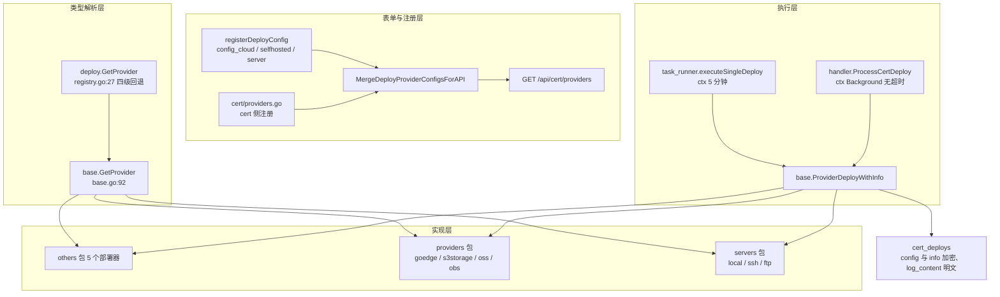
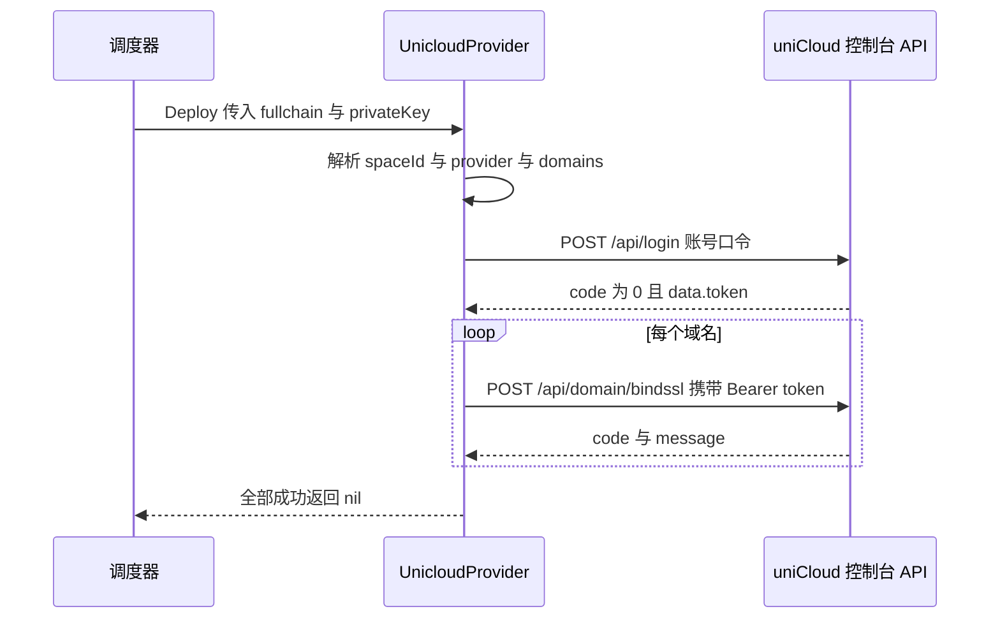
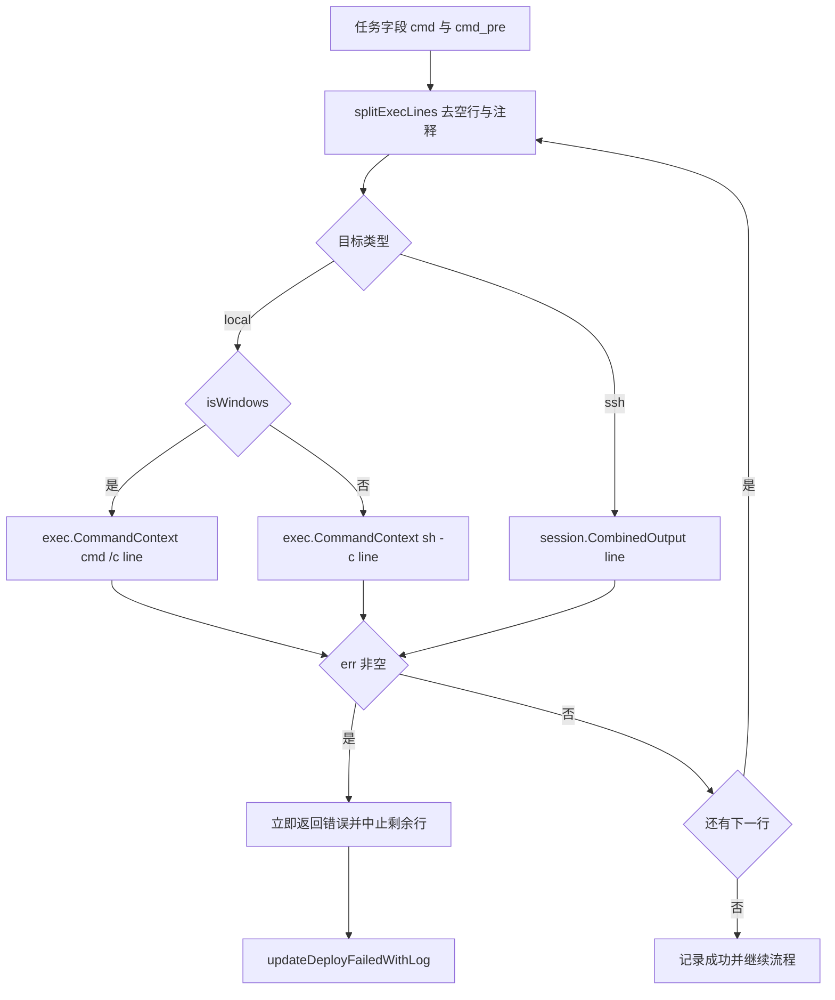
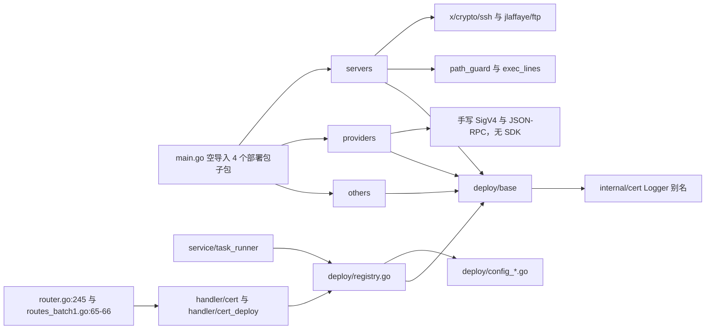
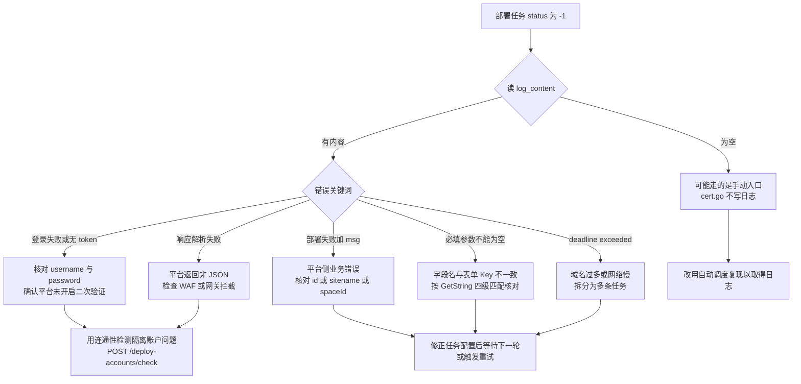

# 其他部署方式

<cite>
**本文档引用的文件**
- [kuocai.go](file://main/internal/cert/deploy/others/kuocai.go)
- [rainyun.go](file://main/internal/cert/deploy/others/rainyun.go)
- [unicloud.go](file://main/internal/cert/deploy/others/unicloud.go)
- [uusec.go](file://main/internal/cert/deploy/others/uusec.go)
- [west.go](file://main/internal/cert/deploy/others/west.go)
- [base.go](file://main/internal/cert/deploy/base/base.go)
- [registry.go](file://main/internal/cert/deploy/registry.go)
- [config.go](file://main/internal/cert/deploy/config.go)
- [config_cloud.go](file://main/internal/cert/deploy/config_cloud.go)
- [config_selfhosted.go](file://main/internal/cert/deploy/config_selfhosted.go)
- [config_server.go](file://main/internal/cert/deploy/config_server.go)
- [merge_deploy_api.go](file://main/internal/cert/deploy/merge_deploy_api.go)
- [README.md](file://main/internal/cert/deploy/README.md)
- [goedge.go](file://main/internal/cert/deploy/providers/goedge.go)
- [s3storage.go](file://main/internal/cert/deploy/providers/s3storage.go)
- [aliyun_oss.go](file://main/internal/cert/deploy/providers/aliyun_oss.go)
- [huawei_obs.go](file://main/internal/cert/deploy/providers/huawei_obs.go)
- [deploy_cert_name.go](file://main/internal/cert/deploy/providers/deploy_cert_name.go)
- [local.go](file://main/internal/cert/deploy/servers/local.go)
- [ssh.go](file://main/internal/cert/deploy/servers/ssh.go)
- [ftp.go](file://main/internal/cert/deploy/servers/ftp.go)
- [path_guard.go](file://main/internal/cert/deploy/servers/path_guard.go)
- [exec_lines.go](file://main/internal/cert/deploy/servers/exec_lines.go)
- [task_fields.go](file://main/internal/cert/deploy/servers/task_fields.go)
- [registry.go](file://main/internal/cert/registry.go)
- [providers.go](file://main/internal/cert/providers.go)
- [main.go](file://main/main.go)
- [task_runner.go](file://main/internal/service/task_runner.go)
- [cert.go](file://main/internal/api/handler/cert.go)
- [cert_deploy.go](file://main/internal/api/handler/cert_deploy.go)
- [router.go](file://main/internal/api/router.go)
- [routes_batch1.go](file://main/internal/apiv1/routes_batch1.go)
- [technitium.go](file://main/internal/dns/providers/technitium/technitium.go)
</cite>

## 目录

1. [简介](#简介)
2. [项目结构](#项目结构)
3. [核心组件](#核心组件)
4. [架构总览](#架构总览)
5. [详细组件分析](#详细组件分析)
6. [依赖关系分析](#依赖关系分析)
7. [性能考虑](#性能考虑)
8. [故障排查指南](#故障排查指南)
9. [结论](#结论)
10. [附录](#附录)

## 简介

本文覆盖证书部署器体系中**不属于**「云厂商 CDN/WAF 主流程」与「SSH/FTP/本地文件」
两大常见形态的剩余部署方式：`deploy/others/` 的 5 个注册名
（`west` 西部数码虚拟主机、`rainyun` 雨云、`unicloud` uniCloud 服务空间、
`kuocai` 括彩云、`uusec` 南墙 WAF，共 604 行）、对象存储形态
（`s3storage`、`aliyun_oss`、`huawei_obs`），以及自建边缘与脚本形态
（`goedge` 的 GoEdge 与 FlexCDN 双系统类型、`local` 与 `ssh` 内嵌的自定义命令）。

**能力边界澄清**：`base.Register` 全量检索（`deploy/**` 下 96 处注册）中**不存在**
`webhook` 与 `technitium` 两项。`technitium` 仅是 DNS 服务商
（`dns/providers/technitium/technitium.go`，实测 665 行），由 `main.go:50`
空导入注册；`webhook` 全部落在 `internal/notify/` 与 `internal/monitor/` 通知域。
详见「详细组件分析」末节。

本文所有结论均来自实际读取的代码，行号以当前工作区文件为准；
所有密钥、口令、令牌一律写作 `{占位}`。

**章节来源**
- [base.go](file://main/internal/cert/deploy/base/base.go#L45-L54)
- [main.go](file://main/main.go#L50-L58)

## 项目结构

### 目录与分类的两套口径

`deploy/` 下的物理目录按**实现归属**划分，而 `DeployProviderConfig.Class`
（`config.go:20-30`）按**业务语义**划分，两者并不重合，`others/` 是错位最集中的地方。
下表行数来自实测 `wc -l`，注册名来自 `base.Register` 全量检索。

| 实现目录 | 文件 | 行数 | 注册名 | 表单登记位置 | Class 值 |
| --- | --- | --- | --- | --- | --- |
| `others/` | `west.go` | 118 | `west` | `config_cloud.go:368-382` | `ClassCloudService` |
| `others/` | `rainyun.go` | 110 | `rainyun` | `config_cloud.go:415-429` | `ClassCloudService` |
| `others/` | `unicloud.go` | 133 | `unicloud` | `config_cloud.go:431-450` | `ClassCloudService` |
| `others/` | `kuocai.go` | 118 | `kuocai` | `config_cloud.go:452-466` | `ClassCloudService` |
| `others/` | `uusec.go` | 125 | `uusec` | `config_selfhosted.go:407-423` | `ClassSelfHosted` |
| `providers/` | `goedge.go` | 261 | `goedge` | `config_selfhosted.go:199-215` | `ClassSelfHosted` |
| `providers/` | `s3storage.go` | 285 | `s3storage` | `config_server.go:100-120` | `ClassServer` |
| `providers/` | `aliyun_oss.go` | 162 | `aliyun_oss` | `config_cloud.go`（aliyun 块内） | `ClassCloudService` |
| `providers/` | `huawei_obs.go` | 185 | `huawei_obs` | `config_cloud.go`（huawei 块内） | `ClassCloudService` |
| `servers/` | `local.go` | 145 | `local` | `config_server.go:72-98` | `ClassServer` |

**章节来源**
- [config.go](file://main/internal/cert/deploy/config.go#L5-L30)
- [config_cloud.go](file://main/internal/cert/deploy/config_cloud.go#L368-L466)
- [config_server.go](file://main/internal/cert/deploy/config_server.go#L72-L120)

### others 包的内部构成

`others` 是 `deploy/` 五个子包中最小的一个：5 个文件、5 个 `init()` 注册、
零单元测试，包内不存在共享工具文件。五个部署器的调用形态为：`kuocai` 登录换
token 后 `PUT /api/domain/{id}/ssl`；`rainyun` 用 `x-api-key` 直连，`id` 为空走
POST 新增、否则 PUT 更新；`unicloud` 登录后按域名循环
`POST /api/domain/bindssl`；`uusec` 用账户填写的控制台基址登录后 `PUT`；
`west` 用 MD5 时间戳签名加表单 POST。`kuocai`、`unicloud`、`uusec` 三者的
`login()` 结构几乎逐行相同，属明显 DRY 违规。

**章节来源**
- [kuocai.go](file://main/internal/cert/deploy/others/kuocai.go#L16-L18)
- [unicloud.go](file://main/internal/cert/deploy/others/unicloud.go#L17-L19)
- [uusec.go](file://main/internal/cert/deploy/others/uusec.go#L17-L19)

## 核心组件

### 接口实现矩阵

`base.DeployProvider` 要求三个方法（`base/base.go:45-54`）。下表统计各实现对
该契约及可选接口 `DeployWithInfoProvider`（`base/base.go:69-74`）的满足情况，
`✗` 表示未实现，此时 `ProviderDeployWithInfo`（`base/base.go:142-150`）
退化为普通 `Deploy`。

| 注册名 | 实现类型 | Check | Deploy | SetLogger | DeployWithInfo | 凭据键 | 任务键 |
| --- | --- | --- | --- | --- | --- | --- | --- |
| `west` | `WestProvider` | 签名试调用 | 自实现 | 转发基类 | ✗ | `username`、`api_password` | `sitename` |
| `rainyun` | `RainyunProvider` | GET user/info | 自实现 | 转发基类 | ✗ | `apikey` | `id` |
| `unicloud` | `UnicloudProvider` | `login()` | 自实现 | 转发基类 | ✗ | `username`、`password` | `spaceId`、`provider`、`domains` |
| `kuocai` | `KuocaiProvider` | `login()` | 自实现 | 转发基类 | ✗ | `username`、`password` | `id` |
| `uusec` | `UusecProvider` | `login()` | 自实现 | 转发基类 | ✗ | `url`、`username`、`password` | `id`、`name` |
| `goedge` | `GoEdgeProvider` | 校验并取 token | 自实现 | 转发基类 | ✗ | `url`、`accessKeyId`、`accessKey`、`usertype`、`systype` | 无 |
| `s3storage` | `S3Provider` | 校验并 GET `/` | 自实现 | 转发基类 | ✗ | `AccessKeyId`、`SecretAccessKey`、`endpoint`、`region` | `bucket`、`cert_path`、`key_path` |
| `aliyun_oss` | `AliyunOSSProvider` | 继承基类空实现 | 委托 `deploy()` | 转发基类 | **✓** | AK/SK（阿里云基类） | `oss_endpoint`、`oss_bucket` |
| `huawei_obs` | `HuaweiOBSProvider` | 键存在性校验 | 自实现 | 转发基类 | ✗ | AK/SK 加项目 ID | `obs_endpoint`、`obs_bucket` |
| `local` | `LocalProvider` | 目录存在性校验 | 自实现 | 转发基类 | ✗ | 无 | `format`、路径、`cmd` |

关键结论：`others/` 五个部署器**全部不实现** `DeployWithInfoProvider`，不会向
`cert_deploys.config` 与 `cert_deploys.info` 回写新生成的证书 ID，这与 `aliyun_oss`、
`aliyun_lb`、`tencent_update`、`axisnow`、`qzyun` 等「上传后回写 ID」的部署器存在
能力差——平台侧 ID 变化时必须人工改任务配置。

**章节来源**
- [base.go](file://main/internal/cert/deploy/base/base.go#L45-L150)
- [goedge.go](file://main/internal/cert/deploy/providers/goedge.go#L25-L34)
- [aliyun_oss.go](file://main/internal/cert/deploy/providers/aliyun_oss.go#L28-L51)

### BaseProvider 配置读取契约

`BaseProvider`（`base/base.go:120-135`）是这些部署器的唯一共享依赖，
其键匹配策略决定「表单字段名与代码里 `GetString("...")` 是否对得上」。

| 方法 | 位置 | 语义 | 对其他部署方式的影响 |
| --- | --- | --- | --- |
| `GetString` | `base.go:199-228` | 四级匹配：精确、忽略大小写、下划线转驼峰、驼峰转下划线 | `api_password` 可写成 `apiPassword` 命中 |
| `GetStringFrom` | `base.go:247-256` | 任务配置优先，空则回退账户配置 | `west.sitename`、`kuocai.id` 两处任填 |
| `Log` | `base.go:131-135` | `Logger` 为 nil 时静默丢弃 | 手动路径与调度路径日志行为不同 |
| `SplitDomains` | `base.go:288-303` | 逗号与换行统一切分 | `unicloud` 未使用，改用手写 `strings.Split` |
| `GetConfigDomains` | `base.go:306-339` | `domainList` → `domains` → `domain` | `goedge` 使用；`unicloud` 未使用 |
| `GetProvider` | `base.go:92-105` | 工厂查表，未命中返回 unknown 错误 | 每次调用都新建实例，token 无法跨任务复用 |

`unicloud.go:78` 用 `strings.Split(p.GetStringFrom(config, "domains"), ",")`，
仅支持英文逗号；而 `SplitDomains`（`base.go:292`）的 `strings.NewReplacer`
会把 `\r\n`、`\r`、`,` 全部归一为 `\n` 再切分，因此 uniCloud 任务用换行分隔域名
会得到「一整行」的错误结果。继承关系上，本文涉及的 10 个类型全部嵌入
`BaseProvider`，其中仅 `AliyunOSSProvider` 额外满足 `DeployWithInfoProvider`。

**章节来源**
- [base.go](file://main/internal/cert/deploy/base/base.go#L199-L339)
- [unicloud.go](file://main/internal/cert/deploy/others/unicloud.go#L75-L90)

## 架构总览

从「表单登记 → 类型解析 → 实例化 → 执行 → 落库」的完整链路看，
其他部署方式与主流部署器共用同一套骨架，差异只在解析回退层级与是否回写信息。



**图表来源**
- [registry.go](file://main/internal/cert/deploy/registry.go#L27-L70)
- [base.go](file://main/internal/cert/deploy/base/base.go#L85-L150)
- [merge_deploy_api.go](file://main/internal/cert/deploy/merge_deploy_api.go#L5-L47)
- [task_runner.go](file://main/internal/service/task_runner.go#L281-L392)

### 三条执行入口的差异

同一部署器实例可能被三条路径调用，context 约束与日志落库行为完全不同，这是排障最易混淆之处。

| 入口 | 位置 | Context | 是否执行 Check | 是否写 log_content | 是否走 DeployWithInfo |
| --- | --- | --- | --- | --- | --- |
| 自动调度 | `task_runner.go:322-350` | `WithTimeout(5m)`（`:345`） | ✗ | ✓（`:370`） | ✓ |
| 失败重试 | `task_runner.go:277` → 同一函数 | 同上 | ✗ | ✓ | ✓ |
| 手动部署 | `cert.go:1369-1376` | `context.Background()` | ✗ | ✗（仅更新 `updated_at`） | ✗ 直接 `provider.Deploy` |
| 账户连通性检测 | `cert_deploy.go:305-316` | `WithTimeout(30s)` | ✓ | ✗（只写进程日志） | 不涉及 |

手动路径调用 `provider.Deploy` 而非 `base.ProviderDeployWithInfo`
（`cert.go:1376`），因此这条路径上即便部署器实现了信息回写也不会落库；
它也没有超时约束，只能依赖各部署器内部 `http.Client{Timeout: ...}` 兜底。

**章节来源**
- [task_runner.go](file://main/internal/service/task_runner.go#L281-L392)
- [cert.go](file://main/internal/api/handler/cert.go#L1340-L1385)
- [cert_deploy.go](file://main/internal/api/handler/cert_deploy.go#L285-L324)

## 详细组件分析

### 西部数码 west：MD5 时间戳签名与表单编码

`others/west.go`（118 行）是 `others` 中唯一不走 JSON 的部署器。
签名在 `west.go:64-68`：`md5(username + api_password + timestamp)` 再
`hex.EncodeToString`。`Check` 把 `act=getlist` 拼进 URL 查询串发起 GET
（`west.go:42-45`）；`Deploy` 改用 `client.PostForm`，把 `act=setssl`、
`sitename`、`cert`、`key` 与三要素签名放进
`application/x-www-form-urlencoded` 表单体（`west.go:87-96`）。
成功判定字段也与众不同：`west` 读 `result["result"]` 且要求等于 `200`
（`west.go:57`、`:108`），`kuocai`/`unicloud`/`uusec` 读 `result["code"]` 要求
等于 `0`，`rainyun` 读 `result["code"]` 却要求等于 `200`。

| 维度 | 取值 | 位置 |
| --- | --- | --- |
| API 基址 | `https://api.west.cn/api/v2/host/` | `west.go:42`、`:85` |
| 口令字段 | `api_password`（可驼峰回退） | `west.go:35`、`:76` |
| 目标粒度 | 单个 FTP 账号 `sitename` | `west.go:77` |
| 成功码 | `result == 200` | `west.go:57`、`:108` |
| HTTP 超时 | 60 秒（Check 与 Deploy 共用） | `west.go:70-72` |
| 幂等性 | 同一 `sitename` 覆盖写入 | 由 `act=setssl` 语义决定 |

**章节来源**
- [west.go](file://main/internal/cert/deploy/others/west.go#L33-L114)
- [config_cloud.go](file://main/internal/cert/deploy/config_cloud.go#L368-L382)

### 雨云 rainyun：无状态 API Key 与新增更新双分支

`others/rainyun.go`（110 行）最简洁：不登录、不换 token，每次请求直接带
`x-api-key` 头（`rainyun.go:37`、`:86`）。`Deploy` 核心分支在
`rainyun.go:66-76`：任务配置的 `id` 为空时 `POST /ssl/cert` 新增，
非空时 `PUT /ssl/cert/{id}` 更新，表单据此标注「留空则为添加证书」
（`config_cloud.go:427`）。

可观察的运维后果：**留空 `id` 的部署任务每轮调度都会在平台侧新增一张证书**而非
覆盖旧的。调度器每 5 分钟一轮（`task_runner.go:41`），只要证书内容变化就再写一条；
又因不实现 `DeployWithInfoProvider`，新 ID 不回写，无法自动收敛为「更新」模式。
`Check` 复用 `GET /user/info`（`rainyun.go:36`），码非 `200` 时报「API错误」
并附带 `message` 字段（`rainyun.go:51-53`），错误键名与其他部署器不同。

**章节来源**
- [rainyun.go](file://main/internal/cert/deploy/others/rainyun.go#L31-L106)
- [config_cloud.go](file://main/internal/cert/deploy/config_cloud.go#L415-L429)
- [task_runner.go](file://main/internal/service/task_runner.go#L38-L44)

### uniCloud：登录式 token 复用与多域名循环

`others/unicloud.go`（133 行）先登录 `unicloud.dcloud.net.cn/api/login`
（`unicloud.go:49`），把 `data.token` 存入实例字段 `p.token`（`:64-69`），
随后在 `Deploy` 内按域名循环 `POST /api/domain/bindssl`（`:88-125`）。



**图表来源**
- [unicloud.go](file://main/internal/cert/deploy/others/unicloud.go#L75-L129)

三点实现细节：其一，**域名切分不统一**，`unicloud.go:78` 用
`strings.Split(..., ",")`，表单提示也写「多个域名可使用,分隔」
（`config_cloud.go:447`），与全局 `SplitDomains` 支持的换行不一致。
其二，**失败即中断且不续跑**，循环内任一域名失败直接 `return`
（`unicloud.go:111`、`:119`、`:123`），后续域名不再尝试、已成功域名不回滚。
其三，**循环内响应体关闭**用「先 `ReadAll` 再显式 `Close`」而非 `defer`
（`:114-115`）。`provider` 字段（`aliyun` / `tencent`，`:441-445`）
只作为请求体一部分透传，部署器内部不对该值做任何分支。

**章节来源**
- [unicloud.go](file://main/internal/cert/deploy/others/unicloud.go#L33-L129)
- [config_cloud.go](file://main/internal/cert/deploy/config_cloud.go#L431-L450)
- [base.go](file://main/internal/cert/deploy/base/base.go#L288-L303)

### 括彩云 kuocai：登录换 token 与域名 ID 定位

`others/kuocai.go`（118 行）与 `unicloud` 同构（登录、取 token、提交），
差异在定位方式与请求体字段名。

| 对比项 | `kuocai` | `unicloud` | `uusec` |
| --- | --- | --- | --- |
| 登录地址 | 常量 `api.kuocai.cn/api/login`（`:48`） | 常量 `unicloud.dcloud.net.cn/api/login`（`:49`） | **用户填写** `url` 加 `/api/login`（`:50`） |
| 定位键 | `id`（域名 ID） | `spaceId` 加 `domains` | `id` 加 `name` |
| HTTP 方法 | `PUT`（`:92`） | `POST`（`:105`） | `PUT`（`:99`） |
| 私钥字段名 | `private_key`（`:88`） | `privateKey`（`:101`） | `private_key`（`:95`） |
| 错误消息键 | `msg`（`:61`、`:109`） | `message`（`:62`、`:123`） | `msg`（`:63`、`:116`） |
| 成功码 | `code == 0` | `code == 0` | `code == 0` |

`kuocai` 把同一个 `domainID` 同时写进 URL 段与请求体（`kuocai.go:86`、`:92`），
两处不会不一致，但意味着 `id` 含特殊字符时会同时影响 URL 与 JSON——
代码未做任何转义。

**章节来源**
- [kuocai.go](file://main/internal/cert/deploy/others/kuocai.go#L36-L114)
- [uusec.go](file://main/internal/cert/deploy/others/uusec.go#L37-L121)

### 南墙 WAF uusec：目录归属错位与自建基址风险

`uusec` 实现放在 `others/`，表单却登记在 `config_selfhosted.go:407-423`，
Class 为 `ClassSelfHosted`；`deploy/README.md:72` 把「南墙WAF」列在自建系统清单，
而 `README.md:81-88` 的「其他部署器」表格只列四项、缺 `uusec`，属文档双重错位。

作为唯一基址由用户提供的 `others` 部署器，`uusec` 对 URL 只做
`strings.TrimRight(p.GetString("url"), "/")`（`uusec.go:38`、`:77`），不校验 scheme、
不做 `url.Parse`，拼接结果直接交给 `http.NewRequestWithContext` 而该调用的 error
被显式丢弃：

```go
req, _ := http.NewRequestWithContext(ctx, "PUT", panelURL+"/api/certificate/"+certID, ...)
req.Header.Set("Content-Type", "application/json")   // uusec.go:100
```

若 `url` 含非法字符导致构造失败，`req` 为 nil，下一行即空指针 panic。该 panic 由
`executeCertTask` 的 `defer recover()`（`task_runner.go:142-146`）捕获，
但 recover 位于**整批任务**层级而非单任务层级，一次 panic 会让本轮后续部署任务
全部跳过。

**章节来源**
- [uusec.go](file://main/internal/cert/deploy/others/uusec.go#L37-L121)
- [README.md](file://main/internal/cert/deploy/README.md#L72-L88)
- [task_runner.go](file://main/internal/service/task_runner.go#L141-L151)

### 云对象存储：S3 通用协议与厂商域名绑定两条路

**通用 S3 协议**：`providers/s3storage.go`（285 行）不依赖厂商 SDK，手写 AWS
SigV4。`Deploy` 只做两次 PutObject：`fullchain` 写 `cert_path`、`privateKey`
写 `key_path`（`s3storage.go:74-82`），`Content-Type` 固定
`application/x-pem-file`（`:94`）；签名链在 `:164-194`，规范化转义由 `escape`
（`:196-202`）把 `+` 还原 `%20`、`*` 还原 `%2A`、`%7E` 还原 `~`；
`Check` 用 `GET /` 探测（`:57`），区域缺省 `us-east-1`（`:36-39`）。

**厂商定制绑定**：`aliyun_oss` 与 `huawei_obs` 不是「上传文件」，
而是把证书绑定到存储桶的自定义域名。

| 部署器 | 动作 | 是否回写信息 | 关键位置 |
| --- | --- | --- | --- |
| `s3storage` | PutObject 覆写两个对象路径 | ✗ | `s3storage.go:92-96` |
| `aliyun_oss` | 先取或传 CAS 证书，再逐域名 PutBucketCname | **✓** 回写 CertId 与名称 | `aliyun_oss.go:53-90`、`:46` |
| `huawei_obs` | 逐域名绑定桶自定义域名证书 | ✗ | `huawei_obs.go:64-110` |

`aliyun_oss` 是这批实现里少见的完整样板：`Deploy` 与 `DeployWithInfo` 共用私有
`deploy()`，靠 `info` 是否为 nil 区分是否收集回传（`aliyun_oss.go:42-51`），并在
文件末尾用 `var _ base.DeployWithInfoProvider = (*AliyunOSSProvider)(nil)` 做编译期
接口断言（`:162`）；证书名称生成已抽到 `deploy_cert_name.go` 的
`parseLeafCertificate`（`:10`）、`certCommonName`（`:23`）、`buildCertName`（`:31`）。
`huawei_obs` 的 `Check`（`:48-62`）用 `huaweiAccessKeysQuiet` 静默取 AK/SK 再校验
endpoint 与 bucket，`Deploy`（`:64-110`）对两者采用「任务配置优先、账户配置兜底」
双层取值（`:65-71`），与 `s3storage` 只读任务配置的写法不同。

**章节来源**
- [s3storage.go](file://main/internal/cert/deploy/providers/s3storage.go#L52-L194)
- [aliyun_oss.go](file://main/internal/cert/deploy/providers/aliyun_oss.go#L41-L162)
- [huawei_obs.go](file://main/internal/cert/deploy/providers/huawei_obs.go#L48-L110)
- [deploy_cert_name.go](file://main/internal/cert/deploy/providers/deploy_cert_name.go#L10-L31)

### GoEdge 与 FlexCDN：一套实现两个系统类型

`providers/goedge.go`（261 行）承担「自建边缘分发」这类部署。账户字段有 5 个
（`config_selfhosted.go:206-212`），其中两个是枚举：`usertype`
（`user` / `admin`）与 `systype`（`0` = GoEdge、`1` = FlexCDN）。
`systype` 的唯一作用是在 `request()` 里切换鉴权头名（`goedge.go:193-199`）：
GoEdge 用 `X-Edge-Access-Token`，FlexCDN 用 `X-Cloud-Access-Token`。
构造函数对凭据键做了双名兼容（`goedge.go:38-45`）：`accessKeyId` 缺失时回退
`access_key`，`accessKey` 缺失时回退 `access_secret`——
这是为兼容 `cert/providers.go:389-406` 那份重叠定义而存在的。

`Deploy` 策略是「查列表，命中则逐个更新、未命中则创建」：先 `listSSLCerts`（`:86`），
响应中的 `sslCertsJSON` 是 **Base64 字符串**，需 `base64.StdEncoding.DecodeString`
再 `json.Unmarshal`（`:91-96`）；列表非空时遍历调用 `updateSSLCert`（`:105-131`），
为空时以 `CN去星号-notBefore` 命名（`:103`）调用 `createSSLCert`（`:146`）。
有效期由 `parseCertInfo`（`:240-257`）从 PEM 解析 `x509` 得到，不向平台查询。
GoEdge 的 `TaskInputs` 为空（`config_selfhosted.go:214`），配合 `TaskNote`
「系统会根据关联SSL证书的域名自动更新」（`:205`），
说明它完全依赖调度器注入的 `domainList`（`task_runner.go:335-340`）。

**章节来源**
- [goedge.go](file://main/internal/cert/deploy/providers/goedge.go#L37-L257)
- [config_selfhosted.go](file://main/internal/cert/deploy/config_selfhosted.go#L199-L215)
- [providers.go](file://main/internal/cert/providers.go#L388-L407)

### 自定义脚本执行：local 的 cmd 与 ssh 的 cmd_pre 与 cmd

项目**没有独立的「脚本部署器」**，自定义命令能力内嵌在服务器类部署器的任务字段：
`ssh` 的 `cmd_pre`（上传前执行）与 `cmd`（上传完操作，`uptype==0` 时生效）见
`config_server.go:37-39`，`local` 的 `cmd`（部署完执行）见 `:96`。
两者共用 `servers/exec_lines.go` 的 `splitExecLines`：统一换行、按行切分、
**跳过空行与以 `#` 开头的注释行**（`exec_lines.go:7-17`），
这是把任务配置当作「迷你脚本」使用的正规入口。



**图表来源**
- [exec_lines.go](file://main/internal/cert/deploy/servers/exec_lines.go#L5-L19)
- [local.go](file://main/internal/cert/deploy/servers/local.go#L117-L133)
- [ssh.go](file://main/internal/cert/deploy/servers/ssh.go#L165-L219)

安全边界由 `servers/path_guard.go` 提供，且只约束**写入路径**而非命令内容：
拒绝 `..` 上溯片段（`:44-50`）、拒绝控制字符（`:37-41`）、远端路径强制 `/` 开头
（`:51-55`）、本机路径允许 POSIX 绝对路径或 Windows 盘符（`:56-61`）。
命令本身仍是任意 shell 片段，`local` 的 `cmd` 等价于以 DNSPlane 进程权限
执行本机命令。取值优先级上，`local` 用
`firstStringInMap(config, "restart_cmd", "reload_cmd", "cmd")`（`local.go:66`）
配合 `GetStringFrom` 账户级兜底（`:68-72`），`ssh` 用
`firstStringInMap(config, "cmd", "restart_cmd")`（`ssh.go:154`）——
顺序不同意味着同一任务 JSON 若同时写 `cmd` 与 `restart_cmd`，
`local` 取 `restart_cmd` 而 `ssh` 取 `cmd`。

**章节来源**
- [exec_lines.go](file://main/internal/cert/deploy/servers/exec_lines.go#L5-L19)
- [path_guard.go](file://main/internal/cert/deploy/servers/path_guard.go#L21-L62)
- [local.go](file://main/internal/cert/deploy/servers/local.go#L53-L137)
- [ssh.go](file://main/internal/cert/deploy/servers/ssh.go#L140-L219)

### Webhook 与 Technitium 的实测边界

| 关键词 | 是否为证书部署器 | 证据 |
| --- | --- | --- |
| `webhook` | 否 | `deploy/` 全目录 `base.Register` 检索（96 处）无 `webhook`；实现集中在 `internal/notify/`（`webhook_test.go`、`channel_adapters.go`）与 `internal/monitor/` |
| `technitium` | 否 | `main/internal/cert` 全域大小写不敏感检索零命中；该包是 DNS 服务商，见 `dns/providers/technitium/technitium.go` 与 `main.go:50` 空导入 |
| `goedge` | 是，同时又是 DNS 服务商 | 部署器注册 `providers/goedge.go:21`；DNS 空导入 `main.go:41` |
| `west` | 是，同时又是 DNS 服务商 | 部署器注册 `others/west.go:19`；DNS 空导入 `main.go:52` |

结论：`goedge` 与 `west` 属「同一品牌、两套实现」——解析走 DNS 服务商包，部署走
`cert/deploy` 包，互不共用代码。而「Webhook 部署」在当前版本（`VERSION` = `1.0.11`）
没有实现；若需求是把证书推给自己的回调地址，现状只能用 `local` 加 `cmd` 里的
`curl` 变通。此结论为**基于代码检索的推断**，不排除经外部脚本实现同等效果。

**章节来源**
- [goedge.go](file://main/internal/cert/deploy/providers/goedge.go#L20-L22)
- [west.go](file://main/internal/cert/deploy/others/west.go#L18-L20)
- [main.go](file://main/main.go#L41-L52)

## 依赖关系分析



**图表来源**
- [main.go](file://main/main.go#L54-L58)
- [registry.go](file://main/internal/cert/deploy/registry.go#L1-L25)
- [ssh.go](file://main/internal/cert/deploy/servers/ssh.go#L16-L17)
- [router.go](file://main/internal/api/router.go#L245)

### 双注册表与类型解析回退

`others` 的四个云属性部署器只在 `AllDeployConfigs` 登记表单，不在 `cert` 注册表出现；
`goedge` 两处都有（`cert/providers.go:389` 与 `config_selfhosted.go:201`）。生效优先级
由 `MergeDeployProviderConfigsForAPI` 决定（`merge_deploy_api.go:5-46`）：以 cert 注册表
为基底，只有 `patchServer` 白名单内的 `ssh`、`ftp`、`local` 会被 `AllDeployConfigs`
覆盖表单字段，其余同名类型保留 cert 侧定义（`:37`）。`deploy.GetProvider` 在
`base.GetProvider` 失败后做四级回退（`registry.go:27-71`），第 4 级是硬编码后缀扫描
`cdn` → `acm` → `cloudfront`（`registry.go:59`）。

| 解析阶段 | 位置 | 对其他部署方式的实际效果 |
| --- | --- | --- |
| 1 按账户类型直查 | `registry.go:28-32` | 全部命中，七个类型均无子产品 |
| 2 任务配置 `product` 组合 | `registry.go:34-46` | 不触发 |
| 3 账户配置 `product` 组合 | `registry.go:48-57` | 不触发 |
| 4 硬编码后缀回退 | `registry.go:59-67` | 前序全失败才生效，是「填错类型被静默解析到别处」的风险源 |

全部失败时返回 `unknown deploy provider: {type}`（`registry.go:70`）。

**章节来源**
- [registry.go](file://main/internal/cert/deploy/registry.go#L27-L71)
- [merge_deploy_api.go](file://main/internal/cert/deploy/merge_deploy_api.go#L5-L46)
- [providers.go](file://main/internal/cert/providers.go#L388-L407)

## 性能考虑

超时与并发：

| 组件 | 超时来源 | 数值 | 位置 |
| --- | --- | --- | --- |
| `west` | `http.Client.Timeout` | 60 秒 | `west.go:70-72` |
| `rainyun` | `Check` 与 `Deploy` 各自构造 | 30 / 60 | `rainyun.go:34`、`:64` |
| `unicloud` | 登录与部署各自构造 | 30 / 60 | `unicloud.go:41`、`:86` |
| `kuocai` | 登录与部署各自构造 | 30 / 60 | `kuocai.go:40`、`:83` |
| `uusec` | 登录与部署各自构造 | 30 / 60 | `uusec.go:42`、`:87` |
| `goedge` | 单一 client 覆盖 list、update、create | 30 秒 | `goedge.go:53` |
| `s3storage` | 单一 client | 30 秒 | `s3storage.go:43` |
| 调度层 | `context.WithTimeout` | 5 分钟 | `task_runner.go:345` |
| 手动路径 | 无 | 无上限 | `cert.go:1376` |

结构性瓶颈有三点。其一 **全串行**：`unicloud.go:88` 的域名循环与 `goedge.go:106`
的证书列表循环都是顺序 HTTP、无并发，`unicloud` 若有 N 个域名最坏耗时约 N × 60 秒，
粗算 N 大于 5 即有撞上 5 分钟总超时的风险。其二 **每次部署重新登录**：
`kuocai.go:79`、`unicloud.go:82`、`uusec.go:83` 在 `Deploy` 内再调 `login()`，
`p.token` 只是实例内缓存且实例由 `GetProvider` 每次新建（`base.go:104`）。
其三 **`http.Client` 未复用**：`west.go:40`、`rainyun.go:34` 等在函数内现场构造，
每轮新建 Transport，TLS 握手无法跨任务复用。

写放大与重试：`logBuilder` 每次 `p.Log` 追加一行，最终整串写入
`cert_deploys.log_content`（`task_runner.go:341-344`、`:370`），长循环部署器会显著
放大单任务日志量，而手动路径完全不写该字段（`cert.go:1382` 仅更新 `updated_at`）。
退避表 `{60, 300, 600, 1800, 3600}` 秒（`task_runner.go:23`），`max_retry` 为 0 时
默认 5 次（`:251-254`），成功后 `retry` 归零（`:369`）；对「新增型」部署器
（`rainyun` 留空 `id`）而言每次重试都可能再插一张证书，重试语义在此**有害**。

**章节来源**
- [task_runner.go](file://main/internal/service/task_runner.go#L23-L23)
- [task_runner.go](file://main/internal/service/task_runner.go#L244-L279)
- [cert.go](file://main/internal/api/handler/cert.go#L1369-L1384)

## 故障排查指南

### 现象速查

| 现象 | 首因 | 定位方法 | 依据 |
| --- | --- | --- | --- |
| `unknown deploy provider: xxx` | 账户 `type` 与注册名不匹配 | 比对四级解析回退表 | `registry.go:70` |
| `登录失败: 无法获取token` | 平台改了返回结构，`data.token` 不再是 string | 抓包核对 `data.token` 类型 | `kuocai.go:71`、`unicloud.go:72`、`uusec.go:73` |
| `响应解析失败` | 返回不是 JSON（网关 HTML、429 页） | 原始 body 未打印，需外部抓包 | `west.go:54`、`rainyun.go:48` |
| 部署成功但平台证书未变 | 目标 ID 填错，更新到另一张证书 | 核对任务配置 `id` 或 `sitename` | `kuocai.go:75`、`west.go:77` |
| 雨云出现大量重复证书 | 任务配置 `id` 为空 | 首次部署后手工回填 ID | `rainyun.go:68-76` |
| uniCloud 多域名只部署了一个 | 域名用换行分隔而非逗号 | 改用英文逗号 | `unicloud.go:78` |
| GoEdge 报「没有设置要部署的域名」 | 任务未关联订单域名且账户未填 `domains` | 检查 `domainList` 注入 | `goedge.go:65-74` |
| S3 报 `HTTP Code: 403` | SigV4 时钟偏差或 region 错误 | 校对 `region` 与服务器时间 | `s3storage.go:152`、`:36-39` |
| local 命令未执行 | 行首是 `#` 被当注释跳过 | 去掉行首井号 | `exec_lines.go:13-15` |
| 本轮多个任务同时未执行 | 某任务 panic 触发批次级 recover | 查进程日志「证书任务异常」 | `task_runner.go:142-146` |

**章节来源**
- [registry.go](file://main/internal/cert/deploy/registry.go#L70-L70)
- [goedge.go](file://main/internal/cert/deploy/providers/goedge.go#L64-L74)
- [exec_lines.go](file://main/internal/cert/deploy/servers/exec_lines.go#L11-L17)

### 定位流程与连通性隔离



**图表来源**
- [cert.go](file://main/internal/api/handler/cert.go#L1369-L1384)
- [task_runner.go](file://main/internal/service/task_runner.go#L350-L361)
- [cert_deploy.go](file://main/internal/api/handler/cert_deploy.go#L265-L324)

`DeployAccountCheck` 是唯一调用 `provider.Check()` 的入口（`cert_deploy.go:316`），
路由在 `routes_batch1.go:65`。两点注意：其 context 仅 30 秒（`cert_deploy.go:314`），
比部署路径的 60 秒客户端超时更短，`west` 这类慢网络下可能先被外层取消；检测结果
**不落库**，只写进程日志（`:317`、`:320`），前端看不到明细，必须检索
`[DeployAccountCheck]`。此外 `DeployList`、`DeployProcess`、`DeployLog` 等约 700 行
handler 在当前工作区**未注册任何路由**（路由检索仅命中 `DeployAccount*` 与
`DeployTypes`），因此「查看部署历史」只能依赖读取 `cert_deploys.log_content`；
若后续版本补齐路由需重新核对。

**章节来源**
- [cert_deploy.go](file://main/internal/api/handler/cert_deploy.go#L265-L324)
- [routes_batch1.go](file://main/internal/apiv1/routes_batch1.go#L65-L66)

### 文档与代码不一致项

| 不一致 | 文档侧 | 实际侧 |
| --- | --- | --- |
| `others` 清单 | `README.md:14` 记 5 个，`:81-88` 表格只列 4 行（缺 `uusec`） | 5 个文件、5 个注册 |
| 子包文件计数 | `README.md:11-12` 记 providers 16 与 panels 15 | 实测 56 与 3 |
| 根目录文件 | `README.md:18-19` 提到 `interface.go` 与 `executor.go` | `deploy/` 根仅有 `config*.go`、`merge_deploy_api.go`、`registry.go` |
| 格式能力 | SSH 与 local 表单提供 `pfx`、`jks` | `ssh.go:142`、`local.go:55-57` 显式仅支持 PEM |

**章节来源**
- [README.md](file://main/internal/cert/deploy/README.md#L11-L88)
- [local.go](file://main/internal/cert/deploy/servers/local.go#L53-L57)
- [ssh.go](file://main/internal/cert/deploy/servers/ssh.go#L140-L144)

## 结论

「其他部署方式」在架构上不是特殊路径，而是 `DeployProvider` 契约下的普通实现，
特殊性体现在四点：

1. **归属错位**。`others/` 目录与 `Class` 分类不一一对应：`uusec` 归
   `ClassSelfHosted`，其余四个归 `ClassCloudService`；`s3storage` 实现在
   `providers/` 却分类为 `ClassServer`。阅读代码应以 `base.Register` 的名字为唯一索引。
2. **凭据形态多样但都很薄**。`west` 用 MD5 时间戳签名、`rainyun` 用静态 API Key、
   其余三个用账号口令换 Bearer token；五者都没有 token 过期处理。
3. **普遍缺位的能力**：全部不实现 `DeployWithInfoProvider`，没有「新证书 ID
   自动回写」；错误处理普遍忽略 `json.Marshal` 与 `http.NewRequestWithContext`
   返回值；无任何单元测试。
4. **Webhook 与 Technitium 不是部署器**，`local` 与 `ssh` 的 `cmd` 字段是
   当前唯一的自定义脚本入口。

改进优先级（按成本从低到高）：把 `unicloud` 的 `strings.Split` 换成
`base.SplitDomains`；给 `rainyun` 增加 ID 回写以消除重复新增；把三个 `login()` 抽到
`others` 包内共享函数以消除 DRY 违规；为 `uusec.go:99` 补 `err` 判断以杜绝批次级
panic；最后把 `README.md` 的文件清单与现实对齐。

**章节来源**
- [base.go](file://main/internal/cert/deploy/base/base.go#L64-L74)
- [README.md](file://main/internal/cert/deploy/README.md#L89-L149)

## 附录

### 注册名与目标平台对照

| 注册名 | 展示名 | 分类 | 图标 | 说明文案 | 登记位置 |
| --- | --- | --- | --- | --- | --- |
| `west` | 西部数码 | 云服务商 | `west.ico` | 支持部署到西部数码虚拟主机 | `config_cloud.go:368-382` |
| `rainyun` | 雨云 | 云服务商 | `waf.png` | 替换雨云证书管理内的证书 | `config_cloud.go:415-429` |
| `unicloud` | uniCloud | 云服务商 | `unicloud.png` | 部署到uniCloud服务空间 | `config_cloud.go:431-450` |
| `kuocai` | 括彩云 | 云服务商 | `kuocai.jpg` | 替换括彩云证书管理内的证书 | `config_cloud.go:452-466` |
| `uusec` | 南墙WAF | 自建系统 | `waf.png` | 部署证书到南墙WAF | `config_selfhosted.go:407-423` |
| `goedge` | GoEdge | 自建系统 | `waf.png`，cert 侧为 `goedge.png` | 支持GoEdge与FlexCDN | `config_selfhosted.go:199-215` |
| `s3storage` | S3存储 | 服务器 | `cloud.png` | 上传到 S3 兼容存储 | `config_server.go:100-120` |
| `local` | 本地部署 | 服务器 | `server.png` | 将证书保存到本地服务器 | `config_server.go:72-98` |

图标文件实测存在于 `web/public/icons/`（该目录共 56 个文件）。

**章节来源**
- [config_cloud.go](file://main/internal/cert/deploy/config_cloud.go#L368-L466)
- [config_selfhosted.go](file://main/internal/cert/deploy/config_selfhosted.go#L199-L215)
- [config_server.go](file://main/internal/cert/deploy/config_server.go#L72-L120)

### 账户与任务字段最小配置样例

以下为脱敏后的最小字段集合，键名严格取自对应表单定义。

| 部署器 | 账户配置（cert_accounts.config） | 任务配置（cert_deploys.config） |
| --- | --- | --- |
| `west` | `username`、`api_password`（`{占位}`） | `sitename` |
| `rainyun` | `account`、`apikey`（`{占位}`） | `id`（留空即新增） |
| `unicloud` | `username`、`password`（`{占位}`） | `spaceId`、`provider`、`domains`（逗号分隔） |
| `kuocai` | `username`、`password`（`{占位}`） | `id` |
| `uusec` | `url`、`username`、`password`（`{占位}`） | `id`、`name` |
| `goedge` | `url`、`accessKeyId`、`accessKey`、`usertype`、`systype`，凭据 `{占位}` | 无（依赖订单域名） |
| `s3storage` | `AccessKeyId`、`SecretAccessKey`（`{占位}`）、`endpoint`、`region` | `bucket`、`cert_path`、`key_path` |
| `local` | `name` | `format` 取 `pem`、`pem_cert_file`、`pem_key_file`、`cmd` |

**章节来源**
- [config_cloud.go](file://main/internal/cert/deploy/config_cloud.go#L415-L466)
- [config_server.go](file://main/internal/cert/deploy/config_server.go#L72-L120)

### 新增一个 others 风格部署器的最短步骤

1. 在 `deploy/others/` 新建文件，声明 `type XxxProvider struct { base.BaseProvider }`
   并实现 `Check` / `Deploy` / `SetLogger`（契约见 `base/base.go:45-54`）
2. 在 `init()` 内 `base.Register("xxx", NewXxxProvider)`（`base.go:85-89`）；
   `others` 包已被 `main.go:55` 空导入，**无需改动** `main.go`
3. 在对应 `config_*.go` 用 `registerDeployConfig` 登记 `Inputs` 与 `TaskInputs`
   （`config.go:47-49`）
4. 若希望新证书 ID 自动回写，额外实现 `DeployWithInfo` 并写入 `info.Config`，
   由 `base.InfoUpdates`（`base.go:156-183`）合并落库
5. 若类型名落在 `patchServer` 白名单（`merge_deploy_api.go:12`，当前为 `ssh`、
   `ftp`、`local`），cert 侧表单会被 `AllDeployConfigs` 覆盖

**章节来源**
- [base.go](file://main/internal/cert/deploy/base/base.go#L85-L183)
- [main.go](file://main/main.go#L54-L58)

### 未验证事项与风险声明

- `kuocai`、`rainyun`、`unicloud` 平台侧 API 的真实字段与限流策略在当前环境
  **无法验证**，本文仅描述代码发出的请求形态
- `west` 的 `md5(username + api_password + timestamp)` 是否与西部数码现行签名规范
  一致属**未知**，未做在线核对；`s3storage` 的 SigV4 对 MinIO 等兼容服务的实际通过率
  属**推断**，未做端到端联测
- 「Webhook 部署不存在」基于代码检索得出，若存在经外部脚本实现的等效方案未纳入统计

**章节来源**
- [west.go](file://main/internal/cert/deploy/others/west.go#L64-L68)
- [s3storage.go](file://main/internal/cert/deploy/providers/s3storage.go#L164-L194)
