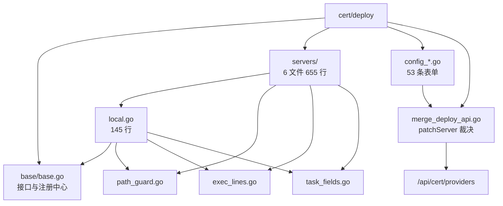
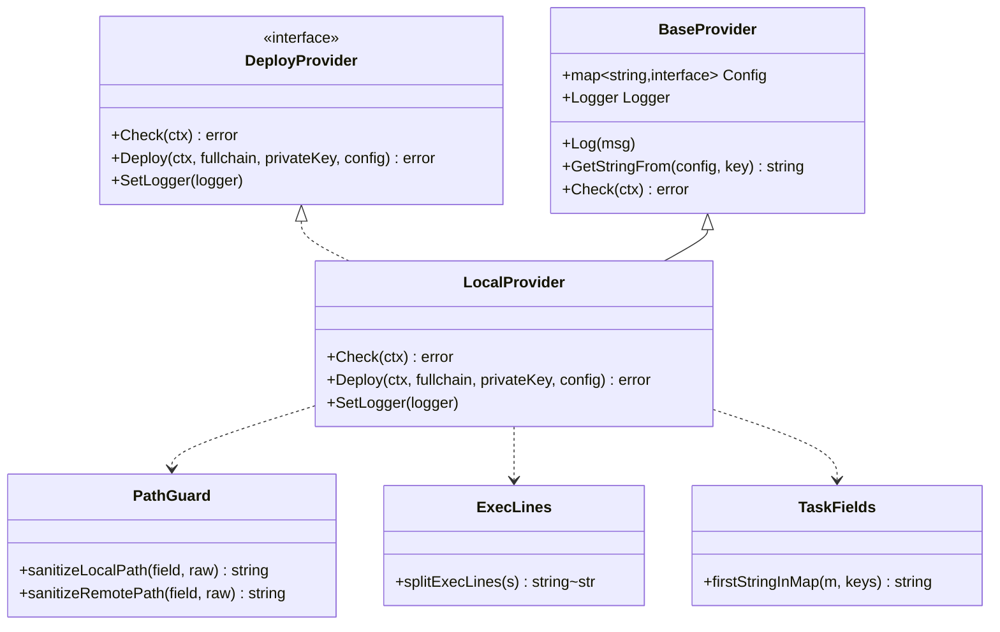
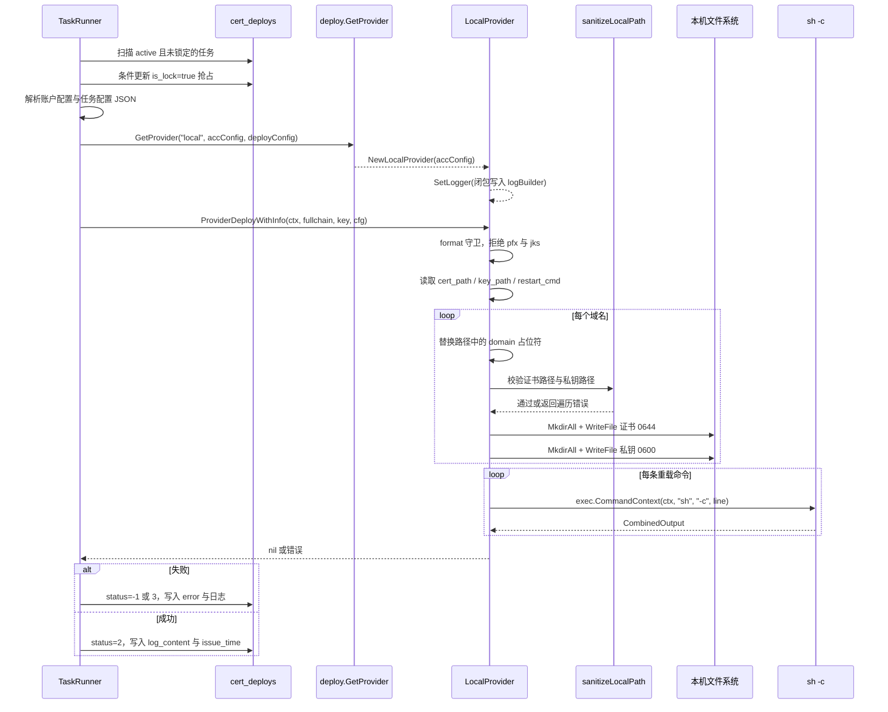
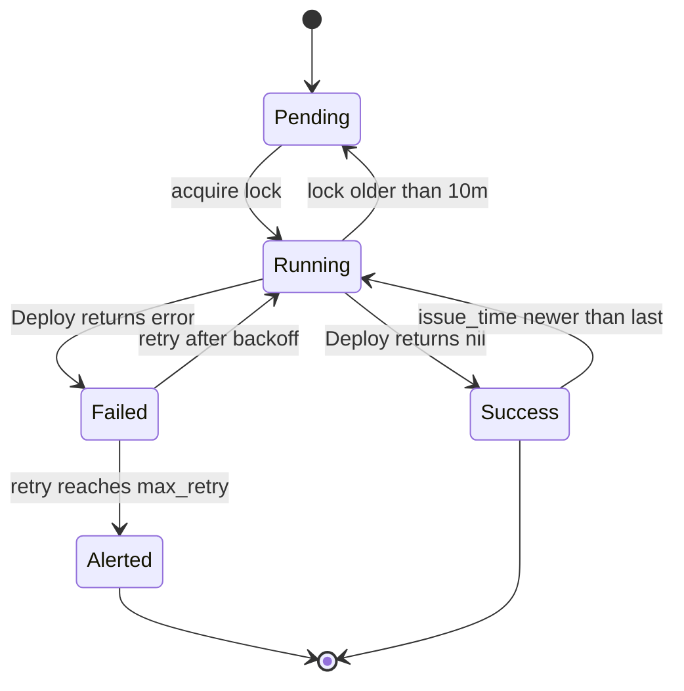
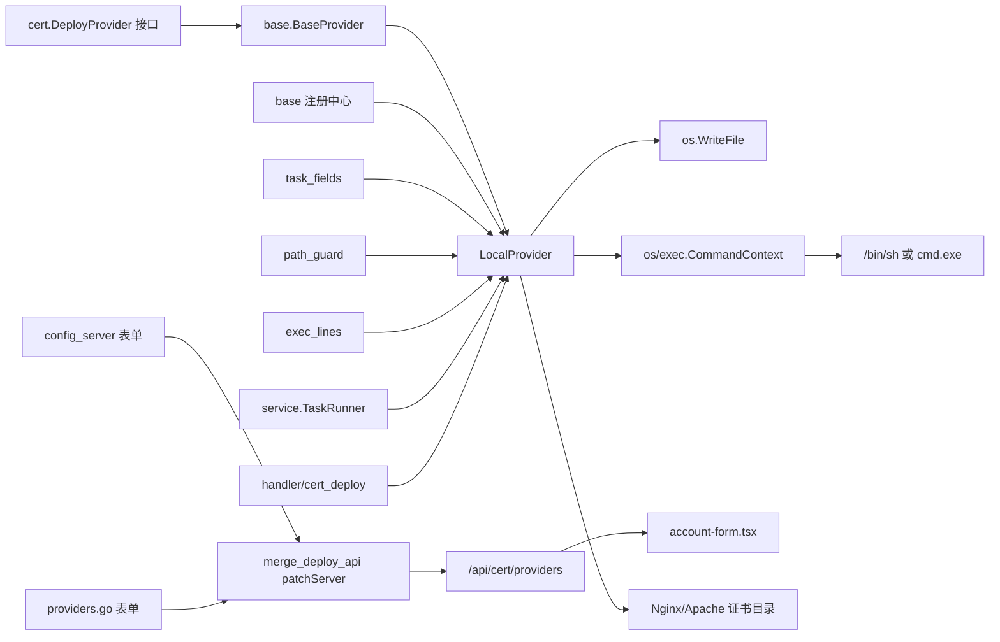
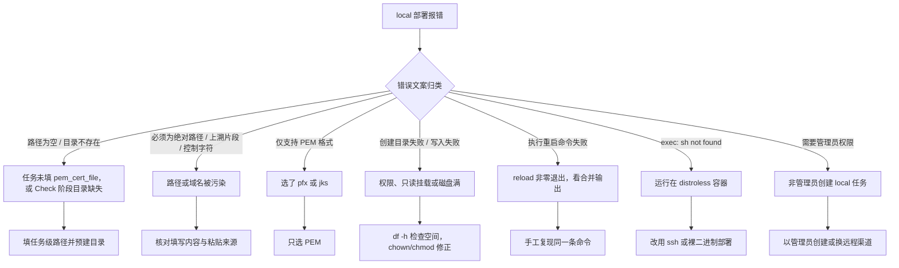

# 本地文件部署

<cite>
**本文档引用的文件**
- [local.go](file://main/internal/cert/deploy/servers/local.go)
- [path_guard.go](file://main/internal/cert/deploy/servers/path_guard.go)
- [exec_lines.go](file://main/internal/cert/deploy/servers/exec_lines.go)
- [task_fields.go](file://main/internal/cert/deploy/servers/task_fields.go)
- [base.go](file://main/internal/cert/deploy/base/base.go)
- [registry.go](file://main/internal/cert/deploy/registry.go)
- [config.go](file://main/internal/cert/deploy/config.go)
- [config_server.go](file://main/internal/cert/deploy/config_server.go)
- [merge_deploy_api.go](file://main/internal/cert/deploy/merge_deploy_api.go)
- [README.md](file://main/internal/cert/deploy/README.md)
- [providers.go](file://main/internal/cert/providers.go)
- [task_runner.go](file://main/internal/service/task_runner.go)
- [cert_deploy.go](file://main/internal/api/handler/cert_deploy.go)
- [cert.go](file://main/internal/api/handler/cert.go)
- [account.go](file://main/internal/api/handler/account.go)
- [models.go](file://main/internal/models/models.go)
- [Dockerfile](file://Dockerfile)
- [account-form.tsx](file://web/components/account-form.tsx)
</cite>

## 目录

1. [简介](#简介)
2. [项目结构](#项目结构)
3. [核心组件](#核心组件)
4. [架构总览](#架构总览)
5. [详细组件分析](#详细组件分析)
6. [依赖关系分析](#依赖关系分析)
7. [性能考虑](#性能考虑)
8. [故障排查指南](#故障排查指南)
9. [结论](#结论)
10. [附录](#附录)

## 简介

`local` 是 DNSPlane 部署器体系中最直接的一个渠道：**把证书与私钥直接写到运行 DNSPlane 的那台
机器的文件系统上**，然后在本机执行管理员填写的重载命令。它没有网络跳数、没有传输凭据，
落地能力完全等价于 DNSPlane 进程自身的文件权限，典型用途是把 ACME 签出的证书同步到与面板
同机部署的 Nginx/Apache 证书目录，让 Web 服务器 reload 后立刻使用新链。

| 维度 | `local` 本机部署 | `ssh` 远程部署 | 云厂商部署器（`providers/`） |
|------|------------------|----------------|------------------------------|
| 目标机 | DNSPlane 所在机器 | 任意可达主机 | 厂商边缘节点 |
| 传输凭据 | 无（复用进程权限） | 口令/私钥（账户配置字段） | AK/SK 或 Token |
| 落地手段 | `os.WriteFile` + 本机 `sh -c` | SFTP 上传 + 远程会话 | API 调用 |
| 权限门槛 | 创建任务需管理员 | 任意用户 | 任意用户 |
| 容器可用性 | 受限（镜像无 shell、非 root） | 可用 | 可用 |

实现证据：文件写入见 `local.go:98-114`，重载执行见 `local.go:117-133`；管理员门槛见
`cert.go:1248-1264`（安全审计 H-3 注释）；表单归属见 `config_server.go:72-98`。
本文结论均可按行号回溯到工作区文件；无法从代码验证的部分（如 SELinux 行为）显式标注为通用指导。
## 项目结构

`local` 的实现位于 `main/internal/cert/deploy/servers/`，与 `ssh`、`ftp` 同组，共 6 个文件。
其中 3 个文件是部署器实现（各自 `init()` 注册），另外 3 个是纯辅助函数文件，
被同组三个实现共享。

```text
main/internal/cert/deploy/
├── base/base.go                # 339 行：接口、注册中心、BaseProvider、配置取值
├── servers/                    # 655 行，本组 3 个实现 + 3 个辅助
│   ├── local.go                # 145 行：本机文件写入 + 本机命令执行（本文主角）
│   ├── ssh.go                  # 263 行：远程对照实现（有 cmd_pre，本组独一份）
│   ├── ftp.go                  # 143 行：远程上传对照实现（无命令执行）
│   ├── path_guard.go           #  63 行：路径遍历防御（local 走本机分支）
│   ├── exec_lines.go           #  19 行：多行命令拆分（local/ssh 共用）
│   └── task_fields.go          #  22 行：多别名取首个非空值（local/ssh/ftp 共用）
├── registry.go                 #  73 行：带四级回落的部署器解析
├── config.go                    #  49 行：DeployProviderConfig 结构与分类常量
├── config_server.go             # 121 行：local 的账户表单与任务表单声明
├── merge_deploy_api.go          #  64 行：patchServer 白名单裁决（local 在白名单内）
└── README.md                    # 双注册规则与交集差异统计
```

结构分工表：

| 文件 | 行数 | 在 `local` 链路中的角色 | 关键位置 |
|------|:----:|--------------------------|----------|
| `servers/local.go` | 145 | 唯一实现体 | `Check` `:29-51`、`Deploy` `:53-137` |
| `servers/path_guard.go` | 63 | 写入前的路径安全网 | `sanitizeLocalPath` `:26-29`、核心 `:31-63` |
| `servers/exec_lines.go` | 19 | 重载命令拆分 | `splitExecLines` `:5-19` |
| `servers/task_fields.go` | 22 | 配置键别名解析 | `firstStringInMap` `:7-22` |
| `deploy/base/base.go` | 339 | 接口与注册中心 | `DeployProvider` `:44-54`、`Register` `:84-89` |
| `deploy/config_server.go` | 121 | 表单声明（生效版本） | local 块 `:72-98` |
| `deploy/merge_deploy_api.go` | 64 | API 视图裁决 | `patchServer` `:12` |

技术栈矩阵：

| 层次 | 选型 | 版本 | 所在位置 | 在 `local` 中承担的职责 |
|------|------|------|----------|--------------------------|
| 语言 | Go | 1.26.2 | `main/` | 实现语言 |
| Web 框架 | Gin | — | `main/internal/api` | 触发部署的 HTTP 入口 |
| 标准库 | `os` / `os/exec` / `path/filepath` | — | `local.go:7-9` | 目录创建、文件写入、命令执行、路径推导 |
| 持久化 | GORM | — | `models.go:256-280` | 部署任务与执行日志落库 |
| 配置载体 | JSON（GORM `text` 字段） | — | `models.go:262`、`:276` | 账户与任务配置以 JSON 文本存取，`local` 不含凭据字段 |
| 前端 | Next.js / React | 16.2.4 / 19.2.4 | `web/components/account-form.tsx:36` | 「远程与本地」分组渲染 |



**图表来源**
- [local.go](file://main/internal/cert/deploy/servers/local.go#L15-L27)
- [base.go](file://main/internal/cert/deploy/base/base.go#L79-L117)
- [config_server.go](file://main/internal/cert/deploy/config_server.go#L72-L98)
- [merge_deploy_api.go](file://main/internal/cert/deploy/merge_deploy_api.go#L11-L36)
- [README.md](file://main/internal/cert/deploy/README.md#L74-L79)

## 核心组件

`local` 的组件粒度很小：一个 provider 类型 + 三个共享辅助函数 + 一套基类设施。
下表按「是否属于 `local` 专属」划分，避免把 `ssh`/`ftp` 复用的代码算作本实现。

| 组件 | 类型 | 职责 | 定义位置 | 是否 `local` 专属 |
|------|------|------|----------|:------------------:|
| `LocalProvider` | 结构体 | 承载配置与日志，实现部署接口 | `local.go:19-21` | 是 |
| `NewLocalProvider` | 工厂 | 注册中心构造入口 | `local.go:23-27` | 是 |
| `Check` | 方法 | 校验路径非空且目录已存在 | `local.go:29-51` | 是 |
| `Deploy` | 方法 | 写证书、写私钥、执行重载 | `local.go:53-137` | 是 |
| `sanitizeLocalPath` | 函数 | 拒 `..`、拒控制字符、强制绝对路径 | `path_guard.go:26-29` | 组内共享 |
| `splitExecLines` | 函数 | 按行拆分并跳过空行与 `#` 注释 | `exec_lines.go:5-19` | 组内共享 |
| `firstStringInMap` | 函数 | 多别名取首个非空字符串 | `task_fields.go:7-22` | 组内共享 |
| `BaseProvider` | 基类 | 配置存取、日志、默认 `Check` | `base.go:119-123`、`:241-244` | 全局共享 |
| `Register` / `ProviderDeployWithInfo` | 注册与调度 | 按键取工厂、可选接口降级 | `base.go:84-89`、`:142-150` | 全局共享 |

大纲中的「备份」一项必须如实说明：**`local` 没有实现任何备份逻辑**。
在 `servers/` 全目录检索 `bak`/`backup`/`.old`/`rename`/`Remove`/`Chmod`/`Chown`，
仅命中 `local.go:122`、`:124` 两行 `exec.CommandContext`（属于重载分支，不是备份）。
证书与私钥都是**就地覆写**，历史版本不留存；如需回滚，只能靠外部机制（文件系统快照、
配置管理工具、`cmd` 内自行 `cp`）。该结论与素材 `analysis-deploy.md` 第 429 行
「备份归目标服务管理，不在本应用职责内」一致。



**图表来源**
- [base.go](file://main/internal/cert/deploy/base/base.go#L44-L54)
- [base.go](file://main/internal/cert/deploy/base/base.go#L119-L135)
- [local.go](file://main/internal/cert/deploy/servers/local.go#L19-L27)
- [path_guard.go](file://main/internal/cert/deploy/servers/path_guard.go#L21-L29)
- [exec_lines.go](file://main/internal/cert/deploy/servers/exec_lines.go#L5-L19)
- [task_fields.go](file://main/internal/cert/deploy/servers/task_fields.go#L7-L22)

### 注册与解析

`local` 通过包级 `init()` 把自己挂到 `base` 的注册中心，键名固定为 `local`（`local.go:15-17`）。
运行期由 `deploy.GetProvider(account.Type, accConfig, deployConfig)` 取出实例
（`task_runner.go:322`、`cert_deploy.go:305`、`:803`）。`registry.go:27-68` 的四级回落在
`local` 上只会走第一级：原名命中即返回，其余三支不会触发。

**章节来源**
- [local.go](file://main/internal/cert/deploy/servers/local.go#L15-L17)
- [registry.go](file://main/internal/cert/deploy/registry.go#L27-L68)
- [task_runner.go](file://main/internal/service/task_runner.go#L321-L326)

### 日志通道

`BaseProvider.Log` 在 `Logger` 非空时转发，否则静默丢弃（`base.go:130-135`）。`local` 的
`正在写入证书文件`（`local.go:98`）、`正在写入私钥文件`（`:107`）、`正在执行重启命令`（`:119`）
都走这条通道，最终由调用方注入的闭包拼成 `cert_deploys.log_content`：定时链路带完整时间戳
（`task_runner.go:341-344`），手动链路只带时分秒（`cert_deploy.go:838-841`）。

**章节来源**
- [base.go](file://main/internal/cert/deploy/base/base.go#L130-L135)
- [local.go](file://main/internal/cert/deploy/servers/local.go#L98-L119)
- [task_runner.go](file://main/internal/service/task_runner.go#L341-L344)
- [cert_deploy.go](file://main/internal/api/handler/cert_deploy.go#L837-L841)

## 架构总览

一次 `local` 部署从任务表扫描开始，经解析配置、构造 provider、逐域名写文件、
执行重载，最后把结果与日志落库。全程受一个 5 分钟上下文约束（`task_runner.go:345`）。



**图表来源**
- [task_runner.go](file://main/internal/service/task_runner.go#L281-L374)
- [local.go](file://main/internal/cert/deploy/servers/local.go#L53-L137)
- [path_guard.go](file://main/internal/cert/deploy/servers/path_guard.go#L26-L62)
- [base.go](file://main/internal/cert/deploy/base/base.go#L142-L150)

分层职责：

| 层 | 承担者 | 输入 | 输出 | 位置 |
|----|--------|------|------|------|
| 调度层 | `TaskRunner` | `cert_deploys` 行 | 锁、状态、日志 | `task_runner.go:217-243` |
| 解析层 | `deploy.GetProvider` | 账户 `type` | provider 实例 | `registry.go:27-68` |
| 实现层 | `LocalProvider` | 任务配置 map | 文件系统副作用 | `local.go:53-137` |
| 守卫层 | `sanitizeLocalPath` | 原始路径 | 原样返回或错误 | `path_guard.go:31-63` |
| 执行层与落库层 | `sh -c` / GORM 更新 | 单行命令、结果 map | 合并输出、状态与日志字段 | `local.go:120-129`、`task_runner.go:363-394` |

## 详细组件分析

### 路径解析：三级取值与键别名

`Deploy` 对路径与命令都做了「任务配置优先、账户配置兜底」的多别名取值。证书路径依次尝试
`cert_path` → `pem_cert_file`（`local.go:58`），仍为空时回退 `GetStringFrom(config, "cert_path")`
（`:60`）；后者先查任务配置再查账户配置（`base.go:246-256`），并在账户配置层做大小写与
下划线/驼峰互转匹配（`base.go:198-228`）。私钥路径同构（`:62-65`）。重载命令的别名更长：
`restart_cmd` → `reload_cmd` → `cmd`（`:66`），之后回退 `restart_cmd`（`:68`）、`reload_cmd`
（`:71`）。注意**账户配置兜底不再尝试 `cmd`**，把 `cmd` 写在账户级不会生效 —— 这是键别名链
的不对称点。

| 语义项 | 任务配置别名（顺序即优先级） | 账户配置兜底键 | 代码位置 |
|--------|------------------------------|----------------|----------|
| 证书路径 | `cert_path`、`pem_cert_file` | `cert_path` | `local.go:58-61` |
| 私钥路径 | `key_path`、`pem_key_file` | `key_path` | `local.go:62-65` |
| 重载命令 | `restart_cmd`、`reload_cmd`、`cmd` | `restart_cmd`、`reload_cmd` | `local.go:66-72` |
| 格式 | `format` | 未兜底（仅任务配置） | `local.go:54` |
| 域名列表 | `domainList`、`domains`、`domain` | 由调度层注入 | `local.go:74`、`base.go:305-339` |

双注册表在这里留下了实际影响：`config_server.go:83-97` 的任务表单用 `pem_cert_file`/
`pem_key_file`/`cmd`，而 `cert/providers.go:308-312` 的账户表单用 `cert_path`/`key_path`/
`reload_cmd`。代码同时兼容两套键名，但 `merge_deploy_api.go:12` 的 `patchServer` 白名单包含
`local`，导致 **API 下发的账户表单以 `AllDeployConfigs` 为准**（只有 `name` 一个字段，
`config_server.go:80-82`），账户级路径在 UI 上已无处可填。

**章节来源**
- [local.go](file://main/internal/cert/deploy/servers/local.go#L53-L77)
- [base.go](file://main/internal/cert/deploy/base/base.go#L198-L256)
- [config_server.go](file://main/internal/cert/deploy/config_server.go#L80-L97)
- [providers.go](file://main/internal/cert/providers.go#L302-L318)
- [merge_deploy_api.go](file://main/internal/cert/deploy/merge_deploy_api.go#L11-L36)

### {domain} 占位符与多域名展开

`base.GetConfigDomains` 从 `domainList`（支持 `[]string`、`[]interface{}`、逗号/换行字符串）或
`domains`、`domain` 取域名列表（`base.go:305-339`），逗号与换行由 `SplitDomains` 归一
（`base.go:287-303`）。列表为空时写入空串占位并只跑一轮（`local.go:75-77`），等价于
「按字面路径写一次」。调度层会在任务配置缺字段时补齐：`domainList` 来自 `cert_domains` 表
按 `sort ASC` 的查询（`task_runner.go:329-337`），`domains` 是其逗号拼接（`:338-340`），
手动链路同构（`cert_deploy.go:809-815`）。因此 `local` 天然支持「一张证书的多 SAN 各自落地到
不同目录」。

替换手段是简单字符串替换：`strings.ReplaceAll(targetCertPath, "{domain}", domain)`
（`local.go:83`），私钥同理（`:84`），且**替换发生在路径校验之前**（`:88-95`）。
这带来一条安全属性：若 `cert_domains` 中存在异常域名（如包含 `..`），污染后的路径
会被 `sanitizeLocalPath` 拦下而不是静默穿越。整体执行次序为：格式守卫（`:54-57`）→
键解析（`:58-72`）→ 域名展开（`:74-77`）→ 逐域名校验与写入（`:79-115`）→
拆分并串行执行重载（`:117-133`）→ 完成日志（`:135`）；任一环节出错立即返回。

**章节来源**
- [local.go](file://main/internal/cert/deploy/servers/local.go#L53-L136)
- [base.go](file://main/internal/cert/deploy/base/base.go#L287-L339)
- [exec_lines.go](file://main/internal/cert/deploy/servers/exec_lines.go#L5-L19)

### 权限与落盘语义

写入用 `os.MkdirAll(dir, 0755)` 建目录、`os.WriteFile` 落文件：证书 `0644`
（`local.go:100-105`），私钥 `0600`（`:109-114`）。五段语义必须分清：

| 关注点 | 实际行为 | 依据 |
|--------|----------|------|
| 属主 | 由 DNSPlane 进程 UID/GID 决定，代码不做 `Chown`（全目录无该调用） | `local.go:98-114` |
| 目录权限 | 仅目录**新建**时按 0755 申请且受 umask 影响；已存在目录不改权限 | `local.go:100`、`:109` |
| 文件权限 | `os.WriteFile` 的 perm 仅在**创建**新文件时生效；覆写已存在文件走截断，权限沿用原值 | `local.go:103`、`:112`（标准库语义，仓库无测试覆盖） |
| 写入原子性 | 无临时文件 + `rename`，是就地截断覆写 | `servers/` 检索无 `rename` 命中 |
| 落盘同步 | 无 `File.Sync()` 调用，异常断电不保证持久 | `local.go:103`、`:112` |

「文件权限沿用原值」这条对私钥尤其关键：若历史私钥曾以 0644 创建，本部署器**不会**把它收紧到
0600，修复只能靠人工 `chmod` 或在 `cmd` 里补一条 `chmod 600`。此为依标准库语义得出的行为描述，
仓库内无对应测试，实际影响面标记为「未在本地复现」。无备份的连带后果是**部分失败不可回滚**：
某域名证书写入成功而私钥失败（磁盘满、目录只读）时函数直接返回错误（`:112-114`），已写的
证书不会还原；多域名循环同理，前面留新链、后面留旧链。

**章节来源**
- [local.go](file://main/internal/cert/deploy/servers/local.go#L98-L115)

### SELinux 与系统层上下文

代码层面**没有任何 SELinux 处理**：全仓检索 `selinux`（含 `*.go`、`*.md`、`*.yaml`）在后端与
配置中零命中，说明部署器不调用 `restorecon`、不写 `semanage`、也不感知 enforcing 模式。
下表属通用运维指导，不对应仓库代码：

| 场景 | 现象 | 处置方向 |
|------|------|----------|
| enforcing 下写 `/etc/pki/tls/certs` | 进程无域标签权限，报 `permission denied` | 为 DNSPlane 进程域授予 `cert_t` 写权限，或改写到无标签约束目录 |
| 新建私钥文件标签错误 | Nginx 读取被拒（`open() failed ... Permission denied`） | 对目标目录执行 `restorecon -R` |
| systemd 沙箱加固 | 写目录被 `ProtectSystem=strict` 拦下 | 用 `ReadWritePaths=` 显式放行 |

容器形态下的约束比 SELinux 更硬：官方镜像运行阶段是
`gcr.io/distroless/static-debian12:nonroot`（`Dockerfile:32`）并以 `USER nonroot:nonroot`
启动（`Dockerfile:35`），既没有 root 写系统目录的权限，也没有 `/bin/sh` 供 `local.go:124`
调用 —— 后者意味着**容器内 `local` 的重载分支必然失败**。素材 `analysis-deploy.md` 第 27 行与
第 499 行（问题 D-9）记录的正是同一事实。

**章节来源**
- [local.go](file://main/internal/cert/deploy/servers/local.go#L117-L130)
- [Dockerfile](file://Dockerfile#L32-L37)
- [本节为通用指导，无需特定文件来源]（SELinux 段落，仓库代码零命中）

### 服务重载：拆分、串行、错误传播

重载命令先由 `splitExecLines` 拆成逐条执行（`local.go:117`）：统一换行符、`TrimSpace`、
丢弃空行与以 `#` 开头的注释行（`exec_lines.go:5-19`）。随后按序**串行**执行，任一条失败即
中断并返回错误（`local.go:126-129`），错误文本形如
`执行重启命令失败: <CombinedOutput>, <err>`。`CombinedOutput` 把 stdout 与 stderr 合并回填，
是排障时最有价值的信息源，也是它进入 `cert_deploys.error`（`size:300`，`models.go:267`）
与 `log_content` 的路径。

| 行为项 | 结论 | 位置 |
|--------|------|------|
| 触发时机 | 所有域名写入完成后统一执行一次 | `local.go:79-115` → `:117` |
| 是否逐域名 reload | 否，多域名共享同一次命令序列 | `local.go:117-130` |
| 前置命令 | **不支持**（`ssh` 有 `cmd_pre`，`local` 无对应键） | 对比 `ssh.go:153`、`:165-170` |
| 命令注入面 | 原样交给 `sh -c`，不做转义，靠管理员权限门槛收敛 | `local.go:124` |
| 取消与超时 | 上下文 5 分钟，超时由 `exec.CommandContext` 终止进程 | `task_runner.go:345`、`local.go:120-124` |
| 无命令时 | 跳过整个重载块，不打印成功日志 | `local.go:117`、`:131-133` |

**章节来源**
- [local.go](file://main/internal/cert/deploy/servers/local.go#L117-L133)
- [exec_lines.go](file://main/internal/cert/deploy/servers/exec_lines.go#L5-L19)
- [task_runner.go](file://main/internal/service/task_runner.go#L341-L352)
- [models.go](file://main/internal/models/models.go#L256-L280)

### 回传信息：对 local 不生效的机制

`base.ProviderDeployWithInfo` 先断言 provider 是否实现 `DeployWithInfoProvider`，实现则调用带
`*DeployInfo` 的入口，否则降级为普通 `Deploy`（`base.go:142-150`）。`LocalProvider` 只有
`Deploy`，因此走降级分支：`DeployInfo.Config` 与 `.Data` 恒空，`InfoUpdates` 返回 nil
（`base.go:156-183`），`cert_deploys.config`/`info` 不会被回传修改。正向收益是 local 不会像
云厂商部署器那样把资源 ID 回写进配置，也就不存在「回传覆盖用户手填路径」的风险；代价是它
无法上报实际落地的文件指纹，`info` 字段对 `local` 长期为空。

**章节来源**
- [base.go](file://main/internal/cert/deploy/base/base.go#L60-L74)
- [base.go](file://main/internal/cert/deploy/base/base.go#L137-L183)
- [local.go](file://main/internal/cert/deploy/servers/local.go#L19-L27)

### 权限门槛：为何 local 要求管理员

创建与修改 `local` 类型的部署任务都必须通过 `checkLocalDeployAllowed`（调用点 `cert.go:1226`、
`:1276`）。函数逻辑：管理员直接放行；非管理员查账户 `type`，命中 `local` 则返回
「本地部署需要管理员权限，请改用 SSH 或其他远程部署方式」（`cert.go:1250-1264`）；
账户查不到时**放行**，交由后续业务逻辑再报错（`:1255-1258`）。设计理由写在注释里：
`local` 会以 DNSPlane 进程权限执行用户填写的 `restart_cmd`，等同服务端 RCE（安全审计 H-3）。
执行顺序也有讲究 —— 账户与订单归属校验必须**早于**该函数（`cert.go:1213-1222`），否则非管理员
可用他人 `accountID` 通过「local 报错 / 其他放行」的差异探测任意账户类型（布尔预言机）。
`isAdmin` 基于 JWT 中间件写入的上下文字段判定（`account.go:52`）。

| 入口 | 路由 | local 门槛 | 位置 |
|------|------|:----------:|------|
| 创建部署任务 | `POST /api/cert/deploys` | 是 | `cert.go:1226` |
| 修改部署任务 | `PUT /api/cert/deploys/:id` | 是 | `cert.go:1276` |
| 账户连通性测试 | `POST /api/cert/deploy-accounts/test` | 否（走 `Check`） | `cert_deploy.go:305-320` |
| 手动立即部署 | 手动执行链路 | 依赖上游属主校验 | `cert_deploy.go:803-846` |

**章节来源**
- [cert.go](file://main/internal/api/handler/cert.go#L1213-L1264)
- [cert.go](file://main/internal/api/handler/cert.go#L1266-L1298)
- [account.go](file://main/internal/api/handler/account.go#L52-L52)
- [cert_deploy.go](file://main/internal/api/handler/cert_deploy.go#L305-L320)

### 任务状态机

`local` 与其他部署器共用同一套状态字段：`is_lock` 通过条件更新抢占（`task_runner.go:284-291`），
失败写 `status=-1` 或重试期内的中间态（`:351-361`），成功写 `status=2` 并同步 `issue_time`
（`:363-373`），超过 10 分钟未释放的锁由 `releaseExpiredLocks` 回收（`:421-433`）。



**图表来源**
- [task_runner.go](file://main/internal/service/task_runner.go#L281-L374)
- [task_runner.go](file://main/internal/service/task_runner.go#L244-L279)
- [task_runner.go](file://main/internal/service/task_runner.go#L421-L433)
- [models.go](file://main/internal/models/models.go#L256-L280)

重试节奏由 `deployRetryIntervals = {60, 300, 600, 1800, 3600}` 秒决定（`task_runner.go:23`，
取值函数 `:776-784`）。这里存在一处口径不一致：`MaxRetry` 的数据库默认值是 3
（`models.go:270`），而代码在字段为 0 时兜底成 5（`task_runner.go:354-357`）。

**章节来源**
- [task_runner.go](file://main/internal/service/task_runner.go#L23-L23)
- [task_runner.go](file://main/internal/service/task_runner.go#L354-L357)
- [task_runner.go](file://main/internal/service/task_runner.go#L776-L784)
- [models.go](file://main/internal/models/models.go#L266-L275)

## 依赖关系分析



**图表来源**
- [local.go](file://main/internal/cert/deploy/servers/local.go#L1-L27)
- [path_guard.go](file://main/internal/cert/deploy/servers/path_guard.go#L26-L29)
- [config_server.go](file://main/internal/cert/deploy/config_server.go#L72-L98)
- [providers.go](file://main/internal/cert/providers.go#L302-L318)
- [merge_deploy_api.go](file://main/internal/cert/deploy/merge_deploy_api.go#L11-L36)
- [account-form.tsx](file://web/components/account-form.tsx#L36-L36)

内部依赖矩阵：

| 上游 | 下游 | 依赖内容 | 强度 | 位置 |
|------|------|----------|:----:|------|
| `servers/local.go` | `deploy/base` | 接口、`BaseProvider`、注册中心 | 强 | `local.go:6` |
| `servers/local.go` | `main/internal/cert` | `cert.Logger` 类型别名 | 强 | `local.go:12`、`base.go:42` |
| `servers/local.go` | 同包三个辅助文件 | `firstStringInMap`、`sanitizeLocalPath`、`splitExecLines` | 强 | `local.go:30`、`:88`、`:117` |
| `service/task_runner.go` | `cert/deploy` | provider 解析与执行 | 强 | `task_runner.go:322`、`:350` |
| `api/handler/cert_deploy.go` | `cert/deploy` | 手动执行与账户测试 | 强 | `:305`、`:803`、`:846` |
| `api/handler/cert.go` | `models.CertAccount` | `type == "local"` 判定 | 强 | `cert.go:1254-1262` |
| `deploy/merge_deploy_api.go` | `deploy.AllDeployConfigs` | 表单覆盖 | 强 | `:14-36` |
| `web/components/account-form.tsx` | `/api/cert/providers` | 「远程与本地」分组渲染 | 弱 | `:36`、`:94` |

外部实体与运行时依赖：

| 外部对象 | 依赖形式 | 失败表现 | 缓解 |
|----------|----------|----------|------|
| 目标目录（Nginx/Apache 证书路径） | `MkdirAll` + `WriteFile` | `创建证书目录失败` / `写入证书失败` | 预建目录并授予进程写权限 |
| `/bin/sh`、`cmd.exe` | `exec.CommandContext` | `exec: "sh": executable file not found` | 容器形态改用 `ssh` 渠道 |
| Web 服务器进程 | 重载命令间接依赖 | 文件写入成功但证书未更新 | 校验 reload 退出码与错误日志 |
| distroless 镜像 | 无 shell、非 root | `local` 渠道整体不可用 | 改用裸二进制部署或 `ssh` |

两份 local 表单的裁决关系是本模块最脆弱的依赖点，`deploy/README.md:101-113` 把规则写成四种
情形，`local` 落在「两表都有且在 `patchServer` 白名单内」这一档：`AllDeployConfigs` 覆盖
`Config`/`DeployConfig`/`Note`/`Name`/`Icon`。交集 26 个键中 `local` 与 `ssh`、`ftp` 一起属于
「表单结构不同」的 17 个之一（`README.md:142`）。

**章节来源**
- [local.go](file://main/internal/cert/deploy/servers/local.go#L1-L27)
- [registry.go](file://main/internal/cert/deploy/registry.go#L20-L68)
- [README.md](file://main/internal/cert/deploy/README.md#L101-L142)
- [merge_deploy_api.go](file://main/internal/cert/deploy/merge_deploy_api.go#L11-L36)
- [account-form.tsx](file://web/components/account-form.tsx#L36-L36)

## 性能考虑

| 问题 | 现状 | 影响 | 优化方向 |
|------|------|------|----------|
| 轮询粒度 | `certTaskInterval` 固定 5 分钟（`task_runner.go:41`、`:100`） | 新签发证书最迟 5 分钟后落地 | 用手动执行入口立即触发（`cert_deploy.go:837`） |
| 单任务串行 | 一次扫描内逐条 `executeSingleDeploy`（`task_runner.go:238`） | 任务多时尾部延迟明显 | 按账户类型分片（需先解决同机写冲突） |
| 多域名循环 | 顺序写文件（`local.go:79-115`） | 域名越多耗时越长，仍在 5 分钟预算内 | 控制单任务域名数量 |
| 重载等待 | `CombinedOutput` 同步阻塞（`local.go:126`） | reload 卡死会占满整个上下文 | 命令内加 `timeout 30s` 前缀 |
| 非原子覆写 | 截断写入，无 rename（`local.go:103`、`:112`） | reload 与写入交叠可能读到半写文件 | 由 `cmd` 做「写临时路径 + `mv` + reload」 |
| 失败放大 | 每次重试都重写文件并重载服务（`task_runner.go:244-279`） | 磁盘满等持久故障会反复触发 reload | 修根因后再启用，或调低 `max_retry` |

最实际的改进是把重载纳入写后校验：当前 `local` 不验证服务是否真的加载了新链（无握手探测），
`status=2` 只代表命令退出码为 0。需要业务级确认时，可把校验命令写进 `cmd`，
让非零退出码自然反映为部署失败。

## 故障排查指南



**图表来源**
- [local.go](file://main/internal/cert/deploy/servers/local.go#L29-L130)
- [path_guard.go](file://main/internal/cert/deploy/servers/path_guard.go#L31-L62)
- [cert.go](file://main/internal/api/handler/cert.go#L1250-L1264)
- [Dockerfile](file://Dockerfile#L32-L37)

症状对照表：

| 症状 | 直接原因 | 代码依据 | 处置 |
|------|----------|----------|------|
| 账户测试恒报「证书路径不能为空」 | `Check` 只读账户配置 `p.Config`，而 UI 的 local 账户表单只有 `name` | `local.go:29-35`、`config_server.go:80-82`、`merge_deploy_api.go:17` | 属已知结构性问题；以任务执行结果为准，勿以测试结论判定可用性 |
| 报错文本与实际填写不符 | `Check` 与 `Deploy` 取值来源不同（前者账户级、后者任务级） | `local.go:30-31` vs `:58-62` | 把路径填进任务配置即可 |
| `pfx`/`jks` 可选但执行失败 | 表单声明三种格式，实现只支持 PEM | `config_server.go:84-88` vs `local.go:54-57` | 只选 PEM |
| 写入成功但 Nginx 仍是旧证书 | `cmd` 未填或填了无效命令 | `local.go:117`、`:131-133` | 填 `nginx -t && nginx -s reload` 之类可验证命令 |
| 私钥权限宽于 0600 | 覆写不重置已存在文件的权限位 | `local.go:112`（标准库语义） | 手工 `chmod 600` 或 `cmd` 内加 `chmod` |
| 多域名只有部分目录更新 | 循环中途某域名写失败即返回 | `local.go:79-115` | 查错误定位失败域名后重跑，注意无回滚 |
| 容器内 `sh -c` 报找不到文件 | distroless 无 shell | `local.go:124`、`Dockerfile:32` | 换 `ssh` 渠道或裸二进制部署 |
| 任务长时间卡在「执行中」 | 锁未释放，等待 10 分钟回收 | `task_runner.go:421-433` | 检查 reload 是否阻塞，必要时停用任务 |
| 反复重试并反复 reload | 退避序列 60/300/600/1800/3600 秒 | `task_runner.go:23`、`:261-264` | 修根因或降低 `max_retry` |

### 权限问题排查顺序

1. 确认进程身份：DNSPlane 以哪个用户运行（容器内固定 `nonroot`，`Dockerfile:35`）。
2. 确认目标目录已存在 —— `Check` 对目录缺失直接报错（`local.go:40-48`），而 `Deploy` 会
   `MkdirAll`（`:100`、`:109`），两者不一致会造成「测试失败但执行成功」的迷惑现象。
3. 确认对目录有写权限且文件系统不是只读挂载，并检查 umask 是否把新建目录收窄到
   Web 服务器无法进入的程度。
4. 启用 SELinux/AppArmor 的主机用 `ls -Z` 比对参考目录标签（通用指导，仓库无相关代码）。

**章节来源**
- [local.go](file://main/internal/cert/deploy/servers/local.go#L40-L48)
- [local.go](file://main/internal/cert/deploy/servers/local.go#L98-L114)
- [Dockerfile](file://Dockerfile#L32-L37)

### reload 失败排查顺序

1. 读 `cert_deploys.log_content`：失败时错误消息带了 `CombinedOutput` 全文
   （`local.go:126-128`），这是第一手证据。
2. 确认命令没被整段注释：`splitExecLines` 会丢掉 `#` 开头行与空行（`exec_lines.go:13-16`），
   全部注释等于「无命令」而静默跳过重载。
3. 确认命令存在于进程 PATH，且运行环境支持它（`systemctl` 在非 systemd 环境不可用）。
4. 先跑 `nginx -t`/`apachectl configtest`：reload 常因新证书与既有配置不匹配失败。
5. 记住退出码会传播（`local.go:127-129`）但**已写入的文件不回滚**，
   「reload 失败而证书已换」是正常形态。

**章节来源**
- [local.go](file://main/internal/cert/deploy/servers/local.go#L117-L133)
- [exec_lines.go](file://main/internal/cert/deploy/servers/exec_lines.go#L5-L19)

## 结论

`local` 用 145 行代码完成了「本机写文件 + 本机执行重载」这一闭环，是 KISS 的正面样本：
无凭据管理、无网络重试、无厂商 SDK，仅靠 `os` 与 `os/exec` 两个标准库落地。它的价值在于把
DNSPlane 变成一台自托管证书分发器，让同机 Nginx/Apache 在续期后自动获得新链。

优势：零传输凭据，私钥不经网络外送；天然支持 `{domain}` 占位与多 SAN 展开；
权限模型清晰，创建与修改都要管理员（`cert.go:1226`、`:1276`），把 RCE 面收敛到可信角色；
路径守卫独立成文件，与 `ssh`/`ftp` 共享同一套遍历防御（`path_guard.go:31-63`）。

需要正视的短板（均可按行号复核）：**无备份、无回滚**，部分失败会留下新旧混合状态
（`local.go:79-115`）；**非原子写**，无临时文件 + `rename`；**权限不纠正**，覆写不重置已存在
文件的权限位；**无前置命令**（`ssh` 有 `cmd_pre`，对比 `ssh.go:153`）；**容器内不可用**
（`Dockerfile:32`、`:35`）；**双注册遗留**，`cert` 侧账户表单被 `patchServer` 覆盖而 `Check`
仍依赖账户级路径（`local.go:29-51`、`providers.go:308-312`、`merge_deploy_api.go:12`），
表现为测试恒失败；**格式声明与实现矛盾**，表单提供 `pfx`/`jks` 而实现只认 PEM
（`config_server.go:84-88` vs `local.go:54-57`）。

建议的最小改进方向（不含代码变更承诺）：写文件改为「临时文件 + `chmod` + `rename`」以获得
原子性并在覆写时显式设权限；循环前做一次可选的 `.bak` 复制以满足回滚；把 `Check` 的取值来源
统一到任务配置以消除测试误报。三者都不引入新依赖。

## 附录

### 配置参数速查

| 键 | 层级 | 表单显示名 | 必填 | 默认 | 敏感级 | 代码消费位置 |
|----|:----:|------------|:----:|------|:------:|--------------|
| `name` | 账户 | 名称 | 是 | 无 | 普通 | 未被 `local.go` 读取 |
| `format` | 任务 | 证书类型 | 是 | `pem` | 普通 | `local.go:54-57` |
| `pem_cert_file` | 任务 | 证书保存路径 | 是 | 无 | 普通 | `local.go:58` |
| `pem_key_file` | 任务 | 私钥保存路径 | 是 | 无 | 普通 | `local.go:62` |
| `cmd` | 任务 | 部署完执行命令 | 否 | 空 | 机密（等同命令执行面） | `local.go:66` |
| `pfx_file`/`pfx_pass`/`jks_file`/`jks_pass`/`jks_alias` | 任务 | PFX 与 JKS 路径、密码、别名 | 条件 | `ssl` | 机密 `{占位}` | 被 `local.go:55` 拒绝 |
| `cert_path`/`key_path`/`reload_cmd` | 任务兼容 | —（cert 侧账户字段） | 否 | 无 | `reload_cmd` 属机密 | `local.go:58`、`:62`、`:66`、`:71` |
| `domain` | 任务 | 部署域名 | 否 | 无 | 普通 | `base.go:333-337` |

表单原文依据：`config_server.go:80-97`（`AllDeployConfigs` 版本）、
`cert/providers.go:308-316`（cert 注册表版本，账户级字段在 API 视图中已被覆盖）。

**章节来源**
- [config_server.go](file://main/internal/cert/deploy/config_server.go#L72-L98)
- [providers.go](file://main/internal/cert/providers.go#L302-L318)
- [local.go](file://main/internal/cert/deploy/servers/local.go#L54-L72)

### 典型配置示例

Nginx 单证书与多站点通配（任务配置 JSON 形态，字段名取自生效表单；`{domain}` 由
`cert_domains` 展开，`local.go:82-85`）：

```json
{
  "format": "pem",
  "pem_cert_file": "/etc/nginx/ssl/{domain}/fullchain.pem",
  "pem_key_file": "/etc/nginx/ssl/{domain}/privkey.pem",
  "cmd": "nginx -t && systemctl reload nginx"
}
```

Apache（把 `local` 缺失的备份与权限能力补回命令里）：

```json
{
  "format": "pem",
  "pem_cert_file": "/etc/httpd/certs/example.com.crt",
  "pem_key_file": "/etc/httpd/certs/example.com.key",
  "cmd": "chmod 600 /etc/httpd/certs/example.com.key && apachectl configtest && systemctl reload httpd"
}
```

两例均不含任何真实凭据；需要口令的场景（PFX/JKS）一律写作 `{占位}`，且当前实现会在执行到
这些格式时报错（`local.go:55-57`）。

**章节来源**
- [local.go](file://main/internal/cert/deploy/servers/local.go#L54-L85)
- [config_server.go](file://main/internal/cert/deploy/config_server.go#L84-L96)

### 已知限制清单

| 编号 | 级别 | 限制 | 证据 |
|:----:|:----:|------|------|
| L-1 | 中 | 仅支持 PEM，表单却声明 PFX/JKS | `local.go:55`、`config_server.go:84-88` |
| L-2 | 高 | 无备份、无回滚，部分失败留下混合状态 | `local.go:79-115`（无 rename/backup 调用） |
| L-3 | 中 | 就地截断覆写，非原子；且覆写不重置已存在文件的权限位 | `local.go:103`、`:112` |
| L-4 | 高 | 容器形态（distroless）下重载分支必然失败 | `local.go:124`、`Dockerfile:32` |
| L-5 | 中 | `restart_cmd` 是管理员可控的命令执行面 | `local.go:117-130`、`cert.go:1224-1228` |
| L-6 | 低 | 无前置命令能力（`ssh` 有 `cmd_pre`） | 对比 `ssh.go:153` 与 `local.go` 全文 |
| L-7 | 中 | 不回传部署信息，`cert_deploys.info` 恒空 | `base.go:142-150`、`local.go` 未实现可选接口 |
| L-8 | 低 | cert 侧 `Icon` 为 `local.png`（文件不存在），靠白名单覆盖为 `server.png` 才正常 | `providers.go:305`、`config_server.go:77`、`merge_deploy_api.go:32-34` |

**章节来源**
- [local.go](file://main/internal/cert/deploy/servers/local.go#L53-L137)
- [ssh.go](file://main/internal/cert/deploy/servers/ssh.go#L140-L170)
- [providers.go](file://main/internal/cert/providers.go#L302-L318)

### 术语表

| 术语 | 含义 |
|------|------|
| 部署器 / Deploy Provider | 实现 `base.DeployProvider` 的渠道插件，按 `type` 键注册（`base.go:44-54`） |
| 账户配置 / 任务配置 | 分别是 `cert_accounts.config` 与 `cert_deploys.config` 解密后的 map，前者注入 provider（`base.go:121`），后者是 `Deploy` 第三入参 |
| 双注册 | 同一 `type` 在 `cert` 注册表与 `AllDeployConfigs` 各有一份表单定义 |
| `patchServer` 白名单 | 决定哪份表单生效的硬编码集合，当前 `ssh`/`ftp`/`local`（`merge_deploy_api.go:12`） |
| `{domain}` 占位符 | 路径模板中被 SAN 域名替换的标记（`local.go:83-84`） |
| 布尔预言机 | 非管理员借错误信息差异推断资源属性的攻击面（`cert.go:1213-1215`） |

**章节来源**
- [base.go](file://main/internal/cert/deploy/base/base.go#L44-L123)
- [merge_deploy_api.go](file://main/internal/cert/deploy/merge_deploy_api.go#L11-L12)
- [cert.go](file://main/internal/api/handler/cert.go#L1213-L1228)
### 相关文档索引

| 文档 | 关系 |
|------|------|
| `docs/证书管理功能/证书部署策略/证书部署策略.md` | 二级总览，含部署器分组与双注册裁决全貌 |
| `docs/证书管理功能/证书部署策略/SSH远程部署.md` | 同组对照实现，含 `cmd_pre` 与主机密钥校验 |
| `docs/系统架构/部署架构.md` | distroless 镜像与非 root 运行约束的上下文 |

**章节来源**
- [本节为总结，无需特定文件来源]
