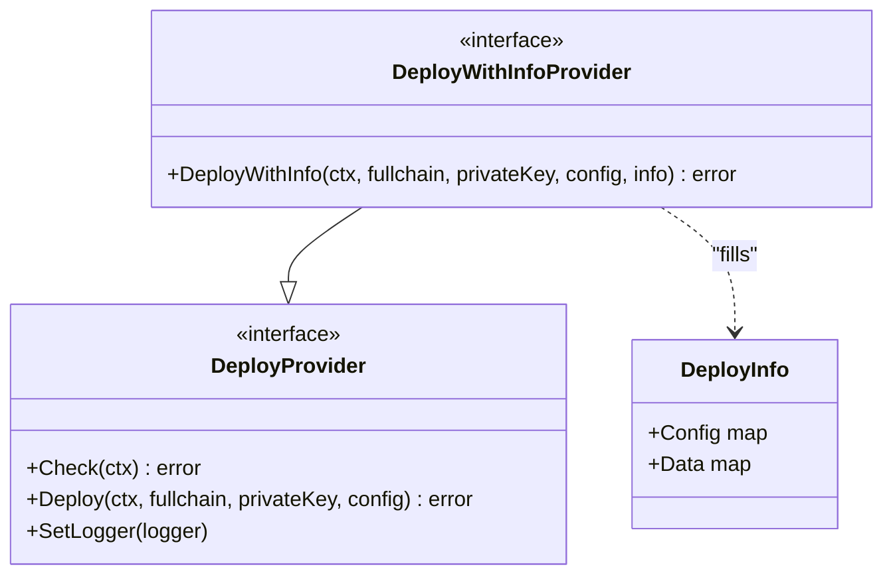
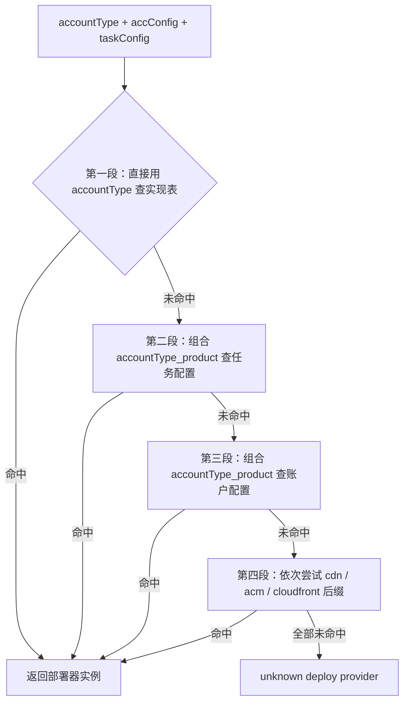
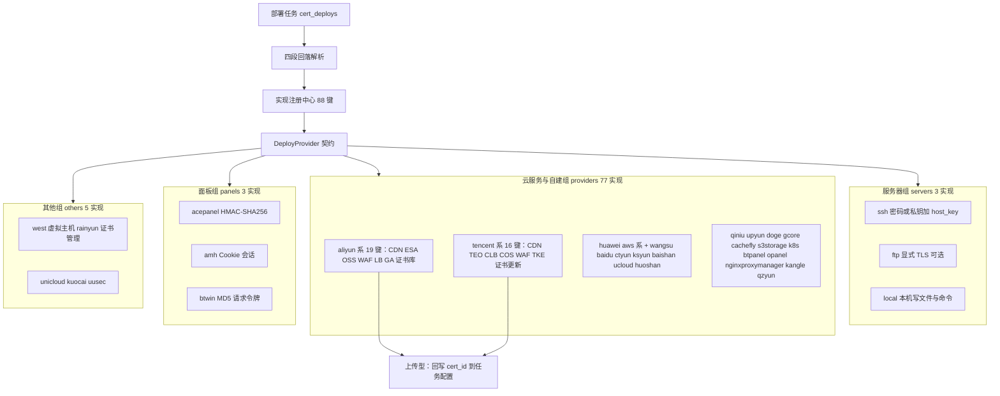
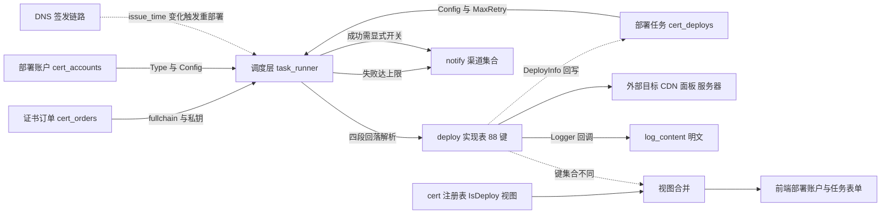
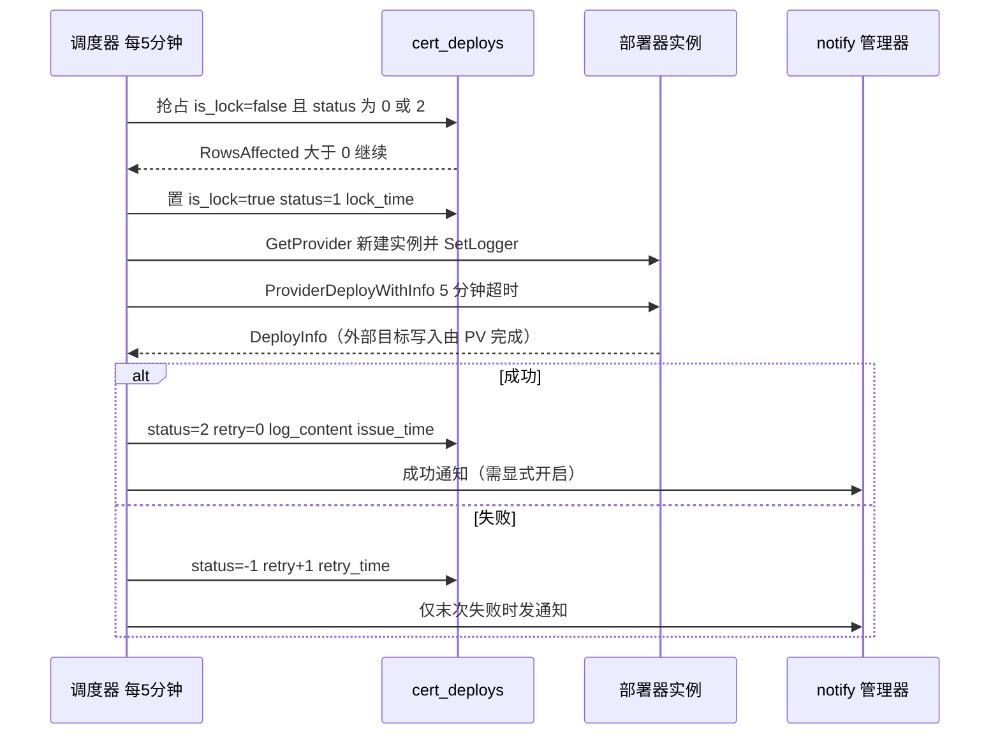
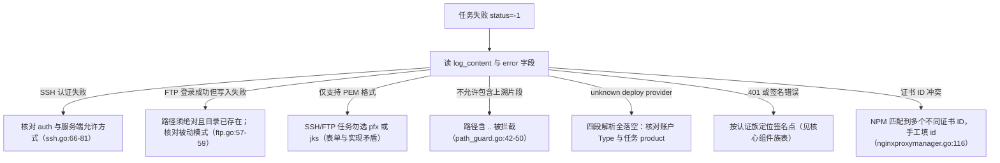

# 证书部署策略

<cite>
**本文档引用的文件**
- [base.go](file://main/internal/cert/deploy/base/base.go)
- [registry.go](file://main/internal/cert/deploy/registry.go)
- [config.go](file://main/internal/cert/deploy/config.go)
- [config_cloud.go](file://main/internal/cert/deploy/config_cloud.go)
- [config_selfhosted.go](file://main/internal/cert/deploy/config_selfhosted.go)
- [config_server.go](file://main/internal/cert/deploy/config_server.go)
- [merge_deploy_api.go](file://main/internal/cert/deploy/merge_deploy_api.go)
- [README.md](file://main/internal/cert/deploy/README.md)
- [ssh.go](file://main/internal/cert/deploy/servers/ssh.go)
- [ftp.go](file://main/internal/cert/deploy/servers/ftp.go)
- [local.go](file://main/internal/cert/deploy/servers/local.go)
- [path_guard.go](file://main/internal/cert/deploy/servers/path_guard.go)
- [exec_lines.go](file://main/internal/cert/deploy/servers/exec_lines.go)
- [task_fields.go](file://main/internal/cert/deploy/servers/task_fields.go)
- [aliyun_upload.go](file://main/internal/cert/deploy/providers/aliyun_upload.go)
- [aliyun_base.go](file://main/internal/cert/deploy/providers/aliyun_base.go)
- [tencent_cdn.go](file://main/internal/cert/deploy/providers/tencent_cdn.go)
- [wangsu_cdn.go](file://main/internal/cert/deploy/providers/wangsu_cdn.go)
- [baidu_cdn.go](file://main/internal/cert/deploy/providers/baidu_cdn.go)
- [huoshan_cdn.go](file://main/internal/cert/deploy/providers/huoshan_cdn.go)
- [aws_cloudfront.go](file://main/internal/cert/deploy/providers/aws_cloudfront.go)
- [cloudpanel.go](file://main/internal/cert/deploy/providers/cloudpanel.go)
- [cdnfly.go](file://main/internal/cert/deploy/providers/cdnfly.go)
- [deploy_cert_name.go](file://main/internal/cert/deploy/providers/deploy_cert_name.go)
- [nginxproxymanager.go](file://main/internal/cert/deploy/providers/nginxproxymanager.go)
- [rainyun.go](file://main/internal/cert/deploy/others/rainyun.go)
- [west.go](file://main/internal/cert/deploy/others/west.go)
- [unicloud.go](file://main/internal/cert/deploy/others/unicloud.go)
- [uusec.go](file://main/internal/cert/deploy/others/uusec.go)
- [kuocai.go](file://main/internal/cert/deploy/others/kuocai.go)
- [acepanel.go](file://main/internal/cert/deploy/panels/acepanel.go)
- [amh.go](file://main/internal/cert/deploy/panels/amh.go)
- [btwin.go](file://main/internal/cert/deploy/panels/btwin.go)
- [task_runner.go](file://main/internal/service/task_runner.go)
- [cert.go](file://main/internal/api/handler/cert.go)
- [cert_deploy.go](file://main/internal/api/handler/cert_deploy.go)
- [router.go](file://main/internal/api/router.go)
- [models.go](file://main/internal/models/models.go)
- [main.go](file://main/main.go)
</cite>

## 目录

1. [简介](#简介)
2. [项目结构](#项目结构)
3. [核心组件](#核心组件)
4. [架构总览](#架构总览)
5. [详细组件分析](#详细组件分析)
6. [依赖关系分析](#依赖关系分析)
7. [性能考虑](#性能考虑)
8. [故障排查指南](#故障排查指南)
9. [结论](#结论)
10. [附录](#附录)

## 简介

证书部署策略对应 `main/internal/cert/deploy` 包：把一张已签发的证书推到「一个外部目标」，
目标可以是云厂商 CDN、对象存储、WAF、负载均衡、运维面板，也可以是一台 SSH/FTP 可达的服务器。
全包按目录切成 **5 组部署器**：

| 组 | 目录 | 定位 | 文件数 | 行数 | `base.Register` 数 |
|----|------|------|:------:|:----:|:------------------:|
| 契约层 | `deploy/base/` | 接口、实现注册中心、`BaseProvider`、配置工具 | 1 | 339 | 0 |
| 云与自建 | `deploy/providers/` | 云产品 + 自建 CDN/WAF + 面板 + 对象存储 + 容器 | 56 | 15727 | 77 |
| 服务器 | `deploy/servers/` | SSH / FTP / 本地文件系统 | 6 | 655 | 3 |
| 面板 | `deploy/panels/` | ACE Panel / AMH / 宝塔 Windows 极速版 | 3 | 356 | 3 |
| 其他 | `deploy/others/` | 西部数码 / 雨云 / uniCloud / 括彩云 / 南墙 WAF | 5 | 604 | 5 |

含 `deploy/` 根目录 6 个配置与合并文件（1317 行）在内，全包 **77 个 Go 文件、18998 行、零测试文件**；
`base.Register` 去重后是 **88 个实现键**，而面向前端的表单表 `AllDeployConfigs` 只有 **53 条**。
三条贯穿全文的事实：**两套注册中心并存**（实现表 `base/base.go:85`、表单表 `config.go:47`，
键集合互不相等，实测差集为表单有实现无 11 项、实现有表单无 46 项，对齐靠 `registry.go:27`
四段回落）；**目录分组 ≠ 业务分组**（`panels/` 只有 3 个文件，面板族实际 17 个实现且多在
`providers/`，而 `deploy/README.md:18-31` 描述的 `interface.go` / `executor.go` 在 `deploy/` 根
**并不存在**）；**失败可见性在调度层**（执行由 `task_runner.go:281` 统一驱动，退避与通知分别
在 `:23` 与 `:456`，88 个部署器没有一个引用数据库或 notify 包）。

**章节来源**

- [base.go](file://main/internal/cert/deploy/base/base.go#L79-L117)
- [config.go](file://main/internal/cert/deploy/config.go#L32-L49)

## 项目结构

```text
main/internal/cert/deploy/
├── base/base.go 339            # DeployProvider(:45) WithInfo(:69) Register(:85) InfoUpdates(:156)
├── providers/ 56 文件 15727 行 # 77 个注册名；辅助文件（无注册名）：aliyun_base.go 275、
│                               #   tencent_update.go 444、deploy_cert_name.go 38、huawei_common.go 83；
│                               #   代表：tencent_cdn.go 506（16 键共用）、huoshan_cdn.go 699（9 分支）、
│                               #   qzyun.go 816（最大单文件）、nginxproxymanager.go 541（幂等样板）
├── servers/ 6 文件 655 行      # ssh.go ftp.go local.go + path_guard.go 63 exec_lines.go 19 task_fields.go 22
├── panels/ 3 文件 356 行       # acepanel amh btwin
├── others/ 5 文件 604 行       # west rainyun unicloud uusec kuocai
├── registry.go 73              # 四段回落解析 + 向后兼容别名
├── config.go 49                # DeployClass(:6-10) 表单注册(:47)
├── config_{cloud,selfhosted,server}.go   # 515 / 495 / 121 行，23 + 26 + 4 = 53 条表单
├── merge_deploy_api.go 64      # API 视图合并裁决(:5)
└── README.md 184               # 双注册规则（目录结构章节已过期）
```

装配入口是 4 条空导入，触发各子包 `init()` 里的 `base.Register`（`main/main.go:55-58`）；`base` 包由 `service/task_runner.go`、`api/handler/cert_deploy.go` 直接引用，无需空导入。

| 事实 | 实测值 | 取证方式 |
|------|--------|----------|
| `base.Register` 去重键数 | 88 | `grep -o` + `sort -u` |
| `AllDeployConfigs` 条目数 | 53（cloud 23 / selfhosted 26 / server 4） | `grep -c registerDeployConfig` |
| 键集合差集 | 表单有实现无 11（`aliyun` `aws` `baidu` `baishan` `ctyun` `huawei` `huoshan` `ksyun` `tencent` `ucloud` `wangsu`）；实现有表单无 46（`tencent_*` `aliyun_*` `huawei_*` 等子产品键） | `comm -13` / `comm -23` 集合差 |
| `Class` 标记分布 | CloudService 25 / SelfHosted 24 / Server 4 | `grep -o 'Class: *Class[A-Za-z]*'` |

**章节来源**

- [base.go](file://main/internal/cert/deploy/base/base.go#L85-L108)
- [config.go](file://main/internal/cert/deploy/config.go#L6-L17)

## 核心组件

### DeployProvider 接口与回传契约

| 符号 | 位置 | 语义 |
|------|------|------|
| `DeployProvider` | `base/base.go:45` | `Check` / `Deploy` / `SetLogger`，任何部署器至少满足它 |
| `ProviderFactory` | `base/base.go:77` | `func(config map[string]interface{}) DeployProvider` |
| `DeployInfo` | `base/base.go:60` | `Config` 合并回任务配置，`Data` 存入任务 `info` 字段 |
| `DeployWithInfoProvider` | `base/base.go:69` | 独立接口，未实现则不参与回写 |
| `ProviderDeployWithInfo` | `base/base.go:142` | 运行期类型断言分派 |
| `InfoUpdates` | `base/base.go:156` | 回传信息转 `cert_deploys` 更新字段，无内容返回 `nil` |

拆两个接口的理由写在 `base.go:137-141`：`BaseProvider` 若提供 `DeployWithInfo`，
嵌入它的部署器会因**方法提升**被误判为「支持回传」，实际部署被默认实现吞掉。
实测实现该方法的文件共 11 个（`aliyun_*` 7 个 + `axisnow` `huawei_upload` `qzyun` `tencent_update`），
其中 `aliyun_upload.go:58` 用 `var _ base.DeployWithInfoProvider = (*AliyunUploadProvider)(nil)`
把契约固化到编译期。



**图表来源**

- [base.go](file://main/internal/cert/deploy/base/base.go#L45-L150)

**章节来源**

- [base.go](file://main/internal/cert/deploy/base/base.go#L45-L77)
- [base.go](file://main/internal/cert/deploy/base/base.go#L137-L183)

### 注册中心与四段回落解析

| 层 | 位置 | 职责 |
|----|------|------|
| 实现注册中心 | `base/base.go:85` / `:92` / `:108` | `map[string]ProviderFactory` + `sync.RWMutex`（`:79-82`） |
| 表单注册中心 | `config.go:47` | 写 `AllDeployConfigs[cfg.Type]`，无锁（仅 `init()` 期写入） |
| 解析包装层 | `deploy/registry.go:27` | 四段回落：`accountType` → `accountType_product`（任务配置）→ `accountType_product`（账户配置）→ `accountType_{cdn\|acm\|cloudfront}` |
| 视图合并层 | `merge_deploy_api.go:5` | cert 表 + 表单表合成对外视图，并向后兼容别名（`registry.go:9-18`） |



**图表来源**

- [registry.go](file://main/internal/cert/deploy/registry.go#L27-L68)
- [base.go](file://main/internal/cert/deploy/base/base.go#L92-L105)

第四段是兜底猜测：注释（`registry.go:58`）说明它专为 AWS 默认 `acm` 而设；副作用是
`ucloud` 这类账户只能靠后缀命中——实现表里只有 `ucloud_cdn`，没有 `ucloud`。
`base.go:100-102` 对 `nil` 工厂单独报错，避免「注册了键但没有实现」的静默失败。

**章节来源**

- [registry.go](file://main/internal/cert/deploy/registry.go#L9-L68)
- [config.go](file://main/internal/cert/deploy/config.go#L33-L49)

### 通用参数与认证方式族

`BaseProvider` 的读取工具是部署器与表单之间的隐式契约：

| 工具 | 位置 | 行为 |
|------|------|------|
| `GetString` | `base/base.go:199` | 四级键匹配：精确 → 忽略大小写 → 下划线转驼峰 → 驼峰转下划线 |
| `GetStringFrom` | `base/base.go:247` | 先查任务配置（空串视为缺失），再回落账户配置 |
| `GetConfigString` / `GetConfigBool` | `base/base.go:259` / `:272` | 布尔兼容 `bool` 与 `"1"`/`"true"` |
| `SplitDomains` / `GetConfigDomains` | `base/base.go:288` / `:306` | 逗号换行归一；`domainList` → `domains` → `domain` |
| `certCommonName` / `buildCertName` | `providers/deploy_cert_name.go:23` / `:31` | 取叶证书 CN，或生成 `{CN}-{NotBefore 秒}` |

`buildCertName` 用 `NotBefore` 拼名（`:36-37`），同一域名每次续期都会得到不同证书名——这是
「上传型」部署器规避同名冲突的实现方式。`servers/task_fields.go:7` 的 `firstStringInMap`
则是服务器组的多键名兼容读取。按认证手段归族：

| 认证族 | 签名实现点 | 覆盖注册名 |
|--------|------------|------------|
| 云 OpenAPI AK/SK 签名 | 阿里云 `aliyun_base.go:246`；腾讯云 `tencent_cdn.go:404` `TC3-HMAC-SHA256`；AWS `aws_cloudfront.go:307-324`；百度 `baidu_cdn.go:153` `bce-auth-v1` | 阿里云 19 + 腾讯云 16 + 华为 5 + AWS 2 + 金山 1 + 天翼 1 + 百度 1 |
| 账号密码换 Token | 网宿 `wangsu_cdn.go:591-594`（HMAC-SHA1 转 Basic）；GoEdge、Cdnfly、LeCDN、群晖、CloudPanel、全栈云、uniCloud、南墙、括彩 | 10 |
| 静态令牌 / APIKey 头 | Gcore `APIKey`；CacheFly `x-cf-authorization`；又拍云与 AxisNow `Bearer`；雷池 `X-SLCE-API-TOKEN`；Lucky `openToken`；Proxmox `PVEAPIToken` | 7 |
| 面板哈希签名 | 宝塔 `btpanel.go:107`；1Panel `opanel.go:108`；小皮 `xp.go:121`；Kangle `kangle.go:184`；宝塔 Win `btwin.go:98`；ACE `acepanel.go:95`；耗子 `ratpanel.go:168`；AMH `amh.go:46` | 8 |
| 对象存储 / 容器 / 传输层凭据 | S3 SigV4 自实现 `s3storage.go:164`；K8s `k8s.go:250` + REST；SSH `ssh.go:42-96`；FTP `ftp.go:40-72`；`local.go:53` 进程权限；飞牛 OS 走 SSH（`fnos.go:16`） | 6 |
| 厂商私有签名 | 七牛 `QBox`；多吉云 `TOKEN ak:sig`；UCloud SHA1；西部数码 MD5；雨云 ApiKey；白山云 query token | 其余全部 |

`ssh.go` 是全族中唯一实现**对端身份校验**的：`buildHostKeyCallback`（`:109-121`）在配置
`host_key` 时走 `ssh.FixedHostKey`，否则回退 `InsecureIgnoreHostKey` 并打 Warn。对照之下有
6 个部署器**固定**跳过 TLS 校验：`synology.go:42`、`cloudpanel.go:49`、`directadmin.go:58`、
`proxmox.go:39`、`k8s.go:301`、`qzyun.go:80-81`。

**章节来源**

- [base.go](file://main/internal/cert/deploy/base/base.go#L199-L339)
- [deploy_cert_name.go](file://main/internal/cert/deploy/providers/deploy_cert_name.go#L22-L38)

## 架构总览

下图按「5 组目录 + 每组代表部署方式」展开，节点全部对应实测存在的注册名：



**图表来源**

- [registry.go](file://main/internal/cert/deploy/registry.go#L27-L68)
- [base.go](file://main/internal/cert/deploy/base/base.go#L85-L105)
- [aliyun_upload.go](file://main/internal/cert/deploy/providers/aliyun_upload.go#L33-L51)

目录是**代码组织**，`Class` 是**产品组织**，两者不等价：

| 目录 | 实现数 | 主要 Class 归属 | 错位实例 |
|------|:------:|-----------------|----------|
| `servers/` | 3 | Server（4 条表单） | `s3storage` 表单在 `ClassServer`（`config_server.go:101-104`），实现在 `providers/` |
| `panels/` | 3 | SelfHosted | 另 14 个面板族实现落在 `providers/` |
| `others/` | 5 | 多为 CloudService | `west`/`rainyun`/`unicloud`/`kuocai` 表单在 `config_cloud.go`，`uusec` 在 `config_selfhosted.go:409` |
| `providers/` | 77 | Cloud + SelfHosted 混合 | 云产品、自建 CDN/WAF、面板、容器同处一组 |

按「面板」筛选不能靠目录，只能靠 `config.go:6-10` 的 `Class` 常量与 `ClassNames`（`:13-17`）。

**章节来源**

- [config.go](file://main/internal/cert/deploy/config.go#L6-L17)
- [config_server.go](file://main/internal/cert/deploy/config_server.go#L100-L114)

## 详细组件分析

### 契约组 base

`base.go` 一个文件承载三类职责：接口定义（`:45-77`）、实现注册中心（`:79-117`）、配置工具
（`:199-339`）。339 行对 88 个实现而言是极简公共层——厂商差异全部压在实现文件里，公共层不感知
任何上游协议。对外视图合并在 `merge_deploy_api.go:5`，由 `GET /api/cert/providers`
（`router.go:245` → `cert.go:1387-1396`）触发，四条裁决：

| 情形 | 结果 | 位置 |
|------|------|------|
| 两表都有且键在 `patchServer`（仅 `ssh`/`ftp`/`local`） | 表单表的字段、名称、图标**覆盖** cert 表 | `merge_deploy_api.go:12`、`:16-36` |
| 两表都有但不在白名单 | 保留 cert 表定义 | `:37` |
| 仅表单表有，但 cert 表同名且 `IsDeploy=false` | 跳过（签发渠道优先） | `:40-43` |
| 仅表单表有 | 经 `deployConfigToAPIProviderConfig` 补入，`IsDeploy: true` | `:44`、`:49-64` |

白名单只放 3 键是刻意收窄：这 3 类的表单字段与实现严格一一对应，其余类型的 cert 侧定义
更贴合上游产品语义。

**章节来源**

- [base.go](file://main/internal/cert/deploy/base/base.go#L45-L117)
- [merge_deploy_api.go](file://main/internal/cert/deploy/merge_deploy_api.go#L5-L64)

### 服务器组 servers

3 个实现，共同特征是**把 PEM 原文写到目标路径**，路径安全与格式边界全在这里。

| 部署方式 | 目标平台 | 认证方式 | 幂等性 | 关键位置 |
|----------|----------|----------|--------|----------|
| `ssh` | Linux/Windows OpenSSH | 密码或 PEM 私钥（可带 passphrase），可选 `host_key` | 覆写文件，命令逐行重复执行 | `ssh.go:42` `connect`、`:140` `Deploy`、`:222` `uploadFile`（`scp -t`，`:244`）、`:247` `runCommand` |
| `ftp` | FTP / FTPS | 用户名密码，`secure==1` 显式 TLS（最低 1.2） | 覆写文件 | `ftp.go:40` `connect`、`:52` `DialWithExplicitTLS`、`:74` `Deploy`、`:133` `uploadFile` |
| `local` | 与 DNSPlane 同机 | 进程权限（无凭据） | 覆写文件 + 执行重启命令 | `local.go:53` `Deploy`、`:100-114` 写文件（证书 0644 / 私钥 0600）、`:117-130` `exec.CommandContext` |

四条共性做法可直接当作服务器类部署器的编写范式：**多键名兼容**
（`cert_path` 与 `pem_cert_file` 同时接受，`ssh.go:145-152`）、**`{domain}` 占位符展开**
（`ssh.go:172-179`、`ftp.go:94-105`）、**路径安全网**（`path_guard.go:22`/`:27` 拒绝 `..` 段与
控制字符，远端强制 `/` 开头；文件头 `:9-19` 标明安全审计 H-1）、**多行命令拆分**
（`exec_lines.go:6`，避免整块 textarea 塞进一次 `sh -c`）。

**表单与实现矛盾**：`config_server.go:29-41` 的 SSH 表单提供 `pfx` + IIS 选项，`:84-95` 的
local 表单提供 `jks`，而 `ssh.go:142-144`、`ftp.go:76-78` 对 `pfx`/`jks` 直接返回「仅支持 PEM」。

**章节来源**

- [ssh.go](file://main/internal/cert/deploy/servers/ssh.go#L42-L179)
- [ftp.go](file://main/internal/cert/deploy/servers/ftp.go#L40-L105)

### 云服务与自建组 providers

这一组占全包 82.8% 的代码量，实现密度差别很大：

| 实现密度 | 代表 | 说明 |
|----------|------|------|
| 一文件一名 | `qzyun.go` 816、`huoshan_cdn.go` 699、`wangsu_cdn.go` 682 | 单厂商协议完整还原 |
| 一文件多名共用实现 | `tencent_cdn.go:36-51` 注册 16 键，全指向 `NewTencentProvider` | 16 键 506 行，差异只在 `product` |
| 一文件多名不同实现 | `aliyun_waf.go:15-18` 注册 4 键 4 构造函数 | `waf`/`wafres`/`waf2`/`api` |
| 纯辅助文件 | `aliyun_base.go` `huawei_common.go` `tencent_update.go` `deploy_cert_name.go` | 有函数无注册名 |

云侧表单设计是「**一个账户类型 + 一个 product 下拉**」：阿里云块只有两个凭据字段加一个
`product` 选择，子产品差异用 `show` 表达式做条件显隐；运行期 `deploy/registry.go:34-45` 把
`aliyun` + `product=cdn` 拼成 `aliyun_cdn` 再查实现表——这正是 11 个「有表单无实现」键存在的原因。
`product` 在实现内部再落地一次：`huoshan_cdn.go:277-310` 按「任务配置 → 账户配置 → 默认 `cdn`」
三级取值后 `switch` 到 9 个产品分支，未知值返回「不支持的产品类型」；`wangsu_cdn.go:85-91` 与
`baidu_cdn.go:232-236` 是同型模式，分支数分别为 4 和 3。幂等性在这一组没有统一实现，而是
**四种并存策略**：

| 策略 | 代表与位置 |
|------|------------|
| 回写 ID，下次转为更新 | `aliyun_upload.go:38-51` → `fillAliyunInfo`（`aliyun_base.go:190`）→ `base.go:156` → `task_runner.go:374`；共 11 个文件 |
| ID 空则新增、非空则更新 | `rainyun.go:66-74` 用 `certID == ""` 决定 `POST` 或 `PUT` |
| 按域名匹配，冲突即拒绝 | `nginxproxymanager.go:56`：优先任务 `id`（`:66`）→ `host_id`（`:83`）→ 域名匹配（`:184`）；匹配到多个不同证书 ID 时报冲突（`:116`、`:120-121`），新建走 `:265` |
| 纯覆写 | servers 组与对象存储族，重复执行结果一致 |

NPM 的冲突文案（`:116`）明确写「请手动填写证书ID」，把决策权交回运维：与「自动挑一个」相比
少了便利，但避免把证书推错站点的不可逆后果；其请求收敛到单一出口 `request`（`:441`）。

**章节来源**

- [tencent_cdn.go](file://main/internal/cert/deploy/providers/tencent_cdn.go#L36-L51)
- [huoshan_cdn.go](file://main/internal/cert/deploy/providers/huoshan_cdn.go#L277-L310)

### 面板组 panels

| 注册名 | 目标平台 | 认证方式 | 幂等性 |
|--------|----------|----------|--------|
| `acepanel` | ACE Panel | 令牌 ID + 访问令牌，`HMAC-SHA256 Credential`（`acepanel.go:95`） | 表单 `type` 决定网站证书或面板本身（`config_selfhosted.go:46`） |
| `amh` | AMH 面板 | `apikey` 派生 `PHPSESSID`（`amh.go:46`），再从页面正则抓 `amh_token`（`:55`） | 按环境名 + vhost 定位（`config_selfhosted.go:62-63`） |
| `btwin` | 宝塔 Windows 极速版 | `request_token = md5(ts + md5(key))`（`btwin.go:98`） | 覆写站点证书，支持 IIS 开关（`config_selfhosted.go:78-80`） |

`amh.go:55` 从 HTML 正则取 `amh_token`，是 88 个实现中唯一依赖页面结构的认证，上游改版即失效。
面板族另外 14 个实现（`btpanel` `btwaf` `opanel` `mwpanel` `ratpanel` `xp` `kangle` `kangleadmin`
`nginxproxymanager` `cloudpanel` `directadmin` `synology` `lucky` `qzyun`）都在 `providers/`，
按目录找面板必然得到错误答案。

**章节来源**

- [acepanel.go](file://main/internal/cert/deploy/panels/acepanel.go#L19-L95)
- [amh.go](file://main/internal/cert/deploy/panels/amh.go#L46-L94)

### 其他组 others

| 注册名 | 目标平台 | 认证方式 | 幂等性 |
|--------|----------|----------|--------|
| `west` | 西部数码虚拟主机 | 用户名 + API 密码，`token = md5(str)`（`west.go:66`），GET query 传参（`:42`） | 按 FTP 账号（表单 `sitename`）定位 |
| `rainyun` | 雨云证书管理 | 账号 + ApiKey（`rainyun.go:32`、`:59`） | ID 空 `POST` 新增、填则 `PUT` 更新（`:66-74`） |
| `unicloud` | uniCloud 服务空间 | 账号密码登录换 `Bearer`（`unicloud.go:107`） | 按空间 ID + 域名 |
| `uusec` | 南墙 WAF | 账号密码登录换 `Bearer`（`uusec.go:101`） | `id` 与 `name` 均必填（`config_selfhosted.go:420-421`），只允许更新 |
| `kuocai` | 括彩云 | 账号密码登录换 `Bearer`（`kuocai.go:94`） | 按域名 `id` 覆盖 |

最清晰的幂等范式来自 `rainyun.go:66-74`：把「有没有 ID」直接映射成「POST 还是 PUT」；
对照 `uusec` 双必填则是「不支持自动新建」的显式收窄。

**章节来源**

- [west.go](file://main/internal/cert/deploy/others/west.go#L42-L66)
- [rainyun.go](file://main/internal/cert/deploy/others/rainyun.go#L32-L74)

## 依赖关系分析

部署器不依赖 DNS 与 notify，但处在证书域与通知域之间：



**图表来源**

- [task_runner.go](file://main/internal/service/task_runner.go#L217-L392)
- [base.go](file://main/internal/cert/deploy/base/base.go#L142-L183)

三点值得强调：**部署器不引用数据库**——`base.go:11` 只导入 `main/internal/cert`（取 `Logger`
别名），回写一律经 `DeployInfo` 交给调度层落库（`task_runner.go:374-376`）；
**部署器不引用 notify**——失败通知由 `task_runner.go:456` 决定，读
`cert_deploy_notice_enabled`（`:462`，未配置视为开）与 `cert_deploy_success_notice_enabled`
（`:458`，未配置视为关），后者键名 34 字符，超出 `models.go:315` 的 `SysConfig.Key size:32`，
MySQL 下会截断而永远读不到；**手工路径与自动路径分叉**——自动路径 `task_runner.go:350` 用
`base.ProviderDeployWithInfo`（收集回写、写日志、更新状态），控制台手工路径 `cert.go:1376`
只调 `provider.Deploy`，仅更新 `updated_at`（`:1382`）。

| 调用点 | 位置 | 收集回传 | 写 `log_content` |
|--------|------|:------:|:----------------:|
| 调度器自动部署 / 重试 | `task_runner.go:322`、`:350`、`:277` | 是 | 是 |
| 控制台手动执行 | `cert.go:1369`、`:1376` | 否 | 否 |
| 对外 API 连通性检查 | `cert_deploy.go:305` | 否（只调 `Check`） | 否 |
| 对外 API 手动部署 | `cert_deploy.go:803`、`:846` | 是 | 是 |

**章节来源**

- [base.go](file://main/internal/cert/deploy/base/base.go#L11-L12)
- [task_runner.go](file://main/internal/service/task_runner.go#L456-L482)

## 性能考虑

### 并发模型与超时

部署**不是并发执行**：`executeDeployTasks`（`task_runner.go:217`）与
`retryFailedDeployTasks`（`:244`）都是单重 `for` 循环逐个调 `executeSingleDeploy`（`:281`）。
并行度只体现在「多实例靠数据库行锁抢占」——`:284-291` 用 `WHERE is_lock = false` 做 CAS，
`RowsAffected == 0` 即放弃。



**图表来源**

- [task_runner.go](file://main/internal/service/task_runner.go#L281-L392)

| 参数 | 取值 | 位置 |
|------|------|------|
| 调度器心跳 | 启动后 30 秒首跑，之后每 5 分钟 | `task_runner.go:41` |
| 单部署 ctx 超时 / 通知 ctx 超时 | 5 分钟 / 10 秒 | `task_runner.go:345` / `:477` |
| 部署锁强制释放 | 10 分钟，置 `status=-1` | `task_runner.go:422-433` |
| 部署器自带 HTTP 超时 | 雨云 60 秒（`rainyun.go:64`）、全栈云 30 秒（`qzyun.go:80`） | 与 ctx 超时叠加 |

5 分钟 < 10 分钟，正常情况下 `defer cancel()` 先取消 ctx、再由
`updateDeployFailedWithLog`（`:408`）落失败态，不留悬挂锁。真正吃满 5 分钟的往往是
「多域名循环 + 每步重新登录」的面板族（`cdnfly.go:51`/`:92`/`:122` 三处 `login`），
优化点在会话复用，不在调度层调参。

**章节来源**

- [task_runner.go](file://main/internal/service/task_runner.go#L36-L44)
- [task_runner.go](file://main/internal/service/task_runner.go#L421-L454)

### 失败重试与通知时机

| 维度 | 取值 | 位置 |
|------|------|------|
| 重试触发条件 | `active = true AND status = -1 AND is_lock = false` | `task_runner.go:246-247` |
| 退避间隔 | 60 / 300 / 600 / 1800 / 3600 秒 | `task_runner.go:23` |
| 最大次数 | `cert_deploys.max_retry`，为 0 取默认 5 | `task_runner.go:251-254` |
| 计数递增 | 每次失败 `retry + 1` 并记 `retry_time` | `task_runner.go:401-402`、`:414-415` |
| 成功归零 | 成功路径显式 `retry: 0` | `task_runner.go:369` |
| 失败通知时机 | 仅 `retry+1 >= max_retry` 时发 | `task_runner.go:358-360` |

另有一道「重新部署」闸门与重试并存：`status = 2` 的任务只在 `order.IssueTime` **晚于**
`deploy.IssueTime` 时才重跑（`task_runner.go:230-239`），任一为 `nil` 直接跳过。效果是
「证书没换新就不重复推」，代价是想「同一张证书再推一次」在本设计下做不到，只能手工改
`issue_time`。`notify` 侧无渠道级重试与限流，失败通知本身是一次性投递——不能因为
「没收到通知」断定部署没失败，必须回看 `cert_deploys.log_content`。

**章节来源**

- [task_runner.go](file://main/internal/service/task_runner.go#L23-L23)
- [task_runner.go](file://main/internal/service/task_runner.go#L230-L279)

## 故障排查指南

排查入口固定三步：**先读 `cert_deploys.log_content`**（部署器自身 `p.Log` 全在里面，
注入点 `task_runner.go:342-344`）→ **再看 `error` 字段**（`:351` 追加「部署失败: 」前缀）→
**最后核对解析键**：把账户 `Type` 与任务 `product` 手工拼一次，对照附录速查表。
下面按大纲要求分 SSH 密钥、FTP 权限、CDN API 认证三条线索展开。



**图表来源**

- [ssh.go](file://main/internal/cert/deploy/servers/ssh.go#L66-L138)
- [ftp.go](file://main/internal/cert/deploy/servers/ftp.go#L40-L72)
- [path_guard.go](file://main/internal/cert/deploy/servers/path_guard.go#L31-L62)

### SSH 密钥问题

| 现象 | 判定依据 | 处理 |
|------|----------|------|
| `no supported authentication methods` | `auth=1` 但服务端只开密码，或反之 | 对齐 `ssh.go:66-81` 的分支与服务端配置 |
| 私钥解析失败 / 口令错误 | 非 OpenSSH/RSA PEM，或带口令密钥未填 `passphrase` | 原文粘贴含 BEGIN/END 的密钥；口令走 `ParsePrivateKeyWithPassphrase`（`ssh.go:71`） |
| 日志出现「未配置 host_key，跳过主机密钥校验」 | `ssh.go:86` 读的是**账户配置**里的 `host_key` | `config_server.go:18-27` 的账户表单**无该字段**，需经对外 API 或直接改 `cert_accounts.config` JSON 补键；取值可为 known_hosts 整行或 `algo base64` 两段式（`ssh.go:104-106`） |
| `host_key 格式无法识别` | 写成裸 base64 或 `MD5:` 指纹 | 按 `ssh.go:123-137` 的两种格式之一填写 |
| 目录不存在但无报错 | `ssh.go:231-233` 忽略 `mkdir -p` 返回值 | 确认目标目录存在；权限问题会在 `uploadFile` 阶段暴露 |
| 重载命令未生效 | `cmd` 只写了注释或空行 | 一行一条命令（`exec_lines.go:6`），且需非交互 |

**章节来源**

- [ssh.go](file://main/internal/cert/deploy/servers/ssh.go#L66-L138)
- [ssh.go](file://main/internal/cert/deploy/servers/ssh.go#L222-L247)

### FTP 权限问题

| 现象 | 判定依据 | 处理 |
|------|----------|------|
| `FTP连接失败` | 端口非 21（默认见 `config_server.go:54`）或防火墙拦截 | 核对 `port`；被动模式默认开（`:58`），置 0 会禁用 EPSV（`ftp.go:57-59`） |
| `FTP登录失败` | 凭据错或账号被 chroot | 同凭据手工登录；失败路径已调 `conn.Quit()`（`ftp.go:67`） |
| 登录成功但 STOR 报 550 | 目录不存在或无写权限；FTP 根常为 chroot 后的家目录 | 路径必须是 `/` 开头的绝对 POSIX 路径（`path_guard.go:51-55`） |
| 显式 TLS 握手失败 | 服务端不支持 FTPS，或证书主机名与 `host` 不符 | `ftp.go:52-55` 设了 `ServerName` 且最低 TLS1.2，无自签豁免开关 |
| 多站点只推了第一个 | 路径未写 `{domain}` 占位符 | 在 `pem_cert_file`/`pem_key_file` 中使用占位符（`ftp.go:103-104`） |

**章节来源**

- [ftp.go](file://main/internal/cert/deploy/servers/ftp.go#L40-L105)
- [config_server.go](file://main/internal/cert/deploy/config_server.go#L52-L69)

### CDN 与面板 API 认证问题

| 现象 | 定位路径 | 依据 |
|------|----------|------|
| 签名错误 / `AuthFailure` | 先确定认证族，再找签名函数 | `aliyun_base.go:246`、`tencent_cdn.go:404`、`aws_cloudfront.go:307`、`baidu_cdn.go:153` |
| `unknown deploy provider` | 账户 `Type` 与任务 `product` 拼不出实现键 | `registry.go:27-68`；11 个聚合键本身无实现 |
| 子产品选错 | `product` 必须落在实现 `switch` 分支内 | `huoshan_cdn.go:285-310`（9 分支）、`wangsu_cdn.go:85-91`、`baidu_cdn.go:232-236` |
| 上传型部署每次新建证书 | 任务配置没有回写成功的 `cert_id` | `base.go:156` → `task_runner.go:374`；仅 11 个文件实现 `DeployWithInfo` |
| 面板 401 / 令牌过期 | 哈希式与登录式密钥来源不同 | `btpanel.go:107`、`opanel.go:108`、`xp.go:121`、`kangle.go:184`、`acepanel.go:95` |
| CloudPanel 登录异常 | 走「模拟登录 + Cookie」，页面结构变化影响令牌抓取 | `cloudpanel.go:126-144`、`:400-403` |
| 自签证书面板连不上 | 6 个部署器写死 `InsecureSkipVerify: true`，本不应报错 | `synology.go:42`、`cloudpanel.go:49`、`directadmin.go:58`、`proxmox.go:39`、`k8s.go:301`、`qzyun.go:80-81` |
| 本地部署被拒 | `local` 类型部署要求管理员 | `cert.go:1248-1276` `checkLocalDeployAllowed`（安全审计 H-3） |
| 通知没收到但任务确实失败 | 成功通知默认关；失败通知仅末次重试才发；渠道无重试 | `task_runner.go:458`、`:462`、`:358-360` |

**章节来源**

- [task_runner.go](file://main/internal/service/task_runner.go#L341-L353)
- [cert.go](file://main/internal/api/handler/cert.go#L1248-L1276)

## 结论

本文把证书部署策略拆成「5 组部署器 + 2 套注册表 + 1 条解析链 + 1 个调度层」，结论均来自实测：
88 个实现键与 53 条表单是**两份不相等的事实来源**，差集 11 / 46 可由 `grep` + `comm` 复现，
对齐依赖 `registry.go:27` 的四段回落，其中第四段（固定后缀猜测）最脆弱；
`DeployProvider` 与 `DeployWithInfoProvider` 分离是正确的依赖倒置——避免方法提升造成误判
（`base.go:137-141`），让 77 个无需回写的实现零成本满足契约，符合 KISS 与 YAGNI；
目录分组已失去分类语义，`panels/` 仅 3 文件而面板族实际 17 实现分散两处，
`deploy/README.md` 的结构描述与统计均过期；幂等性四种策略并存（回写 ID、ID 空则新增、
按域名匹配且冲突即拒绝、纯覆写），选型应按目标平台能否提供稳定 ID 决定；执行是
「单轮串行 + 行锁抢占」的多实例安全模型，重试由调度层统一退避（60→3600 秒、默认 5 次）。

**已知风险（只指出，未实施改动）**：手工部署路径 `cert.go:1376` 不写日志与状态，与自动路径
分叉；SSH/local 表单宣称的 `pfx`/`jks` 与实现矛盾；`host_key` 只在账户配置读取却无表单字段；
6 个部署器固定跳过 TLS 校验，与 `ssh.go` 已加固的主机密钥校验形成不一致基线；
`deploy/` 18998 行零测试，上述行为无法被回归拦截。

**章节来源**

- [base.go](file://main/internal/cert/deploy/base/base.go#L137-L150)
- [registry.go](file://main/internal/cert/deploy/registry.go#L58-L68)

## 附录

### 部署方式速查表（88 个实现键）

行数为其**所在文件**总行数；同一文件被多键共用时数值重复，属预期。

| 组 | 注册名 | 协议与认证 | 实现文件 | 行数 |
|----|--------|------------|----------|:----:|
| servers | `ssh` | SSH，密码或 PEM 私钥，可选 `host_key` 校验 | `servers/ssh.go` | 263 |
| servers | `ftp` | FTP / FTPS（显式 TLS，最低 1.2） | `servers/ftp.go` | 143 |
| servers | `local` | 本机文件写入 + `sh -c` / `cmd /c` | `servers/local.go` | 145 |
| panels | `acepanel` | HTTPS API，HMAC-SHA256 Credential 头 | `panels/acepanel.go` | 113 |
| panels | `amh` | PHPSESSID Cookie + 页面 `amh_token` | `panels/amh.go` | 122 |
| panels | `btwin` | `request_token = md5(ts + md5(key))` | `panels/btwin.go` | 121 |
| others | `west` | GET query + `token = md5(str)` | `others/west.go` | 118 |
| others | `rainyun` | 账号 + ApiKey；ID 空 POST 否则 PUT | `others/rainyun.go` | 110 |
| others | `unicloud` | 账号密码登录换 Bearer | `others/unicloud.go` | 133 |
| others | `uusec` | 账号密码登录换 Bearer | `others/uusec.go` | 125 |
| others | `kuocai` | 账号密码登录换 Bearer | `others/kuocai.go` | 118 |
| providers | `aliyun_cdn` | 阿里云 OpenAPI，AK/SK | `providers/aliyun_cdn.go` | 123 |
| providers | `aliyun_dcdn` | 同上，与 CDN 共用实现 | `providers/aliyun_cdn.go` | 123 |
| providers | `aliyun_esa` | 阿里云 OpenAPI，ESA 站点 | `providers/aliyun_esa.go` | 449 |
| providers | `aliyun_esa_saas` | 阿里云 OpenAPI，ESA SaaS 域名 | `providers/aliyun_esa.go` | 449 |
| providers | `aliyun_oss` | 阿里云 OpenAPI + endpoint + bucket | `providers/aliyun_oss.go` | 162 |
| providers | `aliyun_waf` | 阿里云 OpenAPI，AK/SK + 地域 | `providers/aliyun_waf.go` | 507 |
| providers | `aliyun_wafres` | 阿里云 WAF 云产品防护对象 | `providers/aliyun_waf.go` | 507 |
| providers | `aliyun_waf2` | 阿里云 WAF 3.0 | `providers/aliyun_waf.go` | 507 |
| providers | `aliyun_api` | 阿里云 API 网关分组 | `providers/aliyun_waf.go` | 507 |
| providers | `aliyun_clb` | 阿里云 CLB 证书 + HTTPS 监听 | `providers/aliyun_lb.go` | 400 |
| providers | `aliyun_alb` | 阿里云 ALB 监听（HTTPS/QUIC） | `providers/aliyun_lb.go` | 400 |
| providers | `aliyun_nlb` | 阿里云 NLB TCPSSL 监听 | `providers/aliyun_lb.go` | 400 |
| providers | `aliyun_ga` | 阿里云全球加速实例 + 监听 | `providers/aliyun_ga.go` | 225 |
| providers | `aliyun_ddoscoo` | 阿里云 DDoS 高防 | `providers/aliyun_ddoscoo.go` | 113 |
| providers | `aliyun_live` | 阿里云视频直播域名 | `providers/aliyun_media.go` | 333 |
| providers | `aliyun_vod` | 阿里云点播域名 | `providers/aliyun_media.go` | 333 |
| providers | `aliyun_fc` | 阿里云函数计算（与 `fc2` 仅 API 版本不同） | `providers/aliyun_media.go` | 333 |
| providers | `aliyun_fc2` | 同上 | `providers/aliyun_media.go` | 333 |
| providers | `aliyun_upload` | 阿里云证书管理服务，回写 `CertId` | `providers/aliyun_upload.go` | 58 |
| providers | `tencent_cdn` | 腾讯云 API 3.0，`TC3-HMAC-SHA256` | `providers/tencent_cdn.go` | 506 |
| providers | `tencent_teo` | 腾讯云 EdgeOne 站点 | `providers/tencent_cdn.go` | 506 |
| providers | `tencent_clb` | 腾讯云 CLB 证书 + 监听器 | `providers/tencent_cdn.go` | 506 |
| providers | `tencent_cos` | 腾讯云 COS 存储桶 | `providers/tencent_cdn.go` | 506 |
| providers | `tencent_waf` | 腾讯云 WAF（需 `region`） | `providers/tencent_cdn.go` | 506 |
| providers | `tencent_live` | 腾讯云直播 | `providers/tencent_cdn.go` | 506 |
| providers | `tencent_vod` | 腾讯云点播 | `providers/tencent_cdn.go` | 506 |
| providers | `tencent_tke` | 腾讯云 TKE Secret | `providers/tencent_cdn.go` | 506 |
| providers | `tencent_scf` | 腾讯云云函数 | `providers/tencent_cdn.go` | 506 |
| providers | `tencent_upload` | 腾讯云 SSL 上传 | `providers/tencent_cdn.go` | 506 |
| providers | `tencent_lighthouse` | 腾讯云轻量实例 | `providers/tencent_cdn.go` | 506 |
| providers | `tencent_ddos` | 腾讯云 DDoS 实例 | `providers/tencent_cdn.go` | 506 |
| providers | `tencent_tse` | 腾讯云 TSE | `providers/tencent_cdn.go` | 506 |
| providers | `tencent_tcb` | 腾讯云云开发 | `providers/tencent_cdn.go` | 506 |
| providers | `tencent_update` | 腾讯云 SSL，保持证书 ID 更新 | `providers/tencent_cdn.go` | 506 |
| providers | `tencent_update_new` | 腾讯云 SSL，生成新 ID 可选删旧 | `providers/tencent_cdn.go` | 506 |
| providers | `huawei_cdn` | 华为云 API，AK/SK | `providers/huawei_cdn.go` | 126 |
| providers | `huawei_elb` | 华为云 ELB，AK/SK + 项目 ID + 区域 ID | `providers/huawei_elb.go` | 123 |
| providers | `huawei_waf` | 华为云 WAF，AK/SK + 项目 ID | `providers/huawei_waf.go` | 118 |
| providers | `huawei_obs` | 华为云 OBS，AK/SK + endpoint + 桶名 | `providers/huawei_obs.go` | 185 |
| providers | `huawei_upload` | 华为云 SCM 上传，回写证书 ID | `providers/huawei_upload.go` | 102 |
| providers | `aws_cloudfront` | AWS SigV4 `AWS4-HMAC-SHA256` | `providers/aws_cloudfront.go` | 440 |
| providers | `aws_acm` | AWS ACM 导入（留空分配 ID 即仅导入） | `providers/aws_cloudfront.go` | 440 |
| providers | `huoshan_cdn` | 火山引擎 OpenAPI，按 `product` 分派 9 产品 | `providers/huoshan_cdn.go` | 699 |
| providers | `baidu_cdn` | 百度智能云 `bce-auth-v1`；含 `blb`/`appblb` 分支 | `providers/baidu_cdn.go` | 427 |
| providers | `baishan_cdn` | 白山云，账户名 + query 传 `token` | `providers/baishan_cdn.go` | 146 |
| providers | `ctyun_cdn` | 天翼云 `Eop-Authorization`（HMAC-SHA256） | `providers/ctyun_cdn.go` | 293 |
| providers | `ksyun_cdn` | 金山云，复用 AWS4-HMAC-SHA256 | `providers/ksyun_cdn.go` | 266 |
| providers | `ucloud_cdn` | UCloud，PublicKey/PrivateKey + SHA1 | `providers/ucloud_cdn.go` | 274 |
| providers | `wangsu_cdn` | 网宿，账号 + APIKEY（HMAC-SHA1）转 Basic；4 分支 | `providers/wangsu_cdn.go` | 682 |
| providers | `qiniu` | 七牛云 `QBox` HMAC-SHA1 | `providers/qiniu.go` | 296 |
| providers | `upyun` | 又拍云，用户名密码换 `Bearer` | `providers/upyun.go` | 149 |
| providers | `doge` | 多吉云 `TOKEN ak:hmac-sha1` | `providers/doge.go` | 241 |
| providers | `gcore` | Gcore，账户名 + `APIKey` 头 | `providers/gcore.go` | 143 |
| providers | `cachefly` | CacheFly，`x-cf-authorization: Bearer` | `providers/cachefly.go` | 110 |
| providers | `goedge` | GoEdge/FlexCDN，AK 登录换 token（双键名兼容） | `providers/goedge.go` | 261 |
| providers | `cdnfly` | Cdnfly，`api_key`/`api_secret` 头或登录 | `providers/cdnfly.go` | 294 |
| providers | `lecdn` | LeCDN，`Bearer` 令牌或 API 令牌头 | `providers/lecdn.go` | 220 |
| providers | `axisnow` | AxisNow，租户名 + `Bearer`；支持回写 | `providers/axisnow.go` | 234 |
| providers | `s3storage` | S3 兼容协议，SigV4 自实现 | `providers/s3storage.go` | 285 |
| providers | `k8s` | Kubernetes REST + kubeconfig；写 Secret 绑 Ingress | `providers/k8s.go` | 357 |
| providers | `btpanel` | 宝塔 Linux，`md5(ts + md5(key))` | `providers/btpanel.go` | 356 |
| providers | `btwaf` | 堡塔云 WAF，面板地址 + 接口密钥 | `providers/btwaf.go` | 252 |
| providers | `opanel` | 1Panel，`md5('1panel' + key + ts)`，v1/v2 双版本 | `providers/opanel.go` | 339 |
| providers | `mwpanel` | MW 面板，`appid` + `appsecret` | `providers/mwpanel.go` | 240 |
| providers | `ratpanel` | 耗子面板，`HMAC-SHA256 Credential` 签名 | `providers/ratpanel.go` | 235 |
| providers | `xp` | 小皮面板，`md5(ts + apiKey)` | `providers/xp.go` | 127 |
| providers | `kangle` | Kangle 用户中心，`md5(user + ts + skey)` | `providers/kangle.go` | 190 |
| providers | `kangleadmin` | Kangle 管理员，同签名函数 + 管理员面板路径 | `providers/kangleadmin.go` | 139 |
| providers | `nginxproxymanager` | NPM，邮箱密码登录换 JWT；三级幂等决策 | `providers/nginxproxymanager.go` | 541 |
| providers | `cloudpanel` | CloudPanel，表单模拟登录 + Cookie | `providers/cloudpanel.go` | 481 |
| providers | `directadmin` | DirectAdmin，HTTPS CMD API，密码或 Login Key | `providers/directadmin.go` | 514 |
| providers | `synology` | 群晖 DSM，账号密码换 `sid`/`synotoken` | `providers/synology.go` | 296 |
| providers | `lucky` | Lucky，`openToken` 头 + 可选安全入口 | `providers/lucky.go` | 198 |
| providers | `fnos` | 飞牛 OS，**走 SSH**（`fnos.go:16`） | `providers/fnos.go` | 254 |
| providers | `proxmox` | Proxmox VE，`PVEAPIToken=user=key` | `providers/proxmox.go` | 190 |
| providers | `safeline` | 长亭雷池 WAF，`X-SLCE-API-TOKEN` 头 | `providers/safeline.go` | 244 |
| providers | `qzyun` | 全栈云，邮箱密码 + 页面 `action` 登录（双客户端） | `providers/qzyun.go` | 816 |

**章节来源**

- [base.go](file://main/internal/cert/deploy/base/base.go#L85-L108)
- [config_cloud.go](file://main/internal/cert/deploy/config_cloud.go#L8-L30)

### 聚合账户类型与术语

| 账户类型（有表单无同名实现） | 可解析到的实现键 |
|------------------------------|------------------|
| `aliyun` | `aliyun_cdn` `aliyun_dcdn` `aliyun_esa` `aliyun_esa_saas` `aliyun_oss` `aliyun_waf` `aliyun_wafres` `aliyun_waf2` `aliyun_api` `aliyun_clb` `aliyun_alb` `aliyun_nlb` `aliyun_ga` `aliyun_ddoscoo` `aliyun_live` `aliyun_vod` `aliyun_fc` `aliyun_fc2` `aliyun_upload` |
| `tencent` | `tencent_cdn` `tencent_teo` `tencent_clb` `tencent_cos` `tencent_waf` `tencent_live` `tencent_vod` `tencent_tke` `tencent_scf` `tencent_upload` `tencent_lighthouse` `tencent_ddos` `tencent_tse` `tencent_tcb` `tencent_update` `tencent_update_new` |
| `huawei` | `huawei_cdn` `huawei_elb` `huawei_waf` `huawei_obs` `huawei_upload` |
| `aws` | `aws_cloudfront` `aws_acm`（兜底顺序 `cdn` → `acm` → `cloudfront`） |
| `baidu` `baishan` `ctyun` `ksyun` `ucloud` `wangsu` `huoshan` | 各仅 1 个实现键，子产品差异在实现内 `switch` |

术语口径：**聚合账户类型**指表单以厂商为单位、实现以子产品为单位的账户 `Type`；
**上传型部署器**指只把证书推到厂商证书库、不绑定具体产品并伴随 `cert_id` 回写的实现；
**回写**指 `DeployInfo.Config` 经 `base.InfoUpdates` 合并进 `cert_deploys.config`；
**四段回落**指 `deploy/registry.go:27` 的解析顺序；**`patchServer` 白名单**指
`merge_deploy_api.go:12` 中决定表单表能否覆盖 cert 表的 3 个键。

**章节来源**

- [base.go](file://main/internal/cert/deploy/base/base.go#L85-L108)
- [registry.go](file://main/internal/cert/deploy/registry.go#L58-L67)
