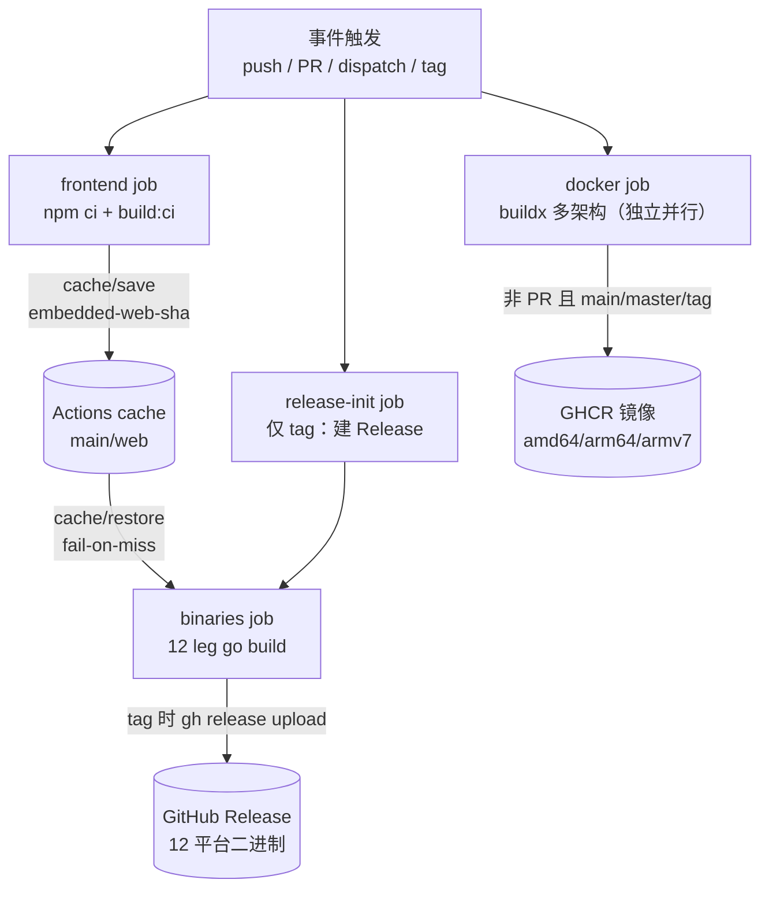
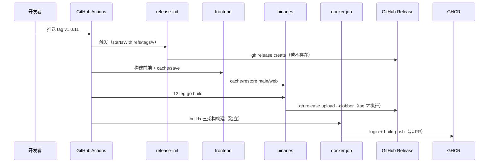
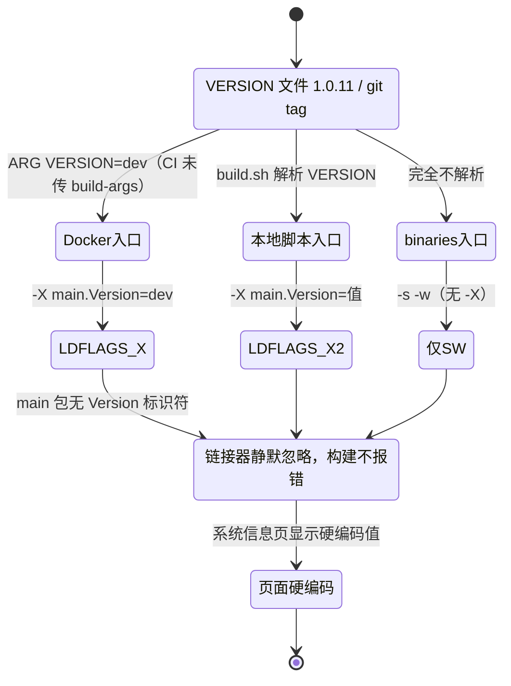
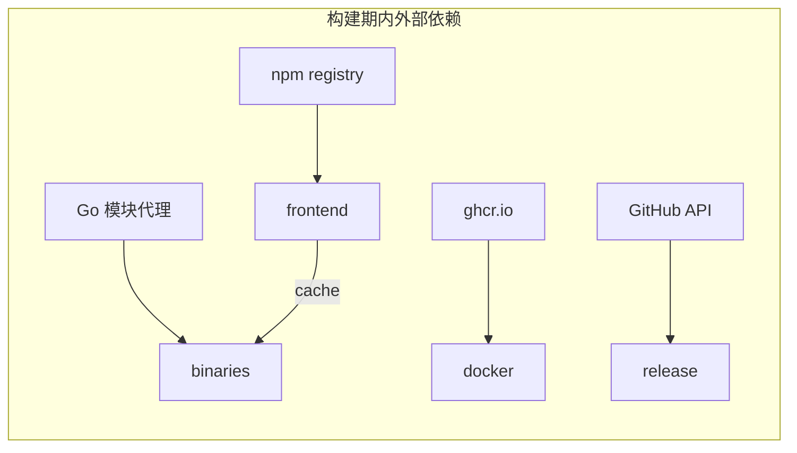

# CI_CD流水线配置

<cite>
**本文档引用的文件**
- [.github/workflows/build.yml](file://.github/workflows/build.yml)
- [Dockerfile](file://Dockerfile)
- [VERSION](file://VERSION)
- [main/main.go](file://main/main.go)
- [main/go.mod](file://main/go.mod)
- [scripts/build.sh](file://scripts/build.sh)
- [scripts/docker-build.sh](file://scripts/docker-build.sh)
- [web/package.json](file://web/package.json)
- [docs/Chanlog.md](file://docs/Chanlog.md)
</cite>

## 目录

1. [简介](#简介)
2. [项目结构](#项目结构)
3. [核心组件](#核心组件)
4. [架构总览](#架构总览)
5. [详细组件分析](#详细组件分析)
6. [依赖关系分析](#依赖关系分析)
7. [性能考虑](#性能考虑)
8. [故障排查指南](#故障排查指南)
9. [结论](#结论)
10. [附录](#附录)

## 简介

本篇是 **DNSPlane 持续集成/持续交付流水线的操作手册**，面向"怎么触发、每个 job 干什么、产物去哪、失败了看哪一行日志"这类实操问题。流水线为何这样切分 job、镜像分层与交叉编译的设计动机、多架构矩阵的能力边界等**架构层面的论证**由 `docs/系统架构/部署架构.md` 承担；本地构建与容器运行见 `docs/部署运维/Docker容器化部署.md`。本篇不重复其推导，只给触发条件、job 拆解、产物去向、secrets 清单与排障步骤。

当前事实口径（以工作区实测为准）：

- **唯一在用流水线为 GitHub Actions**：`.github/workflows/build.yml`（`name: Build`，4 个 job）。
- **CNB 流水线已成历史**：`.cnb.yml` 在提交 `66f4799` 中整体删除，当前工作区不存在该文件；其历史故障（`git:release` 空 tag、`set -u` 报错）已随切换 GitHub Actions 而失效，仅作经验保留（见 [CNB 流水线现状](#cnb-流水线现状)）。
- **仓库版本文件** `VERSION` 为 `1.0.11`，但**流水线并未把它注入二进制**（见 [版本注入链路](#版本注入链路)）。

| 操作意图 | 应触发的 ref | 产出 |
| --- | --- | --- |
| 提交验证（不改线上） | `pull_request` | 仅构建，不推镜像、不传 Release |
| 分支镜像更新 | push `main`/`master` | GHCR 三架构镜像 + 分支标签 |
| 正式发布 | push tag `v*` | GitHub Release（12 平台二进制）+ GHCR 版本镜像 |
| 手动跑一次 | `workflow_dispatch` | 依当前 ref 行为而定 |

**章节来源**
- [.github/workflows/build.yml](file://.github/workflows/build.yml)
- [docs/Chanlog.md](file://docs/Chanlog.md)
- [VERSION](file://VERSION)

## 项目结构

流水线相关文件与它们在交付链路中的角色：

| 路径 | 角色 | 操作者可改点 |
| --- | --- | --- |
| `.github/workflows/build.yml` | 唯一 CI 定义，`on`/`permissions`/四 job | 增删 job、改矩阵、改触发 |
| `Dockerfile` | `docker` job 的构建输入（自包含三阶段） | 见 Docker容器化部署.md |
| `VERSION` | 期望的发布版本号来源 | 发版递增 |
| `scripts/build.sh` | 本地二进制编译（对照 CI 的 binaries job） | 版本注入实验在此 |
| `scripts/docker-build.sh` | 本地多架构 buildx（对照 CI 的 docker job） | 默认仓库名为 CNB 遗留值 |
| `.gitignore`/`.dockerignore` | 上下文与仓库卫生 | 影响缓存命中与体积 |

仓库**没有** `docker-compose.yml`、`.goreleaser.yml` 等编排/发布声明，Release 由 `gh release` 命令直接创建上传，产物通道为"GHCR 镜像 + GitHub Release 二进制"两条，无第三方发布工具。

**章节来源**
- [.github/workflows/build.yml](file://.github/workflows/build.yml)
- [scripts/docker-build.sh](file://scripts/docker-build.sh)

## 核心组件

`build.yml` 定义 4 个 job，职责与触发条件互不重叠：

| job | runs-on | needs | 触发条件 | 一句话职责 |
| --- | --- | --- | --- | --- |
| `release-init` | ubuntu-latest | 无 | 仅 `refs/tags/v*` | 先建好 GitHub Release 骨架，避免 matrix 并发创建竞争 |
| `frontend` | ubuntu-latest | 无 | 总是 | 构建前端并把 `main/web` 存入 Actions cache |
| `binaries` | ubuntu-latest | frontend, release-init | 总是（12 leg 矩阵） | 交叉编译 12 平台裸二进制，tag 时上传为 Release 附件 |
| `docker` | ubuntu-latest | **无** | 总是 | buildx 多架构构建镜像，非 PR 且 main/master/tag 时推送 GHCR |

三个要点值得操作者牢记：

- **`docker` job 不依赖任何 job**：它靠 `Dockerfile` 自带 web+go 构建，与 `frontend`/`binaries` 并行独立，前端 cache 出问题不会连累镜像构建，反之亦然。
- **`binaries` 强依赖 `frontend` 的缓存产物**：`actions/cache/restore` 设 `fail-on-cache-miss: true`，若 `frontend` 未成功写入 `embedded-web-${{ github.sha }}`，`binaries` 直接失败。
- **`release-init` 只为 tag 存在**：非 tag 事件它被 `if` 跳过，`binaries` 的 `needs: [..., release-init]` 对被跳过的依赖视为满足，不阻塞。

**章节来源**
- [.github/workflows/build.yml](file://.github/workflows/build.yml)

## 架构总览

job 之间的 `needs` 传导与产物去向如下（箭头为依赖方向，非执行顺序的唯一约束）：



**图表来源**
- [.github/workflows/build.yml](file://.github/workflows/build.yml)

一次"打 tag 发版"的完整时序：



**图表来源**
- [.github/workflows/build.yml](file://.github/workflows/build.yml)

**章节来源**
- [.github/workflows/build.yml](file://.github/workflows/build.yml)

## 详细组件分析

### 触发与权限模型

`on` 段声明四类触发；`permissions` 段收窄到本次交付所需最小权限。

```yaml
on:
  push:
    branches: [main, master]
    tags: ["v*"]
  pull_request:
  workflow_dispatch:

permissions:
  contents: write   # 创建/上传 GitHub Release 附件
  packages: write   # 推送 GHCR 镜像
```

行为矩阵（触发事件 → 各 job 动作）：

| 事件 | release-init | frontend | binaries | docker：build | docker：push | Release 附件 |
| --- | --- | --- | --- | --- | --- | --- |
| push `main`/`master` | 跳过 | 跑 | 跑（不上传） | 三架构 | 是 | 否 |
| push tag `v*` | 跑 | 跑 | 跑并上传 | 三架构 | 是 | 是 |
| `pull_request` | 跳过 | 跑 | 跑（不上传） | 仅 amd64 | 否 | 否 |
| `workflow_dispatch` | 视 ref | 跑 | 视 ref | 视 ref | 视 ref | 视 ref |

docker 推送条件原样为：`push != 'pull_request' && (ref == main || ref == master || startsWith(ref, 'refs/tags/v'))`；PR 的平台被降为单 `linux/amd64`，其余为 `linux/amd64,linux/arm64,linux/arm/v7`。

**章节来源**
- [.github/workflows/build.yml](file://.github/workflows/build.yml)

### 并发策略

流水线**未定义 `concurrency` 组**。这意味着：同一分支/PR 的多次 push 会产生**并行运行的多次 workflow 实例**，GitHub 默认不做"取消进行中"的收敛。

```yaml
# 现状：build.yml 顶层无此块。如需串行化同分支运行，可自行加入：
concurrency:
  group: ${{ github.workflow }}-${{ github.ref }}
  cancel-in-progress: ${{ github.event_name == 'pull_request' }}
```

需要留意的并发点：

| 场景 | 风险 | 现有缓解 |
| --- | --- | --- |
| tag 的多 leg matrix 同时建 Release | 竞争/重复创建 | `release-init` 先行创建，`binaries` `needs` 它；上传用 `--clobber` |
| 同分支连续 push | 多实例并发跑、抢 runner | 无 `concurrency`，需自行添加（上方建议） |
| PR 与 push 同时触发 | 重复构建 | 无去重；PR 只单架构降低开销 |

**章节来源**
- [.github/workflows/build.yml](file://.github/workflows/build.yml)

### 缓存链路

流水线用三种缓存，各自解决不同问题：

| 缓存 | 位置 | key/scope | 解决什么 |
| --- | --- | --- | --- |
| npm 依赖缓存 | `frontend` 的 `setup-node` | `cache: npm`，`cache-dependency-path: web/package-lock.json` | 加速 `npm ci` |
| Go 模块缓存 | `binaries` 的 `setup-go` | `go-version-file: main/go.mod`，`cache-dependency-path: main/go.sum` | 加速 `go mod download` |
| 前端产物中转 | `frontend` save / `binaries` restore | `embedded-web-${{ github.sha }}` | 跨 job 传 `main/web`，**刻意不用 artifact 以避开产物存储配额** |
| Docker 层缓存 | `docker` 的 buildx | `cache-from/cache-to type=gha,mode=max` | 复用镜像层 |

前端产物中转是本流水线一个反直觉但重要的选择：`frontend` 把 `main/web` 写入 Actions cache 而非上传 artifact，`binaries` 再 restore 且 `fail-on-cache-miss: true`。因此**同一次 run 的 `github.sha` 必须一致**才能命中，手动 `workflow_dispatch` 与 push 事件天然满足。

```bash
# 本地无法复现 Actions cache 中转；若要在单机模拟 binaries job 的 embed 前置：
SKIP_FRONTEND=0 scripts/build.sh   # 先生成 main/web，再进 main/ 编译
```

**章节来源**
- [.github/workflows/build.yml](file://.github/workflows/build.yml)
- [scripts/build.sh](file://scripts/build.sh)

### 产物：Release 附件与多架构镜像

`binaries` 用 `matrix.include` 显式列举 12 条 leg：

| GOOS | 覆盖 GOARCH | 附件命名后缀 |
| --- | --- | --- |
| linux | amd64、arm64、arm(goarm 7)、386、ppc64le、riscv64 | `linux-*`，arm 为 `linux-armv7` |
| darwin | amd64、arm64 | `darwin-*` |
| windows | amd64、arm64 | `windows-*`，追加 `.exe` |
| freebsd | amd64、arm64 | `freebsd-*` |

上传仅在 tag 时执行，先 `shopt -s nullglob` 判空目录再把 `main/dist` 全量文件 `gh release upload --clobber`：

```bash
# tag 环境下 job 内实际执行（GITHUB_REF_NAME 即 tag 名，非空）
gh release upload "${GITHUB_REF_NAME}" main/dist/* \
  --repo "${GITHUB_REPOSITORY}" --clobber
```

镜像侧由 `docker/metadata-action` 生成标签，`images` 为小写化后的 `ghcr.io/${repository}`：

| 标签类型 | 生成规则 | 例 |
| --- | --- | --- |
| `type=ref,event=branch` | 分支名 | `:main` |
| `type=semver,pattern={{version}}` | 完整语义版本 | `:1.0.11` |
| `type=semver,pattern={{major}}.{{minor}}` | 主次版本 | `:1.0` |
| `type=sha,prefix=` | 提交短 sha | `:abc1234` |

矩阵策略 `fail-fast: false`：单 leg 失败不中断其余 leg，但整个 job 仍判失败，因此一次红叉可能只对应一个平台。

**章节来源**
- [.github/workflows/build.yml](file://.github/workflows/build.yml)

### 版本注入链路

这是操作中最容易误解的一段。版本值有三条入口，但**三条都没有落到运行版本上**：



**图表来源**
- [.github/workflows/build.yml](file://.github/workflows/build.yml)
- [Dockerfile](file://Dockerfile)
- [scripts/build.sh](file://scripts/build.sh)

| 入口 | 是否传版本 | `-X main.Version` | 实际后果 |
| --- | --- | --- | --- |
| `docker` job（走 Dockerfile） | 未传 `build-args`，`VERSION` 恒为 `dev` | 有 | 符号不存在，静默忽略 |
| `binaries` job | 完全不解析版本 | 无（仅 `-s -w`） | 二进制内无版本 |
| 本地 `scripts/build.sh` | 解析 VERSION 文件/git | 有 | 值对，但符号不存在，忽略 |

根因（工作区实测）：`main/` 目录仅 `main.go` 一个文件，全文**不含 `Version` 标识符**；`-X importpath.Name=value` 只能写入已存在的 string 变量，对未定义符号 Go 链接器静默忽略、不报错。因此运行版本的可见来源退化为系统信息接口的硬编码值，与 `VERSION`、git tag 形成口径分裂。**这属于设计论证，完整分析与最小修复建议见** `docs/系统架构/部署架构.md`「版本注入三段链」。操作者应知：**发布版本的唯一准绳是镜像 tag 与 Release tag，而非二进制内版本。**

**章节来源**
- [.github/workflows/build.yml](file://.github/workflows/build.yml)
- [main/main.go](file://main/main.go)
- [Dockerfile](file://Dockerfile)
- [scripts/build.sh](file://scripts/build.sh)

### secrets 清单

流水线**未使用任何自定义 repository secret**。所有鉴权都走 Actions 自动注入的 `GITHUB_TOKEN`：

| 名称 | 类型 | 用途 | 使用位置 | 值 |
| --- | --- | --- | --- | --- |
| `secrets.GITHUB_TOKEN` | 内置自动令牌 | GHCR 登录推送镜像 | docker job `docker/login-action` | `{占位-运行时自动注入}` |
| `github.token`（GH_TOKEN 环境变量） | 内置自动令牌 | `gh release create/upload` | release-init、binaries 上传步 | `{占位-运行时自动注入}` |

含义与操作提醒：

- `packages: write`、`contents: write` 是 `GITHUB_TOKEN` 能推 GHCR / 建 Release 的前提，已在上文权限段声明。
- 该令牌作用域限于当前仓库，无法推送到外部 registry（如 Docker Hub）。若改用 `scripts/docker-build.sh` 手动推送到第三方仓库，需在本地或自建 runner 上另行登录，其凭据不属于本工作流定义：

```bash
# 本地推送第三方仓库所需的登录（令牌值占位，切勿写入仓库）
echo "{占位-registry-PAT}" | docker login {占位-registry域名} -u "{占位-用户名}" --password-stdin
IMAGE={占位-registry域名}/{占位-命名空间}/dnsplane scripts/docker-build.sh --push v1.0.11
```

**章节来源**
- [.github/workflows/build.yml](file://.github/workflows/build.yml)
- [scripts/docker-build.sh](file://scripts/docker-build.sh)

### CNB 流水线现状

按工作区取证：`.cnb.yml` **不存在**于当前树；`git` 相关 CI 配置文件仅 `.github/workflows/build.yml`。`docs/Chanlog.md` 记载 `.cnb.yml` 已在提交 `66f4799`（CI 由 CNB 切换 GitHub Actions）中删除，CNB 在仓库中的唯一残留是 `scripts/docker-build.sh` 的默认镜像名 `docker.cnb.cool/neko_kernel/dnsplane` 与一条 OCI source label。

| 维度 | CNB（历史，已删） | GitHub Actions（现状） |
| --- | --- | --- |
| 配置文件 | `.cnb.yml`（`66f4799` 删除） | `.github/workflows/build.yml` |
| 发布触发 | `master.push` + `git:release` upsert `v<VERSION>` | `refs/tags/v*` + `gh release` |
| 产物 | tar.gz + SHA256SUMS 附件 | 12 平台裸二进制附件 |
| 镜像仓库 | `docker.cnb.cool`（脚本默认残留） | `ghcr.io/${repository}` |
| 现状 | 已失效，仅经验保留 | 唯一在用 |

CNB 时代曾出现两类流水线故障，其教训在新流水线中以不同机制规避：

- **`tagname` 为空**（`docs/Chanlog.md` v1.0.6）：`git:release` 因 `cnb:read-file` 缺 `exports` 映射读不到 tag，Release 以空 tag 创建。GitHub Actions 侧改用内置 `${GITHUB_REF_NAME}`（tag 事件下即完整 tag 名，非空）与 `docker/metadata-action`，不存在同类插件参数契约问题。
- **`set -u` 报错**（commit `42f3a23`）：`CNB_TAG_NAME` 未定义在 `set -u` 下触发未绑定变量错误。新流水线在 tag 分支的 `run` 均 `set -euo pipefail` 并只引用 GitHub 保证存在的变量（`GITHUB_REF_NAME`、`GITHUB_REPOSITORY`）。

```bash
# 复核工作区是否真的没有 CNB 配置（应为空输出）
git -C . ls-files | grep -i "cnb" || echo "工作区无 CNB 配置，符合现状"
```

**章节来源**
- [docs/Chanlog.md](file://docs/Chanlog.md)
- [.github/workflows/build.yml](file://.github/workflows/build.yml)
- [scripts/docker-build.sh](file://scripts/docker-build.sh)

## 依赖关系分析

job 依赖（`needs`）与运行期外部依赖是两条独立维度，操作者排障时先分清是"上游 job 没产物"还是"外部服务不可达"。



**图表来源**
- [.github/workflows/build.yml](file://.github/workflows/build.yml)

| 依赖 | 影响哪个 job | 不可达症状 |
| --- | --- | --- |
| npm registry | frontend（`npm ci`） | `ETIMEDOUT`、install 失败，连累 binaries 因缺 cache 而 fail-on-miss |
| Go 模块代理 | binaries（`go build`） | 模块下载超时，单 leg 或全部失败 |
| `ghcr.io` | docker（login/push） | 推送 401/403 或超时，PR 不触发故仅 main/tag 受影响 |
| GitHub Release API | release-init、binaries 上传 | `gh release` 失败，附件缺失 |

`needs` 传导的一个隐藏点：`binaries` 同时 `needs: [frontend, release-init]`，而 `release-init` 在非 tag 事件被跳过——GitHub 将"被 `if` 跳过的 job"视为成功依赖，故非 tag 时 `binaries` 仍照常运行，只是不执行上传步（其 `if: startsWith(github.ref, 'refs/tags/v')`）。

**章节来源**
- [.github/workflows/build.yml](file://.github/workflows/build.yml)

## 性能考虑

流水线耗时主要来自三处，均有对应缓存/降级手段：

- **前端只构建一次**：`frontend` 单独 job 构建并 cache，`binaries` 的 12 条 leg 不再各自跑前端，避免 12× `npm ci`。Docker 侧同理——`Dockerfile` 把 web 阶段固定在 `BUILDPLATFORM` 单跑。
- **交叉编译不靠 QEMU 编译**：`binaries` 在 amd64 runner 上原生 `go build` 出全平台二进制（`CGO_ENABLED=0`），只有 `docker` job 的运行阶段用 QEMU 处理平台差异，编译不随架构翻倍。
- **PR 降级单架构**：PR 事件 docker 只构 `linux/amd64`，减少反馈时间。
- **产物走 cache 而非 artifact**：避开 Actions artifact 存储配额与上传/下载往返。

| 优化 | 手段 | 代价 |
| --- | --- | --- |
| 减少 `npm ci` | setup-node 缓存 + 单 job | 依赖变化时缓存失效首跑变慢 |
| 减少 `go build` 冷启 | setup-go 模块缓存 | `go.sum` 变更即失效 |
| 减少镜像层重建 | buildx `type=gha` 缓存 | GHA 缓存有容量/保留期限制 |
| 加快 PR | docker 单架构 | PR 不验证多架构镜像 |

矩阵 `fail-fast: false` 是"耗时换信息量"的取舍：跑满 12 leg 更慢，但一次能看到所有平台成败，减少反复触发。

**章节来源**
- [.github/workflows/build.yml](file://.github/workflows/build.yml)
- [Dockerfile](file://Dockerfile)

## 故障排查指南

按 job 归类高频失败与定位方法。

### frontend 失败（npm ci 超时）

现象：`frontend` 红，`npm ci` 卡住或网络错误。因 `binaries` `fail-on-cache-miss`，前端失败会连锁让 12 leg 全部无法 restore 产物。

```bash
# 本地复现前端构建（占位，勿在日志留机密）
cd web && npm ci && npm run build:ci
```

### binaries 单 leg 失败（cache miss / 模块超时）

现象：矩阵里个别 leg 红、其余绿。常见两种：`embedded-web` 缓存未命中（frontend 未成功），或 Go 模块代理抖动。`fail-fast: false` 使单 leg 失败不中断其余，但 job 仍判失败。

排查顺序：先看 frontend 是否成功写缓存 → 再看失败 leg 的 `go build` 具体报错（embed 缺 `main/web` 还是下载超时）。

### docker 推送失败（GHCR 权限）

现象：非 PR 事件 `docker` 在 login/push 报 401/403。根因多为 `packages: write` 权限不足，或仓库从未创建过对应 GHCR 包。PR 事件不推送，若 PR 红则是构建而非推送问题。

```bash
# 确认本地是否能以令牌推送（值占位）
echo "{占位-GHCR-PAT}" | docker login ghcr.io -u "{占位-用户名}" --password-stdin
```

### Release 附件缺失 / 空 tag

现象：tag 后 Release 存在但无二进制，或 tag 名异常。附件上传受 `if: startsWith(github.ref, 'refs/tags/v')` 约束，非 tag 事件不传；上传前先 `shopt -s nullglob` 判空 `main/dist`，空目录会主动报错退出而非把字面量 `*` 交给 `gh`。GitHub Actions 用 `${GITHUB_REF_NAME}` 取 tag，tag 事件下不会为空（历史 CNB 空 tag 问题在此不复现）。

| 失败 job | 首要定位 | 处置 |
| --- | --- | --- |
| frontend | `npm ci` 日志网络错误 | 重试/换网络，修好再触发（会连锁影响 binaries） |
| binaries | 是否 cache miss / 模块超时 | 先修 frontend；或重跑失败 leg |
| docker | login/push 权限 | 核 `packages: write` 与 GHCR 包是否存在 |
| release | tag 与 dist 是否为空 | 确认 tag 为 `v*`，确认 binaries 已产出 dist |

### 想验证版本注入是否生效

现象：升级后在系统信息页看到的版本与预期不符。按 [版本注入链路](#版本注入链路)，二进制内版本当前不落地，属预期现象，非流水线 bug。以镜像 tag / Release tag 为准即可。若确需二进制内版本，属代码改动（`main.go` 增加 `var Version`、CI 补 `-X`），见部署架构.md 建议。

**章节来源**
- [.github/workflows/build.yml](file://.github/workflows/build.yml)

## 结论

流水线运维要点收敛为六条：

- **四类触发各有产物**：PR 仅验证、main/master 出镜像、tag 出 Release+镜像、dispatch 视 ref。
- **四个 job 两条主线**：`frontend → binaries` 传裸二进制，`docker` 独立并行传镜像，互不连坐（frontend 失败除外，它会断 binaries 的 cache）。
- **无自定义 secret**：全靠自动注入的 `GITHUB_TOKEN`，配 `contents/packages: write`。
- **并发未收敛**：顶层无 `concurrency`，同分支多 push 会并行跑，按需自行加组。
- **版本不落地是既定事实**：`-X main.Version` 无对应符号，运行版本以 tag 为唯一准绳；深度论证在部署架构.md。
- **CNB 已退役**：工作区仅 `build.yml`，历史 `tagname 空`/`set -u` 故障由 `${GITHUB_REF_NAME}` 机制规避。

架构层设计动机（三阶段镜像、多架构矩阵边界、版本注入三段链根因）统一见 `docs/系统架构/部署架构.md`；镜像的构建与运行操作见 `docs/部署运维/Docker容器化部署.md`。

## 附录

### 手动触发与状态查询速查

```bash
# 用 gh 触发一次 workflow_dispatch
gh workflow run Build.yml --ref main

# 查看最近运行与状态
gh run list --workflow=Build.yml --limit 10
gh run view <RUN_ID> --log-failed

# 列出某 tag 的 Release 附件是否齐全（应为 12 平台）
gh release view v1.0.11 --repo OWNER/REPO
```

### 触发条件速查表

| ref | 触发 job | 产物 |
| --- | --- | --- |
| push `main` | frontend、binaries、docker | GHCR 三架构镜像（`:main`、`:sha`） |
| push `master` | 同上 | GHCR 三架构镜像 |
| tag `v*` | release-init、frontend、binaries(+上传)、docker | Release 12 附件 + GHCR 版本镜像（`:1.0.11`、`:1.0`） |
| `pull_request` | frontend、binaries、docker(单 amd64) | 无外部产物 |
| `workflow_dispatch` | 视所选 ref 而定 | 视 ref |

### 高频操作场景

以下是日常维护流水线时最常执行的几个动作，命令可直接复制，机密一律 `{占位}`。

```bash
# 场景 1：矩阵里只有一条 leg 失败，只重跑失败作业而非整轮
gh run rerun <RUN_ID> --failed

# 场景 2：下载某 tag 的全部 Release 附件并逐个校验哈希
gh release download v1.0.11 --repo OWNER/REPO --dir ./rel
sha256sum ./rel/dnsplane-linux-amd64   # 与随包 SHA256SUMS 比对

# 场景 3：确认 GHCR 上的多架构 manifest 真的含三平台
docker manifest inspect ghcr.io/OWNER/REPO:1.0.11 | grep -A1 platform

# 场景 4：拉取指定 leg 的运行日志，定位是 cache miss 还是模块超时
gh run view <RUN_ID> --log-failed

# 场景 5：核对当前 workflow 的 job 清单与触发条件（离线读 YAML）
sed -n '1,30p' .github/workflows/build.yml
```

操作提示：

| 场景 | 判据 | 后续动作 |
| --- | --- | --- |
| 单 leg 失败 | `--log-failed` 显示某平台 `go build` 报错 | `rerun --failed`；若为模块超时可直接重跑 |
| 全 binaries 红 | 日志见 `embedded-web` cache miss | 先修 `frontend`，再整轮重跑 |
| 附件缺失 | Release 页无 12 平台文件 | 确认事件为 tag `v*`，确认 `dist/` 非空 |
| 镜像缺某架构 | manifest 只列 amd64 | 多为 PR 触发（本就单架构），非缺陷 |

下载产物校验时应交叉参考 `scripts/build.sh` 生成的 `SHA256SUMS` 口径：本地脚本对 `dnsplane-linux-*` 计算 sha256，而 CI 的 `binaries` job 未生成校验文件，Release 页只列原始二进制。若需在 Release 附带校验和，属流水线功能增强（新增一步 `sha256sum` 并 `gh release upload`），非现状。

### 术语说明

- **leg**：矩阵中的一条具体组合（如 `linux/arm64`），`binaries` 共 12 条。
- **BUILDPLATFORM / TARGETPLATFORM**：buildx 交叉编译时"构建主机平台"与"目标运行平台"；Dockerfile 让编译走前者、运行层走后者。
- **fail-on-cache-miss**：`actions/cache/restore` 参数，缓存缺失即让 job 失败，用于强约束"前端产物必须先于二进制"。
- **GHCR**：GitHub Container Registry，`docker` job 的推送目标。
