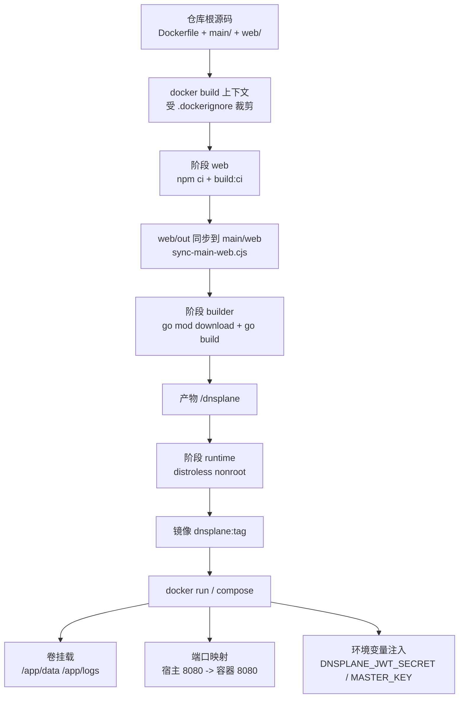
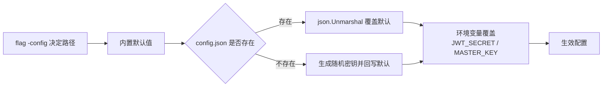
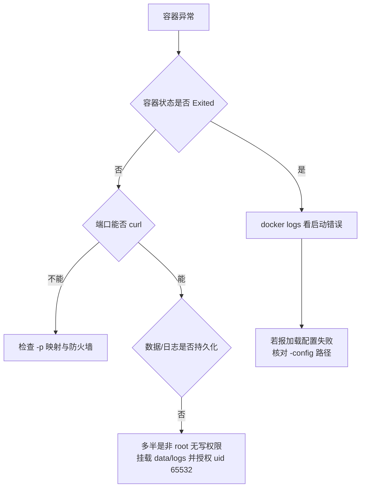
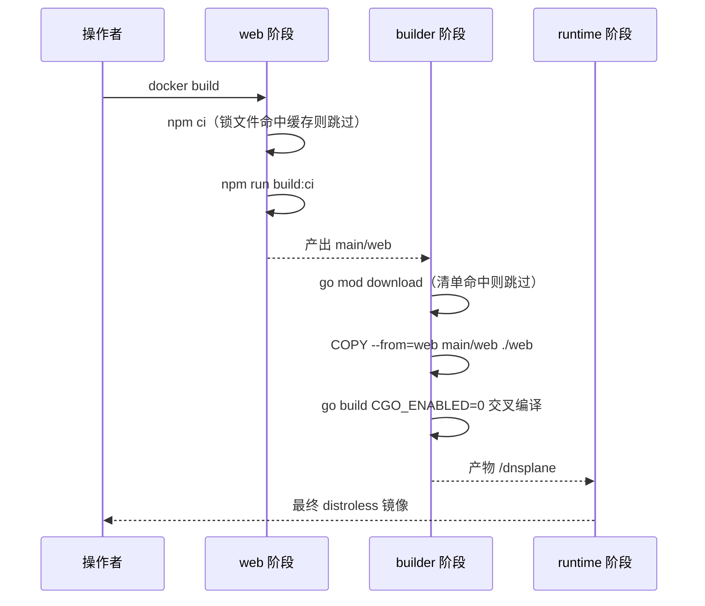
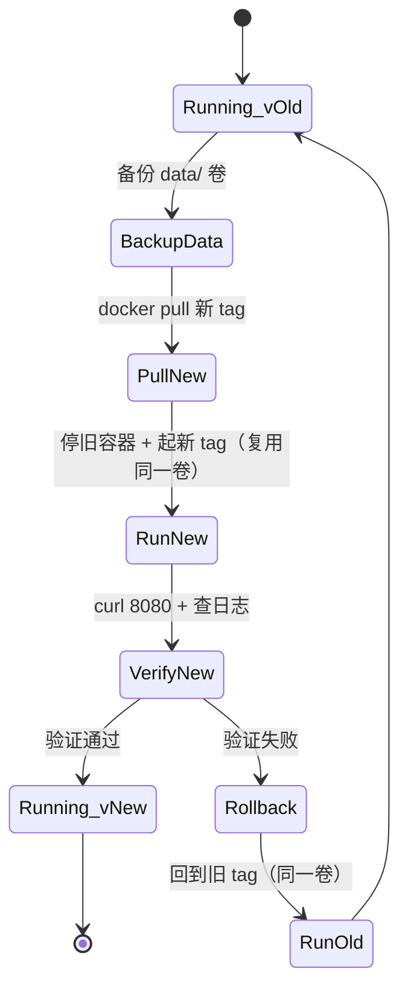

# Docker容器化部署

<cite>
**本文档引用的文件**
- [Dockerfile](file://Dockerfile)
- [.dockerignore](file://.dockerignore)
- [scripts/build.sh](file://scripts/build.sh)
- [scripts/docker-build.sh](file://scripts/docker-build.sh)
- [main/main.go](file://main/main.go)
- [main/internal/config/config.go](file://main/internal/config/config.go)
- [main/internal/logger/logger.go](file://main/internal/logger/logger.go)
- [web/package.json](file://web/package.json)
- [web/scripts/sync-main-web.cjs](file://web/scripts/sync-main-web.cjs)
- [main/go.mod](file://main/go.mod)
- [VERSION](file://VERSION)
</cite>

## 目录

1. [简介](#简介)
2. [项目结构](#项目结构)
3. [核心组件](#核心组件)
4. [架构总览](#架构总览)
5. [详细组件分析](#详细组件分析)
6. [依赖关系分析](#依赖关系分析)
7. [性能考虑](#性能考虑)
8. [故障排查指南](#故障排查指南)
9. [结论](#结论)
10. [附录](#附录)

## 简介

本篇是 **DNSPlane 容器化部署的操作手册**，回答"怎么构建、怎么跑、怎么升级、跑挂了怎么办"这一类运维问题。镜像的分层设计动机、版本注入链路的架构分析、多架构矩阵的能力边界等**设计层面的论证**由 `docs/系统架构/部署架构.md` 承担，本篇不重复其推导，只给出可直接复制执行的命令、参数表与排障步骤，并在需要背景处交叉链接。

一句话概括交付物：**一条 `docker build` 产出一个自包含的 distroless 非 root 镜像，容器启动后由单一 Go 进程在 `8080` 端口同时提供控制台静态页与 API，无需外部 Node、Go、数据库或反向代理。**

面向的三类操作场景：

- **单机落地**：`docker run` 直接起，适合快速验证与小型私有部署。
- **常驻服务**：`docker compose` 固化卷挂载、重启策略与环境变量，适合长期运行。
- **多架构分发**：`scripts/docker-build.sh` 借助 buildx 一次产出 `amd64/arm64/arm/v7` 三架构镜像并推送到目标仓库。

| 关注点 | 本篇给的口径 | 深入设计请转 |
| --- | --- | --- |
| 三阶段 Dockerfile 为何这样分层 | 只讲每阶段的**操作职责**与缓存命中条件 | 部署架构.md「三个镜像阶段」 |
| `docker run` / compose 怎么写 | 给出完整可复制命令与参数表 | 不适用 |
| distroless 排障怎么做 | 给出 debug 镜像挂载法 | 部署架构.md「distroless 缺工具」 |
| 版本注入为什么在容器里看不到 | 只讲**操作后果**与验证手段 | 部署架构.md「版本注入三段链」 |

**章节来源**
- [Dockerfile](file://Dockerfile)
- [main/main.go](file://main/main.go)
- [main/internal/config/config.go](file://main/internal/config/config.go)

## 项目结构

只列出与容器化操作直接相关的文件，以及它们在构建/运行链路中扮演的角色。完整仓库结构见 `docs/项目概述.md`。

| 路径 | 作用 | 操作者是否需要改 |
| --- | --- | --- |
| `Dockerfile` | 三阶段构建定义：`web` → `builder` → `runtime` | 一般不改，交叉编译参数已内置 |
| `.dockerignore` | 裁剪构建上下文，剔除 `.git`、`node_modules`、`.next`、`out`、`**/*.md` | 追加本地 `data/`、`logs/` 可防止污染上下文 |
| `scripts/docker-build.sh` | buildx 多架构一键构建/推送脚本 | 改 `IMAGE`、`PLATFORMS` 环境变量 |
| `scripts/build.sh` | 本地裸二进制交叉编译（非镜像路径，此处仅对照） | 改 `VERSION` 环境变量 |
| `main/go.mod`、`main/go.sum` | builder 阶段 `go mod download` 的依赖清单 | 依赖变更时随之更新 |
| `web/package.json`、`web/package-lock.json` | web 阶段 `npm ci` 的锁文件 | 前端依赖变更时随之更新 |
| `VERSION` | 仓库根版本文件，当前为 `1.0.11` | 发版时递增 |

构建上下文（`docker build` / `docker buildx build` 的最后一个参数 `.`）为**仓库根目录**。builder 阶段以 `COPY main/ ./` 取后端源码，web 阶段以 `COPY web/ ./` 取前端源码，二者都相对仓库根解析，因此必须在根目录执行构建命令，或显式 `-f Dockerfile .` 指定。

**章节来源**
- [.dockerignore](file://.dockerignore)
- [Dockerfile](file://Dockerfile)
- [scripts/docker-build.sh](file://scripts/docker-build.sh)

## 核心组件

镜像由三个 `FROM` 阶段串联，运行阶段只保留最终二进制。下表从**操作职责**角度拆解，设计动机的完整论证见部署架构.md。

| 阶段 | 基础镜像 | 操作职责 | 关键约束 |
| --- | --- | --- | --- |
| `web` | `node:22-bookworm-slim`（`--platform=$BUILDPLATFORM`） | `npm ci` 安装前端依赖、`npm run build:ci` 产出静态站点并同步到 `main/web` | 只在构建主机平台执行一次，避免多架构并行 `npm ci` 撞网络 |
| `builder` | `golang:1.26.2-bookworm`（`--platform=$BUILDPLATFORM`） | `go mod download` 预热依赖、`go build` 交叉编译出 `/dnsplane` | `CGO_ENABLED=0`，按 `TARGETOS/TARGETARCH/TARGETVARIANT` 目标平台编译 |
| `runtime` | `gcr.io/distroless/static-debian12:nonroot`（`--platform=$TARGETPLATFORM`） | 仅承载二进制，`USER nonroot:nonroot`，`EXPOSE 8080` | 无 shell、无包管理器、无诊断工具 |

三个 `ARG` 是交叉编译的操作把手：`TARGETOS`、`TARGETARCH`、`TARGETVARIANT` 由 buildx 依据 `--platform` 自动注入，`VERSION`（默认 `dev`）用于向 ldflags 传版本号。手工 `docker build` 不经过 buildx 平台矩阵时，这三个 `TARGET*` 取宿主默认值。

**章节来源**
- [Dockerfile](file://Dockerfile)
- [web/package.json](file://web/package.json)
- [main/go.mod](file://main/go.mod)

## 架构总览

下图给出从"源码在磁盘"到"容器在服务"的一次完整操作链路，方框标注的是**你要执行的命令**而非模块依赖。



**图表来源**
- [Dockerfile](file://Dockerfile)
- [web/scripts/sync-main-web.cjs](file://web/scripts/sync-main-web.cjs)
- [main/internal/config/config.go](file://main/internal/config/config.go)

操作链路上有两条**必须记住的顺序依赖**：一是 `web` 阶段必须先于 `builder`（builder 的 `COPY --from=web /build/main/web ./web` 直接取 web 阶段产物）；二是 `go:embed all:web` 要求编译时 `main/web` 目录已存在，若单独跳过 web 阶段复用旧产物，需确保上一次 `build:ci` 已落地 `main/web`。

**章节来源**
- [Dockerfile](file://Dockerfile)
- [main/main.go](file://main/main.go)

## 详细组件分析

### 构建前置：环境与上下文准备

在任意机器上执行镜像构建前，先确认 Docker 与 buildx 就绪。单架构本地构建对 Docker 版本无特殊要求；多架构构建依赖 buildx 的 `docker-container` 驱动与 QEMU 模拟器。

```bash
# 检查 buildx 是否可用
docker buildx version
# 检查当前 builder 实例与支持的平台上限
docker buildx inspect --bootstrap | grep -i platforms
```

上下文卫生直接影响构建耗时与可复现性。`.dockerignore` 已剔除 `.git`、`web/node_modules`、`web/.next`、`web/out` 与所有 `*.md`，但**未剔除运行期可能落在仓库根的 `data/` 与 `logs/`**。若在仓库根做过裸二进制试运行，SQLite 库文件与日志会残留在 `data/`、`logs/` 并被复制进上下文。

```bash
# 建议在干净的检出树里构建；若本地跑过 build.sh，先确认这两处不影响上下文
ls -d data logs 2>/dev/null
# 可选：在 .dockerignore 追加，避免把它们送入构建上下文
printf 'data/\nlogs/\ndist/\n' >> .dockerignore
```

**章节来源**
- [.dockerignore](file://.dockerignore)
- [scripts/build.sh](file://scripts/build.sh)

### 单架构本地构建

最直接的构建方式，产物为当前主机架构的单架构镜像，可 `docker run` 直起。

```bash
# 在仓库根执行；-t 打标签，构建缓存默认走本地层缓存
docker build -t dnsplane:local .

# 若要把仓库根 VERSION 文件值传进 ldflags（当前该符号无落地，见附录说明）
VERSION_VAL="$(tr -d '[:space:]' < VERSION)"
docker build --build-arg VERSION="${VERSION_VAL}" -t dnsplane:local .
```

缓存命中判定（操作视角）：

| 改动类型 | 会重跑的层 | 不会重跑的层 |
| --- | --- | --- |
| 仅改前端业务代码（`web/` 下） | `COPY web/ ./`、`npm run build:ci` | `npm ci`（锁文件未变） |
| 改 `web/package.json` 或 `package-lock.json` | `npm ci` 及其后所有层 | Go 相关层 |
| 仅改后端代码（`main/` 下、非依赖清单） | `COPY main/ ./`、`go build` | `go mod download`（go.mod/go.sum 未变） |
| 改 `main/go.mod` 或 `go.sum` | `go mod download` 及其后层 | web 阶段（若前端未变） |

这套分层的核心价值就是**依赖清单先落、源码后落**：`COPY main/go.mod main/go.sum ./` 紧跟 `go mod download`，只要依赖不变，`download` 层即被复用；web 阶段同理先 `COPY package.json package-lock.json` 再 `npm ci`。

**章节来源**
- [Dockerfile](file://Dockerfile)
- [VERSION](file://VERSION)

### 多架构构建与推送（scripts/docker-build.sh）

分发到异构主机时用 buildx 一次产出三架构。脚本封装了 builder 创建、平台参数、标签与 OCI label。

```bash
# 默认：仅本地构建 linux/amd64,linux/arm64，不推送
scripts/docker-build.sh

# 构建并推送，显式打 tag
IMAGE=ghcr.io/your-org/dnsplane scripts/docker-build.sh --push v1.0.11

# 自定义平台集
PLATFORMS=linux/amd64,linux/arm64,linux/arm/v7 \
IMAGE=ghcr.io/your-org/dnsplane \
scripts/docker-build.sh --push v1.0.11
```

脚本关键行为（对照源码，用于判断"为什么没 push 成功"）：

- 默认 `IMAGE` 为 `docker.cnb.cool/neko_kernel/dnsplane`，这是 CNB 历史遗留的仓库名，**私有分发前应显式覆盖**（见上例 `IMAGE=`）。
- 未传 tag 时从 `git describe --tags --always --dirty` 推导，工作树脏时 tag 会带 `-dirty` 后缀。
- 多架构镜像**无法 `--load` 到本地 Docker**，脚本在无 `--push` 且非单宿主架构时只构建不导出，这是 Docker 的平台限制而非 bug。
- 每次都会 `--tag ${IMAGE}:${TAG}` 与 `--tag ${IMAGE}:latest` 双标签。

推送前需先登录目标仓库：

```bash
# GHCR 用个人访问令牌或账号密码登录（令牌值以占位表示）
echo "{占位-GHCR-PAT}" | docker login ghcr.io -u "{占位-用户名}" --password-stdin
```

**章节来源**
- [scripts/docker-build.sh](file://scripts/docker-build.sh)

### 运行容器：卷、端口、非 root 语义

运行阶段镜像 `WORKDIR /app`、`USER nonroot:nonroot`。非 root 用户对 `/app` 无写权限，而进程会把 SQLite 库写到 `data/dnsplane.db`、把日志写到 `logs/`（均为相对 WORKDIR 路径），因此**必须把可写目录挂进来**，否则启动即因无法创建目录失败。

```bash
# 单机运行：显式准备可写卷目录并授权 nonroot（uid 65532）
mkdir -p ./data ./logs
docker run -d --name dnsplane \
  -p 8080:8080 \
  -v "$(pwd)/data:/app/data" \
  -v "$(pwd)/logs:/app/logs" \
  -e DNSPLANE_JWT_SECRET="{占位-随机密钥}" \
  -e DNSPLANE_MASTER_KEY="{占位-随机密钥}" \
  dnsplane:local
```

参数语义表：

| 参数 | 语义 | 缺失后果 |
| --- | --- | --- |
| `-p 8080:8080` | 宿主端口映射到容器 `EXPOSE` 的 8080 | 外部无法访问控制台 |
| `-v ./data:/app/data` | 持久化 SQLite 库（`data/dnsplane.db`） | 容器重建即丢数据；非 root 无写权限会启动失败 |
| `-v ./logs:/app/logs` | 持久化按日切分的 `*.log` | 日志随容器删除丢失 |
| `-e DNSPLANE_JWT_SECRET` | 覆盖配置文件中的 JWT 密钥 | 未设则用文件值或自动生成随机值（重启变化） |
| `-e DNSPLANE_MASTER_KEY` | 覆盖字段加密主密钥 | 未设则自动生成，**重启后旧密文无法解密** |

`8080` 来源：`runtime` 阶段 `EXPOSE 8080`，进程监听地址由配置 `Server.Host:Server.Port` 拼成，默认 `0.0.0.0:8080`。

**章节来源**
- [Dockerfile](file://Dockerfile)
- [main/internal/config/config.go](file://main/internal/config/config.go)
- [main/internal/logger/logger.go](file://main/internal/logger/logger.go)
- [main/main.go](file://main/main.go)

### 配置注入优先级（flag / 文件 / 环境变量）

`config.Load` 的取值顺序决定"我该改哪里才生效"。实测优先级如下：

1. **命令行 `-config`**：`flag.String("config", "config.json", ...)` 决定配置文件路径，容器内相对 WORKDIR 解析为 `/app/config.json`。
2. **内置默认**：`Port=8080`、`Host=0.0.0.0`、`Mode=release`、`Driver=sqlite`、`FilePath=data/dnsplane.db`。
3. **配置文件**：若 `path` 存在则 `json.Unmarshal` 覆盖默认；若文件不存在，进程生成随机 JWT/主密钥并回写默认配置。
4. **环境变量最高优先**：`DNSPLANE_JWT_SECRET`、`DNSPLANE_MASTER_KEY` 在文件加载之后再次覆盖对应字段。



**图表来源**
- [main/main.go](file://main/main.go)
- [main/internal/config/config.go](file://main/internal/config/config.go)

容器内挂载自定义配置文件的写法：

```bash
docker run -d --name dnsplane \
  -p 8080:8080 \
  -v "$(pwd)/data:/app/data" \
  -v "$(pwd)/logs:/app/logs" \
  -v "$(pwd)/config.json:/app/config.json:ro" \
  dnsplane:local
```

注意：环境变量优先级高于文件，若同时设置 `DNSPLANE_JWT_SECRET` 与文件中的 `jwt.secret`，以环境变量为准。机密值一律走环境变量注入，配置文件挂载建议加 `:ro`。

**章节来源**
- [main/main.go](file://main/main.go)
- [main/internal/config/config.go](file://main/internal/config/config.go)

### Compose 常驻编排

仓库未提供 `docker-compose.yml`，下面是可直接落地的最小示例。`restart: unless-stopped` 保证宿主机重启后自恢复，健康检查用二进制自带的 HTTP 端口探测。

```yaml
services:
  dnsplane:
    image: dnsplane:local
    container_name: dnsplane
    restart: unless-stopped
    ports:
      - "8080:8080"
    volumes:
      - ./data:/app/data
      - ./logs:/app/logs
    environment:
      DNSPLANE_JWT_SECRET: "{占位-随机密钥}"
      DNSPLANE_MASTER_KEY: "{占位-随机密钥}"
    healthcheck:
      test: ["CMD", "/app/dnsplane", "-h"]
      interval: 30s
      timeout: 5s
      retries: 3
      start_period: 15s
```

启动与查看：

```bash
docker compose up -d
docker compose ps
docker compose logs -f dnsplane
```

compose 各字段语义：

| 字段 | 作用 | 备注 |
| --- | --- | --- |
| `restart: unless-stopped` | 异常退出与开机自启 | 显式 `down` 不复活 |
| `./data:/app/data` | 库文件持久化 | 首次需保证目录对 uid 65532 可写 |
| `./logs:/app/logs` | 日志持久化 | 进程同时输出到 stdout，`docker logs` 亦可见 |
| `environment` | 注入两个密钥 | 生产用 `secrets` 或外部 `.env`，勿硬编码值 |

**章节来源**
- [main/internal/logger/logger.go](file://main/internal/logger/logger.go)
- [Dockerfile](file://Dockerfile)

### distroless 限制与排障手段

`gcr.io/distroless/static-debian12:nonroot` 是"极简运行镜像"的运维代价：**没有 shell、没有 `ls`、没有包管理器**，`docker exec -it dnsplane sh` 会直接失败。排障必须绕开容器内部，改用宿主工具或 debug 镜像。

```bash
# 反例：distroless 里没有 shell，会报 executable file not found
docker exec -it dnsplane sh

# 正确姿势 1：看进程日志走 stdout，而非进容器翻文件
docker logs --tail=200 dnsplane

# 正确姿势 2：宿主侧读挂载出来的目录
tail -n 200 ./logs/$(date +%F).log
sqlite3 ./data/dnsplane.db ".tables"

# 正确姿势 3：用 GCR 官方 debug 变体替换入口，获得 busybox 环境
# 以同一份运行镜像的文件系统 + debug shell 排查权限/路径问题
docker run --rm -it \
  --entrypoint chroot \
  -v "$(pwd)/data:/app/data" \
  gcr.io/distroless/static-debian12:debug ls -la /app 2>/dev/null || \
  echo "如镜像无 debug 变体，改用下方 busybox 挂载法"

# 通用法：把目标容器文件系统或挂载卷交给带 shell 的小镜像查看
docker run --rm -it \
  -v dnsplane_data:/data busybox sh -c "ls -la /data && id"
```

排障决策图：



**图表来源**
- [Dockerfile](file://Dockerfile)
- [main/internal/config/config.go](file://main/internal/config/config.go)

**章节来源**
- [Dockerfile](file://Dockerfile)
- [main/internal/logger/logger.go](file://main/internal/logger/logger.go)

## 依赖关系分析

运行期镜像对外部组件的依赖极少，这正是 distroless 单进程交付的优势。

| 依赖类别 | 是否必需 | 由谁承担 | 运维注意 |
| --- | --- | --- | --- |
| 静态 Web 服务器 | 否 | `go:embed all:web` 内嵌进二进制 | 无需 nginx、无跨域配置 |
| 数据库服务 | 否 | 默认内嵌 SQLite（`data/dnsplane.db`） | 换外部库需改配置并保证驱动可用 |
| 反向代理/TLS | 可选 | 部署者自备 | distroless 内不含证书自动签发 |
| CA 根证书 | 是 | distroless 自带 `/etc/ssl/certs` | 出站 DNS 商 API 依赖它 |
| shell/诊断工具 | 否（运行镜像不含） | 需外置 debug 手段 | 见上文排障手段 |

构建期依赖则体现为阶段间的取物关系，无外部服务：



**图表来源**
- [Dockerfile](file://Dockerfile)
- [web/scripts/sync-main-web.cjs](file://web/scripts/sync-main-web.cjs)

`go build` 需要 `main/web` 已存在，因为 `main.go` 声明了 `//go:embed all:web`；若 embed 目标缺失，`builder` 阶段会直接编译失败（`pattern all:web: no matching files found`），这是最常见的"跳阶段复用产物"踩坑点。

**章节来源**
- [main/main.go](file://main/main.go)
- [Dockerfile](file://Dockerfile)

## 性能考虑

操作层面能直接影响构建/运行性能的几个开关：

- **上下文裁剪**：`.dockerignore` 每少送 1MB 无关文件，就少一次网络传输到 daemon。本地若跑过 `build.sh` 产生 `dist/`，务必排除。
- **依赖层缓存**：保持 `go.mod/go.sum`、`package.json/package-lock.json` 与源码分离拷贝（Dockerfile 已如此），只在依赖真变化时才重跑 `download`/`ci`。
- **BUILDPLATFORM 交叉编译**：前端与 Go 编译都在宿主架构原生执行，仅运行层按目标平台，避免用 QEMU 跑 Node/Go 解释与编译带来的数量级减速。多架构镜像的分发由 buildx 的 manifest list 完成，编译不随平台翻倍。
- **trimpath 与 -s -w**：`-trimpath` 去除文件系统路径、`-s -w` 去符号表，缩小二进制体积，间接减小镜像层与冷启动拉取时间。

| 操作 | 收益 | 代价 |
| --- | --- | --- |
| 单架构 `docker build` | 迭代快、缓存友好 | 无法直接跨平台分发 |
| buildx 多架构 + `--push` | 一份 tag 覆盖 amd64/arm64/armv7 | 需 QEMU 与远程缓存，首次慢 |
| `cache-from/cache-to type=gha`（CI 内） | 复用 Actions 层缓存 | 仅对 GitHub Actions 有效 |

运行期容量参考：SQLite 为单文件，`data/` 卷需预留增长空间；日志按日切分写入 `logs/`，长期运行应配合外部轮转或定期清理，避免卷膨胀。

**章节来源**
- [Dockerfile](file://Dockerfile)
- [.dockerignore](file://.dockerignore)
- [scripts/docker-build.sh](file://scripts/docker-build.sh)

## 故障排查指南

按"构建期 → 启动期 → 运行期"归类高频故障与定位命令。

### npm ci 超时 / 前端依赖装不上

现象：`web` 阶段 `npm ci` 卡住或报 `ETIMEDOUT`、`ECONNRESET`。Dockerfile 已在 `npm ci` 前设置重试（`fetch-retries 5`、`fetch-retry-mintimeout 20000`、`fetch-retry-maxtimeout 120000`）。多架构并行 `npm ci` 会放大网络压力，因此 web 阶段被固定为 `--platform=$BUILDPLATFORM` 只跑一次。

```bash
# 本地复现单跑，观察是否网络问题
docker build --target web -t dnsplane-webonly .
# 若公司网络需代理，可在构建时传入 npm 配置（代理地址为示例占位）
docker build --build-arg http_proxy="{占位-代理}" --build-arg https_proxy="{占位-代理}" .
```

### go mod download 失败 / embed 缺文件

现象：`builder` 阶段 `go build` 报 `pattern all:web: no matching files found`（web 阶段未产出 `main/web`），或 `go mod download` 拉不到模块。

```bash
# 校验依赖清单可解析（模块路径为 main）
docker run --rm -v "$(pwd)/main:/src" -w /src golang:1.26.2-bookworm go mod download -x
# 单独构建 builder 目标定位是哪一步断的
docker build --target builder -t dnsplane-bld .
```

### 启动即退出 / 无法创建目录

现象：容器 `Exited`，`docker logs` 见权限或目录错误。根因多为未挂载可写 `data/`、`logs/`，或宿主目录属主对 uid 65532 不可写。

```bash
# 查看退出日志
docker logs --tail=100 dnsplane
# 宿主目录授权给 distroless nonroot（uid 65532）
sudo chown -R 65532:65532 ./data ./logs
# 或改用命名卷，由 Docker 处理权限
docker volume create dnsplane_data
```

### 端口不通 / 配置加载失败

现象：`curl localhost:8080` 无响应，或日志见"加载配置失败"。前者查 `-p` 映射与防火墙，后者查 `-config` 路径是否指向容器内可访问文件。

```bash
docker ps --filter name=dnsplane --format "{{.Ports}}"
# 容器监听地址来自配置 Server.Host/Port，默认 0.0.0.0:8080
docker inspect dnsplane --format '{{json .NetworkSettings.Ports}}'
```

### 重启后加密数据读不出

现象：升级或重建后字段解密失败。若未固定 `DNSPLANE_MASTER_KEY`，进程在缺密钥时会自动生成随机主密钥并回写，容器重建即丢失，导致旧密文无法解密。

```bash
# 生产环境务必显式注入稳定的主密钥（值占位）
docker run -d --name dnsplane \
  -e DNSPLANE_MASTER_KEY="{占位-稳定主密钥}" \
  -e DNSPLANE_JWT_SECRET="{占位-稳定JWT密钥}" \
  -v "$(pwd)/data:/app/data" \
  -v "$(pwd)/logs:/app/logs" \
  dnsplane:local
```

| 故障 | 定位命令 | 处置 |
| --- | --- | --- |
| `npm ci` 超时 | `docker build --target web .` | 走宿主网络重试/加代理，勿多架构并行装前端 |
| embed 缺 `main/web` | `docker build --target builder .` | 确保 web 阶段先跑或复用旧产物 |
| 非 root 写权限失败 | `docker logs dnsplane` | 挂 `data/logs` 并 `chown 65532` |
| 端口不通 | `docker ps --format "{{.Ports}}"` | 修 `-p` 与防火墙 |
| 主密钥漂移 | 检查 `DNSPLANE_MASTER_KEY` | 显式注入稳定密钥 |

**章节来源**
- [Dockerfile](file://Dockerfile)
- [main/internal/config/config.go](file://main/internal/config/config.go)
- [main/main.go](file://main/main.go)

## 结论

容器化部署的运维要点收敛为五条：

- **构建在仓库根、上下文要干净**：`docker build -f Dockerfile .` 的 `.` 必须是仓库根；本地跑过裸编译时排除 `data/`、`logs/`、`dist/`。
- **缓存靠"清单先落"**：依赖层命中与否取决于 `go.mod/go.sum`、`package*.json` 是否变化，理解这一点能显著缩短迭代构建。
- **分发靠 buildx 交叉编译**：`scripts/docker-build.sh` 覆盖 amd64/arm64/armv7，注意默认镜像名是 CNB 遗留值、多架构不能 `--load`。
- **运行必须挂可写卷 + 固定密钥**：非 root 语义要求 `/app/data`、`/app/logs` 可写，`DNSPLANE_MASTER_KEY` 不固定会导致重启解密失败。
- **distroless 排障靠外部工具**：容器内无 shell，走 `docker logs`、挂载卷宿主侧查看或 debug 变体。

版本注入的"当前无落地符号"结论、多架构矩阵能力边界、以及三阶段设计动机，属架构论证范畴，统一见 `docs/系统架构/部署架构.md`；与流水线交付的对接见 `docs/部署运维/CI_CD流水线配置.md`。

## 附录

### 常用命令速查

```bash
# 构建单架构
docker build -t dnsplane:local .
# 多架构推送
IMAGE=ghcr.io/your-org/dnsplane scripts/docker-build.sh --push v1.0.11
# 起容器（占位密钥）
docker run -d --name dnsplane -p 8080:8080 \
  -v "$(pwd)/data:/app/data" -v "$(pwd)/logs:/app/logs" \
  -e DNSPLANE_JWT_SECRET="{占位}" -e DNSPLANE_MASTER_KEY="{占位}" \
  dnsplane:local
# 看日志 / 进不去就别进
docker logs -f dnsplane
# 停止与清理
docker rm -f dnsplane
```

### 升级与回滚（镜像 tag 口径）

升级与回滚本质是"换镜像 tag + 保留数据卷"，`data/` 与 `logs/` 卷不随镜像重建而丢失。



**图表来源**
- [scripts/docker-build.sh](file://scripts/docker-build.sh)
- [main/internal/config/config.go](file://main/internal/config/config.go)

操作步骤：

```bash
# 升级
docker stop dnsplane && docker rm dnsplane
docker pull ghcr.io/your-org/dnsplane:v1.0.11
docker run -d --name dnsplane -p 8080:8080 \
  -v "$(pwd)/data:/app/data" -v "$(pwd)/logs:/app/logs" \
  -e DNSPLANE_MASTER_KEY="{占位-稳定主密钥}" \
  ghcr.io/your-org/dnsplane:v1.0.11
curl -sf http://localhost:8080/ >/dev/null && echo "升级后探活 OK"

# 回滚：把镜像换回上一个可用 tag，数据卷不动
docker stop dnsplane && docker rm dnsplane
docker run -d --name dnsplane -p 8080:8080 \
  -v "$(pwd)/data:/app/data" -v "$(pwd)/logs:/app/logs" \
  -e DNSPLANE_MASTER_KEY="{占位-稳定主密钥}" \
  ghcr.io/your-org/dnsplane:v1.0.10
```

| tag 口径 | 含义 | 建议用途 |
| --- | --- | --- |
| `latest` | 每次构建自动附加 | 仅测试，勿用于生产固定 |
| `vX.Y.Z`（semver） | CI metadata 生成 | 生产按精确版本固定 |
| git sha | CI `type=sha,prefix=` | 精确回溯某次提交 |

### 关于版本注入的操作提醒

`Dockerfile` 的 `-ldflags="-s -w -X main.Version=${VERSION}"` 与 `scripts/build.sh` 的 `-X main.Version=${VERSION}` 指向的 `main.Version`，实测 `main/` 目录仅 `main.go` 一个文件且全文无 `Version` 标识符，链接器对未定义符号静默忽略、构建不报错。运维后果是：**容器与系统信息页看不到 ldflags 注入的版本**，页面版本为接口硬编码值，应以镜像 tag 与 Release tag 为版本准绳。完整链路论证见 `docs/系统架构/部署架构.md`。

**章节来源**
- [Dockerfile](file://Dockerfile)
- [main/main.go](file://main/main.go)
- [scripts/build.sh](file://scripts/build.sh)
