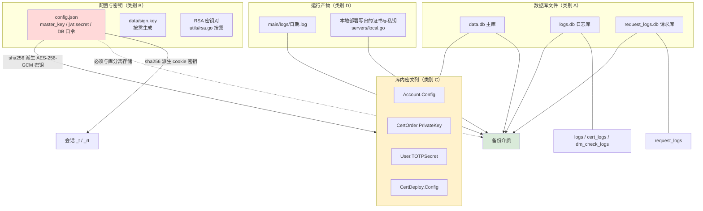
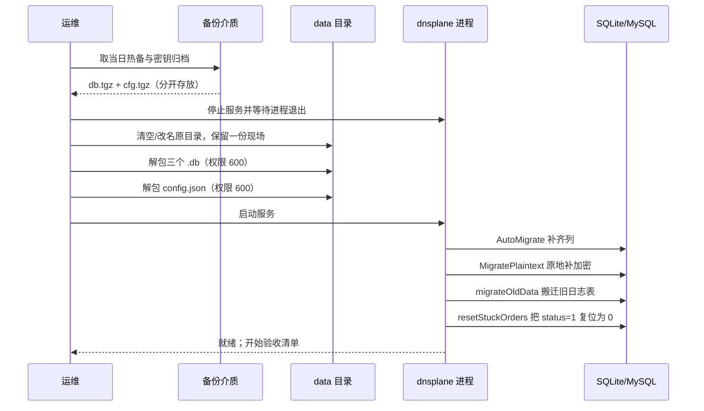
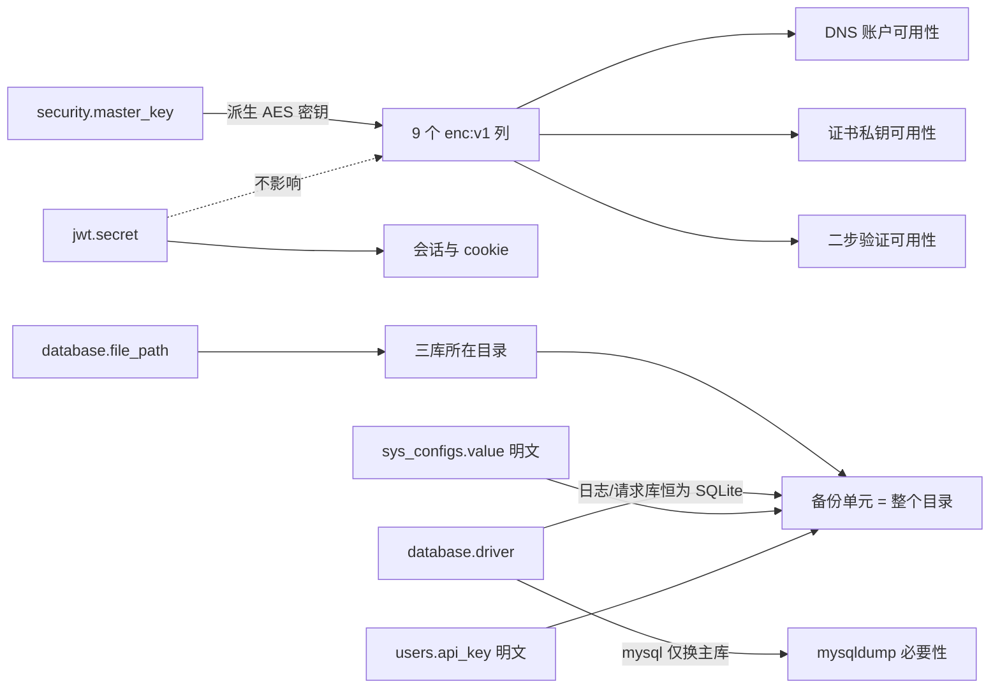

# 备份恢复策略

<cite>
**本文档引用的文件**
- [config.go](file://main/internal/config/config.go)
- [config.json](file://main/config.json)
- [database.go](file://main/internal/database/database.go)
- [maintenance.go](file://main/internal/database/maintenance.go)
- [crypto.go](file://main/internal/crypto/crypto.go)
- [hooks.go](file://main/internal/models/hooks.go)
- [main.go](file://main/main.go)
- [sign.go](file://main/internal/utils/sign.go)
- [rsa.go](file://main/internal/utils/rsa.go)
- [logger.go](file://main/internal/logger/logger.go)
- [local.go](file://main/internal/cert/deploy/servers/local.go)
- [auth.go](file://main/internal/api/middleware/auth.go)
- [dashboard.go](file://main/internal/api/handler/dashboard.go)
- [Dockerfile](file://Dockerfile)
- [README.md](file://README.md)
- [scan-persistence.md](file://../.wiki-context/scan-persistence.md)
- [analysis-deploy.md](file://../.wiki-context/analysis-deploy.md)
- [analysis-auth.md](file://../.wiki-context/analysis-auth.md)
</cite>

## 目录

1. [简介](#简介)
2. [项目结构](#项目结构)
3. [核心组件](#核心组件)
4. [架构总览](#架构总览)
5. [详细组件分析](#详细组件分析)
6. [依赖关系分析](#依赖关系分析)
7. [性能考虑](#性能考虑)
8. [故障排查指南](#故障排查指南)
9. [结论](#结论)
10. [附录](#附录)

## 简介

本篇回答四件事：**备份什么、怎么备、留多久、怎么恢复**。

DNSPlane 是「单二进制 + 本地 SQLite」形态的控制面，业务状态几乎全部落在
`data/` 目录的三个库文件里，密钥落在 `config.json`。这带来一个必须先讲清楚的结论：

> **主库的一份完整备份 = 全站凭据的一次完整外泄。**
> 数据库里的凭据列虽然是 `enc:v1:` 密文，但解密主密钥 `security.master_key`
> 就明文存放在同机的 `config.json` 中；此外 `sys_configs.value` 整列明文、
> `users.api_key` 明文。两者一起进 tar，就等于把私钥和保险柜钥匙放进同一个盒子
> （口径来源：`analysis-deploy.md` D-4 条目，代码取证 `hooks.go:32-70`、
> `database.go` 三库初始化、`config.go:169` 文件权限）。

因此本篇的备份对象分为四类，且**每一类的保护手段不同**：

| 类别 | 对象 | 敏感级 | 保护手段 |
|:---|:---|:---:|:---|
| A | 主库 / 日志库 / 请求库 | 高 | 密文列 + 明文列混杂，需整体加密后落盘 |
| B | `config.json`（含 `master_key`、`jwt.secret`、DB 口令） | 极高 | 单独走密钥通道，不与 A 同介质、同目录 |
| C | 加密后的账户凭据与证书私钥（库内 `enc:v1:` 列） | 高 | 依赖 B；B 丢失即永久不可解 |
| D | 运行产物：日期日志、本地部署写出的证书/私钥文件 | 中 | 按需，私钥文件按 0600 保护 |

工作区实测口径：`main/data/` 目前只有三个库文件及其 WAL 伴生文件，
没有独立的「用户上传附件目录」——本项目的证书导出走 HTTP 响应流
（`handler/cert.go` 的 `Content-Disposition: attachment`），私钥不落应用自己的目录；
唯一会往文件系统写私钥的路径是「本地部署」目标（`servers/local.go:100-113`）。
这一条与很多系统的直觉不同，备份脚本不要按臆想的路径去 tar。

行号、路径、文件体积均为当前工作区实测；命令类示例凡未实际执行的都显式标注「未实机」。

**章节来源**
- [database.go](file://main/internal/database/database.go)
- [hooks.go](file://main/internal/models/hooks.go)
- [config.go](file://main/internal/config/config.go)
- [local.go](file://main/internal/cert/deploy/servers/local.go)
- [analysis-deploy.md](file://../.wiki-context/analysis-deploy.md)

## 项目结构

### `data/` 目录实测形态

以下为 `ls -la main/data/` 的真实输出摘要（文件名为实测值，体积为实测值）：

| 文件 | 体积 | 角色 | 是否必入备份 |
|:---|---:|:---|:---:|
| `data.db` | 438 KB | 主库（业务全量状态） | 是 |
| `data.db-shm` | 33 KB | WAL 共享内存索引 | 否（不可备份，属进程态） |
| `data.db-wal` | 0 B | WAL 待合并日志 | 冷备前必须先 checkpoint |
| `logs.db` | 184 KB | 日志库（操作/证书/监控检查日志） | 是 |
| `logs.db-shm` | 33 KB | 同上 | 否 |
| `logs.db-wal` | 0 B | 同上 | 同上 |
| `request_logs.db` | 41 KB | 请求日志库（`request_logs` 单表） | 按需 |

**实测权限告警**：三个 `.db` 文件当前为 `0755`（带可执行位且全局可读），
`main/logs/*.log` 为 `0644`，而同目录的 `config.json` 是 `0700/0600`。
这是 `database.go:94` 的 `MkdirAll(dir, 0755)` 与 `config.go:160,169` 的
`0700/0600` 之间的落差，也是备份前必须收紧的第一件事（`analysis-deploy.md` D-18）。

```bash
# 取证：确认工作区实际落盘形态与权限
ls -la main/data/
ls -la main/logs/ | head
stat -c '%a %n' main/config.json main/data/*.db

# 取证：确认三库路径推导是否与实际文件一致
sqlite3 main/data/data.db "PRAGMA journal_mode; PRAGMA page_count; PRAGMA page_size;"

# 收紧权限（备份前执行，避免 tar 出去就是全站可读）
chmod 700 main/data && chmod 600 main/data/*.db main/config.json
```

**章节来源**
- [database.go](file://main/internal/database/database.go)
- [config.go](file://main/internal/config/config.go)
- [maintenance.go](file://main/internal/database/maintenance.go)

### 路径由谁决定

库文件名不是硬编码在业务代码里，而是由 `config.json` 的 `database.file_path` 推导：

- 主库：直接用 `DatabaseConfig.FilePath`（工作区实配 `data/data.db`）
- 日志库：`LogDBPath()` = `filepath.Dir(FilePath)/logs.db`（`config.go:58-61`）
- 请求库：`RequestDBPath()` = `filepath.Dir(FilePath)/request_logs.db`（`config.go:63-67`）

注意代码里的默认值是 `data/dnsplane.db`（`config.go:95`），与工作区实配的
`data/data.db` 不同名——**改 `file_path` 会同时改变三库所在目录**，
备份脚本必须以「`file_path` 的所在目录」为单位，而不是写死文件名。

**章节来源**
- [config.go](file://main/internal/config/config.go)
- [database.go](file://main/internal/database/database.go)

## 核心组件

### 三库分工与驱动能力边界

| 库 | 变量 | 承载模型 | SQLite | MySQL |
|:---|:---|:---|:---:|:---:|
| 主库 | `database.DB` | 用户、账户、域名、证书订单/部署、监控任务、系统配置、配额套餐 | 默认 | 可切换 |
| 日志库 | `database.LogDB` | `Log`、`CertLog`、`DMCheckLog` | 固定 | **不切换** |
| 请求库 | `database.RequestDB` | `RequestLog` | 固定 | **不切换** |

关键结论（`database.go:104-118` 无条件 `sqlite.Open`）：
**即使 `driver = mysql`，日志库与请求库仍然是本地 SQLite 文件。**
所以「我用了 MySQL，是不是只要 dump 数据库就行」这个直觉是错的——
必须同时备份两个 SQLite 文件，否则操作审计与请求追踪在恢复后归零。

**章节来源**
- [database.go](file://main/internal/database/database.go)
- [maintenance.go](file://main/internal/database/maintenance.go)

### 静态加密列清单

`models/hooks.go` 通过 GORM 的 `BeforeSave`/`AfterFind` 做字段级 AES-256-GCM 加解密，
共 7 个模型 9 列。备份时无需单独处理（它们在库里就是密文），
但**恢复后的可用性完全依赖主密钥**：

| 模型 | 加密列 | 业务含义 |
|:---|:---|:---|
| `Account` | `Config` | DNS 服务商 AK/SK、面板账号口令 |
| `CertAccount` | `Config`、`Ext` | ACME 账户私钥、EAB `kid`/`hmac` |
| `CertOrder` | `PrivateKey`、`Info` | 证书私钥与订单信息 |
| `CertDeploy` | `Config`、`Info` | 部署目标凭据、SSH `host_key` |
| `DMTask` | `ProxyPassword` | 容灾探测代理口令 |
| `User` | `TOTPSecret` | 二步验证密钥 |
| `UserOAuth` | `AccessToken`、`RefreshToken` | OAuth 令牌 |

加密实现要点（`crypto/crypto.go`）：

- 密文前缀 `enc:v1:`，格式为 `base64(nonce ‖ ciphertext ‖ tag)`
- 密钥 = `sha256(security.master_key)`，`sync.Once` 派生后缓存，不落盘
- `MustDecrypt` 在解密失败时**静默返回原文**（`crypto.go:95-101`），
  因此主密钥不匹配不会报错，只会把 `enc:v1:...` 当明文交给业务解析

**章节来源**
- [hooks.go](file://main/internal/models/hooks.go)
- [crypto.go](file://main/internal/crypto/crypto.go)
- [database.go](file://main/internal/database/database.go)

### 三件套密钥

| 密钥 | 位置 | 环境变量覆盖 | 丢失后果 |
|:---|:---|:---|:---|
| `security.master_key` | `config.json` | `DNSPLANE_MASTER_KEY` | 全部 `enc:v1:` 列永久不可解 |
| `jwt.secret` | `config.json` | `DNSPLANE_JWT_SECRET` | 所有会话失效、`_t`/`_rt` cookie 无法解密 |
| `data/sign.key` | 按需生成 | 无 | 加密请求链路签名失效（当前调用链未接通） |

`sign.key` 为 64 字节 HMAC 密钥，`utils/sign.go:20` 硬编码相对路径 `data/sign.key`、
写入 `0600`。工作区实测 `main/data/` 下**没有**该文件（`analysis-deploy.md` D-1 备注：
`DecryptAndVerify` 为死代码）。`utils/rsa.go:130-140` 的 `InitRSAKey` 亦为按需生成，
两者若在你的实例中存在，必须并入类别 B 的备份。

**章节来源**
- [config.go](file://main/internal/config/config.go)
- [sign.go](file://main/internal/utils/sign.go)
- [rsa.go](file://main/internal/utils/rsa.go)
- [analysis-deploy.md](file://../.wiki-context/analysis-deploy.md)

## 架构总览



**图表来源**
- [config.go](file://main/internal/config/config.go)
- [database.go](file://main/internal/database/database.go)
- [hooks.go](file://main/internal/models/hooks.go)
- [crypto.go](file://main/internal/crypto/crypto.go)
- [local.go](file://main/internal/cert/deploy/servers/local.go)

四类对象的处置路径并非同一套：**库文件走一致性快照，密钥走带外分发，
密文列随库走但可用性取决于密钥，运行产物按需**。分诊判据见[详细组件分析](#详细组件分析)。

## 详细组件分析

### 冷备流程（停机快照）

冷备是唯一能保证「三库 + WAL 全一致」的方式。DNSPlane 的关闭序列是确定的，
`main.go` 中 defer 的注册顺序决定了退出时的收尾动作：

- 收到 `SIGINT`/`SIGTERM` → `srv.Shutdown(10s)` 排空 HTTP 连接
- 之后依次 `StopRecordSync` → `StopOptimizeRunner` → `StopMaintenance`
  → `taskCancel` + `taskRunner.Stop` + `scheduleRunner.Stop` → `mon.Stop`
  → `cache.Close` → **`database.Close`**（三个 `sqlDB.Close()`）
- SQLite 在最后一个连接关闭时会把 WAL 回写主文件并删除 `-wal`，
  这就是「进程干净退出后可以直接 cp」的依据

```bash
# 1. 排空并停机（等待日志出现「HTTP服务已关闭」且进程退出）
systemctl stop dnsplane          # 或 kill -TERM <pid>
while pgrep -x dnsplane >/dev/null; do sleep 1; done

# 2. 确认 WAL 已经合并（-wal 应为 0 字节或不存在）
ls -la main/data/

# 3. 打包三库 + 配置文件分离归档
STAMP=$(date +%Y%m%dT%H%M%S)
tar czf /backup/dnsplane-db-$STAMP.tgz -C main data/*.db
tar czf /backup/dnsplane-cfg-$STAMP.tgz -C main config.json

# 4. 校验与最小权限
sha256sum /backup/dnsplane-db-$STAMP.tgz > /backup/dnsplane-db-$STAMP.sha256
chmod 600 /backup/dnsplane-*.tgz

# 5. 拉起服务
systemctl start dnsplane
```

预期输出：第 2 步中 `data.db-wal` 为 `0 B` 或已消失；若仍是非零长度，
说明进程未干净退出（被 `kill -9` 或崩溃），此时**必须改用热备方式**，
不要直接 tar 半截 WAL。

**章节来源**
- [main.go](file://main/main.go)
- [database.go](file://main/internal/database/database.go)
- [logger.go](file://main/internal/logger/logger.go)

### 热备（不停机）

WAL 模式 + `synchronous(NORMAL)` 意味着任意时刻 `-wal` 里都可能有未合并的页，
**`cp` 主文件会得到一个缺最新事务的库**。SQLite 官方在线备份 API 才是一致性口径：

```bash
# 逐库热备（未实机：本机未执行完整还原演练，命令形态取自 sqlite3 CLI 文档口径）
sqlite3 main/data/data.db ".backup '/backup/hot/data-$STAMP.db'"
sqlite3 main/data/logs.db ".backup '/backup/hot/logs-$STAMP.db'"
sqlite3 main/data/request_logs.db ".backup '/backup/hot/request_logs-$STAMP.db'"

# 一致性核验（未实机）
for f in /backup/hot/*.db; do sqlite3 "$f" "PRAGMA integrity_check;"; done
```

若不希望依赖 `sqlite3` CLI 是否安装，可在业务低峰用**只读 checkpoint**手工合并再取文件：

```bash
# 未实机：仅合并 WAL，不压缩、不锁写超过必要时长
sqlite3 main/data/data.db "PRAGMA wal_checkpoint(FULL);"
```

MySQL 形态（仅主库可能为 MySQL，日志库/请求库仍是 SQLite）：

```bash
# 未实机：账号口令从环境变量注入，禁止写进脚本或命令行历史
mysqldump --single-transaction --routines --triggers \
  --databases "{db_name}" | gzip > /backup/mysql-$STAMP.sql.gz
```

`--single-transaction` 是 InnoDB 一致性快照的关键；若库为 MyISAM 则需
`--lock-tables` 并接受写入阻塞。数据库口令字段来自 `config.json` 的
`database.password`，**明文存放**，因此备份产物一旦外泄即等同凭据外泄。

| 方式 | 一致性 | 是否需要停机 | 覆盖 WAL | 适用场景 |
|:---|:---:|:---:|:---:|:---|
| 停机后 `tar` | 强 | 是 | 是 | 变更窗口、月度全量 |
| `sqlite3 .backup` | 强 | 否 | 是 | 日常自动备份（推荐） |
| `cp` + 手工 `cp` | 弱 | 否 | **否** | 禁止使用 |
| `wal_checkpoint(FULL)` 后取文件 | 中 | 否 | 是 | 无 CLI `.backup` 支持时 |
| `mysqldump --single-transaction` | 强 | 否 | 不适用 | 主库为 MySQL 时 |

**章节来源**
- [database.go](file://main/internal/database/database.go)
- [config.go](file://main/internal/config/config.go)
- [maintenance.go](file://main/internal/database/maintenance.go)

### 保留策略与 cron

应用内建的日志保留由 `maintenance.go` 决定，可通过系统设置的 `maint_*` 键覆盖。
**备份保留期应不短于对应的日志保留期**，否则「备份还在、库里的日志早已被清」并
不代表日志可回溯；反过来，请求库只留 7 天，若合规要求留 90 天，必须靠备份归档承接。

| SysConfig 键 | 默认值 | 含义 | 建议备份保留期下限 |
|:---|---:|:---|---:|
| `maint_operation_log_days` | 90 | 操作日志（`logs.db`） | ≥ 90 天 |
| `maint_cert_log_days` | 60 | 证书日志（`logs.db`） | ≥ 60 天 |
| `maint_monitor_log_days` | 60 | 容灾切换日志（主库） | ≥ 60 天 |
| `maint_check_log_hours` | 72 | 监控检查日志（小时） | 3-7 天 |
| `maint_request_log_days` | 7 | 请求日志（`request_logs.db`） | ≥ 7 天 |
| `maint_request_success_keep` | 2000 | 成功请求日志条数上限 | — |
| `maint_request_error_keep` | 1000 | 错误请求日志条数上限 | — |
| `maint_vacuum_interval_h` | 24 | VACUUM 间隔（小时） | — |

```bash
# /etc/cron.d/dnsplane-backup —— 每日 03:15 热备，每周日额外归档请求库
15 3 * * *  dns /usr/local/sbin/dnsplane-backup.sh daily
30 3 * * 0  dns /usr/local/sbin/dnsplane-backup.sh weekly
# 密钥单独一条：仅在 master_key / jwt.secret 变更后手工触发，不进 cron
```

```bash
# 轮转：日备留 14 份、周备留 8 份、月备留 12 份（未实机）
find /backup/daily  -type f -mtime +14 -delete
find /backup/weekly -type f -mtime +56 -delete
find /backup/monthly -type f -mtime +365 -delete
```

`/usr/local/sbin/dnsplane-backup.sh` 的完整可复制实现见[附录](#附录)。

**章节来源**
- [maintenance.go](file://main/internal/database/maintenance.go)
- [config.go](file://main/internal/config/config.go)

### 恢复演练

恢复分两种情形，路径完全不同。



**图表来源**
- [database.go](file://main/internal/database/database.go)
- [main.go](file://main/main.go)

情形一：**整库可用恢复**（库文件 + `config.json` 同时回到同一时点）

```bash
# 演练环境执行；生产恢复前必须先做原目录快照
systemctl stop dnsplane
mv main/data main/data.broken-$(date +%s)
tar xzf /backup/dnsplane-db-$STAMP.tgz -C main
tar xzf /backup/dnsplane-cfg-$STAMP.tgz -C main
chmod 700 main/data && chmod 600 main/data/*.db main/config.json
systemctl start dnsplane
tail -n 50 main/logs/$(date +%F).log
```

启动后应用会自动做迁移与清理（`migrate` / `migrateLogDB` / `migrateRequestDB`
/ `MigratePlaintext` / `migrateOldData` / `resetStuckOrders`），
日志库中若仍能看到搬迁提示即为正常路径。

情形二：**空库重开 + 数据回填**（库丢失或换机，须重跑首次安装向导）

用户表为空时 `initAdmin` **不会**自动建号，只打印提示
（`database.go:316-326`，旧版硬编码 `admin/admin123` 已因安全审计 H-1 移除）。
因此管理员口令遗失或整库重建时，路径是：

1. 部署同版本二进制，准备好**同一份 `config.json`**（否则旧密文不可解）
2. 启动进程 → 访问前端首页或 `POST /api/install` 设置管理员账号
3. 逐表回填业务数据：优先从冷备库导出再导入
   （`INSERT INTO main.<table> SELECT ... FROM attached.<table>`，
   用 `ATTACH DATABASE` 把备份库挂进来，避免明文重建凭据列）
4. 重新录入 DNS 账户与证书账户：若 `master_key` 一致，可直接沿用备份库中的密文列；
   若不一致，**只能去服务商侧重新签发 AK/SK**，旧密文永久作废
5. 校验续期与容灾开关是否回到预期状态（`is_auto`、`active`）

```bash
# 未实机：ATTACH 方式回填的形态示意
sqlite3 main/data/data.db "ATTACH DATABASE '/backup/hot/data-$STAMP.db' AS old;"
sqlite3 main/data/data.db \
  "INSERT INTO domains SELECT * FROM old.domains WHERE id NOT IN (SELECT id FROM domains);"
sqlite3 main/data/data.db "DETACH DATABASE old;"
```

**章节来源**
- [database.go](file://main/internal/database/database.go)
- [hooks.go](file://main/internal/models/hooks.go)
- [main.go](file://main/main.go)

### JWT Secret 丢失的后果

`jwt.secret` 同时承担两件事，这决定了它丢失后的表现不是「重新登录就行」：

- 作为 access/refresh token 的签名密钥
- 作为会话 cookie 的加密密钥：`_t`、`_rt` 都是
  `AES-GCM(key = sha256(JWT.Secret))` 后的十六进制串（`analysis-auth.md` 会话 cookie 加密条目）

因此一旦 `config.json` 中的 `jwt.secret` 变了（丢失后自动生成、或容器重建未挂载卷）：

| 影响面 | 表现 | 恢复动作 |
|:---|:---|:---|
| 所有在线会话 | 一律 401，`middleware/auth.go` 解密失败分支 | 全员重新登录，无兼容路径 |
| refresh 流程 | `_rt` 无法解密，静默续期失效 | 同上 |
| 已签发 API 调用 | `Authorization: Bearer` 校验失败 | 客户端重新换取 token |
| 密文列 | **不受影响**（走 `master_key`，不是 JWT） | 无需动作 |

首次启动找不到配置文件时，`config.Load` 会**同时**随机生成
`jwt.secret` 与 `security.master_key` 并回写（`config.go:105-113`）；
历史默认值 `dnsplane-secret-key-change-me` 也会被自动替换
（`config.go:130-143`）。这就是「容器重建后凭据全废」的根本成因——
两个随机密钥都被换掉了。

正确处置是把两个值改为**由部署方固定注入**：

```bash
# docker run 形态（README/Dockerfile 口径）：两个密钥都必须来自带外保管
docker run -d --name dnsplane -p 8080:8080 \
  -v /srv/dnsplane/data:/app/data \
  -v /srv/dnsplane/config.json:/app/config.json:ro \
  -e DNSPLANE_JWT_SECRET={jwt_secret} \
  -e DNSPLANE_MASTER_KEY={master_key} \
  dnsplane:{tag}

# 取证：确认当前实例到底用的是哪个来源
grep -c DNSPLANE_MASTER_KEY /proc/$(pgrep -x dnsplane)/environ
```

**章节来源**
- [config.go](file://main/internal/config/config.go)
- [auth.go](file://main/internal/api/middleware/auth.go)
- [analysis-auth.md](file://../.wiki-context/analysis-auth.md)
- [Dockerfile](file://Dockerfile)

### 备份文件即敏感数据：安全存储

把「备份 = 敏感数据」这条原则落成可执行约束：

1. **库备份与密钥备份分离**：不同目录、不同介质、不同审批人；
   恢复时两步拼装，日常不放在一起
2. **备份产物再加密一层**：`age` 或 `gpg` 对称加密，口令不入库不入仓
3. **落地即收权限**：`chmod 600`，属主为服务账号而非 root
4. **禁止进入构建上下文与仓库**：`analysis-deploy.md` D-5 指出
   `.dockerignore` 仅 6 行且未排除 `main/config.json`，
   该文件会随 `COPY main/ ./` 进入 builder 层
5. **Redis 快照同等对待**：账户列表缓存以 `db:v1:accounts:*` 写入
   `cache.C`，Redis 形态下**解密后的明文凭据**会进入 `dump.rdb`（TTL 60s 不等于不存在）
6. **异地副本走加密通道**，禁止明文 scp；对象存储需私有读写 + 生命周期规则

```bash
# 未实机：二次加密与清单留痕
tar czf - -C main data/*.db | age -p -o /backup/dnsplane-db-$STAMP.tgz.age
sha256sum /backup/dnsplane-db-$STAMP.tgz.age | tee -a /backup/MANIFEST

# 取证：确认 config.json 未被 COPY 进镜像层
docker history --no-trunc {image} | grep -i config.json
git check-ignore -v main/config.json
```

**章节来源**
- [config.go](file://main/internal/config/config.go)
- [analysis-deploy.md](file://../.wiki-context/analysis-deploy.md)
- [analysis-auth.md](file://../.wiki-context/analysis-auth.md)

## 依赖关系分析

备份项之间存在**单向可用性依赖**，理解这张图才能避免「备份齐全但打不开」：



**图表来源**
- [config.go](file://main/internal/config/config.go)
- [hooks.go](file://main/internal/models/hooks.go)
- [database.go](file://main/internal/database/database.go)

- 三库之间**没有跨库外键**，可独立备份、独立恢复；但恢复时间点不一致
  会让「操作日志对不上业务变更」。`driver=mysql` 只影响主库，
  日志库与请求库仍走文件备份，二者必须同批执行
- `config.json` 是被所有密文依赖的根，它的备份频率应高于库备份
  （只在密钥轮换时产生新归档）

**章节来源**
- [database.go](file://main/internal/database/database.go)
- [config.go](file://main/internal/config/config.go)

## 性能考虑

- **备份窗口与 VACUUM 冲突**：`optimizeGormDB` 每小时判定一次，
  默认每 24 小时对三库依次执行 `wal_checkpoint(TRUNCATE)` → `ANALYZE`
  → `PRAGMA optimize` → `VACUUM` → 恢复 `journal_mode=WAL`。
  `VACUUM` 会整文件重写并需要约两倍磁盘空间。把备份定在紧接维护之后
  （`GetMaintenanceStats` 暴露 `last_vacuum`/`next_vacuum`）能让
  `-wal` 处于最干净状态，也能避免与重写争抢 IO
- **`.backup` 的代价**：在线备份为 page-by-page 复制且持读锁；请求库通常最大，建议降频或从保留策略上裁剪
- **连接池影响**：SQLite 侧 `MaxOpenConns(8)`、`busy_timeout(5000)`。
  备份进程若与业务争用同一文件，写侧最多等 5 秒后报 `database is locked`，
  因此备份脚本应使用只读方式，不要对生产库执行 `VACUUM`
- **mmap 与压缩收益**：DSN 里 `mmap_size=67108864`、`cache_size=-16000`、
  `temp_store=MEMORY`，大库上另起 `sqlite3` 进程校验会额外占页缓存，
  低配机器把校验放到备份机上跑；SQLite 页内存在空闲碎片，
  `gzip` 收益有限，真正的体积收益来自应用自己的 `VACUUM`

**章节来源**
- [maintenance.go](file://main/internal/database/maintenance.go)
- [database.go](file://main/internal/database/database.go)

## 故障排查指南

以下条目为本篇特有、与「备份/恢复/密钥」直接相关的故障，
通用症状请优先走[故障排除](../故障排除/故障排除.md)的分诊入口，
高频条目的完整三段式见[常见问题解决](../故障排除/常见问题解决.md)。

### BK-1 恢复后所有 DNS 账户显示异常、证书全部部署失败

| 段 | 内容 |
|:---|:---|
| 症状 | 库文件恢复成功、进程正常启动、页面可登录，但账户列表点开报配置解析错误，证书任务批量失败，且**没有任何解密失败的报错** |
| 原因 | `config.json` 与库文件不来自同一时点，`master_key` 变化；`MustDecrypt` 静默把 `enc:v1:` 原文当明文返回（`crypto.go:95-101`），故无错误信号 |
| 方案 | 用备份的原始 `config.json`（或固定的 `DNSPLANE_MASTER_KEY`）重启；若原密钥确已丢失，只能到服务商侧重新签发凭据并重建账户，旧密文永久不可恢复 |

```bash
# 定位：确认密文列前缀是否完好（前缀在但解不开 = 密钥不匹配）
sqlite3 main/data/data.db "SELECT id, substr(config,1,7) FROM accounts LIMIT 5;"
# 定位：确认当前生效的主密钥来源
grep -o 'master_key[^,]*' main/config.json | cut -c1-24
tr '\0' '\n' < /proc/$(pgrep -x dnsplane)/environ | grep -c DNSPLANE_MASTER_KEY
```

**章节来源**
- [crypto.go](file://main/internal/crypto/crypto.go)
- [hooks.go](file://main/internal/models/hooks.go)
- [config.go](file://main/internal/config/config.go)

### BK-2 备份出来的库缺最近几小时的变更

| 段 | 内容 |
|:---|:---|
| 症状 | 恢复后最新的新增域名、账户、证书订单全部消失，但更早的数据完好 |
| 原因 | 用 `cp`/`tar` 直接取主文件而未带走 `-wal`，或未停机 checkpoint；`journal_mode=WAL` + `synchronous(NORMAL)` 下最新事务只在 WAL 中 |
| 方案 | 改用 `sqlite3 .backup`，或停机等待进程自然退出后再打包；打包前用 `ls -la` 断言 `-wal` 为 0 字节 |

**章节来源**
- [database.go](file://main/internal/database/database.go)
- [maintenance.go](file://main/internal/database/maintenance.go)

### BK-3 停机后 `-wal` 文件仍在，怀疑进程没干净退出

| 段 | 内容 |
|:---|:---|
| 症状 | 进程已不在，`main/data/` 下仍留下非零长度的 `.db-wal` 与 `.db-shm` |
| 原因 | 被 `kill -9`、OOM 或掉电中断，`database.Close()` 未执行，SQLite 未完成 checkpoint；这类文件也可能来自上次崩溃残留 |
| 方案 | 不要直接打包主文件；启动一次实例让它自动恢复 WAL，或在备份机上用 `sqlite3 .open` + `PRAGMA wal_checkpoint(TRUNCATE)` 先合并再取文件，并做 `integrity_check` |

**章节来源**
- [main.go](file://main/main.go)
- [database.go](file://main/internal/database/database.go)

### BK-4 系统信息页显示的库体积恒为 0

| 段 | 内容 |
|:---|:---|
| 症状 | 备份脚本以面板体积作为「备份是否成功」的判据时，看到 0 就以为没备上 |
| 原因 | 体积统计基于 `database.file_path` 推导的目录，改过 `file_path` 或换了挂载点后与实际落盘位置不一致（`analysis-deploy.md` 系统信息页条目） |
| 方案 | 备份判据改用文件级断言：`test -s /backup/hot/data-$STAMP.db` + `sha256sum` 比对，不以面板数值为准 |

```bash
# 定位：确认配置声明路径与真实文件是否一致
grep file_path main/config.json
ls -la "$(dirname "$(grep -o '"file_path"[^,}]*' main/config.json | cut -d'"' -f4)")" 2>/dev/null
```

**章节来源**
- [dashboard.go](file://main/internal/api/handler/dashboard.go)
- [config.go](file://main/internal/config/config.go)
- [analysis-deploy.md](file://../.wiki-context/analysis-deploy.md)

### BK-5 备份目录被同机其他账号读取

| 段 | 内容 |
|:---|:---|
| 症状 | 库文件本身 `0755`、备份 tar 落在共享目录，任何登录用户都能 `cat` |
| 原因 | `MkdirAll(dir, 0755)` 与默认 umask 的组合（`analysis-deploy.md` D-18），加上脚本没做落地 chmod |
| 方案 | 备份脚本在打包后立即 `chmod 600`，目录 `700`，属主固定为服务账号；同时对 tar 再做一次 `age`/`gpg` 加密 |

**章节来源**
- [database.go](file://main/internal/database/database.go)
- [config.go](file://main/internal/config/config.go)
- [analysis-deploy.md](file://../.wiki-context/analysis-deploy.md)

## 结论

DNSPlane 的备份难点不在「拷文件」，而在**它把业务状态、密文凭据与解密主密钥
放在同一台机器上，且解密失败是静默的**。据此收敛为四条硬约束：

1. **备份单元是目录而不是文件名**——三库同源于 `database.file_path`，
   日志库与请求库在 MySQL 形态下依然是文件
2. **密钥必须与库分离归档**——`master_key` 决定 9 个密文列能否复活，
   `jwt.secret` 决定会话是否需要全员重登
3. **一致性只有两条路**——干净停机后打包，或 `sqlite3 .backup`；
   直接 `cp` 主文件在 WAL 下不成立
4. **备份产物按凭据级保护**——`sys_configs.value`、`users.api_key` 明文，
   Redis 快照含解密后凭据，权限与加密缺一不可

恢复演练每季度至少做一次，验收标准以「账户可点开、证书可续期、二步验证可登录」
三项为准，而不是以「页面能打开」为准。

**章节来源**
- [database.go](file://main/internal/database/database.go)
- [hooks.go](file://main/internal/models/hooks.go)
- [config.go](file://main/internal/config/config.go)

## 附录

### 备份脚本参考实现

> **章节来源**：见本节末尾汇总的[附录](#附录)来源块（`maintenance.go`、`config.go` 口径）。

```bash
#!/usr/bin/env bash
# /usr/local/sbin/dnsplane-backup.sh
set -euo pipefail

MODE="${1:-daily}"
APP_DIR="/srv/dnsplane"                       # 部署根目录
DATA_DIR="$(basename "$(jq -r '.database.file_path' "$APP_DIR/config.json")")"
DATA_DIR="$APP_DIR/$(dirname "$DATA_DIR")"    # 以 file_path 所在目录为备份单元
BK_ROOT="/backup/dnsplane"
STAMP="$(date +%Y%m%dT%H%M%S)"

mkdir -p "$BK_ROOT/$MODE" "$BK_ROOT/hot"
chmod 700 "$BK_ROOT" "$BK_ROOT/$MODE"

# 1) 三库在线备份：主库每次，日志库每次，请求库仅 weekly
for db in data.db logs.db; do
  sqlite3 "$DATA_DIR/$db" ".backup '$BK_ROOT/hot/$db.$STAMP'"
done
[ "$MODE" = "weekly" ] && \
  sqlite3 "$DATA_DIR/request_logs.db" ".backup '$BK_ROOT/hot/request_logs.db.$STAMP'"

# 2) MySQL 形态时追加逻辑备份：driver 为 mysql 时改用
#    mysqldump --single-transaction --databases "{db_name}"（见热备小节，未实机）

# 3) 归档并二次加密（age 公钥由部署方保管）
tar czf - -C "$BK_ROOT/hot" ./*".$STAMP" \
  | age -R /etc/dnsplane/backup.pub -o "$BK_ROOT/$MODE/db-$STAMP.tgz.age"

# 4) 校验与留痕；密钥归档只在轮换时手工执行，不进本脚本
sha256sum "$BK_ROOT/$MODE/db-$STAMP.tgz.age" >> "$BK_ROOT/MANIFEST"
test -s "$BK_ROOT/$MODE/db-$STAMP.tgz.age"

# 5) 轮转
find "$BK_ROOT/daily"   -type f -mtime +14  -delete
find "$BK_ROOT/weekly"  -type f -mtime +56  -delete
find "$BK_ROOT/monthly" -type f -mtime +365 -delete
```

### 验收清单

> **章节来源**：同上（附录统一来源块）。

| 检查项 | 判据 | 命令形态 |
|:---|:---|:---|
| 三库齐全且一致 | 主库、`logs.db`、`request_logs.db` 均非空，且 `-wal` 为 0 或由 `.backup` 产出 | `test -s`、`ls -la data/` |
| 结构完整 | `integrity_check` 返回 `ok` | `sqlite3 ... "PRAGMA integrity_check"` |
| 密钥可配对 | 密文列带 `enc:v1:` 前缀且能解密 | 登录一个已开 TOTP 的账号 |
| 权限收口与分离 | 备份产物 `600`、目录 `700`；库备与密钥备不同目录不同 tar | `stat -c '%a %n'` + 人工核对 |
| 会话密钥固定 | 容器重建后无需全员重登 | 重启实例验证 |
| 恢复演练留痕 | 最近一次演练日期与结论 | `MANIFEST` |

### 交叉链接

- 运行形态与端口口径：[部署运维.md](./部署运维.md)；容器卷与密钥注入：[Docker容器化部署.md](./Docker容器化部署.md)
- 配置项逐项：[配置管理.md](../配置管理.md)；表结构与迁移：[数据库设计.md](../数据库设计.md)
- 分诊入口（先这里）：[故障排除.md](../故障排除/故障排除.md)；高频条目完整解法：[常见问题解决.md](../故障排除/常见问题解决.md)
- 证书账户与私钥语义：[证书生命周期管理.md](../证书管理功能/证书生命周期管理.md)；首次安装向导：[快速开始.md](../快速开始.md)

**章节来源**
- [README.md](file://README.md)
- [maintenance.go](file://main/internal/database/maintenance.go)
- [config.go](file://main/internal/config/config.go)
- [analysis-deploy.md](file://../.wiki-context/analysis-deploy.md)
