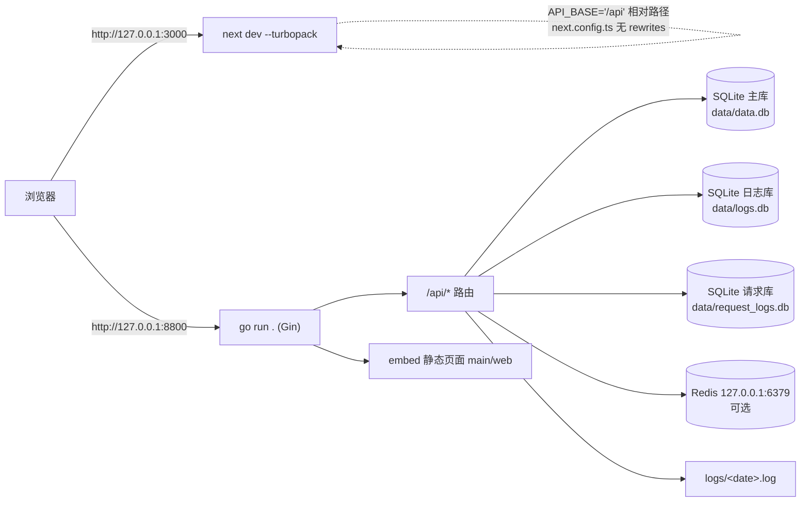
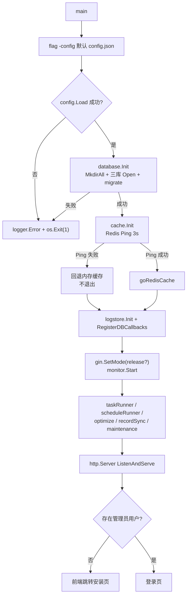
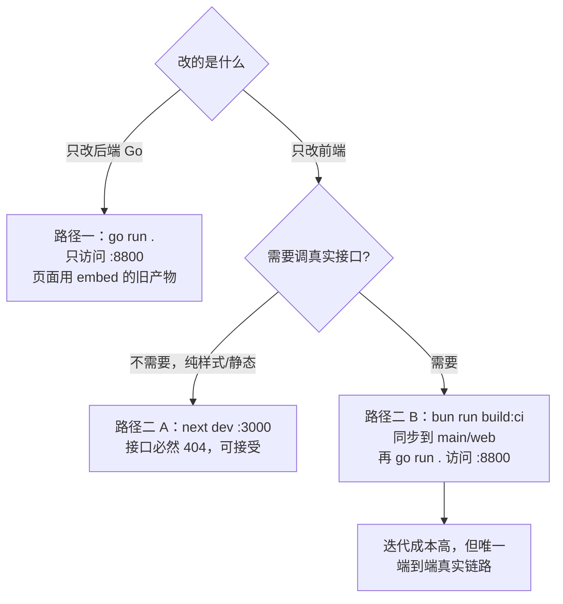
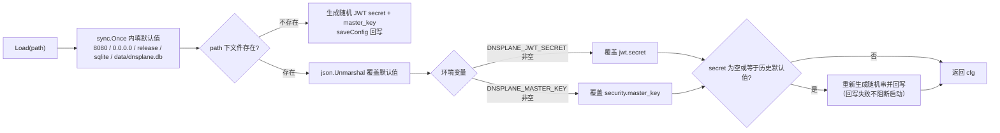
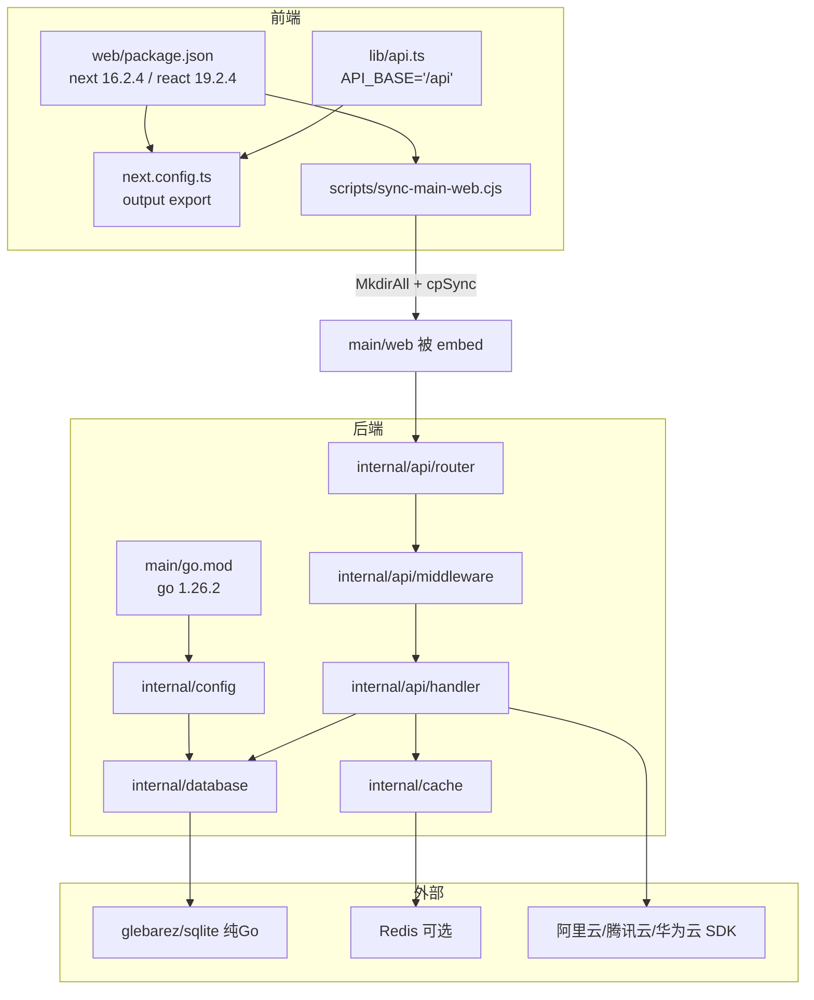

# 开发环境搭建

<cite>
**本文档引用的文件**
- [README.md](file://README.md)
- [VERSION](file://VERSION)
- [Dockerfile](file://Dockerfile)
- [devlog.md](file://devlog.md)
- [main/go.mod](file://main/go.mod)
- [main/main.go](file://main/main.go)
- [main/config.json](file://main/config.json)
- [main/internal/config/config.go](file://main/internal/config/config.go)
- [main/internal/database/database.go](file://main/internal/database/database.go)
- [main/internal/logger/logger.go](file://main/internal/logger/logger.go)
- [main/internal/api/router.go](file://main/internal/api/router.go)
- [main/internal/api/handler/auth.go](file://main/internal/api/handler/auth.go)
- [main/internal/utils/password.go](file://main/internal/utils/password.go)
- [main/internal/cache/cache.go](file://main/internal/cache/cache.go)
- [web/package.json](file://web/package.json)
- [web/next.config.ts](file://web/next.config.ts)
- [web/lib/api.ts](file://web/lib/api.ts)
- [web/scripts/sync-main-web.cjs](file://web/scripts/sync-main-web.cjs)
- [scripts/build.sh](file://scripts/build.sh)
- [.gitignore](file://.gitignore)
</cite>

## 目录
1. [简介](#简介)
2. [项目结构](#项目结构)
3. [核心组件](#核心组件)
4. [架构总览](#架构总览)
5. [详细组件分析](#详细组件分析)
6. [依赖关系分析](#依赖关系分析)
7. [性能考虑](#性能考虑)
8. [故障排查指南](#故障排查指南)
9. [结论](#结论)
10. [附录](#附录)

## 简介

本文给出 DNSPlane 在**本机开发场景**下的完整搭建路径：前置依赖校验、双端依赖安装、
后端与前端各自启动、首次安装向导、配置注入、数据与日志目录初始化，以及本仓库实测过的环境坑。

DNSPlane 以「单一 Go 二进制」为交付形态：Next.js 静态导出产物在编译期被
`//go:embed all:web` 打进可执行文件，运行时由同一个 Gin 进程同时提供 `/api` 与页面。
这决定了开发环境存在**两种工作模式**，且可用能力不同，详见下文「前端启动」一节。

**已验证事实**（本次会话实测或取自真实文件）：

| 项 | 值 | 证据 |
|----|----|------|
| 仓库版本 | `1.0.11` | `VERSION` |
| Go 模块声明版本 | `go 1.26.2`（模块名 `main`） | `main/go.mod` |
| 本机 Go 工具链 | `go1.27.2 linux/amd64` | 本次 `go version` 实测 |
| 官方构建镜像 | `golang:1.26.2-bookworm` | `Dockerfile` |
| 官方前端镜像 Node | `node:22-bookworm-slim` | `Dockerfile` |
| 本机 Node / Bun / npm | `v24.19.0` / `1.4.0` / `12.0.2` | 本次 `node --version` 等实测 |
| 工作区后端监听 | `0.0.0.0:8800`，`mode=debug` | `main/config.json` |
| SQLite 驱动 | `glebarez/sqlite`（纯 Go，无需 CGO） | `main/go.mod`、`database.go` |
| 前端 dev 命令 | `next dev --turbopack` | `web/package.json` |
| 前端 CI 构建命令 | `next build --webpack && node scripts/sync-main-web.cjs` | `web/package.json` |

**未验证内容**：Windows 与 macOS 本机路径下的实际执行结果（本仓库工作区为 Linux），
文中涉及这两个平台的结论均来自脚本语法静态判读，标注为「推断」。

**章节来源**
- [README.md](file://README.md)
- [main/go.mod](file://main/go.mod)
- [main/config.json](file://main/config.json)
- [web/package.json](file://web/package.json)

## 项目结构

仓库为「两个平级模块 + 脚本层」的组织方式，开发环境需要同时理解两侧：

```
dns/
├── main/                       # Go 后端（module main）
│   ├── main.go                 # 入口：flag -> config -> database -> cache -> router
│   ├── go.mod                  # go 1.26.2
│   ├── config.json             # 工作区实际配置（端口 8800、debug）
│   ├── data/                   # SQLite 数据目录（运行时创建）
│   ├── logs/                   # 文本日志目录（运行时创建）
│   ├── web/                    # 前端产物落地目录（被 embed）
│   └── internal/{api,cache,config,database,dns,cert,monitor,service,...}
├── web/                        # Next.js 16 前端
│   ├── app/ components/ lib/ contexts/
│   ├── next.config.ts          # output: 'export'
│   ├── bun.lock / package-lock.json
│   └── scripts/sync-main-web.cjs
└── scripts/                    # build.sh / docker-build.sh
```

| 目录 | 开发环境中的职责 | 是否需要手工创建 |
|------|------------------|------------------|
| `main/` | `go run .` 的工作目录，`-config` 相对路径以此为基准 | 否 |
| `main/data/` | 主库 `data.db`、`logs.db`、`request_logs.db` | 由 `database.Init` 自动创建 |
| `main/logs/` | 按日期切分的文本日志 `<YYYY-MM-DD>.log` | 由 `logger` 自动创建 |
| `main/web/` | 前端静态产物落地处，被 `embed` 编译进二进制 | 由 `build:ci` 生成 |
| `web/` | `next dev --turbopack` 的工作目录 | 否 |
| `web/out/` | `next build` 的静态导出结果 | 由构建生成 |
| `scripts/` | 一键构建与镜像构建 | 否 |

**章节来源**
- [README.md](file://README.md)
- [main/main.go](file://main/main.go)
- [main/internal/database/database.go](file://main/internal/database/database.go)
- [main/internal/logger/logger.go](file://main/internal/logger/logger.go)

## 核心组件

开发环境由四组组件构成，任一组缺失都会导致启动失败或功能退化：

| 组件 | 最低要求 | 缺失后果 | 实测证据 |
|------|----------|----------|----------|
| Go 工具链 | 声明版本 `1.26.2`；本机 `1.27.2` 可用 | 无法编译；`-lang` 由 `go.mod` 决定而非工具链版本 | `devlog.md` 模块 8 兼容性审计：`go build ./...` = 0 |
| Node 或 Bun | 官方镜像 `node:22`；本机 `v24.19.0` / `bun 1.4.0` | 前端无法构建，二进制中没有新页面 | `Dockerfile`、本次 `node --version` |
| SQLite | 无需系统包（纯 Go 驱动） | 无 | `glebarez/sqlite`；`scripts/build.sh` 使用 `CGO_ENABLED=0` |
| Redis（可选） | `enable=false` 时可完全不用 | 自动回退内存缓存，功能不中断 | `cache.Init`：Ping 3s 超时后 `NewMemoryCache` |

关键判读：

- **Go 版本不需要与 `go.mod` 严格相等**。`devlog.md` 记录了一次最小复现：`go.mod` 写 `go 1.26.2`、
  本机 `go1.27.1`、不带 `-gcflags` 时，Go 1.27 的嵌入字段新写法 `Emb{Base.Name: "x"}` 直接编译失败，
  结论是「`-lang` 默认取 `go.mod` 声明值，本机不会比 CI 更宽松」。
- **Bun 与 npm 并存**。`web/` 下同时存在 `bun.lock` 与 `package-lock.json`；
  `scripts/build.sh` 的优先级是「`bun` 可执行且 `bun.lock` 存在 → `bun install --frozen-lockfile`」，
  否则 `npm ci`。开发机只装其中一个即可。
- **Redis 不是硬依赖**，但 `main/config.json` 当前写的是 `enable: true`，
  本机若无 Redis，会在启动日志看到回退警告（属预期行为，不是故障）。

**章节来源**
- [main/go.mod](file://main/go.mod)
- [Dockerfile](file://Dockerfile)
- [devlog.md](file://devlog.md)
- [scripts/build.sh](file://scripts/build.sh)

## 架构总览

开发态的进程与数据拓扑如下（`next dev` 与 `go run` 是两个独立进程，默认**不互通**）：



**图表来源**
- [web/next.config.ts](file://web/next.config.ts)
- [web/lib/api.ts](file://web/lib/api.ts)
- [main/main.go](file://main/main.go)
- [main/internal/database/database.go](file://main/internal/database/database.go)
- [main/internal/logger/logger.go](file://main/internal/logger/logger.go)

启动阶段的职责顺序是固定的，任何一步失败都会 `os.Exit(1)`：



**图表来源**
- [main/main.go](file://main/main.go)
- [main/internal/config/config.go](file://main/internal/config/config.go)
- [main/internal/database/database.go](file://main/internal/database/database.go)
- [main/internal/cache/cache.go](file://main/internal/cache/cache.go)
- [main/internal/api/handler/auth.go](file://main/internal/api/handler/auth.go)

**章节来源**
- [main/main.go](file://main/main.go)
- [main/internal/database/database.go](file://main/internal/database/database.go)
- [main/internal/cache/cache.go](file://main/internal/cache/cache.go)

## 详细组件分析

### 5.1 前置依赖校验

先把本机版本读出来，再与仓库要求对照，避免后面把「环境问题」误判为「代码问题」：

```bash
# 在项目根目录执行
go version                       # 期望 >= go1.26 工具链；本机实测 go1.27.2
node --version                   # 官方镜像为 node:22；本机实测 v24.19.0
bun --version 2>/dev/null || echo "bun 未安装，将使用 npm"
npm --version
git rev-parse --is-inside-work-tree

# SQLite 不需要系统包：驱动是纯 Go 实现
rg -n "glebarez/sqlite|CGO_ENABLED" main/go.mod scripts/build.sh
```

判定规则：

| 检查项 | 通过标准 | 不通过的处理 |
|--------|----------|--------------|
| Go 工具链 | `go version` 主版本 ≥ 1.26 | 升级 Go；无法升级时用 `-gcflags="-lang=go1.26"` 复现 CI 语义 |
| Node | ≥ 20（`README.md` 开发说明） | 用 `fnm`/`nvm` 切到 22 |
| 包管理器 | `bun` 或 `npm` 至少一个可用 | 二者皆无则前端无法构建 |
| Redis | 可无 | `config.json` 把 `redis.enable` 置 `false`，或接受内存回退 |

**章节来源**
- [main/go.mod](file://main/go.mod)
- [scripts/build.sh](file://scripts/build.sh)
- [README.md](file://README.md)

### 5.2 获取代码与安装依赖

```bash
# 1) 克隆
git clone <仓库地址> dnsplane && cd dnsplane

# 2) 后端依赖（首次建议显式下载，便于观察网络失败）
cd main
go mod download
go build ./...          # 验证依赖闭包完整

# 3) 前端依赖：Bun 优先（仓库存在 bun.lock）
cd ../web
bun install --frozen-lockfile

# 或者没有 Bun 时使用 npm
npm ci
```

依赖安装的三条实测约束：

- `README.md` 写的是 `go mod tidy`，而 `tidy` 会**改写** `go.mod`/`go.sum`。日常拉取建议 `go mod download`，
  只在确实增删依赖时才 `tidy`，避免无关 diff。`--frozen-lockfile` / `npm ci` 同样是**锁文件优先**，
  与 `scripts/build.sh` 一致并可复现 CI；`bun install` / `npm install` 允许解析漂移，仅适合主动升级。
- `devlog.md` 记录过 `go build -mod=vendor -o /tmp/testbuild .` 返回 `BUILD_EXIT=1`：
  仓库**没有 `vendor/` 目录**，不要照搬需要 vendor 的构建习惯。
- `devlog.md` 另有一条「`web/` 编译验证（`node_modules` 缺失）需 `npm ci`」，
  说明前端依赖缺失是历史验证中断的真实原因之一。

**章节来源**
- [README.md](file://README.md)
- [scripts/build.sh](file://scripts/build.sh)
- [devlog.md](file://devlog.md)

### 5.3 后端启动

后端只有一条命令，但 `-config` 的解析基准是**当前工作目录**，不是可执行文件所在目录：

```bash
cd main

# 方式 A：使用工作区已有配置（端口 8800、mode=debug、data/data.db）
go run .

# 方式 B：显式指定配置文件
go run . -config config.json

# 冒烟验证（另开终端）
curl -sS http://127.0.0.1:8800/api/install/status
curl -sS -o /dev/null -w "%{http_code} %{redirect_url}\n" http://127.0.0.1:8800/
```

实测要点：

| 项 | 结论 | 证据 |
|----|------|------|
| 入口参数 | `flag.String("config", "config.json", ...)` | `main/main.go` |
| 监听地址 | `fmt.Sprintf("%s:%d", cfg.Server.Host, cfg.Server.Port)` | `main/main.go` |
| 读超时 | `ReadHeaderTimeout: 30s`、`IdleTimeout: 120s` | `main/main.go` |
| Gin 模式 | 仅当 `server.mode == "release"` 才 `gin.SetMode(gin.ReleaseMode)` | `main/main.go` |
| 工作区端口 | `8800` | `main/config.json` |

`go run .` 与 `go build` 都会触发 `main/web/` 的 `embed`。若 `main/web/` 是旧产物，
后端会**成功启动但页面是旧的**，不会报错——这是最常见的「改了前端没生效」误判来源。

**章节来源**
- [main/main.go](file://main/main.go)
- [main/config.json](file://main/config.json)

### 5.4 前端启动与「dev 代理」实测结论

```bash
cd web
bun run dev          # 等价于 next dev --turbopack
# 或
npm run dev
```

`next dev --turbopack` 会在 `http://localhost:3000` 提供开发服务器。但本仓库
**没有任何 dev 代理配置**，实测依据：

- `web/next.config.ts` 只设置 `output: 'export'`、`trailingSlash: true`、`images.unoptimized`，
  **没有 `rewrites`/`redirects`/`proxy` 字段**。
- `web/lib/api.ts` 第一行是 `const API_BASE = '/api'`，即所有请求走**同源相对路径**。
- 全仓库 `web/app`、`web/components`、`web/contexts` 内除一处 Tunnel 表单占位文案外，
  没有硬编码 `8080`/`8800` 的后端地址。

结论（已验证）：单独运行 `next dev` 时，浏览器向 `:3000/api/*` 发请求会得到 404，
前端页面能渲染但**任何接口调用都失败**。这不是 bug，而是「静态导出 + 单二进制」架构的固有约束——
`output: 'export'` 模式下 Next 没有服务端运行时，无法承担代理。

因此开发时应在两条路径中选择：



**图表来源**
- [web/next.config.ts](file://web/next.config.ts)
- [web/lib/api.ts](file://web/lib/api.ts)
- [web/package.json](file://web/package.json)
- [web/scripts/sync-main-web.cjs](file://web/scripts/sync-main-web.cjs)

**建议（未执行，需自行验证）**：若希望 `:3000` 也能直通后端，可在
`next.config.ts` 增加 `rewrites` 把 `/api/:path*` 指向 `http://127.0.0.1:8800/api/:path*`。
但 `output: 'export'` 与 `rewrites` 互斥，添加后 `next build` 会失败，
因此这只能是**临时本地改动，禁止提交**。本文不推荐把它当作标准流程。

命令对照：

| 命令 | 实际内容 | 平台 | 用途 |
|------|----------|------|------|
| `bun run dev` | `next dev --turbopack` | 跨平台 | 前端热更新开发 |
| `bun run build` | `set "ANALYZE=true" && next build && powershell ...` | **仅 Windows** | 构建并拷贝到 `main/web` |
| `bun run build:ci` | `next build --webpack && node scripts/sync-main-web.cjs` | 跨平台 | Linux/CI 下构建 + 同步 |
| `bun run lint` | `eslint` | 跨平台 | 静态检查 |
| `npm run start` | `next start` | — | `output: 'export'` 下不适用，勿用 |

**章节来源**
- [web/next.config.ts](file://web/next.config.ts)
- [web/lib/api.ts](file://web/lib/api.ts)
- [web/package.json](file://web/package.json)
- [web/scripts/sync-main-web.cjs](file://web/scripts/sync-main-web.cjs)

### 5.5 首次安装向导与管理员创建

后端启动后，安装状态由用户表行数决定，而非任何标志文件：

```bash
# 1) 查询安装状态
curl -sS http://127.0.0.1:8800/api/install/status
# 未安装：{"code":0,"data":{"installed":false}}

# 2) 创建管理员（口令须满足复杂度）
curl -sS -X POST http://127.0.0.1:8800/api/install \
  -H 'Content-Type: application/json' \
  -d '{"username":"admin","password":"{至少8位含大小写与数字}"}'

# 3) 复查
curl -sS http://127.0.0.1:8800/api/install/status
# 已安装：{"code":0,"data":{"installed":true}}

# 4) 登录验证
curl -sS -X POST http://127.0.0.1:8800/api/login \
  -H 'Content-Type: application/json' \
  -d '{"username":"admin","password":"{同上}"}'
```

规则与实现位置：

| 行为 | 实现要点 |
|------|----------|
| 幂等保护 | `Install` 先 `Count` 用户表，`count > 0` 直接返回 `{"code":-1,"msg":"系统已安装"}` |
| 绑定校验 | `Username`/`Password` 均 `binding:"required"`，密码另带 `min=8` |
| 复杂度 | `utils.ValidatePasswordStrength`：≥8 位且**必须同时含大写、小写、数字** |
| 落库字段 | `Level: 2`、`Status: 1`、`RegTime: time.Now()`，口令 `bcrypt` 哈希 |
| 安装判定 | `InstallStatus` 与 `Install` 使用同一个 `Count`，无独立开关 |

注意：安装向导**不创建配置目录**，也不写入任何「已安装」标记文件。
若需要重置开发库，直接删除 `data/` 下三个 SQLite 文件并重启（删除前请确认无需保留数据）。

**章节来源**
- [main/internal/api/handler/auth.go](file://main/internal/api/handler/auth.go)
- [main/internal/utils/password.go](file://main/internal/utils/password.go)
- [main/internal/api/router.go](file://main/internal/api/router.go)

### 5.6 配置注入

`config.json` 是**唯一**的启动配置载体，且包含密钥，必须脱敏后入库、示例化后传阅。

```json
{
  "server": {
    "port": 8800,
    "host": "0.0.0.0",
    "mode": "debug",
    "base_url": ""
  },
  "database": {
    "driver": "sqlite",
    "file_path": "data/data.db",
    "host": "",
    "port": 0,
    "username": "",
    "password": "",
    "database": ""
  },
  "jwt": {
    "secret": "{32字节随机串的hex，切勿提交}",
    "expire_hour": 24
  },
  "proxy": {
    "enable": false,
    "url": ""
  },
  "redis": {
    "enable": false,
    "addr": "127.0.0.1:6379",
    "password": "",
    "db": 0,
    "pool_size": 10,
    "min_idle_conns": 0,
    "key_prefix": "dnsplane:"
  },
  "security": {
    "master_key": "{字段级加密主密钥，切勿提交}"
  }
}
```

加载优先级与副作用（`config.Load`）：



**图表来源**
- [main/internal/config/config.go](file://main/internal/config/config.go)

必须知道的三条行为特征：

- 配置文件缺失时进程**不会失败**，而是自动生成随机密钥并回写文件；`jwt.secret` 每次重装都会变，
  旧 token 全部失效，属预期。回写目录权限 `0700`、文件权限 `0600`，防止同机其他用户读取密钥。
- `config.Load` 用 `sync.Once` 包裹：**同一进程内只加载一次**，运行期改文件无效，必须重启。
- 环境变量 `DNSPLANE_JWT_SECRET` / `DNSPLANE_MASTER_KEY` 的优先级高于文件内容，
  容器化部署应优先用它们而不是挂载 `config.json`。

**章节来源**
- [main/internal/config/config.go](file://main/internal/config/config.go)
- [main/config.json](file://main/config.json)

### 5.7 数据目录与日志目录初始化

两个目录都由代码自动创建，但权限与失败语义不同：

```bash
cd main
# 启动前目录可以不存在
ls -ld data logs 2>/dev/null

go run . -config config.json &

# 启动后检查产物
ls -l data/
# data.db  logs.db  request_logs.db（以及 WAL/shm 伴生文件）
ls -l logs/
# 2026-10-12.log 之类按日期命名的文件
```

| 目录/文件 | 创建者 | 权限 | 失败行为 |
|-----------|--------|------|----------|
| `data/`（由 `database.file_path` 推导） | `database.Init` → `os.MkdirAll(dir, 0755)` | `0755` | `创建数据目录失败` → `os.Exit(1)` |
| `data/logs.db` | `cfg.LogDBPath()`（同目录） | 文件默认 | `连接日志数据库失败` → 退出 |
| `data/request_logs.db` | `cfg.RequestDBPath()`（同目录） | 文件默认 | `连接请求日志数据库失败` → 退出 |
| `logs/`（文本日志） | `logger` → `os.MkdirAll(l.logDir, 0755)` | `0755` | **仅打印错误并降级为 `os.Stdout`，不退出** |
| 配置目录（含密钥） | `saveConfig` → `os.MkdirAll(dir, 0700)` | `0700` | 返回错误 |

文本日志按 `logs/<日期>.log` 切分，保留天数由 `logger.MaxAge = 30` 控制。
开发机长期运行会积累三类 SQLite 文件与文本日志，磁盘占用需纳入
[故障排查指南](#故障排查指南) 的配额检查。

**章节来源**
- [main/internal/database/database.go](file://main/internal/database/database.go)
- [main/internal/config/config.go](file://main/internal/config/config.go)
- [main/internal/logger/logger.go](file://main/internal/logger/logger.go)

### 5.8 IDE 配置要点

以下为**通用指导**，非本仓库已提交的配置文件实测结论（仓库内未提供 IDE 工程文件）：

| 关注点 | GoLand | VS Code |
|--------|--------|---------|
| Go 工作目录 | `main/`（module 根） | `main/`（`go.json` 中定位 module） |
| 构建标签/语言 | 沿用 `go.mod` 的 `go 1.26.2` | 同左 |
| 前端根目录 | `web/` | `web/` |
| 静态检查 | `go vet ./...` | 启用 `gopls` + `staticcheck` |
| 调试入口 | `main.go` 程序参数 `-config config.json` | `launch.json` 同参数 |
| 工作目录 | 必须设为 `main/`，否则 `data/`、`config.json` 相对路径错位 | 同左，`"cwd": "${workspaceFolder}/main"` |

`launch.json` 形态（示例，未在本仓库实测运行）：

```bash
cat > .vscode/launch.json <<'JSON'
{
  "version": "0.2.0",
  "configurations": [{
    "name": "dnsplane backend",
    "type": "go",
    "request": "launch",
    "mode": "debug",
    "program": "${workspaceFolder}/main",
    "cwd": "${workspaceFolder}/main",
    "args": ["-config", "config.json"]
  }]
}
JSON
```

**章节来源**
- [main/main.go](file://main/main.go)
- [main/go.mod](file://main/go.mod)

## 依赖关系分析



**图表来源**
- [web/package.json](file://web/package.json)
- [web/next.config.ts](file://web/next.config.ts)
- [web/scripts/sync-main-web.cjs](file://web/scripts/sync-main-web.cjs)
- [main/go.mod](file://main/go.mod)
- [main/main.go](file://main/main.go)

关键依赖与用途：

| 依赖 | 版本 | 在开发环境中的意义 |
|------|------|--------------------|
| `github.com/gin-gonic/gin` | `v1.12.0` | 唯一 HTTP 框架，路由/中间件全在此 |
| `github.com/glebarez/sqlite` | `v1.11.0` | 纯 Go SQLite，`CGO_ENABLED=0` 也能编译，本机无需装 sqlite3 |
| `gorm.io/driver/mysql` | `v1.6.0` | 仅主库可切 MySQL；日志库恒为 SQLite |
| `github.com/redis/go-redis/v9` | `v9.23.0` | 可选缓存后端，未启动时自动降级 |
| `github.com/golang-jwt/jwt/v5` | `v5.3.1` | 鉴权；`jwt.secret` 变更会使旧 token 全失效 |
| `next` | `16.2.4` | `dev` 走 turbopack，`build:ci` 走 webpack |

**章节来源**
- [main/go.mod](file://main/go.mod)
- [web/package.json](file://web/package.json)

## 性能考虑

开发环境层面的性能主要花在「编译与同步」，不是运行时：

| 痛点 | 现象 | 处置 | 证据 |
|------|------|------|------|
| Go 构建缓存膨胀 | `$HOME/.cache/go-build` 增至 `40G` | `go clean -cache` 可回收，但会拖慢后续所有构建，需先评估 | `devlog.md` 环境事故段 |
| `/tmp` 配额打满 | `go build` 报 `disk quota exceeded` | `GOTMPDIR` 指向非 `/tmp` 路径 | `devlog.md` |
| embed 产物过期 | 后端启动成功但页面是旧的 | 前端改完必须重跑 `build:ci` | `main/main.go` embed |
| 前端双构建管线 | `build`（webpack + turbopack 无关，Windows）与 `build:ci`（webpack）产物可能不一致 | Linux 一律用 `build:ci` | `web/package.json` |
| 首次 `go mod download` | 云 SDK 体积大（aliyun/tencentcloud/huaweicloud） | 保持默认 module cache 复用，勿频繁 `clean` | `main/go.mod` |

**章节来源**
- [devlog.md](file://devlog.md)
- [main/main.go](file://main/main.go)
- [web/package.json](file://web/package.json)

## 故障排查指南

```bash
# 统一准备一个不受 /tmp 配额影响的构建工作目录
mkdir -p "$HOME/.cache/go-work"
export GOTMPDIR="$HOME/.cache/go-work"

# 完整验证链（与 devlog.md 记录的验收口径一致）
cd main
go build -gcflags="-lang=go1.26" ./...
go vet ./...
go test ./... -count=1
```

本次实测结果：`GOTMPDIR=$HOME/.cache/go-work go build -gcflags="-lang=go1.26" ./...` → 退出码 `0`。

| 症状 | 根因 | 定位命令 | 解法 |
|------|------|----------|------|
| `write $WORK/_pkg_.a: disk quota exceeded` | `/tmp` 是带 `usrquota` 的 tmpfs，**用户配额**已满而 `df` 显示仍有空间 | `mount \| grep tmp`；`du -sh /tmp/*` | `export GOTMPDIR=$HOME/.cache/go-work`，**不要**盲目清理他人目录 |
| `invalid field name Base.Name in struct literal` | 写了高于 `go.mod` 声明语言版本的新语法 | `rg -n "^go " main/go.mod` | 按 Go 1.26 语义改写；`-lang` 取 `go.mod` 而非工具链 |
| `go build -mod=vendor` 失败 | 仓库无 `vendor/` | `ls main/vendor` | 去掉 `-mod=vendor`，或先 `go mod vendor`（会大幅膨胀 diff） |
| `next: command not found` | 未安装前端依赖 | `ls web/node_modules` | `bun install` 或 `npm ci` |
| `bun run build` 报 `powershell` 不是可执行文件 | 该脚本为 Windows 专属（`set "ANALYZE=true"` + `powershell` 拷贝） | `rg -n "powershell" web/package.json` | Linux/macOS 用 `bun run build:ci` |
| `missing out/ — run next build first` | `build:ci` 前置 `next build` 未产出 | `ls web/out` | 先完整执行 `next build`，或整体跑 `scripts/build.sh` |
| 页面正常、接口全 404 | 在 `next dev :3000` 上访问相对 `/api` | `rg -n "API_BASE" web/lib/api.ts` | 改走 `:8800`（见 5.4） |
| 端口被占用 | 8800/3000 已有监听 | `ss -ltnp \| grep -E '8800\|3000'` | 换端口，**不要**盲杀进程 |
| 启动日志 `Redis 连接失败...回退到内存缓存` | `redis.enable=true` 但服务未起 | `redis-cli -u redis://127.0.0.1:6379 ping` | 起 Redis 或置 `enable: false` |
| 登录 401 反复出现 | 重启时 `config.json` 缺失，自动生成了新 `jwt.secret` | `rg -n "secret" main/config.json` | 固定配置文件，容器用 `DNSPLANE_JWT_SECRET` |
| 改配置不生效 | `config.Load` 由 `sync.Once` 包裹 | — | 重启进程 |

日志侧快速定位：

```bash
# 后端控制台与文件日志
tail -n 100 main/logs/$(date +%F).log

# 三个 SQLite 库是否都建出来
ls -lh main/data/

# 请求日志短路追踪是否在工作
rg -n "db_queries|DBQueriesKey" main/internal/api/middleware/request_trace.go
```

**章节来源**
- [devlog.md](file://devlog.md)
- [main/go.mod](file://main/go.mod)
- [web/package.json](file://web/package.json)
- [web/scripts/sync-main-web.cjs](file://web/scripts/sync-main-web.cjs)
- [main/internal/cache/cache.go](file://main/internal/cache/cache.go)
- [main/internal/config/config.go](file://main/internal/config/config.go)

## 结论

- 搭建路径已收敛为「`go mod download` + `bun install --frozen-lockfile` + `go run .`」三步，
  前端只在需要端到端时才走 `build:ci` 同步进 `main/web`。
- 最重要的环境认知纠偏有两条：其一，本仓库**没有 dev 代理**，`next dev` 与后端接口天然隔离，
  端到端联调必须经 `:8800`；其二，`web/package.json` 的 `build` 脚本是 Windows 专属，
  Linux/macOS 必须用 `build:ci`。
- 下一步建议：若团队需要「改前端即时联调」，应补一个受版本控制的可逆方案
  （例如独立的 dev-only 配置加载或反向代理脚本），而不是临时改 `next.config.ts`。

## 附录

### A. 一键准备脚本

```bash
#!/usr/bin/env bash
set -euo pipefail
ROOT="$(cd "$(dirname "${BASH_SOURCE[0]}")" && pwd)"

export GOTMPDIR="${GOTMPDIR:-$HOME/.cache/go-work}"
mkdir -p "$GOTMPDIR"

echo "==> backend deps"
( cd "$ROOT/main" && go mod download && go build ./... )

echo "==> frontend deps"
( cd "$ROOT/web"
  if command -v bun >/dev/null 2>&1 && [ -f bun.lock ]; then
    bun install --frozen-lockfile
  else
    npm ci
  fi )

echo "==> runtime dirs"
mkdir -p "$ROOT/main/data" "$ROOT/main/logs"

echo "==> run:  cd main && go run . -config config.json"
```

**章节来源**
- [scripts/build.sh](file://scripts/build.sh)
- [devlog.md](file://devlog.md)

### B. 验收清单

| 序号 | 检查 | 通过标准 |
|------|------|----------|
| 1 | `go build ./...` | 退出码 0 |
| 2 | `go vet ./...` | 无输出 |
| 3 | `go test ./... -count=1` | 全部 `ok`，无 `FAIL` 包 |
| 4 | `GET /api/install/status` | 未安装 `installed:false`，安装后 `true` |
| 5 | `POST /api/install` | `{"code":0,"msg":"安装成功"}` |
| 6 | `GET /` | 302，`Location: /login` |

**章节来源**
- [main/internal/api/handler/auth.go](file://main/internal/api/handler/auth.go)

### C. 命令速查

| 场景 | 命令 |
|------|------|
| 仅后端开发 | `cd main && go run .` |
| 前端改完同步 | `cd web && bun run build:ci` 后重启后端 |
| 完整本地产物 | `scripts/build.sh`（多架构：`scripts/build.sh amd64 arm64`） |
| 跳过前端只编后端 | `SKIP_FRONTEND=1 scripts/build.sh` |
| 镜像构建 | `scripts/docker-build.sh` |
| 复现 CI 语言语义 | `go build -gcflags="-lang=go1.26" ./...` |

**章节来源**
- [scripts/build.sh](file://scripts/build.sh)
- [scripts/docker-build.sh](file://scripts/docker-build.sh)

### D. 安全提示

- `main/config.json` 含 `jwt.secret` 与 `security.master_key`，示例一律用 `{占位}` 表达，
  不得把真实值写入文档或提交记录。
- 容器化部署优先用 `DNSPLANE_JWT_SECRET` / `DNSPLANE_MASTER_KEY` 注入，避免挂载明文配置。
- 开发库口令需满足「≥8 位 + 大写 + 小写 + 数字」，这是 `Install` 与改密接口共用的校验。

**章节来源**
- [main/internal/config/config.go](file://main/internal/config/config.go)
