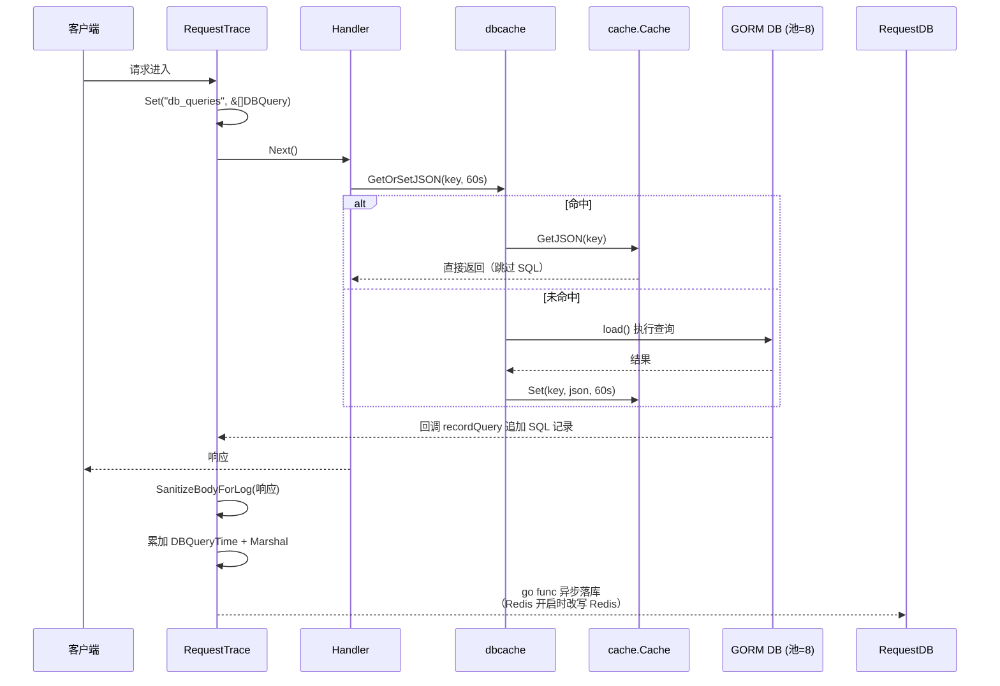
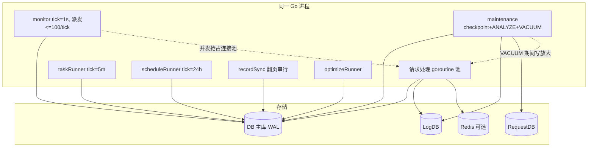
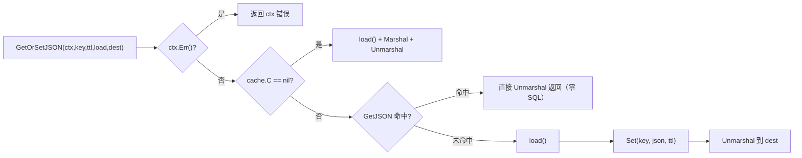
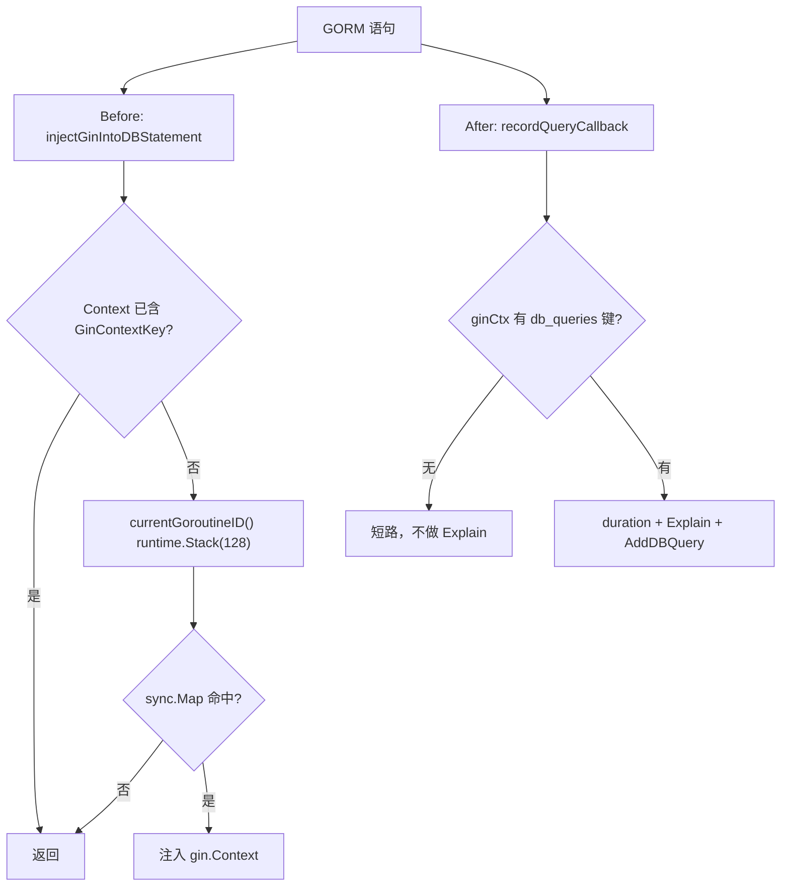
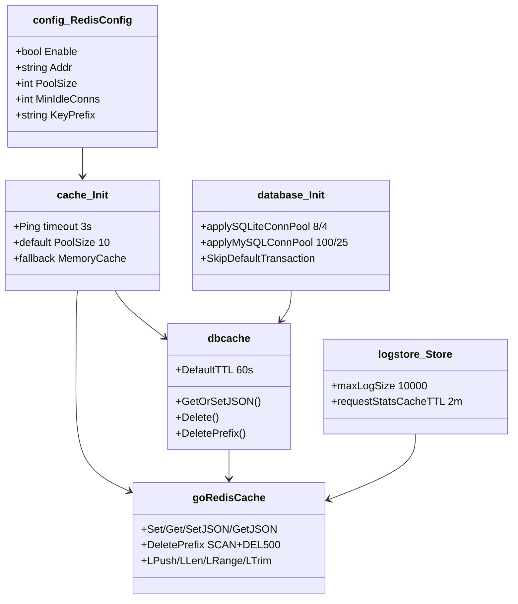

# 性能优化与调优

<cite>
**本文档引用的文件**
- [main/main.go](file://main/main.go)
- [main/go.mod](file://main/go.mod)
- [main/config.json](file://main/config.json)
- [main/internal/database/database.go](file://main/internal/database/database.go)
- [main/internal/database/trace_gin.go](file://main/internal/database/trace_gin.go)
- [main/internal/database/maintenance.go](file://main/internal/database/maintenance.go)
- [main/internal/cache/cache.go](file://main/internal/cache/cache.go)
- [main/internal/cache/go_redis.go](file://main/internal/cache/go_redis.go)
- [main/internal/dbcache/dbcache.go](file://main/internal/dbcache/dbcache.go)
- [main/internal/dbcache/keys.go](file://main/internal/dbcache/keys.go)
- [main/internal/logstore/store.go](file://main/internal/logstore/store.go)
- [main/internal/api/middleware/request_trace.go](file://main/internal/api/middleware/request_trace.go)
- [main/internal/api/middleware/sanitize.go](file://main/internal/api/middleware/sanitize.go)
- [main/internal/api/middleware/sanitize_bench_test.go](file://main/internal/api/middleware/sanitize_bench_test.go)
- [main/internal/api/handler/batch.go](file://main/internal/api/handler/batch.go)
- [main/internal/api/handler/account.go](file://main/internal/api/handler/account.go)
- [main/internal/api/handler/user.go](file://main/internal/api/handler/user.go)
- [main/internal/api/handler/cert.go](file://main/internal/api/handler/cert.go)
- [main/internal/api/handler/domain.go](file://main/internal/api/handler/domain.go)
- [main/internal/monitor/monitor.go](file://main/internal/monitor/monitor.go)
- [main/internal/service/task_runner.go](file://main/internal/service/task_runner.go)
- [main/internal/service/record_sync.go](file://main/internal/service/record_sync.go)
- [devlog.md](file://devlog.md)
</cite>

## 目录
1. [简介](#简介)
2. [项目结构](#项目结构)
3. [核心组件](#核心组件)
4. [架构总览](#架构总览)
5. [详细组件分析](#详细组件分析)
6. [依赖关系分析](#依赖关系分析)
7. [性能考虑](#性能考虑)
8. [故障排查指南](#故障排查指南)
9. [结论](#结论)
10. [附录](#附录)

## 简介

DNSPlane 的性能画像非常特殊：**单进程 Gin** 同时承担 API 与静态页面，业务核心是
**云厂商 API 编排**，持久化默认落在**单机 SQLite**。这意味着瓶颈通常不在 CPU，
而在三处：外部 API 往返、SQLite 写串行化、以及请求追踪自身的观测开销。

本文只讨论**可由代码事实支撑**的调优面，并明确区分证据等级：

| 等级 | 含义 | 本文范围举例 |
|------|------|--------------|
| 已验证 | 本次会话实测命令输出 | `go build` 退出码、基准测试 ns/op、`go tool pprof -top` |
| 代码事实 | 直接读取自源码常量与参数 | 连接池 8/4、`DefaultTTL=60s`、`maxDispatchPerTick=100` |
| 推断 / 未执行 | 结构导出的判断，或给出方法但未产出数据 | 串行云 API 时延放大、端到端压测 |

**关键实测事实：本仓库没有任何 pprof 端点。**
`rg -l pprof main/ web/` 仅命中 `main/go.sum`（传递依赖哈希），源码中不存在 `net/http/pprof` 导入，
`main.go` 的 `http.Server` 只挂了 `api.SetupRouter`。所有 CPU 剖析只能走离线基准测试路径。

**章节来源**
- [main/main.go](file://main/main.go)
- [devlog.md](file://devlog.md)

## 项目结构

性能相关的代码分布高度集中，调优时应按下表定位，而非全仓扫描：

```
main/
├── main.go                        # 进程级超时、runner 编排
├── internal/
│   ├── database/
│   │   ├── database.go            # 连接池 + DSN PRAGMA + SkipDefaultTransaction
│   │   ├── trace_gin.go           # 每语句 goroutine 反查（观测开销源）
│   │   └── maintenance.go         # WAL checkpoint / ANALYZE / VACUUM
│   ├── cache/  dbcache/  logstore/ # Redis 池 / 读穿缓存 / List 日志裁剪
│   ├── api/middleware/            # request_trace.go + sanitize_bench_test.go
│   ├── api/handler/batch.go       # 云 API 串行循环最密集处
│   ├── monitor/monitor.go         # 容灾检测派发与并发
│   └── service/{task_runner,record_sync}.go
```

| 调优面 | 主要落点 | 可调参数 |
|--------|----------|----------|
| 数据库吞吐 | `database/database.go` | 连接池上限、DSN PRAGMA、事务策略 |
| 读放大 | `dbcache/` + 三个 handler | TTL、键粒度、失效半径 |
| 缓存后端 | `cache/cache.go` | `pool_size`、`min_idle_conns`、`key_prefix` |
| 观测开销 | `database/trace_gin.go`、`request_trace.go` | `db_queries` 短路、异步写 |
| 外部 API 时延 | `handler/batch.go`、`service/record_sync.go` | 串行改并行、翻页上限 |
| 后台任务压力 | `monitor/monitor.go`、`service/task_runner.go` | 派发上限、tick 间隔、退避表 |

**章节来源**
- [main/internal/database/database.go](file://main/internal/database/database.go)
- [main/internal/api/middleware/request_trace.go](file://main/internal/api/middleware/request_trace.go)
- [main/internal/monitor/monitor.go](file://main/internal/monitor/monitor.go)

## 核心组件

与性能直接相关的六个既定参数（均为代码事实，非配置项）：

| 组件 | 参数 | 值 | 位置 |
|------|------|----|------|
| SQLite 连接池 | `MaxOpen/MaxIdle` · `MaxIdleTime/MaxLifetime` | 8 / 4 · 5m / 0（不重建） | `database.go` `applySQLiteConnPool` |
| MySQL 连接池 | `MaxOpenConns` / `MaxIdleConns` | 100 / 25 | `applyMySQLConnPool` |
| SQLite DSN | `journal_mode` / `synchronous` / `busy_timeout` | WAL / NORMAL / 5000ms | `sqliteDSN` |
| SQLite DSN | `cache_size` / `temp_store` / `mmap_size` | -16000 KB / MEMORY / 64 MiB | 同上 |
| GORM | `SkipDefaultTransaction` | `true` | `Init` 的 `gormConfig` |
| dbcache | `DefaultTTL` | `60 * time.Second` | `dbcache.go` |
| cache | Redis Ping 超时 / 默认 `PoolSize` | 3s / 10 | `cache.go` `Init` |
| logstore | `maxLogSize` / `requestStatsCacheTTL` | 10000 / 2m | `store.go` |
| monitor | tick / `maxDispatchPerTick` | 1s / 100 | `monitor.go` |
| record_sync | `recordSyncBatchSize` / `maxPages` | 100 / 100 | `record_sync.go` |
| HTTP Server | `ReadHeaderTimeout` / `IdleTimeout` | 30s / 120s | `main.go` |

三个容易忽略的结构性事实：

- 进程内有**三个独立 SQLite 句柄**（`DB`/`LogDB`/`RequestDB`），后两者恒为 SQLite（主库切 MySQL 也是）。
  按上限 8 算峰值 `8×3 = 24`，而 SQLite 单文件写本质串行，超出只增 page cache 内存
  （该判断写在 `applySQLiteConnPool` 注释里）；
- `RegisterDBCallbacks` 只挂 `DB` 与 `LogDB`，不挂 `RequestDB`，避免写日志再被自己追踪；
- `ConnMaxLifetime = 0` 对 SQLite 正确（无网络断连），但不可照搬到 MySQL。

**章节来源**
- [main/internal/database/database.go](file://main/internal/database/database.go)
- [main/internal/dbcache/dbcache.go](file://main/internal/dbcache/dbcache.go)
- [main/internal/cache/cache.go](file://main/internal/cache/cache.go)
- [main/internal/logstore/store.go](file://main/internal/logstore/store.go)
- [main/main.go](file://main/main.go)

## 架构总览

一次 `/api` 请求在性能视角下的完整路径：



**图表来源**
- [main/internal/api/middleware/request_trace.go](file://main/internal/api/middleware/request_trace.go)
- [main/internal/dbcache/dbcache.go](file://main/internal/dbcache/dbcache.go)
- [main/internal/database/database.go](file://main/internal/database/database.go)

后台侧与请求侧共享同一个 SQLite 写串行资源，这是最需要警惕的耦合：



**图表来源**
- [main/main.go](file://main/main.go)
- [main/internal/monitor/monitor.go](file://main/internal/monitor/monitor.go)
- [main/internal/service/task_runner.go](file://main/internal/service/task_runner.go)
- [main/internal/service/record_sync.go](file://main/internal/service/record_sync.go)
- [main/internal/database/maintenance.go](file://main/internal/database/maintenance.go)

**章节来源**
- [main/main.go](file://main/main.go)
- [main/internal/api/middleware/request_trace.go](file://main/internal/api/middleware/request_trace.go)

## 详细组件分析

### GORM 连接池调优

实测参数与语义判读：

| 驱动 | MaxOpen | MaxIdle | ConnMaxIdleTime | ConnMaxLifetime | 判读 |
|------|---------|---------|-----------------|-----------------|------|
| SQLite | 8 | 4 | 5m | 0 | 写串行，8 已超出实际并行收益；提高上限只增内存 |
| MySQL | 100 | 25 | 5m | 1h | 有网络断连风险，`lifetime=1h` 用于规避服务端 idle kill |

`sqliteDSN` 注释里有一条会决定调优成败的约束：`glebarez/go-sqlite` 只识别 `_pragma`、
`_time_format`、`_txlock` 三类 DSN 参数，且 `_pragma` 在**每个新连接建立时重新执行**。
因此调 PRAGMA 必须改 DSN，事后 `Exec("PRAGMA ...")` 只作用于当次连接；
`_busy_timeout` 不是该驱动参数名，正确写法是当前的 `_pragma=busy_timeout(5000)`。

`SkipDefaultTransaction = true` 的依据同样写在源码注释：本项目无显式事务、无多行批量插入、
库内无外键约束，隐式事务只增加 WAL fsync。**未来若引入多语句原子写，必须显式 `DB.Transaction(...)`。**

调优验证：

```bash
cd main

# 观察当前池参数
rg -n "SetMaxOpenConns|SetMaxIdleConns|SetConnMax|_pragma" internal/database/database.go

# 变更参数后的最小验证链
GOTMPDIR="$HOME/.cache/go-work" go build -gcflags="-lang=go1.26" ./...
GOTMPDIR="$HOME/.cache/go-work" go vet ./...
GOTMPDIR="$HOME/.cache/go-work" go test ./... -count=1
```

**章节来源**
- [main/internal/database/database.go](file://main/internal/database/database.go)
- [main/go.mod](file://main/go.mod)
- [devlog.md](file://devlog.md)

### dbcache 命中与失效半径

读穿逻辑只有一条分支树，`cache.C == nil` 时降级为「直接 load + 序列化往返」，
不会报错，只是没有缓存收益：



**图表来源**
- [main/internal/dbcache/dbcache.go](file://main/internal/dbcache/dbcache.go)

命中面（`GetOrSetJSON` 全部调用点，实测 `rg -n` 结果）：

| 调用点 | 键 | 失效函数 | 半径 |
|--------|----|----------|------|
| `handler/account.go:109` | `db:v1:accounts:admin` / `db:v1:accounts:user:<uid>` | `BustAccounts(uid)` | 2 个精确键 |
| `handler/user.go:64` | `db:v1:users:admin_full` | `BustUserList()` | 1 精确键 + 前缀扫描 |
| `handler/cert.go:79` | `db:v1:cert:accounts:list:d{0,1}:(admin|u<uid>)` | `BustCertAccountsList()` | 整前缀 SCAN |

两处键设计直接决定命中率与失效成本：

- `KeyUsersList(page, pageSize, keyword)` 把 `sha256(keyword)[:8]` 写进键名（空词固定 `_`），
  使分页键**基数随搜索词无限增长**，是低命中/高残留的来源；
- `BustUserList()` 与 `BustCertAccountsList()` 走 `DeletePrefix`，在 Redis 后端下是
  `SCAN(count=100)` + 每 500 个 key 一批 `DEL`，内存后端下遍历 map——
  一次用户列表写入的失效代价随缓存总量线性上升。

调优取向（推断）：搜索类键应设更短 TTL 或改显式失效；`BustUserList` 频繁时应收窄前缀而非加大池。

**章节来源**
- [main/internal/dbcache/dbcache.go](file://main/internal/dbcache/dbcache.go)
- [main/internal/dbcache/keys.go](file://main/internal/dbcache/keys.go)
- [main/internal/cache/go_redis.go](file://main/internal/cache/go_redis.go)
- [main/internal/api/handler/account.go](file://main/internal/api/handler/account.go)
- [main/internal/api/handler/user.go](file://main/internal/api/handler/user.go)
- [main/internal/api/handler/cert.go](file://main/internal/api/handler/cert.go)

### Redis 用途与边界

`go_redis.go` 除 KV 外还实现 List 操作（`LPush`/`LLen`/`LRange`/`LTrim`），
只被 `logstore` 使用，把日志装成定长列表：

| Redis 用途 | 键 | 上限/生命周期 |
|------------|----|----------------|
| 请求日志 | `app:request_logs` | `maxLogSize=10000`，`LLen > 10500` 才 `LTrim(0, 9999)` |
| 请求统计缓存 | `requestStatsCacheKey` | TTL `2 * time.Minute` |
| 读穿数据缓存 | `db:v1:*` | TTL `60s`（`dbcache.DefaultTTL`） |

每写一条都调 `LLen`，但只在超出 500 条余量时才 `LTrim`，属**摊还裁剪**：
避免每写必裁剪的双倍 O(N)，代价是列表短暂超限。

降级路径（实测代码）：`cache.Init` 用 3 秒超时 Ping，失败即 `Warn` 并 `NewMemoryCache(prefix)`，
**进程不退出**。副作用是内存缓存按进程计、重启即清空，且 `logstore.Init` 的非 Redis 分支为空实现，
于是请求日志改走 `RequestDB`（SQLite）。`key_prefix` 由 `NormalizeKeyPrefix` 叠加在
`db:v1:` 版本段之前，多环境共用 Redis 时它决定 `DeletePrefix` 的误伤范围。

**章节来源**
- [main/internal/cache/go_redis.go](file://main/internal/cache/go_redis.go)
- [main/internal/cache/cache.go](file://main/internal/cache/cache.go)
- [main/internal/logstore/store.go](file://main/internal/logstore/store.go)
- [main/internal/dbcache/keys.go](file://main/internal/dbcache/keys.go)

### 批量任务并发度

后台任务各有明确的并发闸门，这些是**代码事实**：

| 任务 | 节律 | 并发控制 | 位置 |
|------|------|----------|------|
| 容灾检测 | `1s` ticker | 单轮最多派发 `100` 个；`sync.Map` 去重防重入；单任务 `Timeout+10s` 上下文 | `monitor.go` |
| 证书/部署任务 | `5m` ticker | 逐单处理，退避表 `{300,600,1800,3600,7200}` / 部署 `{60,300,600,1800,3600}` | `task_runner.go` |
| 域名到期检查 | `24h` ticker | 全表扫描 | `task_runner.go` |
| 记录同步 | 每轮 | 每域名**串行翻页**，`100 × 100 = 10000` 条上限 | `record_sync.go` |

`monitor.go` 有两处正向设计：超出 `maxDispatchPerTick` 的任务**不排队，保持原
`check_next_time` 等下一 tick**，避免单轮无限起 goroutine；顺延用 `WHERE id IN (?)`
按 frequency **分组合并 UPDATE**，把 N 条写合成 1 条。
单任务内对多目标探测是**并行**的（每地址一 goroutine + `WaitGroup`/`Mutex`），
时延取决于最慢目标而非目标数之和。

相对地，`record_sync.go` 的 `fetchAllRecords` 是纯串行 `for page := 1..100`，
每页一次 `GetDomainRecords`；唯一的并行度是「每轮多个域名」，翻页本身 N 次 RTT 叠加。
它每页检查 `ctx.Err()`，注释说明否则关停时 `StopRecordSync` 的 `wg.Wait` 会被整轮拖住。

**章节来源**
- [main/internal/monitor/monitor.go](file://main/internal/monitor/monitor.go)
- [main/internal/service/task_runner.go](file://main/internal/service/task_runner.go)
- [main/internal/service/record_sync.go](file://main/internal/service/record_sync.go)

### 云 API 串行瓶颈

最密集的证据在 `handler/batch.go`，四组写操作全部是「逐条串行调用 provider」：

| 位置 | 循环 | 每轮外部调用 | 复杂度 |
|------|------|--------------|--------|
| `batch.go:136` → `:157` | `for _, line := range lines` | `provider.AddDomainRecord` | N × RTT |
| `batch.go:167` → `:180` | `for _, rec := range items` | `provider.AddDomainRecord` | N × RTT |
| `batch.go:301` → `:302` / `:315` | `for _, recordID := range recordIDs` | `GetDomainRecordInfo` **+** `UpdateDomainRecord` | 2N × RTT |
| `batch.go:404` → `:409/:412/:415` | `for _, recordID := range recordIDs` | `SetDomainRecordStatus` 或 `DeleteDomainRecord` | N × RTT |

判读：**批量编辑的往返数是批量新增的两倍**，因为改之前先逐条读回完整记录。
按云 API 单跳 80–200ms 量级，100 条记录的批量编辑会落在 16–40 秒（推断，未实测），
瓶颈与 SQLite、连接池无关，扩池不会改善。

同一模式出现在容灾切换：`monitor.go` 按
`GetDomainRecordInfo` → `AddDomainRecord`（逐个备用值，`:571`/`:587`）
→ `SetDomainRecordStatus` → `DeleteDomainRecord` 顺序执行，切换时延即故障期间的解析空窗。

优化方向（建议，未实施）：读阶段可并行，写阶段受账户级 QPS 约束；
引入并发必须复刻 `monitor.go` 的「上下文超时 + 每轮 `ctx.Err()` 检查」，否则关停被外部调用拖住；
并发上限应取常量而非 CPU 核数，因为约束来自对端限流。

**章节来源**
- [main/internal/api/handler/batch.go](file://main/internal/api/handler/batch.go)
- [main/internal/monitor/monitor.go](file://main/internal/monitor/monitor.go)
- [main/internal/service/record_sync.go](file://main/internal/service/record_sync.go)

### 巨型 handler 对响应路径的影响

`handler/` 目录中超过 500 行的文件（按行数排序，取自仓库既有扫描记录）：

| 排名 | 文件 | 行数 | 业务归属 |
|------|------|------|----------|
| 1 | `cloudflare.go` | 2509 | 自定义主机名 / Tunnel / 回退源 / DCV |
| 2 | `domain.go` | 1716 | 域名与解析记录 |
| 3 | `auth.go` | 1573 | 登录注册、TOTP、魔法链接、安装 |
| 4 | `cert.go` | 1519 | 证书账户 / 订单 / 部署 |
| 5 | `monitor.go` | 1270 | 容灾任务与切换 |
| 6 | `cert_deploy.go` | 1101 | 部署账户与任务 |
| 7-10 | `acceleration.go` 1000 / `user.go` 743 / `plan.go` 672 / `oauth.go` 565 | — | 加速、用户、套餐、OAuth |

需要澄清一个误解：**文件行数本身不是运行时性能问题**，Go 的编译单元大小不影响单次请求耗时。
它的间接影响有三条：

- 同一文件承载差异极大的响应路径。`domain.go` 既有同步查询也有 `utils.SafeGo` 异步写
  （实测 9 处），「这个接口是否等待落库」难以一眼判定；
- `domain.go:172`/`:206` 是内存内组装，而 `:742`/`:1631`/`:1764` 对应不同外部依赖层级，
  混排会掩盖真正的串行 IO 段；
- `db_queries` 是一维数组，单个 handler 产生几十条 SQL 时 `json.Marshal(*q)`
  会推高请求日志行大小，放大 `RequestDB` 写与 Redis List 内存。

结论（推断）：拆分巨型 handler 的收益是**可判定性与可观测性**，不是直接 CPU 节省。

**章节来源**
- [main/internal/api/handler/domain.go](file://main/internal/api/handler/domain.go)
- [main/internal/api/middleware/request_trace.go](file://main/internal/api/middleware/request_trace.go)
- [devlog.md](file://devlog.md)

### 慢查询观测与 db_queries 短路

观测链路由两个文件构成，理解它们的**双层短路**是安全开启追踪的前提：



**图表来源**
- [main/internal/database/trace_gin.go](file://main/internal/database/trace_gin.go)
- [main/internal/database/database.go](file://main/internal/database/database.go)
- [main/internal/api/middleware/request_trace.go](file://main/internal/api/middleware/request_trace.go)

两层短路的作用完全不同：

- **第二层（`db_queries` 键）是高价值短路**。源码注释写明「仅在有请求追踪时记录，
  否则跳过 Explain 等高开销路径」。`RequestTrace` 在 `:146` 注入该键，
  而它仅对 `/api` 前缀生效，故静态资源不会触发 `Explain`。
- **第一层（`trace_inject_gin` Before hook）不受同一开关保护**。
  `Context` 未携带 `GinContextKey` 时它会调用 `currentGoroutineID()`，
  后者用 `runtime.Stack(buf[:128], false)` 解析 goroutine 编号，并对 `sync.Map` 做一次 Load。
  这是**每条 GORM 语句都执行**的自省操作，高频小查询会被固定开销放大（推断，未量化）。

请求侧聚合成本：累加 `DBQueryTime` 并对查询数组做一次 `json.Marshal`（空数组不 Marshal），
请求体与响应体都过 `SanitizeBodyForLog`。

**章节来源**
- [main/internal/database/trace_gin.go](file://main/internal/database/trace_gin.go)
- [main/internal/database/database.go](file://main/internal/database/database.go)
- [main/internal/api/middleware/request_trace.go](file://main/internal/api/middleware/request_trace.go)

### 日志异步落库开销

`RequestTrace` 的落库分支是一个**二选一而非双写**的设计，实测代码：

```go
// 异步写入：Redis 开启时仅写 Redis，避免与 SQLite 双写；否则只写 RequestDB
go func(l models.RequestLog) {
    if logstore.Store != nil && logstore.Store.IsRedis() {
        logstore.Store.SaveRequestLog(l)
        return
    }
    _ = database.RequestDB.Create(&l).Error
}(log)
```

开销判读：

| 维度 | Redis 路径 | SQLite 路径 |
|------|------------|-------------|
| 阻塞请求的时间 | 不阻塞（新 goroutine） | 不阻塞（新 goroutine） |
| 峰值并发 | 受 Redis `pool_size` 约束 | 受 `RequestDB` 池 8 约束，且与业务写争抢同一文件 |
| 保留量 | 固定 `10000` 条环形 | 无上限，持续增长直到 `maintenance` 清理 |
| 主要风险 | 重启即丢失全部日志 | 高 QPS 时 SQLite 写成为全进程瓶颈 |
| 错误可见性 | `SaveRequestLog` 返回值被忽略 | `.Error` 被显式丢弃（`_ =`） |

`go func` 只把延迟挪出请求路径，不减少总工作量：SQLite 路径下每个请求最终都是一次
`RequestDB.Create`，与主库共享同一进程的写串行资源。若「接口 SQL 很快但整体变慢」，
先确认是否运行在无 Redis 的 SQLite 日志路径。

**章节来源**
- [main/internal/api/middleware/request_trace.go](file://main/internal/api/middleware/request_trace.go)
- [main/internal/logstore/store.go](file://main/internal/logstore/store.go)
- [main/internal/database/database.go](file://main/internal/database/database.go)

### 离线 CPU 剖析方法

由于**没有 pprof HTTP 端点**（实测：源码无 `net/http/pprof` 导入，
`rg -l pprof main/ web/` 仅命中 `main/go.sum`），CPU 剖析只能在测试二进制上做。
仓库里唯一现成的热路径基准是 `sanitize_bench_test.go`。

本次实测执行的命令与真实输出：

```bash
cd main
GOTMPDIR="$HOME/.cache/go-work" \
  go test ./internal/api/middleware/ \
    -run '^$' \
    -bench 'BenchmarkIsSensitiveKey|BenchmarkSanitizeBodyForLog' \
    -benchtime=200x \
    -cpuprofile="$HOME/.cache/go-work/cpu-mw.out"
```

```
goos: linux  goarch: amd64  cpu: Intel(R) Core(TM) i5-10200H @ 2.40GHz
BenchmarkIsSensitiveKey-8        200    794.6 ns/op   64 B/op    8 allocs/op
BenchmarkSanitizeBodyForLog-8    200  339524 ns/op  16.81 MB/s  61523 B/op  1880 allocs/op
PASS
```

`go tool pprof -top` 的真实热点（同一 profile 文件）：

```
Type: cpu  Duration: 72.77ms, Total samples = 90ms (123.68%)
 flat  flat%   cum%   function
  10ms 11.11%  30ms   main/internal/api/middleware.isSensitiveKey
  10ms 11.11%  20ms   reflect.Value.assignTo
  10ms 11.11%  10ms   encoding/json/internal/jsonwire.ConsumeWhitespace
  10ms 11.11%  10ms   internal/sync.(*HashTrieMap).Load
```

这张表就是脱敏路径的成本画像：

- `BenchmarkSanitizeBodyForLog` 样本为 50 条记录的列表响应，单次 **339 µs / 61.5 KB / 1880 allocs**；
  据此外推，1000 QPS 的列表接口仅脱敏就吃掉约 0.34 核（推断，基于实测单值）；
- `isSensitiveKey` 累计占 30ms/90ms，与基准注释一致：它对每个 JSON key 调用一次，
  O(表大小) 的线性扫描随字段数放大；
- `reflect.Value.assignTo` 进前十，说明脱敏走反射式 JSON 解码而非字符串替换，
  这是当前最大的可优化点，改造须保证敏感字段覆盖不回退。

常用剖析参数（跨平台）：

```bash
# 内存分配画像
GOTMPDIR="$HOME/.cache/go-work" go test ./internal/api/middleware/ \
  -run '^$' -bench . -benchmem -memprofile="$HOME/.cache/go-work/mem.out"
go tool pprof -top -nodecount=15 "$HOME/.cache/go-work/mem.out"

# 火焰图（需要 graphviz）
go tool pprof -svg "$HOME/.cache/go-work/cpu-mw.out" > "$HOME/.cache/go-work/cpu.svg"

# 只看某个函数的源码级归属
go tool pprof -list 'SanitizeBodyForLog' "$HOME/.cache/go-work/cpu-mw.out"
```

**章节来源**
- [main/internal/api/middleware/sanitize_bench_test.go](file://main/internal/api/middleware/sanitize_bench_test.go)
- [main/internal/api/middleware/sanitize.go](file://main/internal/api/middleware/sanitize.go)
- [main/main.go](file://main/main.go)

### 压测建议

**声明：本节未执行，方法为推断，不可作为容量结论。**

1. **选靶**：纯读接口（`/api/domains`）与批量写接口（`batch.go` 系列）瓶颈完全不同，须分开测。
2. **隔离外部依赖**：批量接口会真实调用云厂商 API，压测前必须把凭据指向桩服务。
3. **固定变量**：一次只改一个参数（连接池、TTL、Redis 开关）。
4. **观测污染**：`RequestTrace` 对 `/api` 全量记录请求体、响应体与 SQL，
   压测流量会写满 `request_logs.db` 或 Redis List，先确认日志路径再评价吞吐。
5. **口径**：看 p99 而非平均值，串行外部调用会把平均值拉低。

**章节来源**
- [main/internal/api/middleware/request_trace.go](file://main/internal/api/middleware/request_trace.go)
- [main/internal/api/handler/batch.go](file://main/internal/api/handler/batch.go)

## 依赖关系分析

性能参数的依赖链是单向的，配置层不会覆盖代码层的池参数：



**图表来源**
- [main/internal/config/config.go](file://main/internal/config/config.go)
- [main/internal/cache/cache.go](file://main/internal/cache/cache.go)
- [main/internal/cache/go_redis.go](file://main/internal/cache/go_redis.go)
- [main/internal/dbcache/dbcache.go](file://main/internal/dbcache/dbcache.go)
- [main/internal/logstore/store.go](file://main/internal/logstore/store.go)
- [main/internal/database/database.go](file://main/internal/database/database.go)

工作区实际配置（`main/config.json`，密钥已脱敏）给出的 Redis 侧取值：

```json
{ "redis": {
    "enable": true, "addr": "127.0.0.1:6379", "db": 0,
    "password": "{占位}", "pool_size": 20, "min_idle_conns": 10, "key_prefix": "{实例前缀}"
} }
```

即当前环境把 `pool_size` 从默认 10 提到 20、`min_idle_conns` 设 10；
而 SQLite/MySQL 侧连接池**没有配置入口**，`database.go` 的 8/100 是硬编码常量。

**章节来源**
- [main/config.json](file://main/config.json)
- [main/internal/database/database.go](file://main/internal/database/database.go)
- [main/internal/cache/cache.go](file://main/internal/cache/cache.go)

## 性能考虑

按「先做哪件最有效」排序的调优优先级：

| 优先级 | 动作 | 依据 | 风险 |
|--------|------|------|------|
| 1 | 保证 Redis 可用，把请求日志从 SQLite 挪走 | `request_trace.go` 二选一分支；`RequestDB` 池仅 8 | 重启丢日志（List 非持久语义） |
| 2 | 串行云 API 改并行（先读后写、限并发） | `batch.go:301` 是 `batch.go:136` 的两倍 RTT | 触发云厂商限流 |
| 3 | 消除 `trace_inject_gin` 的无条件 goroutine 反查 | `trace_gin.go` `runtime.Stack(128)` | 破坏 SQL 与请求的归因 |
| 4 | 优化 `isSensitiveKey` 为集合/前缀树 | 实测 `30ms/90ms` 累计占比 | 敏感字段漏脱敏 |
| 5 | 收紧 `KeyUsersList` 搜索键基数；SQLite 池上限维持 8 不动 | `keys.go` 全词入键 / 池注释「超出只增 page cache」 | 命中率下降 / 提高后吞吐不涨 |
| 6 | `VACUUM` 放在业务低谷窗口执行 | `maintenance.go` 默认 24h 间隔 | 执行期间写放大 |

数据库维护侧已有的自愈动作（`maintenance.go` `optimizeGormDB`）：
`PRAGMA wal_checkpoint(TRUNCATE)` → `ANALYZE` → `PRAGMA optimize` → `VACUUM` →
`PRAGMA journal_mode=WAL`（注释说明 `VACUUM` 可能重置 journal 模式，需显式恢复）。
调优时**不要手工再补 `PRAGMA journal_mode`**，会与后台维护竞争。

配置层与代码层的边界：`ReadHeaderTimeout`、`IdleTimeout`、两侧连接池、
`dbcache.DefaultTTL`、`maxDispatchPerTick`、`recordSyncBatchSize`、`logstore.maxLogSize`
**全部是代码常量**。唯一可从 `config.json` 调整的是 Redis 的 `pool_size` 与 `min_idle_conns`；
`VACUUM` 间隔可经系统配置键 `maint_vacuum_interval_h` 覆盖（`maintenance.go`）。

**章节来源**
- [main/internal/database/maintenance.go](file://main/internal/database/maintenance.go)
- [main/internal/database/database.go](file://main/internal/database/database.go)
- [main/internal/dbcache/dbcache.go](file://main/internal/dbcache/dbcache.go)
- [main/main.go](file://main/main.go)

## 故障排查指南

```bash
# 1) 当前走哪条日志路径（Redis 还是 SQLite）
rg -n "IsRedis" main/internal/logstore/store.go main/internal/api/middleware/request_trace.go
# 启动日志特征：[Cache] 使用 Redis 缓存: ... (pool=20) / 使用内存缓存 / Redis 连接失败(...)，回退到内存缓存

# 2) PRAGMA 与池参数是否按连接生效；请求日志库体积（SQLite 路径最可能的膨胀点）
rg -n "_pragma|SetMax" main/internal/database/database.go
ls -lh main/data/

# 4) 慢接口是否外部 API 串行：命中条数与耗时同量级增长 => 不是本机瓶颈
rg -n "provider\." main/internal/api/handler/batch.go

# 5) 复现并剖析热路径（无 pprof 端点，只能离线）
cd main
GOTMPDIR="$HOME/.cache/go-work" go test ./internal/api/middleware/ \
  -run '^$' -bench . -benchmem -cpuprofile="$HOME/.cache/go-work/cpu.out"
go tool pprof -top "$HOME/.cache/go-work/cpu.out"
```

| 症状 | 首查 | 常见结论 |
|------|------|----------|
| 整体变慢但业务 SQL 记录很快 | `RequestDB` 写路径 | 无 Redis，请求日志与主库争抢同一 SQLite 文件写锁 |
| 批量接口耗时随条数线性增长 | `batch.go:301` 循环 | 每条两次外部往返，与本机无关 |
| `database is locked` | `busy_timeout(5000)` | 并发写超过 5 秒等待上限，优先降并发而非加 timeout |
| 小查询 CPU 占比异常 / 脱敏后 CPU 高 | `trace_inject_gin`、`isSensitiveKey` | 前者每语句 `runtime.Stack`；后者实测累计 33% |
| 缓存命中率忽高忽低 | `BustUserList` 前缀失效 | 一次用户写清掉整个列表前缀 |
| 内存持续上涨 | 内存缓存回退 + `maxLogSize` | Redis 掉线后日志与缓存都留在进程内 |
| WAL 文件过大 | `wal_checkpoint(TRUNCATE)` 周期 | 维护间隔过长或写压力超过程序回收速度 |
| `VACUUM` 后库变小又回升 / 同步一轮跑不完 | `maintenance.go`、`record_sync.go` | 前者属正常但 IO 挤占请求；后者每域串行翻页至 100 页上限 |

**章节来源**
- [main/internal/api/middleware/request_trace.go](file://main/internal/api/middleware/request_trace.go)
- [main/internal/api/handler/batch.go](file://main/internal/api/handler/batch.go)
- [main/internal/database/trace_gin.go](file://main/internal/database/trace_gin.go)
- [main/internal/database/maintenance.go](file://main/internal/database/maintenance.go)
- [main/internal/service/record_sync.go](file://main/internal/service/record_sync.go)

## 结论

- 本项目的性能天花板由三件事决定：**日志落库走哪条路、云 API 是否串行、SQLite 单文件写串行**。
  连接池参数不是主要变量，且大部分是代码常量。
- 实测热点来自 `sanitize_bench_test.go`：单次列表响应脱敏 **339 µs / 61.5 KB / 1880 allocs**，
  `isSensitiveKey` 累计占 33%，是当前唯一有真实数据支撑的优化点。
- 观测本身有成本：`db_queries` 开关只保护 Explain 一层，
  `trace_inject_gin` 的 goroutine 反查在每条 GORM 语句上无条件执行。
- 已验证的负面事实是**没有 pprof 端点**；端到端压测未执行，吞吐推断不应作为容量目标。

## 附录

### A. 参数速查

```bash
cd main
rg -n "SetMaxOpenConns|SetMaxIdleConns|SetConnMax|SkipDefaultTransaction|_pragma=|ReadHeaderTimeout" \
  internal/database/database.go main.go
rg -n "DefaultTTL|PoolSize|minIdle|maxLogSize|requestStatsCacheTTL" \
  internal/dbcache/dbcache.go internal/cache/cache.go internal/logstore/store.go
rg -n "maxDispatchPerTick|certTaskInterval|recordSyncBatchSize|maxPages" \
  internal/monitor/monitor.go internal/service/task_runner.go internal/service/record_sync.go
```

**章节来源**
- [main/internal/database/database.go](file://main/internal/database/database.go)

### B. 调优前后对比模板

| 指标 | 采集方式 | 调优前 | 调优后 |
|------|----------|--------|--------|
| 单请求 p99 | 外部工具（**未执行**） | — | — |
| 脱敏 ns/op 与 allocs/op | `-bench` + `-benchmem` | 339524 / 1880（实测） | 待测 |
| 请求日志落库路径 | 启动日志 `[Cache]` 行 | 待记录 | 待记录 |
| `RequestDB` 体积 | `ls -lh main/data` | 待记录 | 待记录 |

**章节来源**
- [main/internal/api/middleware/sanitize_bench_test.go](file://main/internal/api/middleware/sanitize_bench_test.go)

### C. 不建议的改法

- 把 SQLite `MaxOpenConns` 调大以求「并发提升」：单文件写串行下只增 page cache 内存。
- 用 `Exec("PRAGMA ...")` 替代 DSN 中的 `_pragma`：只作用于当次连接。
- 给 `RequestDB` 也注册 GORM 追踪回调：会形成「写日志 → 追踪 → 再写日志」的自我放大，源码已显式排除。
- 在压测中保留 `RequestTrace` 全量记录后再评价业务吞吐：测的是日志子系统。

**章节来源**
- [main/internal/database/database.go](file://main/internal/database/database.go)
- [main/internal/api/middleware/request_trace.go](file://main/internal/api/middleware/request_trace.go)

### D. 证据等级声明

本文数字来源三类：本次会话真实执行的 `go build` / `go test -bench` / `go tool pprof` 输出、
`main/internal/` 直接读到的常量与参数、以及明确标注为「推断」「未执行」「建议」的判断。
凡标注为未执行者，不得作为容量规划或 SLA 依据。

**章节来源**
- [main/internal/database/trace_gin.go](file://main/internal/database/trace_gin.go)
