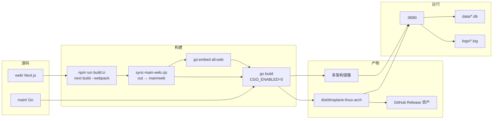
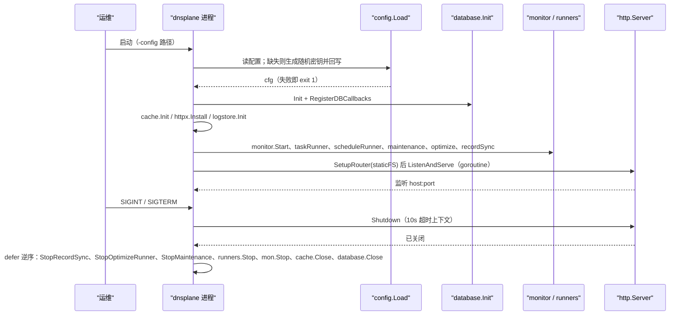
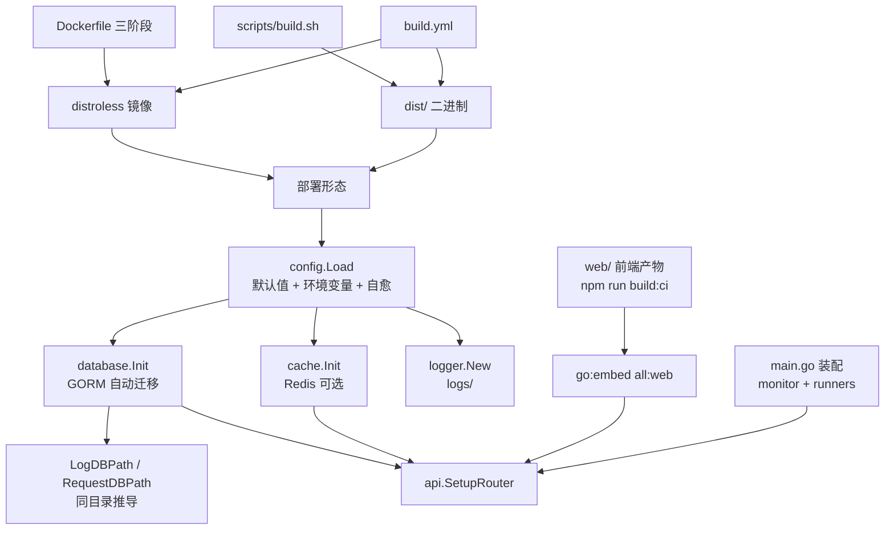

# 部署运维

<cite>
**本文档引用的文件**
- [Dockerfile](file://Dockerfile)
- [build.sh](file://scripts/build.sh)
- [docker-build.sh](file://scripts/docker-build.sh)
- [build.yml](file://.github/workflows/build.yml)
- [.dockerignore](file://.dockerignore)
- [main.go](file://main/main.go)
- [config.go](file://main/internal/config/config.go)
- [config.json](file://main/config.json)
- [database.go](file://main/internal/database/database.go)
- [logger.go](file://main/internal/logger/logger.go)
- [dashboard.go](file://main/internal/api/handler/dashboard.go)
- [package.json](file://web/package.json)
- [sync-main-web.cjs](file://web/scripts/sync-main-web.cjs)
- [go.mod](file://main/go.mod)
- [VERSION](file://VERSION)
- [README.md](file://README.md)
- [scan-infra.md](file://../.wiki-context/scan-infra.md)
- [analysis-deploy.md](file://../.wiki-context/analysis-deploy.md)
</cite>

## 目录

1. [简介](#简介)
2. [项目结构](#项目结构)
3. [核心组件](#核心组件)
4. [架构总览](#架构总览)
5. [详细组件分析](#详细组件分析)
6. [依赖关系分析](#依赖关系分析)
7. [性能考虑](#性能考虑)
8. [故障排查指南](#故障排查指南)
9. [结论](#结论)
10. [附录](#附录)

## 简介

本篇是「部署运维」域的总览，回答三件事：**怎么把 DNSPlane 跑起来、怎么升级回滚、
数据与端口落在哪里**。

DNSPlane 有三种运行形态，全部由同一份 Go 产物支撑：

- **二进制形态**：`scripts/build.sh` 交叉编译出 `dist/dnsplane-linux-<arch>`，
  或由 CI 上传到 GitHub Release；前端静态资源已经 `go:embed` 进二进制，**没有独立静态文件目录**
- **Docker 形态**：`Dockerfile` 三阶段（node 构建前端 → go 交叉编译 → distroless 运行），
  `scripts/docker-build.sh` 负责多架构 buildx；CI 侧推 GHCR
- **开发模式**：`web/` 起 Next.js dev server（turbopack），`main/` 起 `go run .`，
  两端分离，改前端不需重编后端

三者的**唯一差异是产物来源与配置加载路径**，运行期行为完全一致。

版本口径需要提前说明：当前工作区 `VERSION` 文件为 `1.0.11`，
但运行实例通过 API 报告的版本是 `GetSystemInfo` 里写死的 `"1.0.0"`
（`main/internal/api/handler/dashboard.go:500`），且 `main` 包**不存在 `Version` 符号**
（`main/main.go` 内无该标识符），因此 `-X main.Version=` 注入实际是空操作。
核对版本的可靠口径见[升级与回滚](#升级与回滚)。

行号、端口、目录、镜像阶段均为当前工作区实测；素材结论按「素材口径」标注。
四篇子文档尚未生成，链接先行：
[Docker容器化部署.md](./Docker容器化部署.md)、[CI_CD流水线配置.md](./CI_CD流水线配置.md)、
[性能优化与调优.md](./性能优化与调优.md)、[备份恢复策略.md](./备份恢复策略.md)。

**章节来源**
- [Dockerfile](file://Dockerfile)
- [main.go](file://main/main.go)
- [dashboard.go](file://main/internal/api/handler/dashboard.go)
- [VERSION](file://VERSION)

## 项目结构

### 部署相关文件清单

| 文件 | 职责 | 关键内容 |
|---|---|---|
| `Dockerfile` | 三阶段镜像构建 | `node:22-bookworm-slim` 出前端、`golang:1.26.2-bookworm` 出二进制、`distroless/static-debian12:nonroot` 运行，`EXPOSE 8080` |
| `scripts/build.sh` | 一键本地编译 | 前端 `build:ci` → 后端交叉编译 → `dist/` + `SHA256SUMS` |
| `scripts/docker-build.sh` | 多架构镜像构建/推送 | buildx builder `dnsplane-multiarch`、OCI label 打版本与 revision |
| `.github/workflows/build.yml` | CI 流水线 | `release-init` / `frontend` / `binaries`（12 架构矩阵）/ `docker` |
| `.dockerignore` | 构建上下文裁剪 | 排除 `.git`、`.github`、`web/node_modules`、`web/.next`、`web/out`、`**/*.md` |
| `main/config.json` | 开发期配置 | `port: 8800`、`file_path: "data/data.db"`、`redis.enable: true` |
| `main/internal/config/config.go` | 默认值与密钥自愈 | 默认 `8080` / `data/dnsplane.db`、环境变量覆盖、脏密钥回写 |
| `main/main.go` | 启动装配与优雅关闭 | `-config` flag、`defer` 逆序释放、10 秒 `Shutdown` |
| `VERSION` | 发布版本单一来源 | `1.0.11` |

`.dockerignore` 排除 `**/*.md` 意味着 `docs/` 与 `devlog.md` 不进构建上下文，
文档改动不会使镜像层缓存失效——这是有意的。

**章节来源**
- [Dockerfile](file://Dockerfile)
- [build.sh](file://scripts/build.sh)
- [docker-build.sh](file://scripts/docker-build.sh)
- [build.yml](file://.github/workflows/build.yml)
- [.dockerignore](file://.dockerignore)
- [config.json](file://main/config.json)

## 核心组件

### 三种运行形态对比

| 维度 | 二进制 | Docker | 开发模式 |
|---|---|---|---|
| 前端来源 | 已 embed 进可执行文件 | 构建期 `npm run build:ci` 后 embed | `next dev --turbopack` 独立端口 |
| 后端来源 | `go build` → `dist/` | `go build`（builder 阶段） | `go run .` |
| 配置文件 | `./config.json`（缺失则自动生成） | `/app/config.json`（镜像内不存在，自动生成） | `main/config.json`（已入库） |
| 默认监听 | `0.0.0.0:8080` | `0.0.0.0:8080`（`EXPOSE 8080`） | `0.0.0.0:8800`（dev config） |
| 数据目录 | `./data/` | `/app/data/`，**必须挂卷** | `main/data/`（实测已存在） |
| 日志目录 | `./logs/` | `/app/logs/`，**建议挂卷** | `main/logs/`（实测已存在） |
| gin 模式 | `cfg.Server.Mode == "release"` 才切 ReleaseMode | 默认配置为 `release` | dev config 为 `debug` |
| 运行用户 | 启动者 | `nonroot:nonroot` | 启动者 |
| CGO | `CGO_ENABLED=0` | `CGO_ENABLED=0` | 本机默认 |
| 适用场景 | 裸机/VM、systemd | 容器平台、多架构分发 | 编码与联调 |

三处容易踩空的差异：**端口不同源**（8080 vs 8800）、
**容器内配置文件不持久**（`/app` 由 distroless 以 root 建立，非 root 用户写不进去）、
**数据目录是相对路径**（取决于进程 CWD）。

**章节来源**
- [Dockerfile](file://Dockerfile)
- [config.json](file://main/config.json)
- [config.go](file://main/internal/config/config.go)
- [main.go](file://main/main.go)

### 交付物与版本标签矩阵

| 交付物 | 命名/标签 | 产生位置 | 版本注入方式 |
|---|---|---|---|
| 本地二进制 | `dist/dnsplane-linux-<arch>` | `scripts/build.sh` L47-57 | `-ldflags="-s -w -X main.Version=${VERSION}"`（L45，实际无目标符号） |
| 校验和 | `dist/SHA256SUMS` | `scripts/build.sh` L60-67 | `sha256sum` 或 `shasum -a 256` |
| Release 资产 | `dnsplane-<os>-<arch>[.exe]` | `build.yml` L127-158 | `-ldflags="-s -w"`（不含版本注入） |
| 本地镜像 | `${IMAGE}:${TAG}` + `:latest` | `scripts/docker-build.sh` L43-50 | OCI label `image.version=${TAG}`、`image.revision=$(git rev-parse HEAD)` |
| GHCR 镜像 | 分支名 / semver / `sha-` | `build.yml` L187-195 `docker/metadata-action` | label 由 metadata-action 生成 |

版本号优先级（`scripts/build.sh` L37-44）：
**环境变量 `VERSION` > 仓库根 `VERSION` 文件 > `git describe --tags --always --dirty` > `dev`**。

**章节来源**
- [build.sh](file://scripts/build.sh)
- [docker-build.sh](file://scripts/docker-build.sh)
- [build.yml](file://.github/workflows/build.yml)

## 架构总览

### 从源码到运行



**图表来源**
- [Dockerfile](file://Dockerfile)
- [build.yml](file://.github/workflows/build.yml)
- [main.go](file://main/main.go)
- [package.json](file://web/package.json)

### 启动装配与优雅关闭时序



**图表来源**
- [main.go](file://main/main.go)
- [config.go](file://main/internal/config/config.go)
- [database.go](file://main/internal/database/database.go)

## 详细组件分析

### 安装前检查

```bash
# 1) 工具链：go.mod 声明 go 1.26.2，本机 go1.27.2 可用
go version; node -v; docker buildx version    # 期望 go>=1.26 / node 22.x / buildx 可用
# 2) 端口空闲（默认 8080；开发配置为 8800）
ss -lntp | /usr/bin/grep -E ':(8080|8800)\b' || echo "端口空闲"
# 3) 数据/日志目录可写（进程 CWD 相对路径）
mkdir -p data logs && touch data/.w && rm -f data/.w && echo "可写"
# 4) Redis：入库的 main/config.json 里 enable 为 true，无 Redis 必须置 false
```

| 检查项 | 通过判据 | 不通过的后果 |
|---|---|---|
| Go 版本 | `go version` ≥ 1.26 | `go build` 直接失败 |
| 前端产物 | `main/web/` 非空 | `go:embed all:web` 编译期报错 |
| 端口 | 8080（或自定）未被占用 | `HTTP服务启动失败` |
| 目录权限 | CWD 下 `data/`、`logs/` 可创建 | 数据库/日志初始化失败 |
| 磁盘 | 留出 SQLite + 30 天日志轮转空间 | 日志轮转删除滞后、写库失败 |
| 密钥来源 | 决定用文件、环境变量还是自动生成 | JWT 频繁失效（见下） |

`main/web/` 是**被跟踪的构建产物**，前端改动必须先跑 `npm run build:ci`
或 `scripts/build.sh`，否则二进制内嵌的还是旧页面。

**章节来源**
- [go.mod](file://main/go.mod)
- [Dockerfile](file://Dockerfile)
- [main.go](file://main/main.go)
- [config.json](file://main/config.json)
- [README.md](file://README.md)

### 一键部署：scripts/build.sh

```bash
# 默认本机架构
scripts/build.sh

# 指定单架构 / 多架构一次性出
scripts/build.sh amd64
scripts/build.sh amd64 arm64

# 仅改后端时跳过前端，复用现有 main/web/
SKIP_FRONTEND=1 scripts/build.sh

# 显式钉版本（否则 VERSION 文件 > git describe > dev）
VERSION=1.0.11 scripts/build.sh amd64
```

脚本三步（`scripts/build.sh` L19-67）：前端（`bun` 优先，`bun.lock` 存在时用
`bun install --frozen-lockfile`，否则 `npm ci`）→ 后端交叉编译进 `dist/` →
`sha256sum dnsplane-linux-* > SHA256SUMS` 并列目录。

以 systemd 托管二进制形态：

```bash
# 部署目录约定：可执行文件与 data/ logs/ 同处一个 CWD
install -m 0755 dist/dnsplane-linux-amd64 /usr/local/bin/dnsplane
mkdir -p /srv/dnsplane/data /srv/dnsplane/logs
cd /srv/dnsplane && ./dnsplane -config /srv/dnsplane/config.json
```

进程用**相对路径**落库与落日志（默认 `data/dnsplane.db`、`logs/`），
所以 `WorkingDirectory` 必须设成部署目录，不能图省事用 `/`。

**章节来源**
- [build.sh](file://scripts/build.sh)
- [main.go](file://main/main.go)
- [config.go](file://main/internal/config/config.go)

### Docker 容器化部署

`Dockerfile` 的三阶段各有明确取舍：

```dockerfile
# 前端只在 BUILDPLATFORM 上构建一次，避免多架构并行 npm ci 拖垮网络/超时
FROM --platform=$BUILDPLATFORM node:22-bookworm-slim AS web
...
FROM --platform=$BUILDPLATFORM golang:1.26.2-bookworm AS builder
ARG TARGETOS
ARG TARGETARCH
ARG TARGETVARIANT
COPY main/go.mod main/go.sum ./
RUN go mod download
...
FROM --platform=$TARGETPLATFORM gcr.io/distroless/static-debian12:nonroot
WORKDIR /app
COPY --from=builder /dnsplane /app/dnsplane
USER nonroot:nonroot
EXPOSE 8080
ENTRYPOINT ["/app/dnsplane"]
```

三个要点：

1. **前端与 Go 编译都跑在 `$BUILDPLATFORM`**，只有最终运行层是 `$TARGETPLATFORM`；
   `arm` 架构时按 `TARGETVARIANT` 反推 `GOARM`（L25-27）
2. **先 COPY `go.mod/go.sum` 再 `go mod download`**（L19-20），
   依赖不变即可复用该层缓存
3. **运行层是 distroless nonroot**，没有 shell，
   排障不能 `docker exec -it ... sh`，只能从宿主侧看挂载卷与日志

本地多架构构建与推送：

```bash
# 仅本地构建 linux/amd64,linux/arm64（不 push）
scripts/docker-build.sh

# 构建并打 tag 推送
scripts/docker-build.sh --push v1.0.11

# 指定镜像名与平台
IMAGE=docker.cnb.cool/neko_kernel/dnsplane PLATFORMS=linux/amd64 scripts/docker-build.sh v1.0.11
```

脚本会自动创建 `dnsplane-multiarch` buildx builder（`docker-container` 驱动），
并明确处理了**多架构不能同时 `--load`** 的限制：
仅当目标平台等于宿主架构时才 `--load`，否则走无导出构建并提示加 `--push`。

运行容器（关键：卷与环境变量）：

```bash
docker run -d --name dnsplane \
  -p 8080:8080 \
  -v /srv/dnsplane/data:/app/data \
  -v /srv/dnsplane/logs:/app/logs \
  -e DNSPLANE_JWT_SECRET="$(openssl rand -hex 32)" \
  -e DNSPLANE_MASTER_KEY="$(openssl rand -hex 32)" \
  docker.cnb.cool/neko_kernel/dnsplane:v1.0.11
```

`DNSPLANE_JWT_SECRET` / `DNSPLANE_MASTER_KEY` 是容器化的**首选密钥来源**
（`config.go` L122-127 的环境变量优先逻辑）。
不设它们、又不持久化配置文件的话，进程每次启动都会发现配置文件缺失，
走「生成随机密钥 + 回写」分支（`config.go` L107-112），
导致旧会话 token 全部失效、且**已用旧主密钥加密的字段无法解密**。
`/app` 在 distroless 中由 root 建立、容器以 nonroot 运行，
回写大概率失败，从而每轮都重新生成。

**章节来源**
- [Dockerfile](file://Dockerfile)
- [docker-build.sh](file://scripts/docker-build.sh)
- [config.go](file://main/internal/config/config.go)

### 开发模式

```bash
# 后端：默认读 main/config.json（端口 8800）
cd main && go run .

# 前端：turbopack dev server
cd web && npm run dev
```

开发模式与生产形态的差异集中在 `main/config.json`：
`server.port` 为 `8800`、`database.file_path` 为 `data/data.db`、
`server.mode` 为 `debug`、`redis.enable` 为 `true`。
`mode != "release"` 时不切 `gin.ReleaseMode`（`main.go` L102-104），
因此开发期会看到完整调试路由日志。

首次访问会自动跳转安装页设置管理员账户（README 口径）。

**章节来源**
- [config.json](file://main/config.json)
- [main.go](file://main/main.go)
- [package.json](file://web/package.json)
- [README.md](file://README.md)

### CI/CD 流水线

`build.yml` 有四个 job，触发规则写在文件头注释：
`refs/tags/v*` 建 Release 并上传二进制；`push main/master` 推 GHCR `:latest` 与分支标签；
`pull_request` 仅构建验证不推送。

| Job | 依赖 | 关键动作 | 注意点 |
|---|---|---|---|
| `release-init` | tag 触发才跑 | `gh release create ... --generate-notes` | 先建 Release，避免 matrix 各 leg 并发创建竞争（L28 注释） |
| `frontend` | — | `npm ci` + `npm run build:ci` → `main/web` | 用 `actions/cache/save` 传产物，**绕开 artifact 存储配额**（L61 注释） |
| `binaries` | `frontend`、`release-init` | 12 架构矩阵 `CGO_ENABLED=0 go build` | `fail-on-cache-miss: true`：`main/web` 缺失就失败，因为 embed 需要它 |
| `docker` | — | QEMU + buildx + GHCR 登录 + metadata tags | PR 只出 `linux/amd64`，主分支与 tag 出 amd64/arm64/arm-v7；`cache-from/to: type=gha` |

矩阵覆盖 12 个 leg：`linux`（amd64、arm64、armv7、386、ppc64le、riscv64）、
`darwin`（amd64、arm64）、`windows`（amd64、arm64，带 `.exe` 后缀）、
`freebsd`（amd64、arm64）。

两处**与本地脚本不一致**的口径需要运维知晓：

- CI 的 `binaries` 用 `-ldflags="-s -w"`，**不带** `-X main.Version`（L140-141）；
  本地 `build.sh` 带。但由于 `main` 包无 `Version` 符号，两者实际都无效果
- CI 二进制落在 `main/dist/`，本地脚本落在仓库根 `dist/`

```bash
# 本地复现 CI 的构建口径
cd main && CGO_ENABLED=0 GOOS=linux GOARCH=arm64 \
  go build -buildvcs=false -trimpath -ldflags="-s -w" -o dist/dnsplane-linux-arm64 .
```

**章节来源**
- [build.yml](file://.github/workflows/build.yml)
- [build.sh](file://scripts/build.sh)

### 升级与回滚

启动装配的 `defer` 顺序决定了关闭语义，`main.go` 的实际登记顺序是：

```go
defer database.Close()            // 最后执行
defer cache.Close()
defer mon.Stop()
defer func() { taskCancel(); taskRunner.Stop(); scheduleRunner.Stop() }()
defer database.StopMaintenance()
defer service.StopOptimizeRunner()
defer service.StopRecordSync()    // 最先执行
```

`defer` 逆序意味着关闭时**先停记录同步、再停智能解析、再停库维护、
再停任务运行器与取消上下文、再停监控、最后关缓存与数据库**——
这是正确的：所有写路径先静默，再释放连接。

SIGINT/SIGTERM 后 `srv.Shutdown` 给 10 秒排空（`main.go` L149-154）。
10 秒内未排空的请求会被强制中断，滚动升级时需要把 terminationGracePeriod
设得比 10 秒大，否则容器会被平台提前 SIGKILL。

**版本核对口径**（重要）：

| 想确认的事 | 可靠做法 | 不可靠做法 |
|---|---|---|
| 源码版本 | `cat VERSION`（当前 `1.0.11`） | — |
| 镜像版本 | `docker inspect --format '{{ index .Config.Labels "org.opencontainers.image.version"}}' ` | `GetSystemInfo` |
| 镜像 revision | 同上，label `org.opencontainers.image.revision` | — |
| GHCR 标签 | `docker buildx imagetools inspect ` | — |
| 运行实例版本 | **当前无法从运行时取得** | `GetSystemInfo` 恒返回 `"1.0.0"` |

`GetSystemInfo`（`dashboard.go:500`）返回硬编码 `"version": "1.0.0"`，
且 `main.go` 无 `Version` 符号使 `-X` 注入落空。
**因此不要用管理面板的版本号判断线上是否已升级**，
应以镜像 tag / OCI label / Release 资产名的三重一致为准。
该函数的其余字段（`go_version`、`os`、`arch`、`goroutines`、`memory_alloc`）
来自 `runtime`，可正常用于运行时诊断。

升级步骤（Docker 形态）：

```bash
# 1) 先备份（见备份恢复策略.md）
cp -a /srv/dnsplane/data /srv/dnsplane/data.bak.$(date +%F)

# 2) 拉新镜像并换容器
docker pull docker.cnb.cool/neko_kernel/dnsplane:v1.0.11
docker stop dnsplane && docker rm dnsplane
docker run -d --name dnsplane -p 8080:8080 \
  -v /srv/dnsplane/data:/app/data -v /srv/dnsplane/logs:/app/logs \
  --env-file /srv/dnsplane/dnsplane.env \
  docker.cnb.cool/neko_kernel/dnsplane:v1.0.11

# 3) 校验：镜像标签 + 健康 + 日志无 error
docker inspect --format '{{.Config.Image}}' dnsplane
curl -fsS http://127.0.0.1:8080/ -o /dev/null && echo "HTTP OK"
docker logs --tail=50 dnsplane

# 4) 回滚 = 换回旧 tag 重新起容器（数据目录不动，命令同上一步，仅镜像 tag 改回）
docker stop dnsplane && docker rm dnsplane
docker run -d --name dnsplane -p 8080:8080 -v /srv/dnsplane/data:/app/data \
  -v /srv/dnsplane/logs:/app/logs --env-file /srv/dnsplane/dnsplane.env \
  docker.cnb.cool/neko_kernel/dnsplane:v1.0.10
```

回滚的前提是**数据库结构向后兼容**：`database.Init` 走 GORM 自动迁移，
新版本若引入了不可逆列变更，回滚二进制不会回退 schema。
因此第 1 步的卷备份不是可选项。

**章节来源**
- [main.go](file://main/main.go)
- [dashboard.go](file://main/internal/api/handler/dashboard.go)
- [docker-build.sh](file://scripts/docker-build.sh)
- [VERSION](file://VERSION)

### 数据目录与端口矩阵

```text
部署目录（进程 CWD）
├── config.json            # 缺失则自动生成并写入随机密钥
├── data/
│   ├── dnsplane.db        # 主库（默认 database.file_path）
│   ├── logs.db            # 运行日志库，由 LogDBPath() 从主库目录推导
│   ├── request_logs.db    # 请求日志库，由 RequestDBPath() 推导
│   └── data.db            # 开发配置使用的库名（main/config.json）
└── logs/
    └── 2026-10-12.log     # 按日期命名，超 10MB 触发分割，30 天后清理，可 .gz
```

`logs.db` 与 `request_logs.db` 都不是独立配置项，而是
`DatabaseConfig.LogDBPath()` / `RequestDBPath()` 对主库 `filepath.Dir()` 的推导
（`config.go` L58-67），因此**改主库路径会同时改这两个库的位置**。
`database.go` L215-222 还包含一次历史兼容迁移：
主库中若存在 `request_logs` 表则搬运到新库。

| 端口/路径 | 默认值 | 来源 | 变更方式 |
|---|---|---|---|
| HTTP | `8080` | `config.go` L88 默认值 + `Dockerfile` `EXPOSE 8080` | `config.json` 的 `server.port` |
| HTTP（开发） | `8800` | `main/config.json` | 同上 |
| Bind | `0.0.0.0` | `config.go` L89 | `server.host` |
| 主库 | `data/dnsplane.db` | `config.go` L95 | `database.file_path` |
| 主库（开发） | `data/data.db` | `main/config.json` | 同上 |
| 日志库 | `data/logs.db` | 推导 | 随主库 |
| 请求库 | `data/request_logs.db` | 推导 | 随主库 |
| 运行日志 | `logs/` | `logger.New()` → `NewWithOptions("logs", ...)` | 代码常量 |
| Redis | `127.0.0.1:6379` | `main/config.json`（`enable: true`） | `redis.*`；无 Redis 置 `enable: false` |
| JWT 有效期 | `24` 小时 | `config.go` L99 | `jwt.expire_hour` |

`GetSystemInfo` 里取文件大小用的是**字面量** `data/data.db`、`data/logs.db`、
`data/request_logs.db`（`dashboard.go:495-497`），
与默认的 `data/dnsplane.db` 不同名——自定义 `file_path` 后面板显示库大小为 0
是预期行为，不是数据丢失。

**章节来源**
- [config.go](file://main/internal/config/config.go)
- [config.json](file://main/config.json)
- [database.go](file://main/internal/database/database.go)
- [logger.go](file://main/internal/logger/logger.go)
- [dashboard.go](file://main/internal/api/handler/dashboard.go)

### 日志轮转与保留策略

`logger` 包的三个常量（`logger.go` L17-19）：

| 常量 | 值 | 含义 |
|---|---|---|
| `MaxFileSize` | `10 * 1024 * 1024` | 单文件最大 10MB，超过即分割 |
| `MaxBackups` | `30` | 最多保留文件数 |
| `MaxAge` | `30` | 最多保留 30 天 |

`NewWithOptions(logDir, ...)` 会 `MkdirAll(logDir, 0755)`、启动时先 `rotate()` 一次，
再起 `rotateLoop()` 后台协程；清理按 `time.Now().AddDate(0, 0, -MaxAge)` 求截止点，
`Glob(filepath.Join(l.logDir, "*.log*"))` 收集文件（含 `.gz`），
超出 `MaxBackups` 的部分从索引 `MaxBackups` 起删除。

```bash
# 磁盘占用核对（部署目录为 CWD）
du -sh data logs
ls -1 logs | wc -l                       # 应 <= MaxBackups
find logs -name '*.log*' -mtime +30      # 超过保留期的残留，期望为空
```

**章节来源**
- [logger.go](file://main/internal/logger/logger.go)

## 依赖关系分析



**图表来源**
- [main.go](file://main/main.go)
- [config.go](file://main/internal/config/config.go)
- [Dockerfile](file://Dockerfile)
- [build.yml](file://.github/workflows/build.yml)

依赖上有三条硬约束：

- **`main/web` 是后端编译的前置**。`go:embed all:web` 要求目录存在且非空，
  CI 因此用 `fail-on-cache-miss: true` 强制前端 job 成功
- **配置文件是单向自愈的**。空值或历史默认 `dnsplane-secret-key-change-me`
  会被替换并回写（`config.go` L130-143），
  但 `MasterKey` 一旦变化，此前用旧主密钥加密的字段就不可解——
  生产环境必须固定密钥来源
- **Redis 是可选依赖但不等于默认关闭**。入库的 `main/config.json` 里 `enable: true`，
  以它作为模板部署到无 Redis 的机器会静默降级为内存缓存

**章节来源**
- [config.go](file://main/internal/config/config.go)
- [config.json](file://main/config.json)
- [build.yml](file://.github/workflows/build.yml)

## 性能考虑

`main.go` 里写死的三个超时是运维唯一能直接对照的常量：

| 参数 | 值 | 位置 | 调优含义 |
|---|---|---|---|
| `ReadHeaderTimeout` | `30s` | `main.go` L136 | 抗慢首部攻击；不改整体读超时 |
| `IdleTimeout` | `120s` | `main.go` L137 | 长连接空闲回收，需小于上游 LB 空闲阈值 |
| `Shutdown` 排空 | `10s` | `main.go` L150 | 滚动升级的最小优雅期 |

镜像与构建侧的性能取舍：

- `CGO_ENABLED=0` 使二进制静态、可在 distroless 直接跑，代价是失去
  cgo DNS 解析路径（容器内解析依赖 `/etc/resolv.conf` 的 Go 纯实现）
- `-trimpath -ldflags="-s -w"` 去符号表与路径信息，缩小体积
- 前端只在 `$BUILDPLATFORM` 构建一次，避免多架构并行 `npm ci` 打爆网络
- `npm config set fetch-retries 5` 等三项重试参数（`Dockerfile` L7）是针对冷缓存拉包超时的处理
- CI 用 `type=gha,mode=max` 做 buildx 层缓存，`binaries` 用 `actions/cache` 而非 artifact

监控与后台协程都挂在 `taskCtx` 上（`main.go` L111-126），
因此关闭顺序直接影响排空表现：任务运行器在 HTTP 排空之后才被取消，
长任务有最多 10 秒完成收尾。**若存在超过 10 秒的批处理，应当把它从请求路径移到 runner**，
而不是放大 Shutdown 超时。

**章节来源**
- [main.go](file://main/main.go)
- [Dockerfile](file://Dockerfile)
- [build.yml](file://.github/workflows/build.yml)

## 故障排查指南

| 症状 | 根因 | 处置 |
|---|---|---|
| `加载配置失败` 后进程退出 | `-config` 路径错误或目录不可读 | 核对 CWD 与文件权限；`main.go` L70-74 直接 `os.Exit(1)` |
| `初始化数据库失败` 后退出 | `data/` 不可写或 SQLite 驱动不可用 | 建目录并赋权；容器形态检查卷 owner |
| `HTTP服务启动失败` | 端口被占用 | `ss -lntp`；改 `server.port` |
| 面板版本一直显示 1.0.0 | `GetSystemInfo` 硬编码，`main` 无 `Version` 符号 | 用镜像 tag / OCI label 核对 |
| 面板库大小显示 0 | `GetSystemInfo` 用字面量 `data/data.db`，与实际库名不符 | 预期行为；`du -sh data/` 为准 |
| 每次重启都要重新登录，且保存的凭据解密失败 | 配置文件未持久化，走「生成随机密钥」分支 | 挂卷持久化 `config.json`，或设 `DNSPLANE_JWT_SECRET`/`DNSPLANE_MASTER_KEY` |
| 容器内 `exec` 无法进 shell | distroless 无 shell | 从宿主看挂载卷与日志 |
| `docker-build.sh` 多架构后本地看不到镜像 | 多平台不能 `--load` | 加 `--push <tag>`，或只构建宿主架构 |
| 二进制里前端是旧页面 | 未跑 `npm run build:ci` 就 `go build`；或用了 `SKIP_FRONTEND=1` | 先构建前端再编译，或去掉 SKIP |
| CI `binaries` 报 cache miss | `main/web` 未由 frontend job 产出 | 检查 `embedded-web-${{ github.sha }}` cache key |
| 改了 `file_path` 后日志库跑到别处 | `LogDBPath`/`RequestDBPath` 从主库目录推导 | 整目录一起迁移与备份 |
| 滚动升级时请求被截断 | 10 秒排空 + 平台 grace 更短 | grace period 设为 > 10 秒 |
| Redis 未部署但缓存不可用 | `redis.enable: true` 且连不上 | 置 `enable: false` 走内存缓存 |
| 日志目录文件数超过 30 | `rotateLoop` 未跑到清理分支或目录权限不足 | 核对 `logs/` 可写；手动清理前确认时间 |

```bash
# 快速定位：进程视角的真实 CWD 与其下的数据文件
pid=$(pgrep -x dnsplane | head -1)
ls -l "/proc/$pid/cwd"
ls -lh "$(/usr/bin/readlink /proc/$pid/cwd)/data" 2>/dev/null

# 容器形态
docker inspect --format '{{json .Mounts}}' dnsplane
docker logs --since=10m dnsplane | /usr/bin/grep -i error
```

**章节来源**
- [main.go](file://main/main.go)
- [config.go](file://main/internal/config/config.go)
- [docker-build.sh](file://scripts/docker-build.sh)
- [build.yml](file://.github/workflows/build.yml)

## 结论

部署 DNSPlane 的关键不在命令，而在**四个必须显式决定的口径**：

- **形态口径**：二进制/Docker/开发模式的端口与目录来源不同（8080 vs 8800、
  `data/dnsplane.db` vs `data/data.db`），不要指望一份 config 通吃
- **密钥口径**：优先用 `DNSPLANE_JWT_SECRET` / `DNSPLANE_MASTER_KEY`；
  依赖自动生成会随容器重启而失效
- **版本口径**：运行时不可信（恒 `1.0.0`），以 `VERSION` 文件、镜像 tag、
  OCI label 三者一致为准
- **数据口径**：三个 SQLite 库同目录联动，`logs.db`/`request_logs.db` 是推导而非配置，
  备份与迁移必须以目录为单位

升级回滚的安全边界来自关闭顺序（先静默写路径、再释放连接）
与 10 秒排空窗口，容器平台侧的 grace period 必须匹配。

**章节来源**
- [main.go](file://main/main.go)
- [config.go](file://main/internal/config/config.go)
- [Dockerfile](file://Dockerfile)

## 附录

### 命令速查

```bash
# 构建
scripts/build.sh amd64 arm64
SKIP_FRONTEND=1 scripts/build.sh
VERSION=1.0.11 scripts/build.sh

# 镜像
scripts/docker-build.sh
scripts/docker-build.sh --push v1.0.11
docker buildx imagetools inspect docker.cnb.cool/neko_kernel/dnsplane:v1.0.11

# 运行
docker run -d --name dnsplane -p 8080:8080 \
  -v /srv/dnsplane/data:/app/data -v /srv/dnsplane/logs:/app/logs \
  -e DNSPLANE_JWT_SECRET=... -e DNSPLANE_MASTER_KEY=... \
  docker.cnb.cool/neko_kernel/dnsplane:v1.0.11

# 核对
docker inspect --format '{{ index .Config.Labels "org.opencontainers.image.version"}}' dnsplane
cat VERSION
curl -fsS http://127.0.0.1:8080/ -o /dev/null && echo OK
docker stop dnsplane            # 触发 SIGTERM → 优雅关闭

# 备份（详见备份恢复策略.md）
tar czf dnsplane-data-$(date +%F).tgz -C /srv/dnsplane data
```

**章节来源**
- [build.sh](file://scripts/build.sh)、[docker-build.sh](file://scripts/docker-build.sh)

### 部署检查清单

| 阶段 | 项 | 判据 |
|---|---|---|
| 部署前 | `main/web` 为最新 | 前端有改动时先 `build:ci` |
| 部署前 | 密钥来源确定 | 环境变量优先于自动生成 |
| 部署时 | `data/`、`logs/` 卷或目录可写 | 非 root 容器需匹配运行用户 |
| 部署时 | grace period > 10s | 与 `Shutdown` 排空匹配 |
| 部署后 | HTTP 可达且日志无 error | 首页非错误；`docker logs` / `logs/*.log` |
| 部署后 | 三个库文件存在 | `data/` 下有主库、`logs.db`、`request_logs.db` |
| 部署后 | 版本记录入档 | 以镜像 tag + OCI label 记录，不记面板值 |

**章节来源**
- [Dockerfile](file://Dockerfile)、[main.go](file://main/main.go)

### 交叉链接

- 快速上手与首次安装：[快速开始.md](../快速开始.md)
- 配置项逐项说明：[配置管理.md](../配置管理.md)
- 数据结构与迁移：[数据库设计.md](../数据库设计.md)
- 运行异常处置：[故障排除.md](../故障排除/故障排除.md)
- 扩展点的验证方式：[扩展测试与验证.md](../扩展开发/扩展测试与验证.md)
- 子文档（尚未生成，链接先行）：
  [Docker容器化部署.md](./Docker容器化部署.md)、[CI_CD流水线配置.md](./CI_CD流水线配置.md)、
  [性能优化与调优.md](./性能优化与调优.md)、[备份恢复策略.md](./备份恢复策略.md)

**章节来源**
- [README.md](file://README.md)
- [build.sh](file://scripts/build.sh)
- [docker-build.sh](file://scripts/docker-build.sh)
- [analysis-deploy.md](file://../.wiki-context/analysis-deploy.md)
