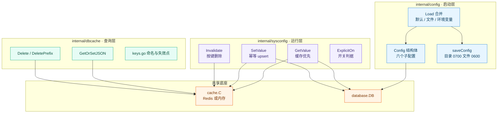
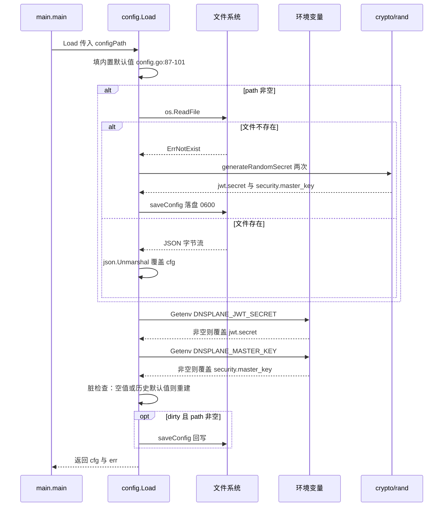
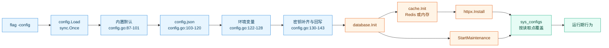
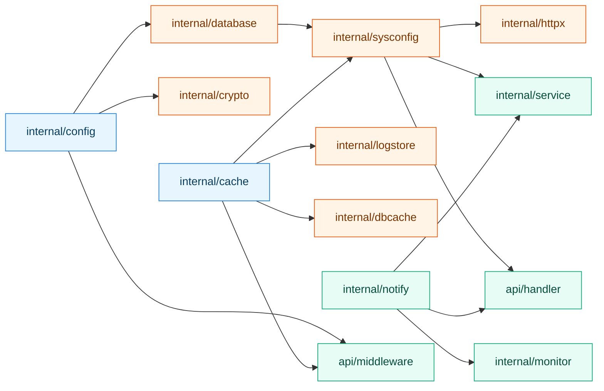
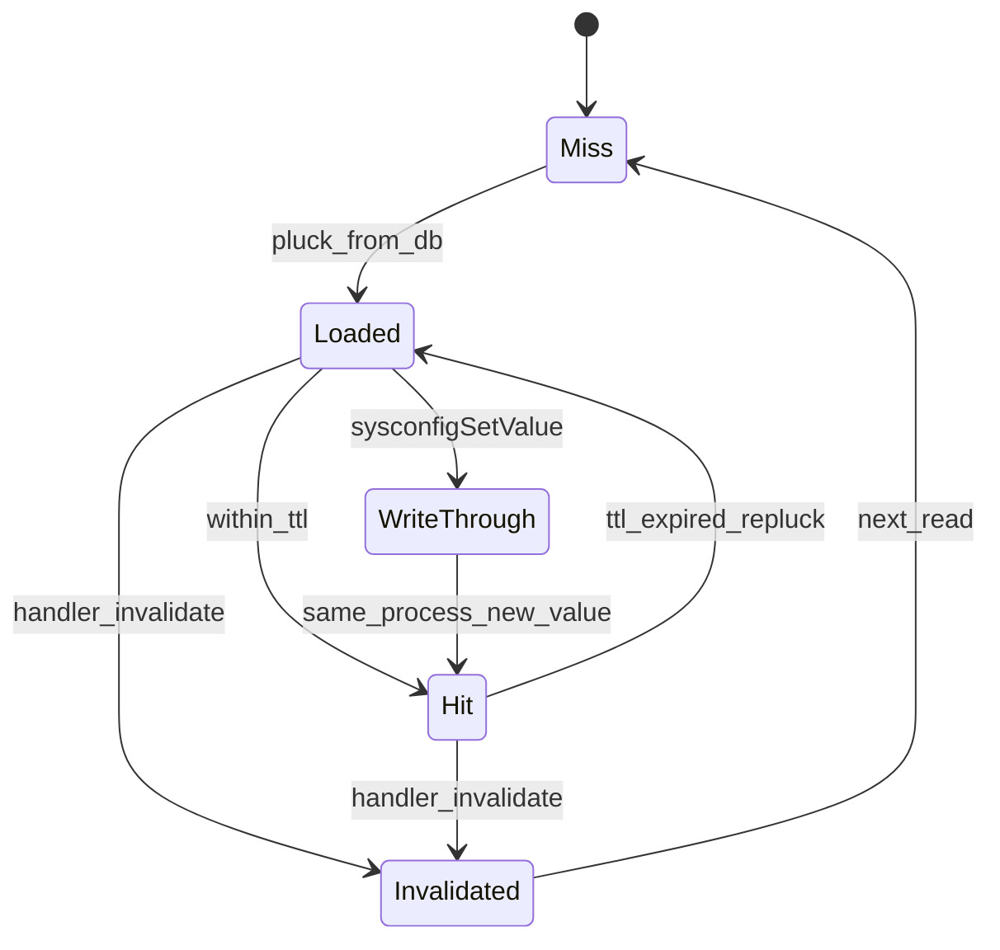

# 配置管理

<cite>
**本文档引用的文件**
- [config.go](file://main/internal/config/config.go)
- [main.go](file://main/main.go)
- [sysconfig.go](file://main/internal/sysconfig/sysconfig.go)
- [dbcache.go](file://main/internal/dbcache/dbcache.go)
- [keys.go](file://main/internal/dbcache/keys.go)
- [cache.go](file://main/internal/cache/cache.go)
- [go_redis.go](file://main/internal/cache/go_redis.go)
- [database.go](file://main/internal/database/database.go)
- [maintenance.go](file://main/internal/database/maintenance.go)
- [models.go](file://main/internal/models/models.go)
- [hooks.go](file://main/internal/models/hooks.go)
- [crypto.go](file://main/internal/crypto/crypto.go)
- [proxy.go](file://main/internal/httpx/proxy.go)
- [store.go](file://main/internal/logstore/store.go)
- [user.go](file://main/internal/api/handler/user.go)
- [auth_control.go](file://main/internal/api/handler/auth_control.go)
- [sysconfig_cache.go](file://main/internal/api/handler/sysconfig_cache.go)
- [dashboard.go](file://main/internal/api/handler/dashboard.go)
- [acceleration.go](file://main/internal/api/handler/acceleration.go)
- [optimizeip.go](file://main/internal/api/handler/optimizeip.go)
- [auth.go](file://main/internal/api/handler/auth.go)
- [middleware/auth.go](file://main/internal/api/middleware/auth.go)
- [router.go](file://main/internal/api/router.go)
- [channel_registry.go](file://main/internal/notify/channel_registry.go)
- [channel_adapters.go](file://main/internal/notify/channel_adapters.go)
- [channel.go](file://main/internal/notify/channel.go)
- [notify.go](file://main/internal/notify/notify.go)
- [providers.go](file://main/internal/cert/providers.go)
- [acme.go](file://main/internal/cert/acme/acme.go)
- [optimize.go](file://main/internal/service/optimize.go)
- [task_runner.go](file://main/internal/service/task_runner.go)
- [record_sync.go](file://main/internal/service/record_sync.go)
- [config.json](file://main/config.json)
- [.gitignore](file://.gitignore)
- [README.md](file://README.md)
- [Dockerfile](file://Dockerfile)
</cite>

## 目录

1. [简介](#简介)
2. [项目结构](#项目结构)
3. [核心组件](#核心组件)
4. [架构总览](#架构总览)
5. [详细组件分析](#详细组件分析)
6. [依赖关系分析](#依赖关系分析)
7. [性能考虑](#性能考虑)
8. [故障排查指南](#故障排查指南)
9. [结论](#结论)
10. [附录](#附录)

## 简介

DNSPlane 的配置分四层，越靠后加载的层优先级越高。四层不是并列可选，而是同一份运行参数在不同阶段的四种来源：

| 层 | 载体 | 读取入口 | 生效时机 | 可写入方 |
|----|------|----------|----------|----------|
| 内置默认 | `config.Load` 内的结构体字面量 | `main/internal/config/config.go:87-101` | 进程启动，仅一次 | 无（编译期固定） |
| 配置文件 | `config.json`（`-config` 可改路径） | `main/internal/config/config.go:103-120`、`main/main.go:67-70` | 进程启动，仅一次 | 运维（文件权限 0600） |
| 环境变量 | `DNSPLANE_JWT_SECRET` 与 `DNSPLANE_MASTER_KEY` | `main/internal/config/config.go:122-128` | 进程启动，覆盖配置文件 | 容器编排或 shell |
| 系统运行时 | `sys_configs` 表（键值对） | `main/internal/sysconfig/sysconfig.go:17-26` | 每次读取，带 60 秒缓存 | 管理员经系统设置页 |

第四层是本项目特有的设计：它不是「配置文件的补充」，而是一组**独立配置域**，承载开关、凭据与阈值，读写全走数据库。分工判据是变更代价而非重要性——监听地址、数据库连接、加密主密钥必须早于数据库存在，只能落在前三层；通知凭据、注册开关、日志保留天数需要即时生效，必须落在第四层。`sync.Once` 则决定了前三层的不可变性（`main/internal/config/config.go:79-86`）：一个进程内 `Load` 只真正执行一次，因此修改 `config.json` 必须重启进程。

**章节来源**
- [config.go:79-146](file://main/internal/config/config.go#L79-L146)
- [sysconfig.go:12-43](file://main/internal/sysconfig/sysconfig.go#L12-L43)

## 项目结构

配置能力集中在三个包，职责边界互不重叠：

```text
main/internal/
├── config/
│   └── config.go          186 行  结构定义、加载、合并、随机密钥、落盘（全包唯一文件）
├── sysconfig/
│   └── sysconfig.go        43 行  sys_configs 表读写与 60 秒缓存（全包唯一文件）
└── dbcache/
    ├── dbcache.go          68 行  读穿缓存原语 GetOrSetJSON / Delete / DeletePrefix
    └── keys.go             50 行  缓存 key 命名与失效点
```

| 包 | 唯一职责 | 依赖 | 明确不做的事 |
|----|----------|------|--------------|
| `internal/config` | 启动期参数：解析、合并、补齐密钥、落盘 | 仅标准库 | 不读数据库，不感知请求上下文 |
| `internal/sysconfig` | 运行期键值配置的读写与缓存 | `cache`、`database`、`models` | 不做类型转换，不做值校验 |
| `internal/dbcache` | 热点列表的读穿缓存与失效 | `cache` | 不碰 `sys_configs` 表，与配置层无关 |

边界由依赖方向保证：`config` 是最底层，被 `database`、`crypto`、`api/middleware` 反向依赖（`main/internal/database/database.go:6`、`main/internal/crypto/crypto.go:13`、`main/internal/api/middleware/auth.go:36`）；`sysconfig` 位于业务层之上，不能被 `config` 反向引用——这正是「配置文件里读不到数据库覆盖值」的结构性原因。`dbcache` 与 `sysconfig` 都建在同一套 `cache.C` 抽象上（`main/internal/cache/cache.go:16-33`），但前者缓存**查询结果**、后者缓存**配置值**，混在一个包里会让「缓存穿透」与「配置未生效」两类问题难以区分。



**图表来源**
- [config.go:16-186](file://main/internal/config/config.go#L16-L186)
- [sysconfig.go:12-43](file://main/internal/sysconfig/sysconfig.go#L12-L43)
- [dbcache.go:12-67](file://main/internal/dbcache/dbcache.go#L12-L67)

**章节来源**
- [config.go:16-23](file://main/internal/config/config.go#L16-L23)
- [dbcache.go:12-67](file://main/internal/dbcache/dbcache.go#L12-L67)
- [cache.go:16-33](file://main/internal/cache/cache.go#L16-L33)

## 核心组件

### Config 结构体

`Config` 是六个子配置的聚合根，字段即 `config.json` 的顶层键（`main/internal/config/config.go:16-23`）：

| 子配置 | 结构位置 | 字段数 | 消费方 |
|--------|----------|--------|--------|
| `Server` | `config.go:40-45` | 4 | `main.go:102-104`、`main.go:130`、`handler/auth.go:815` |
| `Database` | `config.go:47-55` | 7 | `database.Init`（`database.go:71`） |
| `JWT` | `config.go:69-72` | 2 | `middleware/auth.go:36`、`:249`、`:268`、`:424` |
| `Redis` | `config.go:30-38` | 7 | `cache.Init`（`main.go:83-91`） |
| `Security` | `config.go:26-28` | 1 | `crypto.deriveKey`（`crypto.go:26-33`） |
| `Proxy` | `config.go:74-77` | 2 | 无消费方 |

`LogDBPath` 与 `RequestDBPath` 不是配置项而是**派生函数**：日志库与请求库路径恒等于主库同目录下的 `logs.db` 与 `request_logs.db`（`config.go:57-67`），因此无法单独配置，改主库目录即同时改三库位置。

三个字段没有任何消费方（全库检索实测无读取点），属死配置，在[附录](#附录)逐条标注：`ServerConfig.BaseURL`（`config.go:44`）、`JWTConfig.ExpireHour`（`config.go:71`）、`ProxyConfig` 整节（`config.go:20`、`config.go:74-77`）。

**章节来源**
- [config.go:16-77](file://main/internal/config/config.go#L16-L77)

### SysConfig 表

运行期配置只有一张表，模型极简（`main/internal/models/models.go:313-317`）：

| 列 | 类型约束 | 说明 |
|----|----------|------|
| `key` | `primaryKey;size:32` | 键名上限 32 字符，超长键无法落库 |
| `value` | `type:text` | 一律字符串，布尔与数字由消费方各自解析 |

`value` 只有字符串这一种类型是本项目最重要的一次取舍：写入端把前端 JSON 值统一转成字符串（`main/internal/api/handler/user.go:642-671`，布尔转 `true`/`false` 字面串，整数走 `strconv.FormatInt`，数组与对象转成 JSON 串），读取端各自决定「未配置」的默认语义。于是同一个空值在不同判据下结果并不一致：

| 判据函数 | 位置 | 未配置（空串）时 | 视为真的取值 |
|----------|------|------------------|--------------|
| `sysconfig.ExplicitOn` | `main/internal/sysconfig/sysconfig.go:39-43` | 关 | `true`/`1`/`yes`/`on` |
| `notify.ChannelEnabled` | `main/internal/notify/channel.go:22-25` | **开** | 除 `0`/`false`/`no`/`off` 外全部 |
| `sysconfigBoolDefaultTrue` | `main/internal/service/task_runner.go:736-743` | 开 | 同上 |
| `sysconfigBoolExplicitOn` | `main/internal/service/task_runner.go:745-748` | 关 | 同 `ExplicitOn` |

另有两处**绕过 sysconfig 包**、手写 `First` 查询的读取点（`main/internal/api/handler/auth.go:174-184`、`auth.go:629`），它们不吃缓存，没有 60 秒延迟，但也意味着同一次保存后不同入口看到的值可能不一致。

**章节来源**
- [models.go:313-317](file://main/internal/models/models.go#L313-L317)
- [task_runner.go:736-748](file://main/internal/service/task_runner.go#L736-L748)

### 缓存层

`sysconfig` 的缓存极薄，两个常量加一次读写（`main/internal/sysconfig/sysconfig.go:12-37`）：

| 项 | 值 | 定义位置 |
|----|-----|----------|
| 逻辑前缀 | `syscfg:` | `sysconfig.go:13` |
| TTL | 60 秒 | `sysconfig.go:14` |
| 回源语句 | `Pluck("value", &value)` | `sysconfig.go:23` |
| 写穿策略 | 先 upsert 再 `Set`（不是删除） | `sysconfig.go:34-37` |

两个必须知道的性质：`GetValue` 不接 `Pluck` 返回的错误（`sysconfig.go:23`），键不存在与查询失败都表现为空串且空串照样写缓存 60 秒；`SetValue` 只写穿本进程（`sysconfig.go:36`），其他副本最长 60 秒后各自回源收敛，多副本部署下这是可观察行为。

`dbcache` 是另一套面向列表查询的读穿缓存：默认 TTL 60 秒（`main/internal/dbcache/dbcache.go:12`），`cache.C` 为 nil 时直接透传而不缓存（`dbcache.go:18-28`），key 命名与失效点集中定义（`keys.go:10-49`），关键字查询用 SHA-256 前 8 字节做摘要避免 key 过长（`keys.go:16-23`）。

**章节来源**
- [sysconfig.go:12-37](file://main/internal/sysconfig/sysconfig.go#L12-L37)
- [dbcache.go:12-44](file://main/internal/dbcache/dbcache.go#L12-L44)
- [keys.go:10-49](file://main/internal/dbcache/keys.go#L10-L49)

### 加载与合并顺序

`Load` 是唯一合并点，实测顺序严格如下：



**图表来源**
- [config.go:84-154](file://main/internal/config/config.go#L84-L154)
- [main.go:67-74](file://main/main.go#L67-L74)

覆盖关系是**后写胜**：环境变量高于 `config.json`（`config.go:122-128`），`config.json` 高于内置默认（`config.go:116` 的 `Unmarshal` 直接覆写同一 `cfg` 指针）。第四层 `sys_configs` 不参与这里，它由消费方在使用点自行覆盖，典型是 `LoadMaintenanceConfig`（`main/internal/database/maintenance.go:62-98`）与 `cert_expire_days`（`main/internal/service/task_runner.go:153-159`）。

历史默认密钥的强制轮换是启动期最有价值的行为：`legacyDefaultJWTSecret` 常量（`config.go:14`）命中即重建（`config.go:130-143`）。由于 `jwt.secret` 既是 HS256 签名密钥（`middleware/auth.go:249-262`）又是 cookie 会话 AES-GCM 密钥的派生源（`auth.go:35-39`），换密钥等于全端登出，属预期行为。

**章节来源**
- [config.go:84-154](file://main/internal/config/config.go#L84-L154)
- [maintenance.go:61-98](file://main/internal/database/maintenance.go#L61-L98)

## 架构总览

进程装配顺序决定了「哪些配置在什么时候可用」。`main.go` 实测的硬顺序：

| 序 | 位置 | 动作 | 配置依赖 | 失败行为 |
|----|------|------|----------|----------|
| 1 | `main/main.go:67-68` | 解析 `-config`，默认 `config.json` | 路径 | 未知参数直接退出 |
| 2 | `main/main.go:70-74` | `config.Load` | 默认值 + 文件 + 环境变量 | `logger.Error` 后 `os.Exit(1)` |
| 3 | `main/main.go:76-80` | `database.Init(&cfg.Database)` | `database.*` | `os.Exit(1)` |
| 4 | `main/main.go:83-92` | `cache.Init(&cache.Config{...})` | `redis.*` | Redis 失败回退内存，不退出 |
| 5 | `main/main.go:93` | `httpx.Install()` | `sys_configs` 的 `proxy_*` | 非法值回退环境变量代理 |
| 6 | `main/main.go:95-100` | `captcha.Init` / `logstore.Init` / `RegisterDBCallbacks` | `redis.enable` 决定日志落点 | 验证码失败仅 `Warn` |
| 7 | `main/main.go:102-104` | `gin.SetMode(ReleaseMode)` | `server.mode` | 无 |
| 8 | `main/main.go:105-120` | `monitor` / `taskRunner` / `scheduleRunner` | `sys_configs` 阈值类键 | 无 |
| 9 | `main/main.go:121-122` | `StartMaintenance(LoadMaintenanceConfig())` | `maint_*` | 无 |
| 10 | `main/main.go:128-131` | 装配路由、绑定 `host:port` | `server.host` 与 `server.port` | 监听失败仅记日志 |



**图表来源**
- [main.go:66-131](file://main/main.go#L66-L131)
- [config.go:84-146](file://main/internal/config/config.go#L84-L146)
- [maintenance.go:110-120](file://main/internal/database/maintenance.go#L110-L120)

装配顺序里有一条硬约束：**`httpx.Install()` 必须在 `cache.Init()` 之后**（`main/main.go:83-93`）。`proxyForRequest` 经 `sysconfig.GetValue` 走缓存，而 `cache.C` 在 `Init` 前是 nil。代码注释解释了为什么不用 `init()` 兜住顺序（`main/internal/httpx/proxy.go:28-34`）：`go test` 进程不执行 `main`，`init` 期取缓存会 panic，且会覆盖测试中已替换的 `DefaultTransport`。

**章节来源**
- [main.go:66-131](file://main/main.go#L66-L131)
- [proxy.go:28-39](file://main/internal/httpx/proxy.go#L28-L39)

## 详细组件分析

### server 配置

| 键 | 类型 | 内置默认 | 消费位置 | 生效方式 |
|----|------|----------|----------|----------|
| `server.port` | int | `8080` | `main/main.go:130`、`main/internal/api/handler/auth.go:815` | 重启 |
| `server.host` | string | `0.0.0.0` | `main/main.go:130` | 重启 |
| `server.mode` | string | `release` | `main/main.go:102-104` | 重启 |
| `server.base_url` | string | 未初始化（空串） | 无消费方 | 不生效 |

`server.mode` 只做一件事：等于 `release` 时切 Gin 到 ReleaseMode。当前工作区的 `main/config.json:5` 写的是 `debug`，本地因此跑调试模式；生产镜像不含 `config.json`（`Dockerfile:32-37` 只拷贝二进制到 `/app`），走内置默认 `release`。

`server.port` 有两个消费点，第二个常被忽略：未配置 `site_url` 时 magic link 与找回密码链接回退成 `http://localhost:<server.port>`（`main/internal/api/handler/auth.go:805-816`）。这个回退是刻意的——注释说明 OAuth 的 `redirect_uri` 要求逐字一致，恒定端口会让链路整体失效。`server.base_url` 是死字段，跨域来源判定走 `sys_configs` 的 `site_url`（`main/internal/api/middleware/auth.go:551`）。

**章节来源**
- [config.go:40-45](file://main/internal/config/config.go#L40-L45)
- [main.go:102-131](file://main/main.go#L102-L131)
- [auth.go:805-816](file://main/internal/api/handler/auth.go#L805-L816)
- [config.json:2-7](file://main/config.json#L2-L7)

### database 配置

`DatabaseConfig` 七个字段（`main/internal/config/config.go:47-55`），分流逻辑在 `main/internal/database/database.go:81-102`：

| 键 | 类型 | 内置默认 | MySQL 是否使用 | SQLite 是否使用 |
|----|------|----------|----------------|-----------------|
| `database.driver` | string | `sqlite` | 是（分支判据） | 是（default 分支同样落 SQLite） |
| `database.file_path` | string | `data/dnsplane.db` | 否 | 是 |
| `database.host` | string | 空 | 是 | 否 |
| `database.port` | int | `0` | 是 | 否 |
| `database.username` | string | 空 | 是 | 否 |
| `database.password` | string | 空 | 是 | 否 |
| `database.database` | string | 空 | 是 | 否 |

三个库共用同一份配置：主库按 `driver` 分流，日志库与请求库**恒为 SQLite**，路径由 `file_path` 同目录推导（`config.go:57-67`、`database.go:104-118`）。因此 `driver` 取 `mysql` 时日志仍落在本地 SQLite 文件。

连接池与 PRAGMA 不来自配置文件，而是代码内常量：

| 场景 | 参数 | 值 | 位置 |
|------|------|----|------|
| SQLite | `journal_mode`、`synchronous`、`busy_timeout`、`cache_size`、`temp_store`、`mmap_size` | `WAL`、`NORMAL`、`5000`、`-16000`、`MEMORY`、`67108864` | `database/database.go:39-46` |
| SQLite | `MaxOpenConns`、`MaxIdleConns`、`ConnMaxIdleTime`、`ConnMaxLifetime` | `8`、`4`、`5m`、`0` | `database/database.go:48-58` |
| MySQL | 同上四项 | `100`、`25`、`5m`、`1h` | `database/database.go:60-69` |
| GORM | `SkipDefaultTransaction` | `true` | `database/database.go:74-79` |

DSN 没有环境变量通道：MySQL 口令直接来自 `config.json` 明文字段（`database.go:83-84` 的 `fmt.Sprintf`），只能靠 `saveConfig` 的 0600 文件权限与 0700 目录权限保护（`config.go:156-170`）。

**章节来源**
- [config.go:47-67](file://main/internal/config/config.go#L47-L67)
- [database.go:34-118](file://main/internal/database/database.go#L34-L118)

### jwt 配置

| 键 | 类型 | 内置默认 | 实际消费 |
|----|------|----------|----------|
| `jwt.secret` | string | 首次为随机 64 位十六进制串 | HS256 签名密钥，兼作 cookie 会话密钥派生源 |
| `jwt.expire_hour` | int | `24` | 无消费方（死配置） |

`jwt.secret` 的来源优先级：内置历史默认值 → `config.json` → `DNSPLANE_JWT_SECRET` → 脏检查兜底重建（`main/internal/config/config.go:97-100`、`config.go:122-128`、`config.go:130-135`）。

真正决定令牌寿命的是代码常量（`main/internal/api/middleware/auth.go:90-93`）：access token 15 分钟、refresh token 7 天，改 `expire_hour` 无效；cookie 名与路径同样硬编码（`auth.go:308-309`）。同一个 secret 还被 SHA-256 派生成 AES-256 密钥用于会话 cookie 的 AES-GCM 加解密（`auth.go:35-39`）。

**章节来源**
- [config.go:69-72](file://main/internal/config/config.go#L69-L72)
- [middleware/auth.go:35-39](file://main/internal/api/middleware/auth.go#L35-L39)
- [middleware/auth.go:90-93](file://main/internal/api/middleware/auth.go#L90-L93)

### redis 配置

`RedisConfig` 七个字段在 `main/main.go:83-91` 被逐字段转交给 `cache.Init`（`main/internal/cache/cache.go:36-44`）：

| 键 | 类型 | 内置默认 | 兜底规则 | 位置 |
|----|------|----------|----------|------|
| `redis.enable` | bool | `false` | 为假或 `addr` 为空即用内存缓存 | `cache.go:52` |
| `redis.addr` | string | 空 | `host:port`，空则不启用 | `cache.go:52` |
| `redis.password` | string | 空 | 原样传 go-redis | `cache.go:63-69` |
| `redis.db` | int | `0` | 原样传 | `cache.go:63-69` |
| `redis.pool_size` | int | `0` | 小于等于 `0` 时取 `10` | `cache.go:53-56` |
| `redis.min_idle_conns` | int | `0` | 负数时取 `0` | `cache.go:57-60` |
| `redis.key_prefix` | string | 空 | 经 `NormalizeKeyPrefix` 归一 | `cache.go:48-51`、`go_redis.go:127` |

Redis 是**可选依赖**：`Ping` 带 3 秒超时（`cache.go:68-70`），失败则记 `Warn` 并静默回退内存缓存（`cache.go:73-75`），进程照常启动。这带来一个隐蔽副作用——日志落点随缓存实现改变：`logstore.Init` 按 `cache.C.IsRedis()` 决定请求日志与系统日志写 Redis 还是 SQLite（`main/internal/logstore/store.go:40-47`），Redis 可用性变化会让日志读写换边，`CleanOperationLogs` 因此必须两边都清（`main/internal/api/handler/user.go:613-618`）。`redis.password` 无环境变量通道，只受文件权限保护。

**章节来源**
- [config.go:30-38](file://main/internal/config/config.go#L30-L38)
- [cache.go:46-84](file://main/internal/cache/cache.go#L46-L84)
- [store.go:34-51](file://main/internal/logstore/store.go#L34-L51)

### 证书 ACME 配置

证书侧配置**不在 `config.json`，也不在 `sys_configs`**，而是每个证书账户一行记录里的 `config` JSON 列（`models.CertAccount`），由 `BeforeSave` 与 `AfterFind` 透明加解密（`main/internal/models/hooks.go:35-36`）。表单字段由渠道注册表定义：

| 渠道 | 键 | 含义 | 是否必填 | 定义位置 |
|------|----|------|----------|----------|
| `letsencrypt` | `email` | 账户邮箱 | 是 | `main/internal/cert/acme/acme.go:46-55` |
| `zerossl` | `email`、`eab_kid`、`eab_hmac_key` | 邮箱加 EAB 双凭据 | 是 | `acme/acme.go:57-67` |
| `customacme` | `directory`、`email`、`kid`、`key` | 自定义 CA 目录与 EAB，`kid` 与 `key` 留空即不启用 EAB | 前两项必填 | `cert/providers.go:81-92` |
| `google` | `email`、`eab_mode`、`kid`、`key`、`mode` | `mode` 取 `live` 或 `staging` | 多数必填 | `providers.go:11-32` |
| `litessl` | `email`、`kid`、`key` | 面向 freessl.cn 的 EAB | 是 | `providers.go:33-44` |

CA 地址是编译期常量而非配置项：`LetsEncryptURL`、`LetsEncryptStaging`、`ZeroSSLURL`（`acme/acme.go:30-34`），只有 `customacme` 能自由指定 directory。`google`、`litessl`、`customacme` 在 acme 子包里以空 `ProviderConfig` 二次注册，仅补工厂、不覆盖表单（`acme.go:70-76`），所以表单字段的唯一真相始终在 `providers.go`。签发链的系统级参数走 `sys_configs`：`cert_expire_days`（`main/internal/service/task_runner.go:153-159`）与两个通知节奏键（`task_runner.go:750-773`）。

**章节来源**
- [acme.go:30-77](file://main/internal/cert/acme/acme.go#L30-L77)
- [providers.go:11-92](file://main/internal/cert/providers.go#L11-L92)
- [hooks.go:35-36](file://main/internal/models/hooks.go#L35-L36)

### 通知配置

13 个渠道的配置键全部登记在渠道注册表，由 `ChannelConfigKeys` 聚合，装载方不再维护清单（`main/internal/notify/channel_registry.go:20-33`、`channel_registry.go:108-129`）。

| 渠道 | 启用开关 | 配置键 | 定义位置 |
|------|----------|--------|----------|
| 邮件 | `mail_enabled` | `mail_host`、`mail_port`、`mail_user`、`mail_password`、`mail_from`、`mail_recv`、`mail_secure`、`mail_tls`、`mail_type`、`mail_api_user`、`mail_api_key`、`mail_from_name`、`mail_auth` | `notify/channel_adapters.go:21-31` |
| Telegram | `tgbot_enabled` | `tgbot_token`、`tgbot_chatid`、`tgbot_topicid`、`tgbot_url`、`tgbot_proxy` | `channel_adapters.go:41-47` |
| Webhook | `webhook_enabled` | `webhook_url`、`webhook_method`、`webhook_content_type`、`webhook_headers`、`webhook_body`、`webhook_content_format`、`webhook_user` | `channel_adapters.go:67-76` |
| 自定义 Webhook | `custom_webhook_enabled` | `custom_webhook_url`、`custom_webhook_method`、`custom_webhook_content_type`、`custom_webhook_headers`、`custom_webhook_body`、`custom_webhook_content_format` | `channel_adapters.go:97-106` |
| Discord | `discord_enabled` | `discord_webhook` | `channel_adapters.go:130-134` |
| Bark | `bark_enabled` | `bark_url`、`bark_server`、`bark_key` | `channel_adapters.go:151-153` |
| 企业微信机器人 | `wechat_enabled` | `wechat_webhook` | `channel_adapters.go:179-183` |
| 钉钉 | `dingtalk_enabled` | `dingtalk_webhook`、`dingtalk_secret` | `channel_adapters.go:196-200` |
| 飞书 | `feishu_enabled` | `feishu_webhook`、`feishu_secret` | `channel_adapters.go:216-220` |
| 企微应用消息 | `wxwork_app_enabled` | `wxwork_corpid`、`wxwork_agentid`、`wxwork_secret`、`wxwork_touser` | `channel_adapters.go:236-242` |
| 公众号模板 | `wxtpl_enabled` | `wxtpl_appid`、`wxtpl_appsecret`、`wxtpl_template_id`、`wxtpl_users`、`wxtpl_url` | `channel_adapters.go:261-265` |
| WxPusher | 无独立开关 | `wechat_apptoken`、`wechat_appuid` | `channel_adapters.go:294-298` |
| QQ 机器人 | 无独立开关 | `qqbot_appid`、`qqbot_appsecret`、`qqbot_openid` | `channel_adapters.go:316-320` |

容灾告警另有 6 个不受渠道管辖的开关：`notice_mail`、`notice_wxtpl`、`notice_tgbot`、`notice_qqbot`、`notice_webhook`、`notice_custom_webhook`（`channel_registry.go:47-48`），只由 `internal/monitor` 消费（`main/internal/monitor/monitor.go:857`、`monitor.go:911-919`）。装载入口只有一个遍历注册表的循环（`notify.go:908-914`），读取统一走 `sysconfig.GetValue` 缓存（`service/task_runner.go:84-87`）；渠道缺字段时构造返回 `ok=false` 并静默不装载。

**章节来源**
- [channel_registry.go:20-129](file://main/internal/notify/channel_registry.go#L20-L129)
- [channel_adapters.go:21-320](file://main/internal/notify/channel_adapters.go#L21-L320)
- [channel.go:5-25](file://main/internal/notify/channel.go#L5-L25)

### 系统运行参数

| 组 | 键 | 默认语义 | 消费位置 | 写入端点 |
|----|----|----------|----------|----------|
| 站点 | `site_name` | 空则用内置文案 | `service/task_runner.go:515`、`handler/auth.go:629`、`handler/qqbot.go:142` | `POST /api/system/config` |
| 站点 | `site_url` | 未配置回退 `http://localhost:<port>` | `middleware/auth.go:551`、`handler/auth.go:812-815` | 同上 |
| 注册开关 | `register_enabled` | 仅字面 `true` 为开 | `handler/auth.go:186`、`auth.go:1134`、`handler/oauth.go:306` | 同上与 `auth-control` |
| 登录方式 | `auth_password_login`、`auth_password_register`、`auth_magic_link_login`、`auth_email_verify` | 前端默认开，后端只在显式真值判开 | `handler/auth.go:187-188` | `POST /api/system/auth-control` |
| 邮箱白名单 | `auth_email_whitelist_enabled`、`auth_email_whitelist` | 前者需 `true`，后者为邮箱列表 | `handler/auth.go:1161-1173` | `auth-control` |
| OAuth 开关 | `auth_oauth_<p>_login`、`auth_oauth_<p>_register` | 按 `oauth.GetEnabledProviders()` 动态放行 | `handler/auth_control.go:49-86` | `auth-control` |
| 验证码 | `captcha_enabled`、`login_captcha`、`captcha_type`、`captcha_site_key`、`captcha_secret_key`、`turnstile_site_key`、`turnstile_secret_key` | `captcha_type` 空则 `image`，`captcha_enabled` 优先于 `login_captcha` | `handler/auth.go:174-211` | `POST /api/system/config` |
| 全局代理 | `proxy_enabled`、`proxy_server`、`proxy_port`、`proxy_type`、`proxy_user`、`proxy_password` | 仅 `ExplicitOn` 为开，非法回退环境变量 | `httpx/proxy.go:19-68` | `POST /api/system/config` |
| 日志保留 | `maint_*` 共 8 个键 | 各自常量默认值，非正整数忽略 | `database/maintenance.go:29-98` | `POST /api/system/config` |
| 到期提醒 | `cert_expire_days`、`cert_expire_notice_days`、`cert_expire_notice_interval_days`、`domain_expire_days`、`domain_expire_notice_enabled` | 依次默认 30、继承、1、30、开 | `service/task_runner.go:153-159`、`task_runner.go:750-773`、`task_runner.go:803-811` | 同上 |
| 定时表达式 | `cron_schedule`、`cron_cert`、`cron_expire` | `*/1 * * * *`、`0 * * * *`、`0 8 * * *` | 仅读写，无 runner 消费 | `POST /api/system/cron` |
| 记录同步 | `record_sync_interval_min` | 30 分钟，下限 5 | `service/record_sync.go:34-37`、`record_sync.go:109-118` | 通用配置页 |
| 优选 IP | `optimize_ip_api`、`optimize_ip_key`、`optimize_ip_proxy`、`optimize_ip_min`、`optimize_ip_time` | 间隔默认 30 分钟 | `service/optimize.go:19-25`、`service/optimize_task.go:410-426` | `POST /api/system/optimizeip/config` |
| 一键加速 | `accel_*` 共 16 个键 | 无默认，空即未启用 | `handler/acceleration.go:27-32`、`acceleration.go:84-108` | `POST /api/system/accel/config` |
| QQ 机器人 | `qqbot_appid`、`qqbot_appsecret`、`qqbot_openid` | 任一缺失即不启用回调 | `handler/qqbot.go:52-60` | 通用配置页 |
| 配额 | `quota_default` | 空则无系统默认 | `handler/plan.go:642`、`plan.go:649`、`plan.go:670`、`handler/quota.go:238` | 套餐接口 |

两处需特别说明，都是容易写错的地方：**TOTP 不是系统配置**，它按用户存在 `users.totp_secret` 与 `users.totp_open`，且 `totp_secret` 属加密列（`main/internal/models/hooks.go:56-62`），不存在「全局关闭二次验证」的配置键（全库检索无匹配）；**不存在 IP 白名单配置键**，白名单只有邮箱维度（`auth_email_whitelist`），IP 只用于限流计数（`main/internal/verify/code.go:120-129` 的 `AllowPublicEmailRequest`），阈值是函数入参，验证码有效期与重试次数同样是代码常量（`verify/code.go:11-15`）。

`cron_*` 三个键是完整的假通路：`GetCronConfig` 读并补默认（`main/internal/api/handler/dashboard.go:380-404`）、`UpdateCronConfig` 写库（`dashboard.go:481-519`），但两个 runner 都用硬编码 tick——`ScheduleRunner` 固定 60 秒（`main/internal/service/schedule.go:76`），`TaskRunner` 固定 5 分钟与 24 小时（`service/task_runner.go:41-42`）。系统配置读写端点固定在 `main/internal/api/router.go:238-242` 与 `router.go:264-265`，入口都要求管理员身份（`handler/user.go:628`、`user.go:676`、`handler/auth_control.go:98`）。

**章节来源**
- [auth_control.go:37-86](file://main/internal/api/handler/auth_control.go#L37-L86)
- [auth.go:174-211](file://main/internal/api/handler/auth.go#L174-L211)
- [maintenance.go:29-98](file://main/internal/database/maintenance.go#L29-L98)
- [dashboard.go:380-404](file://main/internal/api/handler/dashboard.go#L380-L404)
- [hooks.go:56-62](file://main/internal/models/hooks.go#L56-L62)
- [router.go:238-265](file://main/internal/api/router.go#L238-L265)

## 依赖关系分析



**图表来源**
- [database.go:3-19](file://main/internal/database/database.go#L3-L19)
- [sysconfig.go:3-15](file://main/internal/sysconfig/sysconfig.go#L3-L15)
- [proxy.go:10-21](file://main/internal/httpx/proxy.go#L10-L21)

依赖矩阵（行是调用方，列是被调方，`是` 表示存在实测读取点）：

| 调用方 | config | cache | database | sysconfig | notify |
|--------|--------|-------|----------|-----------|--------|
| `internal/config` | 自身 | 否 | 否 | 否 | 否 |
| `internal/database` | 是（`DatabaseConfig`） | 否 | 自身 | 否 | 否 |
| `internal/crypto` | 是（`SecurityConfig`） | 否 | 否 | 否 | 否 |
| `internal/sysconfig` | 否 | 是（`cache.C`） | 是（`DB`） | 自身 | 否 |
| `internal/httpx` | 否 | 间接（经 sysconfig） | 间接 | 是 | 否 |
| `internal/logstore` | 否 | 是（`cache.C`） | 否 | 否 | 否 |
| `internal/dbcache` | 否 | 是（`cache.C`） | 否 | 否 | 否 |
| `api/middleware` | 是（`JWT.Secret`） | 是 | 是 | 是（`site_url`） | 否 |
| `api/handler` | 是（`Server.Port`） | 是 | 是 | 是 | 是 |
| `internal/service` | 否 | 否 | 是 | 是 | 是 |

三条不变量：`config` 的出度只指向被它初始化的对象，不引用业务包，因此能在数据库存在之前加载；`sysconfig` 是唯一同时依赖 `cache` 与 `database` 的配置入口，可用时机必须晚于 `main.go:76` 与 `main.go:83`；`notify` 从不直接查库，只接受键值 map 或读取函数（`main/internal/notify/notify.go:873-880`），装载点的缓存策略完全由调用方决定。另一处差异：`LoadMaintenanceConfig` 按 `maint_%` 前缀直查 `models.SysConfig`（`database/maintenance.go:68-69`），不走 60 秒缓存。

**章节来源**
- [main.go:14-25](file://main/main.go#L14-L25)
- [notify.go:873-914](file://main/internal/notify/notify.go#L873-L914)
- [maintenance.go:61-98](file://main/internal/database/maintenance.go#L61-L98)

## 性能考虑

`syscfg:` 缓存的价值在批量读取处最明显：`LoadNotifiersWithGetter` 会对 `NotifyConfigKeys()` 的每个键各调一次 `getter`（`main/internal/notify/notify.go:873-880`），71 个键首轮全部回源即 71 次 `SELECT`；有缓存后每 60 秒才出现一次这样的读。



**图表来源**
- [sysconfig.go:17-37](file://main/internal/sysconfig/sysconfig.go#L17-L37)
- [user.go:693-715](file://main/internal/api/handler/user.go#L693-L715)

各写入点的失效策略并不统一，这是排障时最需要确认的一环：

| 写入点 | 落库方式 | 缓存处理 | 位置 |
|--------|----------|----------|------|
| `UpdateSystemConfig` | 逐键 `FirstOrCreate` 加 `Assign` | 仅失效本次提交的键 | `handler/user.go:706-715` |
| `UpdateAuthControl` | 逐键 `FirstOrCreate` 加 `Assign` | `InvalidateSysConfigCache(keys...)` | `handler/auth_control.go:150-154` |
| `UpdateAccelConfig` | 逐键 `FirstOrCreate` 加 `Assign` | 逐键 `sysconfig.Invalidate` | `handler/acceleration.go:69-79` |
| `UpdateOptimizeIPConfig` | `sysconfig.SetValue` | 写穿，直接 `Set` 新值 | `handler/optimizeip.go:76-84` |
| `UpdateCronConfig` | `First` 后 `Create` 或 `Update` | 无任何失效 | `handler/dashboard.go:499-514` |
| `TaskRunner.SetConfig` | `First` 后 `Create` 或 `Update` | 单键 `Invalidate` | `service/task_runner.go:984-993` |
| `ScheduleRunner.setConfig` | 同上模式 | 单键 `Invalidate` | `service/schedule.go:261-269` |

三个只针对已验证行为的结论：**不要做全量清空**，`UpdateSystemConfig` 的注释写明前端提交整个 config 对象，全量失效会让所有读取点同时回源形成击穿（`main/internal/api/handler/user.go:693-698`），按键失效是正确形态；**热更新只覆盖「每次读取」型配置**，`record_sync_interval_min` 被固化为 ticker 参数（`main/internal/service/record_sync.go:93-94`）改完必须重启，而 `maint_*` 是例外——清理协程每轮重新加载（`database/maintenance.go:198-200`），只是服务启停仍受 `StartMaintenance` 幂等守卫限制（`maintenance.go:111-114`）；**Redis 后端下注意跨进程收敛**，`SetValue` 只写穿本进程（`sysconfig.go:36`），`dbcache` 的前缀失效在 Redis 侧用 `SCAN`（`main/internal/cache/go_redis.go:59-79`），开销随匹配键数增长。

**章节来源**
- [notify.go:862-880](file://main/internal/notify/notify.go#L862-L880)
- [maintenance.go:111-120](file://main/internal/database/maintenance.go#L111-L120)
- [record_sync.go:88-118](file://main/internal/service/record_sync.go#L88-L118)

## 故障排查指南

| 症状 | 根因 | 验证方法 | 处置 |
|------|------|----------|------|
| 改了 `config.json` 端口没变 | `sync.Once`，仅启动时读取一次 | 启动日志「服务器启动于 host:port」（`main/main.go:131`） | 重启进程 |
| 每次重启 JWT 密钥都变 | 配置文件不可写，回写静默失败 | `config.go:140-143` 忽略 `saveConfig` 错误，比对两次文件内容 | 修复目录写权限，否则每次重启全端登出 |
| 保存设置后最长 60 秒不生效 | `syscfg:` 的 60 秒 TTL | 直接查 `sys_configs` 表确认库值已变 | 等 TTL 或走带失效逻辑的端点 |
| 点「清除缓存」按钮没反应 | `POST /api/system/cache/clear` 只执行 `runtime.GC()`，不清 `syscfg:` 也不清 `db:v1:` | `handler/dashboard.go:225-237` | 改用具体设置端点重新保存以触发 `Invalidate` |
| 开关打开了却没生效 | 值不是 `true`/`1`/`yes`/`on`，而消费方用 `ExplicitOn` | `sysconfig.go:39-43` | 前端提交布尔，经 `sysConfigJSONValueToDB` 转字符串 |
| 通知渠道配了却不发 | 渠道 `Build` 因缺字段返回 `ok=false`，静默不装载 | `channel_adapters.go` 各 `Build` 的空值判据 | 补齐该渠道 `ConfigKeys` 声明的全部必填键 |
| 通知渠道本该关闭却仍在发 | `ChannelEnabled` 语义是「未配置视为启用」 | `notify/channel.go:5-25` 的注释 | 显式写入 `*_enabled` 为 `false` |
| cron 表达式改了没用 | 两个 runner 都用硬编码 tick | `service/schedule.go:76`、`service/task_runner.go:41-42` | 属实现缺口，勿依赖该页 |
| 改了 `record_sync_interval_min` 无效 | 间隔只在协程启动时读一次 | `service/record_sync.go:93-94` | 重启进程 |
| 代理没走配置的服务器 | `proxy_server` 或 `proxy_port` 非法则回退环境变量 | `httpx/proxy.go:47-51`，`proxy_type` 非法只记 `Warn`（`proxy.go:62`） | 修正端口与类型（`ValidPort` 为 1 到 65535） |
| 代理端口保存后没写进去 | 全局代理开启时端口校验不过，该键被跳过 | `handler/user.go:725-742`，`logger.Warn` 留痕（`user.go:709`） | 先关开关再改草稿值 |
| 重启后全部会话失效 | `jwt.secret` 或 `security.master_key` 变化 | `middleware/auth.go:35-39` | 恢复原密钥，容器场景固定环境变量 |
| 启动即 panic「加密主密钥为空」 | `security.master_key` 为空 | `crypto/crypto.go:26-33` | 检查配置文件是否可读、`path` 是否为空 |
| 敏感凭据在库里是明文 | `SysConfig` 无加解密钩子，仅 7 个模型有 | `models/hooks.go:32-70` | 见下方第二点 |
| 启动即退出且日志只有一行 | 配置解析失败或数据库连接失败 | `main/main.go:71-79` | 校验 JSON 语法与 `file_path` 目录权限 |

两个高价值排查动作：其一，`GetSystemConfig` 会把整表原样返回给管理员（`main/internal/api/handler/user.go:625-640`），把它的键集合与代码消费键集合求差，就能区分「写了没人读」（如 `cron_*`）与「读了没写」（依赖默认值）；本次分析用的实测运行库共 48 行键值，其中 `run_count`、`run_time`、`migration_old_data_done`、`migration_github_oauth_done` 属内部记账，不是配置项。其二，`SysConfig.Value` 是明文列，`hooks.go` 的透明加解密只覆盖 `Account`、`CertAccount`、`CertOrder`、`CertDeploy`、`DMTask`、`User`、`UserOAuth` 七个模型，所以 `mail_password`、`proxy_password`、`accel_eo_secret_key`、`turnstile_secret_key` 在库内是可读明文：`GetAccelConfig` 只在返回时打掩码（`handler/acceleration.go:39-45`），`GetSystemConfig` 返回的是未掩盖原值。这是设计现状，可执行的缓解只有收紧数据库文件访问权限与管理员面。

**章节来源**
- [config.go:130-143](file://main/internal/config/config.go#L130-L143)
- [user.go:625-640](file://main/internal/api/handler/user.go#L625-L640)
- [dashboard.go:225-237](file://main/internal/api/handler/dashboard.go#L225-L237)
- [hooks.go:32-70](file://main/internal/models/hooks.go#L32-L70)

## 结论

四层配置的职责边界是这套设计最值得复述的结论：**前三层只解决「进程启动前必须知道的事」**，合并点唯一（`config.Load`）、覆盖方向单调，代价是不可变；**第四层解决「管理员要即时看到效果的事」**，代价是类型丢失（整表只有字符串）与语义分裂（同一空值在不同判据下分别是开、关、未配置）。

实测确认的三个缺陷均属可直接删除或补齐的低成本项：`jwt.expire_hour`、`server.base_url`、`proxy` 整节是死配置，无消费方却出现在结构体与 `README.md:78-94` 的示例里，会持续误导运维；`cron_*` 三键是假通路，读写端点齐备但调度器不消费；`config.Save`（`main/internal/config/config.go:179-186`）无任何调用方，`config.Load` 的唯一生产调用点是 `main/main.go:70`。`SysConfig` 无加密钩子是最需要使用者知情的一项：配置表的可读性等同于数据库文件的可读性。

**章节来源**
- [本节为总结，无需特定文件来源]

## 附录

### config.json 层速查

`main/config.json` 已被 `.gitignore:28` 排除，属本机运行产物，以下所有密钥一律脱敏为 `{占位}`。首次启动（文件不存在）由 `saveConfig` 落盘的完整取值骨架如下，为控制篇幅按组单行呈现，语义与 `MarshalIndent` 输出一致：

```json
{
  "server":   { "port": 8080, "host": "0.0.0.0", "mode": "release", "base_url": "" },
  "database": { "driver": "sqlite", "host": "", "port": 0, "username": "", "password": "{占位}", "database": "", "file_path": "data/dnsplane.db" },
  "jwt":      { "secret": "{占位}", "expire_hour": 24 },
  "proxy":    { "enable": false, "url": "" },
  "redis":    { "enable": false, "addr": "", "password": "{占位}", "db": 0, "pool_size": 0, "min_idle_conns": 0, "key_prefix": "" },
  "security": { "master_key": "{占位}" }
}
```

| 键 | 类型 | 默认 | 是否可热更新 | 存储位置 | 定义位置 |
|----|------|------|--------------|----------|----------|
| `server.port` | int | `8080` | 否 | `config.json` | `main/internal/config/config.go:41` |
| `server.host` | string | `0.0.0.0` | 否 | `config.json` | `config.go:42` |
| `server.mode` | string | `release` | 否 | `config.json` | `config.go:43` |
| `server.base_url` | string | 空 | 否（无消费方） | `config.json` | `config.go:44` |
| `database.driver` | string | `sqlite` | 否 | `config.json` | `config.go:48` |
| `database.host` | string | 空 | 否 | `config.json` | `config.go:49` |
| `database.port` | int | `0` | 否 | `config.json` | `config.go:50` |
| `database.username` | string | 空 | 否 | `config.json` | `config.go:51` |
| `database.password` | string | 空 | 否 | `config.json`，脱敏为 `{占位}` | `config.go:52` |
| `database.database` | string | 空 | 否 | `config.json` | `config.go:53` |
| `database.file_path` | string | `data/dnsplane.db` | 否 | `config.json` | `config.go:54` |
| `jwt.secret` | string | 随机 64 位十六进制 | 否 | 环境变量优先，脱敏为 `{占位}` | `config.go:70` |
| `jwt.expire_hour` | int | `24` | 否（无消费方） | `config.json` | `config.go:71` |
| `proxy.enable` | bool | `false` | 否（无消费方） | `config.json` | `config.go:75` |
| `proxy.url` | string | 空 | 否（无消费方） | `config.json` | `config.go:76` |
| `redis.enable` | bool | `false` | 否 | `config.json` | `config.go:31` |
| `redis.addr` | string | 空 | 否 | `config.json` | `config.go:32` |
| `redis.password` | string | 空 | 否 | `config.json`，脱敏为 `{占位}` | `config.go:33` |
| `redis.db` | int | `0` | 否 | `config.json` | `config.go:34` |
| `redis.pool_size` | int | `0`，由 `cache.Init` 兜底为 `10` | 否 | `config.json` | `config.go:35` |
| `redis.min_idle_conns` | int | `0` | 否 | `config.json` | `config.go:36` |
| `redis.key_prefix` | string | 空 | 否 | `config.json` | `config.go:37` |
| `security.master_key` | string | 随机 64 位十六进制 | 否 | 环境变量优先，脱敏为 `{占位}` | `config.go:27` |
| `DNSPLANE_JWT_SECRET` | 环境变量 | 未设置 | 否 | 进程环境 | `config.go:123-125` |
| `DNSPLANE_MASTER_KEY` | 环境变量 | 未设置 | 否 | 进程环境 | `config.go:126-128` |
| `HTTP_PROXY` 等标准变量 | 环境变量 | 未设置 | 否 | 进程环境 | `main/internal/httpx/proxy.go:44`、`proxy.go:50` |
| `-config` | 命令行参数 | `config.json` | 否 | 进程参数 | `main/main.go:67` |

**章节来源**
- [config.go:16-77](file://main/internal/config/config.go#L16-L77)
- [config.json:1-37](file://main/config.json#L1-L37)
- [.gitignore:28](file://.gitignore#L28)

### sys_configs 层速查

| 键 | 类型 | 默认 | 是否可热更新 | 存储位置 | 定义位置 |
|----|------|------|--------------|----------|----------|
| `site_name` | string | 空则内置文案 | 是（60 秒） | `sys_configs` | `service/task_runner.go:515`、`handler/auth.go:629` |
| `site_url` | string | 回退 `http://localhost:<port>` | 是（直查库无延迟） | `sys_configs` | `handler/auth.go:812-815`、`middleware/auth.go:551` |
| `register_enabled` | bool 串 | 关 | 是 | `sys_configs` | `handler/auth.go:186`、`handler/oauth.go:306` |
| `auth_password_login` | bool 串 | 前端默认开 | 是 | `sys_configs` | `handler/auth_control.go:37-47` |
| `auth_password_register` | bool 串 | 仅显式真值为开 | 是 | `sys_configs` | `handler/auth.go:187` |
| `auth_magic_link_login` | bool 串 | 仅显式真值为开 | 是 | `sys_configs` | `handler/auth.go:188` |
| `auth_email_verify` | bool 串 | 关 | 是 | `sys_configs` | `handler/auth_control.go:42` |
| `auth_email_whitelist_enabled` | bool 串 | 需字面 `true` | 是 | `sys_configs` | `handler/auth.go:1161` |
| `auth_email_whitelist` | string | 空即不限制 | 是 | `sys_configs` | `handler/auth.go:1173` |
| `auth_oauth_<p>_login` 与 `_register` | bool 串 | 按已启用 provider 放行 | 是 | `sys_configs` | `handler/auth_control.go:49-86` |
| `captcha_enabled` | bool 串 | 默认需要验证码 | 是（直查库） | `sys_configs` | `handler/auth.go:176-179` |
| `login_captcha` | bool 串 | 仅当 `captcha_enabled` 缺失时生效 | 是（直查库） | `sys_configs` | `handler/auth.go:180-184` |
| `captcha_type` | string | `image` | 是 | `sys_configs` | `handler/auth.go:196-199` |
| `captcha_site_key` 与 `captcha_secret_key` | string | 空 | 是 | `sys_configs`，脱敏为 `{占位}` | `handler/auth.go:209-211` |
| `turnstile_site_key` 与 `turnstile_secret_key` | string | 空，私钥非空即强制校验 | 是 | `sys_configs`，脱敏为 `{占位}` | `handler/auth.go:189-195` |
| `proxy_enabled` | bool 串 | 仅 `ExplicitOn` 为开 | 是 | `sys_configs` | `httpx/proxy.go:19-21` |
| `proxy_server` 等 5 个 `proxy_*` | string | 非法回退环境变量 | 是 | `sys_configs`，口令脱敏为 `{占位}` | `httpx/proxy.go:47-68` |
| `maint_operation_log_days` | int 串 | `90` | 是（每轮重载） | `sys_configs` | `database/maintenance.go:30`、`maintenance.go:47-59`、`maintenance.go:198-200` |
| `maint_cert_log_days` | int 串 | `60` | 是 | `sys_configs` | `maintenance.go:31` |
| `maint_monitor_log_days` | int 串 | `60` | 是 | `sys_configs` | `maintenance.go:32` |
| `maint_check_log_hours` | int 串 | `72` | 是 | `sys_configs` | `maintenance.go:33` |
| `maint_request_log_days` | int 串 | `7` | 是 | `sys_configs` | `maintenance.go:34` |
| `maint_request_success_keep` | int 串 | `2000` | 是 | `sys_configs` | `maintenance.go:35` |
| `maint_request_error_keep` | int 串 | `1000` | 是 | `sys_configs` | `maintenance.go:36` |
| `maint_vacuum_interval_h` | int 串 | `24` | 是 | `sys_configs` | `maintenance.go:37` |
| `cert_expire_days` | int 串 | `30` | 是 | `sys_configs` | `service/task_runner.go:154-159` |
| `cert_expire_notice_days` | int 串 | 继承 `cert_expire_days`，再默认 `30` | 是 | `sys_configs` | `task_runner.go:750-763` |
| `cert_expire_notice_interval_days` | int 串 | `1` | 是 | `sys_configs` | `task_runner.go:765-773` |
| `domain_expire_days` | int 串 | `30` | 是 | `sys_configs` | `task_runner.go:806-811` |
| `domain_expire_notice_enabled` | bool 串 | 未配置视为开 | 是 | `sys_configs` | `task_runner.go:736-743`、`task_runner.go:803` |
| `record_sync_interval_min` | int 串 | `30`，下限 `5` | 否（tick 建立时读一次） | `sys_configs` | `service/record_sync.go:36-37`、`record_sync.go:93-94` |
| `optimize_ip_api` | int 串 | `0` | 是 | `sys_configs` | `service/optimize.go:20`、`optimize.go:229` |
| `optimize_ip_key` | string | 无 | 是 | `sys_configs`，脱敏为 `{占位}` | `optimize.go:21`、`optimize.go:97` |
| `optimize_ip_proxy` | string | 空 | 是 | `sys_configs` | `optimize.go:22`、`optimize.go:139` |
| `optimize_ip_min` | int 串 | `30` | 是 | `sys_configs` | `optimize.go:23`、`service/optimize_task.go:411-416` |
| `optimize_ip_time` | 时间串 | 空即立即执行 | 是 | `sys_configs` | `optimize.go:24`、`optimize_task.go:417-425` |
| `accel_*` 共 16 个键 | 混合 | 空即未启用 | 是 | `sys_configs`，密钥脱敏为 `{占位}` | `handler/acceleration.go:27-32`、`acceleration.go:84-108` |
| `cron_schedule` 等 3 个 `cron_*` | cron 串 | `*/1 * * * *` 等 | 否（无消费方） | `sys_configs` | `handler/dashboard.go:383`、`dashboard.go:393-401`、`dashboard.go:512-514` |
| `quota_default` | JSON 串 | 空即无系统默认 | 是 | `sys_configs` | `handler/plan.go:642`、`plan.go:649`、`plan.go:670` |
| `qqbot_appid` 等 3 个 `qqbot_*` | string | 任一缺失即不启用 | 是 | `sys_configs`，脱敏为 `{占位}` | `handler/qqbot.go:52-60`、`notify/channel_adapters.go:316-318` |
| `mail_*` 共 13 个键 | 混合 | 未配置视为启用 | 是 | `sys_configs`，口令脱敏为 `{占位}` | `notify/channel_adapters.go:21-31` |
| `tgbot_*` 共 5 个键 | 混合 | 同上 | 是 | `sys_configs`，令牌脱敏为 `{占位}` | `channel_adapters.go:45-47` |
| `webhook_*` 共 7 个键 | 混合 | 同上 | 是 | `sys_configs` | `channel_adapters.go:71-76` |
| `custom_webhook_*` 共 6 个键 | 混合 | 同上 | 是 | `sys_configs` | `channel_adapters.go:101-106` |
| `discord_webhook`、`bark_*`、`wechat_webhook`、`dingtalk_*`、`feishu_*` | 混合 | 同上 | 是 | `sys_configs` | `channel_adapters.go:134`、`channel_adapters.go:151-153`、`channel_adapters.go:179`、`channel_adapters.go:196`、`channel_adapters.go:216` |
| `wxwork_*` 共 4 个键、`wxtpl_*` 共 5 个键 | 混合 | 同上 | 是 | `sys_configs`，密钥脱敏为 `{占位}` | `channel_adapters.go:236-238`、`channel_adapters.go:261-263` |
| `wechat_apptoken` 与 `wechat_appuid` | string | 齐备即装载 | 是 | `sys_configs`，令牌脱敏为 `{占位}` | `channel_adapters.go:294-296` |
| `notice_*` 共 6 个键 | bool 串 | 未配置视为开 | 是 | `sys_configs` | `notify/channel_registry.go:47-48`、`monitor/monitor.go:857` |

**章节来源**
- [sysconfig.go:12-43](file://main/internal/sysconfig/sysconfig.go#L12-L43)
- [channel_adapters.go:21-320](file://main/internal/notify/channel_adapters.go#L21-L320)
- [maintenance.go:29-44](file://main/internal/database/maintenance.go#L29-L44)

### 证书账户配置速查

| 键 | 渠道 | 含义 | 是否必填 | 存储位置 | 定义位置 |
|----|------|------|----------|----------|----------|
| `directory` | `customacme` | ACME Directory 地址 | 是 | `cert_accounts.config`（加密列） | `cert/providers.go:86` |
| `email` | 全部 ACME 渠道 | 账户邮箱 | 是 | `cert_accounts.config` | `providers.go:87`、`cert/acme/acme.go:52` |
| `kid` 与 `key` | `customacme`、`google`、`litessl` | EAB 双凭据，留空即不启用 | 否（`customacme`） | `cert_accounts.config`，脱敏为 `{占位}` | `providers.go:88-89`、`providers.go:23-24` |
| `eab_kid` 与 `eab_hmac_key` | `zerossl` | EAB 双凭据 | 是 | `cert_accounts.config`，脱敏为 `{占位}` | `acme/acme.go:63-64` |
| `mode` | `google` | `live` 或 `staging` | 否，默认 `live` | `cert_accounts.config` | `providers.go:26-29` |
| `eab_mode` | `google` | `auto` 或 `manual` | 否，默认 `manual` | `cert_accounts.config` | `providers.go:19-22` |

**章节来源**
- [acme.go:30-77](file://main/internal/cert/acme/acme.go#L30-L77)
- [providers.go:11-92](file://main/internal/cert/providers.go#L11-L92)

### 复核命令

```bash
rg -n 'os.Getenv' main/internal/config/config.go
rg -n 'sysconfig\.(GetValue|SetValue|Invalidate|ExplicitOn)' main/internal -g '!*_test.go'
sqlite3 main/data/data.db 'select key from sys_configs order by key;'
```

**章节来源**
- [config.go:122-128](file://main/internal/config/config.go#L122-L128)
- [sysconfig.go:17-26](file://main/internal/sysconfig/sysconfig.go#L17-L26)
