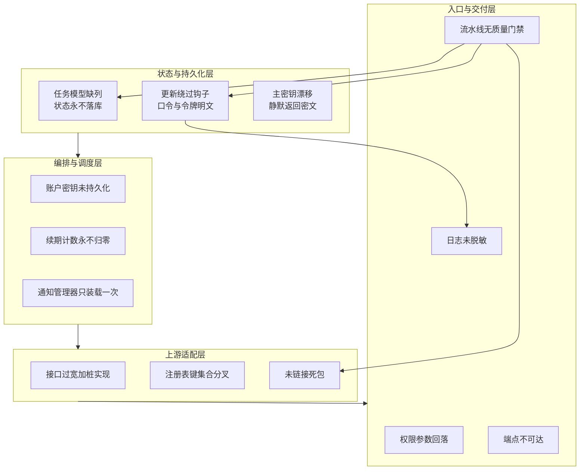
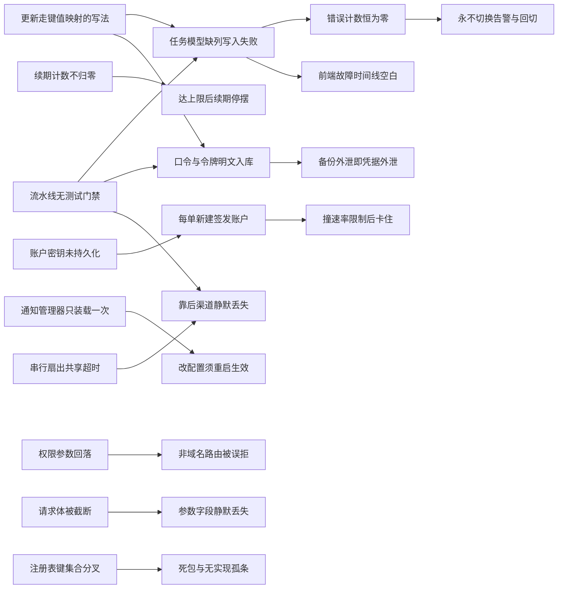
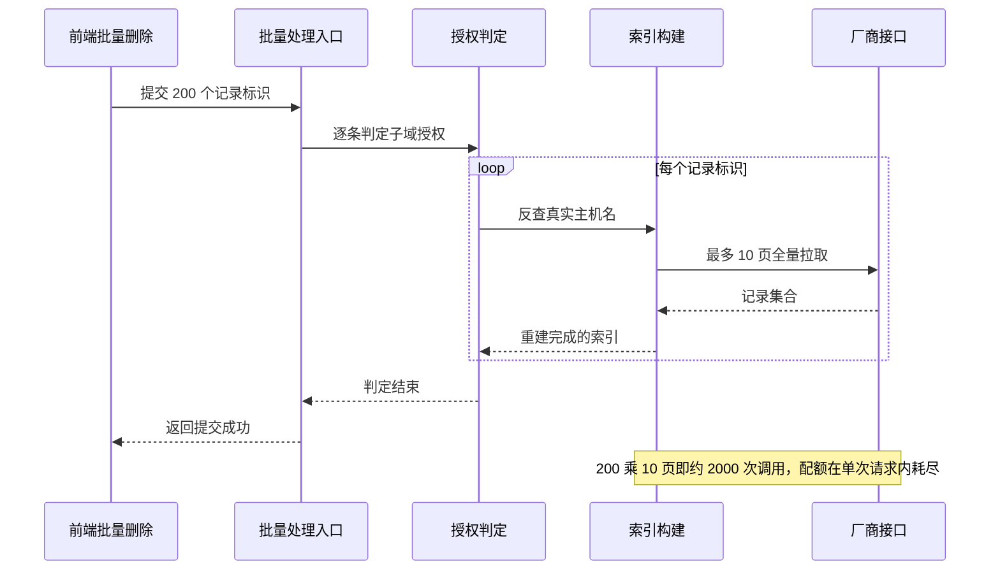
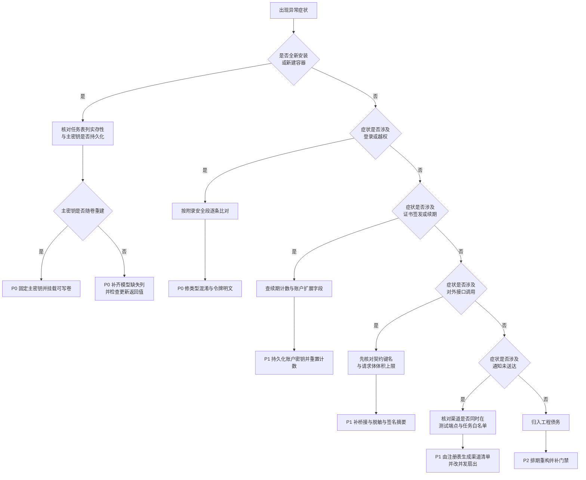

# 问题检测报告

<cite>
**本文档引用的文件**
- [cloudflare.go](file://main/internal/api/handler/cloudflare.go)
- [domain.go](file://main/internal/api/handler/domain.go)
- [auth.go](file://main/internal/api/handler/auth.go)
- [cert.go](file://main/internal/api/handler/cert.go)
- [cert_deploy.go](file://main/internal/api/handler/cert_deploy.go)
- [monitor.go](file://main/internal/api/handler/monitor.go)
- [acceleration.go](file://main/internal/api/handler/acceleration.go)
- [account.go](file://main/internal/api/handler/account.go)
- [user.go](file://main/internal/api/handler/user.go)
- [quicklogin.go](file://main/internal/api/handler/quicklogin.go)
- [batch.go](file://main/internal/api/handler/batch.go)
- [batch_authz.go](file://main/internal/api/handler/batch_authz.go)
- [dashboard.go](file://main/internal/api/handler/dashboard.go)
- [qqbot.go](file://main/internal/api/handler/qqbot.go)
- [router.go](file://main/internal/api/router.go)
- [permission.go](file://main/internal/api/middleware/permission.go)
- [auth.go (中间件)](file://main/internal/api/middleware/auth.go)
- [csrf.go](file://main/internal/api/middleware/csrf.go)
- [request_trace.go](file://main/internal/api/middleware/request_trace.go)
- [sanitize.go](file://main/internal/api/middleware/sanitize.go)
- [apiv1/auth.go](file://main/internal/apiv1/auth.go)
- [route_delivery_test.go](file://main/internal/apiv1/route_delivery_test.go)
- [captcha.go](file://main/internal/captcha/captcha.go)
- [migrate.go](file://main/internal/crypto/migrate.go)
- [crypto.go](file://main/internal/crypto/crypto.go)
- [models.go](file://main/internal/models/models.go)
- [hooks.go](file://main/internal/models/hooks.go)
- [config.go](file://main/internal/config/config.go)
- [main.go](file://main/main.go)
- [interface.go (DNS)](file://main/internal/dns/interface.go)
- [powerdns.go](file://main/internal/dns/providers/powerdns/powerdns.go)
- [monitor.go (监控)](file://main/internal/monitor/monitor.go)
- [ssrf.go](file://main/internal/monitor/ssrf.go)
- [task_runner.go](file://main/internal/service/task_runner.go)
- [acme.go](file://main/internal/cert/acme/acme.go)
- [notify.go](file://main/internal/notify/notify.go)
- [safe_url.go](file://main/internal/notify/safe_url.go)
- [channel_registry.go](file://main/internal/notify/channel_registry.go)
- [audit.go](file://main/internal/api/middleware/audit.go)
- [quota.go](file://main/internal/api/handler/quota.go)
- [registry.go (部署器)](file://main/internal/cert/deploy/registry.go)
- [Dockerfile](file://Dockerfile)
- [build.yml](file://.github/workflows/build.yml)
- [VERSION](file://VERSION)
</cite>

## 目录
1. [简介](#简介)
2. [项目结构](#项目结构)
3. [核心组件](#核心组件)
4. [架构总览](#架构总览)
5. [详细组件分析](#详细组件分析)
6. [依赖关系分析](#依赖关系分析)
7. [性能考虑](#性能考虑)
8. [故障排查指南](#故障排查指南)
9. [结论](#结论)
10. [附录](#附录)

## 简介

本报告汇总 DNSPlane 全库检测结果：八个域分析产物共登记 173 条原始问题，
回到当前工作区复核并合并同根因后为 67 条。所有位置均经本次实读确认，
行号与工作区当前状态一致；未能复核行号的条目只给文件路径，不写行号。

检测范围（本会话实测命令输出）：

| 维度 | 实测值 | 口径 |
|------|--------|------|
| Go 代码 | 非测试 71937 行，测试 16892 行 | `find` 与 `wc -l` 累加 |
| Go 测试文件 | 79 个 | `find main -name '*_test.go'` |
| 前端 ts 与 tsx | 30469 行 | `web/` 排除 `node_modules` 与 `.next` |
| DNS 服务商目录 | 22 个 | `main/internal/dns/providers` |
| 路由规模 | 控制台 226 条、对外 v1 145 条 | 路由文件逐条计数 |
| 版本 | `1.0.11`，标签最新仍为 `v1.0.3` | `VERSION` 与 `git tag` |

定级标准：严重指可绕过安全控制或使状态永久不回写；高指默认路径下必然或大概率产生错误结果；
中指需特定配置或规模放大才显现；低指认知误导、可观测性缺失与工程债务。
优先级 P0 为当日止血、P1 为本迭代、P2 为排期。

本次同时执行的验证：`go build ./...` 通过；
`go test ./internal/notify/... ./internal/monitor/...` 两个包均 `ok`；
`go test ./internal/api/handler/... ./internal/apiv1/...` 分别 `ok 21.151s` 与 `ok 1.362s`。
前端检查与类型校验本次未执行，故不声称零警告。

**章节来源**
- [router.go:104](file://main/internal/api/router.go#L104)
- [VERSION:1](file://VERSION#L1)
- [main.go:1-156](file://main/main.go#L1-L156)

## 项目结构

### 扫描方法与工具

检测分三层推进：扫描产物建立事实基线，域分析产物定位缺陷，最后回到源码复核锚点。

| 方法 | 命令 | 用途 |
|------|------|------|
| 结构盘点 | `find`、`wc -l` | 包清单、行数、路由计数 |
| 符号定位 | `rg -n '^func [A-Z]'` | 处理函数入口与调用点 |
| 可达性判定 | 路由文件逐条对照并统计引用数 | 判定处理函数是否挂载 |
| 数据取证 | `sqlite3 main/data/data.db .schema` | 列实存性与表名 |
| 编译与回归 | `go build ./...`、`go test` | 编译状态与测试状态 |
| 行为复核 | 逐行读取判定分支与常量 | 行号与逻辑一致性 |
| 外部事实 | `git tag`、`stat` | 版本口径与文件权限 |

去重规则：同一根因跨域重复登记的合并为一条，位置取最靠近根因的一侧；
同一现象在不同调用链上各自独立的保留多条。

**章节来源**
- [main.go:27-156](file://main/main.go#L27-L156)
- [router.go:76-104](file://main/internal/api/router.go#L76-L104)

### 素材与溯源

八个域分析产物是报告的证据输入，四份扫描产物用于交叉印证。

| 来源 | 实测行数 | 登记问题数 | 覆盖域 |
|------|:--------:|:---------:|--------|
| `analysis-cert.md` | 441 | 18 | 证书签发、ACME、部署处理链 |
| `analysis-monitor.md` | 534 | 24 | 容灾探测、切换、回切、调度 |
| `analysis-auth.md` | 425 | 26 | 五种认证方式、中间件链、权限模型 |
| `analysis-api.md` | 1239 | 20 | 226 条控制台与 145 条对外端点 |
| `analysis-notify.md` | 615 | 16 | 13 个通知渠道 |
| `analysis-dns.md` | 580 | 27 | DNS 抽象层与 22 家服务商 |
| `analysis-deploy.md` | 586 | 24 | 镜像、流水线、日志、维护、装配 |
| `analysis-ext.md` | 668 | 18 | 四类扩展点成熟度 |
| `scan-*.md` 四份 | 约 2700 | 交叉印证 | 后端、持久化、前端、基础设施 |

这些产物位于仓库外的 `.wiki-context/` 中间目录，不进版本库；
凡引用其结论者均已回到 `main/` 或 `web/` 复核关键行号。

**章节来源**
- [interface.go (DNS):41](file://main/internal/dns/interface.go#L41)
- [config.go:100-145](file://main/internal/config/config.go#L100-L145)

## 核心组件

检测概览（类别 × 严重度）：

| 类别 | 严重 | 高 | 中 | 低 | 合计 |
|------|:----:|:--:|:--:|:--:|:----:|
| 安全风险 | 4 | 14 | 5 | 1 | 24 |
| 架构设计 | 0 | 7 | 4 | 2 | 13 |
| 代码质量 | 1 | 2 | 4 | 2 | 9 |
| 性能瓶颈 | 0 | 3 | 5 | 1 | 9 |
| 最佳实践 | 0 | 3 | 2 | 2 | 7 |
| 上下文缺口 | 0 | 0 | 3 | 2 | 5 |
| **合计** | **5** | **29** | **23** | **10** | **67** |

优先级分布：P0 共 12 条（全部为可绕过安全控制或使核心链路静默失效者）、
P1 共 40 条、P2 共 15 条。

按来源域的代表性缺陷：

| 来源域 | 代表性问题 | 级别 | 报告编号 |
|--------|-----------|:----:|:--------:|
| 证书 | 签发账户密钥从未持久化 | 高 | ARC-02 |
| 监控 | 任务模型缺列致状态永不落库 | 严重 | QLY-01 |
| 认证 | 行为验证码类型混淆 | 严重 | SEC-01 |
| 接口 | 11 条对外端点结构性不可达 | 高 | ARC-05 |
| 通知 | 机器人回调可改指告警收件人 | 高 | SEC-15 |
| DNS | 主机名验证可跨账户写入他人域名 | 严重 | SEC-03 |
| 部署 | 主密钥漂移后全库凭据不可读 | 严重 | SEC-04 |
| 扩展点 | 证书子包未链接成死包 | 高 | ARC-07 |

**章节来源**
- [models.go:134-234](file://main/internal/models/models.go#L134-L234)
- [crypto.go:95-101](file://main/internal/crypto/crypto.go#L95-L101)
- [captcha.go:265](file://main/internal/captcha/captcha.go#L265)

## 架构总览

问题沿「状态与持久化 → 编排与调度 → 上游适配 → 入口与交付」四层聚集，
层间存在明确传导：底层契约脱钩会把错误放大到上层所有消费方。

**图表来源**
- [models.go:134-234](file://main/internal/models/models.go#L134-L234)
- [crypto.go:95-101](file://main/internal/crypto/crypto.go#L95-L101)
- [acme.go:578-590](file://main/internal/cert/acme/acme.go#L578-L590)
- [task_runner.go:168-207](file://main/internal/service/task_runner.go#L168-L207)
- [interface.go (DNS):41-157](file://main/internal/dns/interface.go#L41-L157)
- [build.yml](file://.github/workflows/build.yml)

**章节来源**
- [models.go:134-234](file://main/internal/models/models.go#L134-L234)
- [task_runner.go:976](file://main/internal/service/task_runner.go#L976)
- [main.go:27-31](file://main/main.go#L27-L31)

## 详细组件分析

### 代码质量

巨型文件集中在处理层，行数为本次实测，均超过项目自身约定的 500 行上限。

| 文件 | 行数 | 导出函数 | 质量问题 |
|------|:----:|:--------:|----------|
| `handler/cloudflare.go` | 2509 | 28 | 四套业务语义同文件 |
| `handler/domain.go` | 1748 | 16 | 异步写与本地副本回填口径不一 |
| `handler/auth.go` | 1573 | 25 | 登录、双因子、安装、验证码混排 |
| `handler/cert.go` | 1519 | 19 | 账户、订单、部署、下载混排 |
| `handler/monitor.go` | 1270 | 16 | 更新接口零值覆盖 |
| `handler/cert_deploy.go` | 1101 | 17 | 其中 10 个函数无路由可达 |
| `handler/acceleration.go` | 1000 | 10 | 三个读取接口无权限判定 |

其余要点：记录集合字段为泛型接口值（`interface.go:37`）迫使 12 处断言，
断言失败静默退化为空列表（`domain.go:828`）；动作分支缺兜底（`batch.go:392`），
拼错的动作值因错误为空而被计入成功数；`cert_deploy.go` 的 `DeployList`(331) 至
`DeployBatch`(969) 共约 700 行带鉴权实现在 `router.go` 与 `apiv1/` 中引用数为 0；
监控包按字节截断中文错误串；告警文案打印阈值而非实际计数；
状态语义在模型注释、通知映射与实际赋值三处错位；响应码存在三套互不兼容约定。

**章节来源**
- [interface.go (DNS):37](file://main/internal/dns/interface.go#L37)
- [domain.go:828](file://main/internal/api/handler/domain.go#L828)
- [batch.go:327-399](file://main/internal/api/handler/batch.go#L327-L399)
- [cert_deploy.go:331-969](file://main/internal/api/handler/cert_deploy.go#L331-L969)

### 架构设计

- **缺少领域服务层**：处理层直连服务商，装配逻辑存在 5 份重复实现，错误格式已分歧。
- **抽象被绕过**：写解析记录实际有 3 条通道，审计与本地副本回填只覆盖其中 1 条。
  Cloudflare 因账户级隧道资源无法被记录语义容纳而另建通道，这一逃逸在接口层面成立；
  DNSPod 的逃逸则不必要，委派扩展接口已存在。
- **接口过宽**：服务商接口要求 15 个方法，实测 22 家累计 52 个「不支持」桩；
  取错方法（`interface.go:43`）零消费方却要求各家维护可变状态字段。
- **注册表键集合互不相等**：证书部署视图 37 项、部署配置 53 项、基类实现 88 项、合并后 63 项，
  三表裁决依赖硬编码白名单与三种子产品后缀猜测。
- **死包**：证书子包 `ucloud` 未被任何包导入，445 行签发实现的初始化函数永不执行，
  而前端分类表仍保留该条目。
- **两条链不对等**：对外链 145 条只注册 POST，预检落未匹配处理返回 404 且无跨域头；
  外链不执行权限中间件，使同一角色在控制台被拒而在外链可读，可见性相反。

**章节来源**
- [interface.go (DNS):37-157](file://main/internal/dns/interface.go#L37-L157)
- [domain.go:640-875](file://main/internal/api/handler/domain.go#L640-L875)
- [apiv1/auth.go:85-100](file://main/internal/apiv1/auth.go#L85-L100)
- [acme.go:578-590](file://main/internal/cert/acme/acme.go#L578-L590)

### 安全风险

三条已取证的严重缺陷：

**行为验证码类型混淆**：`Verify`（`captcha.go:265-283`）用请求侧类型选择校验分支，
而缓存中记录的类型从不读取。错配提交时缓存被反序列化为零值结构，
答案落在容差内即通过；反向错配时两侧集合长度同为 0 直接返回真。
两个行为验证码端点均不在跨站跳过集合（`csrf.go:30-44`）内，
但令牌获取端点对任意访客开放，故不构成实际阻断。

**令牌与凭据明文**：迁移规格（`crypto/migrate.go:21`）声明的表名与实际建表名不符，
判表存在为假后整表在 `:27` 被跳过；叠加更新走键值映射时不触发保存前钩子
（`hooks.go:32-54` 只加密结构体字段），同一列出现密文与明文混杂。
解密函数在失败时返回原串（`crypto.go:95-101`），而 `config.go:105-111`
在配置文件缺失时随机生成主密钥并回写，密钥漂移后全库凭据静默不可读。
JWT 侧已部分收敛：`config.go:132-137` 会把空值与历史默认字面量替换为随机密钥，
环境变量优先（`:123-128`），但历史默认字面量仍硬编码于 `config.go:14` 与 `:98`
（值以 `{占位}` 表示，不在此复述）。

**权限与吊销缺口**：`permission.go:229` 把路径参数无条件回落为域名标识，
波及 `router.go:141`、`:160`、`:183` 等带该参数而语义非域名的路由；
`permission.go:143-147` 在缺少域名参数时直接放行，使控制台大批路由只依赖两层弱校验。
`Logout`（`handler/auth.go:406`）只清 cookie，`ChangePassword`(`:487`)、`ResetPassword`(`:893`)、
`ResetTOTP`(`:997`)、`AdminResetTOTP`(`:1103`) 同样不吊销既有会话；
用户缓存失效函数（`middleware/auth.go:473`）定义后零调用点，缓存时长 30 秒（`:99`）。
`middleware/auth.go:546-547` 无条件放行本机来源并允许携带凭据。

出站防护的覆盖范围也不对称：监控侧在 `ssrf.go:31` 提供连接期拦截，
但该守卫只在 `monitor.go:363` 与 `:377` 两处被调用，即仅覆盖两类基于 URL 的探测，
其余探测类型与域名解析路径不做私网判定；通知侧的出站校验（`safe_url.go:15`）
只对 IP 字面量判私网且不解析域名，二者都不能单独构成完整的 SSRF 边界。

**章节来源**
- [captcha.go:262-283](file://main/internal/captcha/captcha.go#L262-L283)
- [migrate.go:15-27](file://main/internal/crypto/migrate.go#L15-L27)
- [hooks.go:32-54](file://main/internal/models/hooks.go#L32-L54)
- [config.go:100-145](file://main/internal/config/config.go#L100-L145)
- [permission.go:138-230](file://main/internal/api/middleware/permission.go#L138-L230)
- [handler/auth.go:406-1103](file://main/internal/api/handler/auth.go#L406-L1103)
- [ssrf.go:31](file://main/internal/monitor/ssrf.go#L31)
- [monitor.go (监控):363-377](file://main/internal/monitor/monitor.go#L363-L377)

### 性能瓶颈

- 授权索引重建：`cloudRecordRRIndex`（`batch_authz.go:48-69`）单次最多拉 10 页共 5000 条，
  而反查函数（`:77`）在 `:135` 的循环内逐条调用它。
- 列表页每页额外调用线路编目（`domain.go:716`），无任何缓存。
- 5 家服务商忽略分页参数返回全量，处理层原样透传（`domain.go:828`）。
- 全表载入域名做后缀最长匹配（`cloudflare.go:1365`、`domain.go:1599`）。
- 每请求新建服务商实例及其连接客户端（`domain.go:640`），连接池无法复用。
- 证书提供商端点（`cert.go:1387`）无缓存层，每请求重算合并视图。
- 通知扇出（`notify.go:688`）为顺序循环且共享单一超时，而各渠道客户端超时更长。
- 请求日志限读后回写请求体，使大体积请求被静默破坏而非仅日志截断。
- 服务商侧无令牌桶与退避，限流错误直接计入失败数。

**章节来源**
- [batch_authz.go:48-135](file://main/internal/api/handler/batch_authz.go#L48-L135)
- [domain.go:716-828](file://main/internal/api/handler/domain.go#L716-L828)
- [cloudflare.go:1361-1365](file://main/internal/api/handler/cloudflare.go#L1361-L1365)
- [notify.go:688](file://main/internal/notify/notify.go#L688)
- [request_trace.go:274-282](file://main/internal/api/middleware/request_trace.go#L274-L282)

### 最佳实践

- 79 个 Go 测试文件不参与流水线，`build.yml` 全文无测试、静态分析与检查步骤，
  唯一门禁是前端类型检查；部署器目录共 18998 行零测试文件；
  DNS 适配层仅一个测试文件；监控包 27 个测试集中在通知装载与 TCP 探测。
- 送达性测试（`route_delivery_test.go:284-300`）在 `:299` 断言不可达数恰为 18，
  而其中 11 条源于测试传错契约键，真实不可达为 11 条；该测试当前通过，
  说明断言仍锁住错误数字。
- 全仓无备份、导出与恢复实现，而默认维护任务会清理 7 至 90 天前的日志。
- 无容器健康检查、无就绪端点，监听失败仅记日志不退出。
- 通知侧无投递记录模型，发送结果只写日志文件，无法统计成功率与做重复抑制。

**章节来源**
- [route_delivery_test.go:284-300](file://main/internal/apiv1/route_delivery_test.go#L284-L300)
- [build.yml](file://.github/workflows/build.yml)
- [models.go:310-370](file://main/internal/models/models.go#L310-L370)
- [main.go:133-144](file://main/main.go#L133-L144)

### 上下文缺口

以下条目无法在当前工作区闭合，保留为未确认而非结论：

| 缺口 | 现状 | 影响 |
|------|------|------|
| 是否置于反向代理之后 | 未确认 | 决定协议信任与来源标识相关判定的严重度 |
| 是否多实例部署 | 未确认 | 进程内验证码与状态存储的影响范围 |
| 另一种主库引擎下的键长行为 | 未实测 | 两个证书通知开关可能永远读不到 |
| 容器是否实际启动即退出 | 源码级推断 | 未实机运行验证 |
| 线上库形态为新库或陈旧库 | 未确认 | 监控域「旧库正常、新库静默失效」的判定 |
| 零标识查询的依赖库行为 | 未知 | 可能改写全表第一条而非查不到 |

一处已收敛项：分析阶段登记的「工作区不可编译，批量本地副本回填函数未定义」
在当前工作区已修复，定义位于 `batch.go:188`，`go build ./...` 与处理层测试均通过。

**章节来源**
- [batch.go:154-188](file://main/internal/api/handler/batch.go#L154-L188)
- [task_runner.go:458-634](file://main/internal/service/task_runner.go#L458-L634)
- [models.go:315](file://main/internal/models/models.go#L315)

## 依赖关系分析

多条问题并非独立，一个根因会放大另一条的影响。下图只画被证实的因果边。

**图表来源**
- [monitor.go (监控):334](file://main/internal/monitor/monitor.go#L334)
- [models.go:134-234](file://main/internal/models/models.go#L134-L234)
- [hooks.go:32-54](file://main/internal/models/hooks.go#L32-L54)
- [task_runner.go:168-207](file://main/internal/service/task_runner.go#L168-L207)
- [acme.go:578-590](file://main/internal/cert/acme/acme.go#L578-L590)
- [notify.go:688](file://main/internal/notify/notify.go#L688)
- [permission.go:229](file://main/internal/api/middleware/permission.go#L229)

根因收敛收益：

| 根因 | 派生条目 | 收敛后可一并关闭 |
|------|----------|:----------------:|
| 更新绕过模型钩子 | 缺列写不回、口令明文、令牌明文 | 4 |
| 模型与列定义脱钩 | 状态不回写、时间线空白、切换不触发 | 3 |
| 通知装载生命周期分裂 | 配置半生效、渠道静默丢失 | 2 |
| 流水线无门禁 | 上述回归全部无拦截 | 放大 6 条 |
| 注册表无完整性断言 | 死包、孤条、后缀猜测 | 3 |

**章节来源**
- [channel_registry.go:14-33](file://main/internal/notify/channel_registry.go#L14-L33)
- [build.yml](file://.github/workflows/build.yml)

## 性能考虑

复现路径与量化影响（数值取自代码常量与实测调用次数，标注推断者除外）：

| 问题 | 位置 | 复现路径 | 量化影响 |
|------|------|----------|----------|
| 批量授权逐条重建索引 | `batch_authz.go:48` 与 `:135` | 选中 200 条做批量删除 | 约 2000 次厂商调用，配额打满后请求超时 |
| 每页线路编目 | `domain.go:716` | 打开记录页并翻页 | 每页 2 次额外上游调用 |
| 分页参数被忽略 | `domain.go:828` | 在不支持服务端过滤的域名下列记录 | 千条记录整表渲染，分页控件失效 |
| 全表后缀匹配 | `cloudflare.go:1365` | 主机名验证或子域托管 | 每次载入全部域名行，万级规模延迟放大（推断） |
| 合并视图每请求重算 | `cert.go:1387` | 打开证书账户页 | 37 项拷贝加 53 项遍历，两条链共用热路径 |
| 串行通知扇出 | `notify.go:688` | 同时启用 5 个渠道且首个为邮件 | 共享 10 秒窗口下靠后 4 个渠道必然失败（推断） |
| 历史点数上限 | `handler/monitor.go:27` 与 `:852` | 60 秒间隔任务查 30 天曲线 | 应约 43200 点，实返 4000 点即约 1.7 天 |
| 前端轮询放大 | `monitor/page.tsx` | 多任务详情每 15 秒轮询 | 每轮最多 200 个历史请求，各触发一次日志扫描 |
| 并发窗口排队 | `monitor.go:29` | 任务数超过 64 并发 | 排队超时计为主源失败，出现批量误切换 |
| 请求体截断 | `request_trace.go` 的限读 | 提交大于 64 KiB 的批量记录 | 参数静默丢失，非仅日志截断 |

一次典型放大链的时序（批量删除 200 条记录，子域委派用户）：

**图表来源**
- [batch_authz.go:48-135](file://main/internal/api/handler/batch_authz.go#L48-L135)
- [batch.go:327](file://main/internal/api/handler/batch.go#L327)

**章节来源**
- [handler/monitor.go:27-852](file://main/internal/api/handler/monitor.go#L27-L852)
- [monitor.go (监控):334](file://main/internal/monitor/monitor.go#L334)
- [account.go:97-134](file://main/internal/api/handler/account.go#L97-L134)

## 故障排查指南

处置顺序按「先止血、再收口、后清债」。下图为从症状定位优先级的决策树。

**图表来源**
- [models.go:134-234](file://main/internal/models/models.go#L134-L234)
- [config.go:100-145](file://main/internal/config/config.go#L100-L145)
- [crypto.go:95-101](file://main/internal/crypto/crypto.go#L95-L101)
- [captcha.go:265](file://main/internal/captcha/captcha.go#L265)
- [task_runner.go:168-207](file://main/internal/service/task_runner.go#L168-L207)
- [apiv1/auth.go:85-100](file://main/internal/apiv1/auth.go#L85-L100)

P0 与 P1 的处置动作与验收判据：

| 顺序 | 级别 | 动作 | 验收判据 |
|:----:|:----:|------|----------|
| 1 | P0 | 任务模型补齐四个缺失列并检查更新返回值 | 新库上错误计数随失败递增并触发一次切换 |
| 2 | P0 | 校验函数只信缓存中的验证码类型 | 三种错配提交全部返回假 |
| 3 | P0 | 迁移规格表名修正且令牌写入走结构体路径 | 列值带密文前缀 |
| 4 | P0 | 主机名验证的目标域名补域权限校验 | 非本用户域名被拒 |
| 5 | P0 | 移除权限中间件的参数无条件回落 | 带路径参数的非域名路由不再误拒 |
| 6 | P0 | 请求日志对查询串与非结构化响应体脱敏 | 日志中无可复用令牌 |
| 7 | P0 | 单条记录删除与启停补云端主机名反查 | 委派范围外记录被拒 |
| 8 | P1 | 签发账户密钥写回账户扩展字段 | 同账户第二单不再新建签发账户 |
| 9 | P1 | 续期成功路径把计数归零 | 长期运行订单不会累计到上限 |
| 10 | P1 | 注销与改密链路统一吊销刷新令牌 | 旧令牌换取新会话被拒 |
| 11 | P1 | 补齐 11 条端点桥接并取消静默假成功 | 参数送达断言与真实值一致 |
| 12 | P1 | 渠道清单与测试端点由注册表生成 | 13 个渠道全部可选可测 |
| 13 | P1 | 流水线增加测试与静态检查步骤 | 回归可被流水线拦住 |
| 14 | P2 | 前端渲染器收敛、命名与响应码统一 | 契约可用单表描述 |

**章节来源**
- [permission.go:138-230](file://main/internal/api/middleware/permission.go#L138-L230)
- [domain.go:1000-1155](file://main/internal/api/handler/domain.go#L1000-L1155)
- [route_delivery_test.go:284-300](file://main/internal/apiv1/route_delivery_test.go#L284-L300)

## 结论

Top 20 高危清单（按「修复收益除以改动面」排序）：

| # | 编号 | 级别 | 问题 | 最小修复建议 |
|:-:|------|:----:|------|--------------|
| 1 | SEC-01 | 严重 | 行为验证码类型混淆 | 校验只以缓存类型为准，请求类型仅作一致性比对 |
| 2 | SEC-02 | 严重 | 第三方令牌明文落库 | 修正迁移表名并改走结构体写入 |
| 3 | SEC-03 | 严重 | 主机名验证可跨账户写入 | 目标域名同样过域权限校验 |
| 4 | SEC-04 | 严重 | 主密钥漂移后静默返回密文 | 启动校验密钥指纹，不匹配即显式失败 |
| 5 | QLY-01 | 严重 | 模型缺列致状态永不回写 | 补齐四列并检查更新返回值 |
| 6 | SEC-05 | 高 | 权限中间件参数回落误伤路由 | 域名参数改路由级显式声明 |
| 7 | SEC-06 | 高 | 证书下载把私钥写入请求日志 | 非结构化响应跳过记录 |
| 8 | SEC-07 | 高 | 记录删除与启停绕过子域委派 | 复用批量侧的主机名反查 |
| 9 | SEC-10 | 高 | 一次性令牌经查询串入库 | 查询串走同一敏感键集合 |
| 10 | SEC-11 | 高 | 快捷登录令牌授予全量会话 | 兑换为受限会话且只返回跳转地址 |
| 11 | SEC-13 | 高 | 注销与改密不吊销既有会话 | 统一吊销并失效用户缓存 |
| 12 | ARC-05 | 高 | 端点结构性不可达 | 补桥接并把 3 条静默假成功改为显式失败 |
| 13 | ARC-04 | 高 | 对外接口无预检与跨域头 | 引擎根处理预检并放行签名头 |
| 14 | ARC-02 | 高 | 签发账户密钥未持久化 | 注册结果写回账户扩展字段 |
| 15 | ARC-03 | 高 | 续期计数永不归零 | 成功与触发路径同时重置 |
| 16 | SEC-16 | 高 | 服务商凭据明文过网 | 默认加密传输并保留兼容回退 |
| 17 | PRA-01 | 高 | 流水线无测试与静态检查 | 增加测试与检查两个步骤 |
| 18 | SEC-15 | 高 | 告警收件人可被外部改写 | 绑定改由鉴权端点显式确认 |
| 19 | PRF-01 | 高 | 批量授权重建全量索引 | 索引移到循环外构建一次 |
| 20 | ARC-07 | 高 | 未链接死包 | 补 blank import 或删除包与前端条目 |

三条结构性判断：

1. **持久化契约已与模型脱钩**是最高风险类别：同一种更新写法同时造成
   缺列写不回、口令明文、令牌明文三类后果，且三者都没有错误可见性。
2. **注册表缺完整性断言**是第二风险源：三套键集合互不相等，
   死包与「有表单无实现」的孤条只能靠后缀猜测对齐，而流水线不跑任何一致性测试。
3. **两条接口链能力不对等**是第三风险源：外链不执行权限中间件，
   同一角色在控制台被拒而在外链可读，契约可见性方向相反。

**章节来源**
- [models.go:134-234](file://main/internal/models/models.go#L134-L234)
- [acme.go:578-590](file://main/internal/cert/acme/acme.go#L578-L590)
- [config.go:100-145](file://main/internal/config/config.go#L100-L145)
- [build.yml](file://.github/workflows/build.yml)

## 附录

完整问题明细表（67 条，按维度分组，编号跨域唯一）。
位置列只写本次复核到行号的条目，未复核者只给文件路径。

### 安全风险（24 条）

| 编号 | 类别 | 位置 | 现象 | 触发条件 | 风险 | 级别 | 优先级 | 建议 |
|------|------|------|------|----------|------|:----:|:------:|------|
| SEC-01 | 安全 | `main/internal/captcha/captcha.go:265` | 校验分支由请求侧类型决定，缓存内类型从不读取 | 提交错配类型 | 无解通过人机校验，登录防暴力形同虚设 | 严重 | P0 | 以缓存类型为唯一判据 |
| SEC-02 | 安全 | `main/internal/crypto/migrate.go:21` | 迁移声明表名与实际建表名不符，整表跳过 | 启动迁移扫描 | 第三方访问与刷新令牌明文入库 | 严重 | P0 | 修正表名并改写入路径 |
| SEC-03 | 安全 | `main/internal/api/handler/cloudflare.go:1153` | 目标域名由全表最长匹配挑选且无归属过滤 | 配置该类域名权限 | 向他人域名添加解析记录 | 严重 | P0 | 目标域名同样过域权限校验 |
| SEC-04 | 安全 | `main/internal/crypto/crypto.go:95` | 解密失败返回原串且主密钥可随机重生成 | 配置缺失或容器重建 | 全库凭据静默不可读且上层继续误用 | 严重 | P0 | 密钥指纹校验，失败即显式退出 |
| SEC-05 | 安全 | `main/internal/api/middleware/permission.go:229` | 路径参数被无条件回落为域名标识 | 非管理员访问带参数路由 | 大批非域名路由被误拒或误提示 | 高 | P0 | 域名参数改路由级声明 |
| SEC-06 | 安全 | `main/internal/api/handler/cert.go:1068` | 文本响应被请求追踪截取且脱敏不识别该类型 | 下载含私钥的证书 | 已加密私钥在日志库退化为明文 | 高 | P0 | 非结构化响应跳过记录 |
| SEC-07 | 安全 | `main/internal/api/handler/domain.go:1076` | 删除记录只校验域名与只读，不回查主机名 | 仅持有单个子域委派 | 删除该域名任意子域记录 | 高 | P0 | 复用批量侧的反查逻辑 |
| SEC-08 | 安全 | `main/internal/api/handler/domain.go:1155` | 启停记录同样缺主机名回查 | 同上 | 停用任意记录造成解析中断 | 高 | P0 | 同上 |
| SEC-09 | 安全 | `main/internal/api/handler/domain.go:1000` | 子域判定依据是请求自带名称 | 记录标识指向委派外记录 | 越权改写并静默改名 | 高 | P1 | 判定改用云端反查真实值 |
| SEC-10 | 安全 | `main/internal/api/middleware/request_trace.go:278` | 查询串原样入库，敏感键集合只作用体与头 | 魔法链接与第三方回调 | 一次性令牌与授权码可被复用 | 高 | P0 | 查询串走同一脱敏集合 |
| SEC-11 | 安全 | `main/internal/api/handler/quicklogin.go:60` | 令牌进响应体且兑换后签发完整会话 | 用户转交快捷链接 | 域名级快捷登录实际授予账户全部权限 | 高 | P0 | 兑换为受限会话且只返回地址 |
| SEC-12 | 安全 | `main/internal/models/models.go:16` | 接口密钥无加密钩子且随列表下发 | 列表与详情接口 | 该键同时是对外签名私钥，泄露即长期授权 | 高 | P1 | 纳入加密并列表不回传 |
| SEC-13 | 安全 | `main/internal/api/handler/auth.go:406` | 注销与改密与重置均不吊销刷新令牌 | 令牌被盗后用户自救 | 有效期内仍可换取全新会话 | 高 | P1 | 变更点统一吊销并失效缓存 |
| SEC-14 | 安全 | `main/internal/apiv1/auth.go:93` | 签名摘要只含标识时间戳方法与路径 | 窗口内截获请求 | 可替换请求体且无去重 | 高 | P1 | 摘要纳入体并加随机数 |
| SEC-15 | 安全 | `main/internal/api/handler/qqbot.go:134` | 验签通过的私聊消息覆盖写入收件人标识 | 任意同渠道用户发消息 | 后续全部告警被改指 | 高 | P1 | 绑定改为鉴权端点确认 |
| SEC-16 | 安全 | `main/internal/dns/providers/powerdns/powerdns.go:68` | 基址固定明文传输前缀 | 配置该类账户 | 接口密钥明文过网可被重放 | 高 | P1 | 默认加密传输并保留回退 |
| SEC-17 | 安全 | `main/internal/config/config.go:109` | 配置缺失时生成随机密钥并回写 | 未持久化配置文件 | 新旧密钥错位导致全列解密失败 | 高 | P1 | 以环境变量注入并禁止自动生成 |
| SEC-18 | 安全 | `main/internal/api/middleware/auth.go:546` | 生产环境仍无条件放行本机来源并允许凭据 | 同机其他本地服务 | 可读取本站认证接口响应 | 高 | P1 | 按环境判断并收敛来源 |
| SEC-19 | 安全 | `main/internal/api/handler/user.go:673` | 配置写入对任意键一律落库 | 管理员提交 | 可覆写语义无关的运行态键 | 中 | P1 | 建立键白名单与类型校验 |
| SEC-20 | 安全 | `main/internal/api/handler/monitor.go:383` | 更新走键值映射，保存前钩子改不到该值 | 编辑任务代理口令 | 口令明文入库，加密边界被绕过 | 中 | P1 | 改结构体写入或显式加密 |
| SEC-21 | 安全 | `main/internal/api/handler/account.go:119` | 解密后的账户配置放入响应与读穿缓存 | 本人或管理员调用 | 厂商密钥入缓存与日志 | 中 | P1 | 输出侧掩码加哨兵回写 |
| SEC-22 | 安全 | `main/internal/notify/safe_url.go:15` | 仅对字面量判私网且自动跟随重定向 | 出站地址解析到内网 | 通知侧服务端请求伪造 | 中 | P1 | 连接期二次拦截 |
| SEC-23 | 安全 | `main/internal/api/handler/acceleration.go:720` | 状态与平台两个接口无任何权限判定 | 任意登录用户 | 回显运营侧资源标识 | 中 | P2 | 补模块与域权限校验 |
| SEC-24 | 安全 | `main/internal/api/handler/auth.go:99` | 登录失败按子网与用户名组合计数 | 用户名喷洒 | 无单来源全局上限且可互相误伤 | 低 | P2 | 叠加单来源全局阈值 |

**章节来源**
- [captcha.go:262-283](file://main/internal/captcha/captcha.go#L262-L283)
- [permission.go:138-230](file://main/internal/api/middleware/permission.go#L138-L230)
- [handler/auth.go:406-645](file://main/internal/api/handler/auth.go#L406-L645)
- [migrate.go:15-27](file://main/internal/crypto/migrate.go#L15-L27)

### 架构设计（13 条）

| 编号 | 类别 | 位置 | 现象 | 触发条件 | 风险 | 级别 | 优先级 | 建议 |
|------|------|------|------|----------|------|:----:|:------:|------|
| ARC-01 | 架构 | `main/internal/api/handler/domain.go:640` | 服务商装配逻辑 5 份重复实现 | 修改账户解析口径 | 五处需同步改，错误格式已分歧 | 中 | P1 | 抽公共装配函数 |
| ARC-02 | 架构 | `main/internal/cert/acme/acme.go:583` | 内部自调注册时丢弃账户密钥与地址 | 每次签发或续期 | 每单新建账户，撞速率限制后卡住 | 高 | P1 | 注册结果写回账户扩展字段 |
| ARC-03 | 架构 | `main/internal/service/task_runner.go:203` | 续期计数每轮递增而成功路径不归零 | 长期自动续期 | 累计到上限后永久停摆并误报 | 高 | P1 | 成功与触发路径同时重置 |
| ARC-04 | 架构 | `main/internal/apiv1/` 全量注册 POST | 预检落未匹配处理返回 404 | 浏览器直连对外接口 | 跨域场景完全不可用 | 高 | P1 | 引擎根处理预检 |
| ARC-05 | 架构 | `main/internal/apiv1/routes_batch2.go:107` | 两组路由未挂参数桥接 | 按文档以体传标识 | 11 条端点不可达其中 3 条静默假成功 | 高 | P1 | 补桥接并改为显式失败 |
| ARC-06 | 架构 | `main/internal/dns/interface.go:41` | 接口要求 15 方法，实测 52 个不支持桩 | 新增第 23 家厂商 | 实现成本线性膨胀，违反接口隔离 | 高 | P1 | 可选能力拆为扩展接口 |
| ARC-07 | 架构 | `main/main.go:28-31` | 证书子包未被导入因而不在二进制内 | 用户选择该渠道 | 445 行签发实现永不执行 | 高 | P1 | 补 blank import 或删除包 |
| ARC-08 | 架构 | `main/internal/service/task_runner.go:976` | 常驻通知管理器只装载一次且重载零调用 | 修改通知凭据 | 三条链路生效时点不同，排障易误判 | 高 | P1 | 命中通知键时触发重载 |
| ARC-09 | 架构 | `main/internal/dns/interface.go:43` | 取错方法零消费方但各家维护状态字段 | 构造失败 | 返回空实现后首个调用即崩溃 | 中 | P1 | 工厂签名改返回错误 |
| ARC-10 | 架构 | `main/internal/cert/deploy/registry.go:59` | 三套键集合互不相等，靠后缀猜测对齐 | 新增非既有后缀子产品 | 解析失败且错误丢失键名 | 中 | P1 | 显式登记可用子产品 |
| ARC-11 | 架构 | `web/components/` 等 6 处 | 7 份动态表单字段渲染器副本 | 给字段加显示条件 | 显示过滤在三份实现中被静默忽略 | 中 | P1 | 收敛为单一组件 |
| ARC-12 | 架构 | `main/internal/api/middleware/permission.go:265` | 所有 POST 一律视为写仅一处豁免 | 只读用户调用查询类 POST | 两条链对同一角色可见性相反 | 低 | P2 | 引入只读方法白名单 |
| ARC-13 | 架构 | `main/internal/api/handler/quota.go:298` | 模块权限与套餐特性两套体系并存 | 授予单模块 | 授权语义与文档不一致 | 低 | P2 | 合并为单一权限模型 |

**章节来源**
- [interface.go (DNS):37-157](file://main/internal/dns/interface.go#L37-L157)
- [task_runner.go:168-207](file://main/internal/service/task_runner.go#L168-L207)
- [route_delivery_test.go:284-300](file://main/internal/apiv1/route_delivery_test.go#L284-L300)

### 代码质量（9 条）

| 编号 | 类别 | 位置 | 现象 | 触发条件 | 风险 | 级别 | 优先级 | 建议 |
|------|------|------|------|----------|------|:----:|:------:|------|
| QLY-01 | 质量 | `main/internal/models/models.go:134` | 任务模型缺四个状态列而更新写这些列 | 全新库安装 | 错误计数恒为零，默认阈值下永不切换告警与回切 | 严重 | P0 | 补齐四列并检查更新返回值 |
| QLY-02 | 质量 | `main/internal/monitor/monitor.go:334` | 更新返回值被丢弃 | 任一写入失败 | 故障完全不可见 | 高 | P0 | 检查错误并落日志 |
| QLY-03 | 质量 | `main/internal/api/handler/cert_deploy.go:331` | 10 个带鉴权导出函数无路由指向 | 手动部署 | 约 700 行加锁与回写逻辑整体空转 | 高 | P1 | 挂载路由或删除该段 |
| QLY-04 | 质量 | `main/internal/api/handler/cloudflare.go` | 2509 行单文件承载四套语义 | 缺陷定位 | 认知负荷与回归面显著偏大 | 中 | P1 | 按子领域拆分 |
| QLY-05 | 质量 | `main/internal/dns/interface.go:37` | 记录集合为泛型接口值致 12 处断言 | 返回类型不符 | 断言失败静默退化为空列表 | 中 | P1 | 改具体类型或导出辅助函数 |
| QLY-06 | 质量 | `main/internal/api/handler/cert.go:670` | 长标识写入 32 字符列 | 严格模式引擎 | 写入报错且错误被忽略 | 中 | P1 | 扩列或改存短标识 |
| QLY-07 | 质量 | `main/internal/models/models.go:224` | 状态语义在注释映射与赋值三处错位 | 用户排障 | 失败原因误导排查方向 | 中 | P2 | 统一为单一枚举定义 |
| QLY-08 | 质量 | `main/internal/api/handler/batch.go:392` | 分支缺少兜底处理 | 动作名拼错 | 统计为成功而云端毫无变化 | 低 | P2 | 加入口白名单与失败计数 |
| QLY-09 | 质量 | `main/internal/api/middleware/` | 响应码存在三套互不兼容约定 | 对外适配 | 失败原因统一折叠为单一码 | 低 | P2 | 按链分别定义并映射 |

**章节来源**
- [models.go:134-234](file://main/internal/models/models.go#L134-L234)
- [monitor.go (监控):334](file://main/internal/monitor/monitor.go#L334)
- [cert_deploy.go:331-969](file://main/internal/api/handler/cert_deploy.go#L331-L969)

### 性能瓶颈（9 条）

| 编号 | 类别 | 位置 | 现象 | 触发条件 | 风险 | 级别 | 优先级 | 建议 |
|------|------|------|------|----------|------|:----:|:------:|------|
| PRF-01 | 性能 | `main/internal/api/handler/batch_authz.go:48` | 每条记录重建全量索引 | 批量操作 200 条 | 约 2000 次厂商调用，配额打满 | 高 | P1 | 索引在循环外构建一次 |
| PRF-02 | 性能 | `main/internal/monitor/monitor.go` | 切换失败后状态仍为未切换 | 切换持续失败 | 每周期重复写并重复告警，无退避 | 高 | P1 | 引入冷却窗口与最大重试 |
| PRF-03 | 性能 | `main/internal/notify/notify.go:688` | 串行扇出共享单一超时 | 多渠道且首个慢 | 靠后渠道静默丢失且只回传首个错误 | 高 | P1 | 并发扇出加独立超时 |
| PRF-04 | 性能 | `main/internal/api/handler/domain.go:716` | 每页额外调用线路编目 | 翻页 | 每页 2 次额外上游调用 | 中 | P2 | 按账户与类型缓存 |
| PRF-05 | 性能 | `main/internal/api/middleware/request_trace.go` | 超限后回写截断体 | 提交大批记录 | 真实请求体被破坏而非仅日志 | 中 | P1 | 只为日志读取副本 |
| PRF-06 | 性能 | `main/internal/monitor/monitor.go` | 并发窗口排队结果计入失败 | 任务数超并发上限 | 与目标无关的批量误切换 | 中 | P1 | 排队超时与探测失败分离 |
| PRF-07 | 性能 | `main/internal/api/handler/domain.go:828` | 忽略分页的厂商被原样透传 | 千条记录域名 | 整表渲染且分页控件失效 | 中 | P2 | 处理层统一本地分页 |
| PRF-08 | 性能 | `main/internal/api/handler/cert.go:1387` | 合并视图每请求重算 | 打开证书页 | 热路径无缓存，全量拷贝遍历 | 中 | P2 | 使用一次性快照 |
| PRF-09 | 性能 | `main/internal/api/handler/monitor.go:27` | 历史点数上限固定 | 30 天曲线 | 实返约 1.7 天数据 | 低 | P2 | 分档聚合降采样 |

**章节来源**
- [batch_authz.go:48-135](file://main/internal/api/handler/batch_authz.go#L48-L135)
- [notify.go:688](file://main/internal/notify/notify.go#L688)
- [handler/monitor.go:27-852](file://main/internal/api/handler/monitor.go#L27-L852)

### 最佳实践（7 条）

| 编号 | 类别 | 位置 | 现象 | 触发条件 | 风险 | 级别 | 优先级 | 建议 |
|------|------|------|------|----------|------|:----:|:------:|------|
| PRA-01 | 实践 | `.github/workflows/build.yml` | 流水线无测试与静态检查步骤 | 每次合并 | 回归全靠人工 | 高 | P1 | 增加测试与检查两个步骤 |
| PRA-02 | 实践 | `main/internal/database/maintenance.go` | 无备份实现且默认清理历史日志 | 误删或损坏 | 数据丢失不可逆 | 高 | P1 | 提供导出与恢复入口 |
| PRA-03 | 实践 | `main/internal/apiv1/route_delivery_test.go:299` | 断言锁死不可达总数 18 | 桥接修复后 | 掩盖已生效事实并误导文档 | 高 | P1 | 按契约键重算并改判 |
| PRA-04 | 实践 | `main/internal/api/middleware/audit.go:99` | 口令登录与注册被跳过前缀排除 | 暴力破解尝试 | 控制台无痕迹仅文件日志 | 中 | P1 | 登录事件单独入审计 |
| PRA-05 | 实践 | `main/internal/api/handler/monitor.go:370` | 更新接口对未传字段写零值 | 对外局部更新 | 频率归零导致每秒重复探测 | 中 | P1 | 改指针字段或局部更新 |
| PRA-06 | 实践 | `main/main.go:133` | 无健康端点且监听失败不退出 | 端口占用 | 进程存活但无服务 | 低 | P2 | 加就绪探针并失败即退 |
| PRA-07 | 实践 | `main/internal/api/handler/dashboard.go:457` | 版本三处口径分裂且注入无落地符号 | 排障与漏洞核对 | 无法自证运行版本 | 低 | P2 | 定义版本符号单一来源 |

**章节来源**
- [route_delivery_test.go:284-300](file://main/internal/apiv1/route_delivery_test.go#L284-L300)
- [build.yml](file://.github/workflows/build.yml)
- [dashboard.go:445-457](file://main/internal/api/handler/dashboard.go#L445-L457)

### 上下文缺口（5 条）

| 编号 | 类别 | 位置 | 现象 | 触发条件 | 风险 | 级别 | 优先级 | 建议 |
|------|------|------|------|----------|------|:----:|:------:|------|
| CTX-01 | 缺口 | `main/internal/service/task_runner.go:458` | 两个通知开关键长超过列声明 | 另一种主库引擎 | 开关被截断后永远读不到 | 中 | P1 | 扩列并加长度测试 |
| CTX-02 | 缺口 | `Dockerfile:33` | 非 root 与写盘需求冲突为源码级推断 | 未挂可写卷 | 官方镜像开箱可能启动即退出 | 中 | P1 | 实机验证并给挂载配方 |
| CTX-03 | 缺口 | `main/internal/apiv1/` | 零标识查询的退化行为取决于依赖版本 | 参数缺失 | 可能改写全表第一条 | 中 | P1 | 入口统一做非零校验 |
| CTX-04 | 缺口 | `main/data/data.db` | 工作区库为陈旧库与新库结构分叉 | 全新安装 | 监控域表现因库形态而异 | 低 | P2 | 以当前模型重建库并回归 |
| CTX-05 | 缺口 | `web/` | 本次未执行前端检查与类型校验 | 未知 | 不能声称零警告 | 低 | P2 | 补跑并纳入流水线 |

[本节为总结，无需特定文件来源]
