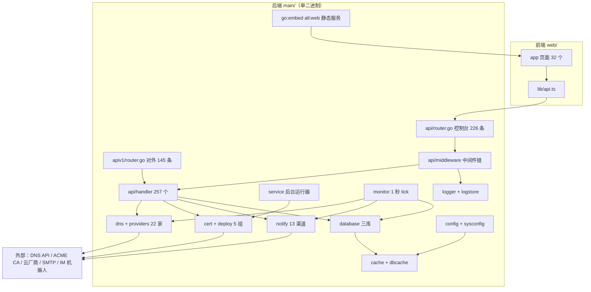
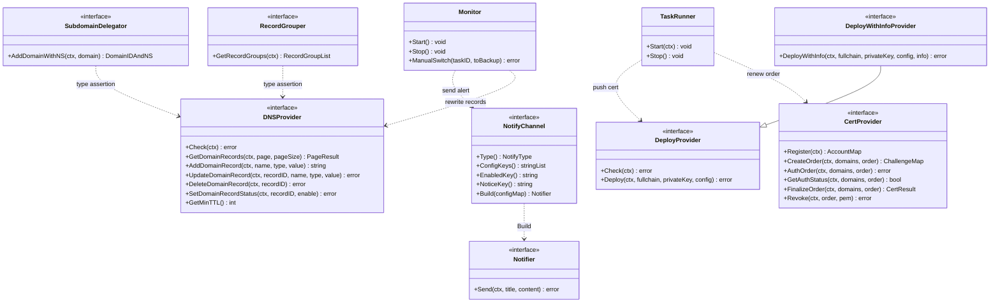
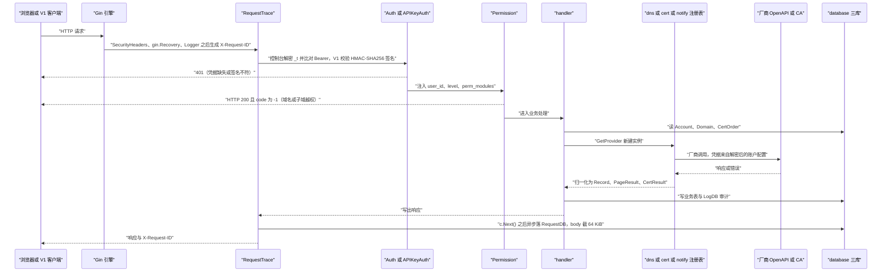
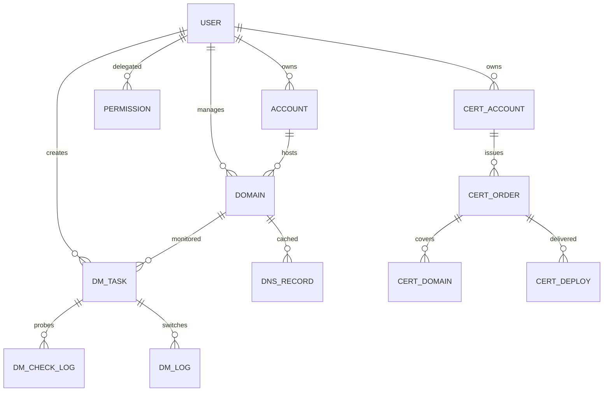
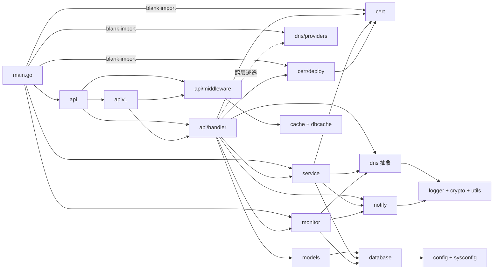
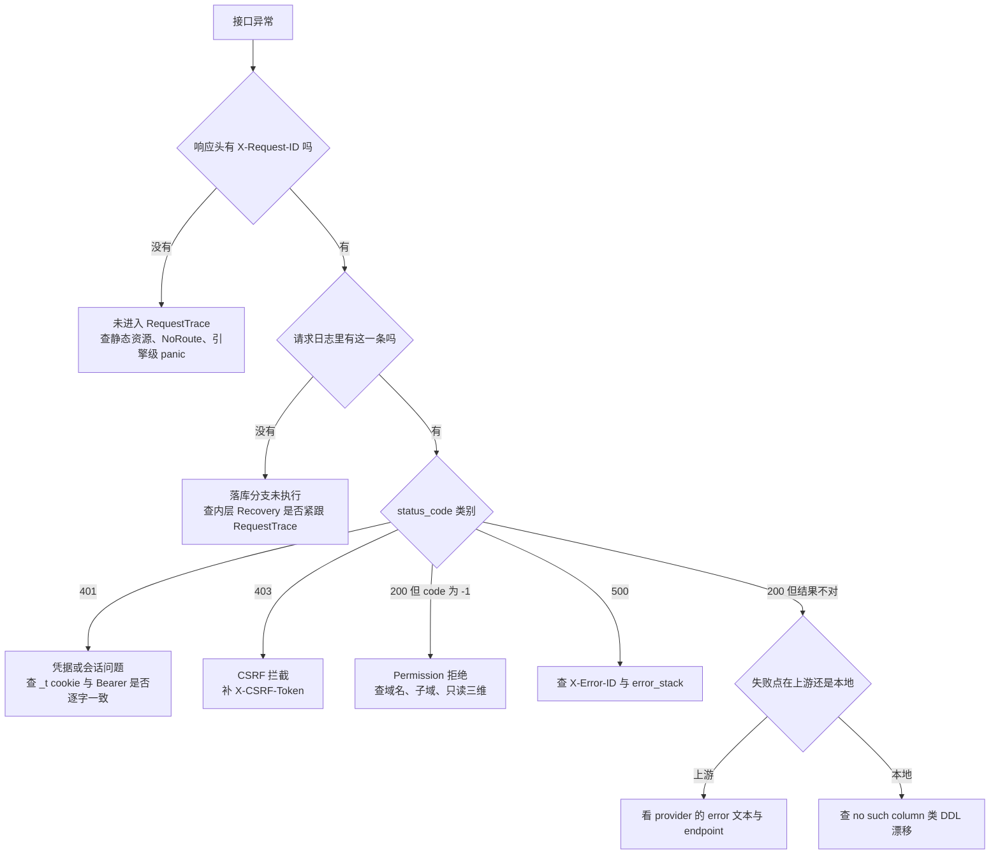

# 项目概述

<cite>
**本文档引用的文件**
- [README.md](file://README.md)
- [VERSION](file://VERSION)
- [Dockerfile](file://Dockerfile)
- [.gitignore](file://.gitignore)
- [main.go](file://main/main.go)
- [go.mod](file://main/go.mod)
- [config.go](file://main/internal/config/config.go)
- [database.go](file://main/internal/database/database.go)
- [models.go](file://main/internal/models/models.go)
- [hooks.go](file://main/internal/models/hooks.go)
- [router.go](file://main/internal/api/router.go)
- [auth.go (middleware)](file://main/internal/api/middleware/auth.go)
- [request_trace.go](file://main/internal/api/middleware/request_trace.go)
- [audit.go](file://main/internal/api/middleware/audit.go)
- [router.go (apiv1)](file://main/internal/apiv1/router.go)
- [interface.go (DNS)](file://main/internal/dns/interface.go)
- [registry.go (DNS)](file://main/internal/dns/registry.go)
- [interface.go (cert)](file://main/internal/cert/interface.go)
- [registry.go (cert)](file://main/internal/cert/registry.go)
- [base.go](file://main/internal/cert/deploy/base/base.go)
- [notify.go](file://main/internal/notify/notify.go)
- [channel_registry.go](file://main/internal/notify/channel_registry.go)
- [channel_adapters.go](file://main/internal/notify/channel_adapters.go)
- [monitor.go](file://main/internal/monitor/monitor.go)
- [task_runner.go](file://main/internal/service/task_runner.go)
- [cert_renew_hook.go](file://main/internal/service/cert_renew_hook.go)
- [cache.go](file://main/internal/cache/cache.go)
- [dbcache.go](file://main/internal/dbcache/dbcache.go)
- [sysconfig.go](file://main/internal/sysconfig/sysconfig.go)
- [proxy.go](file://main/internal/httpx/proxy.go)
- [logger.go](file://main/internal/logger/logger.go)
- [package.json](file://web/package.json)
- [next.config.ts](file://web/next.config.ts)
- [build.yml](file://.github/workflows/build.yml)
- [build.sh](file://scripts/build.sh)
</cite>

## 目录

1. [简介](#简介)
2. [项目结构](#项目结构)
3. [核心组件](#核心组件)
4. [架构总览](#架构总览)
5. [详细组件分析](#详细组件分析)
6. [依赖关系分析](#依赖关系分析)
7. [性能考虑](#性能考虑)
8. [故障排查指南](#故障排查指南)
9. [结论](#结论)
10. [附录](#附录)

## 简介

DNSPlane 是一个**单二进制交付**的 DNS 运维平台，把三件事收在同一套进程里：

- **多厂商 DNS 统一管理**：以一套 15 方法的 `dns.Provider` 接口屏蔽 22 家服务商差异，域名与解析记录的读、写、启停、批量操作走同一抽象。
- **证书自动化**：ACME v2 客户端与云厂商证书渠道双轨签发，签发结果按 `issue_time` 变化自动推送到部署器实现（CDN、面板、服务器）。
- **容灾监控与切换**：1 秒 tick 的常驻调度器按 ping/tcp/http/https 探测主源，连续失败达阈值后改写云端解析记录，主源恢复后自动回切。

配套能力为多用户权限体系与基于 shadcn/ui 的响应式控制台，另对外提供 API Key 鉴权的 `/api/v1` 开放接口。面向的使用者是同时管理多家 DNS 服务商、需要周期性续签并下发证书、且希望解析记录随源站健康状态自动切换的运维与平台团队。

| 维度 | 口径 | 证据 |
| --- | --- | --- |
| 版本 | `1.0.11`；`git tag` 最新为 `v1.0.3`，落后于 `VERSION` | `VERSION` 全文单行、`git tag` 实测 |
| 许可证 | README 声明 MIT；仓库内**未检索到** `LICENSE` 文件 | `README.md:167-169`、`git ls-files` 无命中 |
| Go 语言版本 | `1.26.2` | `main/go.mod:3` |
| 后端规模 | 321 个 `.go`、88829 行；非测试 242 文件、71937 行；测试 79 文件 | 本次实测 `find` 加 `wc -l` |
| 前端规模 | `app` 加 `components` 加 `lib` 加 `contexts` 共 115 个源文件、32043 行 | 本次实测 `find` 加 `wc -l` |
| 一级后端包 | 22 个（`main/internal/*`） | 目录枚举 |
| 路由总量 | 控制台 226 条（`router.go` 内 223 条加引擎级 3 条）、对外 145 条全 POST | `api/router.go` 与 `apiv1/*.go` 实测计数 |
| 交付形态 | 前端静态导出产物经 `go:embed all:web` 编入后端 | `main/main.go:63-64` |

**章节来源**
- [VERSION](file://VERSION)
- [README.md:3-11](file://README.md#L3-L11)
- [README.md:167-169](file://README.md#L167-L169)
- [main/main.go:63-64](file://main/main.go#L63-L64)

## 项目结构

### 目录树

```text
dns/
├── main/                       Go 后端（module 名 main）
│   ├── main.go                 装配 + embed 前端 + 优雅关闭
│   ├── go.mod / config.json    依赖清单与本地配置（后者被 .gitignore 忽略）
│   ├── internal/
│   │   ├── api/{router.go, handler/, middleware/}   控制台 HTTP 层
│   │   ├── apiv1/              对外 /api/v1 独立链（145 条 POST）
│   │   ├── cache/ dbcache/     Redis 或内存缓存 + 读穿缓存
│   │   ├── captcha/ verify/    行为验证码、邮箱验证码
│   │   ├── cert/{acme,aliyun,tencent,huoshan,ucloud,deploy/{base,providers,servers,panels,others}}
│   │   ├── config/ sysconfig/  文件配置 + 数据库键值配置
│   │   ├── crypto/ database/   字段级加解密 + 三库连接、AutoMigrate、维护协程
│   │   ├── dns/{providers(22 家), doh}
│   │   ├── httpx/ logger/ logstore/   代理接入 + 文件与请求日志
│   │   ├── models/ monitor/ notify/   31 实体 + 容灾调度 + 13 渠道
│   │   ├── oauth/ service/ utils/ whois/
│   ├── web/                    前端产物落位（go:embed 目标，不进 git）
│   └── data/ logs/             运行期 SQLite 与日志（不进 git）
├── web/                        Next.js 前端
│   ├── app/{(auth), (dashboard)/dashboard}
│   ├── components/{auth, deploy, ui}
│   ├── lib/ contexts/ public/ scripts/sync-main-web.cjs
├── scripts/{build.sh, docker-build.sh}
├── .github/workflows/build.yml 唯一在用的 CI
├── docs/  Dockerfile  VERSION
```

`.gitignore` 排除 `main/config.json`、`main/data/`、`main/logs/`、`main/web/`、`main/main`，即配置密钥、运行期数据、嵌入产物与陈旧二进制都不进版本库。

**章节来源**
- [.gitignore:25-34](file://.gitignore#L25-L34)
- [main/main.go:26-64](file://main/main.go#L26-L64)

### 模块职责表与技术栈矩阵

| 路径 | 职责 | 主要语言 | 文件数 | 代表文件 | 对外暴露 |
| --- | --- | --- | --- | --- | --- |
| `main/main.go` | 装配配置、库、缓存、后台协程、HTTP | Go | 1 | `main.go`（156 行） | `main()` |
| `internal/api` | 控制台路由与静态资源服务 | Go | 1 | `router.go`（464 行） | `SetupRouter` |
| `internal/api/handler` | 业务请求处理 | Go | 32 | `cloudflare.go`（2509 行） | 257 个 gin handler |
| `internal/api/middleware` | 认证、权限、追踪、审计、CSRF | Go | 10 | `auth.go` | `Auth`、`Permission`、`RequestTrace` |
| `internal/apiv1` | 对外链与响应契约改写 | Go | 14 | `router.go`（47 行） | `Setup`、`APIKeyAuth`、`AdaptResponse` |
| `internal/dns` 与 `providers` | DNS 抽象、注册表、22 家适配 | Go | 29 | `interface.go`（167 行） | `Provider`、`Register`、`GetProvider` |
| `internal/cert` 与 `deploy` | 签发双视图与部署器实现 | Go | 85 | `providers.go`（623 行）、`base/base.go` | `cert.Provider`、`base.DeployProvider` |
| `internal/monitor` | 容灾调度、探测、切换、SSRF 拦截 | Go | 6 | `monitor.go`（1049 行） | `Service`、`New`、`Start`、`Stop` |
| `internal/notify` | 13 个渠道与注册表 | Go | 19 | `notify.go`（914 行） | `Notifier`、`Channel`、`Channels()` |
| `internal/service` | 续期与部署运行器、记录同步、CF 增强 | Go | 10 | `task_runner.go`（1015 行） | `NewTaskRunner`、钩子注入 |
| `internal/database` 与 `models` | 三库连接、迁移、实体与加密钩子 | Go | 7 | `database.go`（496 行）、`models.go` | `DB`、`LogDB`、`RequestDB`、实体 |
| `web/` | 控制台界面与静态导出 | TypeScript | 115 | `lib/api.ts` | `/login`、`/dashboard/*` |

| 层 | 组件 | 版本 | 用途 | 证据 |
| --- | --- | --- | --- | --- |
| 后端栈 | Go | 1.26.2 | 语言与工具链 | `main/go.mod:3` |
| 后端栈 | Gin | v1.12.0 | HTTP 路由与中间件 | `main/go.mod:8` |
| 后端栈 | GORM | v1.31.2 | ORM 与 AutoMigrate | `main/go.mod:27` |
| 后端栈 | glebarez/sqlite | v1.11.0 | 纯 Go SQLite 驱动，免 CGO | `main/go.mod:9` |
| 后端栈 | gorm.io/driver/mysql | v1.6.0 | 可选 MySQL，仅覆盖主库 | `main/go.mod:26` |
| 后端栈 | go-redis/v9 | v9.23.0 | 可选 Redis 缓存 | `main/go.mod:16` |
| 后端栈 | golang-jwt/v5 | v5.3.1 | JWT 双令牌 | `main/go.mod:10` |
| 前端栈 | Next.js | 16.2.4 | App Router，静态导出 | `web/package.json:34` |
| 前端栈 | React | 19.2.4 | 视图层 | `web/package.json:38` |
| 前端栈 | Tailwind CSS 与 Radix UI | ^4 与 ^1.4.3 | 样式方案与无样式组件基座（shadcn） | `web/package.json:37,50` |
| 部署栈 | Dockerfile | 三阶段 | `node:22` → `golang:1.26.2` → `distroless/static` | `Dockerfile:4,12,32` |
| 部署栈 | GitHub Actions | build.yml | 4 个 job，12 平台二进制与多架构镜像 | `.github/workflows/build.yml` |
| 部署栈 | distroless nonroot | static-debian12 | 运行期仅一个二进制，uid 65532 | `Dockerfile:32-37` |

**章节来源**
- [main/go.mod:5-28](file://main/go.mod#L5-L28)
- [web/package.json:12-53](file://web/package.json#L12-L53)
- [main/internal/dns/interface.go:41-86](file://main/internal/dns/interface.go#L41-L86)
- [Dockerfile:4-37](file://Dockerfile#L4-L37)

### 结构图



**图表来源**
- [main/main.go:26-64](file://main/main.go#L26-L64)
- [main/internal/api/router.go:18-65](file://main/internal/api/router.go#L18-L65)
- [main/internal/apiv1/router.go:24-47](file://main/internal/apiv1/router.go#L24-L47)

**章节来源**
- [main/internal/monitor/monitor.go:105-142](file://main/internal/monitor/monitor.go#L105-L142)
- [main/internal/service/task_runner.go:38-68](file://main/internal/service/task_runner.go#L38-L68)

## 核心组件

### 组件清单

| 组件 | 载体 | 装配位置 | 生命周期 | 关键约束 |
| --- | --- | --- | --- | --- |
| Gin HTTP 服务 | `api.SetupRouter` | `main.go:128` | 进程级，`Shutdown` 10 秒超时 | `RedirectTrailingSlash=false`，`/api/x/` 与 `/api/x` 不互认 |
| 中间件链 | `api/middleware` | `router.go:28-30`、`:45-52`、`:96`、`:104` | 每请求 | 内层 `Recovery` 必须紧跟 `RequestTrace`，否则请求日志全丢 |
| GORM 持久层 | `DB` / `LogDB` / `RequestDB` | `main.go:76` | 进程级，`defer Close` | 两个日志库硬编码 SQLite，不受 `database.driver` 影响 |
| DNS 抽象层 | `dns.Provider` 与 `dns.Register` | 各包 `init()`，`main.go:31-52` | 每请求新建实例 | 15 方法必须全实现；工厂无 error 通道，构造失败被吞进 `lastErr` |
| 证书 ACME 客户端 | `cert/acme` | `main.go:27` | 每订单新建 | 私钥本地生成，`FinalizeOrder` 前不出网 |
| 部署器注册表 | `deploy/base.Register`（第二套注册中心） | `main.go:55-58` | 每部署任务新建 | 与 `cert` 注册表完全独立，靠合并函数产出 API 视图 |
| 监控调度器 | `monitor.New()` 赋值全局 `Service` | `main.go:105-107` | 常驻协程，1 秒 tick | 单 tick 最多派发 100 任务，探测全局并发 64 |
| 通知渠道注册 | `notify.RegisterChannel` | `channel_adapters.go:330-343` | 装载期遍历新建 | 重复注册同一标识直接 `panic` |
| Next.js 静态资源 | `staticFS embed.FS` | `main.go:63-64` | 编译期冻结 | `main/web/` 缺失则 `go build` 直接失败 |

**章节来源**
- [main/main.go:66-156](file://main/main.go#L66-L156)
- [main/internal/api/router.go:24-53](file://main/internal/api/router.go#L24-L53)
- [main/internal/notify/channel_registry.go:56-67](file://main/internal/notify/channel_registry.go#L56-L67)

### 组件契约图



**图表来源**
- [main/internal/dns/interface.go:41-127](file://main/internal/dns/interface.go#L41-L127)
- [main/internal/cert/interface.go:52-79](file://main/internal/cert/interface.go#L52-L79)
- [main/internal/cert/deploy/base/base.go:44-74](file://main/internal/cert/deploy/base/base.go#L44-L74)
- [main/internal/notify/notify.go:39-41](file://main/internal/notify/notify.go#L39-L41)
- [main/internal/notify/channel_registry.go:20-33](file://main/internal/notify/channel_registry.go#L20-L33)

**章节来源**
- [main/internal/monitor/monitor.go:56-711](file://main/internal/monitor/monitor.go#L56-L711)
- [main/internal/service/task_runner.go:38-68](file://main/internal/service/task_runner.go#L38-L68)

## 架构总览

### 请求主链路时序



**图表来源**
- [main/internal/api/router.go:24-53](file://main/internal/api/router.go#L24-L53)
- [main/internal/apiv1/router.go:24-47](file://main/internal/apiv1/router.go#L24-L47)
- [main/internal/api/middleware/request_trace.go:30](file://main/internal/api/middleware/request_trace.go#L30)
- [main/internal/dns/registry.go:26-37](file://main/internal/dns/registry.go#L26-L37)

**章节来源**
- [main/internal/api/middleware/auth.go:125-229](file://main/internal/api/middleware/auth.go#L125-L229)

### 架构分层与系统上下文

| 层 | 组成 | 依赖方向 | 可替换点 | 证据 |
| --- | --- | --- | --- | --- |
| 表示层 | Next.js 静态导出产物 | 只依赖 `/api` 契约 | 整体可替换（embed 目录） | `main/main.go:63-64` |
| 接入层 | `api`、`apiv1`、`middleware` | 指向 handler | 两条链共用 handler，响应契约各自适配 | `router.go:63` |
| 业务层 | `handler`、`service`、`monitor` | 指向抽象层 | service 与 handler 用函数钩子解耦 | `cert_renew_hook.go:17` |
| 抽象层 | `dns`、`cert`、`deploy`、`notify` 四套注册表 | 指向外部 SDK | 各子包 `init()` 注册工厂 | `dns/registry.go:18` |
| 基础设施层 | `database`、`cache`、`logger`、`config`、`crypto` | 无向上依赖 | Redis 不可用降级内存缓存 | `cache/cache.go:69-79` |
| 数据层 | 31 个实体与加解密钩子 | 叶子包 | 钩子透明加解密 7 个模型 | `models/hooks.go:32-70` |

| 外部对象 | 协议 | 触发链路 | 凭据形态 | 失败影响 |
| --- | --- | --- | --- | --- |
| 22 家 DNS 服务商 | HTTPS，powerdns 与 qingcloud 有明文 HTTP 常量 | 记录读写、挑战写入、容灾切换 | AK/SK 或 Token，存 `accounts.config` 加密列 | 记录不可写，切换失败 |
| ACME CA（LE、ZeroSSL、Google、LiteSSL、自定义） | HTTPS ACME v2 | 签发与续期 | 账户私钥本地生成，可选 EAB | 签发失败，进入重试计数 |
| 云厂商证书（CAS、SSL、火山、UCloud） | HTTPS RPC | 申领与下载 | AK/SK，存 `cert_accounts.config` 加密列 | 申领失败 |
| Redis | RESP | 缓存、请求日志、会话 | `{占位}` | Ping 3 秒超时回退内存缓存 |
| MySQL | TCP | 仅主库可选替代 SQLite | `{占位}` | 启动即 `os.Exit(1)` |
| 13 个通知渠道 | HTTPS 或 SMTP | 告警、证书结果、验证码邮件 | token 与口令，均为 `{占位}` | 仅丢通知 |
| 5 家 OAuth | HTTPS OAuth2 | 第三方登录 | client id 与 secret 存 `sys_configs` | 该来源不可用 |
| WHOIS | TCP 43 | 到期检测 | 无需凭据 | 到期信息缺失 |

**章节来源**
- [main/internal/cache/cache.go:52-83](file://main/internal/cache/cache.go#L52-L83)
- [main/internal/database/database.go:81-102](file://main/internal/database/database.go#L81-L102)
- [main/internal/notify/channel_registry.go:47-49](file://main/internal/notify/channel_registry.go#L47-L49)

## 详细组件分析

### DNS 抽象层与服务商适配

`dns.Provider` 是单一大接口，15 个方法全部为编译期强制（`interface.go:41-86`）。分组、别名、子域委派三项能力通过可选接口暴露（`:102`、`:109`、`:123`），消费方用类型断言取用，因此新增一家厂商必须实现全部 15 个方法，不支持项以返回 error 的桩实现落地。

注册与取用集中在 `registry.go`：`Register` 写 `providers` 与 `configs` 两张 map（`:18-23`，`sync.RWMutex` 保护），`GetProvider` 每次调用都新建实例（`:26-37`）。线路编码由 `DefaultLineMapping` 提供 21 家条目（`:58-80`），缺条目时回退字面量 `default`（`:82-89`）。对证书链路最关键的是 `EnsureChallengeRecord`，ACME 的 TXT 与 CNAME 写入靠它做幂等。

实体之间**没有任何外键声明**，关联完整性完全由业务层维护：



**图表来源**
- [main/internal/models/models.go:10-347](file://main/internal/models/models.go#L10-L347)

**章节来源**
- [main/internal/dns/interface.go:41-127](file://main/internal/dns/interface.go#L41-L127)
- [main/internal/dns/registry.go:9-89](file://main/internal/dns/registry.go#L9-L89)
- [main/internal/models/models.go:10-347](file://main/internal/models/models.go#L10-L347)

### 证书签发与部署链

签发与部署共用同一张 `cert` 注册表，用 `IsDeploy` 位切成两个视图：`GetCertProviderConfigs()` 取非部署项（`registry.go:71-81`），`GetDeployProviderConfigs()` 取部署项（`:95-105`）。`Register` 的短路条件（`:27-33`）使子包 `init()` 可以「只补工厂、不覆盖表单」。

编排职责在 handler，执行职责在 provider：

| 阶段 | 责任方 | 关键动作 |
| --- | --- | --- |
| 建单 | handler | 配额校验、账户归属校验，写 `CertOrder` 与 `CertDomain` |
| 创建订单 | provider | `newOrder` 与 authorizations，按 `PreferredChallenge` 选 dns-01 或 http-01 |
| 写挑战 | handler 加 dns 抽象 | `_acme-challenge` TXT 经 `EnsureChallengeRecord` 幂等写入云端 |
| 预检 | handler | 生效后用公共 DNS 逐轮校验 TXT 可见 |
| 验证 | provider | `AuthOrder` 提交挑战，`GetAuthStatus` 多轮轮询 |
| 签发 | provider | 本地生成密钥与 CSR，`FinalizeOrder` 换证书链 |
| 落库与通知 | handler 加 service | 置成功状态，触发签发结果钩子 |
| 部署 | `TaskRunner` | 检测 `issue_time` 变化后下全部部署任务 |

部署侧是**第二套独立注册中心**：`deploy/base.Register` 收录实现（`base.go:85-89`），与 `cert` 表的部署视图通过 `MergeDeployProviderConfigsForAPI` 合并成 API 视图，仅 `ssh`、`ftp`、`local` 白名单允许覆盖。解析链做四级名称回落：原名 → 任务配置的 `{type}_{product}` → 账户配置的 `{type}_{product}` → `{type}_{cdn|acm|cloudfront}`。三套编号口径（签发视图、表单条目、实现条目）互不相等，属已知设计债。

**章节来源**
- [main/internal/cert/registry.go:22-105](file://main/internal/cert/registry.go#L22-L105)
- [main/internal/cert/deploy/base/base.go:84-117](file://main/internal/cert/deploy/base/base.go#L84-L117)
- [main/internal/service/task_runner.go:217](file://main/internal/service/task_runner.go#L217)
- [main/internal/service/cert_renew_hook.go:17-46](file://main/internal/service/cert_renew_hook.go#L17-L46)

### 容灾监控与自动切换

`monitor.New()` 在 `main.go:105` 赋值到全局 `Service` 并立即 `Start()`。主循环是 1 秒 ticker（`monitor.go:107-127`），`dispatchTasks` 以 `active` 为 1 且 `check_next_time` 到期为唯一调度条件，按该列升序取 `maxDispatchPerTick = 100` 条（`:24`、`:144-179`），用 `processing.LoadOrStore` 去重，到期时间顺延一个 `frequency`。探测并发受信号量 `maxConcurrentChecks = 64` 限制（`:29`），等待期间 ctx 超时即判失败。

决策链：主源健康则 `err_count` 清零，若已切换且开 `auto_restore` 则回切；主源异常则 `err_count` 加一，达 `cycle` 且未切换才 `smartSwitch`（`:411`）。切换按 `DMTask.Type` 分派：0 暂停原记录、1 删除并留存原值、2 直接切备用值。`ManualSwitch`（`:711`）走同一套逻辑。状态最终由一条合并 UPDATE 写回（`:334`），该调用未处理返回错误。

| 探测类型 | 入口 | 成功判据 | 私网拦截 | 备注 |
| --- | --- | --- | --- | --- |
| 0 ping | ICMP Echo | ID 与 Seq 匹配的应答 | 无 | 非 Windows 走占位实现，可降级 TCP 80 |
| 1 tcp | `CheckTCP` | 三次握手建立 | 无 | `tcp_port` 为 0 时回退 80 |
| 2 http | `CheckHTTP` | 状态码符合且正文含关键词 | 有 | 正文只取前 8192 字节 |
| 3 https | `CheckHTTP` | 同上，另受 TLS 校验 | 有 | 可配 `allow_insecure_tls` |

SSRF 拦截（`ssrf.go`）只覆盖 HTTP 与 HTTPS，ping 与 TCP 无地址私网校验。平台能力表 `capabilities.go` 登记的厂商数少于 providers 实有数，且仅 `Pause` 字段被消费。

**章节来源**
- [main/internal/monitor/monitor.go:19-179](file://main/internal/monitor/monitor.go#L19-L179)
- [main/internal/monitor/monitor.go:334-411](file://main/internal/monitor/monitor.go#L334-L411)
- [main/main.go:105-107](file://main/main.go#L105-L107)

### 认证授权与会话链

五种认证方式共用一套 JWT 双令牌：口令、TOTP、magic link、OAuth、API Key。access 与 refresh token 分别 AES-GCM 加密后写入 cookie（`middleware/auth.go:296`，`EncryptForCookie` 见 `:45`、`DecryptCookie` 见 `:66`），校验时 cookie 解密结果必须与 `Authorization: Bearer` 逐字相等（`Auth()` 起于 `:125`）。每个用户同一时刻只保留一个有效 refresh JTI，重用检测失败即清空该用户全部 refresh。

权限模型三维度组合：`users.level` 角色（0 自助注册、1 第三方创建、2 及以上管理员）、`users.permissions` JSON 模块点、`permissions` 表的域名加子域加只读委派（`models.go:10`、`:105`）。控制台链的 `Permission`（`router.go:104`）写入 `perm_read_only` 与 `perm_sub_domain` 上下文供下游拦截。

对外链用 HMAC-SHA256 替代 cookie，`APIKeyAuth` 挂在组级（`apiv1/router.go:30`），签名即身份与完整性凭据，因此该链刻意不继承 CSRF，理由写在 `apiv1/router.go:11-23` 注释块。字段级加密由 `crypto` 提供 AES-256-GCM，密钥从 `security.master_key` 派生；配置写入权限固定 `0600`、目录 `0700`（`config.go:156-170`）。

**章节来源**
- [main/internal/api/router.go:95-104](file://main/internal/api/router.go#L95-L104)
- [main/internal/api/middleware/auth.go:45-66](file://main/internal/api/middleware/auth.go#L45-L66)
- [main/internal/apiv1/router.go:9-34](file://main/internal/apiv1/router.go#L9-L34)
- [main/internal/models/hooks.go:32-70](file://main/internal/models/hooks.go#L32-L70)

### 通知渠道注册与 API 双链

`notify` 是四套注册表中唯一装载方零硬编码的一套：`Channel` 接口把「标识、显示名、配置键、启用开关、容灾开关、构造方式」内聚（`channel_registry.go:20-33`），`init()` 一次注册 13 个渠道（`channel_adapters.go:330-343`），装载方遍历 `Channels()`；配置键由 `ChannelConfigKeys()` 推导（`:108`），`Channels()` 按标识稳定排序（`:81-83`），重复注册直接 panic（`:62-64`）。6 个 `notice_*` 开关不属于任何渠道，单独登记（`:47-49`）。

| 渠道 | 标识 | 启用键 | 传输 | 成功判据 |
| --- | --- | --- | --- | --- |
| 邮件 | `email` | `mail_enabled` | SMTP、Sendcloud 或阿里云 DirectMail | SMTP 事务无错误 |
| Telegram | `telegram` | `tgbot_enabled` | POST | HTTP 200 |
| Webhook 与自定义 Webhook | `webhook`、`custom_webhook` | 各自 enabled 键 | 用户指定方法 | HTTP 小于 400 |
| Discord、Bark | `discord`、`bark` | 各自 enabled 键 | POST embeds、GET 路径 | HTTP 小于 400 |
| 企微群机器人、钉钉、飞书 | `wechat`、`dingtalk`、`feishu` | 各自 enabled 键 | POST，可选 HMAC | 飞书额外要求业务码为 0 |
| 企微应用、公众号模板、WxPusher | `wxwork_app`、`wxtpl`、`wxpusher` | 见注册表 | POST | 业务码为 0 或 success 为真 |
| QQ 机器人 | `qqbot` | 无独立开关 | POST，两级 token 缓存 | 响应含 `id` 字段 |

同一批 handler 被两条链复用：控制台 226 条与对外 145 条全 POST。`apiv1` 挂在引擎根（`router.go:63` 早于 `:64` 建 `/api` 组），因此不继承 `/api` 组中间件；`AdaptResponse` 放在链末（`apiv1/router.go:34`）把控制台响应改写为对外契约，参数由 `paramAlias` 与 `paramBridge` 回填。`sysconfig` 是链上的横向依赖点：权限、配额、代理开关都读它，读值带 60 秒缓存（`sysconfig.go:17-26`），`ExplicitOn` 只认 `true`、`1`、`yes`、`on`（`:39-43`）。

**章节来源**
- [main/internal/notify/channel_registry.go:20-120](file://main/internal/notify/channel_registry.go#L20-L120)
- [main/internal/notify/channel_adapters.go:330-343](file://main/internal/notify/channel_adapters.go#L330-L343)
- [main/internal/apiv1/router.go:9-47](file://main/internal/apiv1/router.go#L9-L47)
- [main/internal/sysconfig/sysconfig.go:12-43](file://main/internal/sysconfig/sysconfig.go#L12-L43)

## 依赖关系分析

### 内部依赖图



**图表来源**
- [main/main.go:14-58](file://main/main.go#L14-L58)
- [main/internal/api/router.go:3-15](file://main/internal/api/router.go#L3-L15)
- [main/internal/api/handler/domain.go:14](file://main/internal/api/handler/domain.go#L14)
- [main/internal/monitor/monitor.go:7-12](file://main/internal/monitor/monitor.go#L7-L12)

**章节来源**
- [main/internal/apiv1/router.go:3-7](file://main/internal/apiv1/router.go#L3-L7)

### 依赖矩阵与外部服务依赖

图例：`✓` 合法依赖，`✗` 跨层或反向违规，`—` 自身，空为无依赖。各行出边由当期工作区 `import` 语句实测。

| 调用方 \ 被调方 | api | apiv1 | handler | middleware | dns | providers | cert | deploy | notify | monitor | service | models | database | cache |
| --- | --- | --- | --- | --- | --- | --- | --- | --- | --- | --- | --- | --- | --- | --- |
| main | ✓ | | | | | ✓ | ✓ | ✓ | | ✓ | ✓ | | ✓ | ✓ |
| api | — | ✓ | ✓ | ✓ | | | | | | | | | | |
| apiv1 | | — | ✓ | ✓ | ✓ | | | | | | ✓ | ✓ | ✓ | ✓ |
| handler | | | — | ✓ | ✓ | ✗ | ✓ | ✓ | ✓ | ✓ | ✓ | ✓ | ✓ | ✓ |
| middleware | | | | — | | | | | | | | ✓ | ✓ | ✓ |
| monitor | | | | | ✓ | | | | ✓ | — | | ✓ | ✓ | |
| service | | | ✗ | | ✓ | | ✓ | ✓ | ✓ | ✓ | — | ✓ | ✓ | ✓ |
| models | | | | | | | | | | | | — | | |
| database | | | | | | | | | | | | ✓ | — | |

三处需要说明的边：

- `handler → providers/dnspod`：`handler/domain.go:14` 直接 import 具体厂商包并配合类型断言，把抽象层消费者与具体实现绑死，新增一家支持子域委派的厂商必须改 handler，违反依赖倒置。
- `service → handler`：包级 import 不存在，但 `main.go:108` 把 `handler.TriggerCertOrderProcessing` 注入 `service.SetCertRenewProcessStarter`，运行期形成反向调用。用函数钩子承接避免了编译循环，代价是这条链在包图上不可见。
- `deploy → cert`：部署器基类为取 `Logger` 类型别名依赖 `cert`（`base.go:11`、`:42`），留下一条非必要的编译期依赖。

| 依赖 | 域名或地址 | 协议 | 接入方式 | 失败降级 |
| --- | --- | --- | --- | --- |
| 阿里云与腾讯云 DNS | `alidns.aliyuncs.com`、`dnspod.tencentcloudapi.com` | HTTPS | 官方 SDK | 返回 error，无重试 |
| 华为云与其余 19 家 DNS 厂商 | 各家 OpenAPI | HTTPS，powerdns 与 qingcloud 有明文常量 | 官方 SDK 或自实现签名 HTTP | 返回 error，无统一重试 |
| Let's Encrypt | `acme-v02.api.letsencrypt.org` | ACME v2 | `cert/acme` 自实现 JWS | 429 与 503 退避重试 |
| 云厂商证书服务 | CAS、SSL、火山 endpoint | HTTPS RPC | 各子包自实现签名 | 返回 error |
| Redis 与 MySQL | `redis.addr`、`database.host:port` | RESP、TCP | 连接池 | Redis 回退内存，MySQL 启动退出 |
| SMTP 与 IM 机器人 | 由渠道配置键决定 | HTTPS 或 SMTP | `net/http`、`net/smtp` | 仅记录通知失败 |

**章节来源**
- [main/internal/api/handler/domain.go:14](file://main/internal/api/handler/domain.go#L14)
- [main/main.go:108-110](file://main/main.go#L108-L110)
- [main/internal/cert/deploy/base/base.go:11-42](file://main/internal/cert/deploy/base/base.go#L11-L42)
- [main/go.mod:5-28](file://main/go.mod#L5-L28)

## 性能考虑

| 手段 | 实现 | 参数 | 证据 |
| --- | --- | --- | --- |
| SQLite PRAGMA 进 DSN | 每条新连接重放 PRAGMA | WAL、`synchronous NORMAL`、`busy_timeout 5000`、`cache_size -16000`、`mmap_size 64 MiB` | `database/database.go:39-46` |
| 分驱动连接池 | SQLite 串行写因此收窄池 | SQLite 为 8、4、5 分钟、Lifetime 0；MySQL 为 100、25、5 分钟、1 小时 | `database/database.go:48-69` |
| 关闭默认事务 | 单条写不隐式包事务，减少 WAL fsync | `SkipDefaultTransaction: true` | `database/database.go:74-79` |
| 三库分离 | 高频低价值日志不挤占业务写通道 | `DB`、`LogDB`、`RequestDB` | `database/database.go:21-25` |
| 读穿缓存与配置缓存 | 热点列表命中即跳过 SQL；`sys_configs` 读值同样缓存 | 默认 TTL 均 60 秒，前缀 `syscfg:`，`cache.C` 为 nil 时直接 load | `dbcache/dbcache.go:12-44`、`sysconfig/sysconfig.go:12-26` |
| 库维护后台 | checkpoint、索引、按保留期清理 | 独立协程 | `main.go:121-122` |

日志侧全部走异步：`RequestTrace` 在 `c.Next()` 返回后用独立 goroutine 落库（`request_trace.go:296`），审计由 `utils.SafeGo` 包裹（`audit.go:73-88`），文件日志按大小与日期两个 ticker 轮转，单文件上限 10 MiB、保留 30 份（`logger.go:17-18`、`:133-156`）。GORM 日志级别 `Silent`，SQL 改由回调采集进 `db_queries`。两处语义偏差需留意：请求体采集上限 64 KiB（`request_trace.go:30`）会截断真实请求体而不只影响日志文本；`logstore` 在 Redis 下每 64 次写入才裁剪列表。

Cloudflare 是唯一双轨厂商：记录读写经 `dns.Provider`，增强能力绕过 registry 直连 `service.EnhanceService`，因此写 DNS 有两条通道而本地副本回填只覆盖第一条。缓解措施是读接口走 `cache.C` 短 TTL 并以 `cf:` 为前缀、写接口按前缀失效、增强 API 统一自动翻页；代价是 `handler/cloudflare.go` 达 2509 行。

前端为纯静态导出（`output: 'export'`、`trailingSlash: true`、`images.unoptimized`，`next.config.ts:4-8`），零 Node 运行时、镜像极小；`typescript.ignoreBuildErrors` 已移除（`:9-13`），类型错误中断构建，这是 CI 上唯一真实的质量门禁。约束是任何服务端渲染能力都无法引入。

**章节来源**
- [main/internal/database/database.go:34-79](file://main/internal/database/database.go#L34-L79)
- [main/internal/dbcache/dbcache.go:11-44](file://main/internal/dbcache/dbcache.go#L11-L44)
- [main/internal/api/middleware/request_trace.go:30-296](file://main/internal/api/middleware/request_trace.go#L30-L296)
- [main/internal/logger/logger.go:133-156](file://main/internal/logger/logger.go#L133-L156)
- [web/next.config.ts:3-14](file://web/next.config.ts#L3-L14)

## 故障排查指南

| 症状 | 原因 | 排查 | 方案 |
| --- | --- | --- | --- |
| 干净仓库 `go build` 报 `pattern all:web: no matching files` | `main/web/` 是 embed 目标且被 git 忽略 | `ls main/web`，核对 `.gitignore:33` | 先 `npm run build:ci`，或 `SKIP_FRONTEND=1 scripts/build.sh` |
| 容器启动即退出，日志为创建目录失败 | distroless 以 `nonroot` 运行且 `/app` 属 root，默认写相对 `data/`、`logs/` | 检查可写卷与 `-config` 路径 | 挂可写目录，或把 `database.file_path` 指到挂载点 |
| 前端正常但写请求全 403 | CSRF double-submit 未带 `X-CSRF-Token` | 看响应 `msg`（`router.go:50`） | 先 `GET /api/csrf` 取 token 再随写请求带头 |
| 浏览器直连 `/api/v1` 不可用 | CORS 未命中白名单且预检路由未注册 | 检查有无 `Access-Control-Allow-Origin` | 由服务端代理，或补 CORS 与预检 |
| 监控任务不切换也不告警 | 新库缺运行期仍在读写的列，合并 UPDATE 报错被丢弃 | sqlite3 比对 `dm_tasks` DDL 与 `models.go:134-176` | 补齐列，或修正 `monitor.go:334` 的字段集合 |
| 切换后云端记录没变 | 域名或账户反查失败，或厂商不支持暂停 | 查 `dm_logs.action` 与 `dm_check_logs.error` | 把 `DMTask.Type` 改为删除重建或切备用值 |
| 证书签发反复停在同一状态 | ACME 账户密钥未持久化，每轮重新注册触发限流 | 查 `cert_logs` 与 429、`Retry-After` | 持久化账户密钥后续期 |
| 请求日志出现证书私钥 | 响应体被完整记入 `request_logs.response` | 按 `request_id` 检索 | 清理该表并补私钥脱敏规则 |
| Redis 连不上但系统可用 | Ping 3 秒超时自动回退内存缓存 | 启动日志出现 `使用内存缓存` | 修正 `redis.addr`，注意多实例缓存不再共享 |
| 任务量大时监控延迟 | 单 tick 派发 100、探测并发 64 | 观察 `check_next_time` 落后程度 | 增大 `frequency`、拆分实例或上调常量 |
| 账户更新或删除 404 | README 记载 `PUT` 与 `DELETE`，实际为 `POST /:id` 与 `POST /:id/delete` | 对照 `router.go:113-117` | 以代码为准调用 POST |

定位请求级问题时，先用 `X-Request-ID` 或 `X-Error-ID` 在请求日志中检索，再顺着 `db_queries` 判断失败在 SQL 侧还是上游 API 侧。



**图表来源**
- [main/internal/api/router.go:34-53](file://main/internal/api/router.go#L34-L53)
- [main/internal/api/middleware/auth.go:125](file://main/internal/api/middleware/auth.go#L125)
- [main/internal/monitor/monitor.go:334](file://main/internal/monitor/monitor.go#L334)

**章节来源**
- [main/internal/api/router.go:34-53](file://main/internal/api/router.go#L34-L53)
- [main/internal/api/router.go:113-117](file://main/internal/api/router.go#L113-L117)
- [main/internal/cache/cache.go:69-83](file://main/internal/cache/cache.go#L69-L83)
- [main/internal/monitor/monitor.go:144-179](file://main/internal/monitor/monitor.go#L144-L179)

## 结论

### 优势与局限

优势：一套 `dns.Provider` 抽象覆盖 22 家厂商，使控制台操作与厂商解耦；`notify` 的 `Channel` 注册表是开闭原则的干净实现，渠道与配置键全部由注册表推导、装载方零硬编码、重复注册即 panic；单二进制加 distroless 使交付只需一个文件与一个可写目录；`X-Request-ID`、`X-Error-ID`、`db_queries`、`logs.db` 四件套可把一次请求的 SQL 与堆栈串起来；Redis、MySQL、密钥生成三条路径都有明确降级或兜底。

局限集中在六处：

- **持久化契约与模型脱钩**：`AutoMigrate` 新库缺少 `DMTask` 运行期仍读写的列，新装实例 `err_count` 恒 0，永不切换、告警、回切。
- **证书链密钥治理缺口**：ACME 账户密钥未持久化触发 CA 限流；PEM 下载把私钥明文写入请求日志。
- **注册表口径分裂**：`cert` 表混装真实工厂与表单占位工厂，`deploy` 三套编号口径并存，靠白名单与后缀猜测对齐。
- **`cert/ucloud` 未编入二进制**：`main.go:27-30` 缺该行 blank import，该包 `init()` 永不执行。
- **对外 API 缺硬约束**：145 条端点无入口限流，签名未绑定请求体。
- **巨型文件与零测试**：`handler/cloudflare.go` 2509 行等多处远超单文件 500 行约束，`cert/deploy` 共 18998 行无测试文件；`build.yml` 全程无 `go test`、`npm test`、lint 步骤，79 个测试文件未被流水线利用。

另有既存文档偏差：README 的账户接口方法与路由不符（`README.md:134-135` 对比 `router.go:113-117`），并把已实现的华为云、百度云、火山引擎标为「待实现」（`README.md:103-105`）。

**章节来源**
- [main/main.go:26-30](file://main/main.go#L26-L30)
- [main/internal/notify/channel_registry.go:20-33](file://main/internal/notify/channel_registry.go#L20-L33)
- [README.md:103-135](file://README.md#L103-L135)
- [.github/workflows/build.yml](file://.github/workflows/build.yml)

### 后续方向

按收益排序，均可在不新增功能的前提下验证：

1. 修复 `DMTask` 列漂移，补一条 `AutoMigrate` 结果与结构体字段一致性测试。
2. 持久化 ACME 账户密钥，把私钥字段加入请求日志脱敏清单。
3. 补齐 `main.go` 的 `cert/ucloud` blank import，或删除该包及其前端陈旧条目。
4. 把 `deploy` 三套口径收敛为单一注册表，取消后缀猜测对齐。
5. 把 `handler` 对 `providers/dnspod` 的直连改为 `SubdomainDelegator` 能力探测。
6. 在 CI 增加 `go build ./...`、`go vet ./...`、`go test ./...` 与前端 lint 四步门禁。

**章节来源**
- [本节为总结，无需特定文件来源]

## 附录

### 命令速查

| 目的 | 命令 | 说明 |
| --- | --- | --- |
| 后端依赖安装 | `cd main && go mod tidy` | module 名为 `main` |
| 前端依赖安装 | `cd web && npm ci` | 与 CI 一致，`bun install` 亦可 |
| 前端构建并同步 | `cd web && npm run build:ci` | `next build --webpack` 加同步脚本 |
| 本机后端编译 | `cd main && go build -o dnsplane .` | 需 `main/web/` 已存在 |
| 多架构出包 | `scripts/build.sh amd64 arm64` | `SKIP_FRONTEND=1` 可跳过前端 |
| 运行 | `./dnsplane -config config.json` | 默认 `config.json`，监听 8080 |
| 开发模式 | `cd web && npm run dev` | Turbopack，需后端已启动 |
| 静态检查与单测 | `go vet ./...`、`go test ./internal/notify/...` | 通知域测试实测可运行 |
| 镜像构建 | `scripts/docker-build.sh --push v1.0.11` | buildx 多架构 |

**章节来源**
- [README.md:40-73](file://README.md#L40-L73)
- [scripts/build.sh](file://scripts/build.sh)
- [web/package.json:5-11](file://web/package.json#L5-L11)

### 环境变量与配置项

| 键 | 位置 | 默认 | 作用 |
| --- | --- | --- | --- |
| `DNSPLANE_JWT_SECRET` | `config/config.go:123` | 空 | 覆盖 JWT 签名密钥，容器场景优先 |
| `DNSPLANE_MASTER_KEY` | `config/config.go:126` | 空 | 覆盖字段加密主密钥 |
| `HTTP_PROXY` 与 `HTTPS_PROXY` | `httpx/proxy.go:44`、`:50` | 未设 | 系统配置未开启代理时的回退 |
| `server.port` 与 `server.host` | `config/config.go:89-90` | 8080、0.0.0.0 | 监听端口与地址 |
| `server.mode` | `config/config.go:91` | release | 为 release 时切 Gin 发布模式 |
| `database.driver` | `config/config.go:94` | sqlite | 仅主库可为 mysql |
| `database.file_path` | `config/config.go:95` | `data/dnsplane.db` | 两个日志库路径由同目录推导 |
| `redis.enable` | `main.go:84` | 关闭 | 关闭时全链路走内存缓存 |
| `security.master_key` | `config/config.go:26-28` | 空则随机生成并回写 | AES-256-GCM 派生源，值记为 `{占位}` |
| `jwt.secret` | `config/config.go:97-99` | 空或历史默认值则随机生成 | HS256 签名密钥，值记为 `{占位}` |

环境变量注入只覆盖上述密钥类与文件配置项，`GIN_MODE` 等标准环境变量一律无效。`config.json` 落盘权限 `0600`、目录 `0700`，并被 `.gitignore:28` 忽略。

**章节来源**
- [main/internal/config/config.go:14-129](file://main/internal/config/config.go#L14-L129)
- [main/internal/config/config.go:156-170](file://main/internal/config/config.go#L156-L170)
- [main/internal/httpx/proxy.go:41-70](file://main/internal/httpx/proxy.go#L41-L70)
- [.gitignore:28](file://.gitignore#L28)

### 常用文件路径

| 场景 | 路径 |
| --- | --- |
| 进程装配 | `main/main.go` |
| 控制台路由与中间件顺序 | `main/internal/api/router.go` |
| 对外路由与签名校验 | `main/internal/apiv1/router.go`、`apiv1/auth.go` |
| 数据库连接与迁移 | `main/internal/database/database.go` |
| 实体与加解密钩子 | `main/internal/models/models.go`、`models/hooks.go` |
| DNS 接口与注册表 | `main/internal/dns/interface.go`、`dns/registry.go` |
| 新增 DNS 厂商 | `main/internal/dns/providers/{新目录}/{名}.go` 加 `main.go` blank import |
| 证书签发渠道与部署器实现 | `main/internal/cert/providers.go`、`cert/acme/acme.go`、`cert/deploy/{providers,servers,panels,others}/` |
| 通知渠道与容灾调度 | `main/internal/notify/channel_adapters.go`、`channel_registry.go`、`monitor/{monitor,check,ssrf}.go` |
| 续期与部署编排 | `main/internal/service/task_runner.go` |
| 前端请求层与动态表单 | `web/lib/api.ts`、`web/components/account-form.tsx` |
| 构建与发布 | `Dockerfile`、`.github/workflows/build.yml`、`scripts/build.sh` |

**章节来源**
- [main/main.go:14-58](file://main/main.go#L14-L58)
- [Dockerfile:4-37](file://Dockerfile#L4-L37)
